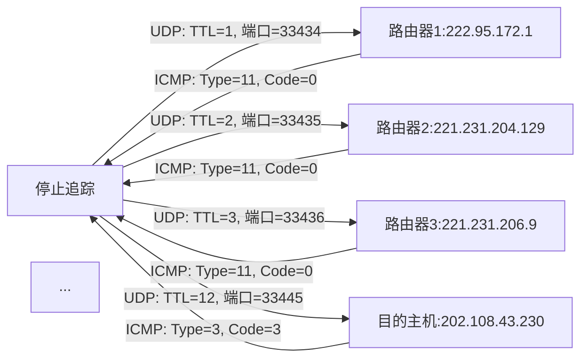
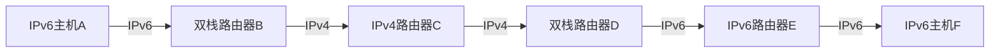

# 网络层（Chapter 5）

## 第5-1页：章节目标（Chapter goals）

### 核心目标梳理

本章需掌握网络层的核心原理与互联网中的实现，具体目标拆解如下：

1. **理解网络层服务原理**
   
   - 网络层服务模型：明确网络层为上层提供的“通道”服务类型（如是否保证带宽、无丢失等）。
   - 转发（Forwarding）与路由（Routing）的区别：前者是路由器内部“分组从输入到输出”的本地操作，后者是网络层面“确定分组路径”的全局计算。
   - 路由器工作机制：掌握路由器的内部结构（输入端口、交换结构、输出端口、路由处理器）及数据处理流程。
   - 路由（路径选择）：学习各类路由算法（如迪杰斯特拉、链路状态、距离向量）的逻辑与应用。
   - 应对规模问题：如何通过分层路由（如自治系统）解决互联网的大规模路由开销。

2. **掌握互联网中的实例与实现**
   
   - 网络层在互联网中的具体落地（如IP协议、路由协议BGP/OSPF/RIP等）。
     
     ## 第5-2页：章节结构（Chapter Outline）
     
     ### 全章内容框架
     
     本章按“基础→核心技术→互联网实现”的逻辑展开，各小节核心主题如下：
- **5.1 引言（Introduction）**：网络层的定位、核心功能（路由与转发）。

- **5.2 虚电路与数据报网络（Virtual Circuit & Datagram Networks）**：网络层的两种核心架构，对比其服务模型与实现差异。

- **5.3 路由器内部结构（What’s inside a router?）**：路由器的硬件组件、分组处理流程（输入端口、交换结构、输出端口）及队列问题。

- **5.4 路由算法（Routing Algorithms）**：
  
  - 迪杰斯特拉算法（Dijkstra’s algorithm）：单源最短路径的全局计算方法。
  - 广播路由（Broadcast routing）：扩散法、生成树广播等实现方式。
  - 链路状态路由（Link State）：全局拓扑已知，基于迪杰斯特拉的分布式实现。
  - 距离向量路由（Distance Vector）：基于邻居交互的分布式算法，需解决“计数到无穷”问题。
  - 分层路由（Hierarchical Routing）：基于自治系统（AS）的大规模路由解决方案。

- **5.5 互联网中的路由（Routing in the Internet）**：自治系统内（IGP：RIP/OSPF）与自治系统间（EGP：BGP）的路由协议。

- **5.6 IP协议（Internet Protocol）**：
  
  - IPv4数据报格式、地址结构、分片（Fragment）。
  
  - 网络地址转换（NAT）、地址解析协议（ARP）、互联网控制报文协议（ICMP）。
  
  - IPv6：地址结构、头部格式及IPv4到IPv6的过渡方案。
    
    ## 第5-3页：重点与难点（Keypoints and Difficulties）
    
    ### 一、重点内容（Keypoints）
1. **链路状态路由算法（Link State Routing）**
   
   - 核心逻辑：每个路由器向全网广播自身的“链路状态”（如链路成本、邻居），所有路由器获取全局拓扑后，用迪杰斯特拉算法计算最短路径。
   - 关键特点：收敛快、无路由环路，但需较大带宽传输链路状态信息。

2. **距离向量路由算法（Distance Vector Routing）**
   
   - 核心逻辑：每个路由器仅向邻居发送“到各目的节点的距离向量”，基于贝尔曼-福特方程迭代更新路径。
   - 关键特点：实现简单，但收敛慢，存在“计数到无穷”问题（需通过毒性逆转等机制解决）。

3. **IPv4协议**
   
   - 核心内容：数据报格式（头部字段含义）、地址分类（A/B/C类）、子网划分、分片机制。

4. **IPv6协议**
   
   - 核心改进：128位地址（解决IPv4地址耗尽）、简化头部（无校验和、固定40字节）、支持流标签与扩展头部。
     
     ### 二、难点内容（Difficulties）

5. **虚电路与数据报网络的区别**
   
   - 难点：两者在“连接状态维护”“分组转发依据”“服务模型”的差异（如虚电路需建立连接、维护VC表，数据报无连接、按目的地址转发）。

6. **子网与子网划分（Subnet & Subnet Division）**
   
   - 难点：基于子网掩码的地址分段（网络位、子网位、主机位）、CIDR（无类域间路由）的前缀表示法、地址块计算（如/24划分为/27）。

7. **IP分片（IP Fragment）**
   
   - 难点：根据MTU（最大传输单元）拆分大IP数据报的过程、分片标识（ID）、标志（Flags）、偏移量（Fragment Offset）的计算，以及仅在目的主机重组的机制。
     
     ## 第5-4页：网络层基本定位（Network Layer）
     
     ### 一、核心功能
     
     网络层的核心任务是**将分组从发送方主机传输到接收方主机**，具体实现依赖：

8. **协议部署**：所有主机和路由器中均运行网络层协议（如IP）。

9. **路由器核心操作**：路由器会检查所有经过它的IP数据报的头部字段（如目的IP地址），以决定转发方向。
   
   ### 二、协议栈层级关系
   
   下图展示网络层在TCP/IP协议栈中的位置及数据传输路径（横向为同一设备的层级，纵向为设备间传输）：
   
   | 设备\层级 | 应用层（Application） | 传输层（Transport） | 网络层（Network） | 数据链路层（Data Link） | 物理层（Physical） |
   | ----- | ---------------- | -------------- | ------------ | ---------------- | ------------- |
   | 发送方主机 | 应用数据（如HTTP）      | TCP/UDP段       | IP数据报        | 帧（Frame）         | 电/光信号         |
   | 路由器1  | -                | -              | IP数据报（转发）    | 帧（不同链路可能不同）      | 电/光信号         |
   | 路由器2  | -                | -              | IP数据报（转发）    | 帧（不同链路可能不同）      | 电/光信号         |
   | 接收方主机 | 应用数据（如HTTP）      | TCP/UDP段       | IP数据报        | 帧（Frame）         | 电/光信号         |
- 关键：网络层“屏蔽”了数据链路层和物理层的差异（如以太网、WiFi的帧格式不同），为传输层提供统一的“主机到主机”服务。
  
  ## 第5-5页：网络层的两个关键功能（Two key Network-layer functions）
  
  ### 一、路由（Routing）
1. **定义**：确定分组从源主机到目的主机所经过的“路径”（即一系列路由器的序列）。

2. **实现依赖**：路由算法（如迪杰斯特拉、链路状态、距离向量），算法根据链路成本（如延迟、带宽、费用）计算最优路径。
   
   ### 二、转发（Forwarding）

3. **定义**：将到达路由器输入端口的分组，转移到合适的输出端口（最终指向目的主机）。

4. **实现依赖**：路由器中的“转发表”（Forwarding Table），表中记录“分组头部值→输出链路”的映射关系。
   
   ### 三、类比理解
   
   | 功能  | 现实场景类比                      | 核心操作   |
   | --- | --------------------------- | ------ |
   | 路由  | 规划从北京到上海的行程（如“北京→济南→南京→上海”） | 全局路径计算 |
   | 转发  | 在济南收费站确定下一站是南京（而非其他方向）      | 本地端口选择 |
   
   ### 四、连接建立（Connection Setup）
   
   部分网络架构（如虚电路网络）需在传输数据前，在路径上的所有路由器中建立“连接状态”（如分配VC标识），之后再传输分组；数据报网络（如互联网）无需此步骤。
   
   ## 第5-6页：路由与转发的交互（Interplay between routing and forwarding）
   
   ### 一、交互逻辑

5. **路由算法生成转发表**：路由算法（如距离向量）在路由器中运行，根据网络拓扑和链路成本，计算出到各目的节点的最优输出链路，生成“本地转发表”。

6. **转发依赖转发表**：当分组到达路由器时，路由器提取分组头部的关键值（如目的IP地址的前缀），查询转发表，确定对应的输出链路，完成转发。
   
   ### 二、示例转发表与交互过程
   
   假设某路由器的转发表如下（简化版）：
   
   | 分组头部值（如目的IP前缀） | 输出链路 |
   | -------------- | ---- |
   | 0100           | 3    |
   | 0101           | 2    |
   | 0111           | 2    |
   | 1001           | 1    |
- 过程：若到达分组的头部值为`0111`，路由器查询转发表，确定输出链路为“2”，将分组转发到该链路对应的端口。
  
  ## 第5-7页：网络层服务模型的核心问题（Network Service Model）
  
  ### 一、核心问题
  
  网络层为“传输分组的通道”提供何种服务？需关注以下关键服务指标：
1. **带宽保证**：是否提供固定带宽（如1Mbps）？

2. **分组时序（无抖动）**：分组到达的时间间隔是否与发送时一致？（影响语音、视频等实时业务）

3. **无丢失传输**：是否保证所有分组都能到达目的主机？

4. **按序传输**：分组到达顺序是否与发送顺序一致？

5. **拥塞反馈**：当网络拥塞时，是否向发送方反馈信息？
   
   ### 二、网络层的核心抽象
   
   网络层最关键的两种服务抽象，决定了网络架构的本质：
- **虚电路（Virtual Circuit, VC）**：面向连接的服务，需先建立连接，维护连接状态。

- **数据报（Datagram）**：无连接服务，无需建立连接，分组独立转发。
  
  ## 第5-8页：网络层的连接与无连接服务（Connection & Connection-less Service）
  
  ### 一、服务类型区分
  
  | 服务类型   | 对应网络架构 | 核心特点                                             |
  | ------ | ------ | ------------------------------------------------ |
  | 无连接服务  | 数据报网络  | 1. 无需建立连接；2. 路由器不维护连接状态；3. 分组按目的地址独立转发           |
  | 面向连接服务 | 虚电路网络  | 1. 需先建立连接（分配VC标识）；2. 路由器维护连接状态（VC表）；3. 分组按VC标识转发 |
  
  ### 二、与传输层服务的对比
  
  | 对比维度 | 网络层服务               | 传输层服务（如TCP/UDP）           |
  | ---- | ------------------- | ------------------------- |
  | 服务范围 | 主机到主机（Host-to-Host） | 进程到进程（Process-to-Process） |
  | 服务选择 | 网络仅提供一种服务（如互联网仅数据报） | 应用可选择（如TCP面向连接，UDP无连接）    |
  | 实现位置 | 网络核心（路由器）           | 网络边缘（主机）                  |
  
  ## 第5-9页：网络层服务模型对比表（Network Layer Service Models）
  
  ### 一、服务模型详情表
  
  | 网络架构（Network Architecture） | 服务模型（Service Model） | 带宽保证（Bandwidth） | 无丢失（Loss） | 按序（Order） | 时序（Timing） | 拥塞反馈（Congestion Feedback） |
  | -------------------------- | ------------------- | --------------- | --------- | --------- | ---------- | ------------------------- |
  | 互联网（Internet）              | 尽力而为（Best Effort）   | 无               | 无         | 无         | 无          | 无（通过分组丢失推断）               |
  | ATM - CBR（恒定比特率）           | 恒定速率服务              | 有（恒定速率）         | 有         | 有         | 有          | 无                         |
  | ATM - VBR（可变比特率）           | 保证速率服务              | 有（保证最小速率）       | 有         | 有         | 有          | 无                         |
  | ATM - ABR（可用比特率）           | 弹性服务                | 有（保证最小速率）       | 无         | 有         | 无          | 有                         |
  | ATM - UBR（未指定比特率）          | 尽力而为                | 无               | 无         | 有         | 无          | 无                         |
  
  ### 二、关键解读
1. **互联网（Internet）**：仅提供“尽力而为”服务，不保证任何指标，通过上层协议（如TCP）弥补可靠性不足。

2. **ATM（异步传输模式）**：为不同业务设计多种服务（如CBR用于语音/视频，ABR用于数据传输），需网络核心维护连接状态。
   
   ## 第5-10页：章节结构重复（Chapter Outline，与5-2一致）
   
   ### 说明
   
   本页与第5-2页内容完全相同，再次强调全章结构，目的是让学习者在进入具体小节前，回顾整体框架，明确当前学习位置（即将进入5.2“虚电路与数据报网络”）。
   
   ## 第5-11页：虚电路的信令协议（Virtual Circuits: Signaling Protocols）
   
   ### 一、信令协议的作用
   
   信令协议用于**建立、维护和拆除虚电路**，具体功能：

3. 建立（Setup）：在源主机到目的主机的路径上，为每个链路分配唯一的VC标识，并在路由器中创建VC表项。

4. 维护（Maintain）：监测虚电路的连通性，处理链路故障。

5. 拆除（Teardown）：数据传输完成后，删除路由器中的VC表项，释放资源。
   
   ### 二、应用场景与范围
- **使用场景**：ATM、帧中继（Frame-Relay）、X.25等传统电信网络。

- **不使用场景**：当前互联网（基于数据报，无需信令协议）。
  
  ### 三、虚电路建立与数据传输流程（简化）
1. 源主机发起“呼叫建立”（Initiate Call），携带目的地址。

2. 路径上的路由器依次分配VC标识，转发“入呼叫”（Incoming Call）。

3. 目的主机接受呼叫（Accept Call），返回“呼叫确认”（Call Connected）。

4. 虚电路建立完成，开始传输数据（Data Flow Begins）。

5. 目的主机接收数据（Receive Data）。
   
   ## 第5-12页：虚电路的核心特点（Virtual Circuits）
   
   ### 一、核心类比
   
   虚电路的“源到目的路径”行为类似电话电路：
- **性能层面**：提供类似电路的稳定传输（如固定带宽、低抖动）。

- **网络操作**：需先建立连接（呼叫 setup），再传输数据，最后拆除连接（teardown）。
  
  ### 二、关键特征
1. **分组标识**：每个分组携带“VC标识”（而非目的主机地址），路由器通过VC标识转发。

2. **连接状态维护**：路径上的每个路由器都为该虚电路维护“状态”（VC表项，记录入VC标识→出VC标识→输出端口）。

3. **资源分配**：可预先分配链路带宽、路由器缓冲区等资源，以保证服务质量（QoS）。

4. 与传输层连接的区别：传输层连接仅涉及两端主机，虚电路连接涉及路径上所有路由器。
   
   ## 第5-13页：虚电路的实现（VC Implementation）
   
   ### 一、虚电路的三要素
   
   一个完整的虚电路由以下三部分组成：

5. **路径（Path）**：从源主机到目的主机的物理链路序列（如“主机A→路由器1→路由器2→主机B”）。

6. **VC标识（VC Numbers）**：路径上每个链路分配一个唯一的VC标识（同一链路的不同虚电路VC标识不同）。

7. **路由器转发表项（Forwarding Table Entries）**：每个路由器中记录该虚电路的“入端口→入VC标识→出端口→出VC标识”映射。
   
   ### 二、VC标识的动态变化
- 特点：VC标识在每个链路上独立分配，分组从一个链路进入路由器后，路由器会将“入VC标识”替换为“出VC标识”，再转发到下一个链路。

- 示例：若虚电路路径为“主机A（VC=10）→路由器1（入VC=10→出VC=20）→路由器2（入VC=20→出VC=30）→主机B（VC=30）”，则分组在路由器1中VC标识从10变为20，在路由器2中从20变为30。
  
  ## 第5-14页：虚电路的转发表（Forwarding Table for VC）
  
  ### 一、示例转发表（西北路由器）
  
  | 入端口（Incoming Interface） | 入VC标识（Incoming VC #） | 出端口（Outgoing Interface） | 出VC标识（Outgoing VC #） |
  | ----------------------- | -------------------- | ----------------------- | -------------------- |
  | 1                       | 12                   | 3                       | 22                   |
  | 2                       | 32                   | 1                       | 10                   |
  
  ### 二、关键解读
1. **转发表作用**：路由器通过“入端口+入VC标识”确定唯一的“出端口+出VC标识”，实现分组转发。

2. **连接状态维护**：路由器必须维护所有经过它的虚电路的转发表项，若虚电路拆除，需删除对应表项——这是虚电路网络的核心特征（与数据报网络的无状态形成对比）。
   
   ## 第5-15页：数据报网络（互联网模型）（Datagram Networks: The Internet Model）
   
   ### 一、核心特点

3. **无连接建立**：网络层无需在传输数据前建立连接，分组可直接发送。

4. **路由器无状态**：路由器不维护任何“连接状态”（如无VC表），仅通过转发表转发分组。

5. **转发依据**：分组头部的“目的主机IP地址”（而非VC标识）。

6. **路径不确定性**：同一源主机到同一目的主机的不同分组，可能经过不同路径（如网络拥塞时，路由算法动态调整路径）。
   
   ### 二、数据传输流程（简化）

7. 源主机直接发送数据分组（无需建立连接），分组携带目的IP地址。

8. 每个路由器接收分组后，提取目的IP地址，查询转发表，确定输出端口。

9. 分组经过多个路由器转发后，到达目的主机。
   
   ### 三、与虚电路网络的核心差异
   
   | 对比维度  | 数据报网络（互联网） | 虚电路网络（如ATM） |
   | ----- | ---------- | ----------- |
   | 连接建立  | 无需         | 必须          |
   | 路由器状态 | 无状态（仅转发表）  | 有状态（VC表）    |
   | 转发依据  | 目的IP地址     | VC标识        |
   | 路径稳定性 | 分组可能走不同路径  | 所有分组走同一路径   |
   
   ## 第5-16页：数据报网络的转发表（Forwarding Table for Datagram）
   
   ### 一、示例转发表（支持40亿可能条目）
   
   | 目的地址范围（Destination Address Range）                                         | 链路端口（Link Interface） |
   | ------------------------------------------------------------------------- | -------------------- |
   | 11001000 00010111 00010000 00000000 ~ 11001000 00010111 00010111 11111111 | 0                    |
   | 11001000 00010111 00011000 00000000 ~ 11001000 00010111 00011000 11111111 | 1                    |
   | 11001000 00010111 00011001 00000000 ~ 11001000 00010111 00011111 11111111 | 2                    |
   | 其他（otherwise）                                                             | 3                    |
   
   ### 二、关键解读

10. **地址范围表示**：转发表不记录单个IP地址，而是记录“地址段”（通过前缀标识），减少表项数量（如第一个范围对应“200.23.16.0/23”，包含512个IP地址）。

11. **默认路由**：“其他”条目对应“默认端口”（如端口3），当目的地址不在任何已知范围时，转发到默认端口（通常指向更上层的路由器）。
    
    ## 第5-17页：最长前缀匹配（Longest Prefix Matching）
    
    ### 一、核心规则
    
    当查询转发表时，**选择与目的IP地址前缀匹配最长的表项**，作为转发的依据。
    
    ### 二、示例转发表（简化前缀表示）
    
    | 目的地址前缀（Destination Address Prefix）      | 链路端口（Link Interface） |
    | --------------------------------------- | -------------------- |
    | 11001000 00010111 00010*** *******（/21） | 0                    |
    | 11001000 00010111 00011000 *******（/24） | 1                    |
    | 11001000 00010111 00011*** *******（/21） | 2                    |
    | 其他（otherwise）                           | 3                    |
    
    ### 三、匹配示例

12. **示例1**：目的IP地址（DA）= 11001000 00010111 00010110 10100001
    
    - 匹配前缀：第一个表项（前缀“00010”与DA的前21位匹配，长度21），无更长匹配，输出端口0。

13. **示例2**：目的IP地址（DA）= 11001000 00010111 00011000 10101010
    
    - 匹配前缀：第二个表项（前缀“00011000”与DA的前24位匹配，长度24），比第一个表项的21位更长，输出端口1。
      
      ### 四、作用
      
      通过最长前缀匹配，可实现“更具体的地址段优先转发”，减少路由冗余，提高转发准确性。
      
      ## 第5-18页：数据报与虚电路网络的选择依据（Datagram or VC: Why?）
      
      ### 一、互联网选择数据报的原因

14. **业务需求**：互联网主要传输数据（如网页、文件），对“弹性服务”（而非固定带宽）需求更高，可容忍一定的延迟和丢失（通过TCP重传弥补）。

15. **终端智能**：互联网终端（如计算机）是“智能”的，可通过上层协议（TCP）实现错误恢复、拥塞控制，无需网络核心复杂处理。

16. **网络复杂度**：数据报网络核心（路由器）无状态，实现简单，可支持多种链路类型（以太网、WiFi、光纤），易于扩展。
    
    ### 二、ATM选择虚电路的原因

17. **业务需求**：ATM源于电信网络，主要传输语音、视频等实时业务，需严格的时序（低抖动）和无丢失保证，需固定带宽。

18. **终端简单**：ATM终端（如电话）是“ dumb”的，无法实现复杂的上层控制，需网络核心提供QoS保证。

19. **网络复杂度**：虚电路网络核心（交换机）需维护连接状态，实现复杂，但可提供稳定的QoS。
    
    ## 第5-19页：章节结构重复（Chapter Outline，与5-2、5-10一致）
    
    ### 说明
    
    本页再次重复章节结构，提示学习者即将进入5.3“路由器内部结构”，帮助衔接前后内容，明确学习重点从“网络层架构”转向“硬件实现”。
    
    ## 第5-20页：路由器架构概述（Router Architecture Overview）
    
    ### 一、路由器的核心组件
    
    路由器的硬件架构围绕“两个关键功能”设计，组件如下：

20. **路由处理器（Routing Processor）**：
    
    - 功能：运行路由协议（如RIP、OSPF、BGP），计算路由表，生成转发表；处理控制平面消息（如ICMP、ARP）。
    - 定位：路由器的“大脑”，负责全局路径计算。

21. **输入端口（Input Port）**：
    
    - 功能：接收来自链路的帧，解封装得到IP数据报；查询转发表，确定输出端口；若分组到达速率超过转发速率，进行队列缓存。
    - 关键：需以“线速”（链路带宽对应的速率）处理分组，避免成为瓶颈。

22. **交换结构（Switching Fabric）**：
    
    - 功能：将输入端口的分组快速转移到对应的输出端口，是路由器内部的“数据通路”。
    - 类型：内存交换、总线交换、交叉矩阵交换（后续页面详细介绍）。

23. **输出端口（Output Port）**：
    
    - 功能：从交换结构接收分组，封装为帧；若分组到达速率超过链路传输速率，进行队列缓存；将帧发送到链路。
      
      ### 二、组件交互流程

24. 输入端口接收帧→解封装IP数据报→查询转发表→将分组送入交换结构。

25. 交换结构将分组转发到对应的输出端口。

26. 输出端口封装帧→发送到链路。

27. 路由处理器持续运行路由协议，更新转发表，确保转发路径最优。
    
    ## 第5-21页：输入端口功能（Input Port Functions）
    
    ### 一、输入端口的核心流程（从接收帧到送入交换结构）

28. **物理层处理（Physical Layer）**：
    
    - 功能：接收链路的电/光信号，转换为数字比特流；进行比特同步和差错检测（如CRC校验）。
    - 示例：以太网输入端口接收RJ45接口的电信号，转换为以太网帧的比特流。

29. **数据链路层处理（Data Link Layer）**：
    
    - 功能：解封装帧，提取IP数据报；验证帧的目的MAC地址是否为路由器自身（或广播地址），丢弃无关帧。
    - 示例：以太网帧解封装后，检查目的MAC地址是否为输入端口的MAC地址，若是则提取IP数据报。

30. **网络层处理（Network Layer）**：
    
    - 功能：查询转发表（通常存储在输入端口的本地内存中，而非路由处理器），确定该IP数据报对应的输出端口。
    - 关键：本地查询转发表可避免路由处理器的瓶颈，实现线速处理。

31. **队列缓存（Queuing）**：
    
    - 功能：若多个输入端口的分组同时指向同一输出端口，或分组到达速率超过交换结构的转发速率，需在输入端口的队列中缓存分组。
    
    - 风险：队列溢出会导致分组丢失。
      
      ### 二、分布式交换（Decentralized Switching）
- 定义：输入端口本地查询转发表，自主决定输出端口，无需路由处理器干预，称为“分布式交换”。

- 优势：避免路由处理器成为瓶颈，提高转发效率，支持高带宽链路。
  
  ## 第5-22页：输入端口队列问题（Input Port Queuing）
  
  ### 1. 输入端口排队的触发条件
  
  当交换机的**交换结构（switch fabric）**的处理速度慢于所有输入端口的总数据速率时，输入端口就会出现排队。此时会产生**排队延迟**，若输入缓冲区溢出，还会导致**数据包丢失**。
  
  ### 2. 队头阻塞（HOL）的原理
  
  队头阻塞指：队列中最前面的数据包（队头）因各种原因（如输出端口竞争）无法转发时，会阻塞队列中后面所有数据包的转发，即使后面的数据包要去的输出端口是空闲的。
  
  ### 3. 图示案例分析
  
  - **左图（输出端口竞争）**：
    
    两个红色数据包都要去往同一个输出端口，但该输出端口同一时间只能转发一个红色数据包，因此下方的红色数据包被阻塞。
  
  - **右图（队头阻塞）**：
    
    一个时间单位后，绿色数据包所在队列的 “队头数据包”（比如某个被阻塞的包）无法前进，导致绿色数据包即使要去的输出端口空闲，也被阻塞，这就是 ** 队头阻塞（HOL blocking）** 的直观体现。
  
  简言之，输入端口排队是交换结构 “处理能力不足” 引发的，而队头阻塞是这种排队机制下的典型问题 —— 队头包的阻塞会牵连后续所有包，降低转发效率。
  
  ### 一、队列产生的原因
  
  当**交换结构的转发速率 < 所有输入端口的总接收速率**时，输入端口会出现分组堆积，产生队列。
  
  ### 二、队首阻塞（Head-of-the-Line, HOL Blocking）
1. **定义**：输入端口的队列中，排在队首的分组因等待某个繁忙的输出端口（如该输出端口正传输其他分组），导致队列中后续分组（即使它们的输出端口空闲）也无法转发，造成阻塞。

2. **示例**：
   
   - 输入端口队列中有两个分组：分组1（输出端口2，繁忙）、分组2（输出端口3，空闲）。
   
   - 因分组1排在队首，需等待输出端口2空闲，分组2虽输出端口3空闲，但无法越过分组1转发，导致HOL阻塞。
     
     ### 三、后果
- 队列延迟：分组在队列中等待的时间，随队列长度增加而增加。

- 分组丢失：若队列满（缓冲区耗尽），新到达的分组会被丢弃，影响传输可靠性。
  
  ## 第5-23页：三种交换结构类型（Three Types of Switching Fabrics）
  
  ### 一、交换结构的核心作用
  
  交换结构是路由器内部“输入端口→输出端口”的分组传输通路，其速率决定了路由器的整体转发能力，三种类型的对比如下：
  
  | 交换类型                                          | 核心原理                                   | 优势               | 劣势                          | 应用场景                       |
  | --------------------------------------------- | -------------------------------------- | ---------------- | --------------------------- | -------------------------- |
  | 内存交换（Switching Via Memory）                    | 分组先存入路由器内存，路由处理器读取分组的目的地址，将分组写入输出端口的内存 | 实现简单（利用CPU内存）    | 速率受内存带宽限制（需两次总线传输：输入→内存→输出） | 早期低带宽路由器（如第一代路由器）          |
  | 总线交换（Switching Via Bus）                       | 所有输入端口和输出端口共享一条总线，分组通过总线直接从输入端口传输到输出端口 | 实现较简单，成本低        | 总线带宽是瓶颈（所有端口共享，无法并行传输）      | 中低带宽路由器（如企业级路由器Cisco 5600） |
  | 交叉矩阵交换（Switching Via Interconnection Network） | 由多个交叉节点组成的矩阵，输入端口与输出端口通过交叉节点直接连接，可并行传输 | 速率高，无总线瓶颈，支持并行转发 | 实现复杂，成本高                    | 高带宽路由器（如骨干网路由器Cisco 12000） |
  
  ### 二、现代路由器的优化

- 内存交换：现代路由器的输入端口配备专用处理器，直接将分组写入内存，无需CPU干预，提高速率（如Cisco Catalyst 8500）。

- 交叉矩阵交换：部分路由器将IP数据报拆分为固定长度的“信元”（如ATM信元），通过交叉矩阵传输，减少分组长度差异导致的阻塞。
  
  ## 第5-24页：内存交换（Switching Via Memory）
  
  ### 一、第一代路由器的内存交换
1. **核心流程**：
   
   - 输入端口接收帧，解封装为IP数据报，通过系统总线送入路由器内存。
   - 路由器的CPU（路由处理器）读取内存中的分组，查询路由表，确定输出端口。
   - CPU将分组通过系统总线写入输出端口的内存，输出端口封装为帧后发送。

2. **瓶颈**：
   
   - 内存带宽限制：每个分组需经过“输入→内存→CPU→内存→输出”两次总线传输，总线带宽成为瓶颈（如32位总线，频率100MHz，带宽仅400MB/s）。
   
   - CPU处理能力：CPU需处理所有分组的转发决策，高流量时易过载。
     
     ### 二、现代路由器的内存交换优化

3. **分布式处理**：输入端口配备专用的“端口处理器”，可自主查询本地转发表（存储在输入端口内存中），直接将分组写入输出端口的内存，无需CPU干预。

4. **优势**：
   
   - 避免CPU瓶颈：端口处理器并行处理分组，CPU仅负责路由协议和转发表更新。
   - 提高速率：分组仅需一次总线传输（输入→输出），突破传统内存交换的带宽限制。

5. **示例**：Cisco Catalyst 8500采用分布式内存交换，支持多个端口处理器并行工作，提高转发速率。
   
   ## 第5-25页：总线交换（Switching Via Bus）
   
   ### 一、核心原理

6. **硬件结构**：所有输入端口和输出端口通过一条共享总线连接，总线带宽决定了路由器的最大转发速率。

7. **转发流程**：
   
   - 输入端口接收分组后，通过“总线仲裁器”申请总线使用权（避免多个输入端口同时占用总线）。
   
   - 获得总线使用权后，输入端口将分组通过总线传输到对应的输出端口（输出端口监听总线，接收目标分组）。
   
   - 输出端口接收分组后，封装为帧发送到链路。
     
     ### 二、关键特点

8. **优势**：
   
   - 实现简单：无需复杂的交叉矩阵，硬件成本低。
   - 易于扩展：新增输入/输出端口只需连接到共享总线，无需修改其他结构。

9. **劣势**：
   
   - 总线带宽瓶颈：所有端口共享一条总线，总转发速率无法超过总线带宽（如32Gbps总线，最大转发速率为32Gbps）。
   
   - 冲突问题：多个输入端口同时申请总线时，需排队等待，会增加延迟。
     
     ### 三、应用场景
- 适用于中低带宽的路由器（如接入层、企业级路由器），如Cisco 5600路由器采用32Gbps总线，可满足中小型网络的需求。
  
  ## 第5-26页：交叉矩阵交换（Switching Via Interconnection Network）
  
  ### 一、核心原理
1. **硬件结构**：由“交叉节点”组成的矩阵网络，每个输入端口连接到矩阵的一行，每个输出端口连接到矩阵的一列，交叉节点可控制“行-列”的通断。

2. **转发流程**：
   
   - 输入端口查询转发表确定输出端口后，向交叉矩阵发送“连接请求”，控制对应行-列的交叉节点闭合。
   
   - 交叉节点闭合后，输入端口的分组通过矩阵直接传输到输出端口（无需共享总线，可并行传输）。
   
   - 传输完成后，交叉节点断开，释放资源供其他分组使用。
     
     ### 二、关键特点

3. **优势**：
   
   - 无带宽瓶颈：不同输入-输出端口对可通过不同的交叉节点并行传输（如输入1→输出2、输入3→输出4可同时进行），总转发速率为各链路速率之和。
   - 低延迟：无需总线仲裁和排队，分组传输延迟小。

4. **劣势**：
   
   - 实现复杂：交叉节点数量随端口数增加而增加（n个输入端口、m个输出端口需n×m个交叉节点），硬件成本高。
   
   - 扩展困难：新增端口需增加对应的行/列和交叉节点，修改硬件结构。
     
     ### 三、优化与应用

5. **优化**：部分路由器采用“信元交换”，将IP数据报拆分为固定长度的信元（如53字节的ATM信元），通过交叉矩阵传输，减少分组长度差异导致的阻塞，提高传输效率。

6. **应用场景**：适用于高带宽的骨干网路由器，如Cisco 12000路由器的交叉矩阵交换速率可达60Gbps，满足骨干网的大流量需求。
   
   ## 第5-27页：输出端口功能（Output Port Functions）
   
   ### 一、输出端口的核心流程（从交换结构到发送帧）

7. **接收分组（From Switching Fabric）**：从交换结构接收分组，暂存到输出端口的缓冲区。

8. **数据链路层处理（Data Link Layer）**：
   
   - 功能：将IP数据报封装为对应链路的帧（如以太网帧、PPP帧），添加帧头（目的MAC地址、源MAC地址）和帧尾（CRC校验）。
   - 示例：若输出链路为以太网，输出端口需查询ARP表获取下一跳的MAC地址，封装为以太网帧。

9. **队列缓存（Queuing）**：
   
   - 功能：若交换结构的分组到达速率超过输出链路的传输速率（如交换结构每秒发送1000个分组，链路每秒仅能传输800个），需在输出端口的队列中缓存分组。
   - 调度算法：输出端口采用调度算法（如FIFO、优先级调度、WFQ）从队列中选择分组发送，保证公平性或QoS。

10. **物理层处理（Physical Layer）**：将帧转换为电/光信号，发送到链路。
    
    ### 二、关键作用
    
    输出端口是路由器与外部链路的“接口”，需匹配链路的协议类型（如以太网、WiFi），并处理“交换结构速率>链路速率”导致的队列问题，是保证分组有序发送的关键。
    
    ## 第5-28页：输出端口队列问题（Output Port Queuing）
    
    ### 一、队列产生的原因
    
    当**交换结构向输出端口传输分组的速率 > 输出链路的传输速率**时，分组会在输出端口的缓冲区中堆积，形成队列。
    
    ### 二、示例流程

11. **时刻t**：交换结构同时向输出端口发送3个分组（红1、红2、绿1），输出链路当前正传输其他分组，无法立即发送，3个分组进入输出队列（队列：红1→红2→绿1）。

12. **1个分组时间后**：输出链路完成前一个分组的传输，开始发送队列首的红1分组；此时交换结构又发送1个绿2分组，进入队列（队列：红2→绿1→绿2）。

13. **后续时刻**：链路依次发送红2、绿1、绿2，队列逐渐清空；若交换结构持续高速发送，队列会不断变长。
    
    ### 三、后果

14. **队列延迟**：分组在队列中等待的时间，队列越长，延迟越大（如队列中有10个分组，每个分组传输需1ms，最后一个分组的延迟为10ms）。

15. **分组丢失**：若缓冲区耗尽（队列满），新到达的分组会被丢弃，导致数据丢失（如TCP会重传丢失的分组，增加网络开销；UDP则直接丢失，影响业务质量）。
    
    ### 四、解决措施
- 采用高效的调度算法（如加权公平队列WFQ），优先发送高优先级分组（如语音、视频），保证关键业务的延迟需求。

- 实施拥塞控制（如路由器向发送方发送ICMP源抑制报文），减少分组发送速率，避免队列溢出。
  
  ## 第5-29页：章节结构重复（Chapter Outline，与前一致）
  
  ### 说明
  
  本页重复章节结构，提示学习者即将进入5.4“路由算法”，从“路由器硬件”转向“软件算法”，核心是掌握“如何计算最优路径”。
  
  ## 第5-30页：路由与转发的交互（Interplay between Routing and Forwarding，重复5-6，补充细节）
  
  ### 一、交互逻辑补充
1. **路由算法的输入**：网络拓扑（如节点、链路）、链路成本（如延迟、带宽、费用）。

2. **路由算法的输出**：路由表（记录“目的节点→下一跳→成本”），路由处理器将路由表转换为“转发表”（记录“目的地址前缀→输出端口”）。

3. **转发的输入**：分组头部值（如目的IP地址）、转发表。

4. **转发的输出**：分组通过输出端口发送到下一跳。
   
   ### 二、示例转发表（补充数值）
   
   | 分组头部值（如目的IP前缀） | 输出链路 |
   | -------------- | ---- |
   | 0100           | 3    |
   | 0101           | 2    |
   | 0111           | 2    |
   | 1001           | 1    |
- 补充：若头部值为`0100`，输出链路3连接到下一跳路由器A；若为`1001`，输出链路1连接到下一跳路由器B，确保分组沿最优路径转发。
  
  ## 第5-31页：路由的基本概念（Routing）
  
  ### 一、路由协议的目标
  
  确定从源主机到目的主机的“最优路径”（通常为“最小成本路径”），路径由一系列路由器组成。
  
  ### 二、网络的图抽象（Graph Abstraction）
  
  为简化路由算法的设计，将网络抽象为“图”，定义如下：
1. **节点（Nodes）**：代表路由器（或主机，若为主机则仅作为源/目的）。

2. **边（Edges）**：代表路由器之间的物理链路。

3. **链路成本（Link Cost）**：边的权重，可根据实际需求定义：
   
   - 固定值（如所有链路成本=1，此时“最小成本路径”即“最短跳数路径”）。
   
   - 与带宽成反比（带宽越高，成本越低，如1Gbps链路成本=1，100Mbps链路成本=10）。
   
   - 与拥塞程度成正比（拥塞越严重，成本越高，如空闲链路成本=1，繁忙链路成本=100）。
     
     ### 三、示例图抽象
     
     假设网络拓扑如下（节点A、B、C、D、E；链路及成本标注）：
- 链路A-B：成本2；A-E：成本1；B-C：成本3；B-E：成本2；C-D：成本5；E-D：成本3；E-C：成本1。

- 图抽象：节点集N={A,B,C,D,E}，边集E={(A,B,2),(A,E,1),(B,C,3),(B,E,2),(C,D,5),(E,D,3),(E,C,1)}。

- 最优路径：从A到D的最小成本路径为“A→E→C→D”，总成本=1+1+5=7（或“A→E→D”，总成本=1+3=4，需根据实际成本计算）。
  
  ## 第5-32页：网络的图抽象（Graph Abstraction of the Network）
  
  ### 一、图的数学定义
  
  网络的图抽象用数学公式表示为：

- \( G = (N, E) \)，其中：
  
  - \( N \)：节点集合（路由器），如 \( N = \{u, v, w, x, y, z\} \)。
  
  - \( E \)：边集合（物理链路），如 \( E = \{(u,v), (u,x), (v,x), (v,w), (x,w), (x,y), (w,y), (w,z), (y,z)\} \)。
    
    ### 二、图抽象的扩展应用
    
    图抽象不仅用于路由算法，还可用于其他网络场景：

- **P2P网络**：节点N为对等方（Peers），边E为对等方之间的TCP连接，用于计算文件传输的最优路径。

- **数据中心网络**：节点N为服务器或交换机，边E为数据中心内的链路，用于优化流量调度。
  
  ### 三、示例图拓扑（补充成本）
  
  假设图中各链路成本如下：

- u-v：2；u-x：1；v-x：1；v-w：3；x-w：2；x-y：1；w-y：1；w-z：5；y-z：1。

- 节点u到z的路径可能有：
  
  1. u→v→w→z：成本=2+3+5=10。
  
  2. u→x→y→z：成本=1+1+1=3（最小成本路径）。
  
  3. u→x→w→y→z：成本=1+2+1+1=5。
     
     ## 第5-33页：图抽象中的成本计算（Graph Abstraction: Costs）
     
     ### 一、链路成本与路径成本的定义
1. **链路成本**：用 \( c(x, x') \) 表示节点x到x'的链路成本，若x与x'无直接链路，则 \( c(x, x') = \infty \)（无穷大）。
   
   - 示例：\( c(w, z) = 5 \) 表示节点w到z的链路成本为5。

2. **路径成本**：路径 \( (x_1, x_2, ..., x_p) \) 的总成本为所有链路成本之和，公式为：
   \[
   \text{cost}(x_1 \to x_2 \to ... \to x_p) = c(x_1,x_2) + c(x_2,x_3) + ... + c(x_{p-1},x_p)
   \]
   
   - 示例：路径 \( u \to x \to y \to z \) 的成本= \( c(u,x) + c(x,y) + c(y,z) = 1 + 1 + 1 = 3 \)。
     
     ### 二、链路成本的设定依据
     
     链路成本的设定直接影响路由算法的“最优路径”选择，常见设定方式：

3. **固定成本**：所有链路成本=1，此时“最小成本路径”即“最短跳数路径”（适用于简单网络）。

4. **与带宽成反比**：带宽越高，成本越低（如10Gbps链路成本=1，1Gbps成本=10，100Mbps成本=100），优先选择高带宽链路。

5. **与拥塞程度成正比**：通过路由器实时监测链路的拥塞程度（如队列长度、延迟），动态调整成本（拥塞越严重，成本越高），避免流量集中在繁忙链路。
   
   ### 三、核心问题
   
   路由算法的核心任务是：给定图 \( G=(N,E) \) 和链路成本 \( c(x,x') \)，找到从源节点到目的节点的“最小成本路径”。
   
   ## 第5-34页：路由算法的分类（Routing Algorithm Classification）
   
   ### 一、按“信息获取范围”分类
   
   | 分类                   | 核心特点                                        | 代表算法         |
   | -------------------- | ------------------------------------------- | ------------ |
   | 全局信息（Global）         | 所有路由器**拥有完整的网络拓扑和链路成本信息（“全知”）**，基于全局信息计算路径。 | 链路状态路由算法（LS） |
   | 分布式信息（Decentralized） | 路由器**仅知道自身直接连接的邻居及链路成本**，通过与邻居交换信息，迭代计算路径。  | 距离向量路由算法（DV） |
   
   ### 二、按“路径更新方式”分类
   
   | 分类            | 核心特点                           | 应用场景               |
   | ------------- | ------------------------------ | ------------------ |
   | 静态路由（Static）  | 路由表手动配置，路径长期不变（仅在网络拓扑变化时手动更新）。 | 小型网络（如家庭网络、企业分支机构） |
   | 动态路由（Dynamic） | 路由算法自动监测网络拓扑和链路成本变化，动态更新路由表。   | 大型网络（如互联网、骨干网）     |
   |               | - 周期性更新：路由器定期（如每30秒）向邻居发送路由信息。 |                    |
   |               | - 触发式更新：当链路成本变化时，立即向邻居发送更新信息。  |                    |
   
   ### 三、分类对比总结
- **全局vs分布式**：全局算法收敛快、无路由环路，但需传输大量拓扑信息（带宽开销大）；分布式算法实现简单、带宽开销小，但收敛慢、可能存在路由环路。

- **静态vs动态**：静态路由配置简单、无算法开销，但无法适应网络变化；动态路由可适应网络变化，但需运行复杂算法，有计算和带宽开销。
  
  ## 第5-35页：迪杰斯特拉算法（Dijkstra’s Algorithm）
  
  ### 一、算法核心特点
1. **适用场景**：全局信息路由算法，所有节点已知完整的网络拓扑和链路成本，计算从“单个源节点”到“所有其他节点”的最小成本路径（单源最短路径）。

2. **迭代特性**：经过k次迭代后，确定k个节点的最小成本路径（逐步收敛）。
   
   ### 二、关键符号定义
- \( c(x, y) \)：节点x到y的链路成本；若x与y无直接链路，\( c(x, y) = \infty \)（无穷大）。

- \( D(v) \)：当前计算的“源节点到目的节点v”的路径成本（迭代过程中可能更新）。

- \( p(v) \)：目的节点v在最小成本路径上的“前驱节点”（用于构建最短路径树）。

- \( N' \)：已确定最小成本路径的节点集合（初始时仅包含源节点）。
  
  ### 三、算法步骤（伪代码）
1. **初始化**：
   
   - 设源节点为u，初始化 \( N' = \{u\} \)（仅源节点的路径已知）。
   - 对所有其他节点v：
   - 若v与u直接相邻，\( D(v) = c(u, v) \)，\( p(v) = u \)。
   - 若v与u不相邻，\( D(v) = \infty \)，\( p(v) = \text{null} \)。

2. **迭代循环（直到所有节点进入N'）**：
   
   - 步骤1：从“未进入N'的节点”中，选择 \( D(v) \) 最小的节点w，将w加入 \( N' \)（此时w的最小成本路径已确定）。
   - 步骤2：更新所有“未进入N'且与w相邻的节点v”的 \( D(v) \)：
   - 新路径成本 = \( D(w) + c(w, v) \)（源→w→v的成本）。
   - 若新路径成本 < 当前 \( D(v) \)，则更新 \( D(v) = D(w) + c(w, v) \)，\( p(v) = w \)；否则不更新。

3. **终止**：当所有节点都进入 \( N' \) 时，算法结束，得到源节点到所有节点的最小成本路径及前驱节点。
   
   ## 第5-36页：迪杰斯特拉算法示例（Dijkstra’s Algorithm: Example）
   
   ### 一、示例网络拓扑
   
   假设源节点为u，网络拓扑及链路成本如下：
- 节点：u（源）、v、w、x、y、z。

- 链路成本：u-v=2，u-x=1，v-w=3，v-x=1，x-w=2，x-y=1，w-y=1，w-z=5，y-z=1。
  
  ### 二、迭代过程（逐步计算）
  
  | 迭代次数 | N'（已确定路径的节点）       | D(v)（u→v成本）          | D(w)（u→w成本）           | D(x)（u→x成本） | D(y)（u→y成本）         | D(z)（u→z成本）         | 选择加入N'的节点 |
  | ---- | ------------------ | -------------------- | --------------------- | ----------- | ------------------- | ------------------- | --------- |
  | 初始   | {u}                | 2（p=u）               | ∞                     | 1（p=u）      | ∞                   | ∞                   | -         |
  | 1    | {u, x}             | min(2, 1+1=2)=2（p=u） | min(∞,1+2=3)=3（p=x）   | 1（已确定）      | min(∞,1+1=2)=2（p=x） | ∞                   | x         |
  | 2    | {u, x, y}          | 2（p=u）               | min(3,2+1=3)=3（p=x或y） | 1（已确定）      | 2（已确定）              | min(∞,2+1=3)=3（p=y） | y         |
  | 3    | {u, x, y, v}       | 2（已确定）               | min(3,2+3=5)=3（p=x或y） | 1（已确定）      | 2（已确定）              | 3（p=y）              | v         |
  | 4    | {u, x, y, v, w}    | 2（已确定）               | 3（已确定）                | 1（已确定）      | 2（已确定）              | min(3,3+5=8)=3（p=y） | w         |
  | 5    | {u, x, y, v, w, z} | 2（已确定）               | 3（已确定）                | 1（已确定）      | 2（已确定）              | 3（已确定）              | z         |
  
  ### 三、结果分析
1. **最小成本路径**：
   - u→v：成本2（路径u→v）。
   - u→x：成本1（路径u→x）。
   - u→y：成本2（路径u→x→y）。
   - u→w：成本3（路径u→x→w或u→x→y→w）。
   - u→z：成本3（路径u→x→y→z）。
2. **最短路径树**：以源节点u为根，所有其他节点的父节点为前驱节点p(v)，形成树状结构（如z的父节点是y，y的父节点是x，x的父节点是u）。

## 第5-37页：迪杰斯特拉算法示例（续）（Dijkstra’s Algorithm: Another Example）

### 一、示例背景

- **源节点**：`u`（所有路径的起点）

- **网络节点**：`u`（源）、`v`、`w`、`x`、`y`、`z`（目的节点）

- **链路成本参考**（结合文档拓扑）： 
  `u-v:2`、`u-w:5`、`u-x:1`、`v-x:1`、`v-w:3`、`x-w:2`、`x-y:1`、`w-y:1`、`w-z:5`、`y-z:1`

- **核心目标**：通过迭代计算，得到`u`到所有其他节点的最小成本路径及前驱节点（`p(v)`）。
  
  ### 二、迭代过程详解（表格拆解）
  
  | 步骤（Step） | 已确定最短路径的节点集（N'）             | D(v),p(v)（u→v的成本/前驱）  | D(w),p(w)（u→w的成本/前驱）    | D(x),p(x)（u→x的成本/前驱） | D(y),p(y)（u→y的成本/前驱）  | D(z),p(z)（u→z的成本/前驱）    |
  | -------- | --------------------------- | --------------------- | ----------------------- | -------------------- | --------------------- | ----------------------- |
  | 0        | {u}（初始状态，仅源节点）              | 2, u（u直接到v，成本2）       | 5, u（u直接到w，成本5）         | 1, u（u直接到x，成本1）      | ∞（无直接路径）              | ∞（无直接路径）                |
  | 1        | {u, x}（选D最小的x加入N'）          | 2, u（x到v成本1，1+1=2，不变） | 4, x（x到w成本3，1+3=4＜5，更新） | 1, u（已确定，不变）         | 2, x（x到y成本1，1+1=2，更新） | ∞（无路径）                  |
  | 2        | {u, x, y}（选D最小的y加入N'）       | 2, u（y到v无直接路径，不变）     | 3, y（y到w成本1，2+1=3＜4，更新） | 1, u（不变）             | 2, x（已确定，不变）          | 3, y（y到z成本1，2+1=3，更新）   |
  | 3        | {u, x, y, v}（选D最小的v加入N'）    | 2, u（已确定，不变）          | 3, y（v到w成本3，2+3=5＞3，不变） | 1, u（不变）             | 2, x（不变）              | 3, y（不变）                |
  | 4        | {u, x, y, v, w}（选D最小的w加入N'） | 2, u（不变）              | 3, y（已确定，不变）            | 1, u（不变）             | 2, x（不变）              | 3, y（w到z成本5，3+5=8＞3，不变） |
  | 5        | {u, x, y, v, w, z}（最后加入z）   | 2, u（不变）              | 3, y（不变）                | 1, u（不变）             | 2, x（不变）              | 3, y（已确定，不变）            |
  
  ### 三、关键结论
1. **最短路径结果**：
   
   - `u→v`：成本2（路径：`u→v`）
   - `u→x`：成本1（路径：`u→x`）
   - `u→y`：成本2（路径：`u→x→y`）
   - `u→w`：成本3（路径：`u→x→y→w`）
   - `u→z`：成本3（路径：`u→x→y→z`）

2. **迭代核心逻辑**： 
   每步选择“未加入N'且D值最小”的节点，加入后更新其所有相邻节点的D值（取“当前D值”与“新路径成本（D(新节点)+链路成本）”的最小值），直到所有节点加入N'。
   
   ## 第5-38页：迪杰斯特拉算法示例（2）（Dijkstra’s Algorithm: Example (2)）
   
   ### 一、最短路径树（Shortest-Path Tree）

3. **定义**：以源节点`u`为根，所有其他节点的父节点为其“前驱节点（p(v)）”，形成的无环连通子图，包含`u`到所有节点的最短路径。

4. **示例树结构**（基于第5-37页结果）：
   
   - 根节点：`u`
   
   - `u`的子节点：`v`（p=u）、`x`（p=u）
   
   - `x`的子节点：`y`（p=x）
   
   - `y`的子节点：`w`（p=y）、`z`（p=y）
   
   - 最终路径：`u`→`v`、`u`→`x`、`u`→`x`→`y`、`u`→`x`→`y`→`w`、`u`→`x`→`y`→`z`
     
     ### 二、源节点`u`的转发表（Forwarding Table）
     
     转发表记录“目的节点→输出链路”，核心是确定每个目的节点的“下一跳链路”（即从`u`出发的第一个链路）：
     
     | 目的节点（Destination） | 输出链路（Link） | 原理（下一跳逻辑）                    |
     | ----------------- | ---------- | ---------------------------- |
     | `v`               | (u, v)     | 最短路径直接从`u`到`v`，下一跳是`v`       |
     | `x`               | (u, x)     | 最短路径直接从`u`到`x`，下一跳是`x`       |
     | `y`               | (u, x)     | 最短路径是`u`→`x`→`y`，下一跳是`x`     |
     | `w`               | (u, x)     | 最短路径是`u`→`x`→`y`→`w`，下一跳是`x` |
     | `z`               | (u, x)     | 最短路径是`u`→`x`→`y`→`z`，下一跳是`x` |
     
     ### 三、转发表核心作用
- 路由器`u`接收分组时，仅需根据“目的节点”查询转发表，即可确定输出链路，无需存储完整路径，减少存储开销。
  
  ## 第5-39页：广播路由（Broadcast Routing）
  
  ### 一、泛洪（Flooding）
1. **定义**：源节点将广播分组发送到所有直接相连的邻居，每个邻居收到后再将分组转发到除“接收链路”外的所有其他邻居，以此类推，直到分组到达所有节点。

2. **特点**：
   
   - 优点：实现简单，无需维护路由表，适用于未知拓扑的网络。
   
   - 缺点：易产生“广播风暴”（分组在环路中无限转发，导致网络拥塞）。
     
     ### 二、受控泛洪（Controlled Flooding）
     
     为解决广播风暴，需对泛洪进行控制，两种核心方式：

3. **序列号控制泛洪（Sequence-number-controlled Flooding）**：
   
   - 源节点在广播分组中加入“源节点ID”和“广播序列号”（每个源节点的序列号递增）。
   - 每个节点维护“<源ID, 最大序列号>”的记录表，收到分组时：
   - 若序列号大于记录表中的值，转发分组并更新记录表；
   - 若小于或等于，丢弃分组（避免重复转发）。

4. **反向路径转发（Reverse Path Forwarding, RPF）**：
   
   - 核心规则：仅当广播分组从“到源节点的最短路径对应的输入链路”到达时，才转发该分组；否则丢弃。
   - 示例：若节点`A`到源`S`的最短路径是`A←B←S`，则`A`仅接收来自`B`的`S`的广播分组并转发，若从其他链路（如`A←C`）收到，则丢弃。

5. **作用**：有效避免环路导致的重复转发，抑制广播风暴。
   
   ## 第5-40页：广播路由（续）——生成树广播（Spanning-Tree Broadcast）
   
   ### 一、生成树的定义
- 对一个连通无向图，**生成树**是包含所有节点、但无环路的连通子图（边数=节点数-1）。

- 广播时，仅在生成树上转发分组，避免冗余路径。
  
  ### 二、生成树广播的流程
1. **构建生成树**：通过算法（如最小生成树算法）在网络中构建一棵覆盖所有节点的生成树（如第5-38页的最短路径树可作为生成树）。

2. **广播转发**：
   
   - 源节点将分组发送到生成树中的所有直接子节点；
   
   - 每个节点收到分组后，仅转发给生成树中的“子节点”（排除父节点，避免环路）；
   
   - 最终所有节点通过生成树收到分组，无冗余转发。
     
     ### 三、示例（文档图示）
- 图(a)：广播从`A`发起，生成树为`A→B→E`、`A→C→D`，分组仅沿此路径转发，无冗余。

- 图(b)：广播从`D`发起，生成树调整为`D→C→A→B→E`，分组沿新生成树转发。
  
  ### 四、优点

- 无广播风暴：生成树无环路，分组仅转发一次。

- 带宽高效：仅使用必要的链路，减少冗余流量。
  
  ## 第5-41页：链路状态路由算法（Link State Algorithm）
  
  ### 一、核心原理：广播路由 + 迪杰斯特拉算法
  
  链路状态（LS）算法是“全局信息路由算法”，分三步实现：
1. **链路状态信息广播（LSB）**：
   
   - 每个路由器主动向**全网所有路由器**广播“链路状态分组（LSP）”，包含：
   - 自身的路由器ID；
   - 所有直接邻居的ID；
   - 自身到每个邻居的链路成本。
   - 最终，**所有路由器获得完全相同的网络拓扑图和链路成本信息**（全局视图）。

2. **最短路径计算**：
   
   - 每个路由器以“自身为源节点”，使用迪杰斯特拉算法，计算到所有其他路由器的最短路径。

3. **动态更新**：
   
   - 当链路成本变化（如链路故障、拥塞）时，该链路的两端路由器立即重新广播LSP；
   
   - 所有路由器收到新LSP后，更新拓扑图，重新运行迪杰斯特拉算法，更新路由表。
     
     ### 二、关键特点

4. **全局视图**：所有路由器拥有一致的拓扑信息，计算结果准确。

5. **收敛快**：链路变化后，LSP快速扩散，路由表更新及时。

6. **无路由环路**：基于迪杰斯特拉算法，最短路径无环路。
   
   ## 第5-42页：链路状态算法的讨论（Link State Algorithm: Discussion）
   
   ### 一、算法复杂度
- 假设网络有`n`个路由器：
  
  1. **迪杰斯特拉算法复杂度**：每轮迭代需遍历所有未确定节点，共`n`轮，总复杂度为`O(n²)`；
  
  2. **优化实现**：使用优先队列（如堆）存储未确定节点，复杂度可降至`O(nlogn)`；
  
  3. **消息复杂度**：每个路由器发送`O(n)`个LSP（覆盖所有节点），`n`个路由器共发送`O(n²)`个LSP，若有`E`条链路，实际消息量为`O(nE)`（每个链路对应两个LSP，分别由两端路由器发送）。
     
     ### 二、振荡问题（Oscillations）
1. **产生原因**：若链路成本与“链路承载的流量”相关（拥塞越严重，成本越高），可能导致路由反复切换，形成振荡。

2. **示例（文档图示）**：
   
   - 初始状态：链路`A-B`成本`1`，`A-C`成本`1+e`，流量走`A→B`；
   - 流量集中导致`A-B`成本升至`2+e`，路由切换为`A→C`；
   - `A→C`流量增加导致其成本升至`2+e`，路由又切换回`A→B`；
   - 循环往复，形成振荡。

3. **解决思路**：
   
   - 链路成本采用“静态值”（如仅与带宽相关），不随流量变化；
   
   - 为成本变化设置“阈值”，仅当变化超过阈值时才更新LSP。
     
     ## 第5-43页：距离向量路由算法（Distance Vector Algorithm）
     
     ### 一、核心理论：贝尔曼-福特方程（Bellman-Ford Equation）

4. **定义**：对任意路由器`x`，其到目的节点`y`的最小成本`d_x(y)`，等于“`x`到某个邻居`v`的链路成本`c(x,v)`”加上“`v`到`y`的最小成本`d_v(y)`”的最小值，公式为： 
   \[
   d_x(y) = \min_{v \in \text{邻居}} \left\{ c(x,v) + d_v(y) \right\}
   \]
   
   - `d_x(y)`：`x`到`y`的最小成本；
   - `c(x,v)`：`x`到邻居`v`的链路成本；
   - `min`：遍历`x`的所有邻居，取最小值。

5. **示例计算（文档图示）**：
   
   - 已知：`d_v(z)=5`（`v`到`z`成本5）、`d_w(z)=3`（`w`到`z`成本3）、`d_x(z)=3`（`x`到`z`成本3）；
   
   - 计算`d_u(z)`（`u`到`z`的最小成本）： 
     `u`的邻居是`v`、`x`、`w`，链路成本分别为`2`、`1`、`5`，因此： 
     \[
     d_u(z) = \min\left\{ 2+5, 1+3, 5+3 \right\} = \min\left\{7,4,8\right\} = 4
     \]
     
     ## 第5-44页：距离向量算法的核心概念（Distance Vector Algorithm: Key Concepts）
     
     ### 一、距离向量（Distance Vector, DV）

6. **定义**：每个路由器`x`维护一个“距离向量`D_x`”，其中`D_x(y)`是`x`对“到`y`的最小成本”的**估计值**（初始可能不准确，需迭代更新）。
   
   - 形式：`D_x = [D_x(y) | y ∈ 所有节点]`。

7. **路由器的本地信息**：
   
   - 已知信息：自身到每个邻居`v`的链路成本`c(x,v)`（可通过硬件检测）；
   
   - 维护信息：每个邻居`v`的距离向量`D_v`（邻居定期发送给`x`）。
     
     ### 二、核心逻辑
- 路由器`x`的距离向量`D_x`，完全基于“邻居的DV”和“本地链路成本”计算，无需全局拓扑信息（分布式特性）。
  
  ## 第5-45页：贝尔曼-福特示例（Bellman-Ford Example）
  
  ### 一、网络拓扑与距离向量

- **节点**：`u`、`v`、`w`、`x`、`y`、`z`；

- **节点`x`的距离向量**：记录`x`到所有目的节点的估计成本及下一跳；

- **路由表（节点`x`）**：将距离向量转换为“目的节点→下一跳+成本”的映射：
  
  | 目的节点（Destination） | 下一跳（Hop） | 成本（Cost） | 原理（基于B-F方程）                                                  |
  | ----------------- | -------- | -------- | ------------------------------------------------------------ |
  | `z`               | `y`      | 1        | `D_x(z) = min(c(x,y)+D_y(z)) = 2+1=3？`（文档表格可能基于特定拓扑，此处以表格为准） |
  | `u`               | `y`      | 1        | `D_x(u) = min(c(x,y)+D_y(u)) = 2+1=3？`（表格数据为1，需结合实际链路成本）     |
  | `v`               | `u`      | 1        | `D_x(v) = min(c(x,u)+D_u(v)) = 1+2=3？`（表格数据为1，以实际拓扑为准）       |
  | `w`               | `v`      | 2        | `D_x(w) = min(c(x,v)+D_v(w)) = 2+3=5？`（表格数据为2，需结合实际链路成本）     |
  | `y`               | `y`      | 2        | `D_x(y) = c(x,y) = 2`（直接链路）                                  |
  
  ### 二、链路成本表（节点`x`视角）
  
  记录`x`到所有邻居的链路成本：
  
  | 节点（Node） | 到`u`的成本 | 到`v`的成本 | 到`w`的成本 | 到`y`的成本 |
  | -------- | ------- | ------- | ------- | ------- |
  | `x`      | 1       | 2       | 2       | 2       |
  | `u`      | 0       | 2       | 5       | 3       |
  | `v`      | 2       | 0       | 3       | 3       |
  | `w`      | 5       | 3       | 0       | 1       |
  
  ## 第5-46页：距离向量算法的基本思想（Distance Vector Algorithm: Basic Idea）
  
  ### 一、迭代更新逻辑
1. **定期交换DV**：每个路由器每隔固定时间（如30秒），向所有直接邻居发送自己当前的距离向量`D_x`。

2. **更新自身DV**：
   
   - 当路由器`x`收到邻居`v`的新DV（`D_v`）时，对每个目的节点`y`，使用贝尔曼-福特方程更新`D_x(y)`： 
     \[
     D_x(y) \leftarrow \min_{v \in \text{邻居}} \left\{ c(x,v) + D_v(y) \right\}
     \]

3. **收敛性**：
   
   - 在“链路成本非负”的条件下，经过有限次迭代，所有路由器的`D_x(y)`会收敛到实际的最小成本`d_x(y)`。
     
     ### 二、示例：收敛过程
- 初始时，`x`对`y`的`D_x(y)=∞`；

- 邻居`v`发送`D_v(y)=3`，`c(x,v)=2`，则`D_x(y)=min(∞, 2+3)=5`；

- 邻居`w`发送`D_w(y)=1`，`c(x,w)=2`，则`D_x(y)=min(5, 2+1)=3`（收敛到实际成本）。
  
  ## 第5-47页：距离向量算法的特性（Distance Vector Algorithm: Properties）
  
  ### 一、迭代与异步（Iterative & Asynchronous）
1. **触发迭代的条件**：
   
   - 本地链路成本变化（如链路故障，成本变为∞）；
   - 收到邻居的DV更新消息。

2. **异步性**：
   
   - 不同路由器的迭代无固定顺序，无需同步执行；
   
   - 邻居发送DV的时间也不固定（定期或触发式）。
     
     ### 二、分布式（Distributed）

3. **信息交换范围**：仅在直接邻居之间交换DV，无需向全网广播（与LS算法不同）。

4. **通知机制**：
   
   - 仅当路由器`x`的DV发生变化时，才向邻居发送新DV；
   
   - 邻居收到变化的DV后，若自身DV也变化，再通知其邻居，以此类推。
     
     ### 三、路由器的核心逻辑（伪代码）
     
     ```plaintext
     while True:
     等待事件（本地链路成本变化 OR 收到邻居DV消息）
     根据贝尔曼-福特方程，重新计算D_x(y)（所有目的节点y）
     若D_x(y)有任何变化：
     向所有直接邻居发送新的D_x
     ```
     
     ## 第5-48页：距离向量算法的计算示例（Distance Vector: Calculation Example）
     
     ### 一、场景设定
- 路由器`x`的邻居：`y`和`z`；

- 链路成本：`c(x,y)=2`，`c(x,z)=7`；

- 邻居的DV：
  
  - `D_y(y)=0`（`y`到自身成本0），`D_y(z)=1`（`y`到`z`成本1）；
  
  - `D_z(z)=0`（`z`到自身成本0），`D_z(y)=1`（`z`到`y`成本1）。
    
    ### 二、计算`D_x(y)`和`D_x(z)`
1. **计算`D_x(y)`（`x`到`y`的最小成本）**： 
   根据贝尔曼-福特方程，遍历所有邻居`y`和`z`： 
   \[
   D_x(y) = \min\left\{ c(x,y)+D_y(y), c(x,z)+D_z(y) \right\} = \min\left\{ 2+0, 7+1 \right\} = \min\left\{2,8\right\} = 2
   \]

2. **计算`D_x(z)`（`x`到`z`的最小成本）**： 
   同理： 
   \[
   D_x(z) = \min\left\{ c(x,y)+D_y(z), c(x,z)+D_z(z) \right\} = \min\left\{2+1,7+0\right\} = \min\left\{3,7\right\} = 3
   \]
   
   ### 三、结果记录
- `D_x = [D_x(x)=0, D_x(y)=2, D_x(z)=3]`；

- 路由器`x`的路由表：`y`的下一跳是`y`（成本2），`z`的下一跳是`y`（成本3）。
  
  ## 第5-49页：距离向量算法的动态更新（Distance Vector: Dynamic Update）
  
  ### 一、多节点更新示例
  
  以`x`、`y`、`z`三节点为例，展示不同时间点的DV变化：
  
  | 时间（Time） | 路由器`x`的DV与路由表                    | 路由器`y`的DV与路由表                    | 路由器`z`的DV与路由表                    |
  | -------- | -------------------------------- | -------------------------------- | -------------------------------- |
  | 初始       | `D_x(y)=2`（p=y），`D_x(z)=3`（p=y）  | `D_y(x)=2`（p=x），`D_y(z)=1`（p=z）  | `D_z(x)=7`（p=x），`D_z(y)=1`（p=y）  |
  | 时间t1     | 收到`y`的新DV（`D_y(z)=1`），`D_x(z)`不变 | 收到`z`的新DV（`D_z(y)=1`），`D_y(x)`不变 | 收到`x`的新DV（`D_x(y)=2`），`D_z(x)`不变 |
  | 时间t2     | 无新变化，DV稳定                        | 无新变化，DV稳定                        | 无新变化，DV稳定                        |
  
  ### 二、核心结论

- **收敛过程**：通过邻居间的DV交换，每个路由器的DV逐步逼近实际最小成本，最终稳定。

- **局部更新**：仅当邻居DV变化时，才触发自身DV更新，减少不必要的计算和消息传输。
  
  ## 第5-50页：距离向量算法的链路成本变化（Distance Vector: Link Cost Changes）
  
  ### 一、“好消息”与“坏消息”的传播差异
1. **核心规律**： 
   “好消息”（链路成本降低，路径更优）传播快；“坏消息”（链路成本升高或链路故障）传播慢，甚至导致“计数到无穷”问题。

2. **“好消息”示例（文档图示）**：
   
   - 初始链路`w-x`成本1，`x-y`成本4，`y-z`成本7；
   
   - 若`x-y`成本降至1（好消息）：
   
   - `x`立即更新DV，通知邻居`w`；
   
   - `w`收到后更新DV，通知其他邻居；
   
   - 3步内全网收敛（算法3步完成更新）。
     
     ### 二、链路成本变化后的处理流程

3. **检测变化**：路由器通过硬件检测到本地链路成本变化（如链路故障，成本变为∞）。

4. **更新DV**：使用贝尔曼-福特方程重新计算所有目的节点的`D_x(y)`。

5. **通知邻居**：若DV有变化，立即向所有邻居发送新DV。

6. **邻居迭代**：邻居收到新DV后，重复步骤2-3，直到全网收敛。
   
   ## 第5-51页：“好消息”的快速传播（Good News Travels Fast）
   
   ### 一、示例详解（基于文档拓扑：`w-x-y-z`）

7. **初始状态**：
   
   - `w`到`x`成本1，`x`到`y`成本4，`y`到`z`成本7；
   - `w`的DV：`D_w(x)=1`，`D_w(y)=5`（1+4），`D_w(z)=12`（1+4+7）。

8. **“好消息”触发（`x-y`成本降至1）**：
   
   - **步骤1**：`x`更新DV：`D_x(y)=1`，`D_x(z)=8`（1+7），向`w`发送新DV；
   
   - **步骤2**：`w`更新DV：`D_w(y)=min(5, 1+1)=2`，`D_w(z)=min(12,1+8)=9`，向其他邻居发送新DV；
   
   - **步骤3**：`y`收到`x`的DV，更新`D_y(x)=1`，向`z`发送新DV；`z`更新DV后，全网收敛。
     
     ### 二、收敛快的原因
- “好消息”对应更优路径，DV变化后，邻居可立即利用新路径更新自身DV，无需等待旧路径的“坏消息”传播，因此速度快。
  
  ## 第5-52页：“好消息”传播的验证（Good News Travels Fast: Verification）
  
  ### 一、各路由器的DV更新过程
  
  | 步骤（Step） | 路由器`w`的DV（到`y`、`z`）    | 路由器`x`的DV（到`y`、`z`）    | 路由器`y`的DV（到`x`、`w`）   | 收敛状态 |
  | -------- | ---------------------- | ---------------------- | --------------------- | ---- |
  | 0（初始）    | `D_w(y)=5`，`D_w(z)=12` | `D_x(y)=4`，`D_x(z)=11` | `D_y(x)=4`，`D_y(w)=5` | 未收敛  |
  | 1        | `D_w(y)=2`，`D_w(z)=9`  | `D_x(y)=1`，`D_x(z)=8`  | `D_y(x)=4`，`D_y(w)=5` | 部分收敛 |
  | 2        | `D_w(y)=2`，`D_w(z)=9`  | `D_x(y)=1`，`D_x(z)=8`  | `D_y(x)=1`，`D_y(w)=2` | 基本收敛 |
  | 3        | `D_w(y)=2`，`D_w(z)=9`  | `D_x(y)=1`，`D_x(z)=8`  | `D_y(x)=1`，`D_y(w)=2` | 完全收敛 |
  
  ### 二、结论

- 仅需3步，所有路由器的DV稳定，验证“好消息”传播快的特性，适用于动态变化的网络（如链路拥塞缓解）。
  
  ## 第5-53页：“计数到无穷”问题（Count to Infinity Problem）
  
  ### 一、问题定义
  
  当链路发生“坏消息”（如链路故障，成本变为∞）时，由于距离向量算法的分布式特性，路由器可能反复接收邻居的“过时DV”，导致`D_x(y)`不断增大，直到达到“无穷大阈值”（如16）才停止，此过程称为“计数到无穷”。
  
  ### 二、示例（文档图示）
1. **初始状态**：`x-y-z`，`x-y`成本1，`y-z`成本1，`x`到`z`的路径是`x→y→z`，`D_x(z)=2`。

2. **故障触发**：`y-z`链路故障，成本变为∞，`y`的`D_y(z)=∞`。

3. **“坏消息”传播延迟**：
   
   - `y`向`x`发送新DV（`D_y(z)=∞`），但`x`可能先收到`z`的旧DV（`D_z(y)=1`）；
   
   - `x`错误计算：`D_x(z)=min(∞, c(x,y)+D_y(z))=min(∞,1+∞)=∞`？不，实际场景中`z`可能未及时更新，仍向`y`发送`D_z(y)=1`，`y`又向`x`发送`D_y(z)=c(y,z)+D_z(z)=∞+0=∞`，但若`z`误判路径，可能导致`y`的`D_y(z)=2`（`y→x→z`），`x`的`D_x(z)=3`（`x→y→x→z`），以此类推，直到`D_x(z)=16`（阈值）才停止。
     
     ### 三、问题后果
- 收敛慢：需44步（文档示例）才能收敛，期间路由表错误，分组可能被转发到无效路径。

- 带宽浪费：反复发送过时DV，占用链路带宽。
  
  ## 第5-54页：“坏消息”的慢传播（Bad News Travels Slow）
  
  ### 一、迭代过程示例（文档表格）
  
  | 迭代次数 | 路由器`x`的`D_x(z)` | 路由器`y`的`D_y(z)` | 路由器`z`的`D_z(x)` | 状态描述               |
  | ---- | --------------- | --------------- | --------------- | ------------------ |
  | 0    | 2               | 1               | 2               | 故障前正常              |
  | 1    | 3               | 2               | 2               | `y`误判路径为`y→x→z`    |
  | 2    | 4               | 3               | 2               | `x`误判路径为`x→y→x→z`  |
  | ...  | ...             | ...             | ...             | 持续增大               |
  | 44   | 16（无穷阈值）        | 16（无穷阈值）        | 2               | 收敛，`x`和`y`判定`z`不可达 |
  
  ### 二、慢传播原因

- **分布式依赖**：路由器仅依赖邻居的DV，无法直接感知远端链路故障，需等待“坏消息”逐跳传播。

- **过时信息**：故障后，远端路由器可能仍发送旧DV，导致近端路由器计算出错误的“迂回路径”，延迟收敛。
  
  ## 第5-55页：“计数到无穷”的验证（Count to Infinity: Verification）
  
  ### 一、关键观察

- 文档示例中，`x`到`z`的`D_x(z)`从2逐步增至16，共需44步；

- 每一步中，`x`和`y`的DV相互“误导”：`x`认为`y`有到`z`的路径，`y`认为`x`有到`z`的路径，形成“路由环路”（`x→y→x→z`）。
  
  ### 二、阈值机制

- 为避免`D_x(y)`无限增大，距离向量算法通常设置“无穷大阈值”（如RIP协议中为16跳）；

- 当`D_x(y)`达到阈值时，路由器判定“目的节点不可达”，停止更新，终结“计数到无穷”。
  
  ## 第5-56页：解决“计数到无穷”的方法——毒性逆转（Poisoned Reverse）
  
  ### 一、核心原理

- 若路由器`Z`通过邻居`Y`到达目的节点`X`（即`Z`到`X`的下一跳是`Y`），则`Z`向`Y`发送DV时，**故意将“到`X`的成本设为无穷大”**，明确告知`Y`：“不要通过我到达`X`”。
  
  ### 二、示例（文档图示）

- 场景：`X-Y-Z`，`Z`通过`Y`到达`X`（`Z→Y→X`）；

- 毒性逆转配置：
  
  - `Z`向`Y`发送的DV中，`D_Z(X)=∞`（而非实际成本`2`）；
  
  - `Y`收到后，不会将`Z`作为到`X`的下一跳，避免形成环路。
    
    ### 三、效果

- **部分解决环路**：防止“两节点间的直接环路”（如`Y→Z→Y→X`）；

- **局限性**：无法解决“多节点环路”（如`X→Y→Z→X`），需结合其他机制（如水平分割）。
  
  ## 第5-57页：毒性逆转的收敛效果（Poisoned Reverse: Convergence）
  
  ### 一、收敛过程示例
  
  | 步骤（Step） | 路由器`x`的`D_x(z)`     | 路由器`y`的`D_y(z)`     | 路由器`z`的`D_z(x)`（毒性逆转） | 收敛状态 |
  | -------- | ------------------- | ------------------- | --------------------- | ---- |
  | 0（故障后）   | 3                   | 2                   | ∞（向`y`发送`D_z(x)=∞`）   | 未收敛  |
  | 1        | ∞（收到`y`的`D_y(z)=∞`） | ∞（收到`z`的`D_z(x)=∞`） | ∞                     | 基本收敛 |
  | 2        | ∞                   | ∞                   | ∞                     | 完全收敛 |
  
  ### 二、关键改进

- 收敛时间从44步缩短至3步，大幅提升“坏消息”的传播速度；

- 核心原因：毒性逆转打破了“邻居间的相互误导”，强制路由器放弃无效的迂回路径。
  
  ## 第5-58页：链路状态（LS）与距离向量（DV）算法的对比（Comparison of LS and DV）
  
  ### 一、多维度对比表
  
  | 对比维度      | 链路状态（LS）算法                           | 距离向量（DV）算法                  |
  | --------- | ------------------------------------ | --------------------------- |
  | **消息复杂度** | 全网广播LSP，`n`个节点共发送`O(nE)`个消息（`E`为链路数） | 仅邻居间交换DV，消息量`O(E)`（每链路双向交换） |
  | **收敛速度**  | 快（`O(nlogn)`），链路变化后LSP快速扩散           | 慢（“好消息”快，“坏消息”慢，可能计数到无穷）    |
  | **路由环路**  | 无（基于迪杰斯特拉算法，最短路径无环路）                 | 可能存在（需毒性逆转等机制缓解）            |
  | **鲁棒性**   | 故障影响小：单个路由器发送错误LSP，仅自身路由表错误          | 故障影响大：单个路由器发送错误DV，错误会逐跳传播   |
  | **实现复杂度** | 高（需维护全局拓扑，运行迪杰斯特拉算法）                 | 低（仅维护邻居DV，运行贝尔曼-福特方程）       |
  | **存储开销**  | 高（需存储全局拓扑图）                          | 低（仅存储邻居DV和本地链路成本）           |
  
  ### 二、应用场景选择

- **LS算法**：适用于大规模、对收敛速度要求高的网络（如互联网骨干网，对应OSPF协议）；

- **DV算法**：适用于小规模、对实现复杂度敏感的网络（如企业分支网络，对应RIP协议）。
  
  ## 第5-59页：分层路由（Hierarchical Routing）
  
  ### 一、分层路由的必要性
1. **解决“规模问题”**：
   
   - 互联网有数十亿个目的节点，若每个路由器存储所有目的节点的路由表，表项数量会达到数十亿，远超存储能力；
   - 路由表更新时，消息量会淹没链路（如每个路由器发送数十亿条更新）。

2. **解决“管理自治问题”**：
   
   - 互联网是“网络的网络”（如企业网、校园网、运营商网），每个网络的管理员希望自主控制内部路由（如限制外部流量进入），不希望外部干预。
     
     ### 二、核心思想：自治系统（Autonomous System, AS）
- 将互联网中的路由器**按管理域和地理范围分组**，每个组称为一个“自治系统（AS）”；

- 示例：北京大学的校园网是一个AS，中国电信的骨干网是另一个AS。
  
  ## 第5-60页：分层路由的实现（Hierarchical Routing: Implementation）
  
  ### 一、自治系统（AS）的核心规则
1. **内部路由（Intra-AS Routing）**：
   
   - 同一AS内的路由器运行**相同的内部路由协议（IGP）**，如RIP、OSPF；
   - 目标：计算AS内的最短路径，实现AS内的分组转发。

2. **外部路由（Inter-AS Routing）**：
   
   - 不同AS之间的路由由**网关路由器（Gateway Router）** 负责；
   
   - 网关路由器：同时运行IGP（与AS内其他路由器通信）和**外部路由协议（EGP，如BGP）**（与其他AS的网关路由器通信）；
   
   - 目标：交换AS间的可达性信息，计算AS间的路径。
     
     ### 二、分层路由的优势

3. **路由表压缩**：
   
   - 路由器仅需存储“AS内的子网路由”和“到其他AS的汇总路由”，表项数量大幅减少（如从数十亿降至数千）。

4. **管理自治**：
   
   - AS管理员可自主选择IGP，控制内部路由策略（如优先使用高带宽链路）；
   
   - 可通过EGP策略限制外部流量（如不转发其他AS的过境流量）。
     
     ## 第5-61页：内部与外部路由的交互（Intra-AS & Inter-AS Routing）
     
     ### 一、网关路由器的双重角色
     
     网关路由器是AS的“出入口”，同时承担两种功能：

5. **内部功能**：
   
   - 运行IGP（如OSPF），与AS内所有路由器交换路由信息，维护AS内的路由表；
   - 为AS内的非网关路由器提供“到其他AS的路由”（如告知“到AS B的流量需转发到我”）。

6. **外部功能**：
   
   - 运行EGP（如BGP），与其他AS的网关路由器建立邻居关系，交换“AS间的可达性信息”（如“AS A可到达子网192.168.0.0/24”）；
   
   - 将外部路由信息汇总后，通过IGP告知AS内的其他路由器。
     
     ### 二、数据转发流程示例（文档图示）
- 场景：AS A内的主机`A.a`向AS B内的主机`B.a`发送分组；
1. `A.a`将分组发送到AS A的网关路由器`A.c`（基于IGP路由表）；

2. `A.c`通过BGP得知“到AS B的路径”，将分组转发到AS B的网关路由器`B.a`；

3. `B.a`通过IGP将分组转发到`B.a`（AS B内的内部转发）。
   
   
   
   ### 1. 自治系统（AS）的概念
   
   自治系统是指在一个管理实体（如一家企业、一个运营商）控制下的一组路由器，这些路由器在内部采用统一的路由策略。图中用浅蓝色区域划分了三个自治系统：**A、B、C**。
   
   ### 2. Intra-AS 路由
   
   - 定义：**自治系统内部的路由**，即同一 AS 内的路由器之间如何交换路由信息、选择路径。
   - 实现：通过内部路由算法（如 OSPF、RIP 等），在 AS 内部的路由器（如 A.a、A.c、A.d 等）之间运行，构建 AS 内部的路由表。
   
   ### 3. Inter-AS 路由
   
   - 定义：**自治系统之间的路由**，即不同 AS 的路由器之间如何交换路由信息、选择跨 AS 的路径。
   - 实现：通过外部路由算法（如 BGP），在不同 AS 的网关（Gateway）之间运行。图中的**A.c、B.a、C.b**就是网关。
   
   ### 4. 网关（Gateways）的作用
   
   网关是同时执行 Intra-AS 和 Inter-AS 路由的特殊路由器：
   
   - 对内部（Intra-AS）：与所在 AS 内的其他路由器（如 A.a、A.d）运行内部路由算法，维护 AS 内部的路由信息。
   - 对外部（Inter-AS）：与其他 AS 的网关（如 B.a、C.b）运行外部路由算法，交换跨 AS 的路由信息。
   
   ### 5. 网关内部的路由逻辑（以网关 A.c 为例）
   
   图中下方的模块展示了网关 A.c 的内部结构：
   
   - 它同时运行**Intra-AS 路由算法**（红色部分）和**Inter-AS 路由算法**（紫色部分）。
   - 两种算法共同生成**路由表（ROUTING TABLE）**，指导数据包的转发。
   - 底层的物理层（PHY）和数据链路层（DL）为路由提供基础的传输
     
     
   
   ## 第5-62页：内部与外部路由的协同（Intra-AS & Inter-AS Coordination）
   
   ### 一、关键协同点

4. **路由信息汇总**：
   
   - 网关路由器将“外部子网的路由”汇总为“AS级路由”（如将AS B内的100个子网汇总为“到AS B的路由”），减少AS内路由表的表项数量。

5. **路径选择优先级**：
   
   - 分组在AS内转发时，优先使用IGP计算的内部路径；
   
   - 分组需跨AS转发时，使用BGP计算的外部路径，转发到网关路由器。
     
     ### 二、示例流程（文档图示）
- 主机`h1`（AS A）向主机`h2`（AS B）发送分组：
1. **AS A内部转发**：`h1`→AS A的内部路由器→网关`A.c`（基于OSPF路由表）；

2. **AS间转发**：`A.c`→`B.a`（AS B的网关，基于BGP路由表）；

3. **AS B内部转发**：`B.a`→AS B的内部路由器→`h2`（基于RIP路由表）。
   
   ## 第5-63页：互联网中的路由架构（Routing in the Internet）
   
   ### 一、自治系统（AS）的分类
   
   根据AS的功能和角色，互联网中的AS分为三类：

4. **Stub AS（末梢AS）**：
   
   - 特点：仅连接到一个其他AS（如小型企业网、校园网），不转发其他AS的流量；
   - 示例：某公司的内部网络，仅通过中国电信的AS接入互联网。

5. **Multihomed AS（多宿主AS）**：
   
   - 特点：连接到多个其他AS（如大型企业网），但不转发其他AS的过境流量；
   - 优势：提高可靠性（一个AS故障时，可通过另一个AS接入互联网）。

6. **Transit AS（过境AS）**：
   
   - 特点：连接到多个其他AS，转发其他AS的过境流量（如运营商的骨干网）；
   
   - 示例：中国电信、中国联通的骨干网，为Stub AS和Multihomed AS提供互联服务。
     
     ### 二、两级路由架构

7. **内部路由（Intra-AS）**：
   
   - 责任方：AS的管理员；
   - 协议选择：自主选择（如RIP、OSPF）。

8. **外部路由（Inter-AS）**：
   
   - 责任方：互联网标准组织；
   
   - 协议标准：唯一（BGP协议），确保不同AS间的兼容性。
     
     ## 第5-64页：互联网的AS层级结构（Internet AS Hierarchy）
     
     ### 一、层级划分
     
     互联网的AS按“核心-边缘”分为两级：

9. **核心AS（Transit AS）**：
   
   - 角色：构成互联网的骨干，如Tier 1运营商（如AT&T、 Verizon）的AS；
   - 特点：相互之间直接连接，无层级，通过BGP交换全球路由信息。

10. **边缘AS（Stub/Multihomed AS）**：
    
    - 角色：接入核心AS的用户网络，如企业网、校园网；
    
    - 特点：仅与一个或多个核心AS连接，不参与骨干路由。
      
      ### 二、路由器分类
      
      根据在AS中的角色，路由器分为两类：

11. **内部路由器（Interior Gateway Router）**：
    
    - 位置：AS内部，不直接连接其他AS；
    - 功能：仅运行IGP，负责AS内的分组转发。

12. **边界路由器（Border Gateway Router）**：
    
    - 位置：AS的边界，直接连接其他AS的边界路由器；
    
    - 功能：运行IGP+BGP，负责AS内外部路由的交互。
      
      ### 三、架构优势
- **可扩展性**：核心AS处理骨干流量，边缘AS处理本地流量，避免骨干网过载；
- **可靠性**：边缘AS多连接到核心AS，单一链路故障不影响接入。

## 第5-66页：自治系统内部路由（Intra-AS Routing）

### 一、核心定义：内部网关协议（IGP）

- **作用范围**：仅在单个自治系统（AS）内部运行，负责计算AS内路由器之间的最短路径，实现AS内分组转发。

- **本质**：解决“同一管理域内的路由选择”问题，管理员可自主选择IGP类型，无需与其他AS协调。
  
  ### 二、三种主流IGP协议
  
  | 协议名称（缩写）       | 核心定位                        | 关键特点                                   |
  | -------------- | --------------------------- | -------------------------------------- |
  | RIP（路由信息协议）    | 早期基础IGP，基于距离向量算法            | 简单易实现，适用于小型网络；以“跳数”为度量，最大跳数15（16视为不可达） |
  | OSPF（开放最短路径优先） | 现代主流IGP，基于链路状态算法            | 收敛快、无路由环路，支持大规模网络；“开放”指协议公开，无厂商私有限制    |
  | IGRP（内部网关路由协议） | Cisco私有协议，RIP的继任者（2016年前闭源） | 支持多维度成本度量（如延迟、带宽），比RIP更灵活，但仅限Cisco设备使用 |
  
  ## 第5-67页：RIP协议详解（Routing Information Protocol）
  
  ### 一、核心特性（基于距离向量算法）
1. **历史背景**：1982年集成于BSD-UNIX，是互联网早期最广泛的IGP，奠定了内部路由的基础。

2. **距离度量**：以“跳数（Hop Count）”为唯一成本指标，**每经过一个路由器计1跳**，最大有效跳数为15（16跳表示“目的不可达”）。
   
   - 为何最大15跳？ 
     为避免“计数到无穷”问题（距离向量算法的固有缺陷），16跳作为“无穷大阈值”，强制终止无效路径的迭代。

3. **路由信息交换**：
   
   - **周期**：每30秒通过“响应报文（Response Message，又称广告报文）”向所有直接邻居发送距离向量。
   
   - **报文容量**：每个响应报文最多包含25个“目的子网→跳数→下一跳”的条目，避免单个报文过大导致链路拥塞。
     
     ### 二、关键限制
- 仅适用于小型网络（如企业分支、校园网）：跳数限制（15跳）导致覆盖范围有限，无法支持大型AS。

- 收敛慢：“坏消息”（如链路故障）传播需多轮迭代，可能导致短期路由环路。
  
  ## 第5-68页：RIP路由表示例（Routing Table in D）
  
  ### 一、拓扑背景
  
  假设路由器`D`的邻居为`A`、`B`、`C`，网络包含子网`w`、`x`、`y`、`z`，`D`的路由表记录“到各目的子网的下一跳及跳数”。
  
  ### 二、路由表解析（简化版）
  
  | 目的网络（Destination Network） | 下一跳路由器（Next Router） | 到目的的跳数（Num. of hops） | 原理说明                                 |
  | ------------------------- | ------------------- | -------------------- | ------------------------------------ |
  | `w`                       | `A`                 | 2                    | `D`→`A`→`w`，共2跳，`A`是`D`到`w`的最优下一跳    |
  | `y`                       | `B`                 | 2                    | `D`→`B`→`y`，共2跳，`B`是`D`到`y`的最优下一跳    |
  | `z`                       | `B`                 | 7                    | `D`→`B`→...→`z`，共7跳，无更优路径（如经`C`跳数更多） |
  | `x`                       | `--`（直连）            | 1                    | `x`是`D`的直连子网（无需经过其他路由器），跳数为1         |
  
  ### 三、路由表的核心作用

- 路由器`D`接收分组后，仅需根据“目的网络”查询表中“下一跳”，即可完成转发，无需计算完整路径，降低实时处理开销。
  
  ## 第5-69页：RIP的链路故障恢复（Link Failure and Recovery）
  
  ### 一、故障检测机制

- **超时阈值**：若路由器连续180秒未收到某邻居的响应报文（广告），判定该邻居或链路“失效”。

- **失效处理**：
  
  1. 将通过该邻居的所有路由标记为“无效”（跳数设为16，即不可达）。
  
  2. 立即向自身所有邻居发送新的响应报文，告知故障信息。
  
  3. 邻居收到后，若自身路由表受影响（如依赖失效邻居），则更新本地路由表并转发新报文，直至整个AS内的路由器均知晓故障。
     
     ### 二、防环路机制：毒性逆转（Poisoned Reverse）

- **原理**：若路由器`X`通过邻居`Y`到达目的`Z`，则`X`向`Y`发送的响应报文中，将“到`Z`的跳数设为16（无穷大）”，明确告知`Y`：“不要通过我反向到达`Z`”。

- **作用**：避免“双向环路”（如`X→Y→X→Z`），加速“坏消息”传播，缩短收敛时间。
  
  ### 三、恢复效率

- 故障信息可在几秒到几十秒内扩散至整个小型AS，比无毒性逆转时的“计数到无穷”（需44步）快得多。
  
  ## 第5-70页：RIP路由表的处理机制（RIP Table Processing）
  
  ### 一、实现层面：应用层守护进程（Route-d）

- RIP并非在网络层直接实现，而是通过**应用层进程`route-d`（路由守护进程）** 管理路由表：
  
  1. `route-d`监听UDP端口520，接收邻居发送的响应报文。
  
  2. 根据报文内容更新本地路由表（基于距离向量算法）。
  
  3. 定期（30秒）生成响应报文，通过UDP发送给邻居。
     
     ### 二、协议栈交互流程
     
     | 协议层   | 核心操作                                  |
     | ----- | ------------------------------------- |
     | 应用层   | `route-d`进程维护路由表，生成/解析RIP响应报文         |
     | 传输层   | 使用UDP协议（端口520），提供无连接传输（RIP自身处理丢包重传逻辑） |
     | 网络层   | 封装UDP报文为IP数据报，通过AS内链路转发到邻居路由器         |
     | 数据链路层 | 将IP数据报封装为帧（如以太网帧），适配物理链路              |
     
     ### 三、关键优势

- 实现简单：借助UDP和应用层进程，无需修改网络层内核，降低设备开发难度。
  
  ## 第5-71页：RIP路由表示例（续）
  
  ### 一、实际路由表（路由器：giroflee.eurocom.fr）
  
  | 目的网络（Destination） | 网关（Gateway）    | 标志（Flags） | 引用计数（Ref） | 使用次数（Use）   | 接口（Interface） |
  | ----------------- | -------------- | --------- | --------- | ----------- | ------------- |
  | 127.0.0.1         | 127.0.0.1      | UH        | -         | 0 26492 100 | -             |
  | 192.168.2.0/24    | 192.168.2.5    | U         | 2         | 13          | fa0（以太网接口）    |
  | 193.55.114.0/24   | 193.55.114.6   | U         | 3         | 58503       | 1e0（广域网接口）    |
  | 192.168.3.0/24    | 192.168.3.5    | U         | 2         | 25          | qaa0（无线接口）    |
  | 224.0.0.0/4       | 193.55.114.6   | U         | 3         | 0           | 1e0           |
  | default（默认路由）     | 193.55.114.129 | UG        | -         | 0 143454    | -             |
  
  ### 二、字段含义解析
1. **标志（Flags）**：
   
   - `U`：路由有效（Up）；
   - `H`：主机路由（目的是单个主机，如回环地址127.0.0.1）；
   - `G`：网关路由（需通过网关转发，非直连，如默认路由）。

2. **关键条目说明**：
   
   - 回环地址`127.0.0.1`：用于本机TCP/IP协议栈测试，无需物理接口。
   
   - 三个C类子网（192.168.2.0/24、192.168.3.0/24、193.55.114.0/24）：直连或通过邻居网关直连，标志为`U`。
   
   - 组播地址`224.0.0.0/4`：用于AS内组播通信，转发到193.55.114.6。
   
   - 默认路由`default`：目的网络不在表中的分组，均转发到网关193.55.114.129（通常是AS的出口网关）。
     
     ## 第5-72页：OSPF协议（Open Shortest Path First）
     
     ### 一、核心定位：现代主流IGP
- **“Open”含义**：协议规范完全公开，任何厂商均可实现（非私有），兼容性强，是当前企业网、骨干网的首选IGP。

- **算法基础**：链路状态（LS）算法，本质是“全局拓扑视图+迪杰斯特拉算法”的结合。
  
  ### 二、核心工作流程
1. **链路状态公告（LSA）泛洪**：
   
   - 每个路由器定期向**整个AS内所有路由器**广播LSA，包含：
   - 自身路由器ID；
   - 所有直接邻居的ID；
   - 自身到每个邻居的链路成本（可设为带宽的反比、延迟等）。
   - 最终，**所有路由器获得完全相同的AS拓扑图和链路成本信息**（全局视图）。

2. **最短路径计算**：
   
   - 每个路由器以“自身为源节点”，运行迪杰斯特拉算法，计算到所有其他路由器的最短路径。
   
   - 动态更新：若链路成本变化（如拥塞、故障），立即重新泛洪LSA，触发全网路由表更新。
     
     ### 三、报文承载方式
- OSPF报文不依赖TCP/UDP，**直接封装在IP数据报中**（IP协议号为89），减少传输层开销，提高转发效率。
  
  ## 第5-73页：OSPF的高级特性（vs RIP）
  
  OSPF的特性均针对RIP的缺陷设计，是其成为主流IGP的关键：
  
  | 高级特性        | 具体功能                                    | 优势（对比RIP）                                    |
  | ----------- | --------------------------------------- | -------------------------------------------- |
  | 安全认证        | 所有OSPF报文均需通过密码或数字证书认证，防止恶意节点发送虚假LSA篡改路由 | RIP无认证，易受攻击；OSPF可抵御路由欺骗，提高网络安全性              |
  | 多同等成本路径     | 支持同时使用多条“成本相同”的路径转发分组（如两条带宽相同的链路）       | RIP仅能选择一条路径，OSPF可实现负载均衡，提高链路利用率              |
  | 多TOS成本度量    | 为同一条链路配置不同的成本（如卫星链路：尽力而为业务成本低，实时业务成本高）  | RIP仅单一跳数度量，无法区分业务需求；OSPF支持QoS-aware路由        |
  | 集成单播与组播     | 组播OSPF（MOSPF）复用OSPF的拓扑数据库，无需额外维护组播路由表   | RIP需单独运行组播协议（如IGMP），OSPF简化多业务路由管理            |
  | 分层OSPF（大型域） | 将AS划分为“本地区域+骨干区域”，限制LSA传播范围             | RIP无分层，LSA泛洪全网导致大型AS带宽浪费；OSPF分层降低开销，支持超大规模网络 |
  
  ## 第5-74页：分层OSPF的拓扑结构
  
  ### 一、核心组件（图示逻辑）
  
  ```
  [骨干区域（Backbone Area）]
  ↓（连接区域边界路由器）
  [区域1（Area 1）]：内部路由器（仅运行区域1的OSPF）
  [区域2（Area 2）]：内部路由器
  [区域3（Area 3）]：内部路由器
  ↑（区域边界路由器汇总路由）
  ```

- **内部路由器（Internal Router）**：仅属于一个本地区域，仅维护本区域的拓扑图，不参与其他区域的LSA泛洪。

- **区域边界路由器（Area Border Router, ABR）**：连接“本地区域”和“骨干区域”，负责汇总本地区域的路由信息，发送到骨干区域。

- **骨干路由器（Backbone Router）**：属于骨干区域，仅在骨干区域内运行OSPF，转发各ABR汇总的路由信息。

- **边界路由器（Boundary Router）**：连接AS外部（如其他AS），同时运行OSPF（Intra-AS）和BGP（Inter-AS）。
  
  ### 二、分层目的

- 解决大规模AS的“拓扑爆炸”问题：LSA仅在区域内传播，骨干区域仅传输汇总后的路由（而非完整LSA），大幅减少带宽和存储开销。
  
  ## 第5-75页：分层OSPF的工作机制
  
  ### 一、两级路由逻辑
1. **本地区域内路由**：
   
   - 内部路由器通过LSA泛洪，获得本区域的完整拓扑，计算到区域内所有子网的最短路径。
   - 例：区域1的路由器仅知道区域1的拓扑，不知道区域2、3的细节。

2. **跨区域路由**：
   
   - ABR将本地区域的子网路由“汇总”（如将区域1的10.1.1.0/24、10.1.2.0/24汇总为10.1.0.0/16），发送到骨干区域。
   
   - 骨干路由器将汇总路由转发到其他区域的ABR，其他区域的路由器仅知道“到其他区域的汇总前缀及下一跳ABR”，无需知道具体子网拓扑。
     
     ### 二、关键优势
- **路由表压缩**：内部路由器仅存储本区域的详细路由和其他区域的汇总路由，表项数量大幅减少。

- **故障隔离**：某区域的链路故障仅影响该区域，不会导致全网LSA泛洪，提高AS的稳定性。
  
  ## 第5-76页：IGRP协议（Interior Gateway Routing Protocol）
  
  ### 一、核心定位：Cisco私有增强型IGP

- 1980年代中期由Cisco推出，作为RIP的继任者，解决RIP的单一度量和小规模限制，2016年后Cisco开放部分规范，但仍以私有为主。
  
  ### 二、关键特性（对比RIP）
  
  | 特性     | IGRP实现                                          | RIP实现对比                     |
  | ------ | ----------------------------------------------- | --------------------------- |
  | 算法类型   | 距离向量算法，但优化了迭代逻辑                                 | 基础距离向量算法                    |
  | 成本度量   | 多维度综合（延迟、带宽、可靠性、负载），管理员可配置各维度权重                 | 仅单一跳数度量                     |
  | 传输协议   | 使用TCP传输路由更新（可靠传输，避免UDP丢包导致的路由不一致）               | 使用UDP传输（不可靠，需自身处理重传）        |
  | 无环路机制  | 基于“扩散计算（Diffused Computation）”的DUAL算法，从根源避免路由环路 | 依赖毒性逆转、水平分割等补丁机制，无法完全避免短期环路 |
  | 适用网络规模 | 支持中大型网络（最大跳数255，远超RIP的15跳）                      | 仅支持小型网络（15跳限制）              |
  
  ### 三、局限性

- 私有性：仅Cisco设备支持，无法与其他厂商设备兼容，限制了跨厂商网络的部署。

- 逐步被替代：当前Cisco设备更推荐使用OSPF（开放、标准化），IGRP仅在legacy网络中存在。
  
  ## 第5-77页：自治系统间路由（Inter-AS Routing）
  
  ### 一、核心场景
  
  当分组需要从一个AS传输到另一个AS（如从“北京大学AS”到“清华大学AS”）时，需通过**Inter-AS路由**实现，由AS的“网关路由器”负责。
  
  ### 二、拓扑示例（文档图示）

- AS结构：包含AS A、AS B、AS C，每个AS内有普通路由器和网关路由器（如AS A的网关路由器A.c，AS B的网关路由器B.a）。

- 交互逻辑：
  
  1. AS A内的主机发送分组到AS B内的主机，分组先到达AS A的网关A.c。
  
  2. A.c通过Inter-AS协议（如BGP）与B.a交互路由信息，确定到AS B的路径。
  
  3. A.c将分组转发到B.a，B.a再通过AS B的IGP（如OSPF）将分组转发到目的主机。
     
     ### 三、核心挑战
1. **管理自治**：不同AS的管理员可能有不同的路由策略（如“不转发竞争对手AS的流量”），需协议支持策略控制。

2. **规模问题**：互联网有数十万AS，需避免路由信息泛滥，需支持路由聚合。
   
   ## 第5-78页：互联网的域间路由协议BGP（Border Gateway Protocol）
   
   ### 一、核心定位：事实标准的Inter-AS协议
- 所有AS间的路由交换均基于BGP，是互联网“互联互通”的核心协议（无替代方案）。

- 算法类型：**路径向量协议（Path Vector）**，可视为“增强型距离向量协议”。
  
  ### 二、路径向量的核心逻辑
1. **路由信息格式**：每个网关路由器向邻居（称为“对等体，Peer”）广播的路由信息，不仅包含“到目的子网的成本”，还包含“完整的AS路径”（即从当前AS到目的子网经过的所有AS序列）。
   
   - 示例：网关X到目的Z的路径为`Path(X,Z) = X → Y1 → Y2 → Z`，表示从X出发，经过AS Y1、Y2，最终到达AS Z内的Z子网。

2. **防环路机制**：网关路由器收到路由信息时，若AS路径中包含“自身AS的ID”，则丢弃该路由（避免AS间环路，如`A→B→A`）。
   
   ### 三、与距离向量的区别
   
   | 对比维度  | BGP（路径向量）             | RIP（距离向量）    |
   | ----- | --------------------- | ------------ |
   | 路由信息  | 完整AS路径+前缀+策略属性        | 仅目的子网+跳数+下一跳 |
   | 防环路机制 | 检查AS路径是否包含自身AS ID     | 依赖毒性逆转、水平分割  |
   | 适用范围  | AS间（域间）               | AS内（域内）      |
   | 策略支持  | 强（可基于AS路径、本地优先级等过滤路由） | 弱（仅基于跳数）     |
   
   ## 第5-79页：BGP的核心功能
   
   BGP为每个AS提供三大核心能力，确保互联网的全局可达性：

3. **获取邻居AS的可达性信息**：
   
   - 网关路由器通过BGP对等体关系，从相邻AS获取“该AS可到达的子网前缀列表”（如AS B告知AS A：“我可到达192.168.0.0/24”）。

4. **向AS内传播可达性信息**：
   
   - 网关路由器将从外部AS获取的路由信息，通过AS内的IGP（如OSPF）转发给所有AS内路由器，确保AS内主机知道如何到达外部子网。

5. **基于策略选择路由**：
   
   - 若网关路由器从多个对等体获得“到同一子网的多条路由”，则根据AS管理员配置的策略（如“优先选择电信AS的路由，而非联通AS”）选择最优路由。

6. **子网宣告**：
   
   - 新加入互联网的子网（如某公司的10.0.0.0/24），通过BGP逐层向全网宣告“我已存在”，最终实现全球可达。
     
     ## 第5-80页：BGP的路由选择规则
     
     当网关路由器学习到多条“到同一子网前缀”的路由时，按以下优先级依次筛选（直到选出唯一路由）：

7. **本地优先级（Local Preference）**：
   
   - 由AS管理员配置的策略属性（如“本地优先级高的路由优先”），完全基于行政策略，与技术性能无关。
   - 例：管理员配置“从电信AS来的路由本地优先级为100，从联通AS来的为50”，则优先选择电信路由。

8. **最短AS路径（Shortest AS-Path）**：
   
   - 选择经过AS数量最少的路由，减少跨AS转发的延迟和故障风险。
   - 例：路由1经过3个AS，路由2经过2个AS，则选路由2。

9. **最近下一跳（Closest NEXT-HOP）**：
   
   - 选择“下一跳网关路由器”物理距离最近的路由（通过IGP计算到下一跳的最短路径），即“热土豆路由（Hot Potato Routing）”——尽快将分组转发给下一跳，减少本地处理开销。

10. **其他 criteria**：
    
    - 如“最早收到的路由”“路由的起源（如直接宣告 vs 间接汇总）”等，作为前三个规则无法区分时的补充。
      
      ## 第5-81页：BGP的路径传播与流量控制
      
      ### 一、路径传播逻辑
      
      假设网关`X`向对等体网关`W`发送“到目的`Z`的路径`Path(X,Z) = X→Y1→Y2→Z`”：

11. `W`的选择：
    
    - 若`W`认为该路径优于当前路由（如AS路径更短、本地优先级更高），则接受该路径，并将其更新为`Path(W,Z) = W→X→Y1→Y2→Z`（在原路径前添加自身AS ID）。
    - 若`W`不接受（如路径包含`W`的AS ID、策略不允许），则丢弃该路径。

12. `W`的转发：
    
    - 若`W`接受路径，会将更新后的`Path(W,Z)`发送给自身的其他对等体（如网关`V`），实现路径的全网扩散。
      
      ### 二、流量控制手段
      
      网关路由器可通过“控制路由广告”来控制流入/流出AS的流量：
- 例：若AS X不希望转发“其他AS到Z的流量”（避免成为过境AS，节省带宽），则X不向任何对等体广告“到Z的路由”，其他AS将无法通过X到达Z。
  
  ## 第5-82页：BGP的报文与传输
  
  ### 一、传输协议：TCP

- BGP使用TCP作为传输层协议（端口号179），原因：
  
  1. 可靠传输：路由信息不可丢失（丢包会导致路由不一致），TCP的重传机制确保可靠性。
  
  2. 连接维护：TCP的连接状态可用于检测对等体是否存活，无需BGP自身实现复杂的存活检测。
     
     ### 二、四种核心BGP报文
     
     | 报文类型         | 核心功能                                                 |
     | ------------ | ---------------------------------------------------- |
     | OPEN         | 发起TCP连接后，向对等体发送OPEN报文，包含自身AS ID、BGP版本等信息，完成认证和对等体建立  |
     | UPDATE       | 最核心报文：1. 广告新的路由（包含AS路径、前缀、属性）；2. 撤销已失效的路由            |
     | KEEPALIVE    | 无UPDATE时，每30秒发送一次KEEPALIVE，维持TCP连接；同时用于ACK OPEN报文    |
     | NOTIFICATION | 检测到错误（如报文格式错误、AS路径无效）时，发送NOTIFICATION告知对等体，随后关闭TCP连接 |
     
     ### 三、报文交互流程（建立对等体）
1. `A`向`B`发起TCP连接（端口179）。

2. 连接建立后，`A`发送OPEN报文，`B`回复KEEPALIVE（ACK）。

3. `B`发送OPEN报文，`A`回复KEEPALIVE（ACK），对等体关系建立。

4. 双方开始发送UPDATE报文，交换路由信息。
   
   ## 第5-83页：BGP的路由策略示例（1）
   
   ### 一、拓扑背景
- 角色定义：`A`、`B`、`C`为**提供商AS**（Transit AS，提供过境服务）；`X`、`W`为**客户AS**（Stub AS，仅接入提供商，不提供过境）；`X`是“双宿主AS”（同时接入`A`和`B`）。

- 策略需求：`X`不希望成为“`B`到`C`的过境AS”（即不转发`B`→`X`→`C`的流量），避免自身带宽被占用。
  
  ### 二、策略实现

- `X`的网关路由器在向`B`发送BGP UPDATE报文时，**不包含“到`C`的路由”**，仅向`A`广告“到`C`的路由”。

- 结果：`B`无法通过`X`到达`C`，只能选择其他路径（如`B`→`A`→`C`），`X`成功避免过境流量。
  
  ### 三、核心原则
  
  BGP的策略优先于技术性能：即使`X`到`C`的路径更短，管理员也可通过不广告路由强制流量绕行。
  
  ## 第5-84页：BGP的路由策略示例（2）
  
  ### 一、拓扑背景

- 角色：`A`、`B`为提供商AS，`W`为`A`的客户AS，`C`为另一提供商AS。

- 路由传播：
  
  1. `A`向`B`广告“到`W`的路径`A→W`”。
  
  2. `B`向自身客户`X`广告“到`W`的路径`B→A→W`”。
     
     ### 二、策略决策：`B`是否向`C`广告“到`W`的路径”？

- **结论：不广告**。

- 原因：`C`不是`B`的客户，`B`无义务为`C`提供“到`W`的过境服务”（无收益，且占用`B`的带宽）。

- 结果：`C`若要到达`W`，必须通过`A`（`C`→`A`→`W`），`B`仅为自身客户（如`X`）提供`W`的路由。
  
  ### 三、商业逻辑
  
  提供商AS的核心策略：“仅为付费客户提供路由服务，拒绝免费过境流量”，BGP的路由广告机制完美支持这一商业需求。

## 第5-85页：为何区分域内与域间路由？（Why different Intra- and Inter-AS routing?）

### 核心原因：从**策略、规模、性能**三维度对比

| 对比维度                | 域间路由（Inter-AS）                                                                             | 域内路由（Intra-AS）                                                     |
| ------------------- | ------------------------------------------------------------------------------------------ | ------------------------------------------------------------------ |
| **策略（Policy）**      | 1. 管理自治需求：不同AS由不同管理员控制，需限制“谁能通过本AS转发流量”（如拒绝竞争对手AS的过境流量）；<br>2. 路由选择需服从行政策略（如优先选择合作ISP的AS）。 | 1. 单一管理域：整个AS由同一管理员控制，无跨组织策略冲突；<br>2. 无需复杂策略，仅需选择最优路径（如最短路径、最低延迟）。 |
| **规模（Scale）**       | 1. 互联网有数十万AS，若每个路由器存储所有AS的详细路由，表项会爆炸；<br>2. 分层路由（AS级聚合）可大幅减少路由表项（如将多个子网聚合为一个AS前缀）。         | 1. AS内路由器数量有限（通常数百至数千），路由表项可存储详细子网路由；<br>2. 无需聚合，可直接计算到每个子网的最短路径。  |
| **性能（Performance）** | 1. 策略优先于性能：即使某条路径延迟更低，若不符合策略（如无收益的过境路由），也会被舍弃；<br>2. 关注“可达性”而非“最优性能”。                      | 1. 性能优先：仅需选择AS内的最优路径（如低延迟、高带宽）；<br>2. 可通过算法（如OSPF的多路径负载均衡）优化性能。    |

### 关键结论

- 域间路由的核心是**管理自治与规模控制**，域内路由的核心是**性能优化**；

- 分层路由（AS划分）是平衡“策略需求”与“规模挑战”的唯一解决方案。
  
  ## 第5-86页：练习题1（Exercises-1）
  
  ### 题目：RIP、OSPF、BGP分别通过哪种协议直接封装？
  
  #### 选项：A. TCP、UDP、IP；B. TCP、IP、UDP；C. UDP、TCP、IP；D. UDP、IP、TCP
  
  ### 解题步骤与知识点回顾
1. **RIP（路由信息协议）**：
   
   - 封装层：**UDP**（传输层）；
   - 原因：RIP是应用层守护进程（`route-d`），通过UDP端口520交换路由信息，无需TCP的可靠传输（RIP自身通过周期性重传保证可靠性）。

2. **OSPF（开放最短路径优先）**：
   
   - 封装层：**直接封装在IP数据报中**（网络层）；
   - 原因：OSPF是网络层协议，IP协议号为89，无需传输层封装，减少中间层开销，提高转发效率（OSPF自身通过LSA泛洪和确认机制保证可靠性）。

3. **BGP（边界网关协议）**：
   
   - 封装层：**TCP**（传输层）；
   
   - 原因：BGP需在不同AS的网关间传输大量路由信息（如AS路径、前缀列表），TCP的可靠传输（重传、流量控制）可避免路由信息丢失，确保跨AS路由一致性。
     
     ### 答案：D
     
     ### 总结：三种协议的封装对比
     
     | 协议   | 封装协议 | 端口/IP协议号 | 核心原因           |
     | ---- | ---- | -------- | -------------- |
     | RIP  | UDP  | 520      | 应用层进程，轻量级周期性传输 |
     | OSPF | IP   | 89       | 网络层直接封装，减少开销   |
     | BGP  | TCP  | 179      | 跨AS可靠传输，避免路由丢失 |
     
     ## 第5-87页：网络层的两大平面（Network Layer: Data Plane & Control Plane）
     
     ### 一、核心定义与功能对比
     
     | 平面（Plane）                | 定义                          | 核心功能                                                                         | 实现位置                 |
     | ------------------------ | --------------------------- | ---------------------------------------------------------------------------- | -------------------- |
     | **数据流平面（Data Plane）**    | 路由器的**本地、逐分组**处理逻辑，又称“转发平面” | 1. 接收分组，提取头部关键值（如目的IP前缀）；<br>2. 查询转发表（Forwarding Table）；<br>3. 将分组转发到指定输出端口。 | 每个路由器的硬件/固件（如ASIC芯片） |
     | **控制流平面（Control Plane）** | 网络的**全局、路径计算**逻辑，又称“路由平面”   | 1. 收集网络拓扑（如链路故障、链路成本变化）；<br>2. 运行路由算法（如OSPF、BGP）；<br>3. 生成并更新所有路由器的转发表。      | 传统：每个路由器；SDN：远程控制器   |
     
     ### 二、两种控制平面实现方式

4. **传统分布式控制平面**：
   
   - 逻辑：每个路由器运行路由算法，与邻居交换路由信息（如OSPF的LSA、BGP的UPDATE），自主计算转发表；
   - 特点：无中心节点，鲁棒性强，但收敛慢、难全局优化。

5. **软件定义网络（SDN）集中控制平面**：
   
   - 逻辑：由**远程集中控制器**收集全网拓扑，统一计算转发表，再分发给所有路由器；
   
   - 特点：全局优化、简化管理、快速响应故障，但依赖控制器（需冗余备份）。
     
     ## 第5-88页：每路由器控制平面（Per-router Control Plane）
     
     ### 一、传统路由架构的交互逻辑

6. **控制流流程**：
   
   - 每个路由器运行路由算法（如OSPF），通过接口与邻居交换路由信息（如LSA分组）；
   - 路由算法根据全网拓扑（本地收集的邻居信息+邻居转发的拓扑），计算到所有目的节点的最短路径；
   - 生成“本地转发表”，存储在路由器内存中。

7. **数据流流程**：
   
   - 分组到达路由器输入端口，提取目的IP地址；
   
   - 基于最长前缀匹配查询转发表，确定输出端口；
   
   - 通过交换结构将分组转发到输出端口，最终发送到下一跳。
     
     ### 二、示例图示解析
- 转发表示例：`0100→3`、`0101→2`、`0111→2`、`1001→1`；

- 分组头部值为`0111`时，查询转发表匹配输出链路`2`，完成转发；

- 核心：控制流（路由算法）生成转发表，数据流（转发逻辑）依赖转发表，两者独立但协同工作。
  
  ## 第5-89页：逻辑集中控制平面（Logically centralized Control Plane）
  
  ### 一、SDN架构核心组件
1. **远程控制器（Remote Controller）**：
   
   - 功能：全局拓扑收集、路由算法计算、转发表生成与分发；
   - 特点：逻辑集中（物理可分布式部署），掌握全网状态，可实现全局最优路由。

2. **本地控制代理（Control Agents, CA）**：
   
   - 功能：运行在每个路由器上，接收控制器下发的转发表，控制数据流转发；
   
   - 特点：无复杂路由算法，仅执行控制器指令，简化路由器硬件。
     
     ### 二、交互流程

3. CA定期向控制器上报**本地状态（如接口状态、链路带宽）**；

4. 控制器汇总所有CA的状态，构建全网拓扑；

5. 控制器运行**路由算法（如最短路径算法）**，为每个路由器生成转发表；

6. 控制器将转发表下发给对应CA；

7. **CA根据转发表处理到达的分组，完成转发**。
   
   ### 三、优势
- 简化管理：无需在每个路由器上配置路由协议；

- 快速响应：拓扑变化时，控制器可实时更新所有转发表；

- 全局优化：基于全网状态选择路径，避免分布式算法的局部最优问题。
  
  ## 第5-90页：通用转发与SDN（Generalized Forwarding and SDN）
  
  ### 一、SDN的核心：流表（Flow Table）
1. **流表定义**：由控制器计算并分发到路由器的“分组匹配-动作”映射表，替代传统转发表；

2. **流表结构**：
   
   | 字段            | 功能                                 |
   | ------------- | ---------------------------------- |
   | 匹配字段（Headers） | 匹配分组头部的关键信息（如源IP、目的IP、TCP端口、入端口）；  |
   | 计数器（Counters） | 统计流表项的匹配次数、字节数（用于流量监控）；            |
   | 动作（Actions）   | 匹配后的操作（如转发到指定端口、丢弃、修改分组头部、发送到控制器）； |
   
   ### 二、通用转发逻辑

3. 分组到达路由器后，CA提取分组头部的匹配字段；

4. 查询流表，找到“最长匹配”的流表项；

5. 执行流表项中的动作（如转发到端口2）；

6. 若无匹配项，将分组发送到控制器，由控制器动态生成流表项。
   
   ### 三、示例
- 流表项：`头部值0100→动作转发到端口2`、`头部值1101→动作转发到端口3`；

- 分组头部值为`1101`时，匹配流表项，转发到端口3；

- 核心：流表支持更灵活的匹配规则（如基于传输层端口），远超传统转发表的“仅目的IP前缀”匹配。
  
  ## 第5-91页：OpenFlow流表项（OpenFlow: Flow Table Entries）
  
  ### 一、OpenFlow流表的三大核心组件
  
  #### 1. 规则（Rule）：多维度匹配字段
  
  覆盖**链路层、网络层、传输层**的头部信息，支持细粒度匹配：
  
  | 层级  | 匹配字段示例                                              |
  | --- | --------------------------------------------------- |
  | 链路层 | 入端口（Switch Port）、VLAN ID、源MAC、目的MAC、以太网类型（Eth Type） |
  | 网络层 | 源IP（IP Src）、目的IP（IP Dst）、IP协议号（IP Prot）             |
  | 传输层 | TCP源端口（TCP sport）、TCP目的端口（TCP dport）                |
  
  #### 2. 动作（Action）：灵活的分组处理
  
  | 动作类型 | 具体操作                                           |
  | ---- | ---------------------------------------------- |
  | 转发   | 1. 转发到指定物理端口；<br>2. 转发到所有端口（泛洪）；<br>3. 转发到控制器； |
  | 修改   | 1. 修改分组头部（如NAT中的IP地址、端口）；<br>2. 添加/删除VLAN标签；   |
  | 丢弃   | 直接丢弃匹配的分组（如防火墙功能）；                             |
  | 正常处理 | 交给路由器的传统转发流程（兼容 legacy 设备）；                    |
  
  #### 3. 统计（Stats）：流量监控

- 记录每个流表项的**分组计数器**（匹配的分组数）和**字节计数器**（匹配的总字节数）；

- 控制器可读取统计信息，实现流量分析、带宽控制等功能。
  
  ### 二、OpenFlow的核心价值

- **统一设备抽象**：路由器、交换机、防火墙、NAT设备均可通过“匹配-动作”流表实现，简化网络设备架构；

- **软件定义逻辑**：所有流表由控制器动态配置，无需修改硬件即可扩展功能（如新增防火墙规则）。
  
  ## 第5-92页：OpenFlow抽象（OpenFlow Abstraction）
  
  ### 一、“匹配-动作”统一不同网络设备
  
  OpenFlow通过相同的流表结构，实现不同设备的核心功能，示例如下：
  
  | 设备类型    | 匹配字段（Match）         | 动作（Action）       | 功能说明                   |
  | ------- | ------------------- | ---------------- | ---------------------- |
  | 路由器     | 目的IP地址前缀（最长匹配）      | 转发到指定输出端口        | 实现传统IP路由功能，替代转发表；      |
  | 交换机     | 目的MAC地址             | 转发到指定端口（或泛洪）     | 实现二层交换功能，避免广播风暴；       |
  | 防火墙     | 源IP、目的IP、TCP/UDP端口号 | 允许（转发）或拒绝（丢弃）    | 基于IP和端口的访问控制；          |
  | **NAT** | 私网IP+端口             | 修改源IP为公网IP，更新端口号 | 实现网络地址转换，解决IPv4地址不足问题； |
  
  ### 二、核心优势

- 打破设备厂商锁定：不同厂商的设备可通过OpenFlow实现统一控制；

- 快速功能迭代：新增功能（如QoS、负载均衡）仅需更新控制器软件，无需更换硬件。
  
  ## 第5-93页：OpenFlow示例（OpenFlow Example）
  
  ### 一、拓扑背景

- 主机：`h1(10.1.0.1)`、`h2(10.1.0.2)`、`h3(10.2.0.3)`、`h4(10.2.0.4)`、`h5(10.3.0.5)`、`h6(10.3.0.6)`；

- 交换机：`s1`、`s2`、`s3`；

- 需求：`h5`、`h6`（10.3.0.0/24）的分组需发送到`h3`、`h4`（10.2.0.0/24），路径为`s3→s1→s2`。
  
  ### 二、流表配置（由OpenFlow控制器下发）
  
  #### 1. 交换机`s3`的流表
  
  | 匹配字段（Match）                      | 动作（Action） | 说明                                          |
  | -------------------------------- | ---------- | ------------------------------------------- |
  | IP Src=10.3.*.*, IP Dst=10.2.*.* | forward(3) | `h5`/`h6`到`h3`/`h4`的分组，转发到`s3`的端口3（连接`s1`）； |
  
  #### 2. 交换机`s1`的流表
  
  | 匹配字段（Match）                                      | 动作（Action） | 说明                                       |
  | ------------------------------------------------ | ---------- | ---------------------------------------- |
  | Ingress Port=1, IP Src=10.3.*.*, IP Dst=10.2.*.* | forward(4) | 从端口1（连接`s3`）收到的目标分组，转发到`s1`的端口4（连接`s2`）； |
  
  #### 3. 交换机`s2`的流表
  
  | 匹配字段（Match）                     | 动作（Action） | 说明                                       |
  | ------------------------------- | ---------- | ---------------------------------------- |
  | Ingress Port=2, IP Dst=10.2.0.3 | forward(3) | 从端口2（连接`s1`）收到的目标`h3`的分组，转发到端口3（连接`h3`）； |
  | Ingress Port=2, IP Dst=10.2.0.4 | forward(4) | 从端口2（连接`s1`）收到的目标`h4`的分组，转发到端口4（连接`h4`）； |
  
  ### 三、转发流程
1. `h5`发送分组（源10.3.0.5，目的10.2.0.3）到`s3`；

2. `s3`匹配流表，转发到`s1`的端口1；

3. `s1`匹配流表，转发到`s2`的端口2；

4. `s2`匹配流表，转发到`h3`；
- 核心：控制器通过配置流表，精确控制分组路径，实现自定义转发逻辑。

- ## 第5-96页：互联网网络层架构（The Internet Network Layer）
  
  ### 一、主机与路由器的网络层功能
  
  | 设备类型 | 核心功能                                                                                                                        |
  | ---- | --------------------------------------------------------------------------------------------------------------------------- |
  | 主机   | 1. 封装传输层段（TCP/UDP）为IP数据报；<br>2. 解析接收的IP数据报，提取段交给传输层；<br>3. 运行ICMP（处理错误报告、ping请求）、ARP（解析局域网MAC地址）。                           |
  | 路由器  | 1. 转发IP数据报（查询路由表，确定输出端口）；<br>2. 运行路由协议（RIP/OSPF/BGP），更新路由表；<br>3. 处理IP分片/重组（仅在目的主机重组）、TTL递减；<br>4. 运行ICMP（发送TTL过期、目的不可达消息）。 |
  
  ### 二、核心协议栈交互
  
  ```plaintext
  应用层（HTTP/FTP）
  ↓
  传输层（TCP/UDP）→ 段（Segment）
  ↓
  网络层（IP）→ 数据报（Datagram），包含：
  - IP协议：寻址、格式定义、分片
  - 路由协议：RIP/OSPF/BGP（生成路由表）
  - ICMP协议：错误报告、路由信令
  ↓
  数据链路层（Ethernet/PPP）→ 帧（Frame）
  ↓
  物理层（电/光信号）
  ```
  
  ## 第5-97页：IPv4数据报格式（IPv4 Datagram format）
  
  ### 一、32位头部字段详解（固定20字节，选项字段可变）
  
  | 字段（Field）            | 位数  | 核心功能                                                                                                  |
  | -------------------- | --- | ----------------------------------------------------------------------------------------------------- |
  | 版本（Version）          | 4   | 标识IP版本（IPv4=4，IPv6=6），确保接收方用正确格式解析；                                                                   |
  | 头部长度（Head. Len）      | 4   | 单位为4字节，最小值为5（5×4=20字节，无选项），最大值为15（60字节，含选项）；                                                          |
  | 服务类型（TOS）            | 8   | 指示分组的优先级（如实时业务设高优先级），现代网络扩展为DSCP（差分服务）；                                                               |
  | 总长度（Total Len）       | 16  | IP数据报总长度（头部+数据），最大值为65535字节；                                                                          |
  | 标识（ID）               | 16  | 唯一标识一个数据报，用于分片重组（同一数据报的分片ID相同）；                                                                       |
  | 标志（Flags）            | 3   | 1. 第一位：保留（0）；<br>2. 第二位：DF（Don’t Fragment，0=可分片，1=不可分片）；<br>3. 第三位：MF（More Fragments，0=最后一片，1=后续有分片）； |
  | 片偏移（Fragment Offset） | 13  | 单位为8字节，指示分片在原数据报中的位置（如偏移185=185×8=1480字节）；                                                            |
  | 生存时间（TTL）            | 8   | 分组可经过的最大路由器数，每跳减1，为0时丢弃（防止环路）；                                                                        |
  | 上层协议（Protocol）       | 8   | 指示数据部分交给哪个上层协议（TCP=6，UDP=17，ICMP=1，OSPF=89）；                                                          |
  | 头部校验和（Checksum）      | 16  | 仅校验IP头部（数据部分由上层校验），确保头部无传输错误；                                                                         |
  | 源IP地址（Src IP）        | 32  | 发送方主机/路由器的IP地址；                                                                                       |
  | 目的IP地址（Dst IP）       | 32  | 接收方主机/路由器的IP地址；                                                                                       |
  | 选项（Options）          | 可变  | 可选功能（如记录路由、时间戳），很少使用，长度需为4字节的整数倍；                                                                     |
  | 填充（Padding）          | 可变  | 确保头部长度为4字节的整数倍（补0）；                                                                                   |
  
  ### 二、数据部分（Data）

- 通常为传输层段（TCP/UDP），长度=总长度-头部长度；

- 开销示例：20字节IP头部 + 20字节TCP头部 = 40字节固定开销，再加上应用层数据。
  
  ## 第5-98页：上层协议字段（Upper-layer protocol field）
  
  ### 一、核心作用

- 指示IP数据报的“数据部分”应交给哪个上层协议处理，是IP与传输层/网络层控制协议的“接口”。
  
  ### 二、常见协议号与对应协议
  
  | 协议号 | 上层协议     | 应用场景                |
  | --- | -------- | ------------------- |
  | 1   | ICMP     | 网络层控制（错误报告、ping）；   |
  | 6   | TCP      | 可靠传输（HTTP、FTP、SSH）； |
  | 17  | UDP      | 无连接传输（DNS、DHCP）；    |
  | 89  | OSPF     | 域内路由协议（AS内路径计算）；    |
  | 97  | OpenFlow | SDN控制器与交换机的通信；      |
  
  ### 三、处理流程示例
1. 路由器收到IP数据报，提取“上层协议字段”值为6；

2. 确定数据部分是TCP段，将其交给TCP协议栈；

3. TCP协议栈根据端口号，将段交给对应应用（如端口80→HTTP）。
   
   ## 第5-99页：头部校验和（Header checksum）
   
   ### 一、校验原理
- 仅校验IP头部（数据部分由TCP/UDP校验），采用“反码求和”算法，步骤如下：
  
  #### 发送方计算流程
1. 将IP头部按16位分组（不足16位补0）；

2. 将“头部校验和”字段设为0；

3. 对所有16位组进行反码求和（若有进位，将进位加到求和结果的最低位）；

4. 对求和结果取反，得到校验和，填入“头部校验和”字段。
   
   #### 接收方验证流程

5. 将IP头部按16位分组；

6. 对所有16位组（含校验和）进行反码求和；

7. 若结果为全1（反码为全0），则头部无错误；否则丢弃分组。
   
   ### 二、示例（简化）
- 头部16位组：`0x4500`、`0x003C`、`0x1A37`、`0x0000`、`0x8001`、`0x0000`、`0xC0A8`、`0x01D4`、`0xD39B`、`0x1C41`；

- 求和后取反得到校验和，接收方验证时求和结果为全1，确认无错。
  
  ### 三、为何不校验数据部分？

- 数据部分由上层协议（如TCP）负责校验，避免IP层重复计算，提高路由器转发效率。
  
  ## 第5-100页：互联网校验和示例（Internet checksum: example）
  
  ### 一、示例：两个16位整数求和
  
  假设需计算`0xE666`（二进制`1110011001100110`）与`0xD555`（二进制`1101010101010101`）的校验和：
  
  #### 步骤1：二进制求和（含进位）
  
  ```
  1110 0110 0110 0110 （0xE666）
+ 1101 0101 0101 0101 （0xD555）
  =1 1011 1011 1011 1011 （求和结果，最高位产生进位1）
  ```
  
  #### 步骤2：处理进位（循环相加）
- 将进位`1`加到求和结果的最低位：
  ```
  1011 1011 1011 1011
+ 0000 0000 0000 0001
  = 1011 1011 1011 1100 （最终和：0xBBBC）
  ```
  
  #### 步骤3：计算校验和（取反）
- 对`0xBBBC`取反，得到校验和：`0x4443`（二进制`0100010001000011`）。
  
  ### 二、验证

- 接收方将`0xE666`、`0xD555`、`0x4443`求和：
  
  ```
  0xE666 + 0xD555 = 0x1BBBC → 去掉进位为0xBBBC；
  0xBBBC + 0x4443 = 0xFFFF → 全1，验证无错。
  ```
  
  ### 关键提示

- 进位必须循环相加（而非丢弃），否则会导致校验错误；

- 校验和算法确保“发送方计算的校验和”与“接收方验证的结果”完全匹配，仅当数据无错时成立。

## 第5-101页：IP分片与重组（IP Fragmentation & Reassembly）

### 一、核心概念与背景

1. **MTU（最大传输单元）** 
- 定义：链路层帧能承载的**最大数据部分长度**（不含帧头），不同链路类型的MTU不同（如以太网MTU=1500字节，PPP链路MTU=1492字节）。 
- 问题：若IP数据报总长度（头部+数据）超过链路MTU，会被路由器拆分（分片），否则无法通过该链路。
2. **分片与重组的核心规则** 
   
   | 操作   | 执行主体    | 核心逻辑                                                           |
   | ---- | ------- | -------------------------------------------------------------- |
   | 分片   | 路径中的路由器 | 将大IP数据报拆分为多个“分片”，每个分片长度≤MTU（需预留20字节IP头部）；                      |
   | 重组   | 仅目的主机   | 路由器不重组（避免重复分片开销），目的主机接收所有分片后恢复为原始数据报；                          |
   | 分片标识 | IP头部字段  | 通过`ID`（标识同一原始数据报）、`标志（Flags）`、`片偏移（Fragment Offset）`实现分片关联与排序。 |
   
   ### 二、分片依赖的IP头部字段
   
   | 字段        | 位数  | 核心作用                                                                                     |
   | --------- | --- | ---------------------------------------------------------------------------------------- |
   | 标识（ID）    | 16  | 唯一标识一个原始IP数据报，**同一数据报的所有分片ID相同**；                                                        |
   | 标志（Flags） | 3   | - 第1位：保留（0）；<br>- 第2位（DF）：`0=允许分片`，`1=禁止分片`（若超MTU则丢弃）；<br>- 第3位（MF）：`1=后续还有分片`，`0=最后一片`； |
   | 片偏移       | 13  | 指示分片在原始数据报数据部分的位置，**单位为8字节**（便于计算且充分利用字段空间）；                                             |
   
   ### 三、流程示例（文档图示）


A[原始大IP数据报<br>（如4000字节）] -->|路由器检测超MTU| B[分片1<br>（1500字节，MF=1）]
A --> C[分片2<br>（1500字节，MF=1）]
A --> D[分片3<br>（1040字节，MF=0）]
B -->|经多跳路由| E[目的主机]
C --> E
D --> E
E --> F[重组为原始数据报]


## 第5-102页：IP分片示例（IP Fragmentation）

### 一、示例背景

- 原始数据报数据部分：**3800字节**（IP头部默认20字节，总长度=3820字节）； 

- 链路MTU=1500字节（数据部分最大1480字节？文档简化为1400字节，聚焦片偏移计算）； 

- 分片目标：拆分为3个分片，确保每个分片数据部分≤1400字节。
  
  ### 二、分片计算细节
  
  | 分片序号 | 数据部分长度（字节）           | 片偏移计算（offset = 数据起始位置/8） | 标志（MF） | 说明                      |
  | ---- | -------------------- | ------------------------ | ------ | ----------------------- |
  | 1    | 1400                 | 0/8 = 0                  | 1      | 覆盖原始数据第0~1399字节，后续还有分片； |
  | 2    | 1400                 | 1400/8 = 175             | 1      | 覆盖第1400~2799字节，后续还有分片；  |
  | 3    | 1000（3800-1400-1400） | 2800/8 = 350             | 0      | 覆盖第2800~3799字节，最后一片；    |
  
  ### 三、关键疑问：为何片偏移单位是8字节？

- 片偏移字段共13位，最大取值=2¹³-1=8191； 

- 8191×8=65528字节，刚好匹配IP数据报的最大数据长度（65535字节总长度-20字节头部=65515字节），可覆盖所有可能的分片位置，避免字段溢出。
  
  ## 第5-103页：IP分片与重组示例（续）
  
  ### 一、标准示例（MTU=1500字节）

- 原始数据报：总长度=4000字节（数据部分=3980字节，头部20字节）； 

- 分片规则：每个分片数据部分≤1480字节（1500-20），确保分片总长度≤MTU。
  
  ### 二、分片结果（文档表格解析）
  
  | 分片属性         | 原始数据报  | 分片1           | 分片2           | 分片3           |
  | ------------ | ------ | ------------- | ------------- | ------------- |
  | 总长度（字节）      | 4000   | 1500（20+1480） | 1500（20+1480） | 1060（20+1040） |
  | ID           | x      | x             | x             | x             |
  | 标志（fragflag） | 0（未分片） | 1（MF=1）       | 1（MF=1）       | 0（MF=0）       |
  | 片偏移（offset）  | 0      | 0（0/8）        | 185（1480/8）   | 370（2960/8）   |
  
  ### 三、重组逻辑
  
  目的主机接收分片后：
1. 按`ID`分组（同一ID归为一个原始数据报）； 

2. 按`片偏移`排序（确保顺序正确）； 

3. 当收到`MF=0`的分片时，确认所有分片已接收，重组为原始数据报。
   
   ## 第5-104页：IP数据报头部分析（IP Datagram Header Analysis）
   
   ### 一、分析背景
- 捕获的IP数据报前20字节（十六进制）： 
  `0x45 0x00 0x00 0x3C 0x1A 0x37 0x00 0x00 0x80 0x01 0x6E 0x31 0xC0 0xA8 0x01 0xD4 0xD3 0x9B 0x1C 0x41` 

- 目标：逐字段解析IPv4头部（固定20字节）。
  
  ### 二、逐字段解析（按IPv4头部格式）
  
  | 字段           | 对应字节（十六进制）          | 二进制/十进制转换                      | 含义与说明                         |
  | ------------ | ------------------- | ------------------------------ | ----------------------------- |
  | 版本（Version）  | 第1字节：0x45           | 高4位=0100→4                     | IPv4协议；                       |
  | 头部长度         | 第1字节：0x45           | 低4位=0101→5                     | 头部长度=5×4=20字节（无选项字段）；         |
  | 服务类型（TOS）    | 第2字节：0x00           | 00000000                       | 传统TOS（未使用差分服务），优先级默认；         |
  | 总长度          | 第3-4字节：0x003C       | 0×256 + 60 = 60                | 数据报总长度=60字节（头部20字节+数据部分40字节）； |
  | 标识（ID）       | 第5-6字节：0x1A37       | 1×4096 + 10×256 + 3×16 +7=6711 | 用于分片重组的唯一标识；                  |
  | 标志（Flags）    | 第7字节：0x00           | 高3位=000                        | DF=0（允许分片），MF=0（未分片或最后一片）；    |
  | 片偏移          | 第7-8字节：0x0000       | 低13位=0                         | 无分片，偏移为0；                     |
  | TTL          | 第9字节：0x80           | 128                            | 分组最大跳数=128（每经过一个路由器减1，为0时丢弃）； |
  | 协议（Protocol） | 第10字节：0x01          | 1                              | 数据部分交给ICMP协议（TCP=6，UDP=17）；   |
  | 校验和          | 第11-12字节：0x6E31     | 28209                          | 头部校验和（接收方验证无错则接收）；            |
  | 源IP地址        | 第13-16字节：0xC0A801D4 | 192.168.1.212                  | 发送方IP地址；                      |
  | 目的IP地址       | 第17-20字节：0xD39B1C41 | 211.155.28.65                  | 接收方IP地址；                      |
  
  ## 第5-105页：IP寻址简介（IP Addressing: Introduction）
  
  ### 一、IP地址的核心定位

- **定义**：32位二进制标识符，**关联主机/路由器的“接口”**（非设备本身）； 

- 路由器：通常有多个接口（如WAN口、LAN口），每个接口对应一个唯一IP地址； 

- 主机：通常1~2个接口（有线以太网、无线WiFi），每个接口一个IP地址。

- **示例**：IP地址`223.1.1.1`的二进制表示为： 
  `11011111 00000001 00000001 00000001`，对应点分十进制“223.1.1.1”。
  
  ### 二、图示拓扑解析（文档图示）

- 子网划分：图示包含3个子网（`223.1.1.0/24`、`223.1.2.0/24`、`223.1.3.0/24`）； 

- 接口关联：每个接口的IP地址与子网匹配（如`223.1.1.1`属于`223.1.1.0/24`子网）； 

- 通信规则：同一子网的接口可直接通信（无需路由器），不同子网需通过路由器转发。
  
  ## 第5-106页：IP寻址的接口连接（IP Addressing: Interface Connection）
  
  ### 一、接口连接方式
  
  | 接口类型     | 连接媒介       | 通信范围                             |
  | -------- | ---------- | -------------------------------- |
  | 有线以太网接口  | 以太网交换机     | 同一交换机下的接口属于同一子网，直接通过交换机通信（无路由器）； |
  | 无线WiFi接口 | WiFi基站（AP） | 连接同一AP的接口属于同一子网，通过AP转发通信；        |
  
  ### 二、关键原则

- **“无路由器介入”的通信**：若两个接口通过交换机/AP直接连接（无路由器），则属于同一子网，IP地址的“子网部分”相同； 

- **跨子网通信**：需通过路由器转发（如`223.1.1.2`到`223.1.2.9`，需经过连接两个子网的路由器）。
  
  ### 三、图示说明
  
  文档图示中，`223.1.1.2`与`223.1.1.4`通过以太网交换机连接（同一子网），可直接通信；`223.1.1.2`与`223.1.2.9`需通过路由器（接口`223.1.1.1`和`223.1.2.1`）转发。
  
  ## 第5-107页：子网（Subnets）
  
  ### 一、子网的定义与结构
1. **IP地址的两级划分**： 
- 子网部分（高位）：标识同一子网； 
- 主机部分（低位）：标识子网内的具体接口。 
2. **子网的本质**： 
   具有相同“子网部分”的接口集合，这些接口可在**无路由器介入**的情况下物理可达（通过交换机/AP）。
   
   ### 二、图示子网解析（文档图示）
- 网络包含3个子网： 
1. `223.1.1.0/24`：接口`223.1.1.1`、`223.1.1.2`、`223.1.1.3`、`223.1.1.4`； 
2. `223.1.2.0/24`：接口`223.1.2.1`、`223.1.2.2`、`223.1.2.9`； 
3. `223.1.3.0/24`：接口`223.1.3.1`、`223.1.3.2`、`223.1.3.27`； 
- 跨子网通信：如`223.1.1.2`到`223.1.3.27`，需经过连接`223.1.1.0/24`和`223.1.3.0/24`的路由器。
  
  ## 第5-108页：子网的确定方法（Subnets: Recipe）
  
  ### 一、子网划分步骤（文档“Recipe”）
1. **“分离接口”原则**：将所有主机/路由器的接口从设备上“逻辑分离”，形成多个“孤立网络”； 

2. **定义子网**：每个孤立网络即为一个子网，同一子网的接口IP地址“子网部分”相同。
   
   ### 二、示例（文档图示）
- 原始设备拓扑：包含多个主机和路由器，接口互联； 

- 分离接口后：形成3个孤立网络（子网），对应`223.1.1.0/24`、`223.1.2.0/24`、`223.1.3.0/24`； 

- 子网掩码：`/24`（即`255.255.255.0`），表示前24位为子网部分，后8位为主机部分。
  
  ### 三、子网地址范围（以`223.1.1.0/24`为例）
  
  | 地址类型    | 地址值                   | 用途                      |
  | ------- | --------------------- | ----------------------- |
  | 网络地址    | 223.1.1.0             | 标识子网本身（主机位全0）；          |
  | 可分配接口地址 | 223.1.1.1~223.1.1.254 | 分配给主机/路由器接口（主机位非全0/全1）； |
  | 广播地址    | 223.1.1.255           | 子网内广播（主机位全1，所有接口接收）；    |
  
  ## 第5-109页：子网数量判断（How Many Subnets?）
  
  ### 一、判断原则

- **核心**：每个“无路由器介入的孤立网络”即为一个子网； 

- **方法**：遍历拓扑中的所有接口，判断哪些接口可通过交换机/AP直接通信（无路由器），这些接口构成一个子网。
  
  ### 二、文档图示子网数量分析
  
  | 子网序号   | 包含的接口IP地址                               | 连接方式        | 数量统计   |
  | ------ | --------------------------------------- | ----------- | ------ |
  | 1      | 223.1.1.1、223.1.1.2、223.1.1.3、223.1.1.4 | 以太网交换机连接    | 1个     |
  | 2      | 223.1.2.1、223.1.2.2、223.1.2.6           | 以太网交换机连接    | 1个     |
  | 3      | 223.1.3.1、223.1.3.2、223.1.3.27          | 以太网交换机连接    | 1个     |
  | 4      | 223.1.7.1                               | 独立接口（无其他连接） | 1个     |
  | 5      | 223.1.8.1                               | 独立接口        | 1个     |
  | 6      | 223.1.9.1、223.1.9.2                     | 以太网交换机连接    | 1个     |
  | **总计** | -                                       | -           | **6个** |
  
  ### 三、关键提示

- 即使某子网仅含1个接口（如`223.1.7.1`），仍视为独立子网； 

- 路由器的不同接口必然属于不同子网（否则无需该接口）。
  
  ## 第5-110页：分类寻址（Classful Addressing）
  
  ### 一、分类依据
  
  根据IP地址前几位（前缀）的取值，将IPv4地址分为A、B、C、D四类，每类的“网络位”长度固定：
  
  | 地址类别 | 前缀标识（前n位） | 网络位长度 | 主机位长度 | 地址范围                      | 用途               |
  | ---- | --------- | ----- | ----- | ------------------------- | ---------------- |
  | A类   | 0（前1位）    | 8位    | 24位   | 1.0.0.0~127.255.255.255   | 大型网络（支持百万级主机）    |
  | B类   | 10（前2位）   | 16位   | 16位   | 128.0.0.0~191.255.255.255 | 中型网络（支持65534台主机） |
  | C类   | 110（前3位）  | 24位   | 8位    | 192.0.0.0~223.255.255.255 | 小型网络（支持254台主机）   |
  | D类   | 1110（前4位） | -     | -     | 224.0.0.0~239.255.255.255 | 组播（如视频会议）        |
  
  ### 二、分类寻址的缺陷
1. **地址浪费严重**： 
- B类地址支持65534台主机，但多数企业仅需数千台，剩余地址闲置； 
- 无法根据实际需求灵活分配地址块，导致IPv4地址空间快速耗尽。
2. **路由表膨胀**： 
   每个网络需一条路由表项，大量小型网络导致路由表项激增。
   
   ## 第5-111页：特殊IP地址的用途（Special IP Addresses）
   
   ### 一、特殊地址分类与用途
   
   | 网络号（高位）   | 主机号（低位） | 地址类型   | 用途说明                                            |
   | --------- | ------- | ------ | ----------------------------------------------- |
   | 全0        | 全0      | 本机地址   | 主机启动时未分配IP，用于临时标识自身（如DHCP请求的源IP）；               |
   | 网络ID      | 全0      | 网络地址   | 标识整个子网（如`223.1.1.0`表示`223.1.1.0/24`子网），不可分配给接口； |
   | 网络ID      | 全1      | 直接广播地址 | 在指定子网内广播（如`223.1.1.255`），所有子网内接口接收；             |
   | 全1        | 全1      | 有限广播地址 | 本地子网广播（`255.255.255.255`），路由器不转发，仅本地子网接口接收；     |
   | 127（A类前缀） | 任意      | 回送地址   | 用于本机TCP/IP协议栈测试（如`127.0.0.1`，发送给该地址的数据包不离开本机）；  |
   
   ### 二、示例
- 测试本机网络：`ping 127.0.0.1`，若通则说明TCP/IP协议栈正常； 

- 本地子网广播：主机发送目的IP为`255.255.255.255`的DHCP discover报文，仅同一子网的DHCP服务器接收。
  
  ## 第5-112页：IP寻址的改进（Subnetting & CIDR）
  
  ### 一、分类寻址的改进方向
1. **子网划分（Subnetting）**： 
- 目的：将分类地址的“主机位”拆分为“子网位”和“主机位”，形成**三级地址结构**（网络位→子网位→主机位）； 
- 示例：B类地址`145.13.0.0`（网络位16位），拆分为“16位网络位+4位子网位+12位主机位”，可划分16个子网，每个子网支持4094台主机。
2. **无类域间路由（CIDR）**： 
- 目的：彻底打破分类寻址的固定网络位限制，支持**任意长度的网络前缀**； 

- 格式：`a.b.c.d/x`，其中`x`为前缀长度（网络位长度），如`200.23.16.64/27`（前27位为前缀，后5位为主机位）。
  
  ### 二、示例解析（文档图示）

- CIDR地址`200.23.16.64/27`： 
  二进制：`11001000 00010111 00010000 01000000`； 
  前缀（前27位）：`11001000 00010111 00010000 010`； 
  主机位（后5位）：`00000`； 
  可分配地址数：2⁵-2=30（减去网络地址和广播地址）。
  
  ## 第5-113页：无子网的B类网络（Class B Network Without Subnet）
  
  ### 一、拓扑特点

- 网络ID：`145.13.0.0`（B类地址，网络位16位，主机位16位）； 

- 所有接口属于同一子网：`145.13.0.0/16`，包括`145.13.3.10`、`145.13.7.34`、`145.13.21.8`等； 

- 路由方式：所有到`145.13.x.x`的数据包，均通过连接该网络的路由器转发。
  
  ### 二、无子网的缺陷
1. **广播域过大**：子网内所有广播包（如ARP查询、DHCP discover）会发送到所有接口，占用大量带宽，影响性能； 

2. **安全性低**：无子网隔离，子网内任何主机可直接访问其他主机，无法通过路由器实现访问控制； 

3. **地址浪费**：16位主机位支持65534台主机，多数场景下大量地址闲置。
   
   ## 第5-114页：划分子网的B类网络（Class B Network With 3 Subnets）
   
   ### 一、子网划分方案
- 原始网络：`145.13.0.0/16`（B类）； 
- 划分策略：将16位主机位拆分为“2位子网位+14位主机位”，可划分4个子网，选择其中3个使用： 
1. 子网1：`145.13.0.0/18`（子网位=00）； 

2. 子网2：`145.13.64.0/18`（子网位=01）； 

3. 子网3：`145.13.128.0/18`（子网位=10）； 
   
   ### 二、改进效果

4. **缩小广播域**：每个子网的广播域仅包含自身接口（如子网1的广播地址为`145.13.63.255`），减少广播风暴； 

5. **提高安全性**：跨子网通信需通过路由器，可在路由器上配置ACL（访问控制列表）限制流量； 

6. **优化地址利用**：每个子网支持2¹⁴-2=16382台主机，适配中型网络需求，减少浪费。
   
   ## 第5-115页：子网掩码（Subnet Mask）
   
   ### 一、核心作用
   
   通过**与IP地址进行“AND运算”**，提取出IP地址的“子网网络地址”，判断两个IP是否属于同一子网。
   
   ### 二、地址结构对比
   
   | 地址类型   | 结构              | 示例（IP=192.168.1.100）         |
   | ------ | --------------- | ---------------------------- |
   | 两级IP地址 | 网络位 + 主机位       | 网络位24位（192.168.1），主机位8位（100） |
   | 三级IP地址 | 网络位 + 子网位 + 主机位 | 网络位24位+子网位0位（无子网）            |
   | 子网掩码   | 网络位/子网位=1，主机位=0 | 255.255.255.0（/24）           |
   
   ### 三、子网网络地址计算示例

7. IP地址：`192.168.1.100`（二进制：`11000000.10101000.00000001.01100100`）； 

8. 子网掩码：`255.255.255.0`（二进制：`11111111.11111111.11111111.00000000`）； 

9. AND运算： 
   `11000000.10101000.00000001.01100100` 
   `AND 11111111.11111111.11111111.00000000` 
   `= 11000000.10101000.00000001.00000000` → 子网网络地址`192.168.1.0`。
   
   ## 第5-116页：无类域间路由（CIDR: Classless InterDomain Routing）
   
   ### 一、CIDR的核心优势

10. **灵活的地址分配**： 
    前缀长度`x`可任意选择（如`/23`、`/28`），根据实际主机数量分配地址块（如需要512台主机→`/23`，需要16台→`/28`）。

11. **路由聚合（Route Aggregation）**： 
    多个连续的CIDR地址块可聚合为一个更短前缀的地址块，减少路由表项（如`200.23.16.0/24`和`200.23.17.0/24`可聚合为`200.23.16.0/23`）。
    
    ### 二、CIDR地址示例
- 地址块`200.23.16.0/23`： 
  前缀长度=23位，主机位=9位； 
  地址范围：`200.23.16.0`~`200.23.17.255`； 
  可分配地址数：2⁹-2=510台（减去网络地址和广播地址）。
  
  ### 三、与分类寻址的区别
  
  | 对比维度  | CIDR（无类）   | 分类寻址（有类）            |
  | ----- | ---------- | ------------------- |
  | 前缀长度  | 任意（x=0~32） | 固定（A=8，B=16，C=24）   |
  | 地址块表示 | a.b.c.d/x  | 仅网络ID（如192.168.1.0） |
  | 路由聚合  | 支持（核心优势）   | 不支持                 |
  | 地址利用率 | 高（按需分配）    | 低（固定大小）             |
  
  ## 第5-117页：CIDR示例（ISP与大学地址分配）
  
  ### 一、层级地址分配流程（文档图示）
1. **ISP层面**： 
- 分配地址块：`206.0.64.0/18`（前缀18位，地址数=2¹⁴=16384）； 
- 用途：分配给下属组织（如大学X）。
2. **大学X层面**： 
- 分配地址块：`206.0.68.0/22`（前缀22位，地址数=2¹⁰=1024）； 

- 再分配给4个学院： 
  
  | 学院  | CIDR地址块         | 前缀  | 地址数 | 二进制前缀（关键位）                    |
  | --- | --------------- | --- | --- | ----------------------------- |
  | 学院1 | 206.0.68.0/23   | 23  | 512 | 11001110.00000000.0100010*    |
  | 学院2 | 206.0.70.0/24   | 24  | 256 | 11001110.00000000.01000110.*  |
  | 学院3 | 206.0.71.0/25   | 25  | 128 | 11001110.00000000.01000111.0* |
  | 学院4 | 206.0.71.128/25 | 25  | 128 | 11001110.00000000.01000111.1* |
  
  ### 二、路由聚合效果

- 大学X向ISP广告`206.0.68.0/22`（聚合4个学院的地址块）； 

- ISP向互联网广告`206.0.64.0/18`（聚合所有下属组织的地址块）； 

- 互联网路由表仅需1条`206.0.64.0/18`的表项，而非数千条学院级表项，大幅减少路由表膨胀。
  
  ## 第5-118页：IP地址的获取方式（How to Get an IP Address?）
  
  ### 一、主机IP地址的获取
1. **静态配置（Static Assignment）**： 
- 方式：管理员手动在主机配置文件中设置IP地址、子网掩码、网关（如Windows的“手动IP设置”）； 
- 适用场景：服务器（如Web服务器、DHCP服务器），需固定IP以便访问。
2. **动态获取（DHCP）**： 
- 协议：动态主机配置协议（DHCP），实现“即插即用”（无需手动配置）； 
- 流程： 
1. 主机广播`DHCP discover`：寻找局域网内的DHCP服务器； 

2. DHCP服务器广播`DHCP offer`：提供IP地址、子网掩码、租期等； 

3. 主机广播`DHCP request`：确认选择某服务器的IP offer； 

4. DHCP服务器广播`DHCP ack`：确认IP分配，主机获得IP。
   
   ### 二、关键区别
   
   | 获取方式     | 优点        | 缺点           | 适用场景          |
   | -------- | --------- | ------------ | ------------- |
   | 静态配置     | 地址固定，便于管理 | 手动操作，效率低     | 服务器、网络设备      |
   | DHCP动态获取 | 自动配置，即插即用 | 地址可能变化（租期到期） | 普通PC、手机、IoT设备 |
   
   ## 第5-119页：DHCP客户端-服务器场景（DHCP Client-Server Scenario）
   
   ### 一、拓扑背景
- DHCP服务器：位于`223.1.2.0/24`子网，IP地址`223.1.2.5`； 

- 新接入客户端：需在`223.1.2.0/24`子网获取IP（无初始IP）； 

- 通信范围：DHCP报文为广播（`255.255.255.255`），仅在`223.1.2.0/24`子网内传播（路由器不转发广播）。
  
  ### 二、核心交互逻辑
1. 客户端接入子网后，因无IP，发送广播`DHCP discover`； 

2. 同一子网的DHCP服务器接收后，发送`DHCP offer`，包含分配的IP（如`223.1.2.4`）； 

3. 客户端确认IP，发送`DHCP request`； 

4. 服务器回复`DHCP ack`，客户端正式获得IP，有效期（租期）通常为24小时。
   
   ### 三、跨子网DHCP
   
   若客户端与DHCP服务器不在同一子网，需在路由器上配置“DHCP中继代理”，将客户端的广播报文转发到DHCP服务器所在子网，实现跨子网IP分配。
   
   ## 第5-120页：DHCP交互报文细节（DHCP Message Details）
   
   ### 一、关键报文字段解析
   
   | 报文类型          | 源IP地址     | 目的IP地址          | 源端口 | 目的端口 | 核心字段（示例）                                                  |
   | ------------- | --------- | --------------- | --- | ---- | --------------------------------------------------------- |
   | DHCP discover | 0.0.0.0   | 255.255.255.255 | 68  | 67   | yiaddr=0.0.0.0（未分配IP），transaction ID=654（匹配请求与响应）；        |
   | DHCP offer    | 223.1.2.5 | 255.255.255.255 | 67  | 68   | yiaddr=223.1.2.4（分配的IP），租期=3600秒（1小时），transaction ID=654； |
   | DHCP request  | 0.0.0.0   | 255.255.255.255 | 68  | 67   | yiaddr=223.1.2.4（确认选择的IP），transaction ID=655；             |
   | DHCP ack      | 223.1.2.5 | 255.255.255.255 | 67  | 68   | yiaddr=223.1.2.4（确认分配），transaction ID=655；                |
   
   ### 二、端口与协议
- 传输协议：UDP（无连接，轻量化，适合广播）； 

- 端口号：客户端使用68，服务器使用67（固定端口，确保报文正确接收）。
  
  ### 三、租期管理

- 客户端在租期过半时，向服务器发送`DHCP request`续约； 

- 若服务器同意，回复`DHCP ack`延长租期；若不同意，客户端租期到期后释放IP，重新发起`DHCP discover`。
  
  ## 第5-121页：网络地址块的获取（Network Address Block Assignment）
  
  ### 一、层级分配流程
  
  互联网IP地址分配遵循“层级模式”，确保地址唯一性和可管理性：
1. **ICANN（全球）**：分配大型地址块给区域互联网注册机构（如APNIC负责亚太地区、RIPE负责欧洲）； 

2. **区域注册机构**：分配地址块给ISP（互联网服务提供商）； 

3. **ISP**：分配地址块给组织（企业、学校、家庭）； 

4. **组织**：将地址块划分为子网，分配给内部接口。
   
   ### 二、示例（文档图示）
- ISP地址块：`200.23.16.0/20`（前缀20位，地址数=2¹²=4096）； 

- 分配给8个组织，每个组织`/23`地址块（地址数=2⁹=512）： 
  
  | 组织序号 | CIDR地址块        | 地址范围                      |
  | ---- | -------------- | ------------------------- |
  | 组织0  | 200.23.16.0/23 | 200.23.16.0~200.23.17.255 |
  | 组织1  | 200.23.18.0/23 | 200.23.18.0~200.23.19.255 |
  | ...  | ...            | ...                       |
  | 组织7  | 200.23.30.0/23 | 200.23.30.0~200.23.31.255 |
  
  ### 三、关键原则

- **地址块连续性**：分配的地址块需连续，便于后续路由聚合； 

- **前缀长度匹配需求**：组织根据内部子网数量和主机数，选择合适的前缀长度（如500台主机→`/23`）。
  
  ## 第5-122页：层级寻址与路由聚合（Hierarchical Addressing & Route Aggregation）
  
  ### 一、路由聚合的核心价值

- **减少路由表项**：多个连续的子网地址块可聚合为一个更短前缀的地址块，路由器仅需一条聚合后的路由表项； 

- **提高转发效率**：路由表项减少，路由器查询转发表的时间缩短。
  
  ### 二、示例（文档图示）
1. **组织层面**：8个组织的地址块为`200.23.16.0/23`~`200.23.30.0/23`，均属于`200.23.16.0/20`（前缀20位）； 

2. **ISP层面**：向互联网广告`200.23.16.0/20`，覆盖所有组织的地址； 

3. **互联网路由表**：仅需1条`200.23.16.0/20`的表项，而非8条`/23`表项。
   
   ### 三、聚合规则
- **共同前缀**：聚合后的地址块前缀为所有子地址块的“最长共同前缀”； 

- 示例：`200.23.16.0/23`（二进制`11001000.00010111.00010000.*`）和`200.23.18.0/23`（`11001000.00010111.00010010.*`）的最长共同前缀为20位（`11001000.00010111.0001*`），聚合为`200.23.16.0/20`。
  
  ## 第5-123页：更具体的路由（More Specific Routes）
  
  ### 一、核心逻辑：最长前缀匹配

- 路由器查询转发表时，优先匹配“前缀最长”的路由表项（更具体的路由）； 

- 若存在聚合路由和具体路由，具体路由优先（前缀更长）。
  
  ### 二、示例（文档图示）
1. **ISPs-R-Us的路由表**： 
- 聚合路由：`199.31.0.0/16`（覆盖大量子网）； 
- 具体路由：`200.23.18.0/23`（到组织1的专用路由）。 
2. **转发决策**： 
- 若数据包目的IP为`200.23.18.100`，匹配`200.23.18.0/23`（前缀23位，更长），使用具体路由； 

- 若目的IP为`199.31.5.6`，匹配`199.31.0.0/16`（无更具体路由），使用聚合路由。
  
  ### 三、应用场景

- 企业专线：若组织1与ISPs-R-Us有专线，ISPs-R-Us会配置到组织1的具体路由，确保流量通过专线传输（而非公共链路）。
  
  ## 第5-124页：IP地址分配的顶层管理（ICANN）
  
  ### 一、ICANN的核心职责
  
  ICANN（互联网名称与数字地址分配机构）是全球IP地址分配的顶层管理机构，主要职责：
1. **IP地址分配**：将大型地址块分配给区域互联网注册机构（如APNIC、RIPE、ARIN）； 

2. **DNS管理**：维护顶级域名（如`.com`、`.org`、`.cn`）的根服务器地址； 

3. **域名分配与争议解决**：协调域名注册，处理域名所有权争议。
   
   ### 二、区域互联网注册机构（RIR）
- **APNIC**：负责亚太地区（中国、日本、韩国等）的IP地址分配； 

- **RIPE NCC**：负责欧洲、中东、中亚地区； 

- **ARIN**：负责北美、加勒比地区； 

- **LACNIC**：负责拉丁美洲、加勒比地区； 

- **AFRINIC**：负责非洲地区。
  
  ### 三、分配流程总结
  
  `ICANN → 区域RIR → ISP → 组织 → 子网`，确保全球IP地址的唯一性和有序分配。
  
  ## 第5-125页：练习题2（Exercise-2）
  
  要解决这个问题，需理解**子网掩码与可用主机数**的计算规则：
  
  - 子网`192.168.4.0/30`的子网掩码是`30`位，即前 30 位为网络位，后`32-30=2`位为主机位。
  - 主机位的取值范围决定了可用主机数，但需排除**网络地址**（主机位全 0）和**广播地址**（主机位全 1）。
  - 对于`/30`子网，主机位只有 2 位，可能的组合是`00`、`01`、`10`、`11`：
    - 网络地址：`192.168.4.0`（主机位`00`）
    - 广播地址：`192.168.4.3`（主机位`11`）
    - 可用主机地址：`192.168.4.1`、`192.168.4.2`（共 2 个）
  
  但题目中目标地址是`192.168.4.3`（广播地址），广播地址不是主机地址，因此能接收该地址数据包的主机数为**0**。
  
  答案：**A**
1. ### 题目2：四条路由的聚合
   
   #### 解题步骤

2. **四条路由的网络地址（二进制）**： 
- 35.230.32.0/21：`00100011.11100110.00100000.00000000` 
- 35.230.40.0/21：`00100011.11100110.00101000.00000000` 
- 35.230.48.0/21：`00100011.11100110.00110000.00000000` 
- 35.230.56.0/21：`00100011.11100110.00111000.00000000` 
2. **寻找最长共同前缀**： 
   前19位相同（`00100011.11100110.001`），第20位及以后不同； 

3. **聚合后的地址块**： 
   前缀19位，网络地址为`35.230.32.0`（`00100011.11100110.00100000.00000000`），即`35.230.32.0/19`。
   
   #### 答案：C（35.230.32.0/19）
   
   ## 第5-126页：练习题3（Exercises-3）
   
   ### 题目背景
- 地址块：`218.75.230.0/24`（C类，256个地址）； 
- 设备数量需求： 
- N2：25台主机； 
- N1：6台主机； 
- N3：12台主机； 
- N4：10台主机； 
- N5：2台主机（路由器间链路）； 
- 要求：分别用**固定长度子网掩码（FLSM）** 和**可变长度子网掩码（VLSM）** 分配地址。

## 第5-127页：练习题3（固定长度子网掩码划分）

### 一、题目背景回顾

- 基础地址块：`218.75.230.0/24`（C类地址，共256个IP地址，范围：`218.75.230.0`~`218.75.230.255`）； 

- 需求：用**固定长度子网掩码（FLSM）** 划分，为5个网络（N1：6台、N2：25台、N3：12台、N4：10台、N5：路由器间链路）分配地址； 

- 选择的子网掩码：`255.255.255.224`（即`/27`，前缀27位，主机位5位）。
  
  ### 二、子网掩码`255.255.255.224`（/27）的核心参数
1. **关键计算**： 
- 主机位数量：32-27=5位； 

- 每个子网的总地址数：\(2^5 = 32\)个（包含网络地址和广播地址）； 

- 每个子网的可分配地址数：\(2^5 - 2 = 30\)个（排除“主机位全0”的网络地址和“主机位全1”的广播地址）； 

- 子网块大小：256-224=32（即每个子网的起始地址间隔32，如0、32、64...）。
2. **为何选择/27？** 
   所有网络中最大主机数为N2的25台，\(2^5 - 2 = 30 \geq 25\)，可满足所有网络的主机数量需求；若选择更粗的掩码（如/26，可分配62台）会浪费地址，选择更细的掩码（如/28，可分配14台）则无法满足N2的25台需求。
   
   ### 三、子网划分细节表（文档表格解析）
   
   | 子网序号 | 网络地址（Network Address）  | 广播地址（Broadcast Address） | 可分配地址范围（Usable Addresses）       | 可容纳主机数 | 适配场景（N1-N5）         |
   | ---- | ---------------------- | ----------------------- | ------------------------------- | ------ | ------------------- |
   | 1    | 218.75.230.0           | 218.75.230.31           | 218.75.230.1 ~ 218.75.230.30    | 30     | 适配N2（25台，最接近30）     |
   | 2    | 218.75.230.32          | 218.75.230.63           | 218.75.230.33 ~ 218.75.230.62   | 30     | 适配N3（12台）           |
   | 3    | 218.75.230.64          | 218.75.230.95           | 218.75.230.65 ~ 218.75.230.94   | 30     | 适配N4（10台）           |
   | 4    | 218.75.230.96          | 218.75.230.127          | 218.75.230.97 ~ 218.75.230.126  | 30     | 适配N1（6台）            |
   | 5    | 218.75.230.128         | 218.75.230.159          | 218.75.230.129 ~ 218.75.230.158 | 30     | 适配N5（路由器间链路，仅需2个地址） |
   | 6-8  | 218.75.230.160/192/224 | 218.75.230.191/223/255  | 对应范围（略）                         | 30     | 预留（未分配）             |
   
   ### 四、子网分配逻辑（任选5个子网）

3. **分配原则**： 
- 优先将容量接近需求的子网分配给主机数多的网络（如N2用子网1，25台接近30台，减少浪费）； 

- 路由器间链路（N5）仅需2个地址（两个路由器接口），任何/27子网均可满足，此处选择子网5。
2. **最终分配方案**： 
   
   | 网络名称    | 分配的子网                  | 网络地址           | 广播地址           | 可分配地址示例（前3个）                   |
   | ------- | ---------------------- | -------------- | -------------- | ------------------------------ |
   | N1（6台）  | 子网4（218.75.230.96/27）  | 218.75.230.96  | 218.75.230.127 | 218.75.230.97、98、99            |
   | N2（25台） | 子网1（218.75.230.0/27）   | 218.75.230.0   | 218.75.230.31  | 218.75.230.1、2、3               |
   | N3（12台） | 子网2（218.75.230.32/27）  | 218.75.230.32  | 218.75.230.63  | 218.75.230.33、34、35            |
   | N4（10台） | 子网3（218.75.230.64/27）  | 218.75.230.64  | 218.75.230.95  | 218.75.230.65、66、67            |
   | N5（链路）  | 子网5（218.75.230.128/27） | 218.75.230.128 | 218.75.230.159 | 218.75.230.129（路由器1）、130（路由器2） |
   
   ### 五、固定长度子网掩码（FLSM）的特点
- **优点**：配置简单，所有子网大小一致，便于管理； 

- **缺点**：地址浪费（如N1仅需6台，却占用32个地址；N5仅需2个，浪费30个），适合地址需求均匀的场景。
  
  ## 第5-128页：练习题3（可变长度子网掩码划分）
  
  ### 一、VLSM的核心思想

- 与FLSM（所有子网大小固定）不同，**可变长度子网掩码（VLSM）** 允许根据每个网络的**实际主机数量**，选择不同长度的子网掩码，实现“按需分配”，最大程度减少地址浪费。
  
  ### 二、需求分析与掩码选择
  
  首先明确5个网络的最小主机数需求，计算所需的最小主机位和对应掩码：
  
  | 网络名称   | 主机数需求 | 最小主机位（\(2^h - 2 \geq 需求\)） | 对应子网掩码（前缀长度）         | 子网容量（可分配地址数） |
  | ------ | ----- | -------------------------- | -------------------- | ------------ |
  | N2（最大） | 25台   | 5位（\(2^5-2=30 \geq25\)）    | /27（255.255.255.224） | 30           |
  | N3     | 12台   | 4位（\(2^4-2=14 \geq12\)）    | /28（255.255.255.240） | 14           |
  | N4     | 10台   | 4位（\(2^4-2=14 \geq10\)）    | /28（255.255.255.240） | 14           |
  | N1     | 6台    | 3位（\(2^3-2=6 \geq6\)）      | /29（255.255.255.248） | 6            |
  | N5（链路） | 2台    | 2位（\(2^2-2=2 \geq2\)）      | /30（255.255.255.252） | 2            |

- 题目要求：从`218.75.230.0/24`中提取5个地址块：1个/27、3个/28、1个/30（文档简化为1个/27、3个/28、1个/30，需匹配需求）。
  
  ### 三、VLSM划分步骤（基于文档示例）
  
  #### 步骤1：优先分配大容量子网（避免碎片化）

- N2需/27（32个地址），选择起始地址`218.75.230.0`，划分第一个子网： 

- 子网：`218.75.230.0/27` 

- 范围：`218.75.230.0`（网络）~`218.75.230.31`（广播） 

- 可分配：`218.75.230.1`~`218.75.230.30`（30台，适配N2）。
  
  #### 步骤2：分配/28子网（16个地址，块大小16）
1. **N1（6台，/29可满足，但文档用/28）**： 
- 起始地址：`218.75.230.32`（上一个子网结束于31，下一个起始为32） 

- 子网：`218.75.230.32/28` 

- 范围：`32`（网络）~`47`（广播），可分配`33`~`46`（14台，适配N1）。
2. **N3（12台，/28）**： 
- 起始地址：`218.75.230.48`（上一个子网结束于47） 

- 子网：`218.75.230.48/28` 

- 范围：`48`~`63`，可分配`49`~`62`（14台，适配N3）。
3. **N4（10台，/28）**： 
- 起始地址：`218.75.230.64`（上一个子网结束于63） 

- 子网：`218.75.230.64/28` 

- 范围：`64`~`79`，可分配`65`~`78`（14台，适配N4）。
  
  #### 步骤3：分配/30子网（4个地址，块大小4，适配N5链路）

- 起始地址：`218.75.230.80`（上一个子网结束于79） 

- 子网：`218.75.230.80/30` 

- 范围：`80`（网络）~`83`（广播），可分配`81`~`82`（2台，适配N5路由器间链路）。
  
  ### 四、VLSM划分结果汇总（文档示例）
  
  | 网络名称 | 子网地址块             | 前缀长度 | 网络地址          | 广播地址          | 可分配地址范围          | 地址数量（可分配） | 适配原因        |
  | ---- | ----------------- | ---- | ------------- | ------------- | ---------------- | --------- | ----------- |
  | N2   | 218.75.230.0/27   | /27  | 218.75.230.0  | 218.75.230.31 | 218.75.230.1~30  | 30        | 满足25台最大需求   |
  | N1   | 218.75.230.32/28  | /28  | 218.75.230.32 | 218.75.230.47 | 218.75.230.33~46 | 14        | 满足6台需求，避免浪费 |
  | N3   | 218.75.230.48/28  | /28  | 218.75.230.48 | 218.75.230.63 | 218.75.230.49~62 | 14        | 满足12台需求     |
  | N4   | 218.75.230.64/28  | /28  | 218.75.230.64 | 218.75.230.79 | 218.75.230.65~78 | 14        | 满足10台需求     |
  | N5   | 218.75.230.80/30  | /30  | 218.75.230.80 | 218.75.230.83 | 218.75.230.81~82 | 2         | 仅需2个路由器接口地址 |
  | 剩余地址 | 218.75.230.84~255 | -    | -             | -             | -                | 172       | 未分配，可用于后续扩展 |
  
  ### 五、FLSM与VLSM的对比
  
  | 对比维度  | 固定长度子网掩码（FLSM） | 可变长度子网掩码（VLSM）   |
  | ----- | -------------- | ---------------- |
  | 子网大小  | 所有子网大小一致       | 子网大小按需分配（不同掩码）   |
  | 地址利用率 | 低（易浪费，如N5用/27） | 高（精准匹配需求，浪费少）    |
  | 配置复杂度 | 简单（统一掩码）       | 复杂（需计算每个子网的范围）   |
  | 适用场景  | 网络主机数均匀的场景     | 网络主机数差异大的场景（如本题） |
  
  ## 第5-129页：网络地址转换（NAT: Network Address Translation）
  
  ### 一、NAT的核心定位

- **问题背景**：IPv4地址空间耗尽，大量私有网络（如家庭、企业内网）无法获取公网IP； 

- **解决方案**：NAT路由器将**私有网络的多个私有IP地址**映射到**一个公网IP地址**，实现多台主机共享一个公网IP访问互联网。
  
  ### 二、私有IP地址范围（文档规定）
  
  NAT使用的私有IP地址是互联网分配机构（ICANN）预留的，不用于公网路由，仅在私有网络内部使用：
  
  | 私有IP段          | 地址范围                          | 类别  | 用途         |
  | -------------- | ----------------------------- | --- | ---------- |
  | 10.0.0.0/8     | 10.0.0.0 ~ 10.255.255.255     | A类  | 大型企业/校园内网  |
  | 172.16.0.0/12  | 172.16.0.0 ~ 172.31.255.255   | B类  | 中型企业内网     |
  | 192.168.0.0/16 | 192.168.0.0 ~ 192.168.255.255 | C类  | 家庭/小型办公室内网 |

- 文档示例：私有网络使用`10.0.0.0/24`，NAT公网IP为`138.76.29.7`。
  
  ### 三、NAT的工作原理（文档图示流程）
  
  #### 1. 外出数据报（私有网络→互联网）

- **步骤1**：私有主机（如`10.0.0.1`）发送数据报，目的IP为互联网服务器（如`128.119.40.186`），源IP为私有IP`10.0.0.1`，源端口为随机值（如`3345`）。 

- **步骤2**：NAT路由器接收数据报，执行以下操作： 

- 替换**源IP地址**：将`10.0.0.1`（私有）替换为`138.76.29.7`（公网）； 

- 替换**源端口号**：将`3345`替换为新端口（如`5001`，避免与其他主机的端口冲突）； 

- 记录映射关系：在“NAT转换表”中添加条目`(138.76.29.7:5001) ↔ (10.0.0.1:3345)`。 

- **步骤3**：NAT路由器将修改后的数据报发送到互联网，服务器仅看到公网IP和新端口。
  
  #### 2. 入站数据报（互联网→私有网络）

- **步骤1**：互联网服务器发送响应数据报，目的IP为`138.76.29.7`，目的端口为`5001`。 

- **步骤2**：NAT路由器查询“NAT转换表”，找到`(138.76.29.7:5001)`对应的私有映射`(10.0.0.1:3345)`。 

- **步骤3**：替换**目的IP**为`10.0.0.1`，**目的端口**为`3345`，将数据报转发到私有主机。
  
  ### 四、NAT转换表示例（文档逻辑）
  
  | WAN侧地址（公网）         | LAN侧地址（私有）      | 连接状态 |
  | ------------------ | --------------- | ---- |
  | 138.76.29.7 : 5001 | 10.0.0.1 : 3345 | 活跃   |
  | 138.76.29.7 : 5002 | 10.0.0.2 : 4567 | 活跃   |
  | 138.76.29.7 : 5003 | 10.0.0.3 : 8901 | 活跃   |
  | 138.76.29.7 : 5004 | 10.0.0.4 : 2345 | 活跃   |

- 关键：通过“公网IP+端口”的组合，区分不同私有主机的连接，实现“一对多”映射。
  
  ### 五、NAT的局限性
1. **外部无法主动发起通信**：NAT转换表仅在私有主机主动访问互联网时创建，外部主机（如互联网服务器）无法主动向私有IP发送数据报（需端口映射解决）； 

2. **部分协议不兼容**：依赖IP地址的协议（如某些P2P应用）可能因NAT地址替换而失效，需特殊处理（如UPnP、NAT穿透）； 

3. **隐藏内部拓扑**：虽然提高安全性，但也增加了网络故障排查的难度（外部无法直接访问内部主机）。
   
   ## 第5-130页：NAT的实现细节（NAT: Implementation）
   
   ### 一、NAT路由器的核心任务
   
   NAT路由器需同时处理“外出”和“入站”数据报，核心是维护“NAT转换表”，具体任务如下：
   
   | 数据报方向       | 核心操作                                                                                  | 依赖组件          |
   | ----------- | ------------------------------------------------------------------------------------- | ------------- |
   | 外出（LAN→WAN） | 1. 提取数据报的源IP和源端口；<br>2. 分配新的公网端口，替换源IP和源端口；<br>3. 在转换表中记录映射关系；<br>4. 转发修改后的数据报。       | NAT转换表、端口分配算法 |
   | 入站（WAN→LAN） | 1. 提取数据报的目的IP和目的端口；<br>2. 查询转换表，找到对应的私有IP和端口；<br>3. 替换目的IP和目的端口；<br>4. 转发修改后的数据报到LAN。 | NAT转换表、查询算法   |
   
   ### 二、端口分配规则
- 目的：确保不同私有主机的连接不会因端口冲突而混淆； 

- 策略：为每个新的“私有IP+端口”组合，分配一个未被使用的公网端口（范围：1024~65535，避免使用知名端口）； 

- 示例：若`10.0.0.1:3345`分配`5001`，则`10.0.0.2:3345`需分配`5002`（同一私有端口，不同公网端口）。
  
  ### 三、NAT转换表的生命周期

- **创建**：当私有主机发送第一个外出数据报时，创建映射条目； 

- **维护**：若连接活跃（有数据传输），则保持条目；若长时间无数据（如超时10分钟），删除条目，释放公网端口； 

- **删除**：私有主机主动关闭连接（如TCP FIN），或超时后自动删除。
  
  ## 第5-131页：NAT的交互示例（NAT: Example Walkthrough）
  
  ### 一、完整交互流程（文档图示）
  
  #### 场景：私有主机`10.0.0.1`访问互联网Web服务器`128.119.40.186:80`
1. **步骤1：私有主机发送请求** 
- 数据报信息： 

- 源IP：`10.0.0.1`，源端口：`3345`； 

- 目的IP：`128.119.40.186`，目的端口：`80`； 

- 发送到NAT路由器。
2. **步骤2：NAT路由器修改并转发** 
- 修改：源IP→`138.76.29.7`，源端口→`5001`； 

- 记录转换表：`(138.76.29.7:5001) ↔ (10.0.0.1:3345)`； 

- 转发数据报到Web服务器。
3. **步骤3：Web服务器发送响应** 
- 响应数据报信息： 

- 源IP：`128.119.40.186`，源端口：`80`； 

- 目的IP：`138.76.29.7`，目的端口：`5001`； 

- 发送到NAT路由器。
4. **步骤4：NAT路由器反向修改并转发** 
- 查询转换表：找到`(138.76.29.7:5001)`对应`(10.0.0.1:3345)`； 

- 修改：目的IP→`10.0.0.1`，目的端口→`3345`； 

- 转发数据报到私有主机`10.0.0.1`。
  
  ### 二、关键观察

- Web服务器始终不知道私有主机的真实IP（`10.0.0.1`），仅与NAT的公网IP（`138.76.29.7`）通信； 

- 端口映射是NAT实现“多对一”的核心，通过不同的公网端口区分不同的私有主机连接。
  
  ## 第5-132页：NAT的关键限制与私有IP（NAT: Limitations & Reserved IP）
  
  ### 一、外部无法主动发起通信

- **原因**：NAT转换表仅在私有主机主动访问外部时创建，外部主机（如互联网上的服务器）无法预先知道私有IP与公网端口的映射关系，因此无法主动向私有主机发送数据报； 

- **解决方案**： 

- 端口映射（Port Forwarding）：手动在NAT路由器上配置“公网端口→私有IP+端口”的固定映射（如将`138.76.29.7:8080`映射到`10.0.0.5:80`，外部可通过`138.76.29.7:8080`访问内部Web服务器）； 

- UPnP（通用即插即用）：支持UPnP的设备可自动请求NAT路由器创建临时端口映射。
  
  ### 二、私有IP地址的唯一性

- **规则**：私有IP仅在**同一私有网络内部**唯一，不同私有网络可使用相同的私有IP（如A公司和B公司的内网均可使用`192.168.1.100`）； 

- **原因**：私有IP不参与公网路由，仅在NAT路由器处被替换为唯一的公网IP，因此不会产生公网地址冲突。
  
  ### 三、NAT的安全性

- **优势**：隐藏内部网络拓扑，外部攻击者无法直接访问私有IP，降低被攻击风险； 

- **局限性**：无法替代防火墙，若私有主机主动访问恶意网站，仍可能遭受攻击（如病毒、木马）。
  
  ## 第5-133页：LAN地址与ARP（LAN Addresses and ARP）
  
  ### 一、IP地址与MAC地址的定位差异
  
  网络层和数据链路层使用不同的地址，两者分工明确，不可替代：
  
  | 地址类型       | 层级    | 作用范围           | 核心用途                                  | 示例                |
  | ---------- | ----- | -------------- | ------------------------------------- | ----------------- |
  | IP地址（32位）  | 网络层   | 全局（跨网络）        | 确定数据报的“最终目的地网络”，实现跨网络路由（如从北京到上海的主机）   | 192.168.1.100     |
  | MAC地址（48位） | 数据链路层 | 本地网络（LAN/WLAN） | 确定数据报在“同一本地网络内”的物理接口，实现链路层转发（如同一交换机内） | 1A-2F-BB-76-09-AD |

- **关键类比**：IP地址类似“家庭住址（省+市+街道）”，MAC地址类似“家门口的门牌号”；跨城市送信需按家庭住址（IP）找到小区，小区内按门牌号（MAC）找到住户。
  
  ### 二、MAC地址的特点
1. **唯一性**：48位二进制地址，由IEEE分配给网络适配器（如网卡），**全球唯一**（烧录在适配器ROM中，又称“物理地址”）； 

2. **格式**：通常用十六进制表示，每2位一组，用短横线或冒号分隔（如`1A-2F-BB-76-09-AD`或`1A:2F:BB:76:09:AD`）； 

3. **作用范围**：仅在同一本地网络内有效，跨网络时会被替换（如路由器转发时，会重新封装帧，使用下一跳的MAC地址）。
   
   ## 第5-134页：地址解析协议（ARP: Address Resolution Protocol）
   
   ### 一、ARP的核心问题
- **场景**：在同一本地网络中，主机A已知主机B的IP地址（如`137.196.7.23`），但要发送数据报，需知道B的MAC地址（链路层转发需要）； 

- **解决方案**：ARP协议通过“查询-响应”机制，实现“IP地址→MAC地址”的解析。
  
  ### 二、ARP的组件与前提
1. **ARP模块**：每个IP节点（主机、路由器）都运行ARP模块，负责发送ARP查询和处理ARP响应； 

2. **ARP表**：每个节点维护“ARP缓存表”，存储“IP地址→MAC地址→TTL”的映射关系： 
- TTL（Time To Live）：映射的有效期（通常20分钟），过期后自动删除，避免无效映射； 

- 示例ARP表条目：`(137.196.7.23, 71-65-F7-2B-08-53, 15min)`。
3. **前提**：仅适用于**同一本地网络**（如同一以太网、同一WiFi），跨网络的IP地址无法通过ARP解析（需路由器转发）。
   
   ## 第5-135页：ARP协议的工作流程（同一LAN）
   
   ### 一、完整流程（主机A→主机B，B的MAC不在A的ARP表）
   
   #### 1. 步骤1：A发送ARP查询报文（广播）
- **目的**：询问“谁是`IP=137.196.7.23`？请回复你的MAC地址”； 

- **报文特点**： 

- 链路层帧的目的MAC地址：`FF-FF-FF-FF-FF-FF`（广播地址，同一LAN内所有节点接收）； 

- ARP报文内容：源IP（A的IP）、源MAC（A的MAC）、目的IP（B的IP）、目的MAC（全0，待填充）； 

- **范围**：广播报文仅在同一LAN内传播，路由器不转发（避免广播风暴）。
  
  #### 2. 步骤2：LAN内所有节点接收并处理ARP查询

- 非目的节点（如C、D）：检查ARP报文中的“目的IP”，发现不是自己的IP，丢弃报文； 

- 目的节点B：检查“目的IP”是自己的IP，准备发送ARP响应。
  
  #### 3. 步骤3：B发送ARP响应报文（单播）

- **目的**：向A回复自己的MAC地址； 

- **报文特点**： 

- 链路层帧的目的MAC地址：A的MAC地址（单播，仅A接收）； 

- ARP报文内容：源IP（B的IP）、源MAC（B的MAC）、目的IP（A的IP）、目的MAC（A的MAC）； 

- **范围**：单播报文仅发送给A，不影响其他节点。
  
  #### 4. 步骤4：A更新ARP表并发送数据报

- A接收ARP响应，提取B的IP和MAC，添加到ARP表（设置TTL=20分钟）； 

- A封装IP数据报为链路层帧，目的MAC设为B的MAC，发送给B。
  
  ### 二、ARP的“即插即用”特性

- 无需管理员手动配置ARP表，节点通过ARP自动发现并维护IP-MAC映射，适应网络拓扑动态变化（如主机B更换网卡后，A通过ARP重新解析新MAC）。
  
  ## 第5-136页：跨LAN路由的地址变化（Routing to another LAN）
  
  ### 一、场景背景

- 主机A（IP：`111.111.111.111`，MAC：`74-29-9C-E8-FF-55`）需向主机B（IP：`222.222.222.222`，MAC：`49-BD-D2-C7-56-2A`）发送数据报； 

- A与B不在同一LAN，需通过路由器R（A的网关，IP：`111.111.111.110`，MAC：`E6-E9-00-17-BB-4B`；B的网关，IP：`222.222.222.220`，MAC：`1A-23-F9-CD-06-9B`）转发。
  
  ### 二、关键前提
1. A已知B的IP地址（如通过DNS解析）； 

2. A已知网关R的IP地址（手动配置或DHCP获取）； 

3. A已知R的MAC地址（通过ARP解析，因A与R在同一LAN）。
   
   ### 三、跨LAN转发的地址变化规律
   
   #### 1. 阶段1：A→路由器R（同一LAN）
- **IP数据报**（网络层，不变）： 

- 源IP：`111.111.111.111`（A）； 

- 目的IP：`222.222.222.222`（B）； 

- **链路层帧**（数据链路层，变化）： 

- 源MAC：`74-29-9C-E8-FF-55`（A）； 

- 目的MAC：`E6-E9-00-17-BB-4B`（R的LAN接口MAC）； 

- **转发逻辑**：A将数据报发送给网关R，而非直接发送给B（因跨LAN，A无法解析B的MAC）。
  
  #### 2. 阶段2：路由器R→主机B（同一LAN）

- **IP数据报**（网络层，不变）： 

- 源IP：`111.111.111.111`（A）； 

- 目的IP：`222.222.222.222`（B）； 

- **链路层帧**（数据链路层，重新封装）： 

- 源MAC：`1A-23-F9-CD-06-9B`（R的另一LAN接口MAC）； 

- 目的MAC：`49-BD-D2-C7-56-2A`（B的MAC，R通过ARP解析）； 

- **转发逻辑**：R接收帧后，提取IP数据报，查询路由表确定下一跳是B，重新封装帧（使用B的MAC），发送给B。
  
  ### 四、核心结论

- **IP地址**：在整个转发过程中**保持不变**（源IP始终是A，目的IP始终是B），用于跨网络路由； 

- **MAC地址**：在每个LAN内**动态变化**（每经过一个路由器，帧的源MAC和目的MAC会重新封装），用于同一LAN内的链路层转发。

## 第5-137页：跨局域网路由（Routing to another LAN）

### 一、场景拓扑背景

- **主机A**：IP=111.111.111.111，MAC=74-29-9C-E8-FF-55（位于LAN1）； 

- **主机B**：IP=222.222.222.222，MAC=49-BD-D2-C7-56-2A（位于LAN2）； 

- **路由器R**：双接口，LAN1侧IP=111.111.111.110、MAC=E6-E9-00-17-BB-4B；LAN2侧IP=222.222.222.220、MAC=1A-23-F9-CD-06-9B； 

- **核心需求**：A需向B发送数据报，需通过路由器R跨LAN转发，重点关注**IP地址与MAC地址的变化规律**。
  
  ### 二、跨LAN路由的关键前提
1. A已知B的IP地址（如通过DNS解析获取）； 

2. A已知默认网关（路由器R的LAN1侧IP=111.111.111.110），通过手动配置或DHCP获取； 

3. A已知R的LAN1侧MAC地址（通过ARP解析获取，因A与R在同一LAN1）。
   
   ### 三、第一步：A封装IP数据报与链路层帧
   
   #### 1. 网络层（IP数据报）——端到端不变
- 源IP地址：111.111.111.111（主机A，始终不变）； 

- 目的IP地址：222.222.222.222（主机B，始终不变）； 

- 核心原因：IP地址是“端到端”的逻辑地址，用于跨网络路由，全程标识源和目的主机。
  
  #### 2. 数据链路层（以太网帧）——链路层逐段变化

- 源MAC地址：74-29-9C-E8-FF-55（主机A的MAC）； 

- 目的MAC地址：E6-E9-00-17-BB-4B（路由器R的LAN1侧MAC）； 

- 核心原因：MAC地址是“链路层”的物理地址，仅在当前链路（A→R）有效，需指向“下一跳设备”（R），而非最终目的B（B与A不在同一LAN，A无法解析B的MAC）。
  
  #### 3. 帧结构示意
  
  | 字段             | 内容（A→R的帧）         | 长度（字节）  |
  | -------------- | ----------------- | ------- |
  | 目的MAC          | E6-E9-00-17-BB-4B | 6       |
  | 源MAC           | 74-29-9C-E8-FF-55 | 6       |
  | 类型字段（Eth Type） | 0x0800（标识承载IP数据报） | 2       |
  | 数据部分           | IP数据报（A→B）        | 可变（≥20） |
  | FCS（校验和）       | 帧校验序列             | 4       |
  
  ## 第5-138页：跨局域网路由（帧从A到R的处理）
  
  ### 一、路由器R的处理步骤
  
  #### 1. 物理层与数据链路层解封装

- R的LAN1接口接收A发送的以太网帧，首先验证FCS校验和，确认帧无错误； 

- 解封装帧：提取帧的数据部分（即IP数据报），丢弃帧头（MAC地址、类型字段）和FCS； 

- 检查帧的目的MAC：确认是自身的LAN1侧MAC（E6-E9-00-17-BB-4B），否则丢弃。
  
  #### 2. 网络层路由决策

- R提取IP数据报的目的IP（222.222.222.222），查询自身路由表； 

- 路由表匹配：发现目的IP属于LAN2（222.222.222.0/24），下一跳为“直接转发到LAN2的主机B”，输出端口为LAN2侧接口（IP=222.222.222.220）。
  
  #### 3. 关键观察

- IP数据报的内容（源IP、目的IP）未被修改，仅链路层帧被解封装； 

- R的核心作用是“跨链路转发”，需重新封装帧以适配下一段链路（R→B的LAN2）。
  
  ## 第5-139页：跨局域网路由（R封装帧转发到B）
  
  ### 一、第二步：R重新封装链路层帧
  
  #### 1. 数据链路层（以太网帧）——适配新链路

- 源MAC地址：1A-23-F9-CD-06-9B（路由器R的LAN2侧MAC，替换原A的MAC）； 

- 目的MAC地址：49-BD-D2-C7-56-2A（主机B的MAC，R通过ARP解析获取，因R与B在同一LAN2）； 

- 类型字段：仍为0x0800（承载IP数据报）。
  
  #### 2. 网络层（IP数据报）——保持不变

- 源IP：111.111.111.111（A）； 

- 目的IP：222.222.222.222（B）； 

- 补充：R会更新IP数据报的**TTL字段**（减1，如从128变为127），并重新计算IP头部校验和（因TTL变化）。
  
  #### 3. R发送帧到B

- R的LAN2接口将重新封装的帧发送到LAN2，B的MAC地址为目的，仅B接收该帧。
  
  ## 第5-140~141页：跨局域网路由（B接收与总结）
  
  ### 一、主机B的处理步骤
1. B接收R发送的帧，验证FCS无错，解封装帧，提取IP数据报； 

2. 检查IP数据报的目的IP（222.222.222.222），确认是自身IP，将数据部分（如TCP段）交给上层协议； 

3. 若需回复A，流程反向：B→R（MAC为R的LAN2侧MAC）→A（MAC为A的MAC），IP地址仍为B→A，全程不变。
   
   ### 二、跨LAN路由的核心规律总结
   
   | 地址类型        | 跨LAN转发时的变化     | 原因                                |
   | ----------- | -------------- | --------------------------------- |
   | IP地址（源/目的）  | 全程不变           | IP是端到端逻辑地址，标识最终源和目的，用于跨网络路由决策；    |
   | MAC地址（源/目的） | 每段链路重新封装（逐跳变化） | MAC是链路层物理地址，仅在当前链路有效，需指向“下一跳设备”；  |
   | IP头部字段      | TTL减1，校验和重新计算  | TTL防止环路，减1后需重新校验；其他字段（如源/目的IP）不变； |
   
   ### 三、示例流程回顾

A[主机A<br>IP:111.111.111.111<br>MAC:74-29-9C-E8-FF-55] -->|帧1: MAC=R(LAN1)，IP=A→B| R[路由器R<br>LAN1:IP=111.111.111.110, MAC=E6-E9-00-17-BB-4B<br>LAN2:IP=222.222.222.220, MAC=1A-23-F9-CD-06-9B]
R -->|帧2: MAC=B，IP=A→B（TTL-1）| B[主机B<br>IP:222.222.222.222<br>MAC:49-BD-D2-C7-56-2A]

## 第5-142页：练习题4（Exercises-4）

### 一、题目背景

- **拓扑**：主机（10.2.128.100）→路由器R（10.2.128.1）→互联网→Web服务器； 

- **已知**：以太网帧前80字节十六进制数据：`0021272151ee 0015c5c15e28 0800 4500 01ef 113b 4000 8006 ba9d 0a028064 40aa00fa 7bf9f805 5018 6220 04ff 0050 e0e2faf0 1ac40000 47455420 2f7266632e68746d6c20485454502f312e31 0d0a4163`。
  
  ### 二、问题（1）：Web服务器IP与默认网关MAC
  
  #### 1. 步骤1：提取默认网关MAC（目的MAC）

- 以太网帧结构：前12字节为MAC地址（前6字节=目的MAC，后6字节=源MAC）； 

- 数据中前12字节：`0021272151ee`（目的MAC）、`0015c5c15e28`（主机MAC）； 

- 结论：**默认网关MAC=00-21-27-21-51-EE**（默认网关即路由器R的LAN侧接口，主机发送帧的目的MAC）。
  
  #### 2. 步骤2：提取Web服务器IP（IP数据报的目的IP）

- 以太网帧中，第13-14字节为类型字段：`0800`→标识承载IP数据报； 

- IP数据报从第15字节开始（即`4500...`），IP头部结构中： 

- 第15字节：`45`→版本4（IPv4），头部长度5（20字节）； 

- 源IP地址：第27-30字节（IP头部第13-16字节）：`0a028064`→十六进制转十进制：10.2.128.100（主机IP，验证正确）； 

- 目的IP地址：第31-34字节（IP头部第17-20字节）：`40aa00fa`→十六进制转十进制：64.170.0.250； 

- 结论：**Web服务器IP=64.170.0.250**（IP数据报的目的IP）。
  
  ### 三、问题（2）：路由器R转发时需修改的IP字段
1. **TTL（生存时间）**： 
- 路由器转发时需将TTL值减1（如从128→127），防止IP数据报在网络中无限循环； 

- 因TTL变化，需重新计算IP头部校验和。
2. **IP头部校验和**： 
- 校验和基于IP头部所有字段计算，TTL变化会导致校验和失效，需重新计算并更新。
3. **可选字段（如DSCP）**： 
- 若路由器启用QoS，可能修改DSCP（服务类型字段），但非必需；核心修改字段为TTL和校验和。
  
  ### 四、答案总结
1. Web服务器IP：64.170.0.250；默认网关MAC：00-21-27-21-51-EE； 

2. 需修改的IP字段：TTL（减1）、IP头部校验和（重新计算）。
   
   ## 第5-143页：ICMP协议（ICMP: Internet Control Message Protocol）
   
   ### 一、ICMP的核心定位
- **作用**：主机、路由器、网关用于传递**网络层控制信息**，而非传输应用数据； 

- **封装方式**：ICMP消息封装在IP数据报中（IP协议号=1），属于“网络层控制协议”，依赖IP传输。
  
  ### 二、ICMP的两大功能类别
  
  #### 1. 错误报告（Error Reporting）
  
  用于通知源主机“数据报传输失败的原因”，常见类型与代码：
  
  | ICMP类型（Type） | 代码（Code） | 描述（Description）                     | 应用场景                                 |
  | ------------ | -------- | ----------------------------------- | ------------------------------------ |
  | 3            | 0        | 目的网络不可达（Dest. Network Unreachable）  | 路由器无法找到到目的网络的路由（如子网不存在）；             |
  | 3            | 1        | 目的主机不可达（Dest. Host Unreachable）     | 目的网络可达，但主机无响应（如主机关机）；                |
  | 3            | 2        | 目的协议不可达（Dest. Protocol Unreachable） | 目的主机存在，但指定协议（如ICMP）未运行；              |
  | 3            | 3        | 目的端口不可达（Dest. Port Unreachable）     | 目的主机和协议运行，但指定端口（如80）无服务（如Web服务器未启动）； |
  | 11           | 0        | TTL过期（TTL Expired）                  | 数据报经过路由器数超过TTL值（如环路导致），路由器丢弃并发送此消息；  |
  | 12           | 0        | 无效IP头部（Bad IP Header）               | IP头部格式错误（如校验和无效、版本错误）；               |
  
  #### 2. 查询消息（Query Messages）
  
  用于网络诊断和信息获取，常见类型：
  
  | ICMP类型（Type） | 代码（Code） | 描述（Description）           | 应用场景                 |
  | ------------ | -------- | ------------------------- | -------------------- |
  | 0            | 0        | 回显应答（Echo Reply）          | 响应“回显请求”，即ping的回复；   |
  | 8            | 0        | 回显请求（Echo Request）        | 主动请求目的主机响应，即ping的请求； |
  | 9            | 0        | 路由通告（Route Advertisement） | 路由器向主机通告自身的路由信息；     |
  | 10           | 0        | 路由发现（Router Discovery）    | 主机请求路由器发送路由信息；       |
  
  ### 三、ICMP消息结构

- **固定头部**（8字节）：类型（1字节）、代码（1字节）、校验和（2字节）、标识符（2字节）、序列号（2字节）； 

- **数据部分**：包含导致错误的IP数据报的前8字节（便于源主机定位故障数据报），或查询所需的附加信息（如ping的数据部分）。
  
  ## 第5-144页：ICMP协议总结（ICMP: Brief Summary）
  
  ### 一、ICMP与IP的关系

- **“控制伙伴”**：ICMP是IP的补充，用于解决IP的“无反馈”缺陷（IP自身不提供错误报告）； 

- **依赖IP传输**：ICMP消息必须封装在IP数据报中发送，无独立的传输层协议； 

- **跨层协作**：ICMP的消息会被上层协议（如ping程序）处理，而非直接交付给应用。
  
  ### 二、ICMP的三大核心应用
  
  #### 1. ping工具（网络连通性测试）

- **原理**： 
1. 源主机发送ICMP“回显请求”（Type=8，Code=0），携带随机数据（如32字节）； 

2. 目的主机接收后，发送ICMP“回显应答”（Type=0，Code=0），携带相同数据； 

3. 源主机计算往返时间（RTT），判断连通性。
   
   #### 2. traceroute工具（路径追踪）
- **原理**：依赖ICMP“TTL过期”（Type=11）和“端口不可达”（Type=3，Code=3）消息，详见5-147页。
  
  #### 3. 路径MTU发现（Path MTU Discovery）

- **目的**：找到从源到目的的“最大传输单元（MTU）”，避免IP分片（提升效率）； 

- **步骤**： 
1. 源主机发送“不分片（DF=1）”的大IP数据报（如1500字节）； 

2. 若某路由器的链路MTU小于数据报长度，丢弃数据报，发送ICMP“数据包过大（Packet Too Big）”消息（Type=3，Code=4），告知当前链路的MTU； 

3. 源主机减小数据报长度，重复步骤1-2，直到无“Packet Too Big”消息，此时的长度即为路径MTU。
   
   ## 第5-145页：ping工具示例（ping Example）
   
   ### 一、ping命令输出解析
   
   ```plaintext
   C:\Documents and Settings\WXR>ping mail.sina.com.cn
   Pinging mail.sina.com.cn [202.108.43.230] with 32 bytes of data:
   Reply from 202.108.43.230: bytes=32 time=368ms TTL=242
   Reply from 202.108.43.230: bytes=32 time=374ms TTL=242
   Request timed out.
   Reply from 202.108.43.230: bytes=32 time=374ms TTL=242
   Ping statistics for 202.108.43.230:
   Packets: Sent = 4, Received = 3, Lost = 1 (25% loss),
   Approximate round trip times in milli-seconds:
   Minimum = 368ms, Maximum = 374ms, Average = 372ms
   ```
   
   ### 二、关键字段解读

4. **目标解析**：`mail.sina.com.cn [202.108.43.230]`→域名解析为IP=202.108.43.230（Web服务器IP）； 

5. **数据大小**：`with 32 bytes of data`→ICMP消息的数据部分为32字节（默认，可通过`-l`参数修改）； 

6. **回复信息**： 
- `bytes=32`：接收的数据大小与发送一致，无丢失； 

- `time=368ms`：往返时间（RTT），反映网络延迟； 

- `TTL=242`：目的主机返回时的TTL值，估算跳数=255-242=13（默认TTL初始值为255）； 
4. **丢包率**：`Lost = 1 (25%)`→4个请求中1个超时，可能因网络拥塞或路由器丢弃； 

5. **RTT统计**：最小368ms、最大374ms、平均372ms，延迟波动小，网络稳定性较好。
   
   ## 第5-146页：traceroute工具示例（traceroute Example）
   
   ### 一、traceroute命令输出解析
   
   ```plaintext
   C:\Documents and Settings\XR>tracert mail.sina.com.cn
   Tracing route to mail.sina.com.cn [202.108.43.230]
   over a maximum of 30 hops:
   1 24ms 24ms 23ms 222.95.172.1
   2 23ms 24ms 22ms 221.231.204.129
   3 23ms 22ms 23ms 221.231.206.9
   ...
   12 321ms 322ms 320ms freemail43-230.sina.com [202.108.43.230]
   Trace complete.
   ```
   
   ### 二、关键字段解读

6. **目标与跳数限制**：`over a maximum of 30 hops`→最多追踪30跳，超过则停止； 

7. **每跳信息**： 
- 跳数（1~12）：从源主机到该路由器/主机的经过的路由器数量； 

- 延迟（24ms/24ms/23ms）：发送3个探测包的RTT，反映该跳的延迟； 

- IP/域名：该跳路由器或主机的IP（如222.95.172.1），部分路由器会显示域名； 
3. **终止条件**：第12跳到达目标主机（202.108.43.230），显示域名`freemail43-230.sina.com`，追踪完成。
   
   ## 第5-147页：traceroute与ICMP的协作（Traceroute and ICMP）
   
   ### 一、traceroute的实现原理（依赖ICMP）
   
   #### 1. 核心机制：TTL递增 + UDP端口不可达
- **步骤1：发送UDP探测包**： 
  源主机向目的主机发送一系列UDP段，特点： 

- TTL值从1开始，每跳递增1（第1个TTL=1，第2个TTL=2，…，直到到达目的）； 

- UDP目的端口选择“不可能使用的端口”（如33434~33534），确保目的主机无服务监听。

- **步骤2：路由器的TTL过期处理**： 
  当第n个UDP段（TTL=n）到达第n个路由器时： 

- 路由器将TTL减1至0，丢弃UDP段； 

- 发送ICMP“TTL过期”消息（Type=11，Code=0）给源主机，消息中包含该路由器的IP和域名； 

- 源主机接收ICMP消息，记录该跳的IP和RTT（重复3次，取平均）。

- **步骤3：目的主机的端口不可达处理**： 
  当UDP段最终到达目的主机时： 

- 目的主机无服务监听该UDP端口，丢弃UDP段； 

- 发送ICMP“目的端口不可达”消息（Type=3，Code=3）给源主机； 

- 源主机接收此消息，确认已到达目的，停止追踪。
  
  ### 二、示例流程（追踪到第3跳）



## 第5-148页：IPv6协议（IPv6）

### 一、IPv6的设计动机

1. **IPv4地址耗尽**：32位IPv4地址仅约43亿个，2008年已全部分配完毕，无法满足物联网、移动设备的增长需求； 

2. **简化头部处理**：IPv4头部字段多（20~60字节），路由器转发时需处理大量字段；IPv6头部固定40字节，减少处理时间； 

3. **支持QoS**：新增“流标签（Flow Label）”字段，可标识同一“流”（如语音通话），优先转发，保障实时业务； 

4. **新增任播地址**：路由到“多个复制服务器中最优的一个”（如CDN节点），提升访问速度； 

5. **取消分片**：IPv6不允许路由器分片，仅由源主机根据路径MTU调整数据报大小，减少路由器开销。
   
   ### 二、IPv6数据报的核心特点
- **固定头部长度**：40字节（无选项字段，选项通过扩展头部实现）； 

- **地址长度**：128位（约3.4×10³⁸个地址，彻底解决地址耗尽问题）； 

- **分片限制**：仅源主机可分片，路由器不分片（收到过大数据报时发送“Packet Too Big”ICMPv6消息）； 

- **扩展头部**：支持路由、分片、认证等扩展功能，不影响基本头部的转发效率。
  
  ## 第5-149页：IPv6头部结构（IPv6 Header）
  
  ### 一、IPv6固定头部字段（40字节，32位/行，共10行）
  
  | 字段（Field）           | 位数  | 位置（字节） | 核心功能                                         |
  | ------------------- | --- | ------ | -------------------------------------------- |
  | 版本（Version）         | 4   | 0      | 6（标识IPv6，区别于IPv4的4）；                         |
  | 优先级（Priority）       | 8   | 0~1    | 分为“流量类别（6位）”和“优先级（2位）”，标识数据报的重要性（如实时业务优先级高）； |
  | 流标签（Flow Label）     | 20  | 1~3    | 标识同一“流”（如同一语音通话的所有数据报），路由器按流优先转发；            |
  | 有效载荷长度（Payload Len） | 16  | 4~5    | IPv6数据报中“扩展头部+数据”的总长度（字节）；                   |
  | 下一个头部（Next Header）  | 8   | 6      | 标识下一个头部类型（如6=TCP，17=UDP，43=路由扩展头部）；          |
  | 跳数限制（Hop Limit）     | 8   | 7      | 类似IPv4的TTL，每经过一个路由器减1，为0时丢弃（防止环路）；           |
  | 源IP地址（Source Addr）  | 128 | 8~23   | 发送方的128位IPv6地址；                              |
  | 目的IP地址（Dest Addr）   | 128 | 24~39  | 接收方的128位IPv6地址；                              |
  
  ### 二、关键字段解读
1. **流标签（Flow Label）**： 
- 同一流的所有数据报使用相同的流标签，路由器可预先缓存该流的转发规则，无需逐包查询路由表，提升转发效率； 

- 示例：视频会议的所有数据报流标签=0x12345，路由器优先转发该流。
2. **下一个头部（Next Header）**： 
- 若无扩展头部，直接指向上层协议（如TCP=6）； 

- 若有扩展头部，指向扩展头部类型（如43=路由扩展头部），实现功能扩展且不增加基本头部长度。
  
  ## 第5-150页：IPv6扩展头部（Next Header）
  
  ### 一、扩展头部的作用
  
  IPv6将IPv4的“选项字段”独立为“扩展头部”，通过“下一个头部”字段串联，实现“按需扩展”，不影响基本头部的转发速度。
  
  ### 二、两种典型场景
  
  #### 1. 无扩展头部（直接承载TCP/UDP）
  
  ```
  [IPv6基本头部] → Next Header=6（TCP） → [TCP头部+数据]
  ```

- 流程：基本头部的“下一个头部”直接指向TCP，数据报仅包含基本头部和TCP段，适用于简单传输场景。
  
  #### 2. 有扩展头部（路由+分片）
  
  ```
  [IPv6基本头部] → Next Header=43（路由扩展头部） → [路由扩展头部] → Next Header=44（分片扩展头部） → [分片扩展头部] → Next Header=6（TCP） → [TCP头部+数据]
  ```

- 流程： 
1. 基本头部指向“路由扩展头部”，包含需经过的路由器列表； 

2. 路由扩展头部指向“分片扩展头部”，包含分片信息（仅源主机分片时使用）； 

3. 分片扩展头部指向TCP，最终将数据交给TCP协议。
   
   ### 三、常见扩展头部类型
   
   | 下一个头部值 | 扩展头部类型     | 功能                         |
   | ------ | ---------- | -------------------------- |
   | 0      | 逐跳选项扩展头部   | 所有经过的路由器需处理的选项（如路由器告警）；    |
   | 43     | 路由扩展头部     | 指定数据报需经过的路由器序列（如源路由）；      |
   | 44     | 分片扩展头部     | 分片信息（仅源主机使用，包含分片偏移、标识符）；   |
   | 50     | 认证扩展头部     | 验证IP数据报的完整性和源真实性（类似IPsec）； |
   | 51     | 封装安全载荷扩展头部 | 对数据部分加密，保障传输安全；            |
   
   ## 第5-151页：IPv6与IPv4的其他区别（Other Changes from IPv4）
   
   ### 一、核心差异对比
   
   | 对比维度   | IPv6                  | IPv4                  |
   | ------ | --------------------- | --------------------- |
   | 头部校验和  | 完全移除                  | 16位头部校验和（需逐跳重新计算）     |
   | 选项字段   | 扩展头部（按需加载，不影响基本头部）    | 头部内选项字段（增加头部长度，影响转发）  |
   | ICMP版本 | ICMPv6（新增消息类型，支持组播管理） | ICMPv4（仅错误报告和基本查询）    |
   | 地址类型   | 单播、组播、任播（三种）          | 单播、组播、广播（三种，无任播）      |
   | 地址配置   | 支持无状态地址自动配置（SLAAC）    | 需手动配置或DHCP（少数支持APIPA） |
   
   ### 二、关键改进解读

4. **移除头部校验和**： 
- 原因：TCP/UDP已包含校验和，IP层重复校验无必要；移除后路由器无需逐跳计算校验和，提升转发速度。
2. **ICMPv6的增强**： 
- 新增“Packet Too Big”（Type=2）：用于路径MTU发现； 

- 新增组播管理消息：如“组播侦听报告”“组播侦听离开”，替代IPv4的IGMP协议； 

- 错误消息更详细：如“目的不可达”细分更多代码，便于故障定位。
3. **无状态地址自动配置（SLAAC）**： 
- 主机通过路由器发送的“路由通告（RA）”获取网络前缀，结合自身的EUI-64接口ID，自动生成IPv6地址，实现“即插即用”，无需DHCP服务器。
  
  ## 第5-152页：IPv6地址表示（IPv6 Address）
  
  ### 一、地址类型
  
  IPv6定义三种地址类型，覆盖不同通信场景：
1. **单播地址（Unicast）**：一对一通信，指向单个接口（如主机、路由器接口）； 

2. **组播地址（Multicast）**：一对多通信，指向多个接口（如视频会议的所有参与者）； 

3. **任播地址（Anycast）**：一对最近通信，指向多个复制接口中“路由最优”的一个（如CDN节点）。
   
   ### 二、地址表示方法：冒号十六进制 notation
   
   #### 1. 基本格式
- 将128位地址分为8组，每组4位十六进制数，组间用冒号分隔； 

- 示例：`68E6:8C64:FFFF:FFFF:0000:1180:960A:FFFF`。
  
  #### 2. 零压缩规则（简化表示）

- **规则1：前导零省略**：每组中的前导零可省略（如`0000`→`0`，`0123`→`123`）； 

- **规则2：连续零组压缩**：连续的全零组可替换为`::`（仅允许一次，避免歧义）； 

- 示例1：`FF05:0000:0000:0000:0000:0000:0000:00B3`→压缩为`FF05::B3`； 

- 示例2：`0000:0000:0000:0000:0000:0000:128.10.2.1`→压缩为`::128.10.2.1`（兼容IPv4地址，称为“IPv4映射地址”）； 

- 示例3：`12AB:0000:0000:CD30:0000:0000:0000:0000/60`→压缩为`12AB::CD30:0:0:0:0/60`或`12AB:0:0:CD30::/60`。
  
  #### 3. 前缀表示法（类似CIDR）

- 格式：`IPv6地址/x`，`x`为前缀长度（0≤x≤128），表示前x位为网络前缀； 

- 示例：`2001:0DB8::/32`→前32位为网络前缀，用于全球公网地址分配。
  
  ## 第5-153页：IPv6单播地址结构（Unicast Address）
  
  ### 一、全球单播地址的三级结构
  
  IPv6单播地址（全球可路由）采用“三级分层”，便于路由聚合和管理：
  
  | 层级（Level） | 字段名称                          | 长度（比特） | 功能描述                                         |
  | --------- | ----------------------------- | ------ | -------------------------------------------- |
  | 第一级       | 全球路由前缀（Global Routing Prefix） | 48     | 由ICANN分配给区域注册机构（如APNIC），再分配给ISP，标识全球唯一的网络段；  |
  | 第二级       | 子网ID（Subnet ID）               | 16     | 由ISP或组织自行分配，用于划分内部子网（最多可划分2¹⁶=65536个子网）；     |
  | 第三级       | 接口ID（Interface ID）            | 64     | 标识子网内的具体接口（如主机网卡、路由器接口），通常由MAC地址转换为EUI-64格式； |
  
  ### 二、结构示例
  
  假设某组织的IPv6地址为`2001:0DB8:1234:5678:020C:85FF:FEAB:5001/64`：

- 全球路由前缀（48位）：`2001:0DB8:1234`（由ISP分配）； 

- 子网ID（16位）：`5678`（组织内部划分的子网）； 

- 接口ID（64位）：`020C:85FF:FEAB:5001`（主机接口的EUI-64地址）； 

- 前缀长度（/64）：前64位=全球路由前缀（48）+子网ID（16），标识该子网。
  
  ## 第5-154页：EUI-64接口ID（EUI-64）
  
  ### 一、EUI-64的作用
  
  将48位的以太网MAC地址转换为64位的IPv6接口ID，实现“接口ID自动生成”，无需手动配置。
  
  ### 二、转换步骤（基于IEEE 802标准）
1. **拆分MAC地址**：将48位MAC地址分为前24位（厂商代码）和后24位（设备序列号）； 
- 示例：MAC=00:0C:85:AB:50:01 → 前24位=00:0C:85，后24位=AB:50:01。
2. **插入FFFE**：在前后24位之间插入16位的`FFFE`，形成64位的临时地址； 
- 示例：00:0C:85 + FFFE + AB:50:01 → 00:0C:85:FF:FE:AB:50:01。
3. **翻转G/L位**：将临时地址的第7位（G/L位，Global/Local位）翻转（0→1，1→0）； 
- 目的：G/L位=0表示“本地唯一”，翻转后=1表示“全球唯一”，符合IPv6全球路由需求； 

- 示例：临时地址的第1字节=00（二进制=00000000），第7位=0→翻转后=00000010（十六进制=02）； 

- 最终EUI-64：02:0C:85:FF:FE:AB:50:01。
  
  ### 三、EUI-64格式示意
  
  ```
  MAC地址（48位）：| 前24位（厂商代码） | 后24位（设备序列号） |
  | 00:0C:85 | AB:50:01 |
  插入FFFE后（64位）：| 00:0C:85 | FFFE | AB:50:01 |
  翻转G/L位后（EUI-64）：| 02:0C:85 | FFFE | AB:50:01 | → 02:0C:85:FF:FE:AB:50:01
  ```
  
  ## 第5-155页：EUI-64示例（Example）
  
  ### 一、完整示例流程
1. **已知条件**： 
- 主机MAC地址：00:0C:85:AB:50:01； 

- 路由器通告的IPv6网络前缀：2001:0DB8:1234:5678::/64。
2. **生成EUI-64接口ID**： 
- 步骤1：拆分MAC=00:0C:85 和 AB:50:01； 

- 步骤2：插入FFFE→00:0C:85:FF:FE:AB:50:01； 

- 步骤3：翻转G/L位→02:0C:85:FF:FE:AB:50:01（EUI-64）。
3. **生成完整IPv6单播地址**： 
- 网络前缀（64位）+ EUI-64（64位）→ 2001:0DB8:1234:5678:020C:85FF:FEAB:5001。
  
  ### 二、验证

- 该地址可被全球路由：前缀`2001:0DB8:1234:5678::/64`由ISP分配，接口ID全球唯一； 

- 即插即用：主机通过SLAAC自动获取前缀并生成接口ID，无需手动配置IP。
  
  ## 第5-156页：IPv4到IPv6的过渡（Transition From IPv4 To IPv6）
  
  ### 一、过渡挑战

- 无法“一刀切”更新：全球路由器和主机无法同时升级为IPv6，需兼容IPv4和IPv6混合网络； 

- 核心需求：在IPv4网络中传输IPv6数据，或实现IPv4与IPv6主机的通信。
  
  ### 二、两种主流过渡方案
  
  #### 1. 双栈技术（Dual Stack）

- **原理**：路由器和主机同时运行IPv4和IPv6协议栈，根据目的IP地址选择对应的协议； 

- **流程**： 

- 若源主机（双栈）与目的主机（双栈）均支持IPv6，使用IPv6通信； 

- 若目的主机仅支持IPv4，使用IPv4通信； 

- **示例**：主机A（双栈）→路由器B（双栈）→路由器C（仅IPv4）→主机D（仅IPv4）：A→B用IPv6，B→C→D用IPv4，B负责协议转换。
  
  #### 2. 隧道技术（Tunneling）

- **原理**：将IPv6数据报封装在IPv4数据报中（IPv4目的IP为隧道端点），在IPv4网络中传输，到达隧道端点后解封装； 

- **适用场景**：两个IPv6网络被IPv4网络分隔（如跨国IPv6企业网）； 

- **流程**： 

- 源IPv6主机→隧道入口路由器（封装IPv6→IPv4）→IPv4网络→隧道出口路由器（解封装IPv4→IPv6）→目的IPv6主机； 

- **示例**：IPv6主机A→隧道入口B（封装）→IPv4网络→隧道出口C（解封装）→IPv6主机D。
  
  ## 第5-157页：双栈技术示例（Dual Stack Approach）
  
  ### 一、拓扑与流程



#### 流程解读

1. **A→B**：A仅支持IPv6，B是双栈路由器，A向B发送IPv6数据报（目的IP=F的IPv6地址）； 

2. **B→C→D**：B查询路由表，发现F所在的IPv6网络需经过IPv4网络，将IPv6数据报转换为IPv4数据报（目的IP=D的IPv4地址），通过IPv4网络传输； 

3. **D→E→F**：D是双栈路由器，将IPv4数据报转换为IPv6数据报，通过IPv6网络发送到F； 

4. **核心**：双栈路由器（B、D）负责IPv4与IPv6的协议转换，实现不同协议主机的通信。
   
   ## 第5-158~159页：隧道技术示例（Tunneling）
   
   ### 一、逻辑视图与物理视图
   
   #### 1. 逻辑视图（IPv6视角）
   
   ```
   IPv6主机A ↔ IPv6路由器B ↔ IPv6路由器E ↔ IPv6主机F
   ```
- 逻辑上，A、B、E、F构成IPv6网络，直接通过IPv6通信。
  
  #### 2. 物理视图（实际网络）
  
  ```
  IPv6主机A ↔ IPv6路由器B ↔ [IPv4隧道：B→C→D→E] ↔ IPv6路由器E ↔ IPv6主机F
  ```

- 物理上，B与E之间是IPv4网络（C、D为IPv4路由器），需通过隧道传输IPv6数据报。
  
  ### 二、隧道传输流程
1. **A→B**：A发送IPv6数据报（目的IP=F的IPv6地址）到B； 

2. **B封装IPv6→IPv4**： 
- B将IPv6数据报作为“数据部分”，封装在IPv4数据报中； 

- IPv4数据报的源IP=B的IPv4地址，目的IP=E的IPv4地址（隧道端点）； 
3. **IPv4隧道传输（B→C→D→E）**：IPv4数据报在IPv4网络中正常传输，C、D无需感知内部的IPv6数据； 

4. **E解封装IPv4→IPv6**：E接收IPv4数据报，提取内部的IPv6数据报； 

5. **E→F**：E将IPv6数据报发送到F； 
- 核心：隧道隐藏了IPv4网络，使IPv6主机认为直接通信。
  
  ## 第5-160页：全章总结（Summary）
  
  ### 一、核心知识框架
1. **网络层架构**： 
- 虚电路网络（VC）：面向连接，需建立连接、维护VC表（如ATM）； 

- 数据报网络（互联网）：无连接，按目的IP转发，路由器无状态。
2. **路由算法**： 
- 全局算法：链路状态（LS）→广播LSP获取全局拓扑，用迪杰斯特拉算最短路径； 

- 分布式算法：距离向量（DV）→邻居交换DV，用贝尔曼-福特方程迭代，需解决“计数到无穷”（毒性逆转）； 

- 分层路由：自治系统（AS）→ Intra-AS（RIP/OSPF）、Inter-AS（BGP）。
3. **互联网路由协议**： 
- Intra-AS：RIP（DV，跳数≤15）、OSPF（LS，分层、安全）； 

- Inter-AS：BGP（路径向量，基于策略选路，TCP传输）。
4. **IP协议**： 
- IPv4：数据报格式（20字节头部）、子网划分（VLSM/FLSM）、NAT（地址转换）、ARP（IP→MAC）、ICMP（控制消息）、分片（仅目的主机重组）； 

- IPv6：128位地址、固定40字节头部、扩展头部、EUI-64、过渡技术（双栈/隧道）。


##### 题

###### Compare and contrast link-state and distance-vector routing algorithms.

LS 全局路由算法，DV 局部路由算法

<img src="" title="" alt="" width="487">

###### What is the “count to infinity” problem in distance vector routing?

当链路的距离增加时，DV算法的收敛速度非常慢

###### Consider the following network.With the indicated link costs, please use Dijkstra’s shortest-path algorithm to compute the shortest path from **x** to

考虑如下网络（注：原文未附网络图示），根据标注的链路代价，请使用迪杰斯特拉最短路径算法（Dijkstra’s shortest-path algorithm）计算从节点 x 到所有网络节点的最短路径，给出从 x 出发的最短路径树（shortest-path tree）以及到所有网络节点的转发表（forwarding table）。

<img src="" title="" alt="" width="305">

<img src="data:image/png;base64,/9j/4AAQSkZJRgABAQEAwADAAAD/2wBDAAoHBwkHBgoJCAkLCwoMDxkQDw4ODx4WFxIZJCAmJSMgIyIoLTkwKCo2KyIjMkQyNjs9QEBAJjBGS0U+Sjk/QD3/2wBDAQsLCw8NDx0QEB09KSMpPT09PT09PT09PT09PT09PT09PT09PT09PT09PT09PT09PT09PT09PT09PT09PT09PT3/wAARCAGrAagDASIAAhEBAxEB/8QAHwAAAQUBAQEBAQEAAAAAAAAAAAECAwQFBgcICQoL/8QAtRAAAgEDAwIEAwUFBAQAAAF9AQIDAAQRBRIhMUEGE1FhByJxFDKBkaEII0KxwRVS0fAkM2JyggkKFhcYGRolJicoKSo0NTY3ODk6Q0RFRkdISUpTVFVWV1hZWmNkZWZnaGlqc3R1dnd4eXqDhIWGh4iJipKTlJWWl5iZmqKjpKWmp6ipqrKztLW2t7i5usLDxMXGx8jJytLT1NXW19jZ2uHi4+Tl5ufo6erx8vP09fb3+Pn6/8QAHwEAAwEBAQEBAQEBAQAAAAAAAAECAwQFBgcICQoL/8QAtREAAgECBAQDBAcFBAQAAQJ3AAECAxEEBSExBhJBUQdhcRMiMoEIFEKRobHBCSMzUvAVYnLRChYkNOEl8RcYGRomJygpKjU2Nzg5OkNERUZHSElKU1RVVldYWVpjZGVmZ2hpanN0dXZ3eHl6goOEhYaHiImKkpOUlZaXmJmaoqOkpaanqKmqsrO0tba3uLm6wsPExcbHyMnK0tPU1dbX2Nna4uPk5ebn6Onq8vP09fb3+Pn6/9oADAMBAAIRAxEAPwD2aiiigAooooAQnA5rOu9ctLVigYySD+FB/kVW1m6lluUsIG2Bl3SuOu30H1zVeO2igiKQqEBGMjrTsJsmbXLtziK0VAehkYf0NL/aWp/3LX8m/wAa5u+8O3ckrSxXrt3AY9Kqwa1f6W/l3i+dGvGQcmnYXMdd/aWp/wBy1/Jv8aRdbvEbEtqrgdTGw/qa5KfWtQ1NxHar5EbcZJwTVmy8OXSSrLLeOO52nrRYOY6+y1y1vG2ZMUn9160etc5NaxXESpMu/b0Y9R71Y0e7mguzYTuZF27onPXHofypWGmblFFFIYUUUUAFFFFABRRRQAUUUUAFFFFABRRRQAUUUUAFFFFABRRRQAUUUUAFFFFABRRRQAUUUUAFFFFABRRRQAUUUUAFFFFABRRRQAUUUUAFFFFABRRRQAUUUUAcTr2srpni+OOb/VTR4J9D8tahmDQGSDbLxkAHrWT4/wBAnuni1O1QyeSCJFA5x6/pWBpF7NGB5Mxx6ZzVLYhuzNK6n1q/mMMcRgTpkf41csdJisoSt/cxkucnzGAz+ZqK88VRaVHCb0OxkOAEHOB1NZvxBn09dGiubh5DMwAt0Ryu7d3pc6u4rdGjozjCNSS0ls+9jXvtKivoAljcx5Q5ARgcfkapW0+tafMInjNwme/+NUvh1o0mnWL3VzdCW4nAPlCTdsH5+9dTd3ckIOzGapGbJ/tAjtxLcYi4yQT0rM0PWU1Pxi0UH+qii4PqcGsDWryWXAmkJHZc9fwra8A6BcQXEup3KNEHXbGjDBI55/Wk9gWrO7oooqSwooooAKKKKACiiigAooooAKKKKACiiigAooooAKKKKACiiigAooooAKKKKACiiigAooooAKKKKACiiigAooooAKKKKACiiigAooooAKKKKACiiigAooooAQgMpDAEHgg96wr/AMIWF3IZYgbeUnJKdPy6VvUUAePePtNl028sreSbzQUYrxjHOK2E0P8A4TPS7aaazTZAPLX96wPy8dvpVP4pPnxJZL/dtx/6Ea7XwRF5XhqL/akkP/j5rmpO9Wb9D2swXLgMNHyk/wATmfDOlfYdTvbWwtyJ4cCRZpmPGSARnPHWugl0HULs/vJo4QeoX5v6VX8Ro2i+I7HW4gfKkIguAOmDwp/NjXWqwdQynKkZB9a6rniWMTTvCllYy+bLm4l7GQcD8OlbYAUAAAAdhS0UhhRRRQAUUUUAFFFFABRRRQAUUUUAFFFFABRRRQAUUUUAFFFFABRRRQAUUUUAFFFFABRRRQAUUUUAFFFFABRRRQAUUUUAFFFFABRRRQAUUUUAFFFFABRRRQAUUUUAFFFFAHj/AMTZd3i3H9yBB/M16R4UTZ4ctB6qT+ZzXmHxDPn+MrpR2RV/Ja9Y0OPytEs1/wCmK/yFc1D4pvzPbzbShho/3PzsGtacuqaTcWrDJdDt9m7H86zfBmovd6QbW4P+k2TGCQHr8vAP44roa5C8/wCKf8bQ3QG201IeXJjoHGAv5ljXSeIdfRSUtABRRRQAUUUUAFFFFABRRRQAUUUUAFFFFABRRRQAUUUUAFFFFABRRRQAUUUUAFFFFABRRRQAUUUUAFFFFABRRRQAUUUUAFFFFABRRRQAUUUUAFFFFABRRRQAUUUUAFFFFAHiniw+d47vlz1l2/8AjoFex6eNunWy+kSj9BXjOpn7T8QJx13Xu3/x7Fe1QLsgjX0UD9K5sNtJ+bPbzvSVGPaEf1JKxvFWlf2toU0af66MebER13ryP1rZorpPEMjwxqg1XRIZSf3iDy5B3DKcH+Va9cxpFuNE8WX1nnbBfKJoB/tD7/8APNdPQAUUUUAFFFFABRRRQAUUUUAFFFFABRRRQAUUUUAFFFFABRRRQAUUUUAFFFFABRRRQAUUUUAFFFFABRRRQAUUUUAFFFFABRRRQAUUUUAFFFFABRRRQAUUUUAFFFFABRRSHgUAeI2g+0+Pg3UHUC3/AJEr24dK8U8Jr9q8ZRE85l8z/wAeBr2yubCfw7+Z7ef6YpR7RSCiiiuk8Q5fxrBNDDZ6ta582wk3EDurYU/zrobO6jvbOK5hOY5UDqfY065gW5tpIZACrqVINcz4NnaylvNCuCfMs3Jiz3jPC/8AoJoA29R1q00yWCO4ch5nCIoGTknH9aNR1X7DtC208xYZ/doSAKpeKokNlbSFFLi7hAbHI+YVa1XUVsbNERDLczDZFGByT/8AqyaALOn38OpWi3EBO08EEYIPoatVn6JYNp2mpFKQZW+eTHTcetaFABRRRQAUUUUAFFFFABRRRQAUUUUAFFFFABRRRQAUUUUAFFFFABRRRQAUUUUAFFFFABRRRQAUUUUAFFFFABRRRQAUUUUAFFFFABRRRQAUUUUAFFFFABUN2/lWcz/3Y2P5Cpqpay/l6HftnGLeQ/8AjppPRF01zTS8zyT4er5njCH2Rj/KvaK8i+GMe7xKXx92Jq9drDCr90j1c+d8fPyt+SCiiiug8cK5LxSjaRrVhrsI+UMIbj3VjtH5bjXW1T1WwTUtMuLWQZEiED2OOD+dADrm1g1O2jEg3x7llUj1HINUdT8M2mqXsd1K0iyxrtUqeg5/xqn4Lvnl0yTT7gn7TYOYWB67QSFP5CukoAq6fYpp1qIEd3AOcseatUUUAFFFFABRRRQAUUUUAFFFFABRRRQAUUUUAFFFFABRRRQAUUUUAFFFFABRRRQAUUUUAFFFFABRRRQAUUUUAFFFFABRRRQAUUUUAFFFFABRRRQAUUUUAFZHiqTyvCupP6W7D9MVrEgdTisLxvJ5fg7UT6xhfzIqKmkH6HRg1zYimvNfmcV8K492qXL/AN1APzzXqdebfCWPJ1KT+6UH/oVek1GHVqUTrziXNjqj8/0CiiitjzAooooA5DU1OgeMrbUF4tb/ABDN6BuAp/NjXXA5GR0rK8S6X/a+h3EC/wCtC74j6OOV/WmeFdRbUtBhkkGJYiYZB/tIcH+VAGzRRRQAUUUUAFFFFABRRRQAUUUUAFFFFABRRRQAUUUUAFFFFABRRRQAUUUUAFFFFABRRRQAUUUUAFFFFABRRRQAUUUUAFFFFABRRRQAUUUUAFFFFABRRRQBynia78jUkS+uZILNom8sxsQTJxjOPxrP8Ry3P/Cs3a6k3u5jAbuy7hjNa+s2s6auLtrM3sBiKCMDdsY45x+HWuf8XW89h4BEVz8rS3SlUznYOSF/DFZVnanL0O7LFzYykv7yJvhTEV029k/vuv6Zrvq434YR7fC+/u0rD8ia7KnRVqcfQWZS5sXVf95/mFFFFaHEFFFFABXMafOuk+MLvS8bYLpBcQ+7n7w/8dzXT1zHjWykFrBqtqD9osXD8dSp4I/ImgDp6Krafex6jYQXcJzHMgdfxqzQAUUUUAFFFFABRRRQAUUUUAFFFFABRRRQAUVHNPFbRGSeRY416sxwBVeDV9PupRHb3tvK56KkgJoAuUUUUAFFFFABRRRQAUUUUAFFFFABRRRQAUUUUAFFFFABRRRQAUUUUAFFFFABRRRQAUUUUAFFFFABXDfFaTHh+0T+9cg/krf413Nee/Fp8WOmp6yOfyA/xrDEu1JnqZLHmx1Nef6M2Phumzwdb5H3pHP/AI9XVVgeCYfJ8KWS4xld3581v1rBWijixUuavN92/wAwoooqjAKKKa7KiFmOFAyTQA6o5olngeJxlXUqfxrHn16SdzHpsPmAHBlf7v4d6xb/AFcW8uy+v5PN7pGBjH4inYVy14RmOmX19oMzc27mSDPUxnIH/oNdXuHrXF2cWk38nnxENORgsSd2KuNp9pGpZgVA7ljRYLnUUtcE+r6fb3Hlw3c0eDjK4I/Wta11K/WMTQSpdwnoG4bH6UWC6OnorP0/WIL9jGMxzr96NuorQpDCiiigAooooAKKKKACiiigBksMc8ZSVQyHqDXOWNlb3PimSeCERxWS7AV7vyD+hFdHIpaNlU4JGAap6Ppg0uy8kv5kjNvdz/Ex/wD1UAX6KKKACiiigAooooAKKKKACiiigAooooAKKKZLKkMbSSMFReST2oAfRWBLrVxekjTowsXQzSd/pWJd61DHJtutQmdwcMqAY/lTsK53OQO9G4etchapp98m6GQv7bjmpZbOyt0LSnYvcljRYLnV0VwI1qxjn2Q3k8QHcYI/WtqDU9RiQSqUu4j/AN9Y/QUWC6OkoqrY6hBqEO+Bs44ZT1U+hq1SGRzlhBIUOGCnB9Diiib/AFEn+6f5UU0JklFFFIYUUUUAFea/FuX97psfosjfyr0qvLPiw2dXsUHaAn82/wDrVz4r+Ez2cgV8dB9r/kzv/DcfleHbBcY/cIf/AB0VqVT0lNmj2S+kCD/x0VcrdaI8ib5pNhRRRTJCsTxJISltbltqTPhvfGDituuL+JMssFhZTQkhkmzuHbkUIGaoVY1CIAFXgAdqqX1rYyrvvFj47nrWZpPieO6jVLsbZOm4dDWPqF9Y6l4ljsluJpVdgm4fcVvSnKUYfEy6NCrXv7ON7K79B0lnaXF4w0uVlZec9v5U6W01GeM/bZ38pB09RV7Vr3T/AAZaRTyWjypI2wuvboOePen6v4r0+xhsN8DT/b8eWinkZx7e4qrmNhdHttHliTYFaUdQ/XNdAqqoAUAD0FYNx4YgnZZoHMDMAxHpmrsc8Ok2u2e5aYj1OTQBJqgMUSXcAH2mJh5ZP8XPT8ad/bPicddDXPs6/wDxVcpqniCbUdSs4IgUg+0Jx3b5hXqtSykzlf7Z8T/9AMf99r/8VR/bPif/AKAY/wC+1/8Aiq6qikM5X+2fE/8A0Ax/32v/AMVR/bPif/oBj/vtf/iq6qigDlf7Z8T/APQDH/fa/wDxVH9ueJU5fQCw9Fdf/iq6qigDlf8AhIPEP/Quy/8AfxP/AIqj/hIPEP8A0Lsv/fxP/iq6qigDlf8AhIPEP/Quy/8AfxP/AIqj/hIPEP8A0Lsv/fxP/iq6qigDlf8AhIPEP/Quy/8AfxP/AIqk/wCEg8Q/9C7L/wB/E/8Aiq6uigDlf+Eo1ZOJPD9zuHXDp/8AFUf8JVqn/Qv3P/faf411VFAHK/8ACVap/wBC/c/99p/jR/wlWqf9C/c/99p/jXVUUAcr/wAJVqn/AEL9z/32n+NH/CVap/0L9z/32n+NdVRQByv/AAluoR/NLoF3t9nT/Gk/4TWf/oAX3/fSf411dFAHKf8ACaz/APQAvv8AvpP8aP8AhNZ/+gBff99J/jXV0UAcp/wms/8A0AL7/vpP8agk1x9dvYbSexntIh85WUqfM9uP88V18kiQxl5XVEHVmOAK828c+KbR9Qs20u6E0kByxj5Xvxnv1qZTjDWTsb0cNWxD5aUW35HXdsDgVQ1Cz04qZLxI1OOp61w03jDW9XYQWSiHPH7pfmP/AAI9K1NG8J3kiNJql2G3nIjD7iPqainXU5WinbudeJyuWFpOdacVL+W92NFnDNcO2lSuuzv60XNpcsnn6pK7KpwVHWumW0tdIspJYoC/lrkqvVq4rw54rl1nXru2v7WaWKaQCNecQjpzxXRc8qx1WlWujyIjQBHcf3utbYAUYUYHtXPz+FYvO8y2nMPfirxvrfSrYJNO0zDv1JoAtRgW+uW0kRCtMCrj+9yK6avMNK1efVfHNkXyI0DbVHbkV6fUspEV0VW0mL/dCMT9MUU2+VnsLhUXc5iYKPU4NFCBk9FFFIYUUUUAFeUfEkmfxjawf9MkX82Ner15P4zfzPiTbL12vAv6j/GubFfAl5nt5BpiZS7RbPUrRPLs4U/uxqP0qakAwMUtdJ4gUUUUAFUdX0qDWdPktbkfKw4PcHsavVxHjrxoNKjbTdNfN84xI6/8sQf/AGb+VRUqKnHmZ04TC1MXVVKmtX+HmzhdbD6PezabDMszodpkTt7fWtfwlpUVowuZ2X7UeApPMY+nrT9H0uPw5bx31/D9p1m6B+yWZ5KE/wATD15/Cuw0Pwqkdi0uqKHvZ3MkhTgLnoox6VlSjKcva1Pkux6WNxNPDUvqWEen2pfzPt6f160fEemLrHh25tnxnYWUnsRz/SvPPAlpc61r8Rvfmh0tdi9wCOP/AGWvUNb8EpqlkILfULm1IPLK7HI9OopuieAbDQ7QxQzTMznLvuILH866bnh20C+kCISXC/U4rmLvdcSFLeN5nPZFJ/lXeL4csv8AloJJP99yavW9lb2oAghjTHcKM0+YXKefWfgbVHEeoCaOC5iYPFCy7ge/PPtW9b+MWs5BBr9lLZSdPMALxk/7wGBXVVDc2kF5EYrmGOVD/C6gj9akpaBbXUF5EJLaaOVD0ZGDD9Kmrlbnwc9pIbjQL2WzlHPlElo2/AnA/Kmw+KL/AEmQQ+I7Ixp0+1RZZD9eABQB1lFV7S+tr+ES2k8c0Z/iRgR+lWKACiiigAooooAKKKKACiiigAooooAKKKKACiiq95f2unwmW8uIoIx/FIwFDdhxi5OyV2WKK4fVvihp1ruTTYXu3HRz8if4n8q5G68UeJfE7tFbGYRk48u0QgD6kc/rXPLEwTtHV+R61HJcRKPPWtTj3lp+B6hqvijSdGBF5eRiQf8ALNPmf8hXE6r8VJpSYtHswmeBJN8zH6KP/r1U0n4Y6hdsJNSmW3QnOF+dj9emK7nR/BmkaN80NsskhHLy/N+WelTatU391fibc2WYTZOrL7o/19550mj+KvFsnmXRnMef+W52KB7LxXR2XwrtUtX+2XTyzkfKVG1VP0zzXfgADAGAKWrjh4Rd3q/M56+c4mpHkg+SPaOn/BPKZNFvNCl8q6hJTtJGuVI/DpW1psynaFkH03c13MkaSrtkRXX0YZFc74o0+xsdCvbyOIRTJGSjJ8vP4V0pnktXdyZMjGa4Dw7PPovjLVLW5spiLqYFJQp2gY9ce9d1pHh9ZNJtnuZ7gzFMsfMbnn61b/4Rq2Y7nllZv724g/zpXFYy9QkCL80gX6tiuZuUku5ClrDJM5/uqcfnXfL4dsR99Xk/33J/nV+C1gthiGJE/wB1QKfMHKc54U8JDSGN5eEPduMADog9P5V1NFFSUFFFFABRRRQAUUUUAFeSa2PtPxXVPS5hH5BTXrdeTxL9p+Lr99t0T/3yP/rVzYn7K80e3kunt5doSPWKKKK6TxCtfX8On25mnJxnAA6k+gqLTtQkvt5e1lgA6eYuMisjxUs8l9pUcDiPdI2XPbpWTr3i678LG4spZlvLplBhdgBsznlgAB+FTOaguZm2Hw9TEVFSpq7Zd8b+Mk0G3NnZMG1CRfr5Q9T7+grkdH01dGhj1nV42n1C5bNlatyzsT99h+Of1qPSdOW2i/4SLxAGnkmfNrbvy1w5P3j7DNdz4e0Cdro6zrZD6hKPkj/hgX+6PfnFc9ODqy9pPboj2cViKeApPCYZ3k/il+iHeHPD80U76trBEupTjOD0hH90fn6dq6Wiiuo8AKKKKACiiigAooooAxtd1C4tZra3gdYfPJBmfouBUWjzz38l5Z6h5V1FEQFl2gh854xjGRioPFaRyy2sd+GGnFiZWXse2T9cUeF1jju7uPTtzaYMGNjzljndg9T260AMu/BaQzG50S7lsZ+u0EsjH6E4H5VCniTVtFk8rxBYs8I4+1W43L9TwAK66muiyLtdQw9CM0AVNN1ay1aHzbG4jmXvtOcfWrtc5qXg+Caf7Xpcz2F4Od8fIb2IOR+lUxr+taCdmuWRuLccfarbn8TnH6UAdfRVDTNbsNYiEljcpKO4B5FXqAFoqBry3T70qj8aj/tSy/5+Y/zoAt0VXS+tn+7Mhz71PnNAC0Vnap4g0zR0Jv7yKI/3M5Y/gOa4rVviqMmPR7Msegln/oo/xrKdaEN2d2Fy3E4rWnDTvsvvPRWYIpZiABySe1c5q3jzRdK3J9o+0zD/AJZwfNz7npXmF3quveJpzHLNPcEn/UJwB/wHgVt6T8M7+7Aa+dbZCc4/jH4YxWXtas/gjbzZ3/UcFhdcVV5n/LH/AD/4Ybq3xO1S8Jj0+OOzjPAb7z/meB+VZlr4a8QeJJ/OlSZtx/11wxwfoea9R0jwfpOjgGC2VpO7vkk/h0rWmlitLdpHKpGgyewprD82tR3JlnCorlwdNQXfd/f/AMOcTo/wysbWRH1Kc3D9fLHA/MV2lrYW1lGEtoI4wBj5VArmIRcz+KNOvrhmXzwwSLPCrtYjPvXX1vGMYq0UeTWr1a8uarJt+YUUUVRkFFFFABXMeOX83TrWxH3rq4WP8CDXT1yWtn7Z440i0HKwqZ2+oIH9aAOqiXZEijsoFPpKWgAooooAKKKKACiiigAooooAKKKKACvKfDZE/wAVbl+3nTt/OvVq8m8BZn8f3EvoJm/M/wD165q/xwXme3lWmHxMv7tvvues0UVjeJfElt4b04zzYeZ+IYs8uf8AD1rolJRV2eRSpTrTVOmrtmf471mw0zSfLuVEt1JzBFnkH+8fYVw2gaLHNFJ4g8RMwsUO5EbrcN6fSjTbGTxBdT+IPEcpFihyc8eaR0RR6dq67R9Lm8SX0WqalCIdPgwLK0IwAB0Yj8B6Vyxi68ueXw9Ee7Xqwyuk8PRd6r+KXbyX9f8AAs+HrC41e9OtatCqKBiygxxCnTP1IxXV0gAAAHAFLXWfPBRRRQAUUUUAFFFFABRRRQAhUMMEAj3oVQowoAHtS0UAFFFFABSMAQdwBHvS1U1SQw6bO6nBC9aAOS1zSbG/vG/siNoL1G+a5jOAvPv/AId6LySWwsov7Turi8YcAjGM4+grS08RjT4fKIKFQcjvUk8sMURM7KE77qpIls5+z1rS532T23lHsWz/AI1tObCO3M7tCsKjJcnAFc5qV1pl5MsNvblnJxvUcCq914XmuYTEJnWDOfofpRK9rrcqlyOaVR2j1Y/VPF+jWzFLO1+1P/eGVX86x4NW8Ra1K0emLLDG3BEOVAHuxrQ0zTtE0u7aK/gaaQHh5eV/Ku1tpIGhUWxTywOFTgD8K5fZVanxysuyPa+vYDC6Yalzy/ml/l/wx5vdeDtRt2je6/ePKwBcHKqf9o9fyrstH+GtlCgk1CQTlufLT/V/gSM/rWzKqtDIJACm05z9Kv6C4fRLUqdy7MA+wJArSFCFPZHHiczxWK0qT07LRfcWLPT7WwiEdpAkSDsoqzRRWhwhVXUdOg1Sze2ul3RP1FWqKAOZXwdBBrVjeQO+23JJUn2OP5101FFABRRRQAUUUUAFcppA+2+O9UuxykCLCp9MhT/SupkcRxs7dFGTXMeBUMlneXh63Nwx/wC+SV/pQB1NFFFABRRRQAUUUUAFFFFABRRRQAUUUUAMlfZC7/3VJry74Xx+b4kvZ/7sR/Vh/hXpOpTJHpt0xdRiFz19jXmHw81W00SDV768faqJGFXu5JbgD1rlrNKrC/me7lsJSwOI5VdvlX4no+v69a+HtNa6umyekcY6yN6CvMLW3uPF+oz61rkpi06A/O3QY7RpToYr7x/rkl5fSfZ9Pg++5OFiTrtGe59fxrp9OtV8S3Edpb2/k+HbI4VMY89x0PuAc+uaSTxErv4V+JrOUMopezhrWktX/Kuy8/67C6TpT+J54Ly6g+z6NbY+x2mMbgOjEfkelduAFUADAHAFIiLGgRFCqowABgAU6us+ebbd2FFFFAgooooAKKQkKMkgD3qlca1plpn7RqFrGR1DSrn8s0m0tyowlN2irl6iuaufiD4etmx9tMp/6ZRs1ZF18VtPjYi1sbib0LEIP61m69NbyO2nleMqfDTf3W/M7yivLbv4r30mRaWMEPu7Fz/Ssi5+IPiC7XYLpYv+uMYU1k8ZTWx3U+HcbP4kl6v/ACue0EhRkkAe9VptUsbfPnXlumOzSAGvFRL4m1bhX1S4VvQuV/wqxb+AvEN22TYmPPeVwP61P1qT+GDN/wCwaVP+PXiv682j0m48e+H7YkNfBmHZEZv5Csi7+KmmxEi3tZ5/Q52j9aw7b4VanJg3F3awjuBlj/Kta2+E1ouPtWozyH0jQL/PNHPiJbRsH1XJ6Xx1XL0/4C/Uzb34q3kgH2Kzji9fMO7+WKx7rxxrmq/uHmUCX5dsKkZ/WvQbb4c+H7cgtbyTEf8APSQ/0xWxZeHtK09g1pp9vEw6MEG4fieaap127ykRPF5TCLjSotvz/wCHZ5p4c8QXFhCsD5khHG09VrpZxYa9GvmO6FecZo1zwM32l7vSSoLHc0J4H4VmWsc1nJsu4JIW/wBpTj867rpnzdmjds9JtLKMmCNWYDgmsXRvGf2+91K0u7cW8lkpOM/ex/8AqretJ4niysqH/gQrgfGPh3Uz4ge80SNXW7QJMQ2McnP86TGjf0W5h8aaRPeS2wt8SNFG/GTgdf1rm45tU8G6lmQLNCT65Rx7Hsa7PRbKDQ/DttZmSNWRAX+YfewM1Qvl+2FoYoHuN3YISD+NZVaTnZp2aO/A42OGcoTgpQlunv8AJmbqXjJtTs2jtMwAjDKT81egeDlZPCOmqwIPkjrXkVzoVxFdyxtEbSZTmOKY7Q4/2WOBn2rrfDXxEaxCafrsRRYwEWZVwV/3l/qKyVdxfLVVvPodtTK4V4utgJcy6xfxL/P+tz0qiore4hu4Emt5UlicZV0OQalroPGaadmFFFFAgooooAKKKKACiiigDJ8UXf2Lw1fzA4YQtt+uDiq2i6fcJ4VtILeUW8rAuzYz1JP9areO283TLaxBIa6uUj/A8H+dXtb1GbRdFj+zQPLMQsabVJ2nHU/lQAmi3N0NQu7K5mFwsP3ZMc9BwfzrbrD8MtbLbvHF5zTE75ZJUK7j+P4VuUAFFFFABRRRQAUUUUAFISAMk4ApayvEUhTTVQPtEsgjJHoQaAIJ9cluHaPTodwBI81+Bn29axdQ1f7PJi+v5PM7pGoA/Q1rooRFVRgAYAFV7y2tJI912ibR/EeKqxLZi3l7p91ol7JFPIZFhY7WlOc49M1xWheHZtaRpRPFDbROBKznkcdh3ro72z068uGgsXbJBz6H2qtBoc9jaSKzMkIy5UHlsCuerh/aTTeyPYy/NHg8NOFP45NW7GnM2hW9l/ZsckywEYbY559ScGtzSbqe0s4xpjJPaRjAjKhT+YzXmB124XiFIYx2O3cf1qUajr16oSOW8dT2iBA/SsnjKa0imda4dxc3z15xV97u/wDX3nstnrdtchllYW8qfeSUhSPzqO58VaJaEibVLUEdQrhj+QzXjzeG9amHmTWswBIG6Zscn6mty0+F2rzqrTz2sKkZ+8WP6D+tL29WXwwL/snAUv42JXyt/wAE665+JWgQZEcs85/6ZxHH64rJufizAB/oumyMfWSQL/IGktvhNEB/pWpux9I4wP5mta2+GmgwYMiXE5/25SB+mKP9pl2Qf8IlH+af3/8AAOUuvinq8uRb29rAPXaWP6n+lZcvjPxLqBwl7Nz2gQD+Qr1a28KaHaYMOmWwI6Fk3H8zWnFBFAMQxJGPRVAo9hVl8Uw/tbAUv4OGXzt/wTxNdJ8UaqPmt9SmVu8hYD/x7ircPw316RC8sUMCgZO+UE/pmvZaTrTWDh9ptky4kxCVqcIxR5DpfgSG9u/s0+qCKXsvkn5vpkjNdRbfCvSYsG4uLqY+m4KP0H9avy/am8TWw1CCGG3Vm+ztEc7zg/e4HauorRYakuhxVM7x1Tepb0sjnrbwL4ftR8unI59ZGLfzNa1vpdjaY+z2dvFjoUjANW6K1UIx2Rw1MTWq/HNv1bCiiiqMAooooAKKKKACo5YIph+9jRx/tKDUlYvivVTpGgzzJ/rnGyIerH/JoAw9GsYdc8T6he7Ctlb/ALiJUJVWbg5wPrXSjQrIdEkH/bRv8aj8NaV/Y+h29sR+8AzIfU1q0AUI9FsYzkQhv98lv51ajt4Yf9XEif7qgVLRQBS1LSbPVoDFeQLID0OPmH0PUVwHiDwjdWiMHha+sk4jlT/Xwj06EuPqa9MpCARg8ilKKkrM0pVp0ZqdN2aPE9M1bU/C8xn0y4FxZ5+dOq/8CXqhr0vw5400/wAQqsat9nu8cwOeT/unvRrXg6z1NjNbk2t1/fQcN7Feh/KvNNc8NXmjTb7iP7OQflmQ/umPrnjafb6VzeznR1p6rse2sVhcxXLilyT/AJls/Vf18j22ivL/AA/8RLvTJFsvEEckkY4E2P3ij3/vD36/WvSLK+ttRtluLOZJoW6MhzWtOrGpsedjMvrYR++rp7NbMsUUUVqcIUUUUAFFFFAHL68puvGGi2uMoqtOfqrLj+tdOVVhhgCPcVgQgXfjaaZeRa2wiPsWJP8ASugoAaqKn3VUfQU6iigAooooAKKKKACiiigArlfiIzp4XLxkhllUgjtwa6qq2oWEOp2MtrcrujkGDQBxOj+J47iCOO7GyQKBu7Hipb3RU1SbzVvWKH+Ht/Kse88OX2hzkPEZbbPyyJ6ds1f02VTja+PrxVmfqaC6da6LYzXKQtK0KFyB1OBmsR/iJo02mR3Hkyu0snliDA3g8D1966O8uRa6VcTkb9kTEKP4jjpXkNvpWpWF7beIHsd0cs5Jg7qMjnr7/pSZSsejXHhzT7i1F6FWzDL5jbgBtHXmrenXtlYacXivxdR9AVI6+lTXvk6to2JQViuI+Vzgjv8ApXnF5Z3Oh3LGCQyQ/wB4A4Ps1Y1KjpNO3u9T08FhIY2Lg6lqnRPZ/PudFqmvzalqVpAg2Q+eny9z8wr1SIYiQeiivMfAdtp2ran9ourhPtUXKWx4/Eev4V6jVqcZq8djiq4eph5unVVmFFFFMzCiiigApkqGSJ0DFSwI3DqKfRQBkWmheVerdXV1LcyR8R78YX8h71r0UUAFFFFABRRRQAUUUUAFFFFABXNavGmseKbCx6rY5upR65+VR+probiZbe3klc4VFLH8BXM+DInvJb/W5s7r2QrHntGCSv8AOgDqaWiigAooooAKKKKAM/V4DNApN49qinLMuOfzFUNCle/hure6cXdsjlI5WA+ccVZ1y/s7WJY76BpY5OwUkVW8LW7Qx3LRwG3s3kLQxHsOKAOc1/4eMsLPpWJYxyLeQ8r/ALrdfwJxXG2V9qnhe/d7N5ImU/vIZB2/2l6fjXulZes+HrDXYdl5CCw+7IPvL9KxqUYz1Wj7npYPM6uGXs5e9B7xe3y7GT4a8eWGuhYJyLW9PHlsflc/7J/pXVV474k8CXuj7riI+dbLyZR1X3b/AOsKseHPiDfaOyWuqq91ajADE/vEHse4+tZqtKm+Wr951zy+jjIurgHr1g916dz1qiqem6rZ6vaLcWM6TRnrjqp9COxq5XSmmro8SUZQbjJWaCkJwCaWoLydbazllc4VVJJpkmD4Tl+1ahrl1jhrvYPoFH+NdLXOeBIWj8NRSv8AeuGMpPrkAf0ro6ACiiigAooooAKKKKACiiigAooooAQjIwelUbjRNPuTmS1jLeu3mr9FAGR/wjdp/DLcKPQOMD9KX/hHbf8A5+Lr/v4P8K1qKAMoeHLHP7xXlHpIQf6VZ/siw+zvB9ki8pxhl2jBq5RQGx5b4n8AXGlynUNCZ2iQ7zGp+eP3B7/Sr/hX4jBytjrx2SD5VuSMAn0cdj716HXH+KvAVrrKvc2IW3veTwMLIfcevvXLKi4Pmpfce5QzGniYKhj1ddJdV/n/AFudcrK6hkIZSMgg5BFOryDRvE2reC702GpQySWqnBifqvuh9P0r1LStXs9as1ubCZZIz1HdT6EdjWlKsp6bPscmOy2phbTT5oPaS2LtFFFbHnBRRRQAUUUUAFFFFABRRRQAUUUUAFFFITgEnoKAOZ8bXsgs7fTLY/v76QIMdQoILfpmt6ws49PsILWIAJCgQfgMVzWkn+3fGV3qDDNvYjyIT2Lc5P5EV11ABRRRQAUUUUAFFFFABRRRQAUUUUAIwDKQRkHgiuO8Q/Dyy1IPLp+21nJyVA+Rj7gd/wAa7Kk6Umk1ZlQnKnJSg7NHhrw614N1Penm28g7jlXHvjgj2r0Hwz8RLPVtlvqO20uzwCT+7c+x7H2Naur6jp92jWb2wvvVcZUfjgivPtS8GwJLNKL2K2Dcxwv8xB9CR/hXM6M6etLbse3HMMPjUqeOVpdJrf5o9dzWB43u/svha6APzyAIv1yK83sfEmq6DKlrfSzy2q8BVlPA/wBk/wBK7CJbDxRYK4vJ5oUbJVpCCje4rWnWjU02fY4sbl1XCpT+KD2ktv8AgHWaRafYdJtrYf8ALNAtXK5F9Ue1mEY1VMj+Fxn9c1eh126iXdcQLNGf44WzgfQZrax51zoKKrWeoW9/HugfOOqngj6irNIYUUUUAFFFFABRRRQAUUUUAFFFFABRRRQAUUUUAFFFFAGN4i8M2XiK1Edyu2VM+XIvVT/UV5dc2Ot+A9U8+JmVM4EqjKSD0YdPwr2qoLyyt7+3aC6iWSNhghhWNWip67PuejgcyqYW8Pig94vb/gGB4X8bWXiFFhkxb3wHMTHhvdT3+nWumryfxR4BudIc3ukb5LdTu2rnfH9PYetXvCnxIKlLPXWyPurddx/v/wCNZxrSg+Wr95118upYmDr4B3XWPVf5/wBbnpVFNjkSWNZI3V0YZVlOQRTq6jw9gooooAKKKKACiiigAprMEQsxwAMk06qeqWTahp8lskzQs+PnUcjmgDLtdRurzX1dSVsmVljGPvEEfNVnxRqo0nQ55h/rWASMepJA/rVC30TUrXVLE/bC9vChUjywOOOKrap/xPvGdrp4+a2sB50w7FjkYP5g0AbHhfSv7I0G3t3H74qGlPcuQM/yrXoooAKKKKACiiigAooooAKKKKACiiigArI16aTyoraJihnbazA8ge1a9cj4+u5bGztbiE4dJRj8jQBdggjtowkKhQPzP1qlqGjWl/8APONrDndmotL8QW2oxLuYRy45U1Dqmm6jqEgEdyBAT0U4qyDAvtIiZ2t7adbhRzsJyB9Oag02wu7KKaK23wpIQZGY8nHT+dbcK6ToWow2d1OftlxwgJ6/rWhe6lpceoppc8gW5lHyoO9S4xcua2prGvVVN0lJ8r6dDP0rQbC7j8x5/PfPI3c/zro4YUt4xHEu1R2rnrjw1cW8+/TpynqCa2LeSSztf+JhOhYd+lUzJC3CfY5Vvbf5HQ/OBwHHvXUK25QfWvM9a8SfarmG0tMiMuNzHvXpcf8Aq1+lSykx1FFFIYUUUUAFFFFABRRRQAUUUUAFFFFABRRRQAUUUUAFYfijVDp9pDGJvJNw+3zPQZGcfga3KxvEWnyXaW1xBGJZLWTeIz/EOM/yoAh8PLppeYWc8kknHmLIck9ecZ781g+MfAA1B3v9KCpPjLw9n9x71u6dBcXuuf2lLbNaxpHsCNjLZ9celdBUyipK0jWhXqUJqpSdmjxbw/4s1Lwndm1nR3t1bEltIeUPfb6H9K9Z0fW7LXbMXFhMHX+JTwyH0IrP8S+EbLxFCWdRFdKPklXr9D7V5bcWms+CtXDqzQyA/LIvKSD6dx9a5rTobax/I9zmw2a6StCt+Ev+D/Wp7lRXKeFfHVprwW3udttfdNhPyyf7p/pXV10wnGavE8XEYarhpunVVmFFFFUYBRRRQAUUUUAVtQvI9PsJrqY4jiXcTWD4ItJP7Pl1O6B+037mU56gYAx+lHjQSXyWGkxHH22YrJjsgGT+uK6SGJIIVjjUKijAA7UAPooooAKKKKACiiigAooooAKKKZJLHChaR1VR1JNAD6K5e68cWrSmDSYJdQn6ARDAH1ziof7O8Sa42b+7TTrY9YoPvke+QRQBtat4j03RkJvLhVftGPvN7CuX1d9X8Z2otrTTvstqW3LPccE/TGfWuh0vwnpmlSCaOHzLjqZZDlj/AEraAA6UAeQvp91o9yIb6Jo27P8Awt9K6HS53IG1yRXcz28VzGUmjV1PUGsmTwrY7y9vut29Yz/jVcxPL2PMfH039n+MNI1G4Vvs8R3MwqrPrEOufEnT7u1RxAeFZh14NepXPhczx7JJ/PUdBMP8BTF8MyBkObddn3SoOV+lIY29dlB2nFcpqk4BPmOSfTNdqfDYm/4+LyZx3XjH8qt2eg6fZMHit13j+I8mnzC5TiPDfhK4v76O+vozFbxnciHq5/wr0egDHSlqW7jSsFFFFAwooooAKKKKACiiigAooooAKKKKACiiigAooooAKKKKACiiigAqrqOm2uq2j217EssTDoe3vVqigDxjxR4Nu9AuWmgBezLZjkXqnoD3z05AxWz4V+IslqUstdLPGPlW46sv+96j3r0uSNJo2jkUMjDBB6GvO/FXw7wHutGXK9Wt+Bj/AHew+ntXNOi4vnpaPt0Z7eHzKFWCw+OXNHpLqv8AP+tz0OGaO4hSWGRZI3GVZTkEVJXiXh/xRqXhW58vDPbFv3lvJkfXGehr1rQ/EFj4gtBPZS5I+/G3DIfcf1q6VZT0ej7HPjctnhkqkHzU3tJfr2NOiiitjzApCcDJpayfE2pjStDnmH+sYeWg7lmOB/OgDN0eY6v4w1G8xmC1QW8R/wBrcdxH/fIrqKxvCmmHS9Agjk/10g82U/7bDJ/WtmgAooooAKKKKACio5Z4oE3TSJGvq7ACufvvG1lDJ5NjFNfT5xtiQ4/76xigDpKzdR8QadpS/wClXKhuyqCx/IZrCaLxNrK77meLSbXGSFOXx/vA/wBKu6L4c0SBjND5d5c/xzSMHfPrmgCmfEms6yxTQ9NMcX/PxcdPwGQacngyW/bzNf1Ca8P/ADyU4j/IjNdWBgUtAEFpZW9jCIrWFIox/CowKnoooAKKKKACiiigAooooAKKKKACiiigAooooAKKKKACiiigAooooAKKKKACiiigAooooAKKKKACiiigAooooAKKKKACiiigDmvE3gy012N5olWG8AyHA4f2Yd68vaDUfDuqeZbGW1uouSmecex6OPp6V7rXJa9BD4huTbrEFSBubkcPn0B/+v3rKpRjU9e534LMauEbS1i94vZkXhn4hWeqxCHUStteAf8AAJPp6H2rcbxDbHiGOaRvTYRXE6x4Ct7hVk02TyZh94OSVb39jT1udb0rYZY/MjiUKcD7wHGc4p0lU1jP7wx7wcuWrhm1feL6fPsdefEDDGLKU/n/AIVh61PcavrGn+ZaSCwt2MknXLHHHGOxApLXxTZzIfOLROOoNVLnxPPcsYtNhZs8biM1tY87mOxh12ylbaZDEf8Apqu0frV9JEkXcjKw9Qc1w2lx6nM5GoRRGLr8yjP8q0xbzWjeZYTMjDkox3Kfz6UrDTOoormZ/GtrAPJ+zzy3w4NvEm4g/wCFVyniTxCcSFdJtPRfmkb8wCKQze1HXdO0pC13dRIR/BuBY/h1rCbxTqWrOY9B0yQr/wA97gGMfkRz+dX9P8HaZYuJZEa6m7vcMX/Q5rcRFjUKihVHQAYFAHLReEbjUpPP8Q30tw5/5YREpGPbGSDXQ2WmWenRhLO2ihH+wgBP5VaooAjnjSWFlkXcpHK+tczo/kv4mmFtbGxWOMq0ZXaJOR8wHFdHd+f9mf7Lt87+Hd0rM0/Tb19S+36m8fmBNiRx9AOD179KANqiiigAooooAKKKKACiiigAooooAKKKKACiiigAooooAKKKKACiiigAooooAKKKKACiiigAooooAKKKKACiiigAooooAKKKKACiiigBG+6fpXHaLqENz9ot1YCaKQhl7ngc12JGQRXj2p29xpHia5ViyMz70YdGFNCkd9dXUdnCZZshR6Vzt1r9zqZNtp0Bw3G4jNS6frs0iBLlFkHrVrVGL6FeHTQIbnZlGA6HNUTuRL4cW5RDOgWQDnHc1Xu7W+0uVZLKEFFHzADNcm3i/U7vwnZQ21wf7SeUozYGThc06XxZqU/h/T7WO4I1CS58qRsDOBtz/WlcfKdtpviNLuTyLiMxzfoa2WYIpZjhRySazGnTT7ePMSvOEAdsdTXN61q9zcoyu+yP0FOwrnXeGbq21HVb+WFEYJhd+Bk8nvXUVxnw50+a302a6lUqs7ZQHuPWuzqWUgooopDCiiigAooooAKKKKACiiigAooooAKKKKACiiigAooooAKKKKACiiigAooooAKKKKACiiigAooooAKKKKACiiigAooooAKKKKACiiigAooooAKKKKACs/VtEs9Zg8u7iDEfdcdV+laFFAHDyeDr2xfNpKs8fZX+9/QVNCJ7QFLyzkXIxxg12VFO7FZHkekeDYNO8QtqLSyGIEskRHTIx6e9JY+DorbxO2plpZIt7OsWOhP4V65jNLRcDi59P1DUn/cW3lox+/IRj9DVnT/A8Ec6z6jJ9occhP4RXV0UXYWQ1VVFCqAFHAAp1FFIYUUUUAFFFFABRRRQAUUUUAFFFFABRRRQAUUUUAFFFFABRRRQAUUUUAFFFFABRRRQAUUUUAFFFFABRRRQAUUUUAFFFFABRRRQAUUUUAFFFFABRRRQAUUUUAFFFFABRRRQAUUUUAFFFFABRRRQAUUUUAFFFFABRRRQAUUUUAFFFFABRRRQAUUUUAFFFFABRRRQAUUUUAFFFFABRRRQAUUUUAFFFFABRRRQAUUUUAFFFFABRRRQAUUUUAFFFFABRRRQAUUUUAFFFFABRRRQAUUUUAFFFFABRRRQAUUUUAFFFFABRRRQAUUUUAFFFFABRRRQAUUUUAFFFFABRRRQAUUUUAFFFFABRRRQAUUUUAFFFFABRRRQAUUUUAFFFFABRRRQAUUUUAFFFFABRRRQAUUUUAFFFFABRRRQAUUUUAFFFFABRRRQAUUUUAFFFFABRRRQAUUUUAFFFFABRRRQAUUUUAFFFFABRRRQAUUUUAFFFFABRRRQAUUUUAf/2Q==" title="" alt="" width="249">

###### Consider the network shown below, and assume that each node initially knows the costs to each of its neighbors. Consider the distance-vector algorithm and show the distance table entries at node z.

考虑如下所示的网络（注：原文未附网络图示），假设每个节点最初都知道到其每个邻居节点的代价。请基于距离向量算法（distance-vector algorithm），写出节点 z 的距离表（distance table）条目。

![](data:image/png;base64,/9j/4AAQSkZJRgABAQEAwADAAAD/2wBDAAoHBwkHBgoJCAkLCwoMDxkQDw4ODx4WFxIZJCAmJSMgIyIoLTkwKCo2KyIjMkQyNjs9QEBAJjBGS0U+Sjk/QD3/2wBDAQsLCw8NDx0QEB09KSMpPT09PT09PT09PT09PT09PT09PT09PT09PT09PT09PT09PT09PT09PT09PT09PT09PT3/wAARCAEFAbMDASIAAhEBAxEB/8QAHwAAAQUBAQEBAQEAAAAAAAAAAAECAwQFBgcICQoL/8QAtRAAAgEDAwIEAwUFBAQAAAF9AQIDAAQRBRIhMUEGE1FhByJxFDKBkaEII0KxwRVS0fAkM2JyggkKFhcYGRolJicoKSo0NTY3ODk6Q0RFRkdISUpTVFVWV1hZWmNkZWZnaGlqc3R1dnd4eXqDhIWGh4iJipKTlJWWl5iZmqKjpKWmp6ipqrKztLW2t7i5usLDxMXGx8jJytLT1NXW19jZ2uHi4+Tl5ufo6erx8vP09fb3+Pn6/8QAHwEAAwEBAQEBAQEBAQAAAAAAAAECAwQFBgcICQoL/8QAtREAAgECBAQDBAcFBAQAAQJ3AAECAxEEBSExBhJBUQdhcRMiMoEIFEKRobHBCSMzUvAVYnLRChYkNOEl8RcYGRomJygpKjU2Nzg5OkNERUZHSElKU1RVVldYWVpjZGVmZ2hpanN0dXZ3eHl6goOEhYaHiImKkpOUlZaXmJmaoqOkpaanqKmqsrO0tba3uLm6wsPExcbHyMnK0tPU1dbX2Nna4uPk5ebn6Onq8vP09fb3+Pn6/9oADAMBAAIRAxEAPwD2aiisfUtaaKc2ljGJbjHzMfux/WgDWZ1QZZgo9ScVSm1vT4H2SXUYb0BzWFJZSTgyX80ly+M7M4T8BWLc63NZyeVHpyxqvquadhNnZf8ACQWmflWdh6iM0f2/aj/lncf9+jXN2PiW1ucJL+5f36Vo3Go21tF5ksyhT0wetFhXNMeIbDP7x3i/30Iq3b6jaXQzBcRv9DXB3fine+20t94HUsM1b0+Qar81xYeX6SDiiwcx3VFcxHLf6b81vKbmEdYpTlvwNbmnajDqdsJocjBwyt1U+hpFFuiiigAooooAKKKKACqOo6zZaUYlu5gjSsFRepJNXq5zxjbQ/wBmLceWvnedEu/HON44oA6KlpB0paACiiigAooooAKKKKACmu6oMuwUepOKx9R1mXz2tNORXmX78jfdj/xNZklk0iNJeyy3cnXaThc+wosK5uy67p0TFWukLDsOaj/4SC0P3VnYeoiOK4yfXZrSXy009Y1U9CK0bHxJaXQCyHyn9D0qrC5joj4gtR/yzuP+/RpR4hsP+WkjRf76EVlXOpWtpHvlmUDsAc5rBuvFLSSYtbfco6lhnNFg5jvre/tboZgnjf6GrFcPYEamN89iYWA4kXg1ox3GoaYMxyNdwDrHIfnA9j3pWHc6eiq1jfQ6harPA2VPBB6g+hqzSGFFFFABRRRQAUUUUAFFFFABRRRQAUUUUAFFFFABRRRQAUUUUAFFFFABXJ6W6SxTyKwZjPIGPfIYiusrx/TdZuNL1e+UZaJrqXKH/fNNCZ6FVC/1GxtkP2hlY/3epqOHVLXUrcp5hjLDnPBFUl8LQNP5jTtIp7E9aokzBHbavPJ5EJiA6Ed6UaBIpzcOSg6AVpa3qll4RsI52ti6u20betP1PxNb6f4cj1aWFmikxhO/NFwsUdK1PT7VzFNB5bA434zXTwzxToGhdWX2rDtrSx8RaZFexxeV5oyPUVNY6NDpb+Y9030zxQGxtVHozomv3UcZHzRhmUevrWLqniWO2Rlthvf1PQVieF7C+17V7ySPUri1dVBZo8c5+tJrQaep6tRXJ/8ACIan/wBDJffkv+FH/CIan/0Ml9+S/wCFSUdZRXJ/8Ihqf/QyX35L/hR/wiGp/wDQyX35L/hQB1lFcn/wiGp/9DJffkv+FH/CIan/ANDJffkv+FAHWVQ1nTf7VsRb79mJEfP+6c1hf8Ihqf8A0Ml9+S/4Uf8ACIan/wBDJffkv+FAHWUVyf8AwiGp/wDQyX35L/hR/wAIhqf/AEMl9+S/4UAdZRXJ/wDCIan/ANDJffkv+FH/AAiGp/8AQyX35L/hQB1lFcn/AMIhqf8A0Ml9+S/4Uf8ACIan/wBDJffkv+FAHWU2U4hcg8hTXK/8Ihqf/QyX35L/AIU2TwjqYjc/8JHfH5Txhf8ACgB+kFH09JEO4uSzn1OeavV53oOtXGkytAzGWIMQQ3XOetdimoWmqWxjEpjLD6EVViLjtR1KwtkIuGV2x90cmucS3t9WllaGEwgfdx3rVj8LQed5jzNIvoTRrmq2vhKwSc2heMttJXsaewWuZn9gvHlrhywA4FWtJ1XT4D5UsAicHG7GQasaj4ssrLw/DqkiF4psbUHXPpSx6Za63p8V2ITbtKu4DuKLhY3IpY5kDRMrL7U+sax0qHSW8x7pvoTxVfVvEywRsloNz/3j0FAXN7QpUXWb2CIjaVDuPRq6GuA+HMktxfahPISxOAWPrXf1LKWwUUUUhhRRRQAUUUUAFFFFABRRRQAUUUUAFFFFABRRRQAUUUUAFFFFABXBeK/B0pu31HS0LlzmWEdc+orvaKAPJLNtkmxwUdTgqwwQa6WxZsDk11N5pFlfj/SbeN27NjkfjWafCkMJzZ3U0R/2jvH61XMTynE/E+CWbw5E8aFljky2Owrl9a8UW2peCLfTLaOVpo8GQ7eFx7165L4fvJIzHJeRTRtwVeIYrntH0kXuo6pp8drZRLaS7GIi4fgHP60hoXwfkeELPt8lGovgEs3Hua34fDVzFEIxfKkY/gSEACpoPCenxuHmElw3fzGyPyp3E1c8+WxutVuPJsIWlboWx8q/U16H4Z8Ox+H7Epu3zycyv6n0+la0NvFbxhIY1jUdAoxUlJu40rBRRRSGFFFFABRRRQAUUUUAFFFFABRRRQAUUUUAFJ1paKAPPPE3g24gvZL/AEyMyxSHdJEv3lPqKybJwr7W+VwcFW4INes1QvdFsNQybi2Qv/fAww/GmpEuNzmbF24GTR4l0xdX8P3VsRlihKn0IrV/4RSOD/jyu5ov987/AOdKdE1BRgXscgP96PFO6CzPE9OkudbfS9BdW2QSkvke/wDhXshQQWyxx8KihQPasjQ7GW+1bUkhitIZbOUIZFj5bIzmug/4R+7k4l1E7T1CxAUkxtXOZ1F8Alm49zWPFpl5rFx5NjCz5PMhGFX8a19U0iXwzqw1C7V9R0l/lkVhkw++K7vT5bSeyjlsDGYGXKlOmKfMLlKXhzQYtA04QId0jndK/wDeateiipKCiiigAooooAKKKKACiiigAooooAKKKKACiiigAooooAKKKKACiiigAooooAKKKKACuR8Lf8jZ4k/6+R/IV11cj4W/5GzxJ/18j+QoA66iiigAooooAKKKKACiiigAooooAKKKKACiiigAooooAKKKKACiiigAooooAKKKKAOS8H/8h/xJ/wBfKf8AoNdbXJeD/wDkP+JP+vlP/Qa62gBksSTxNHKodGGGUjgiuJnt73wJetcWSNcaJK2ZYurQe49q7mmuiyoyOoZWGCD3oAhsb2DUbSO5tZFkikGVYGrFcPdWt14GvnvtPR59HmbM9uOTEf7y+1ddp2oW+qWUd1aSCSKQZBFAFqiiqGqaommxxgRtLNK22ONerGgC/RVDTbrULgv9vsltsfd2y781foAKKKKACiiigAooooAKKKKACiiigAoqrqOo22lWUl1eSCOKMZJNOsryO/s4rmHPlyLuXIwcUAWKKKKACiiigAooooAKKKKACuR8Lf8AI2eJP+vkfyFddXI+Fv8AkbPEn/XyP5CgDrqKKKACiiigAooooAKKKKACiiigAooooAKKKKACiiigAooooAKKKKACiiigAooooA5Lwf8A8h/xJ/18p/6DXW1yXg//AJD/AIk/6+U/9BrraACiiigBrKrqVYAqeCD3ri76xuvBmoPqWlo0ulytm5tR/wAs/wDaWu2prKrqVYAqRgg96AK2m6na6tZJdWUqyROOoPT2Nc/r0V3c+LbCG3mECmFj5hXJBz296qalplz4Qv31bRozJYOc3Vovb1ZRW00dj4s0+3vLS4ZWQ7o5YzhkPoaAE0qe8tNam0y7uPtKiISxyFcEZOMGt2s3S9HTTpJJmmknuJeHlc849PatKgAooooAKKKKACiiigAooooAKp6pqltpFi93eSBI0H4k+gpur6va6LYPdXjhUXoO7H0FcxpumXniy/TVdbiaKzjObWzb/wBCYUAJYabfeML5NS1lTFpsZ3W1oerejNXaKqooVAAoGAB2pQAoAUAAdAKWgAooooAKKKKACiiigAooooAK5Hwt/wAjZ4k/6+R/IV11cj4W/wCRs8Sf9fI/kKAOuooooAKKKKACiiigAooooAKKKKACiiigAooooAKKKKACiiigAooooAKKKKACiiigDkvB/wDyH/En/Xyn/oNdbXJeD/8AkP8AiT/r5T/0GutoAKKKKACiiigBCAwIIBB4INcXqmj3Xha/bWNCVmtWObqzHQjuyiu1pCARgjINAFLSNXtdasEurOTcjdR3U+hq9XGarol54cvpNY8PgmJjuubMdHHcj3ro9G1m11ywW6tHyDwynqh9CKANCiiigAooooAKKKKACs/Wdas9CsWub2Tao+6o5LH0ApNa1u00Oxa5u3AwPkQfec+gFc9o2i3ev36634gTAHNraHpGOxI9aAE0nSbvxNqC6zrqFbdTm0tD0Uf3mHrXZAYGB0oAwMCloAKKKKACiiigAooooAKKKKACiiigArkfC3/I2eJP+vkfyFddXI+Fv+Rs8Sf9fI/kKAOuooooAKKKKACiiigAooooAKKKKACiiigAooooAKKKKACiiigAooooAKKKKACiiigDkvB//If8Sf8AXyn/AKDXW1yXg/8A5D/iT/r5T/0GutoAKKKKACiiigAooooAQjIwa4/WNEvNC1BtZ8Orndzc2n8Mg9R6GuxprMqKSxAHqaAM/Q9ctdesRcWrYI4eM/eQ+hFaVcDrYj0rVhq3huUSXDNi5tY+VlHrx0NdBF4jnmhR102YEjkMwGDQBvUVhf29ef8AQMb/AL+ilGvXXfTH/CQUAblZuua5a6DYtcXLZY8Rxjlnb0AqjeeLI7SyllazuTKo+WNULZP1FZPhvTf7cvhretXCTXWcw2obKwDtx60ATaLoFxrN8Nb8QrmXrb2x+7EvuPWuv6UtFABRRRQAUUUUAFFFFABRRRQAUUUUAFZmo6z9gm8pLO5uGxuPlJkAVp1Q1fVItKszK3zSN8saDq7dhQBJpuow6pZrc25OxiQQwwQR1BrnPC3/ACNniT/r5H8hW14fsZLDS1Wf/XSM0rj0LHOKxfC3/I2eJP8Ar5H8hQB11FFFABRRRQAUUUUAFFFFABRRRQAUUUUAFFFFABRRRQAUUUUAFFFFABRRRQAUUUUAcl4P/wCQ/wCJP+vlP/Qa1L7xB9hnkQ6feSRx/ekSPK/hWX4P/wCQ/wCJP+vlP/Qa09fm1qONhpdvbyRFPnd3O8euFxg0AalpdRXtrHcQNujkGVNTVl+HFgXQLQWpJi2cE9c55/WtSgAooooAKKKKAKWqakmm24cqXkc7Y0HVjWC1tPfv5upSls9IUOEX/E1Y8RXEcGtaYJWA37wufXAqWmhMydRF7ap/xLYYguOcDmsiLXdSsZP9MiLqexGDXR3eo21kuZpVB9O9c7fa8b9/JtrYMpONzDJqkSzYtvEVjcRlmkEZA5DVn3vioZMdjGXbpuIqM+HFuMOqlPUetQ3CNozxvDbhgPvbhmgV2TWNzrkso+XKN13jit1tPilVWdBHMP44+CDVGw8SWlyAkv7l/Q9K2FdXUMhBB7ihjQ2y1S4sLhLe/bzYHO1J+6n0b/Guhrkdbnig01zKepAUepzXU27FraNj1KgmpZSJaKKKQwooooAKKKKACiiigAooooAK57VPD15e62moQ6gYvLXbHGUDBT3P1roaKAKmnwXNvb7by4+0SZ+9txXOeFv+Rs8Sf9fI/kK66uR8Lf8AI2eJP+vkfyFAHXUUUUAFFFFABRRRQAUUUUAFFFFABRRRQAUUUUAFFFFABRRRQAUUUUAFFFFABRRRQByXg/8A5D/iT/r5T/0GtG60zWLiSRE1NY4HPZBuUegrO8H/APIf8Sf9fKf+g11tAFawso9OsYrWH7kYwKs0UUAFFFFABRRRQBwPxODq2mSrkBXb5h2OKo6P4llSNY7oGQDgN3rv9W0q31mwe1ulyrdD3U+orzu98L6hokhLIbi3HSSMZIHuKpNEtM25bfTNWIdx8/rnFXbXT7W0T9zGv1rnNMuYZhmORWx6GultTmLPXimSclqPxF/s24ljl0q52Rtt8wjANbXhzXofFGnNcC3MaBtuG5zXnXizX/7Z18WlyskOnwSYbYuS3vXofhS80660hV0qJo4Ivlwy4JNIt7E8+h6cZPMkUD2BxTbjWLbT4PLtkLbRwO1SagyrnLAfU1y19dxmaOGM7pJW2IOxPpmmR6FTVNRudUvoRIxOZFCoOg5r2OBClvGp6hQK5Hw14L+yXCX+p7XnXlIhyE/xNdlUtlpWCiiikMKKKKACiiigAooooAKKKKACiiigArkfC3/I2eJP+vkfyFddXI+Fv+Rs8Sf9fI/kKAOuooooAKKKKACiiigAooooAKKKKACiiigAooooAKKKKACiiigAooooAKKKKACiiigDkvB//If8Sf8AXyn/AKDXW1yXg/8A5D/iT/r5T/0GutoAKKKKACiiigAoopCQoJJwB1JoACQASTgCuN1fWLrxJfPougOREvF3djog/ug+tJqmqXfirUG0jRJClohxd3Y6Ad1X3rptJ0e00WyW1sowiDqe7H1NAFOz8JaRZ2EVqLON1jH3m6k+pNKfDNsCfJnuYVP8KPwK2aKAObbwTYOxZppyT1JI/wAKmg8J21uNsV1dKp7KwH9K3qKAMmPw1pykNLCZ3H8UrEml1bw7YatprWksKoP4HQYZD2INatFAHG6RrN54e1BNG8QSF1c4tbs9JB6H3rsQcjIqjrGj2ut2D2t2mVP3WHVT6iua0vWL3wzfppHiBt9u5xbXnZh2De9AHaUUgIIBByD3paACiiigAooooAKKKKACiiigAooooAK5Hwt/yNniT/r5H8hXXVyPhb/kbPEn/XyP5CgDrqKKKACiiigAooooAKKKKACiiigAooooAKKKKACiiigAooooAKKKKACiiigAooooA5Lwf/yH/En/AF8p/wCg11tcl4P/AOQ/4k/6+U/9BrraACiiigAooprusaF3YKoGST0FACswRSzEADkk9q4nUNRvPGF++l6PI0WnRnFzdr/F/sqaS+v73xpfPp2ku0OlRnbcXQ6yeoWur02xstItI7K0CRog4XIyfc0AGlaVa6NYJaWcYSNB+LH1NXaKKACiiigAooooAKKKKACqWraTa6zYPaXkYeNhwe6n1FXaKAOJ03VrvwnfJpOuFpLJji2vD0A7KxrtQQygqQQeQRVXUtNttWsntbyMPE479vcVyen6lc+Db5dL1mRpNOc4tbtv4f8AZY0AdvRTUdZEDIwZSMgjvTqACiiigAooooAKKKKACiiigArkfC3/ACNniT/r5H8hXXVyPhb/AJGzxJ/18j+QoA66iiigAooooAKKKKACiiigAooooAKKKKACiiigAooooAKKKKACiiigAooooAKKKKAOS8H/APIf8Sf9fKf+g11tcl4P/wCQ/wCJP+vlP/Qa62gAoopk00dvC0srBEQZZj0AoAWSRIo2eRgqqMkk8CuJur288cXj2On7oNHjbE1yODNj+Ffaknubnx5em1sy8GixN++m6Gc+g9q7Kzs4NPtI7a1jWOKMYVQKAG2Fhb6ZZR2tpGI4oxgAVgeItHsraxuL3fKLwnML7+d56Ae1dOTgZrin1U3mvtcajaXQgtW2wRLGSGP940AdfZeYbGDz/wDW+Wu/645qemQyCaJZACAwzgjBp9ABRRRQAUUUUAFFFFABRRRQAVV1DTrbVLN7W8iWSJxggirVFAHEWV7deCr9NO1J2l0mVsW1yf8All6K1dqjrIgdGDKRkEHINQX9hb6nZva3cSyROMFTVTQNF/sGya0W5lni3kx+Z1Qf3aANSiiigAooooAKKKKACiqV5rFlYkLPOoY9FHJ/SqLeIWkJFtYzsezP8qmgDbrkfC3/ACNniT/r5H8hWgdY1LPFlB+Mv/1qydLi1LTdV1K9EEDm9k8wr5mNvAGP0osFztKKwhrV+uDJYIR32SZNSJ4ltQf9Jinth6yJx+lAGzRUUFzDdR74JFdfVTUtABRRRQAUUUUAFFFFABRRRQAUUUUAFFFFABRRRQAUUUUAFFFULvWbKzbbLOC/ZV5P6UAX6KxG8QSScW1jMT6yYUUz+2NSzxZQfjL/APWoAoeD/wDkP+JP+vlP/Qa62uM0iLUtKv8AUbkQQSfbZBIV8wjbgYxWsNbvk5lsFK99kmTRYLmzPPHbQtLO6pGgyzMcAVxUklz49vjFCzwaFC3zuODcH0HtVfVbqfxHrK22qLLYaPFyVYczn0OO1dxYLaR2kcdgIxAgwqx9AKAH2trDZWyQW8axxIMKqjGKmoooAKKKKACiiigAooooAKKKKACiiigAooooAKKKKACiiigAooooAKKKKACudvtQn1G4kt7OQw28bbZJB1Y9wK6KuO0S9huorhI2G+O4lDL3HzmmhMtx2UUCN5KASEcu3JJ9zWBqEGuCUlZSyDkFDiulkkSJC8jBVHUmsO+8UQRZS2Uyv0z2qkSyna+Jbi1YR38RIHG4Dmr9z4os4ogYcyOR0A6fWqFnHdarI73cOUI+UYxirI8Ox2+XVN59PSgWpQa/1fVX/wBHDRp228VuaVBqKr/p8qsv90jJrFg1i80qQx3EO6PPHGMCt6x1u0v8BH2v/dbrQwRK9j5TmWxc203XKdG+o71saTqZvkeKZQlzDw4HQ+49qpVW0O8iuPEt1HCc+XEAxHrUstHT0UUUhhRRRQAUUUUAFFFFABRRRQAUUUUAFFFFABSdBS0yb/USf7p/lQBzt3fXGqzyRQSGGzQ7S68NIe+D2FNSyjt4mFsio5/iIySfeq2hXkV1pyCNhuQlWHoc1fllSCMvKwVR1JqiTmr6HXUmLCQso5BQ4FFp4nmgYR38R4/iAwas33imGPKWiea3TJ6VVsre51QyPeQ5Dfd4ximSXbrxTaRRj7PmVyOmOlZZvNY1STdDvRR0C8Vf/wCEeS2VmSPe2OPaqdtrl3pknlXUO5AeDjBxQBt6XBfrH/p8iuCPu45qY2Jt5DNp8ht5euB9xvqKbY6xaX+BFIA/909avE4GTSKRe0jUv7QgYSLsuIjtlT0P+FaFcx4evorvXr1YDlUQBiOhOa6epKCiiigAooooAKKKKACiiigAooooAKKKKACiiigAooooAKKKKACiiigArxYS3Oma9e7WMcguJCR7FiRXtNc14j8HwazJ9qt2EN4Bjd2f6007CauY9l4gW5j2XcQORgkdDVyCx015PNiiQMa5+TTb7SXK3ts6qP8Aloo3Ka1tPnibbiRcntnmqI1HeKbm807QJrnS9glh+baRkEd654+Opv8AhBV1EGM3xfyiMcbvpXaXEST2jxS42OpU5968asdFmuPF39ih91tHcF2C9MUmUj1PRFl1HQoJtWVDNKu44GMCpAunaaS8UQ3+oFXpAkNuFyFVRgZ4rn7+4jLbVbex6BBu/lTEQav4huJUaOH90h9OtVfB+j32q3l3La6jPZBAAzx/xmr9p4R1DVnDTKbWA9S33iPYV3elaVbaPZJa2ibUXqT1Y+ppNjSe7MD/AIRTWP8AoZr39KP+EU1j/oZr39K6yipKOT/4RTWP+hmvf0o/4RTWP+hmvf0rrKKAOT/4RTWP+hmvf0o/4RTWP+hmvf0rrKKAOT/4RTWP+hmvf0pD4X1ZTg+KLsH0OK62uc1+z0mN5bjUL2aGRlyMS4x9BQBW/wCEU1j/AKGa9/Sj/hFNY/6Ga9/Stfw291JoNs16SZSDyepXPyn8sVq0Acn/AMIprH/QzXv6Uf8ACKax/wBDNe/pXWUUAcn/AMIprH/QzXv6Uf8ACKax/wBDNe/pXWUUAcn/AMIprH/QzXv6Uj+FNY2N/wAVLeng8cc11tFAHienT3Wk30iCRhLG5V89znvXYWevR3cXl3cQ564GQa0/Eng2LVZTd2bCG778fK/1rljZXmlSbL62kj9GAyp/KrTTIaaOit7DTd/mQxICah8Rvf22jSTaRs8+IbtpGdw9KZp80bEAOufTPNJ4ou7220aRdNt2muZRtXb/AA+9DBHGR/EPUr62s7OzjT+0ZJNshK8AZr0JbNZbONb8I8u35yB3715ZH4R1rRTYapaxPLclt0sY/h56flXqMd0Z9PjmmTyWZcsrHGDSQ2QA6fpgLQxDd7CsPWNfuZ0aOI+Wh9OpqxfXCFtqEyMegQbv5Utj4Ov9VlDXam1tu+fvtT0ROrLPw0gcm9uSDsJCAnua76q2n2EGmWaW1qgSNBwKs1DNEFFFFABRRRQAUUUUAFFFFABRRRQAUUUUAFFFFABRRRQAUUUUAFFFFABRRRQAhAIwRkVRm0TT5yWe0i3H+ILg1fooA53VvBtrqWnS20NxcWzPjEiOSRis/QfhppujM0rz3Fxcv1lLbT+ldlRQBlL4csAfmR3Ho7kirtvYWtoSbe3jjz/dXFWKKACiiigAooooAKKKKACiiigArnNX1LRp5JIryzknmjBUAwEn8DXR0m0ZzgZoAzPDcNzBoVvHeZ80ZOD1AycD8sVqUUUAFFFFABRRRQAUUUUAFIQGGCAR70tFAFCXQ9PmJLWsYY/xKMH86rnw1YnoZx9JTWvRQBj/APCM2X9+4/7+mpE8O6epy0bSezuWFalFAEFvZW1oMW8EcYP91cVPRRQAUUUUAFFFFABRRRQAUUUUAFFFFABRRRQAUUUUAFFFFABRRRQAUUUUAFFFFABRRRQAUUUUAFFFFABRRRQAUUUUAFFFFABRRRQAUUUUAFFFFABRRRQAUUUUAFFFFABRRRQAUUUUAFFFFABRRRQAUUUUAFFFFABRRRQAUUUUAFFFFABRRRQAUUUUAFFFFABRRRQAUUUUAFFFFABRRRQB/9k=)

<img src="data:image/png;base64,/9j/4AAQSkZJRgABAQEAwADAAAD/2wBDAAoHBwkHBgoJCAkLCwoMDxkQDw4ODx4WFxIZJCAmJSMgIyIoLTkwKCo2KyIjMkQyNjs9QEBAJjBGS0U+Sjk/QD3/wAALCAHwAsIBAREA/8QAHwAAAQUBAQEBAQEAAAAAAAAAAAECAwQFBgcICQoL/8QAtRAAAgEDAwIEAwUFBAQAAAF9AQIDAAQRBRIhMUEGE1FhByJxFDKBkaEII0KxwRVS0fAkM2JyggkKFhcYGRolJicoKSo0NTY3ODk6Q0RFRkdISUpTVFVWV1hZWmNkZWZnaGlqc3R1dnd4eXqDhIWGh4iJipKTlJWWl5iZmqKjpKWmp6ipqrKztLW2t7i5usLDxMXGx8jJytLT1NXW19jZ2uHi4+Tl5ufo6erx8vP09fb3+Pn6/9oACAEBAAA/APZqKKKKKKKKKKKKKKKKKKKKKKKKKKKKKKKKKKKKKKKKKKKKKKKKKKKKKKKKKKKKKKKKKKKKKKKKKKKKKKKKKKKKKKKKKKKKKKKKKKKKKKKKKKKKKKKKKKKKKKKKKKKKKKKKKKKKKKKKKKKKKKKKKKKKKKKKKKKKKKKKKKKKKKKKKKKKKKKKKKKKKKKKKKKKKKKKKKKKKKKKKKKKKKKKKKKKKKKKKKKKKKKKKKKKKKKKKKKKKKKKKKKKKKKKKKKKKKKKKKKKKKKKKKKKKKKKKKKKKKKKKKKKKKKKKKKKKKKKKKKKKKKKKKKKKxl8V6S+uPpC3IN8vWMCtWaZLeF5ZDhEBZj6CsjQ/F2keI5pY9LufOaE4f5cYrboooooooooooooooooooooooooooooooooooooooooooooooooooooooooooooooooooooooooooooooooooorL8RaxDoOh3N9cMAsaHHua+eNGi8S6rrk/iDR0YzI5PmHpW3rHiH4gQaVO9/OgtsYfGOlYvgyTxTYxz3Ph4oqzffJI5rvPDOq+P7jXrdNRdXtCf3mMcCvXR0GaWiiiiiiiiiiiiiiiiiiiiiiiiiiiiiiiiiiiiiiiiiiiiiiiiiiiiiiiiiiiiiiiiiiiiiiiiiiiiiiiiikYhVLHoBmvn/4teOH1rUW0uzLLa25w5/vmuo8MsbX4JSTQfJKQ2WHWvMtOC6zbSrqeuNbjP8Aq2OQauppllY2z/ZPEpUAZCLxmu3+Bt9c3d1qa3EzShQMFjmvYqKKKKKKKKKKKKKKKKKKKKKKKKKKKKKKKKKKKKKKKKKKKKKKKKKKKKKKKKKKKKKKKKKKKKKKKKKKKKKKKKKKSvMPiZ4Q0yx8N6xq8cI+1TFTnH3aq+H/APkhj/Rq8u0K602CKQX2iy37Z4dM8VozahoZgcJ4WuEYg4Y54rsPgLg3mq4GBgYHpXtVFFFFFFFFFFFFFFFFFFFFFFFFFFFFFFFFFFFFFFFFFFFFFFFFFFFFFFFFFFFFFFFFFFFFFFFFFFFFFFFFFFFcV8Wzj4e33uV/nXJaHf2sXwSaGSdFlIbCk81xHhC48Rx2sw0SS2WLPzebjP61t3V343NrKJZ7Ex7TuwFzir3wPvre0vtTF3MkbvgDccZOa9vBBAI6GloooooooooooooooooooooooooooooooooooooooooooooooooooooooooooooooooooooooooooooooooornvHOhTeI/C1zp1u22SQggn2rz+2+CUtxpUEV1qbxOmcovIpyfAgRjEetTIP9kYpx+BbEYOu3BFFv8Ckt7iOVNYkG1gxAXGcGvWoY/KhSPOdqhc+uKfRRRRRRRRRRRRRRRRRRRRRRRRRRRRRRRRRRRRRRRRRRRRRRRRRRRRRRRRRRRRRRRRRRRRRRRRRRRRRRRRRRRRRRRRRRRRRRRRRRRRRRRRRRRRRRRRRRRRRRRRRRRRRRRRRRRRRRRRRRRRRRRRRRRRRRRRRRRRRRRRRRRRRRRRRRRRRRRRRRRRRRRRRRRRRRRRRRRRRRRRRRRRRRRRRRRRRRRRRRRRRRRRRRRRRRRRRRRRRRRRRRRRRRRRRRRRRRRRRRRRRRRRRRRRRRRRRRRRRRRRRRRRRRRRRRRRRRRRRRRRRRRRRRRRRRRRWV4kh1KfRZo9GmEN6cbHI6Vwn9j/Ef/oMp/3zS/2P8R/+gyn/AHzR/Y/xH/6DKf8AfNH9j/Ef/oMp/wB80f2P8R/+gyn/AHzR/Y/xH/6DKf8AfNH9j/Ef/oMp/wB80f2P8R/+gyn/AHzR/Y/xH/6DKf8AfNH9j/Ef/oMp/wB80f2P8R/+gyn/AHzQNH+I+RnWUx/u0+bSfiI0mY9XRV9NtM/sf4j/APQZT/vmj+x/iP8A9BlP++aP7H+I/wD0GU/75o/sf4j/APQZT/vmj+x/iP8A9BlP++aP7H+I/wD0GU/75o/sf4j/APQZT/vmj+x/iP8A9BlP++aP7H+I/wD0GU/75oOj/EYnjWU/75o/sf4j/wDQZT/vmj+x/iP/ANBlP++aP7H+I/8A0GU/75o/sf4j/wDQZT/vmj+x/iP/ANBlP++aP7H+I/8A0GU/75o/sf4j/wDQZT/vmj+x/iP/ANBlP++aP7H+I/8A0GU/75oOj/EYnjWEH/AaP7H+I/8A0GU/75o/sf4j/wDQZT/vmj+x/iP/ANBlP++aP7H+I/8A0GU/75o/sf4j/wDQZT/vmj+x/iP/ANBlP++aP7H+I/8A0GU/75o/sf4j/wDQZT/vmj+x/iP/ANBlP++aP7H+I/8A0GU/75o/sf4j/wDQZT/vmpE0n4hiJw2rIXP3Tt6VH/Y/xH/6DKf980f2P8R/+gyn/fNH9j/Ef/oMp/3zR/Y/xH/6DKf980f2P8R/+gyn/fNH9j/Ef/oMp/3zR/Y/xH/6DKf980f2P8R/+gyn/fNH9j/Ef/oMp/3zT4NJ+IiSAy6ujL6baYdH+I5JxrKY/wB2j+x/iP8A9BlP++aP7H+I/wD0GU/75o/sf4j/APQZT/vmj+x/iP8A9BlP++aP7H+I/wD0GU/75o/sf4j/APQZT/vmj+x/iP8A9BlP++aP7H+I/wD0GU/75oGj/EfIzrKY/wB2nzaT8RGkzHq6Kvptpn9j/Ef/AKDKf980f2P8R/8AoMp/3zR/Y/xH/wCgyn/fNH9j/Ef/AKDKf980f2P8R/8AoMp/3zR/Y/xH/wCgyn/fNH9j/Ef/AKDKf980f2P8R/8AoMp/3zSf2P8AEf8A6DKf98123he31e30tU1y4E91nlgMVtUUUUUUUUUUUUUUUUUUUUUUUUUUUUUUUUUUUUUUUUUUUUUUUUUUUUUUUUUUUUUUUUUUUUUUUUUUUUUUUUUUUUUUUUUUUUUUUUUUUUUUUUUUUUUUUUUUUUUUUUUUUUUUUUUUUUUUUUUUUUUUUUUUUUUUUUUUUUUUUUUUUUUUUUUUUUUUUUUUUUUUUUUUUUUUUUUUUUUUUUUUUUUUUUUUUUUUUUUUUUUUUUUUUUUUUUUUUUUUUUUUUUUUUUUUUUUUUUUUUUUUUUUUUUUUUUUUUUUUUUUUUUUUUUUUUUUUUUUUUUUUUUUUUUUUUUUUUUUUUUUUUUUUUUUUUUUUUUUUUUUUUUUUUUUUUUUUUUUUUUUUUUUUUUUUUUUUUUUUUUUUUUUUUUUUUUUUyVxFE7noqk/lXPeFPGdr4rlvEtkKm1fa2e9XvEuvw+GtGk1G4UtHGQCB71NoerR65pMF/CMJKMgVoUUUUUVDdTG3tZJQu7YpbH0rC8J+MrPxYtz9lBV7dtrqe1a+ranDo+mzXtycRRLk1n+FvEsfijTjeQRFIt2FJ71uUUUUUUUUVznivxdF4U+zyXULNBK20yDotbdtewXdkl1DIGhdd4YHjFc/o/je213xBcadYRGRIDh5uwNdRRRRRRRXPeLPFkPhSCGa4iZ4pG2lh/DWzZXkV/ZxXMDBo5FDAisLxT40tfC9xZ28yGSW6baiiuiifzIkfGNyg4p9FFFFFNdtkbN12gmvP7j4rwwXMkR024OxiMhTzUB+MlilxHDLZyo8jBQCMHmvRonEsSSDoyhvzp9FFFFFFFFFFFFFFFFFFFFFFFFFFFFFFFFFFFFFFFFFQXn/AB5T/wDXNv5V5V8EP+PzXv8Aruf510nxf/5J/ef7y1ofDf8A5EbTv9yuooooooprqHRlPRhg15DoefCHxdudOUbLS/8AmU9ia1/jJqzxaPbaPDzJfyBcDrjNdh4T0ZNB8N2dlGPuICfqa2aKKKKKKKKzde0S28QaRPYXaBkkUgZHQ9jXjB8R6x4WtbvwWDuuGfZbylvuqa9U8DeFIfC2hxxAB7qUb5pO7E10tFFFFFFc9440JfEHhW8s8DfsLIfQiuc+D+ufbPDkmnTE+dYMUbPXFY8MZ8YfGCSU/vbHTfXkZr1sAAADoKWiiiiikrK12+03QdKnv72OFY41J5QZJ9K818GaFN448SyeJ9Vt1js0bFtFtwG969fACqAOAOBS0UUUUUUUUUUUUUUUUUUUUUUUUUUUUUUUUUUUUUUUUVDdgtZzAdTGw/SvIfg9ewabruuWV5KsMzykqrnGea1fjJ4itB4YfT4JFlklYbihyF+tdP8ADj/kR9Px/crqKKKKKKK8x+L2myQDTtethtazlHmMPTNZGlXQ8ffEy3u0/eWFhEp9t2K9kAwAB0FLRRRRRRRRWF4u8TW/hfRJryZh5mMRpnlm7V5haeAb/wASeHrvxHeu41eY+bADxtA5Fdv8OPGA8Q6WbS8YLqNp+7lRuCccZrtaKKKKKKQgMpB6EYNeJazeSfDrx7fTRoVstQjO0Dpmuw+E2jGz0KXUpgftF9IXbPXGeK76iiiiiimyOscbO5wqjJPtXi2uasPiR4yTS4rpIdHtHzI7NgPg16tYXOkabZxWlrdWyRxgKoEgrUVgygqQQehFLRRRRRRRRRRRRRRRRRRRRRRRRRRRRRRRRRRRRRRRRRSVx+vfDPRdcvWvCjwXL/eeNsZp9v8ADXQ4NHmsDE0iz43u7ZNdDpGlwaNpsVlajEMQwoq7RRRRRRVLVtKtta06WxvU3wyjDCs7wz4O0zwosw02MqZvvE1vUUUUUUUUUVg6/wCEdP8AElzby6krSC3O5FzxmtuOJIoljRQEUYAHpWDB4L0y08RvrNshiuX+/t4B/CuhoooooopkkscS7pHVB6scV5D8RJ7fxp4w0vQ9MxNLA+6WReQo9M16zY2qWVlDbxqFWNAuB9KsUUUUUUVHPCtxA8T/AHXUqfpXDn4QeHy7OqyoWOTtcilT4R6Ejqwa4ypz/rDXb28K21ukKZ2ooUZqSiiiiiiiiiiiiiiiiiiiiiiiiiiiiiiiiiiiiiiiiiiiiiiiiiiiiiiiiiiiiiiiiiiiiiiiiiisjxH4fh8R6a1nPI8anuhwap+GPBGleFgz2cRa4f78rnLGujooooooooooooooooooooooooooooooooooooooooooooooooooooooooooooooooooooooooooooooooooooooooooooooooooooooooooooooooooooooooooooooooooooooooooooooooooooooooooooooooooooooooooooooooooooooooooooooooooooooooooooorK8SrqbaJMNFYLe8bCa4MQ/EjAzPHn6Uvk/Ef/nvH+VHk/Ef/AJ7x/lR5PxH/AOe8f5UeT8R/+e8f5UeT8R/+e8f5UeT8R/8AnvH+VHk/Ef8A57x/lR5PxH/57x/lR5PxH/57x/lR5PxH/wCe8f5UCH4j5GZo8fSnyw/EUyfu5k2/SmeT8R/+e8f5UeT8R/8AnvH+VHk/Ef8A57x/lR5PxH/57x/lR5PxH/57x/lR5PxH/wCe8f5UeT8R/wDnvH+VHk/Ef/nvH+VHk/Ef/nvH+VKYfiPniaP8qTyfiP8A894/yo8n4j/894/yo8n4j/8APeP8qPJ+I/8Az3j/ACo8n4j/APPeP8qPJ+I//PeP8qPJ+I//AD3j/KjyfiP/AM94/wAqPJ+I/wDz3j/KlMPxHzxNH+VJ5PxH/wCe8f5UeT8R/wDnvH+VHk/Ef/nvH+VHk/Ef/nvH+VHk/Ef/AJ7x/lR5PxH/AOe8f5UeT8R/+e8f5UeT8R/+e8f5UeT8R/8AnvH+VHk/Ef8A57x/lR5PxH/57x/lUiQ/ETyn3TJv/hqPyfiR/wA94/yo8n4j/wDPeP8AKjyfiP8A894/yo8n4j/894/yo8n4j/8APeP8qPJ+I/8Az3j/ACo8n4j/APPeP8qPJ+I//PeP8qPJ+I//AD3j/Knww/EUSDzJkK4phh+I+TiaPGfSjyfiP/z3j/KjyfiP/wA94/yo8n4j/wDPeP8AKjyfiP8A894/yo8n4j/894/yo8n4j/8APeP8qPJ+I/8Az3j/ACo8n4j/APPeP8qBD8R8jM0ePpT5YfiKZP3cybfpTPJ+I/8Az3j/ACo8n4j/APPeP8qPJ+I//PeP8qPJ+I//AD3j/KjyfiP/AM94/wAqPJ+I/wDz3j/KjyfiP/z3j/KjyfiP/wA94/yoMPxIxxPH+Vdt4XXV10pRrrBrrPJFbVFFFFFFFFFFFFFFFFFFFFFFFFFFFFFFFFFFFFFFFFFFFFFFFFFFFFFFFFFFFFFFFFFFFFFFFFFFFFFFFFFFFFFFFFFFFFFFFFFFFFFFFFFFFFFFFFFFFFFFFFFFFFFFFFFFFFFFFFFFFFFFFFFFFFFFFFFFFFFFFFFFFFFFFFFFFFFFFFFFFFFFFFFFFFFFFFFFFFFFFFFFFFFFFFFFFFFFFFFFFFFFFFFFFFFFFFFFFFFFFFFFFFFFFFFFFFFFFFFFFFFFFFFFFFFFFFFFFFFFFFFFFFFFFFFFFFFFFFFFFFFFFFFVr6/ttNtmuLyZIo1GSWOKq6N4i07X43fTbgTKhwxHatOiiiiiiiqGra1YaJam41C4SGMep5NYdn8TPDN9crBDfjexwNy4BrqUdZFDIwZTyCO9OooooooooprusSF5GCqOSScAVy158S/DVjctBNfjepwdq5FbOj+INO16DzdOuUmX2PP5VpUUUUUUUnSud1bx94f0W4MF5fKJB1CDdirGi+L9G8QMV068SRx/CeDW3RRRRRRSdBXN33xA8PadePa3N8EmT7y46VB/ws3wx/0EB/3zXSWN9BqVolzavvicZVvWrFFFFFFFFFFFFFFFFFFFFFFFFFFFFFFFFVdSvPsFhLc7C/lruKisvwr4stPFdnJNa8GNtrr6GruvazBoGkTahdH91EMmofDWvJ4k0iPUIYykUhO3PeteiiiiikPSvONd8Har4k1O9udau2TTIEYwW6nG7jvVD4GqEs9TQdFlIH0zXq9FFFFFFISFUk9BzXjj2x+IHxRngvHZ9Msf+WQPBNdf4l+HOjX2hTpa2qwTxoWikTggiqPwg16bUtCmsLly81i5QsTyRXodFFFFFFFFcl8QtL1fWtEFjo7FfNYCQg4OKi0H4a6Lpukxw3Nos85X9678kmuFSyTwp8Ybez0d2FtNy0AbIFe1jpS0UUUUVk+J4r+fQLqLSji7dcIa5LwX8M7Sx00T67B9o1GUkyFznFcr8S9FtfCOvaTf6Fm2nmlAdEPXn0r2e0dpLOF3+80ak/XFTUUUUUUyU4ic+imvGfCGhaf4k8d65JqUIlSJuMngV3y/D7wu7YSyiY+zZro7Kyg0+1S3tkCRJwq+lWKKKKKKKKKKKKKKKKKKKKKKKKKKKKKKKKZNGJoXjYZDqVP415H4Ib/hE/ibqOhNkR3R3pnpV74xajLc/wBnaDanc93IPMUema9B0HTItI0W1s4VCrHGBj3xWhRRRRRRVTVP+QVd/wDXJv5V5p8EP+PbVf8Aruf516tRRRRRRUdx/wAe8v8AuH+VeT/CXnxd4gL/AHvM4/OvV7r/AI9Jv9xv5V5R8FuNa8RBfu+b/wCzV65RRRRRRRRRXB+NJfGq3uPDcamDHU9a5jwBLaQeL5P+En3DxC5+Rn6V7HRRRRRRRXK+N5PEqW8P/CMRq8hzvzXmtnLcQ+Lreb4iq3m5/cZHyg9q9xiZGiRoyChA249KfRRRRRTJlLQuq9SpAryDTPhz4lXWtQZL77BbXTksy8lhRr/g/wAReDrNtX0vWZbgw8vG2eld/wCBvE48U+HIbxwFn+7Ivoa6OiiiiiiiiiiiiiiiiiiiiiiiiiiiiiiiivK/iraPo+taX4jtVwYJAJmHpmqnhhh42+J0utId9pZxrtB6ZNev0UUUUUUhOBk9KxdV17TF0+7ja9hD+UwxvGc4rzn4M6rZWdvqgubmOMtMSNzAZGa9btrqG8hEtvIskZ6MpyKmooooopGXcpU9CMV47Y3K+B/itdR3mYrG+Pyynpmu/wDFPi3TdG8Pz3LXUTs8ZEao4JYkcVzfwb0Waz0a51KdSrX0hcAjnGa9IoooooooorjfiJ4m1LwxY293YQGWLfiYgZ2itbQ/Fml63pcV3DeQjcoLKzgEHvXmHjW+t/EXxH0uDRMSTwOPNkjH9a9oiBWFA3UKAafRRRRRWH4w1O80fw5cXunxGWeIZCAdRWX4I8eWXiTSUa5njhvUyJY3YLg/jXI/GPWdOv47LT7RkuL0yjHl8lea9L8OwTW2g2cVwSZFiGc/StOiiiiimSuY4XdV3FVJA9a4jw18TbbV9XutN1OAadcRNhFkbG8fjUvxE8V6dpnhm5i+0RS3EybY40YMWJqt8INLmsPCazXClGuGLBT2Fd9RRRRRRRRRRRRRRRRRRRRRRRRRRRRRRRRWfrei2niDTJLC+TfDJ1FVfDfhTTvC1u8OnR7A5yxPetqiiiiiimsodCp6EYribv4T6FeXMk8vnbpDk/OahHwd8Or9xJV/3WxXW6FottoGmJY2m7yk6bjk1o0UUUUUVj+IPC2meJrYRalAH2/dYcEVzdl8ItCtrpZZ/OuFU5VHckCu5hhjt4liiQIiDCqBwBT6KKKKKKKKgvLOC/tnt7qNZInGGUiuHu/g/oUsxe2M1upOSiOQK3fDngfR/DLGSxt/37felY5JroqKKKKKKa6LIhV1DKRgg964rVPhToOoXDzxRyW0rnLGNsZqxoPw00PQ7pbpYTPcr0eQ5xXXUtFFFFFFct4g+HuieIbg3NxAUuf+ekZwaztN+EuhWVws86yXLocr5jEgV3EcaRRqkahVUYAA4FOoooooooooooooooooooooooooooooooooooooooooooooooooooooooooooooooooooooooooooooooooooooooooooooooooooooooooooooooooooooooooooooooooooooooooooooooooooooooooooooooooooooooooooooooooooooooooooooooooooooooooooooooooooooooooooooooooooooooooooooooooooooooooooooooooooooooooooooooooooooooooorL8RtqSaNMdGUNecbAa4YXPxFwM20efrS/afiJ/z7R/nR9p+In/AD7R/nR9p+In/PtH+dH2n4if8+0f50fafiJ/z7R/nR9p+In/AD7R/nR9p+In/PtH+dH2n4if8+0f50fafiJ/z7R/nR9p+In/AD7R/nQLn4iZGbZMfWnS3HxCEn7u3Qr9ab9p+In/AD7R/nR9p+In/PtH+dH2n4if8+0f50fafiJ/z7R/nR9p+In/AD7R/nR9p+In/PtH+dH2n4if8+0f50fafiJ/z7R/nR9p+In/AD7R/nQbn4iZ4tk/Oj7T8RP+faP86PtPxE/59o/zo+0/ET/n2j/Oj7T8RP8An2j/ADo+0/ET/n2j/Oj7T8RP+faP86PtPxE/59o/zo+0/ET/AJ9o/wA6PtPxE/59o/zoNz8RM8WyfnR9p+In/PtH+dH2n4if8+0f50fafiJ/z7R/nR9p+In/AD7R/nR9p+In/PtH+dH2n4if8+0f50fafiJ/z7R/nR9p+In/AD7R/nR9p+In/PtH+dH2n4if8+0f50fafiJ/z7R/nT0uPiD5T7rdN38PNM+0/ET/AJ9o/wA6PtPxE/59o/zo+0/ET/n2j/Oj7T8RP+faP86PtPxE/wCfaP8AOj7T8RP+faP86PtPxE/59o/zo+0/ET/n2j/Oj7T8RP8An2j/ADp8Nx8QjJ+8t0C/WmG5+ImTi2jxn1o+0/ET/n2j/Oj7T8RP+faP86PtPxE/59o/zo+0/ET/AJ9o/wA6PtPxE/59o/zo+0/ET/n2j/Oj7T8RP+faP86PtPxE/wCfaP8AOgXPxEyM2yY+tOluPiEJP3duhX6037T8RP8An2j/ADo+0/ET/n2j/Oj7T8RP+faP86PtPxE/59o/zo+0/ET/AJ9o/wA6PtPxE/59o/zo+0/ET/n2j/Oj7T8RP+faP86Q3PxFxxbR/nXaeGH1Z9LU62gS67gVs0UUUUUUUUUUUUUUUUUUUUUUUUUUUUUUUUUUUUUUUUUUUUUUUUUUUUUUUUUUUUUUUUUUUUUUUUUUUUUUUUUUUUUUUUUUUUUUUUUUUUUUUUUUUUUUUUUUUUUUUUUUUUUUUUUUUUUUUUUUUUUUUUUUUUUUUUUUUUUUUUUUUUUUUUUUUUUUUUUUUUUUUUUUUUUUUUUUUUUUUUUUUUUUUUUUUUUUUUUUUUUUUUUUUUUUUUUUUUUUUUUUUUUUUUUUUUUUUUUUUUUUUUUUUUUUUUUUUUUUUUUUVyPxK1u80Lwq9zp0vlXG8BWrZ8M3NxeeHrSe8ffM8YLN6muc+KGvX2haLDJp03lSvKFz7ZrrNJkll0m1knOZHjVmPvirlFFFFFFFFFFFFFFFFFFZ11r2nWd6tpPcos7dEzzWgDkAjoaWiiiiiiqmoanZ6Xbma9nSJB3Y4rKtPHOgX1wIIdQjLngAnFb6srqGUhgehBzS0UUUUUUUUhIAyTgCsG+8caDp1yYLi/jEg6gHOK1NP1O01W3E9lOk0Z7qc1booooooorF1Pxbo2kSeXeXsaP/AHQcmp9K8Q6ZrQP2C7jlI7A8/lWnRRRRRRRVDU9asNHi8y+uY4h6E81R0/xnoeqTiG1v42kPQE4zW4DkZFLRRRRRRRRRRRRRRRRRRRRXm3xouRHoNrCf+Wky/wA67nQVjXQrIQsGTyVwQfavPPjK/mz6LZ7sebOD+Rr02zXZZQL6RqP0qaiiiiiimSv5cTPjO0E4rD8P+MdN8RXdza2rlbi3OHjbg1P4j8T2HhmzFxfybdxwi92NXdMvl1KwiukUqsgyAfSrdFFFFFFZHibX7fw5os19cMBtGEXuzdq8Lng1OXxTpWs6m7iTUJdyof4R2r6Ih/1Ef+6P5U+iiiiikPTivL7/AMF6x4r8dvPrqsujRf6uNX+9V3xb8NNCTw7czWUJtbiFNyShsYxUnwg1a61HwwYrpi/kOUVz3FegUUUUUUUUVwvxW8RTaJ4c8i0cpc3bCNGHbNV/C3ww0iPQoZNUha5vJl3ySM3rXOpA/wAOviVBb2srjSr7jymOQK9jUhlDDoRmlooooorJ8TnUv+EfuhoyB70riMZriPB3wugNgbvxRE8+oTMSys+Qlc74/wBDh8B+INK1DQXeAzSbWiDcHmvabWQy2kMjfeZFY/UipqKKKKKbIWEbFBlsHH1ryuw8Bap4m8XXeoeLUdbRD+5hD8MM074ieANJ0vwxPqelxta3NrhlZWxmup+GuqXGr+CLK5u2Ly4Klj3xXV0UUUUUUUUUUUUUUUUUUUV5P8W4v7c17R9Ehb55Cd2O1T+A9Wu/C2uN4S1mQlRzayN39s1zfxc1CXUPF9vbWwLmxIc7e3evYfDepx6voNrdRHIZAD9R1rUoooooopK8t8d6NN4U16LxdpKbUU/6Ui8AiqWlJJ8U/FyalcjGkWOCkXYtXr0caxRqiKFVRgAdqdRRRRRTZJFijZ3YKqjJJ7V5VJ5vxL8bBF3HRNNfk9pGpvxOjWLxf4bjjUKithQOwr1aH/Up/uin0UUUUUVWv3njspWtU3zBflX1NeM+KdY8Y3cLW+sQtY6YzYldBk7a9K8BR6PF4ZgTQpBJAB8zdye+a6WiiiiiiiivI/jcSb3QFP3TOM/nXqtnxZQY/wCea/yryr4y/J4g8Oun3/N/rXq9t/x6w/7g/lUtFFFFFFcv401DxBYwQnw/Zi4Zs7/avM7O4fVPF9vJ4+maFo2/cQEfLn617jHt8pPLxswNuPSn0UUUUUVHNNHbwtLM6pGoyWY4ArybxPr138RtS/4R/wAPqx09X/0i4xw2O1emaFo8Gg6Pb6fbDEcK4+prRooooooooooooooooooopsjrHGzscKoyTXkvhrPi74sXmsRkta2HyJnpmuq8f6Hp1xBHrN7OLd7BSyuOCT2Fct8NdFk8RHVdb1OPeLsGOEt6etWfAGrP4Y8Q3fhTVH2fOXtmboQe1epUUUUUUUleWeOdXm8X+IIvCWkvmItm7kXkAVSsDL8KvF0dlOSdHvsASdlavXo5EmjWSNgyMMgjuKfRRRRRWV4l02fV9BubK1lMUsq4DjtXnmk+APF2hWv2bTNaWGInJG3k1yvjXSvEdp4i0qPVNTE9zI37l8fdr2TwnZavZacF1m8+1SkDa2OgreooooopGJCkgZOOBXB6T8SBL4vuND1WAWbqcRsxwGrpfEGp6Xb6JdSX08DQ+WwILA54rz74HRzeTqsuGFrJLmHPTGe1es0UUUUUUUV5v8ZtIku9Ct9QiUsbKQOQBzjNdT4U8SWWteHbW6juIgfLCsCwBBArzzxNcp4y+KGn6fZnzYbI5d15Ar2BF2Rqo/hAFOooooorF8W61ceH/D8+oWtubiSLnYPSqXg3xpZ+KdGS5aWOG4HEkRYAqa4v40XunTW9jbQmOS/MoKeXgsOfavSPDsc8egWa3OfNES5z9K06KKKKKRmCqWJwAMmvI/EWt3Hj/wATN4f068S10uA/6TNvxv8AYV6DoGnaL4c05LTT5bZFUct5i5Y+prZjljmXdFIrj1U5p9FFFFFFFFFFFFFFFFFFFc942sNU1Lw7NbaPJsuJPlz7d6i8C+FE8KaDHbthrl/mmf8AvGsXx34R1jxVq9pbx3OzSs5lArtdL0230jTobO0QJFEoAArl/HvgYeJoorqyfyNRgIMcq8Guk0S2u7TSLeHUJ/PuEUB39av0UUUUVHcRmaB41baWBGfSsDwx4MsfDM1zcQZkuLhsvI3Jq14m8M2XijTTaXqjg5R+6mrWi6Z/ZGlxWfmmURDAY9cVfooooooorntf8IWuv6pZXtwxD2hyldAq7VC+gxS0UUUUUVzHibwDpPidvOuYjHdD7syHBFc5H8GrNpl+2ahcTwj/AJZljg132laVaaNYx2dhEIoUHAFXKKKKKKKKKiuLeK6geGdA8bjDKRwRXn958H9Pe6d9Pu57SJzkxqxxXS+F/BmmeFYWFlHmaT/WStyzV0FFFFFFFMliSeJo5VDIwwQe4rgdS+EOl3F08+nTS2TOcsEY4zVjQfhXpOk3i3l0z3lwhyrSHOK7gAAADoKWiiiiimSoJYnQ9GUj8685f4MaY00ki3UyM7FjtYjrSf8ACmNP/wCf+6/7+Gux8M+HYvDWnC0hleVQc5c5NbNFFFFFFFFFFFFFFFFFFFFFFFFFFFFFFFFFFFFFFFFFFFFFFFFFFFFFFFFFFFFFFFFFFFFFFFFFFFFFFFFFFFFFFFFFFFFFFFFFFFFFFFFFFFFFFFFFFFFFFFFFFFFFFFFFFFFFFFFFFFFFFFFFFFFFFFFFFFFFFFFFFFFFFFFFFFFFFFFFFFFFFFFFFFFFFFFFFFFFFFFFFFFFFFFFFFFFFFFFFFFFFFFFFFFFFFFFFFFFFFFFFFFFFFFFFFFFFFFFFFFFFFFFFFFFFFFFFFFFFFFFFZfiKfUrfRpZNHgE94MbEJxmuH/tv4if9ASP/vuj+2/iJ/0BI/8Avuj+2/iJ/wBASP8A77o/tv4if9ASP/vuj+2/iJ/0BI/++6P7b+In/QEj/wC+6P7b+In/AEBI/wDvuj+2/iJ/0BI/++6P7b+In/QEj/77o/tv4if9ASP/AL7o/tv4if8AQEj/AO+6Ua18RMjOiR4/3qdNrPxBSTEejIy+u6mf238RP+gJH/33R/bfxE/6Akf/AH3R/bfxE/6Akf8A33R/bfxE/wCgJH/33R/bfxE/6Akf/fdH9t/ET/oCR/8AfdH9t/ET/oCR/wDfdH9t/ET/AKAkf/fdH9t/ET/oCR/990p1r4hg8aJH/wB9Un9t/ET/AKAkf/fdH9t/ET/oCR/990f238RP+gJH/wB90f238RP+gJH/AN90f238RP8AoCR/990f238RP+gJH/33R/bfxE/6Akf/AH3R/bfxE/6Akf8A33R/bfxE/wCgJH/33SnWviGDxokZ/wCBUn9t/ET/AKAkf/fdH9t/ET/oCR/990f238RP+gJH/wB90f238RP+gJH/AN90f238RP8AoCR/990f238RP+gJH/33R/bfxE/6Akf/AH3R/bfxE/6Akf8A33R/bfxE/wCgJH/33R/bfxE/6Akf/fdH9t/ET/oCR/8AfdSJrHxAMTltGQOPujd1qP8Atv4if9ASP/vuj+2/iJ/0BI/++6P7b+In/QEj/wC+6P7b+In/AEBI/wDvuj+2/iJ/0BI/++6P7b+In/QEj/77o/tv4if9ASP/AL7o/tv4if8AQEj/AO+6P7b+In/QEj/77qSHWPiC8mJNGRV9d1MOtfEQE40SPH+/Sf238RP+gJH/AN90f238RP8AoCR/990f238RP+gJH/33R/bfxE/6Akf/AH3R/bfxE/6Akf8A33R/bfxE/wCgJH/33R/bfxE/6Akf/fdH9t/ET/oCR/8AfdKNa+ImRnRI8f71Om1n4grJiPRkZfXdTP7b+In/AEBI/wDvuj+2/iJ/0BI/++6P7b+In/QEj/77o/tv4if9ASP/AL7o/tv4if8AQEj/AO+6P7b+In/QEj/77o/tv4if9ASP/vuj+2/iJ/0BI/8Avuj+2/iJ/wBASP8A77rtPDNxq1zpgfW7YW9znlAc1sUUUUUUUUUUUUUUUUUUUUUUUUUUUUUUUUUUUUUUUUUUUUUUUUUUUUUUUUUUUUUUUUUUUUUUUUUUUUUUUUUUUUUUUUUUUUUUUUUUUUUUUUUUUUUUUUUUUUUUUUUUUUUUUUUUUUUUUUUUUUUUUUUUUUUUUUUUUUUUUUUUUUUUUUUUUUUUUUUUUUUUUUUUUUUUUUUUUUUUUUUUUUUUUUUUUUUUUUUUUUUUUUUUUUUUUUUUUUUUUUUUUUUUUUUUUUUUUUUUUUUUUUUUUUUUUUUUUUUUUUUUUUUUUUUUUUUUUUUUUUUUUUUVBd3tvYwmW6mSJB3Y4qnY+ItL1GQpa3sLv6BhWnRRRRRRRVG61rT7KUx3N1FG46hmxUH/AAk2kf8AP/B/32Kv2t3BewiW2kWSM9GU5FTUUUUUUUUUhOBk1l3fiXSbGbyri+hV/TcKvWt7b30QktZklQ91bNT0UUUUUU13WNC7kBRySazT4l0lSQb+AEf7YpU8R6VK4RL6BmPQBxWkDkZHQ0tFFFFFFVrzULXT4jJdzxxKO7Niqth4i0vUnKWl7DIw7BhmtOiiiiiiiiiiiiiiiiiiiiiiiiiiiiiiiikYhVJPQDNcld/E7w5ZXT289zKJEOGAiJqIfFjwsWCm9dSxwN0ZFdfbzpcwJNEco43KfapKKKKKKbI4jjZz0UEmvHoIJ/ij42uxcTyLo9g23y1ONxrY1/4TWiQR3Hhl5LS8hYHAkJDV32kJdR6XAl8264VQHPqau0UUUUUV4nqmjxeJfjTc2F40htlUEqrEV2B+EHh3+7P/AN/DXVaFodr4f05bKy3eUpyNxya0qKKKKKKKK5X4gy6yPD7w6DEWuJTtLD+EVgeHfhLph0lJNeEtzfSDc7GQ8E1z1jDceA/ihDptncSPYXJ/1TNnAr2kHIBpaKKKKKxfF8xt/C99IDgiM815n8PPh9pniPw7/aGomZ5HkbBDmuwtfhRoNpcxzxibehyMua7RVCIFHQDFOooooopkriKJ3PRVJP4V43pdnJ8UfGl9NfTyDS7J9qwqxAatHxt8ObLQ9GbVvDpltrq0+faHJDiuy8Ba+/iPwrbXkx/f42yD3FdJRRRRRRRRRRRRRRRRRRRRRRRRRRRRRRRSEZGDWPf6LokMUt3d2luFQFndlFeTaZo0PxF8bPcW9qsGjWbYG1cBq9vhiWCFIoxhEAUD2FPoooooqnqzmPSLtl6iJv5V4b8Om1y+N/YaEwtt8pM1yedvNb+vQeMvAsa6mNVN/Zqw88EdBXpPhnXYvEehW+owjCyjkeh71rUUUUUUleN6j4f8VD4j3mo6TBsEvAmPYVb1Ww+IOiW51CPUxdBPmkjx2712PgLxjH4v0fzWXy7qI7Zk9DXU0UUUUUUUUlZHiTxPYeGNPe5vpQDj5EB5Y/SuA8F6Nf8AizxY/i3VYmhgBxbRMOo9a9XoooooorA8bWlxfeFL23s03zOmFX1rznwr4d8dRaIlhBONNgjJIJGS1Pk8UeK/AetW8XiKT7Zp87bVcCvXba4S7to54jlJFDA/WpaKKKKKp6uxTSLtl6iFv5V5v8EUAstTf+Jpzn867/xKiv4dvVbp5TfyriPgo7HQrpD91ZTj869MooooooooooooooooooooooooooooooopCcDJryXx94hn8Va7F4T0aYKjN/pMgbAx6Zr0Lw5pOn+HNHhsLR4gqD5iGGWPrWwCCMg5FLRRRRRUN5F59lPFjO9GX9K8l+E1xFoPiPWdHv2ENw8m6MNxuGa634n6paWvgm9SWWMvIu1E3DJNM+ElrLa+A7QTAqXJYA9hXbUUUUUUhOAT6Vy2nePdOvPEc2jS/uLmPpvON1a+t6tZado9zcXU8axrG3VhzxXnHwPtpf8Aib3hQrBPLmMnoRmvWqKKKKKKKKxvFPiK38MaJNf3BHyjCr/eNefeF/Dj+Mr4eIvE9yjRM2YLYvwB2yK9TiltY0WKGSFVUYVVYcVPRRRRRRWZ4g1mPQNHm1CWNnSIZIHWofDniew8SaUl7ayoA3BQsMiuD+NOpWslhZ6fGyS3Usg2qpyRzXf+GLWWz8O2UM2d6xjOfpWtRRRRRUN3F59pNF13oV/MV5P8KbpNB8R6xomoOIpmkLxBjjcM12XxD1230nwjeOZkMsi7EQMMsTVL4S6VJp/g6KWZSstwxcg9hXc0UUUUUUUUUUUUUUUUUUUUUUUUUUUUUUUyVPMidM43KRmvM0+Daw3s11b6rIksrFi2OeferA+Fl2GU/wBuz8HPeu+0+0NlYxW7SGQoMbj3qzRRRRRRXHeK/h1Y+I7oXsMjWl8P+WydTWPZ/CJHvo59b1SW/SM5EbZAr0WCCO2hSKFAkaDCqOwqSiiiiiiuN8VfDfTvElz9sjZrW+/57R8E1hr8IJbmVBqmtz3Vup/1ZyAa9B0rSrTRbCOzsYhHDGMACrtFFFFFFFFcx418GR+MbSKCW4aFYznjvXLJ8HXjQJHrc6qOAATgVa0/4VS2N/FcnWbhxGc7STzXoiLtQL1wMU6iiiiiorm2iu7d4LhA8bjDKRwRXnd38IUjvJJdF1SawRzkouSKu+HvhZZaXqAv9SuH1C6U5VpOgNd2BgYHQUtFFFFFFcf4r+Hdj4kuVvIpGtL5f+WydTWRYfCRDfRT63qcuoJEcrG2QK9EiiSGJY41CoowAOwp9FFFFFFFFFFFFFFFFFFFFFFFFFFFFFFFFFFFFFFFFFFFFFFFFFFFFFFFFFFFFFFFFFFFFFFFFFFFFFFFFFFFFFFFFFFFFFFFFFFFFFFFFFFFFFFFFFFFFFFFFFFFFFFFFFFFFFFFFFFFFFFFFFFFFFFFFFFFFFFFFFFFFFFFFFFFFFFFFFFFFFFFFFFFFFFFFFFFFFFFFFFFFFFFFFFFFFFFFFFFFFFFFFFFFFFFFFFFFFFFFFFFFFFFFFFFFFFFFFFFFFFFFFFFFFFFFFFFFFFFFFFFFFFFFFFFFFFFFFFFFFFFFFFFFFFFFFFFFFFFFFFFFFFFFFFFFFFFFFFFFFFFFFFFFFFFFFFFFFFFFFFFFFFFFFFFFFFFFFFFFFFFFFFFFFFFFFFFFFFFFFFFFFFFFFFFFFFFFFFFFFFFFFFFFFFFFFFFFFFFFFFFFFFFFFFFFFFFf//Z" title="" alt="" width="410">

###### Consider a three-node topology shown below. If the DV routing algorithm is used in the network, what problem will· happen when c(Y,X)· changes· from· 4· to 40?· In order to solve this problem, after the self-update, what distance

考虑如下所示的三节点拓扑结构（注：原文未附拓扑图示）。若该网络使用距离向量路由算法（DV routing algorithm），当链路代价 c (Y,X) 从 4 变为 40 时，会出现什么问题？为解决该问题，在自身更新后，路由器 Y 会向其邻居通告怎样的距离向量表（distance vector table）？

（1）会出现**无穷计数问题（Count to Infinity）**。

路由器 Y 向 Z 通告的内容：

路由器 Y 向 X 通告的内容：

![](data:image/png;base64,/9j/4AAQSkZJRgABAQEAwADAAAD/2wBDAAoHBwkHBgoJCAkLCwoMDxkQDw4ODx4WFxIZJCAmJSMgIyIoLTkwKCo2KyIjMkQyNjs9QEBAJjBGS0U+Sjk/QD3/wAALCADuARUBAREA/8QAHwAAAQUBAQEBAQEAAAAAAAAAAAECAwQFBgcICQoL/8QAtRAAAgEDAwIEAwUFBAQAAAF9AQIDAAQRBRIhMUEGE1FhByJxFDKBkaEII0KxwRVS0fAkM2JyggkKFhcYGRolJicoKSo0NTY3ODk6Q0RFRkdISUpTVFVWV1hZWmNkZWZnaGlqc3R1dnd4eXqDhIWGh4iJipKTlJWWl5iZmqKjpKWmp6ipqrKztLW2t7i5usLDxMXGx8jJytLT1NXW19jZ2uHi4+Tl5ufo6erx8vP09fb3+Pn6/9oACAEBAAA/APZqKKKKKKKKKKKKKKKKKKKKKKKKKKKKKKKKKKKKKKKKKKKKKKKKKKKKKKKKKKKKKKKKKKKKKKKKKKKKKKKKKKKKKKKKrXeoWmnoHvLmGBT08xwufpnrWcfGGiB9v238RE+PzxitCz1Oy1FSbO6hnx1COCR9R2q1RRRRRRRRRRRRRRRRRRRRRRRRRRRRRRWTd31xd3b2GllVkTHn3LDKw56ADu3t0Hen2fh+xtXMrxfablvvT3Hzux+p6fhWiFULtCjHpis+80DT71hI0AinXlZof3cin1DCore7udNuY7LU382OU7YLvGN5/uOOgb0PQ/Wteiiiiiiiiiiiiiiiiiiiiiiiiiiiis/XNQbTNJmniXdNwkS/3nY4UfmaLHTn03SBbW0iG42kmWRSwaQ8liMgnn3rij4q8XW/jeHw9fpo1sLhWeC68qQrKB2A3jn2r0CUTG2YRPGs+35WZSVDepGQce2a4/w1rPizW9TvBONIj060uGg+0RxSE3G087Mvx6Z559cV1t/ZRahZS2s4yki49wexHuKp6Bey3enFLk5ubWRreY/3mXv+IwfxrUooooooooooooooooooooooooooorE8Q/PeaNE33WvVY/VQSP1rbrl/Hvhh/EehhrJjHqlk32izlXqHH8OfQ/4Vk2PjaTxL4bs7KxJj1y8Y2s6DralR+8kI7ADp7kV2mm6db6TptvY2ibIIECIPYf1q1WHpJ2eJ9diX7gMD492Q5/kK3KKKKKKKKKKKKKKKKKKKKKKKKKKKKxfFKMmnQ3qAsbG4S4IA5Kg/MPyJrYR1kRXRgysMgjoRTq8x+HEUf/Cx/HEmxd6XQVTjkAvJkfoPyr06k6DmsXw5m5l1LUj926uCIz6xoNoP5g1t0UUUUUUUUUUUUUUUUUUUUUUUUUUVXv7m3s7C4uL1lW2jjZpS3QKBzmsPQ9Shsre3gd2/s+4UPY3EgI+VuRG2ehHbPUVtahb3VzbbLK8+yS7gfM8oScemDXJ6R8P7zQ9Uv9QsvEVwLi/bfcl7aNg5yTnHbqfzrtR0rk/GXiYWFm0MCyPbiVYtQuYhn7LGxwT9eenYc109pHBFZwpahRAqKI9vTbjjH4VNRRRRRRRRRRRRRRRRRRRRRRRRRRRXGeKnPiXxBaeFYGP2dcXepMD0iB+WP6sf0FdbLawT2ptpYkeArtMZHy49MVlf2RqOn8aRqIEI+7b3aGRF+jAhgPbOBR53iMfL9k00n+/5zgflj+tH9l6rf8anqSxxH70Nkhj3D3ckt+WK0F0uyTTW09baMWjoUaLHBB65rlvCtzL4b1iTwlqEhaNVMulzOeZYe6E/3l/lXaUUUUUUUUUUUUUVn6rrmn6ILb+0blYTcyrDCCCS7noAB/OtCs2bX7CC5MLSuxUlXeOJnSMjqGYAhfxIrQR1kRXRgysMhgcginUUUUUUUUVn67rFvoOi3Wo3R/dwJux3Y9lHuTgVleCdHuLDTJdQ1If8TTVJPtN0T/Dn7qfRRxXS0UUUVg+LfD7a7pim0k8jUrRxPZzjqkg7H2PQ1J4V8QL4i0dZ3TybyFjDdwHrFKPvD+o9q2qKKKKKKKKKKKjuJ47WB5pmCxoNzE9hXlXxKWWXVPCN3cqVkm1IFUP/ACzTcmF+vc+5rtPiFrsvhzwVf31sdtxtEcTf3WY4z+GSfwrT8P6ZFpXh+zsoxkJEN5bq7EZZj6kkkn61z3gq/aDxB4i8PMxMWn3IktgTyscg3bR7Anj612dRTXMFuMzTRxj/AG2A/nUgORkUtFFFFFcXqH/FXeN4tNX5tL0VluLv+7LcH7ie+3qRXaUUUUUUVxXiOJ/CWvr4otFJsZ9sOqxKP4eizY9V7+1dlFKk0SSxMHjcBlYHIIPQ0+ue8SeLo9BkS1trG61LUZF3ra2qbmC/3m9Bmuf0r4qL/akOn+JtGutEuJziJpslD6ZJAI/LFeg0UUUUUUVxer+MNDfxI2nahq1tbW9gQ08cpwZpOqr9F6n3xXI/EvxXomran4Xew1S2nS2vxJMUbPlrlOT7cGtf4tXVvr3wzF/pd1HcWsV2khkjOQwBZCPzYflXo8DBreNh0Kgj8q8l+z69/wALE8Z6j4YNu13AsUflzLneCqkhff5e9UdK1rXNagln8QXPiCS3Ryky6UEXyCOzqPnBro9Esvh3fXEeZlub0cganM/mg+6uR/KvR0KlFMZBTHG3pinUVyx8ao/xBh8NQW+4NA0sk5bGCAcBR36da6misXxZr3/CPaDLdRp5t05ENrEOskrcKv58/QUnhLQT4e0GK2lfzbuQme7l7yTNyx/p9BW3RRRRRRUc8EdzBJBOiyRSKVdGGQwPUVx/heeTwvrcnhO+cm3YGbSpnP34u8WfVf5V2lV4bKGC5nuEX97OQXc9SAMAZ9Bz+ZrjPi1p66r4esrKJA19cX0UdtgfMCT8xH4cmu2tojBbRRFi5RApY9TgYzUtFFFFFFU5dJ0+eVpJrC1kkblmeFST+OK4b4h+Epb/AFHw4+j6TE8cF6HuTFEigJlfveo4NdrqGh2Oo6JcaVJAiWk8ZQpGoUDPcD1zz9azdNudS0fTrfTLixuLy4hTyo7hCPLlCj5WdiflJ78HmrHhnQP7Et7mSeTzr6+na4uZfVj0Uf7KjgVQ8Q+F7h7/APtzw7KtprMYw4P+qu1H8Eg/k3UUabLo/jiymj1TSIlvbdhHd21zEC8T/XuD2IqFvh5b2jF9B1bUtJY/wwzF4/8AvhsirGlweL7HUYotQutO1GxJw8wQxSoPoMgmtbU7qQyRWFqxFzcAksBnykH3mP8AIe5rgfJS3+PtnDEMIml7VHthq9PorirH/irvHMmoH5tK0NjBbf3Zbkj53/4COB712tFFFFFFFFYfizw9/wAJBpOyCTyNQtnE9nOOsco6fgeho8J+IR4h0jzJo/Iv7djBeW56xSjqPoeo9q07+/t9Ns3ubp9saegyWPYAdyfSszS7C4vb/wDtjVYxHNtK2tsefsyHrk/3z39OlbSurqGRgynoQcinUUUUUUUUUUUUU0IoYsFAZupA5NOpGJCkgZIHT1rz7Tdb8U2k9zdXHgm5lu7l8vIL2IAICdigegB/Mk1y0uu6yfjJBfHw1OL4WJQWP2lNxXB+bd0/D2r2eB3kgjeSMxOygshOSpxyM+1c/wCNtZn07S47LTTnVdTk+zWg/uk/ef6KMn8q09B0aDw/olrptqP3cCYLHq7dWY+5OTWjRRRRRRRRRXF+JoZPC2uJ4rskZrVwIdWhQfej/hlA9V7+1VNf8JeI/E2pRalY+K0tLVRutUt4TgKR97O7kkHrVJvh14vmBjuPHV08LcSKEYbl7j73pXo1pbR2dpDbQjEcKBFHsBipqKKKKKKKKKKKKKKKK5mTweX+Ikfij7YAEtvs/wBn8vrwed2ff0rpGZUUs5CqoySTwBXG+F1PifxHd+KZwTax7rTTFI6Rg/PJ9WP6V2lFFFFFFFFFFMlijnheKZFeN1KsrDIIPUGuN8NSyeE9dbwreOTZTbptKmY/wdWhJ9V7e1drRRRRRRRRRRRRRRRRRRRXI+Ob2e8+yeGdNkK3mqkiV16w24++3tkcD6101jZQadYwWdqgjggQRoo7ADFWKKKKKKKKKKKKxPFfh8eIdIMMchhvIGE1pOOsUq9D9Ox9jTfCXiBte0tvtUfk6jauYLyDukg6/geordoooooooooooooooooqG8u4bCzmurlxHDChd2PQADJrlfA9pNqM134q1BCtxqZxbI3WG2H3B+PU/Wuwooooooooooooori/FNvL4a1mPxZYIWhAEWqQoP8AWRdpAP7y/wAq6+3uIru2juLd1kilUOjqchgeQaloooooooooooooooori/Frt4k16z8KW7HyDi61Jl/hhB+VPqx/SuyRFijVEUKigBQOgAp1FFFFFFFFFFFFFMkjSaJo5FDI4KspGQQe1cb4ekfwh4hbwzcsf7Pud02lSMfujq0JPqOo9q7WiiiiiiiiiiiiikrNk8SaJE5WTWNORgcENdICP1qK/wDFOlWejXmpR3tvcxWsZdvIlVznsOD1J4qh4G0ie002bVNTX/iaaq/2m4z1QH7ifRRXT0UUUUUUUUUUUUUUVjeKfD6eI9Ha2DmG6jYS2s46xSryrD+vtWb4b8b2N5pezWbyzsdTtXNvdQzTKmJF4JGTyD1rfs9X07UHKWV/aXLAZIhmVzj8DVyiiiiiiiiiiqGqaounJGiRNPdTnbBAhw0h+vYDue1Z6+G21PEviKc3jE5FqpK28ftt/i+rZ/CtWDS7G2jCQWdvGoGAFjAqnqHhbRtTH+k6fAXHSRF2Ov0YYIqobi98NkG+nkvtLzg3Dgebb/7+PvL/ALXUd89a6BWDqGUgqRkEHgiloooooooooooooqlqmpw6VaiWUO7uwSKKMZeVz0VR61m/2Hc6z+91+djE3K2ELlYk9nI5c/Xj0FaNrommWKkWun2sIPXZEozUV74d0nUVxdafbuezBAGB9QRyKpMl/wCHAZEln1DTF+/G53zwD1VurqPQ8+hPStyCeK6gjngdZIpFDIynIIPepKKKKKKKKa7rGjO5CqoySegFYPhpDqLTa9cD95eHbbqf+WUAOFA+v3j9ad4lHiSO2efw5LYvIiZ+zXMLEufZgw/LH41h/DbxPrfiu3vLnVns4fs0zW7W0UDK4YAHJJY46kYx2q9411XXtKNr/YEtlLcXUiwxWc0BLOedzbgwwAOTxx61uaXBqI0/Zrc1rcTuPnEEJRAMcjBJz+lUNBZ9N1O70OQkxQqLi0J7Qscbf+AkEfTFb9FFFFFFFFFFFFFc/o3/ABOdWutYlyYYXa2s1PQBTh3HuTx9B71q6rcyWml3M8AUzJGfKDdC/Rc+2cVlwWfid4EafV9OSUqCypp7EA+gJlFYCeI/EM3j2Pw/ZXVhexQKJNQnFoyCAdlH7w5Y/wBfY131c/p5/sbxJLpYOLS8Rrm1XtGwP7xB7HO4D610FFFFFFFFY/i24a28J6nInDfZ2UH0zx/Wr2mwrb6XaQrjbHCijHsBVqvOfFkUngLxEvi7To86fdMItVt0x82T8sg98n/Oa6PwzavqJHiO+KPc3sY+zop3LbwHkKD6ngsfXjtXR1gamoj8aaJIoO6SK4iYjuAFYZ/Gt+iiikJx1pNy/wB4fnRuX+8Pzo3L/eH50w3EIODLHn/eFH2mD/ntH/30KPtMH/PaP/voU1ry2T71xCufVwKT7faf8/UH/fwVBe6lbJYXDJdQ7liYjEg64NVvCUQh8JaWFIO62RyfUsNx/UmtZlV1wwDD0IzXOeOfFH/CMaHutkMupXTeRZQqMl5D0OPQf4etHgbwt/wjGi4uWEupXbGe8nPV3POM+gz/AD9a6Wuf8TZi1HQbhDh0vxH/AMBdSCK6CiiiiiiiqOtWX9paJe2YGTNCyL9SOP1qLw3ejUPDtjOOGMQVweoZeGH5g1ou6xozuwVVGSScACuXt7VfGd2b6+j3aLGCtnA44nJ4MzD07KPqe4rD8M3M3gPxMfCmoySPpl2xk0q5kPC+sRP+efrXo1cfr+jw+KfFtvZTTXMUVhbNK720xjbe5wFyPZSaX/hWul/9BHW//BjJ/jTW+GOkMcte6yx9TqElO/4Vlof/AD11T/wPl/xo/wCFZaH/AM9dU/8AA+X/ABpG+F+guMNJqbD0N/Kf605Phj4dVQPJu2x3a7kJ/nTv+FZ+HP8Anhc/+BUn+NH/AArPw5/zwuf/AAKk/wAaI/hl4XTOdPZyTnLzOT/On/8ACtfC3/QLX/v6/wDjR/wrXwt/0C1/7+v/AI0D4aeFM5bR4X/33Zv5mnf8K28Jf9AK0/I/401/hp4TaNlXQ7VSQQCAeP1q34McL4agtSMSWTNayLjGChIH5jB/Gti7u4bCzmurqRY4IULu7dABya4DwhbTeNPEsvjHUoytpDmHSoWz8qgkGQj1P+egr0KaVIIXlkYKiKWYnsBSQSi4t45VBAkUMAeoyM1ha0Pt3ijRbJcnyWe8kx2Cjav5s1dDRRRRRRRRXOyMPDGqSzPkaVeyb5G7W0p6k+it69j9aZ4l8Jy+KYnhk12+trGQD9xbBArDHdsZIPXGa2NJsZdN06K1mu5LsxjaskiKp2joMKAK57xZ4BXxhPG19rF7FBC++GGFY1EbYAznGT+Jq/G8vhjThDdajc6rcPhLWKRUErnHT5QM+5PSrmh6W+nW0sl06yXt1IZriQdCx6KPYDgVp0UUUVDd3cFjaS3N1KsUESl3djgKB3rgbz4uR20/mJ4c1h9NAy14YSq49QCOn4iuy0LX9P8AEmlpf6XOJoHOD2KnuCOxpl5rYj1BtOsIPtd+sfmtHv2Ki9tzYOM9hgmpLLV0uLxrG4j+z3yIJGhLbsqf4lP8QzxWjRRRWBfRvoWrSarEpaxuQBeooyYyOBKB9OG9sHtS+J/D0PjPQ1s/7RngtJSHZrYqfNHYZIPHemW3h3U7O2it7fxFcRwxKERBaQYAHT+GodT8J6hrFhJZXniW/NvKMOscMKFh6ZC5xW3f6hbaRZebO2FGEjRRlpG7Ko7k1U0Ownja41HUFAvrwgugORCg+7GPpnn1JNa9FFFFFFFFNdFkRkdQysMFSMgisM6JfaWS2gXiJD1+x3Sl4h7IQdyfTke1NOreIITtk8PJKf70F6pU/wDfQBpfP8TXwAS0sNNU9XllM7j6KAB+ZNXNM0SHT5XuZJZbu9kGHuZzliPQDoo9gAK06KKKKKq3+nwalCkN0u+IOrlCAQ+OQCPTOD+FWHjR4yjqrIRgqRwR6V5/8K9N/s6PxFdRDZp02oyfZEH3diEjcPboP+A1P8K7j+1bLWtYch5b3UpMv6ooGwfQA0nxBvl0bxJ4U1INsb7W1vIwHWNwMiu8ooopCMjBrDk0C4sZXm0C8FpvJZ7WVTJbsT3C5BQ/7pA9jTDqniK3ws2gwzn+/bXgwfwYAilF54lvPli02ysAT/rLicykD/cUDP8A31VnT9CW3uRe31xJfX+MCaUACMHqEUcKP19Sa1qKKKKKKKKKKKKKKKKKKKKKwtTvJtWuZNI0t9uOLy6HSFT/AAL6uR+QOT2rUt7G3tLBLG2RYoEj8tEXjC4xXFfCK2Gm6DqmmNkSWepSoyt94DC4J+oFJ8R7Marr/hPTwCxa/MrKOoVQCT9K7+iiiiiiiiiiiiiiiiiiiiiiiiiiiiisfxNa61e6W1voF1bWlxJw08wJKD/Zx3+tcPbeCPiDZ26w2/i62SNegEX/ANjzXUeD/Dur6Q13deIdV/tK+m2ojjhY4x2AwMEknP0FXp9FltdVuNU0cwR3VygW4ilBEcxX7rEjkEZ696fZ6J/xNv7X1Fkmv/K8qPYPkhQ8lVzzyeprXooooooooooooooooooooooooooooooooooooooooooooooooooooooooooooooooooooooooooooooooooooooooooooooooooooooooooooooooooor//Z)

Y告诉Z：  <img src="data:image/png;base64,/9j/4AAQSkZJRgABAQEAwADAAAD/2wBDAAoHBwkHBgoJCAkLCwoMDxkQDw4ODx4WFxIZJCAmJSMgIyIoLTkwKCo2KyIjMkQyNjs9QEBAJjBGS0U+Sjk/QD3/2wBDAQsLCw8NDx0QEB09KSMpPT09PT09PT09PT09PT09PT09PT09PT09PT09PT09PT09PT09PT09PT09PT09PT09PT3/wAARCABfAYwDASIAAhEBAxEB/8QAHwAAAQUBAQEBAQEAAAAAAAAAAAECAwQFBgcICQoL/8QAtRAAAgEDAwIEAwUFBAQAAAF9AQIDAAQRBRIhMUEGE1FhByJxFDKBkaEII0KxwRVS0fAkM2JyggkKFhcYGRolJicoKSo0NTY3ODk6Q0RFRkdISUpTVFVWV1hZWmNkZWZnaGlqc3R1dnd4eXqDhIWGh4iJipKTlJWWl5iZmqKjpKWmp6ipqrKztLW2t7i5usLDxMXGx8jJytLT1NXW19jZ2uHi4+Tl5ufo6erx8vP09fb3+Pn6/8QAHwEAAwEBAQEBAQEBAQAAAAAAAAECAwQFBgcICQoL/8QAtREAAgECBAQDBAcFBAQAAQJ3AAECAxEEBSExBhJBUQdhcRMiMoEIFEKRobHBCSMzUvAVYnLRChYkNOEl8RcYGRomJygpKjU2Nzg5OkNERUZHSElKU1RVVldYWVpjZGVmZ2hpanN0dXZ3eHl6goOEhYaHiImKkpOUlZaXmJmaoqOkpaanqKmqsrO0tba3uLm6wsPExcbHyMnK0tPU1dbX2Nna4uPk5ebn6Onq8vP09fb3+Pn6/9oADAMBAAIRAxEAPwD2aiiigAooooAKKKKACiiigAooooAij/10v1H8qlqKP/XS/UfyqWgAooooAKKKKACiiigAooooAKKKKACiiigCK3/1CfSpait/9Qn0qWgAooooAKybzxToen3DwXuq2cE0f30klClfrWtXOePYo/8AhCNYbYu77M3OOaTdhrU0tP8AEOk6rOYdP1C2uZAu4rFIGIHrTLzxPoun3Bt7zVbOGZeqPMoI+o7VmeJryTSfA0txZbYrhoY4kkVeULkLu/DOa09J8PabpOmpaW1pFsC4dmQFpT3ZiepJ55qmtWSnojRimjniWWGRJI2GVZDkEexp9cnpECaH46vNKshssbq0F6sC/dhk37W2jsG4OPWuspdLj8gooooAKiuP9SfqP5ipaiuP9SfqP5igCWiiigAooooAKKKKACiiigAooooAKKKKACiotkn/AD1/8dFGyT/nr/46KAJaKi2Sf89f/HRRsk/56/8AjooAloqLZJ/z1/8AHRRsk/56/wDjooAloqLZJ/z1/wDHRRsk/wCev/jooAloqLZJ/wA9f/HRRsk/56/+OigAj/10v1H8qlqsiSebJ+99P4R6VJsk/wCev/jooAloqLZJ/wA9f/HRRsk/56/+OigCWiotkn/PX/x0UbJP+ev/AI6KAJaKi2Sf89f/AB0UbJP+ev8A46KAJaKi2Sf89f8Ax0UbJP8Anr/46KAJaKi2Sf8APX/x0UbJP+ev/jooAloqLZJ/z1/8dFGyT/nr/wCOigAt/wDUJ9KlqvAkhhXEuBj+6Kfsk/56/wDjooAloqLZJ/z1/wDHRRsk/wCev/jooAlrG8YWVxqPhLU7S0iMs80DKiAgFj6c1qbJP+ev/joo2Sf89f8Ax0UNXBaGfqOjR6z4Zk0u6LIJoBGWHVGxwR7g1l2ms6/ptqtrqOg3F5cxKFFxZyRmObHG75iCpPUiuk2Sf89f/HRRsk/56/8AjooeruCVlYxND0q9Or3et6uscd3cosMVvG24QRKSQC3diTk9uldBUWyT/nr/AOOijZJ/z1/8dFAEtFRbJP8Anr/46KNkn/PX/wAdFAEtRXH+pP1H8xRsk/56/wDjopk6SCI5lzyP4R60AWKKi2Sf89f/AB0UbJP+ev8A46KAJaKi2Sf89f8Ax0UbJP8Anr/46KAJaKi2Sf8APX/x0UbJP+ev/jooAloqLZJ/z1/8dFGyT/nr/wCOigCWiotkn/PX/wAdFGyT/nr/AOOigCWiotkn/PX/AMdFGyT/AJ6/+OigCWiiigAooooAKKKKACiiigAooooAij/10v1H8qlqKP8A10v1H8qloAKKKKACiiigBks0cCb5pEjXIG52AGTwBSSTxRMiyyIjSNtQMwBY+g9TVfVrO0v9KubbUAptXjPmFjjaPXPbHXPtXGeC5pNZ1oXGsyvLPZQY00SJt82AnH2jH95sAH0H1oWrt/X9f10B7XO/ooooAKKKKACiiigCK3/1CfSpait/9Qn0qWgAooooAKKKKAGedH53k+Ynmld2zcN2OmcelBmjWZYmkQSOCVQsMkDqQK5zxWv9m3+l6+gx9km8i5IHWCQhT+TbT+Bo0RRq3irVNZOGit8afanORheZGH1Y4/4DQtf6/ryB6HTUUUUAFFFFABUVx/qT9R/MVLUVx/qT9R/MUAS0UUUAFFFFABRRRQBSuNY02zmMV1qFpDKOqSTKrD8CasW9zBdwiW2mjmjPAeNgwP4iuc8UGGa5i02wsrWbWLwcSyQq/wBnjHBlbI7dAO5x71s6Jo1roGkwafYptiiHXuzd2PuTzQgZfooooAKKKKAIvtEX98UfaIv74qWigCL7RF/fFH2iL++KlooAi+0Rf3xR9oi/vipaKAIvtEX98UfaIv74qWigCL7RF/fFH2iL++KlooArJPGJZDvHOP5VJ9oi/viiP/XS/UfyqWgCL7RF/fFH2iL++KlooAi+0Rf3xR9oi/vipaKAM7VrKy1qweyvJGNu5BdUcrvAOdpx2Pcd6bdadp93dWVyxMc1kxMLRNtwCMFTjqp9PYVp0UARfaIv74o+0Rf3xUtFAEX2iL++KPtEX98VLRQBF9oi/vij7RF/fFS0UAV4J4xCoLjOKf8AaIv74ot/9Qn0qWgCL7RF/fFH2iL++KlooAi+0Rf3xR9oi/vipaKAOd8WXxk0qXTbWxmvZ76Nokwn7pM8bnb+EDOfXjir2g2NtoWh2enRShhbxhCx6u3dj9Tk1oTTxW0LSzypFGoyzuwUD6k022u7e9hEtrPFPETgPE4YfmKEDF+0Rf3xR9oi/vipaKAIvtEX98UfaIv74qWigCL7RF/fFMnnjMRAcdR/OrFRXH+pP1H8xQAfaIv74o+0Rf3xUtFAEX2iL++KPtEX98VLRQBF9oi/vij7RF/fFS0UAc3c+F9Pn1a61FNR1G3uLraJTBclQQowBjHArV06CHTbXyBeXFwNxO+4lLt9M+lTXeoWdgFN5d29uG+75sgTP0yanVldAyMGVhkEHIIoAZ9oi/vij7RF/fFS0UARfaIv74o+0Rf3xUtFABRRRQAyUuInMQUybTtDHAJ7ZrEsvFEU/hB9buI/KMETmeEHJSRMhk/MYrerz+/06ZvGcnh9E3adqEyapNzwgTG9Mf7ThD+dG7sHmdrpc9xdaXaz3kKwXEsavJEpJCEjOMn0q3RRQwQUUUUAFFFFAEUf+ul+o/lUtRR/66X6j+VS0AFFFFABRRRQBzOovLq3jBdHa5nt7OCz+0yCCQxtKzNtUFhyAME4HUmsrRLC/wBYudZtr7Wr4rplwbW0eKUxsPlDb3x99uQOeOOnNdLqug/b76C/tbyaxvoUMYmiCtuQ8lWVgQRnkehrNi8ER2Yl/s/Vb+1a6H+mOGVmuGPVySDtbkjK44+lLoDNHwpqU2r+GbK8uSDO6ESMBgMwJUn8cZrXqvY2UGm2MNnaJsggQIi+gFWKp7iWwUUUUhhRRRQBFb/6hPpUtRW/+oT6VLQAUUUUAFFFFAHK6vBFq/jrTtNvEEtnb2cl4YW5SR9wRSw745I+tJHbwaL8QoIbCJIINRs5GmijG1C8bDD4HGcMQT9Ksa9BdWGv2Ou2lrLdxxRPbXUMIBk8tiGDKO+GHI9DTNNS61rxV/bE1lPZ2lrbNb263CbJJGYgs23qBgADPXmiPT5/r/wAfX5fp/wTpqKKKACiiigAqK4/1J+o/mKlqK4/1J+o/mKAJaKKKACiiigAooooAwJvD2mQahqOs6wYbkSKPmukUpbxKvKrnoDyT9ah8BwvF4fdhG8VpLcyyWcbggpAWygweg7gehFZerXcuoeJpYtW0rVZdKsWXyIYLVpI7mTGTI5HUDoF9eTXW6bqK6lbmVba6twG27bmExt9cHtQtrg+xcooooAKKKKAI9sv99P++P8A69G2X++n/fH/ANepKKAIikpUjzFGe4T/AOvWZpPh8aVPcXJupbu8uMCS4uAC5UdFGMAKMngCtiigCPbL/fT/AL4/+vRtl/vp/wB8f/XqSigCPbL/AH0/74/+vRtl/vp/3x/9epKKAI9sv99P++P/AK9G2X++n/fH/wBepKKAK6CXzpPnXt/D7fWpNsv99P8Avj/69JH/AK6X6j+VS0AR7Zf76f8AfH/16Nsv99P++P8A69SUUAR7Zf76f98f/Xo2y/30/wC+P/r1JRQBHtl/vp/3x/8AXo2y/wB9P++P/r1JRQBHtl/vp/3x/wDXo2y/30/74/8Ar1JRQBHtl/vp/wB8f/Xo2y/30/74/wDr1JRQBHtl/vp/3x/9ejbL/fT/AL4/+vUlFAFeAS+QuHXGP7v/ANepNsv99P8Avj/69Jb/AOoT6VLQBHtl/vp/3x/9ejbL/fT/AL4/+vUlFAEe2X++n/fH/wBejbL/AH0/74/+vUlFAEe2X++n/fH/ANejbL/fT/vj/wCvUlFAEe2X++n/AHx/9ejbL/fT/vj/AOvUlFAEe2X++n/fH/16Nsv99P8Avj/69SUUAR7Zf76f98f/AF6jnEvlHLr1H8Pv9asVFcf6k/UfzFAC7Zf76f8AfH/16Nsv99P++P8A69SUUAR7Zf76f98f/Xo2y/30/wC+P/r1JRQBHtl/vp/3x/8AXo2y/wB9P++P/r1JRQBHtl/vp/3x/wDXo2y/30/74/8Ar1JRQBHtl/vp/wB8f/Xo2y/30/74/wDr1JRQBHtl/vp/3x/9ejbL/fT/AL4/+vUlFAH/2Q==" title="" alt="" width="407">

Y告诉X：<img src="data:image/png;base64,/9j/4AAQSkZJRgABAQEAwADAAAD/2wBDAAoHBwkHBgoJCAkLCwoMDxkQDw4ODx4WFxIZJCAmJSMgIyIoLTkwKCo2KyIjMkQyNjs9QEBAJjBGS0U+Sjk/QD3/2wBDAQsLCw8NDx0QEB09KSMpPT09PT09PT09PT09PT09PT09PT09PT09PT09PT09PT09PT09PT09PT09PT09PT09PT3/wAARCABsAdsDASIAAhEBAxEB/8QAHwAAAQUBAQEBAQEAAAAAAAAAAAECAwQFBgcICQoL/8QAtRAAAgEDAwIEAwUFBAQAAAF9AQIDAAQRBRIhMUEGE1FhByJxFDKBkaEII0KxwRVS0fAkM2JyggkKFhcYGRolJicoKSo0NTY3ODk6Q0RFRkdISUpTVFVWV1hZWmNkZWZnaGlqc3R1dnd4eXqDhIWGh4iJipKTlJWWl5iZmqKjpKWmp6ipqrKztLW2t7i5usLDxMXGx8jJytLT1NXW19jZ2uHi4+Tl5ufo6erx8vP09fb3+Pn6/8QAHwEAAwEBAQEBAQEBAQAAAAAAAAECAwQFBgcICQoL/8QAtREAAgECBAQDBAcFBAQAAQJ3AAECAxEEBSExBhJBUQdhcRMiMoEIFEKRobHBCSMzUvAVYnLRChYkNOEl8RcYGRomJygpKjU2Nzg5OkNERUZHSElKU1RVVldYWVpjZGVmZ2hpanN0dXZ3eHl6goOEhYaHiImKkpOUlZaXmJmaoqOkpaanqKmqsrO0tba3uLm6wsPExcbHyMnK0tPU1dbX2Nna4uPk5ebn6Onq8vP09fb3+Pn6/9oADAMBAAIRAxEAPwD2aiiigAooooAKKKKACiiigAooooAKKKKAIZ/+Wf8Avipqhn/5Z/74qagAooooAKKKKACiiigAooooAKKKKACiiigAooooAKh/5e/+Af1qaof+Xv8A4B/WgCaiiigAooooAKKKqalpttq9k9peoXhcglQxXp7jmgC3RXm2peDtHg8eaNYRwTLa3FvM8kf2iTDFcYPX3ra1lYPBGhGLw/b7b2/nSCBXdnHmNxuOSeAATR0v/W9g62Ovorkofh7YTReZrN1fajeuoEk8lwy8/wCyqkBRUFubvwd4lsdPe7nu9G1ImKD7Q297aUDIXd3Ugd+lHWwdLnaUUUUAFFFFABRRRQBDb9JP99qmqG36Sf77VNQAUUUUAFFFFABRRRQAUUUUAFFFFABRRRQAUUUUAFFFFABRRRQAUUUUAFFFFABRRRQBDP8A8s/98VNUM/8Ayz/3xU1ABRRRQAUUUUAFFFFABRRRQAUUUUAFFFFABRRRQAVD/wAvf/AP61NUP/L3/wAA/rQBNRRRQAUUUUAFFFFAHI6v/wAlO8P/APXrcf8AstM+IpNpbaPqxBMOn6hHJNj+FD8pb8M1vXWhw3XiGy1dpZBLZxyRqgxtYPjOe/ar9xbxXVvJBcRrJFIpV0YZDA9jS2S8v87h1fn/AJWHRyJNGskbBkcBlYdCDXH+L2F/4p8NaXCQ0yXRvJAOqRop5PpknFTx+BnsVMWka/qthaYwtujrIqf7u8EitTRPDVlobSzRGW4vJseddXDl5ZMepPb2HFNbpi1tY16KKKBhRRRQAUUUUAQ2/ST/AH2qaobfpJ/vtU1ABRRRQAUUUUAFFFFABRRRQAUUUUAFFFFAEP2aL+7+po+zRf3f1NTUUAQ/Zov7v6mj7NF/d/U1NRQBD9mi/u/qaPs0X939TU1FAEP2aL+7+po+zRf3f1NTUUAQ/Zov7v6mj7NF/d/U1NRQBD9mi/u/qaPs0X939TU1FAFWa3jHl4Xq4HU1J9mi/u/qaJ/+Wf8AvipqAIfs0X939TR9mi/u/qamooAh+zRf3f1NH2aL+7+pqaigCH7NF/d/U0fZov7v6mpqKAIfs0X939TR9mi/u/qamooAh+zRf3f1NH2aL+7+pqaigCH7NF/d/U0fZov7v6mpqKAIfs0X939TR9mi/u/qamooAh+zRf3f1NR/Z4/tWNvGzPU+tWqh/wCXv/gH9aAD7NF/d/U0fZov7v6mpqKAIfs0X939TR9mi/u/qamooAh+zRf3f1NH2aL+7+pqaigCH7NF/d/U0fZov7v6mpqKAIfs0X939TR9mi/u/qamooAh+zRf3f1NH2aL+7+pqaigCH7NF/d/U0fZov7v6mpqKAIfs0X939TR9mi/u/qamooAqw28bB8r0cjqak+zRf3f1NFv0k/32qagCH7NF/d/U0fZov7v6mpqKAIfs0X939TR9mi/u/qamooAh+zRf3f1NH2aL+7+pqaigCH7NF/d/U0fZov7v6mpqKAIfs0X939TR9mi/u/qamooAh+zRf3f1NH2aL+7+pqaigAooooAKKKKACiiigAooooAKKKKACiiigCGf/ln/vipqhn/AOWf++KmoAKKKKACiiigAooooAwPFml3F5ZR32nSeXqOnsZoCWwr/wB5G9mHFYvhu7fx1rMevyBotNsMx2tvu5abHzuwHp0H51s+KrHU9Yjt9Lsl8qyuWxe3IcBljHVFHXLdM9hVdNBuNA8RwXWhWyHTrpVhvbZWCCPaMLKo9ccEd6I7/wBf1/Vwlt/X9f1Y6iiiigAooooAKKKKACof+Xv/AIB/Wpqh/wCXv/gH9aAJqKKKACiiigAooooAK5K0L6J8RLq1Zm+y6xD9oi3HhZk4cD6jBrra5H4jo1toEWr25QXumTrNb7v4iflKD65pXs7jtdWF0strfj/Ub/extNLjFnCOcGU8yH3xwK62sXwlpLaP4et4JiTcyZmnY95HOW/nj8K2qq1tCb31CiiikMKKKKACiiigCG36Sf77VNUNv0k/32qagAooooAKKKKACiikJIUkDJ9PWgDgPFvh7QLBUgstKjuNZ1ByttEZG+93dueFXqa6nwxoKeG9Bt9OSV5TGMvI5yWY9foPauW0hPEtpqt5qupeGnutQnYojreQhYYgflRQW49Se5rs9Kury8tPMv7BrGXcR5TSrJx65U4ojoge5dooooAKKKKAIsT/AN+P/vk/40Yn/vx/98n/ABqWigCLE/8Afj/75P8AjRif+/H/AN8n/GpaKAIsT/34/wDvk/40Yn/vx/8AfJ/xqWigCLE/9+P/AL5P+NGJ/wC/H/3yf8alooAixP8A34/++T/jRif+/H/3yf8AGpaKAIsT/wB+P/vk/wCNGJ/78f8A3yf8alooAqzCb93lk++MfKf8alxP/fj/AO+T/jST/wDLP/fFTUARYn/vx/8AfJ/xoxP/AH4/++T/AI1LRQBFif8Avx/98n/GjE/9+P8A75P+NS0UARYn/vx/98n/ABoxP/fj/wC+T/jUtVdS1K00ixkvL+dIbeMZZ2P6e5o2AlxP/fj/AO+T/jRif+/H/wB8n/GsDT/HekX99Baf6XbSXA/cG6t2iWX2Ungn2rS1vxBp/h61WfUZigdtsaKpZ5G9FUck0bAXcT/34/8Avk/40Yn/AL8f/fJ/xrI0fxdputXz2UJuILtF3+RcwtE7L6gHqPpW5QBFif8Avx/98n/GjE/9+P8A75P+NS0UARYn/vx/98n/ABoxP/fj/wC+T/jUtFAEWJ/78f8A3yf8aixN9q+8mdn90+v1q1UP/L3/AMA/rQAuJ/78f/fJ/wAaMT/34/8Avk/41LRQBFif+/H/AN8n/GjE/wDfj/75P+NS0UARYn/vx/8AfJ/xoxP/AH4/++T/AI1LRQBFif8Avx/98n/GsW78LDUNaj1C+vZriOFg8Vm/+pRx0bA6n65rfrH1rxRp2hTQwXTSyXM3MdvbxmSRh67R296NgNPE/wDfj/75P+NGJ/78f/fJ/wAaoaJ4i0/xBFI9jI2+JtssUqFJIz/tKeRWpQBFif8Avx/98n/GjE/9+P8A75P+NS0UARYn/vx/98n/ABoxP/fj/wC+T/jUtFAEWJ/78f8A3yf8aMT/AN+P/vk/41LRQBVhE2HwyffP8J/xqXE/9+P/AL5P+NJb9JP99qmoAixP/fj/AO+T/jRif+/H/wB8n/GpaKAIsT/34/8Avk/40Yn/AL8f/fJ/xqWigCLE/wDfj/75P+NGJ/78f/fJ/wAalooAixP/AH4/++T/AI0Yn/vx/wDfJ/xrn77x7o9ldz24+13TW3E7Wtu0qxH0JHGa3NP1C11SxivLGZJreUZR1PBoWquHkSYn/vx/98n/ABoxP/fj/wC+T/jUtFAEWJ/78f8A3yf8aMT/AN+P/vk/41LRQAUUUUAFY/iq/vtL8PXN9piRyTW4EjI6k7kB+YDkc4zWxTJI0mieORQyOCrA9waTvbQa31My+1+3tfC0mtoQ8C2/npj+LIyBU2hTXtxodnNqYjW8liDyqilQpPOMH06V55ZxTXN7beBpgzx2V6Z5WIwDaqd0Y/EkD8K9SqtN112/r+tidVo+n9f16i0UUUhhRRRQAUUUUAQz/wDLP/fFTVDP/wAs/wDfFTUAFFFFABRRRQAVnavodrrbWf2zzCtpcLcIikbWYZxuGORzWjXO+NPE6+GdLjZGiF5dyCC381tqKx/iY/3R1NJuw0rlDx/KmoJp+hWo83Uri6jmRV5MKI2WkPoO3vmt+fQrW51201aYyNc2sTRRAkbBu6nGOvvXP+Hb3w1oqPJJr1ld6ndEG5u3nXdK3oOeFHYCl8Z+KRZ3VpotnfwWVzfKXe7lYBYIh1YZ6segp7ev/A/yFuGrSLrHxB0e3sPnk0rzJruZeREGXAQn1PXHtXY1zXh2+8MaZbxabpOpWbu7ZOJw0kznqzHqWNdLT2Vg3YUUUUgCiiigAqH/AJe/+Af1qaof+Xv/AIB/WgCaiiigAooooAKKKKACuQ8Khbvxh4ovpVBnS5S1U+kaoCB+ZzXX1xNtqFv4S8Z6tFqsi21pqjrc29w4whfbtZC3QHjPNC3+X+QPYnvdtl8VNNeEBTfWMsc2B97YQV/KuvrjNPu4vE/j9dSsCJdP0y2aFbgD5ZJXPIU98Ada7OhfCv66sHu/66BRRRQAUUUUAFFFFAENv0k/32qaobfpJ/vtU1ABRRRQAUUUUAFIw3KRkjI6ilpskixRtI5CooJJPYCk9tQMiys9M8F+HWQSmKyt90jyzMCxJOSSe5JNZ3w9tJrfQJ55oWt0vLuW5hhYYKIxyOO2ev41gWOv6P4s1L+1Nb1Wzj063lIsdPkmUZKnHmyDPJ9Aeld9YanZapE0mn3UNzGp2lonDAH04ql3B9i3RRRSAKKKKAIvtA/55y/98Gj7QP8AnnL/AN8GpaKAIvtA/wCecv8A3warX97cQWUkllZSXVwo+SInZu/E8Cr1FAHMeG9Mu7e+vdZ1mPGp321THGpZYI1+6gPf1J9a6L7QP+ecv/fBqWigCL7QP+ecv/fBo+0D/nnL/wB8GpaKAIvtA/55y/8AfBo+0D/nnL/3walooAi+0D/nnL/3waPtA/55y/8AfBqWigCrNMD5fyScODypqX7QP+ecv/fBpJ/+Wf8AvipqAIvtA/55y/8AfBo+0D/nnL/3walooAi+0D/nnL/3waPtA/55y/8AfBqWigCL7QP+ecv/AHwahuEtrtQtzaecB0EkO7H5irdFAGaNN0sHI0uAEf8ATqv+FSz21ldEG4sUlIGAZIA2B+Iq7RQBnx2OnQyLJFpsKOpyGW2AI/HFW/tA/wCecv8A3walooAi+0D/AJ5y/wDfBo+0D/nnL/3walooAi+0D/nnL/3waPtA/wCecv8A3walooAi+0D/AJ5y/wDfBqLzh9qzsk+5j7p9atVD/wAvf/AP60AL9oH/ADzl/wC+DR9oH/POX/vg1LRQBF9oH/POX/vg0faB/wA85f8Avg1LRQBF9oH/ADzl/wC+DR9oH/POX/vg1LRQBF9oH/POX/vg1FOILqPy7i2MqZztki3D8jVqigCvE0UEYjhgaNB0VI8AfhT/ALQP+ecv/fBqWigCL7QP+ecv/fBo+0D/AJ5y/wDfBqWigCL7QP8AnnL/AN8Gj7QP+ecv/fBqWigCL7QP+ecv/fBo+0D/AJ5y/wDfBqWigCrDMAH+ST75PCmpftA/55y/98Gkt+kn++1TUARfaB/zzl/74NH2gf8APOX/AL4NS0UARfaB/wA85f8Avg0faB/zzl/74NS0UARfaB/zzl/74NIZlYEGOQg8EFDU1FAGadN0snJ0uAn/AK9V/wAKnt0trRClta+SpOSI4doP5VbooAi+0D/nnL/3waPtA/55y/8AfBqWigCL7QP+ecv/AHwaPtA/55y/98GpaKAP/9k=" title="" alt="" width="414">


###### Figure 1 shows the network topology, and Figure 2 shows the hex-content of the first 80 bytes of an Ethernet frame of the host for a Web request.1.(1)

图 1 展示了网络拓扑结构，图 2 展示了某主机发起 Web 请求时，其以太网帧前 80 字节的十六进制内容。

（1）该 Web 服务器的 IP 地址是什么？该主机默认网关的 MAC 地址是什么？

（2）当此帧中封装的 IP 数据包通过路由器 R 转发时，IP 数据包中的哪些字段需要修改？

![]()

(1)64.170.98.32;00-21-27-21-51-ee

(2) TTL字段，首部校验和重新计算，总长字段若大于MTU，则总长字段、标志字段、片偏移字段都需要修改

###### One University owns the block of IP addresses of the form: 103.46.112.0 /20. Suppose it wants to create four subnets from this block, with each-block  having the same number of IP addresses. Please complete the following list.

某大学拥有一个 IP 地址块：103.46.112.0 /20。

假设该大学要从该地址块中划分出 4 个子网，且每个子网的 IP 地址数量相同。请完成下列内容。

| The block of IP4address                                 | 103.46.112.0 /20 |
| ------------------------------------------------------- | ---------------- |
| The prefixes (of form a.b.c.d/x) for the **lst** subnet | 103.46.112.0 /22 |
| the prefixes (of form a.b.c.d/x)for the **3rd** subnet  | 103.46.120.0 /22 |
| The directed broadcast address of the **2nd** subnet    | 103.46.119.255   |
| Loop back test address (local host IP address)          | 127.0.0.1        |

###### Consider sending a 1600-byte datagram into a link that has an MTU of 500 bytes. Assuming a 20-byte IP header and the original datagram is stamped with the identification number 345. Please complete the fragmentation for the large datagram. Give the specific values of the fields related to fragmentation.

考虑向某链路发送一个 1600 字节的数据报，该链路的 MTU（最大传输单元）为 500 字节。已知 IP 头部长度为 20 字节，原始数据报的标识号（identification number）为 345。请完成对该大数据报的分片操作，并给出分片相关字段的具体值。

Length=500   ID=345   fragflag=1  offset=0

Length=500   ID=345   fragflag=1  offset=60

Length=500   ID=345   fragflag=1  offset=120

Length=160   ID=345   fragflag=0  offset=180

###### What is the principal responsibility of a router?        <u><span>路由和转发</span></u>

###### MTU means   <u><span>最大传输单元</span></u>     ，it relates to the    <u><span>数据报分段</span></u>     field in the header of an IP datagram.

###### There are two levels for the routing protocols in the Internet: intra-autonomous system routing protocol and inter-autonomous system routing protocol.  <u><span lang="EN-US">OSPF</span></u>   、   **<u><span>&nbsp;<span lang="EN-US">RIP</span></span></u>**     routing protocols are widely used for intra-AS routing. And all ASs run a same inter-AS

###### A IPv6 address with zero compression is 1A00::C057:50:8:15/60, the full expression of

###### What aspects of the IPv6 protocol has been improved to speed up the IP forwarding speed within the network? The analysis can be combined with the IPv6 and IPv4 datagram formats?

1）简化头部格式，固定头部长度 2）移除checksum字段  3）IPv6 不允许在中间路由器上进行分片与重新组装

###### What two types of ICMP messages are received at the sending host executing the Traceroute program?

Type11  code 0  TTL过期

Type3  code 3  目的端口不可达

###### When does the NAT (Network Address Translation) protocol need? How does it work?

内网主机与外网主机进行数据传输时，NAT将内网地址转换成公网IP地址，并通过端口号区分不同内网主机，NAT使用NAT路由器上的NAT转换表记录公网IP地址+端口号与内网IP+端口号的对应关系。


4. 路由器的主要功能是什么？ 路由和转发

5. MTU 的含义是 **最大传输单元** ，它与 IP 数据报头部中的 数据报分段 字段相关。

6. 互联网中的路由协议分为两个层级：自治系统内部路由协议（intra-autonomous system routing protocol）和自治系统间路由协议（inter-autonomous system routing protocol）。其中， OSPF 、 RIP 是广泛用于自治系统内部（intra-AS）的路由协议；而所有自治系统（AS）均运行同一种自治系统间（inter-AS）路由协议： BGP 。

7. 某 IPv6 地址的零压缩形式为 1A00::C057:50:8:15/60，其采用冒号十六进制表示法的完整形式为 1A00:0:0:0:C057:50:8:15/60 。

8. IPv6 协议在哪些方面进行了改进，以提高网络内的 IP 转发速度？请结合 IPv6 与 IPv4 的数据报格式进行分析。

（1）简化头部格式，采用固定的头部长度；

（2）移除校验和（checksum）字段；

（3）IPv6 不允许在中间路由器上进行分片与重新组装。

9. 执行 Traceroute 程序的发送方主机会接收到哪两种类型的 ICMP 报文？
- 类型（Type）11、代码（code）0：TTL（生存时间）过期

- 类型（Type）3、代码（code）3：目的端口不可达
10. 何时需要使用 NAT（网络地址转换）协议？它的工作原理是什么？

当内网主机与外网主机进行数据传输时，需要使用 NAT 协议。其工作原理为：NAT 将内网主机的私有 IP 地址转换为路由器的公网 IP 地址，并通过端口号区分不同的内网主机；同时，NAT 会在路由器的 NAT 转换表中，记录 “公网 IP 地址 + 端口号” 与 “内网 IP 地址 + 端口号” 的对应关系，以确保数据能正确回传。
