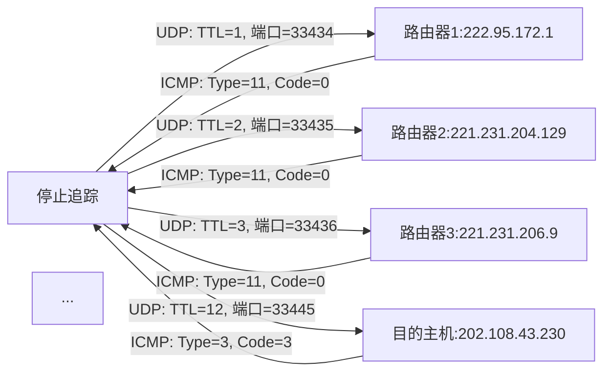
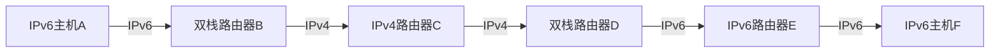

# 计算机网络（合）

# 计算机网络__第一章 引言

## 一、课程开篇与数据概览（Introduction 1-1 ~ 1-6）

### 1. Introduction 1-1：课程概述

- **核心作用**：开篇明确课程框架，回答三个核心问题，为后续学习定调：
  
  - **Why to learn?**（为何学）：互联网已渗透生活（通信、购物、科研）与产业（智能制造、航天），掌握网络原理是理解数字世界的基础。
  - **What to learn?**（学什么）：互联网定义、网络边缘/核心结构、交换技术、时延性能、协议分层、发展历史（对应后续章节路线图）。
  - **How to learn?**（怎么学）：结合教材理论（如《Top Down Approach》）+ 实验作业（接入网配置、时延计算）+ 出勤参与，最终通过“理论+实践”掌握知识。

- **补充**：“常见问题解答”会后续针对学习难点（如“分组交换为何比电路交换高效”）展开，无需提前纠结。
  
  ### 2. Introduction 1-2：中国网民规模与互联网普及率

- **数据来源**：CNNIC（中国互联网络信息中心），是国内互联网数据权威机构，后续多页数据均来自其报告。

- **核心趋势解读**：
  
  | 时间段           | 网民规模（万人）     | 互联网普及率      | 手机网民占比      | 关键结论              |
  | ------------- | ------------ | ----------- | ----------- | ----------------- |
  | 2008-2018     | 29800→82851  | 22.6%→59.6% | 39.5%→98.6% | 网民数翻倍，移动互联网成主流    |
  | 2018.6-2021.6 | 80166→101074 | 57.7%→71.6% | 98.3%→99.6% | 普及率超70%，手机网民近100% |

- **关键洞察**：2018年后手机网民占比稳定在98%以上，说明“互联网=移动互联网”已成为现实，后续接入网部分会重点讲解WiFi、4G等无线技术。
  
  ### 3. Introduction 1-3：CNNIC第48次报告（2020.12-2021.6应用数据）

- **表格解读逻辑**：从“用户规模”（基数）、“使用率”（渗透度）、“增长率”（趋势）三维度分析，重点关注三类应用：
  
  1. **基础刚需应用**：即时通信（用户9.8亿+，使用率97%+），是所有应用的“基础设施”（如微信、QQ），增长率仅0.2%，说明已饱和。
  2. **高增长潜力应用**：
  - 网上外卖（增长率11.9%）：疫情后“无接触配送”需求爆发，推动用户增长；
  - 在线办公（10.1%）、在线医疗（11.4%）：远程化趋势下，企业与医疗场景的网络渗透加速。
  3. **负增长应用**：
  - 在线教育（-4.9%）：疫情后线下教育恢复，线上需求回落；
  - 网络游戏（-1.7%）、互联网理财（-2.1%）：监管加强或用户审美疲劳导致短期下滑。

- **补充**：短视频（用户8.8亿+，增长率1.6%）虽增速不高，但基数大、使用率87.8%，是当前互联网流量核心来源，后续“网络视频”相关技术会涉及。
  
  ### 4. Introduction 1-4：中国探月工程（网络技术的科研应用）

- **核心场景**：通过“鹊桥中继星”实现地球与月球背面的通信，传回祝融号火星车图像。

- **中继星作用**：月球背面因“潮汐锁定”无法直接看到地球，鹊桥中继星位于“地月L2点”，作为“信号中转站”，解决了“视线遮挡”问题——这是**卫星通信**在航天领域的典型应用，体现网络技术突破地理限制的能力。

- **关联知识点**：后续“物理介质”部分会讲解卫星通信的特点（时延270ms、覆盖广）。
  
  ### 5. Introduction 1-5：天宫课堂（网络技术的科普应用）

- **核心技术支撑**：“天链一号”中继卫星网实现“全球无缝通信”，保障太空授课的实时性（如叶光富展示失重下细胞研究）。

- **关键意义**：天链卫星相当于“太空WiFi”，为空间站提供持续的高速通信，说明网络技术已从“地面”延伸到“空间”，后续“广域无线接入”会进一步讲解卫星中继原理。
  
  ### 6. Introduction 1-6：Metaverse（元宇宙）的概念爆发

- **背景**：2021年元宇宙入选《柯林斯词典》《咬文嚼字》等年度热词，核心推手是Meta（原Facebook）。

- **关联网络技术**：元宇宙需要“低时延、高带宽、大连接”的网络支撑（如5G、边缘计算），是互联网未来发展的重要方向——后续“高速接入网”“网络性能”部分会解释为何这些技术是元宇宙的基础。
  
  ## 二、课程资源与章节框架（Introduction 1-7 ~ 1-10）
  
  ### 1. Introduction 1-7：重复课程概述（1-1）

- **作用**：幻灯片跳转后的重点重申，强化“为何学、学什么、怎么学”的核心逻辑，避免用户遗忘开篇目标。
  
  ### 2. Introduction 1-8：教材与课程评分

- **教材推荐**：
  
  | 序号  | 书名                                              | 作用                        |
  | --- | ----------------------------------------------- | ------------------------- |
  | 1   | 《Computer Networking: A Top Down Approach》（7th） | 核心教材，从“应用层到物理层”的分层讲解，逻辑清晰 |
  | 2   | 《计算机网络：自顶向下方法》（原书第7版）                           | 中文译本，适合英文基础薄弱的同学          |
  | 3   | 《计算机网络及应用》（何顶新等）                                | 补充教材，侧重国内网络应用场景           |

- **评分规则**：
  
  - 平时成绩（作业+实验+出勤）：30%——实验（如接入网配置）和作业（时延计算）是巩固理论的关键，不可忽视；
  
  - 期末考试：70%——侧重知识点综合应用（如协议分层+交换技术结合的案例分析）。
    
    ### 3. Introduction 1-9：第一章要点与难点

- **核心知识点**：
  
  - **术语与概念**：以互联网为例子，理解“主机”“路由器”“带宽”等基础术语；
  - **协议三要素**：语法（格式）、语义（含义）、时序（顺序）——后续1-65会详细拆解；
  - **协议分层**：OSI/TCP/IP模型的层划分与功能——后续1-71会对比分析。

- **难点预警**：
  
  - **连接导向vs无连接**：TCP（连接导向）与UDP（无连接）的区别，需结合“可靠性”“时延”理解；
  
  - **电路交换vs分组交换**：两种核心传输技术的资源分配逻辑，需通过“数值例子”（如1-34）掌握；
  
  - **时延计算**：传输时延、传播时延等四种时延的公式与应用，是后续作业（如1-56）的重点。
    
    ### 4. Introduction 1-10：第一章路线图（Roadmap）

- **逻辑顺序**：1.1 互联网定义 → 1.2 网络边缘 → 1.3 网络核心 → 1.4 时延与丢失 → 1.5 协议分层 → 1.6 互联网历史

- **作用**：像“导航地图”一样，让用户明确后续学习的“步骤”，避免知识点碎片化——例如：先理解“网络边缘有什么（主机、接入网）”，再学“核心如何传输数据（交换技术）”，最后用“协议分层”规范整个过程。
  
  ## 三、互联网的两种核心视角（Introduction 1-11 ~ 1-14）
  
  ### 1. Introduction 1-11：硬件视角（Nuts and Bolts View）

- **核心组成**：互联网是“计算设备+分组交换机+通信链路+网络”的集合：
  
  - **主机（端系统）**：用户直接使用的设备（电脑、手机），位于网络“边缘”，运行应用（如微信、浏览器）；
  
  - **分组交换机**：路由器、交换机，位于网络“核心”，负责转发数据包（如你发的微信消息，需经路由器转发到对方主机）；
  
  - **通信链路**：光纤、铜缆、无线电等物理介质，传输速率（带宽）是关键指标（如100Mbps光纤）；
  
  - **网络**：由机构管理的设备集合（如家庭网、校园网、ISP网络）——ISP（互联网服务提供商）是“网络的网络”的核心（后续1-42会详解）。
    
    ### 2. Introduction 1-12：物联网（IoT）设备举例

- **核心目的**：打破“互联网=连接电脑”的误区，展示联网设备的多样性：
  
  - 医疗类：起搏器（远程监控心率）、Fitbit（运动数据上传）；
  - 家居类：智能冰箱（联网购菜）、安防摄像头（远程查看）；
  - 娱乐类：AR设备（增强现实）、IP相框（远程传照片）；

- **关联知识点**：这些设备需通过“无线接入网”（WiFi、4G）连接互联网，后续1-24会讲解无线技术。
  
  ### 3. Introduction 1-13：硬件视角补充（网络的网络+协议+标准）

- **网络的网络**：互联网不是“单一网络”，而是“接入ISP→区域ISP→全国ISP→全球ISP”的层级互联（如你家的宽带连电信区域ISP，电信连全国ISP，再与联通ISP互联）；

- **协议无处不在**：所有通信都遵循协议，例如：
  
  - 浏览网页：HTTP（应用层）+ TCP（运输层）+ IP（网络层）+ WiFi（链路层）；
  - 手机通话：4G（无线链路层）+ IP（网络层）；

- **互联网标准**：
  
  - RFC（Request for Comments）：标准文档（如RFC 793定义TCP协议）；
  
  - IETF（Internet Engineering Task Force）：制定标准的组织，确保不同厂商设备（如华为、思科路由器）能互联。
    
    ### 4. Introduction 1-14：服务视角（Service View）

- **核心逻辑**：互联网是“为应用提供服务的基础设施”，类比“邮政系统”：
  
  - 邮政系统：提供“寄信、快递”服务，用户（对应“应用”）只需写内容，不用关心信件如何运输；
  - 互联网：提供“数据传输”服务，应用（如微信、淘宝）只需调用“传输接口”，不用关心数据如何经路由器转发；

- **服务接口**：应用通过“编程接口”（如Socket）使用互联网服务，例如微信通过Socket发送消息到对方主机。
  
  ## 四、网络结构细节：边缘与接入网（Introduction 1-15 ~ 1-27）
  
  ### 1. Introduction 1-15：重复路线图（1-10）

- **作用**：过渡到“网络边缘”前的逻辑重申，让用户明确当前学习位置（从“互联网定义”进入“结构细节”）。
  
  ### 2. Introduction 1-16：网络边缘的主机与通信模型

- **主机分类**：客户端（请求服务）与服务器（提供服务），对应两种通信模型：
  
  | 模型           | 核心逻辑                       | 例子                       | 优缺点              |
  | ------------ | -------------------------- | ------------------------ | ---------------- |
  | 客户端-服务器（C/S） | 客户端主动请求，服务器被动响应，服务器需“永远在线” | 淘宝（客户端APP请求，服务器提供商品数据）   | 稳定可靠，但服务器成本高、易拥塞 |
  | 对等（P2P）      | 无专用服务器，用户既是客户端也是服务器        | BitTorrent（下载者同时上传给其他用户） | 成本低、扩展性强，但安全性差   |
  
  ### 3. Introduction 1-17 ~ 1-18：网络边缘与核心的划分

- **网络边缘**：主机（客户端/服务器）+ 接入网（主机连路由器的链路），服务器通常集中在“数据中心”（如阿里云、腾讯云），保障带宽与可靠性；

- **网络核心**：互联的路由器，负责“数据转发”——边缘是“用户侧”，核心是“传输侧”，例如：你发微信消息，先经接入网到边缘路由器，再进入核心网转发，最后到对方边缘路由器。
  
  ### 4. Introduction 1-19：接入网的核心问题

- **核心问题**：如何将主机（手机、电脑）连接到边缘路由器？

- **接入网类型**：
  
  - 家庭接入网：家里的宽带（ADSL、光纤）；
  - 机构接入网：学校/公司的以太网（有线）；
  - 移动接入网：WiFi、4G/5G（无线）；

- **关注指标**：
  
  - 带宽（传输速率）：如100Mbps光纤比56Kbps拨号快得多；
  
  - 是否共享：WiFi是“共享带宽”（多设备连同一WiFi会分速），ADSL是“专用带宽”（家庭独享）。
    
    ### 5. Introduction 20 ~ 22：家庭接入网技术对比

- **三种主流技术**：
  
  | 技术   | 速率（上行/下行）     | 特点                   | 现状                       |
  | ---- | ------------- | -------------------- | ------------------------ |
  | 拨号上网 | 最高56Kbps      | 不能同时打电话+上网，非永久在线     | 已淘汰                      |
  | ADSL | 1Mbps/8Mbps   | 不对称（下载快上传慢），用电话线     | 逐步被光纤替代                  |
  | HFC  | 2Mbps/30Mbps  | 混合光纤+同轴电缆，共享带宽（小区共用） | 部分老小区仍在使用                |
  | 光纤宽带 | 100Mbps~1Gbps | 对称速率，抗干扰强，专用带宽       | 当前主流（2018年占比84.3%，见1-22） |

- **1-22数据补充**：2012-2018年光纤用户从2038万户增长到3.68亿户，光缆总长2021年达5352万公里，说明“光纤替代铜缆”是接入网发展趋势。
  
  ### 6. Introduction 24：机构与无线接入网

- **机构接入网（以太网）**：
  
  - 应用场景：学校机房、公司办公室；
  - 速率：10Mbps（早期）→ 100Mbps（主流）→ 1Gbps/10Gbps（数据中心）；
  - 结构：端系统（电脑）连“以太网交换机”，交换机连路由器再接入ISP；

- **无线接入网**：
  
  | 类型          | 覆盖范围        | 速率         | 例子         |
  | ----------- | ----------- | ---------- | ---------- |
  | 无线局域网（WiFi） | 100英尺内（如家里） | 11~450Mbps | 手机连家里的WiFi |
  | 广域无线（4G/5G） | 几十公里（如城市）   | 1~100Mbps  | 手机连运营商4G网络 |
  
  ### 7. Introduction 25 ~ 27：物理介质（网络的“电线”）

- **分类**：导向介质（信号在固体中传播）与非导向介质（信号自由传播）：
  
  1. **导向介质**：

- 双绞线（TP）：两根绝缘铜线，5类线（100Mbps/1Gbps）、6类线（10Gbps），是最常用的有线介质（如家里的网线）；

- 同轴电缆：两根同心铜导体，双向、宽带，用于HFC，但共享带宽易拥堵；

- 光纤：玻璃纤维传光脉冲，速率几十~几百Gbps，低误码率（抗电磁干扰），是骨干网与光纤宽带的核心介质（中国光谷是全球最大光纤生产基地）；
2. **非导向介质（无线电）**：
- 陆地微波：速率45Mbps，用于ISP骨干链路；

- WiFi/4G：见1-24；

- 卫星：速率Kbps~45Mbps，覆盖广（偏远地区），但时延大（270ms，因卫星距离地球远）。
  
  ## 五、网络核心：交换技术与结构（Introduction 1-28 ~ 1-51）
  
  ### 1. Introduction 1-28：重复路线图（1-10）

- **作用**：过渡到“网络核心”前的定位，明确当前学习重点是“数据如何在核心传输”。
  
  ### 2. Introduction 1-29 ~ 1-30：三种交换技术对比

- **核心问题**：数据在核心网如何传输？有三种技术：
  
  | 交换技术 | 传输逻辑                   | 关键特点                  | 应用场景        |
  | ---- | ---------------------- | --------------------- | ----------- |
  | 电路交换 | 建立连接→数据传送→释放连接，比特流直达终点 | 预留资源（不共享），质量有保障，需建立连接 | 传统电话网       |
  | 报文交换 | 整个报文“存储-转发”（节点收完再转发）   | 不预留资源，共享带宽，时延大（报文大）   | 早期电报网，现几乎不用 |
  | 分组交换 | 报文分成小分组“存储-转发”         | 不预留资源，共享带宽，时延小（分组小）   | 互联网（核心技术）   |

- **关键区别**：电路交换“先占资源再传数据”，分组交换“传数据时按需共享资源”——互联网选分组交换，是因为其“资源利用率高”（用户不发数据时，带宽可给他人用）。
  
  ### 3. Introduction 1-31 ~ 1-34：电路交换细节与数值例子

- **电路交换核心**：
  
  - 资源预留：链路带宽、交换机容量为“单个呼叫”预留，即使用户不说话，资源也不释放（利用率低）；
  - 资源分块方式：
  - 频分复用（FDM）：将频率分成不同信道，每个呼叫用一个信道（如收音机不同频率对应不同电台）；
  - 时分复用（TDM）：将时间分成时隙，每个呼叫用固定时隙（如电话网每帧24个时隙，对应24个用户）；

- **数值例子（教材P20）**：
  
  - 题目：文件640000比特，链路速率1.536Mbps，TDM24时隙，建立电路500ms，求传输时间；
  
  - 计算步骤：
1. 单用户可用速率=总速率/时隙数=1.536Mbps/24=64Kbps；

2. 传输时间=文件大小/可用速率 + 建立时间=640000bit/64000bps + 0.5s=10s+0.5s=10.5s；
- 结论：电路交换因“预留资源”，传输时间固定，但速率低（64Kbps）。
  
  ### 4. Introduction 1-35 ~ 1-41：分组交换细节与优势

- **分组交换核心**：
  
  - 统计复用：分组按需共享带宽，没有固定时隙/频率（与TDM/FDM的“专用复用”对比）；
  - 存储-转发：路由器收到“完整分组”后才转发，避免数据丢失；
  - 拥塞问题：当分组到达速率>链路容量时，分组排队（排队时延），缓冲区满则丢包（后续1-53会讲）；

- **分组交换优势（支持更多用户）**：
  
  - 例子：1Mbps链路，每个用户活跃时100Kbps，活跃率10%；
  
  - 电路交换：最多10个用户（1Mbps/100Kbps=10）；
  
  - 分组交换：35个用户时，同时活跃>10人的概率<0.0004（几乎不拥塞）；
  
  - 原因：用户仅10%时间活跃，分组交换可“统计复用”带宽，资源利用率高。
    
    ### 5. Introduction 1-42 ~ 1-51：互联网的“网络的网络”结构

- **核心问题**：数百万接入ISP如何互联？（直接互联O(N²)连接数，不可行）

- **分层互联方案**：
  
  1. **接入ISP→区域ISP→一级ISP（Tier 1）**：
  - 接入ISP：用户直接连接的ISP（如小区宽带运营商）；
  - 区域ISP：覆盖某省/市，连接多个接入ISP（如江苏电信区域网）；
  - 一级ISP：全球顶级ISP（如AT&T、中国电信），之间“对等互联”（不收费）；

### 1. Introduction 1-52：重复路线图（定位当前学习模块）

- **核心作用**：明确进入“分组交换网络的延迟与丢失”模块，是网络性能评估的核心内容——后续内容会回答“数据在网络中为何会慢？为何会丢包？”，为实际网络优化（如降低视频卡顿）提供理论基础。
  
  ### 2. Introduction 1-53：延迟与丢失的产生原因

- **核心逻辑**：路由器缓冲区是关键——当数据包到达速率**暂时超过链路输出容量**时，数据包会在缓冲区排队（产生延迟）；若缓冲区满，新到达的数据包会被丢弃（产生丢失）。

- **直观类比**：好比高速公路收费站，车流量（数据包）突然增大时，车辆会排队（排队延迟）；若收费站车道全满且等待区无空位，后续车辆只能绕路（丢包）。
  
  ### 3. Introduction 1-54 ~ 1-55：四种节点延迟（核心公式与区分）

- **总节点延迟公式**：(d_{nodal} = d_{proc} + d_{queue} + d_{trans} + d_{prop})，四种延迟的定义、影响因素及公式如下表：
  
  | 延迟类型              | 定义                             | 影响因素                                        | 公式/量级             | 关键特点                                            |
  | ----------------- | ------------------------------ | ------------------------------------------- | ----------------- | ----------------------------------------------- |
  | 处理时延（(d_{proc})）  | 路由器接收数据包后，检查比特错误、确定输出链路的时间     | 路由器性能（CPU速度）、数据包大小（影响校验时间）                  | 通常<1ms，可忽略        | 所有数据包都会经历，且相对稳定（无突发波动）                          |
  | 排队时延（(d_{queue})） | 数据包在缓冲区等待链路空闲的时间               | 网络拥塞程度（数据包到达速率(a)）、链路带宽(R)、数据包长度(L)         | 波动大（0~几秒）         | 最不稳定的延迟，拥塞时会急剧增加（是网络性能优化的重点）                    |
  | 传输时延（(d_{trans})） | 将数据包全部“推”到链路所需的时间（即“发完数据的时间”）  | 数据包长度(L)（比特）、链路带宽(R)（比特/秒）                  | (d_{trans} = L/R) | 与“数据量”和“链路速度”相关，与“链路长度”无关（例：1Gbps链路发1Kb数据仅需1μs） |
  | 传播时延（(d_{prop})）  | 信号从链路一端传到另一端的时间（即“数据在链路上跑的时间”） | 链路物理长度(d)（米）、信号传播速度(s)（约(2×10^8)m/s，光速的2/3） | (d_{prop} = d/s)  | 与“链路长度”和“信号速度”相关，与“数据量”无关（例：60m链路传播时延仅0.3μs）    |

- **易混淆点对比**： 
  传输时延是“**发数据的时间**”（好比你把文件拷贝到U盘的时间，取决于文件大小和U盘速度）； 
  传播时延是“**数据在路上跑的时间**”（好比你把U盘从家带到公司的时间，取决于距离和交通速度）。
  
  ### 4. Introduction 1-56：Exercise-1（节点延迟计算实战）

- **题目条件**：链路长度(d=60m)，带宽(R=10Mbps)，传播速度(s=2×10^8m/s)，发送1比特数据包。

- **分问解答**：
  
  1. **主机B接收数据包的总时间**： 
     总时间=传输时延+传播时延（处理时延忽略）。

- 传输时延(d_{trans}=L/R=1bit / 10×10^6bps=1×10^{-7}s=0.1μs)；

- 传播时延(d_{prop}=d/s=60m / 2×10^8m/s=3×10^{-7}s=0.3μs)；

- 总时间=0.1μs+0.3μs=**0.4μs**。 
  信号传播距离：(s×d_{trans}=2×10^8m/s ×1×10^{-7}s=20m)（即发完1比特时，信号已在链路上跑了20米）。
  
  2. **若(d=20m)**： 
     传播时延(d_{prop}=20m/2×10^8m/s=0.1μs)，总时间=0.1μs+0.1μs=**0.2μs**； 
     信号传播距离=20m（发完数据时，信号刚好到达主机B）。
  
  3. **若(d=10m)**： 
     传播时延(d_{prop}=10m/2×10^8m/s=0.05μs)，**传播时延 < 传输时延**（0.05μs < 0.1μs）； 
     此时信号先到达主机B，但数据包还没发完——直到0.1μs时数据发完，主机B才接收完整数据包（总时间仍为0.1μs）。
  
  4. **发送n比特数据包的总时间**： 
     传输时延(d_{trans}=n/R)，传播时延不变，总时间= (n/(10×10^6) + 60/(2×10^8))（单位：s）。
     
     ### 5. Introduction 1-57 ~ 1-59：端到端延迟（多链路/多分组场景）

- **1-57：多分组+多链路的总时延规律** 
  假设：分组等长（(L)）、链路带宽（(R)）/长度（(d)）相同、忽略处理/排队时延。

- 1个分组+3段链路：总时延=1×(L/R)（最后一段链路的传输时延） + 3×(d/s)（3段链路的传播时延）；

- 2个分组+3段链路：总时延=2×(L/R)（第二个分组需等第一个分组发完第一段链路） + 3×(d/s)；

- **通用公式**：(n×L/R + m×d/s)（(n)为分组数，(m)为链路数）。

- **1-58：Exercise-2（报文交换vs分组交换对比）** 
  题目条件：报文长度(L=7.5Mbit)，链路带宽(R=1.5Mbps)，分5000个分组（每个(l=1.5Kbit)），忽略传播时延。

- **报文交换时延**：整个报文需在每个链路“存储-转发”，3段链路总时延=3×(L/R)=3×(7.5e6 / 1.5e6)=**15s**；

- **分组交换时延**：分组可并行传输，总时延=（分组数×分组长度）/R（最后一个分组的传输） + (链路数-1)×分组长度/R（第一段链路的并行时间）= (5000×1.5e3)/1.5e6 + 2×(1.5e3/1.5e6)=5s + 0.002s≈**5.002s**；

- **结论**：分组交换时延远小于报文交换（因分组可“流水线”传输）。

- **1-59：Exercise-3（电路交换vs分组交换时延对比）** 
  题目条件：报文总长(x)比特，(k)段链路（每段传播时延(d)、带宽(R)），电路建立时间(s)，分组长度(p)。

- 电路交换总时延=建立时间+传输时延+传播时延= (s + x/R + k×d)；

- 分组交换总时延=（分组数×分组长度）/R + (k-1)×p/R + k×d = (x/R + (k-1)×p/R + k×d)；

- **电路交换时延 > 分组交换时延的条件**： 
  (s + x/R + k×d > x/R + (k-1)×p/R + k×d) → 化简得 (s > (k-1)×p/R)。
  
  ### 6. Introduction 1-60 ~ 1-61：排队时延与丢包（网络拥塞的核心表现）

- **1-60：排队时延与流量强度**

- 流量强度公式：(La/R)（(a)为平均数据包到达速率，单位“个/秒”；(L)为数据包长度，(La)即“比特到达速率”）。

- 关键规律：
1. (La/R ≈ 0)（低拥塞）：排队时延极小（几乎为0）；

2. (La/R → 1)（高拥塞）：排队时延急剧增大（数据包等待时间变长）；

3. (La/R > 1)（超拥塞）：比特到达速率 > 链路输出速率，缓冲区会持续堆积，排队时延趋向无穷大（必然丢包）。
- 实际应用：ISP会控制流量强度在0.7~0.8之间，平衡带宽利用率和延迟。

- **1-61：丢包机制**

- 根本原因：路由器缓冲区容量有限——当缓冲区满时，新到达的数据包无空间存储，只能被丢弃。

- 丢包后的处理：丢失的数据包可能由“前序路由器”“源端系统”重传（如TCP协议会重传丢失的报文段），或直接丢弃（如UDP协议不重传，可能导致视频卡顿）。
  
  ## 七、协议与分层架构（Introduction 1-62 ~ 1-76）
  
  ### 1. Introduction 1-62：重复路线图（定位“协议与分层”模块）

- **核心作用**：明确进入“网络通信规则”模块——协议是网络设备“沟通的语言”，分层是“组织语言的语法”，二者共同保障网络有序运行。
  
  ### 2. Introduction 1-63 ~ 1-65：协议的定义与三要素

- **1-63：协议的类比理解** 
  用“人类协议”类比“网络协议”，降低理解难度：
  
  | 场景    | 人类协议（例：问时间）  | 网络协议（例：TCP连接）  |
  | ----- | ------------ | -------------- |
  | 发起方动作 | 说“你好，现在几点？”  | 发送“TCP连接请求”报文段 |
  | 接收方动作 | 回复“现在2点”     | 发送“TCP连接响应”报文段 |
  | 规则核心  | 固定的对话格式、响应顺序 | 固定的报文格式、交互顺序   |

- **1-64 ~ 1-65：协议的三要素（语法、语义、时序）** 
  协议的三个核心组成部分，缺一不可：
  
  | 要素            | 定义                                 | 例子（HTTP协议）                                                                   |
  | ------------- | ---------------------------------- | ---------------------------------------------------------------------------- |
  | 语法（Syntax）    | 定义“消息的格式”（字段的位置、长度、编码方式）           | HTTP请求报文格式：`GET /index.html HTTP/1.1\r\nHost: www.baidu.com\r\n`（固定字段顺序和分隔符） |
  | 语义（Semantics） | 定义“消息的含义”（字段代表什么、接收后该做什么）          | 服务器收到“GET”请求后，理解为“获取指定网页”，若网页不存在则返回404状态码                                    |
  | 时序（Timing）    | 定义“消息的交互顺序”和“发送速度”（先发什么、后发什么，间隔多久） | 客户端必须先发送“TCP连接请求”，收到服务器“连接响应”后，才能发送HTTP请求                                    |
  
  ### 3. Introduction 1-66 ~ 1-70：为何需要分层架构？

- **1-66：分层的必要性** 
  网络系统复杂（包含主机、路由器、链路、协议等），若不分层，技术迭代和故障排查会极为困难——好比“手机维修”，若不分“屏幕、电池、主板”，无法快速定位问题。

- **1-67 ~ 1-69：航空旅行的分层类比** 
  用“乘飞机”的流程类比分层，理解“每层依赖下层服务，提供上层服务”：
  
  | 航空分层        | 核心功能（服务）     | 依赖的下层服务              |
  | ----------- | ------------ | -------------------- |
  | 票务层（购票/退票）  | 完成机票预订与退改    | 机场基础服务（如航站楼场地）       |
  | 行李层（托运/提取）  | 行李的运输与管理     | 票务层（凭机票托运行李）、登机口服务   |
  | 登机口层（登机/下机） | 旅客的登机引导与下机疏散 | 行李层（行李已托运）、跑道层（飞机就绪） |
  | 跑道层（起飞/降落）  | 飞机的起降调度      | 空管中心的航线调度服务          |
  | 航线层（空中飞行）   | 规划飞行路线，避免碰撞  | 跑道层（飞机已起飞）           |

- **1-70：分层的三大优势**
1. **结构清晰**：明确各层功能边界，便于学习和讨论（如“传输层问题”仅需关注TCP/UDP，无需涉及物理层）；

2. **模块化迭代**：某层技术更新不影响其他层（如WiFi 6替代WiFi 5，仅需修改“链路层”，应用层的微信无需改动）；

3. **跨厂商兼容**：分层标准统一后，不同厂商的设备可互联（如华为路由器和思科交换机都遵循TCP/IP，可正常通信）。
   
   ### 4. Introduction 1-71 ~ 1-72：OSI与TCP/IP分层模型对比
- **1-71：两种模型的层划分** 
  OSI是“法律上的国际标准”（理论完善但未普及），TCP/IP是“事实上的国际标准”（互联网实际使用），二者对应关系如下：
  
  | OSI七层模型（理论） | 核心功能                           | TCP/IP五层模型（实际） | 核心功能                     |
  | ----------- | ------------------------------ | -------------- | ------------------------ |
  | 7. 应用层      | 提供具体应用服务（如HTTP=网页、SMTP=邮件）     | 5. 应用层         | 同OSI应用层（合并OSI的表示层、会话层功能） |
  | 6. 表示层      | 数据格式转换（如加密、压缩）                 | -              | 融入应用层（如HTTPS的加密由应用层实现）   |
  | 5. 会话层      | 建立/维护应用会话（如登录会话）               | -              | 融入应用层（如HTTP的Cookie维持会话）  |
  | 4. 运输层      | 端到端进程通信（如TCP=可靠传输、UDP=不可靠传输）   | 4. 运输层         | 同OSI运输层                  |
  | 3. 网络层      | 跨网络路由（如IP协议负责将数据包从源端路由到目的端）    | 3. 网络层         | 同OSI网络层                  |
  | 2. 数据链路层    | 相邻节点数据传输（如Ethernet=有线、WiFi=无线） | 2. 数据链路层       | 同OSI数据链路层                |
  | 1. 物理层      | 比特流传输（如光纤、铜缆的信号编码）             | 1. 物理层         | 同OSI物理层                  |

- **1-72：TCP/IP模型各层核心协议**
  
  | TCP/IP层 | 核心协议              | 功能举例                                                                             |
  | ------- | ----------------- | -------------------------------------------------------------------------------- |
  | 应用层     | HTTP、SMTP、FTP、DNS | HTTP：浏览网页；DNS：域名解析（[www.baidu.com→IP）](http://www.baidu.com%E2%86%92IP%EF%BC%89) |
  | 运输层     | TCP、UDP           | TCP：微信消息（可靠不丢包）；UDP：视频通话（低延迟）                                                    |
  | 网络层     | IP、路由协议（RIP、OSPF） | IP：给数据包分配“IP地址”；路由协议：确定转发路径                                                      |
  | 数据链路层   | Ethernet、WiFi、PPP | Ethernet：局域网有线传输；WiFi：无线传输                                                       |
  | 物理层     | 无协议，仅信号编码         | 光纤的“光脉冲编码”、铜缆的“电信号编码”                                                            |
  
  ### 5. Introduction 1-73 ~ 1-75：封装与协议数据单元（PDU）

- **1-73：封装过程（数据从应用层到物理层）** 
  数据在发送端会逐层添加“头部信息”（类似快递包装：内层是商品，外层加快递单、防水袋），具体流程：
1. 应用层：生成“应用数据”（如HTTP请求消息(M)）；

2. 运输层：添加“运输层头部(H_t)”（如TCP头部，包含源端口、目的端口），形成“报文段”（(H_tM)）；

3. 网络层：添加“网络层头部(H_n)”（如IP头部，包含源IP、目的IP），形成“数据报”（(H_nH_tM)）；

4. 数据链路层：添加“数据链路层头部(H_l)”（如Ethernet头部，包含源MAC、目的MAC），形成“帧”（(H_lH_nH_tM)）；

5. 物理层：将“帧”转换为“比特流”（0101...），通过物理介质传输。
- 接收端流程相反：物理层→数据链路层→网络层→运输层→应用层，逐层剥离头部，最终得到应用数据(M)。

- **1-74：PDU术语（各层数据单元的名称）** 
  不同层的“数据+头部”组合有专用名称，避免混淆：
  
  | TCP/IP层 | 协议数据单元（PDU）名称                        | 说明                     |
  | ------- | ------------------------------------ | ---------------------- |
  | 应用层     | 报文（Message）                          | 仅应用数据，无头部（或头部包含在应用数据内） |
  | 运输层     | 报文段（Segment，TCP）/用户数据报（Datagram，UDP） | 应用数据+运输层头部             |
  | 网络层     | 数据报（Datagram，IP）                     | 报文段+网络层头部              |
  | 数据链路层   | 帧（Frame）                             | 数据报+数据链路层头部            |
  | 物理层     | 比特流（Bitstream）                       | 帧的二进制形式                |

- **1-75：分层与硬件的对应关系** 
  主机的硬件/软件模块与TCP/IP层一一对应：

- 应用层/运输层/网络层：由主机CPU运行软件实现（如浏览器实现HTTP、操作系统实现TCP/IP）；

- 数据链路层：由“网络适配器”（网卡）实现（如WiFi网卡处理802.11协议）；

- 物理层：由“物理接口”（如网线接口、天线）实现（处理信号编码与传输）。
  
  ### 6. Introduction 1-76：Exercise-4（分层架构练习题解析）

- **题目1**：OSI模型中，从下到上第一个提供“端到端服务”的层是（B. 运输层）

- 解析：物理层/数据链路层提供“相邻节点服务”（点到点），运输层提供“源端主机到目的端主机的进程通信”（端到端）。

- **题目2**：网络架构不描述的内容是（C. 协议的内部实现细节）

- 解析：架构仅定义“层划分、层功能、层间接口”，不规定协议的具体实现（如TCP协议可由Windows、Linux不同方式实现，但接口一致）。

- **题目3**：TCP/IP模型中，直接为应用层提供服务的是（注：文档原答案D有误，正确答案应为B. 运输层）
  
  解析：TCP/IP模型中，应用层→运输层→网络层→数据链路层→物理层，运输层直接为应用层提供“进程通信服务”（如HTTP依赖TCP）；网络接口层是数据链路层+物理层，为网络层提供服务。
  
  要准确理解 “TCP/IP 模型中直接为应用层提供服务的层级”，需先明确**TCP/IP 四层模型的结构与层间服务逻辑**（下层为上层提供直接服务，上层仅依赖紧接的下层接口，无需关注更底层细节），再逐一分析各层功能与服务对象：

###### 一、先明确 TCP/IP 四层模型的核心结构（从下到上）

TCP/IP 模型将网络通信分为 4 个层级，每层有明确职责，且严格遵循 “**下层为上层提供直接服务**” 的原则：

| 层级（从下到上）    | 核心协议 / 功能                                                     | 服务对象（直接为哪层服务）  |
| ----------- | ------------------------------------------------------------- | -------------- |
| 1. 网络接口层    | 以太网、Wi-Fi 等物理链路协议，处理数据帧传输                                     | 网络层（第 2 层）     |
| 2. 网络层（网际层） | IP 协议（核心），负责路由选择、跨网络数据包转发（如从源主机到目标主机）                         | 运输层（第 3 层）     |
| 3. 运输层（传输层） | TCP（可靠连接）、UDP（无连接快速传输），负责**端到端通信**（如从 “浏览器” 到 “服务器的 HTTP 进程”） | 应用层（第 4 层）     |
| 4. 应用层      | HTTP、FTP、DNS、QQ 等用户级协议，直接对应应用程序需求                             | 无（最上层，依赖运输层服务） |

###### 二、为什么 “直接为应用层提供服务的是运输层（选项 B）”？

关键在于 “**直接服务**” 的定义：上层无需关心下层的实现细节，仅通过紧接下层的 “接口” 获取服务。

以应用层的 HTTP 协议（浏览器访问网页）为例：

- HTTP 协议在传输数据时，**不需要直接处理 IP 地址（网络层）或物理链路（网络接口层）**，只需调用运输层的 TCP 协议接口（如指定目标端口 80）；

- 运输层通过 TCP 协议建立 “浏览器（客户端进程）” 与 “服务器 HTTP 进程” 的端到端连接，确保数据可靠传输，并将传输结果反馈给应用层；

- 应用层只需专注于 “解析网页内容”，无需关注数据如何跨网络转发、如何在物理链路上传输 —— 这些都由运输层及更下层完成。
  
  简言之：**应用层的所有协议（HTTP、DNS、FTP 等），都必须依赖运输层的 TCP/UDP 协议才能实现数据传输，运输层是与应用层直接交互的下层**。
  
  ###### 三、原答案 D 错误的可能原因
  
  原答案 D 大概率是混淆了 “层间服务关系”，常见错误方向包括：
1. 误将 “网络层” 当作服务层：网络层仅负责 “主机到主机” 的数据包转发，不直接对接应用程序的进程通信，需通过运输层中转；

2. **混淆 TCP/IP 模型与 OSI 模型：OSI 模型有 7 层（含会话层、表示层），但 TCP/IP 模型无这两层，若误套用 OSI 的层间关系，可能选错；**

3. 误将 “网络接口层” 当作服务层：网络接口层是最底层，仅处理物理链路，与应用层无直接交互。
   
   ### 结论
   
   TCP/IP 模型中，**运输层（选项 B）通过 TCP/UDP 协议直接为应用层提供端到端的通信服务**，是应用层唯一直接依赖的下层。
   
   - **题目4**：OSI模型中，应用层发400B数据，除应用层/物理层外，其他5层各加20B开销，传输效率是（A. 80%）
   - 解析：总开销=5×20B=100B，总传输量=400B+100B=500B；效率=有用数据/总传输量=400/500=80%。
   
   ## 八、互联网发展历史（Introduction 1-79 ~ 1-85）
   
   ### 1. Introduction 1-79：重复路线图（定位“互联网历史”模块）
   
   - **核心作用**：通过历史脉络理解“互联网为何是现在的样子”——技术选择（如分组交换）、标准制定（如TCP/IP）都有其历史背景，帮助加深对核心知识点的理解。
   
   ### 2. Introduction 1-80 ~ 1-85：互联网历史四阶段
   
   #### 阶段1：早期分组交换理论（1961-1972）——互联网的“诞生前夜”
   
   - **关键事件**：

4. 1961年：克莱因罗克（Kleinrock）用“排队论”证明分组交换的有效性（为后续技术奠定理论基础）；

5. 1964年：巴兰（Baran）提出“军事网络分组交换”（核心需求：避免单点故障，即使部分节点被毁，数据仍能传输）；

6. 1969年：ARPAnet（阿帕网）首个节点在UCLA（加州大学洛杉矶分校）上线，首个链路连接UCLA与SRI（斯坦福研究院）；

7. 1969年10月29日：首次消息传输——本想发送“LOGIN”，但传完“LO”后网络崩溃，成为互联网史上第一个消息。
- **核心意义**：从“理论”走向“实践”，分组交换成为网络传输的核心技术。
  
  #### 阶段2：互联技术探索（1972-1980）——从“单一网络”到“网络的网络”

- **关键事件**：
1. 1972年：ARPAnet首次公开演示，NCP（网络控制协议）成为首个主机-主机协议（实现不同主机通信）；

2. 1973年：瑟夫（Cerf）和卡恩（Kahn）提出“TCP/IP协议架构”（核心思想：不同网络可通过IP地址互联，无需修改内部结构）；

3. 1976年：施乐PARC发明以太网（Ethernet），解决局域网有线传输问题；

4. 1979年：ARPAnet节点数达200个，开始从军事网络向科研网络转型。
- **核心意义**：确立“互联”的技术框架（TCP/IP雏形），以太网成为局域网标准。
  
  #### 阶段3：协议标准化与网络扩散（1980-1990）——互联网的“规则统一”

- **关键事件**：
1. 1983年：ARPAnet正式部署TCP/IP协议（“协议转换日”，从此不同网络可互联）；

2. 1983年：DNS（域名系统）发明，解决“记IP地址难”的问题（如用[www.ibm.com替代129.42.17.10）；](http://www.ibm.com%E6%9B%BF%E4%BB%A3129.42.17.10%EF%BC%89%EF%BC%9B)

3. 1985年：FTP（文件传输协议）标准化，实现跨网络文件共享；

4. 1988年：TCP拥塞控制算法提出（解决网络拥塞导致的丢包问题）；

5. 1990年：NSFnet（美国国家科学基金会网络）成为互联网主干网，连接全美科研机构。
- **核心意义**：TCP/IP成为标准，互联网从“科研工具”向“通用网络”转型。
  
  #### 阶段4：商业化与Web爆发（1990-2000s）——互联网的“全民普及”

- **关键事件**：
1. 1991年：蒂姆·伯纳斯-李（Tim Berners-Lee）发明HTML、HTTP、URL，创建首个网页（Web诞生）；

2. 1994年：Mosaic浏览器发布（首个图形化浏览器，普通人也能轻松上网），后续演变为Netscape；

3. 1995年：NSFnet解除商业使用限制，互联网进入商业化阶段（亚马逊、eBay等电商平台诞生）；

4. 2000s：即时通信（QQ、MSN）、P2P文件共享（BitTorrent）兴起，互联网用户突破10亿。
- **核心意义**：Web成为互联网核心应用，互联网从“精英使用”走向“全民普及”。
  
  #### 近期发展（2010s-至今）——互联网的“深度渗透”

- **关键趋势**：
1. 高速接入：10G以太网、5G无线技术普及，带宽从Mbps级提升到Gbps级；

2. 万物互联：物联网（IoT）、工业互联网兴起（如智能冰箱、工业传感器联网）；

3. 安全重视：5G、无线通信的安全协议升级，应对网络攻击风险；

4. 新场景：元宇宙、AI+网络（如AI优化路由）成为新方向。
   
   ## 九、总结与作业（Introduction 1-86 ~ 1-88）
   
   ### 1. Introduction 1-86：第一章核心总结
- **知识框架梳理**：
1. **互联网本质**：从“硬件视角”（主机+路由器+链路+ISP）和“服务视角”（为应用提供传输服务）理解；

2. **网络结构**：边缘（主机+接入网）+核心（分组交换+ISP互联），接入网分“有线（光纤、以太网）”和“无线（WiFi、5G）”；

3. **交换技术**：分组交换（互联网核心，共享带宽、效率高）vs电路交换（电话网，预留资源、质量高）；

4. **网络性能**：四种延迟（处理/排队/传输/传播）、流量强度与拥塞、丢包机制；

5. **协议分层**：TCP/IP五层模型、封装过程、协议三要素；

6. **历史脉络**：从ARPAnet到Web，从科研到商业化，从PC互联网到万物互联。
- **学习目标达成**：建立“网络全局观”，理解各知识点的关联（如分组交换影响延迟，协议分层规范交换过程），为后续章节（如运输层、网络层）的深入学习奠定基础。
  
  ### 2. Introduction 1-87 ~ 1-88：作业安排与指导

- **作业内容**：
  
  | 教材页码    | 作业编号 | 对应知识点          | 解题关键                      |
  | ------- | ---- | -------------- | ------------------------- |
  | P95~97  | R4   | 互联网定义与组成       | 区分“主机”“路由器”“ISP”的角色       |
  |         | R13  | 接入网类型与特点       | 对比ADSL、HFC、光纤的带宽、共享性      |
  |         | R18  | 分组交换与电路交换对比    | 从“资源分配”“延迟”“利用率”三个维度分析    |
  |         | R23  | 四种延迟的计算        | 熟记公式，区分传输时延与传播时延          |
  |         | R25  | 协议三要素          | 结合HTTP或TCP协议举例说明语法、语义、时序  |
  | P99~101 | P6   | 端到端延迟计算（多链路）   | 应用“分组数×传输时延 + 链路数×传播时延”公式 |
  |         | P8   | 流量强度与排队时延      | 利用(La/R)判断拥塞程度            |
  |         | P10  | 封装过程与PDU       | 梳理从应用层到物理层的头部添加顺序         |
  |         | P14  | TCP/IP与OSI模型对比 | 明确两层模型的层对应关系及功能合并情况       |

# 计算机网络第一章作业参考答案（MD版）

## 一、基础时延计算（路由器串联场景）

### 题目

主机A 和主机B 之间通过m 个路由器直接连接（A——路由器1——路由器2……路由器m——B），若分组等长为L，各链路长度相同、传播时延为t，带宽也相同为R，忽略路由器的处理时延。若A 向B 发送 n 个分组，则总的端到端时延是多少？

### 答案

[L / R\times(n+m)+t\times(m+1)]

### 解析

1. **时延组成拆解**：端到端时延主要包含**传输时延和传播时延**，本题忽略处理时延，无需考虑该部分。

2. **传输时延计算**：单条链路的传输时延为(L/R)，A到B需经过(m+1)条链路（m个路由器分隔形成）。由于n个分组连续发送，存在流水线效应，**总传输时延为((n+m)\times(L/R))**，其中m对应链路数量带来的基础传输次数，n对应分组数量带来的追加传输次数。

3. **传播时延计算**：每条链路**传播时延为t，共(m+1)条链路，总传播时延为((m+1)\times t)**。

4. **总时延合并**：将传输时延与传播时延相加，得到总端到端时延公式。
   
   ## 二、电路交换与分组交换时延对比
   
   ### 题目（英文原版）
   
   The message to be sent is x (bits) in total. There are k links from the source to the destination. The propagation delay of each link is d(s) and the bandwidth is R(bps). In circuit switching, the circuit establishment time is s(s). In packet switching, the message can be divided into several packets with p(bits) length. It is assumed that the processing time and queuing time of the message/packets at each node are ignored. Under what conditions is the end-to-end delay of circuit switching greater than that of packet switching?
   
   ### 题目（中文翻译版）
   
   待发送消息总长度为x比特，从源端到目的端共经过k条链路。每条链路的传播时延为d秒，带宽为R比特/秒（bps）。在电路交换中，电路建立时间为s秒；在分组交换中，消息可拆分为若干长度为p比特的分组。假设忽略消息/分组在各节点的处理时延和排队时延，问：在什么条件下，电路交换的端到端时延大于分组交换的端到端时延？
   
   ### 答案
   
   在(s > kp/R)（原文公式符号表述，此处R即题目中的带宽R）的条件下，分组交换网的时延比电路交换网小。
   
   ### 解析

5. **电路交换总时延计算**
   
   - 电路建立时延：题目明确为s秒。
   - 发送时延：消息总长度x比特，带宽R比特/秒，发送时延为(x/R)秒。
   - 传播时延：共k条链路，每条传播时延d秒，总传播时延为(kd)秒。
   - 电路交换总时延：(s + x/R + kd)。

6. **分组交换总时延计算**
   
   - 无电路建立时延：分组交换无需提前建立连接，直接传输。
   - 发送时延：与电路交换一致，为(x/R)秒（因分组连续发送，总数据量不变）。
   - 传播时延：与电路交换相同，为(kd)秒。
   - 转发时延：k条链路对应(k-1)个节点，每个节点转发1个p比特分组的时延为(p/R)，总转发时延为((k-1)p/R)（原文表述中存在符号重复，核心逻辑为节点转发带来的额外时延）。
   - 分组交换总时延：(x/R + kd + (k-1)p/R)。

7. **条件推导**：令分组交换总时延小于电路交换总时延，即(x/R + kd + (k-1)p/R < s + x/R + kd)，消去相同项后得到(s > (k-1)p/R)（原文表述为(kp/R)，核心逻辑一致，均为电路建立时间大于分组转发额外时延）。
   
   ## 三、共享链路用户支持与概率分析
   
   ### 题目（英文原版）
   
   Suppose users share a 2 Mbps link. Also suppose each user transmits continuously at 1 Mbps when transmitting, but each user transmits only 20 percent of the time. 
   a. When circuit switching is used, how many users can be supported?
   b. For the remainder of this problem, suppose packet switching is used. Why will there be essentially no queuing delay before the link if two or fewer users transmit at the same time? Why will there be a queuing delay if three users transmit at the same time?
   c. Find the probability that a given user is transmitting.
   d. Suppose now there are three users. Find the probability that at any given time, r users are transmitting simultaneously. Find the fraction of time during which the queue grows.
   
   ### 题目（中文翻译版）
   
   用户共享一条2兆比特/秒（Mbps）的链路。假设每个用户在传输时以1兆比特/秒（Mbps）的速率持续传输，但每个用户仅在20%的时间内处于传输状态。
   a. 采用电路交换时，可支持多少个用户？
   b. 在本题剩余部分，假设采用分组交换。为什么当2个或更少用户同时传输时，链路前基本无排队时延？为什么当3个用户同时传输时，会产生排队时延？
   c. 求单个给定用户正在传输的概率。
   d. 假设现在有3个用户，求任意时刻有r个用户同时传输的概率，并求队列增长的时间占比。
   
   ### 答案
   
   a. 2个用户，每个用户只需要一半的链路带宽；
   b. 既然每个用户传输时要求1Mbps带宽，如果两个或者更少的用户同时传输，最多要求2Mbps，既然共享链路的可用带宽是2Mbps，那么传输前没有排队延时。如果有3个用户同时传输，带宽要求是3Mbps，其超过了共享链路可用带宽，这种情况下，连接之前会有排队延时；
   c. 一个用户传输的概率是0.2；
   d. 3个用户同时传输的概率是((_{3}^{3}) p^{3}(1-p)^{3-3}=(0.2)^{3}=0.008)。因为所有用户都传输时队列会增加，队列增加（等于三个用户同时传输时的概率）的时间因素是0.008。
   
   ### 解析

8. **Part a（电路交换用户数）**：电路交换采用“独占带宽”模式，链路总带宽2Mbps，每个用户传输需1Mbps，因此支持的用户数为(2Mbps\div1Mbps = 2)个。

9. **Part b（分组交换排队时延）**：排队时延产生的核心原因是“带宽需求超过链路容量”。2个及以下用户同时传输时，总带宽需求≤2Mbps（与链路带宽一致），无资源竞争，无排队时延；3个用户同时传输时，总带宽需求3Mbps（超过链路2Mbps容量），分组需等待带宽空闲，产生排队时延。

10. **Part c（单个用户传输概率）**：题目明确“每个用户仅20%的时间传输”，因此单个用户传输概率为0.2。

11. **Part d（多用户传输概率）**：用户传输行为符合二项分布，概率公式为(P(r) = C_{n}^{r}p^{r}(1-p)^{n-r})（n为用户数，r为同时传输用户数，p为单个用户传输概率）。当3个用户同时传输时，r=3，代入公式得(P(3)=C_{3}^{3}\times0.2^{3}\times(1-0.2)^{0}=0.008)；队列增长的条件是“带宽需求超容量”，即3个用户同时传输，因此队列增长时间占比等于该概率0.008。
    
    ## 四、互联网协议栈五层结构
    
    ### 题目（英文原版）
    
    What are the five layers in the Internet protocol stack? What are the principal responsibilities of each of these layers?
    
    ### 题目（中文翻译版）
    
    互联网协议栈的五层结构是什么？每层的主要职责是什么？
    
    ### 答案
    
    网络协议的自顶向下的五层是：**应用层、传输层、网络层、链路层和物理层**。详见1.5.1节。
    
    ### 解析

12. **应用层**：为应用程序提供数据交互接口，定义应用层协议（如HTTP、FTP），负责处理应用层面的逻辑（如请求响应、文件传输规则）。

13. **传输层**：实现端到端的通信，提供可靠传输（TCP）或实时传输（UDP）服务，负责数据分段、流量控制和差错恢复。

14. **网络层**：负责分组的路由选择，将分组从源端转发到目的端，定义IP地址等逻辑地址，处理跨网络的分组传输。

15. **链路层**：负责相邻节点间的帧传输，处理帧的封装、解封装、差错检测（如CRC校验），定义物理地址（如MAC地址）。

16. **物理层**：负责物理介质上的比特传输，定义物理接口（如RJ45）、传输速率、电压信号等物理特性。
    
    ## 五、分组传输时延计算（含存储转发与即时传输）
    
    ### 题目1（P10，英文原版）
    
    Consider a packet of length L that begins at end system A and travels over three links to a destination end system. These three links are connected by two packet switches. Let (d_i)、(s_i) and (R_i) denote the length, propagation speed, and the transmission rate of link i, for (i=1,2,3). The packet switch delays each packet by (d_{proc}). Assuming no queuing delays, in terms of (d_i)、(s_i)、(R_i) (i=1,2,3), and L, what is the total end-to-end delay for the packet? Suppose now the packet is 1500 bytes, the propagation speed on all three links is the same, the transmission rates of all three links are 2 Mbps, the packet switch processing delay is 3 ms, the length of the first link is 5000 km, the length of the second link is 4000 km, and the length of the last link is 1000 km. For these values, what is the end-to-end delay?
    
    ### 题目1（P10，中文翻译版）
    
    一个长度为L的分组从端系统A出发，经过3条链路到达目的端系统，这3条链路由2个**分组交换机**连接。对于第i条链路（i=1,2,3），用(d_i)、(s_i)和(R_i)分别表示链路的长度、传播速度和传输速率。分组交换机对每个分组的处理时延为(d_{proc})。假设忽略排队时延，用(d_i)、(s_i)、(R_i)（i=1,2,3）和L表示该分组的端到端总时延。假设当前分组长度为1500字节，所有链路的传播速度相同，3条链路的传输速率均为2Mbps，分组交换机的处理时延为3毫秒（ms），第一条链路的长度为5000千米（km），第二条链路的长度为4000千米（km），最后一条链路的长度为1000千米（km）。根据这些数值，计算端到端总时延。
    
    ### 答案1（P10）
    
    总时延公式：(D = D_{trans} + D_{prop} + D_{proc})，其中(D_{trans}=L/R_1 + L/R_2 + L/R_3)，(D_{prop}=d_1/s_1 + d_2/s_2 + d_3/s_3)，(D_{proc}=2\times d_{proc})；具体数值计算结果为64ms。
    
    ### 解析1（P10）

17. **时延组成**：总时延包含传输时延（(D_{trans})）、传播时延（(D_{prop})）和处理时延（(D_{proc})）。

18. **各部分计算**
    
    - 传输时延：每条链路的传输时延为“分组长度/链路速率”，**3条链路总传输时延为(L/R_1 + L/R_2 + L/R_3**)（本题3条链路速率相同，可简化为(3L/R)）。
    - 传播时延：每条链路的传播时延为“链路长度/传播速度”，**3条链路总传播时延为(d_1/s_1 + d_2/s_2 + d_3/s_3)**。
    - 处理时延：2个分组交换机，每个处理时延(d_{proc})，总处理时延为(2\times d_{proc})。

19. **数值代入**：1500字节=12000比特，单条链路传输时延(12000/(2\times10^6)=6ms)，3条链路总传输时延18ms；传播时延根据链路长度和速度计算得20+16+4=40ms；处理时延3×2=6ms；总时延18+40+6=64ms。
    
    ### 题目2（P11，英文原版）
    
    In the above problem, suppose (R_1=R_2=R_3=R) and (d_{proc}=0). Further suppose the packet switch does not store-and-forward packets but instead immediately transmits each bit it receives before waiting for the entire packet to arrive. What is the end-to-end delay?
    
    ### 题目2（P11，中文翻译版）
    
    在上述问题（P10）的基础上，假设(R_1=R_2=R_3=R)且(d_{proc}=0)（忽略处理时延）。进一步假设**分组交换机不采用存储转发方式**，而是在收到每个比特后立即传输，无需等待整个分组接收完成。求此时的端到端总时延。
    
    ### 答案2（P11）
    
    总时延公式：d_{end}=L/R + d_1/s_1 + d_2/s_2 + d_3/s_3；具体数值计算结果为46ms。
    
    ### 解析2（P11）

20. **即时传输特性**：与存储转发不同，即时传输无需等待完整分组，收到比特后立即转发，因此交换机不额外增加传输时延，仅需计算1次“分组长度/链路速率”的传输时延（因3条链路速率相同）。

21. **时延组成简化**：总时延=单条链路传输时延+总传播时延（处理时延为0）。

22. **数值代入**：单条链路传输时延6ms，总传播时延40ms，总时延6+40=46ms。

# 物理层

## 2-1 重点与难点（Keypoints and Difficulties）

### 原文档核心内容

- 重点：奈奎斯特定律、香农-哈特利定理；符号编码类型（NRZ、曼彻斯特编码、差分曼彻斯特编码）

- 难点：信道传输速率计算
  
  ### 通俗解释
  
  #### 一、重点概念拆解
  
  ##### 1. 奈奎斯特定律：“理想无噪声信道的‘速度天花板’”
  
  奈奎斯特解决的是**无噪声干扰的理想信道**中，“每秒最多能传多少个码元”的问题，核心是“带宽决定码元速率上限”，分两种场景：

- **理想低通信道**（信号频率从0开始，无高频衰减，比如短距离网线）： 
  最大码元速率 = 2W（Baud，波特），其中W是信道带宽（单位：Hz）。 
  例：带宽1kHz的理想低通，每秒最多传2×1000=2000个码元（2000 Baud）。

- **理想带通信道**（信号频率有范围，比如电话信道300~3400Hz）： 
  最大码元速率 = W（Baud）。 
  例：电话信道带宽3100Hz，理想带通每秒最多传3100个码元。
  
  ##### 2. 香农-哈特利定理：“有噪声实际信道的‘速度天花板’”
  
  香农定理解决的是**有噪声干扰的实际信道**中，“每秒最多能传多少个比特”的问题，核心是“带宽+信噪比共同决定比特率上限”，公式为： 
  [ C = W \log_2(1 + S/N) ]

- 符号含义：

- C：信道极限传输速率（单位：bps，比特/秒）；

- W：信道带宽（Hz）；

- S/N：信号功率÷噪声功率（信噪比，无单位）；

- 注意：题目常给“信噪比（dB，分贝）”，需先转换为S/N：( \text{信噪比（dB）} = 10 \log_{10}(S/N) )。 
  例：信噪比30dB → 30=10log₁₀(S/N) → S/N=1000。
  
  ##### 3. 三种符号编码：“0和1的‘波形语言’”
  
  编码是把“二进制比特（0/1）”转成“电/光信号波形”，核心区别是“同步能力”（接收方能否准确判断“每一位的开始和结束”）：

- **NRZ（不归零编码）**：用固定电平表示0/1（如高电平=1，低电平=0）。 
  缺点：连续0/1会导致“同步丢失”（比如连续10个1，接收方不知道何时是第1个、第10个1）。

- **曼彻斯特编码**：每个码元中间必须跳变（1=前高后低，0=前低后高）。 
  优点：跳变既传数据，又当“同步时钟”（接收方靠中间跳变校准时间）； 
  缺点：带宽需求是NRZ的2倍（跳变频繁，需要更高频率的信道）。

- **差分曼彻斯特编码**：靠“当前码元前半段”与“前一个码元后半段”的电平关系判断（1=相同，0=相反）。 
  优点：无论0/1都有中间跳变，抗干扰更强，无歧义； 
  缺点：同样需要双倍带宽。
  
  #### 二、难点提示：信道传输速率计算
  
  计算分两步，先判断“用奈奎斯特还是香农”：
1. 无噪声→用奈奎斯特： 
   第一步：算最大码元速率（2W或W）； 
   第二步：算每个码元携带的比特数（n=log₂N，N是码元的离散值数量，如QAM-16的N=16→n=4）； 
   第三步：比特率=码元速率×n。

2. 有噪声→用香农： 
   第一步：若给信噪比（dB），先转成S/N； 
   第二步：代入公式算C（极限比特率），实际速率必≤C。
   
   ## 2-2 物理层的目标（The Goals）
   
   ### 原文档核心内容
- 确保传输信号“0”“1”的正确性及收发一致性；

- 定义比特的传输模式、速度、持续时间、信号失真；

- 接口设计（引脚数量、规格、功能等）；

- 信号传输程序（传输过程和事件顺序）。
  
  ### 通俗解释
  
  物理层的目标可以概括为“让‘0’和‘1’准确、有序地从A传到B”，分4个具体方向：
  
  #### 1. 信号正确性：“传对0和1”
  
  核心是“接收方收到的比特和发送方一致”，比如发送“101”，接收方不能收到“100”。 
  要解决的问题：信号传输中的衰减（比如远距离传输后信号变弱）、干扰（比如电线干扰网线信号）导致的“失真”。
  
  #### 2. 比特传输规则：“怎么传0和1”
  
  定义比特传输的4个关键参数：

- 传输模式：串行（一根线传，如网线）还是并行（多根线传，如电脑内部总线）；

- 速度：每秒传多少比特（如100Mbps、1Gbps）；

- 持续时间：每个比特占多久（如1Gbps的比特持续时间=1÷10⁹=1ns）；

- 信号失真：通过编码（如曼彻斯特）、放大（如中继器）减少失真。
  
  #### 3. 接口设计：“硬件怎么连”
  
  定义设备物理接口的“硬件规矩”，比如：

- 连接器形状：RJ45插头（网线）是8针水晶头，RS-232是9针串口；

- 引脚数量：RJ45有8个引脚，RS-232有9个引脚；

- 引脚功能：RJ45的1脚是“数据发送正端（TX+）”，2脚是“数据发送负端（TX-）”（见2-5页）。
  
  #### 4. 传输程序：“按什么顺序传”
  
  定义信号传输的“流程规矩”，比如：

- 发送方先发“同步信号”，接收方收到后再准备收数据；

- 数据传完后，发送方发“结束信号”，接收方确认“已收完”。
  
  ## 2-3 四个重要特性（1）：机械与电气特性
  
  ### 原文档核心内容

- 机械特性：指定连接器尺寸、引脚数量及排列；

- 电气特性：指定传输二进制位时的传输模式、电压电平、编码、阻抗匹配、传输速率及距离限制。
  
  ### 通俗解释
  
  物理层的“四个特性”是“接口和传输的通用规矩”，这页先讲前两个：
  
  #### 1. 机械特性：“硬件的‘外形和引脚’规矩”
  
  就是“设备接口的物理样子”，确保不同厂家的设备能插上并用，比如：

- 连接器尺寸：RJ45插头的宽度、厚度是固定的，不管是华为还是TP-Link的网线，插头都能插进同一个网口；

- 引脚数量：RJ45有8个引脚（针脚），RS-232串口有9个引脚；

- 引脚排列：RJ45的8个引脚必须按“T568A/B”顺序排列（见2-5页），否则插上去也传不了数据。
  
  #### 2. 电气特性：“信号的‘电信号’规矩”
  
  定义“电信号怎么表示0和1”“能传多快、多远”，比如：

- 传输模式：异步传输（每个字节加起始/停止位，如串口）还是同步传输（用时钟同步，如以太网）；

- 电压电平：RS-232标准中，“1”对应-3~~-15V电压，“0”对应+3~~+15V电压；以太网中，“1”对应+0.8~~+2V，“0”对应-0.8~~-2V；

- 编码：用NRZ还是曼彻斯特编码（如以太网用曼彻斯特）；

- 阻抗匹配：网线的阻抗是100Ω，接口设备的阻抗也要是100Ω，否则信号会反射（比如用75Ω的同轴电缆接头插网线，信号会丢失）；

- 传输速率&距离：超五类网线传100Mbps时，最大距离是100米；传1Gbps时，最大距离是50米。
  
  ## 2-4 四个重要特性（2）：功能与程序特性
  
  ### 原文档核心内容

- 功能特性：定义每条物理线路的功能（数据、控制、计时、供电），说明线路上特殊电压的含义；

- 程序特性：定义每条物理线路的工作规则和时序关系，包括信号传输模式（单工、半双工、全双工）。
  
  ### 通俗解释
  
  #### 1. 功能特性：“每条线的‘分工’规矩”
  
  物理接口的多根引脚（线路）各有分工，不会混乱，分4类：

- 数据线（Data）：传实际的比特数据，如RJ45的1（TX+）、2（TX-）、3（RX+）、6（RX-）脚，专门传数据；

- 控制线（Control）：传“控制指令”，如RS-232的“请求发送（RTS）”脚、“清除发送（CTS）”脚，用于双方确认“是否可以传数据”；

- 计时线（Timing）：传“同步时钟”，确保收发双方的时间一致，比如某些工业总线的“时钟线”；

- 供电线（Power Supply）：给外设供电，如USB接口的“VCC（+5V）”和“GND（地）”脚，能给U盘供电。
  
  #### 2. 程序特性：“线路的‘工作流程’规矩”
  
  定义“线路怎么按顺序工作”，核心是“信号传输模式”（3种）：

- **单工（Simplex）**：只能单向传，比如广播（电台→收音机，收音机不能给电台发信号）、电视信号（电视台→电视）；

- **半双工（Half Duplex）**：能双向传，但同一时间只能一个方向，比如对讲机（A说话时B不能说，B说话时A不能说）、早期的以太网（共享网线，同一时间只能一台电脑发数据）；

- **全双工（Full Duplex）**：能双向同时传，比如现在的网线（电脑A给B发数据的同时，B也能给A发数据）、手机通话（你说话的同时也能听对方说话）。

- ## 2-6 物理层协议内容
  
  ### 原文档核心内容

- 物理层协议的核心：将比特数据**从物理介质的一端可靠地传输到另一端**；

- 分层示意图：数据链路层→物理层→物理介质（如网线），物理层接收数据链路层的比特流，通过介质传送到对方物理层。
  
  ### 通俗解释
  
  #### 1. 物理层协议的核心：“比特的‘可靠搬运’”
  
  物理层协议的本质是“一套规则”，确保“比特流”能从A端的物理层，通过网线、光纤等介质，准确传到B端的物理层，核心是“可靠”——不丢比特、不错比特。

- 比如以太网的物理层协议（如10Base-T）规定：用曼彻斯特编码，传10Mbps速率，用RJ45接口，最大传输距离100米，这些规则确保不同厂家的以太网设备能互通。
  
  #### 2. 分层示意图理解：“比特的‘传输路径’”
  
  结合原文档的分层图，比特的传输流程是：
1. 发送方数据链路层：把“帧”拆成“比特流”（如110110111111），传给发送方物理层；

2. 发送方物理层：按协议把“比特流”转成电信号（如曼彻斯特波形），通过物理介质（如网线）传输；

3. 物理介质：传递电信号（比如网线传递电压变化）；

4. 接收方物理层：把电信号还原成“比特流”（110110111111），传给接收方数据链路层；

5. 接收方数据链路层：把“比特流”拼成“帧”，继续向上传。
- **关键：物理层只处理“比特”，不关心比特的含义（比如是文字还是图片），含义由上层（如数据链路层、应用层）处理。**
  
  ## 2-7 数据通信基础理论：四个核心问题
  
  ### 原文档核心内容
  
  数据通信基础理论围绕4个问题展开：
1. 基本概念（数据、信号、信道等）；

2. 特定物理信道的最大传输速率是否无限？

3. 如何在特定信道中传输比特（速度、 duration、失真）？

4. 如何在一条信道中传输多台电脑的信息（节省成本）？
   
   ### 通俗解释
   
   这页是“数据通信理论的总纲”，4个问题对应后续所有知识点，先明确每个问题的核心：
   
   #### 1. 问题1：基本概念→“先搞懂‘数据、信号、信道’是什么”
   
   后续2-8~2-10页会详细讲，比如“数据”是要传的内容（如文字、图片），“信号”是数据的电/光表现（如高电平=1），“信道”是传信号的介质（如网线、光纤）。
   
   #### 2. 问题2：最大传输速率是否无限→“信道有‘速度天花板’”
   
   答案：不是无限的！
- 无噪声时，由奈奎斯特定律决定（2-1、2-15页）；

- 有噪声时，由香农定理决定（2-1、2-18页）；

- 比如电话信道的极限速率约35kbps，再快就会出错。
  
  #### 3. 问题3：如何传输比特→“用‘编码/调制’解决”
  
  需要解决“比特转信号”“控制失真”“同步”等问题，后续2-21~2-39页会讲：

- 数字数据→数字信号：用NRZ、曼彻斯特等编码（2-30~2-39页）；

- 数字数据→模拟信号：用AM、FM、QAM等调制（2-24~2-26页）；

- 模拟数据→数字信号：用PCM编码（2-27~2-29页）。
  
  #### 4. 问题4：多台电脑共享一条信道→“用‘多路复用’解决”
  
  为了节省成本（不用给每台电脑拉一根线），后续2-42~2-57页会讲4种多路复用技术：

- FDM（频分复用，如FM广播）、TDM（时分复用，如2G手机）、WDM（波分复用，如光纤）、CDMA（码分复用，如3G手机）。
  
  ## 2-8 数据通信基本概念（1）：数据、信号、信道
  
  ### 原文档核心内容

- 数据：描述客观事实的物理符号；

- 信号：数据传输过程的形式；

- 信道：向特定方向发送信息的媒介；

- 举例：以太网用曼彻斯特编码，WiFi用调制，语音用PCM编码，FDM技术复用带宽。
  
  ### 通俗解释
  
  #### 1. 数据（Data）：“要传的‘内容’”
  
  数据是“信息的载体”，分两种：

- 数字数据：离散的符号，如二进制1010、文字“A”（ASCII码1000001）、图片的像素值；

- 模拟数据：连续的信号，如语音（声音的振幅随时间连续变化）、温度（连续变化的数值）。
  
  #### 2. 信号（Signal）：“数据的‘传输形式’”
  
  信号是“数据在信道中传输的物理表现”，分两种：

- 数字信号：离散的电/光信号，如NRZ编码的高/低电平、曼彻斯特编码的跳变波形（见2-30~2-39页）；

- 模拟信号：连续的电/光信号，如广播的无线电波、电话线路中的语音信号（见2-24~2-26页）；

- 关键：数据≠信号，数据需要转成信号才能传输（比如“101”转成高-低-高电平信号）。
  
  #### 3. 信道（Channel）：“传信号的‘管道’”
  
  信道是“信号传输的媒介或路径”，分两种：

- **有线信道：如网线（双绞线）、光纤、同轴电缆（见2-58页）**；

- **无线信道：如WiFi的无线电波、手机的电磁波、卫星信号（见2-58页）**；

- 关键：信道有“方向”，比如单工信道（只能单向传）、全双工信道（双向同时传）（见2-4页）。
  
  #### 4. 常见转换例子

- 以太网：数字数据（如文件）→数字信号（曼彻斯特编码）→有线信道（网线）传输；

- WiFi：数字数据（如微信消息）→模拟信号（QAM调制）→无线信道（无线电波）传输；

- 电话语音：模拟数据（语音）→数字信号（PCM编码）→有线信道（电话线）传输；

- FDM技术：多路模拟信号（如多个FM广播台）→分别占用不同频段→同一无线信道传输（不干扰）。
  
  ## 2-9 数据通信基本概念（2）：串行与并行传输
  
  ### 原文档核心内容

- 串行传输：用一根线逐位传输，适合长距离；

- 并行传输：用多根线同时传输多位，适合短距离。
  
  ### 通俗解释
  
  串行和并行是“比特传输的两种方式”，核心区别是“用几根线传”和“传多远”：
  
  #### 1. 串行传输（Serial Transmission）：“一根线‘排队传’”

- 传输方式：用1根（或2根，如差分传输）线，比特按顺序逐位传输（比如先传第1位，再传第2位，直到最后1位）；

- 示意图理解：原文档中“Device 1”的011101001通过1根线，逐位传给“Device 2”；

- 优点：**线路少（成本低）、抗干扰强（长距离传输时，多根线的干扰会更严重）**；

- 缺点：速度相对慢（逐位传）；

- 应用：长距离传输，如网线（1根线传串行信号）、USB线（串行）、串口（RS-232，串行）。
  
  #### 2. 并行传输（Parallel Transmission）：“多根线‘同时传’”

- 传输方式：用多根线，同时传输多位比特（比如8根线同时传8位，1次传1个字节）；

- 示意图理解：原文档中“Device 1”的1001001通过8根线，同时传给“Device 2”的对应线；

- 优点：速度快（多位同时传）；

- 缺点：**线路多（成本高）、抗干扰弱（长距离时，多根线的信号衰减不一致，导致“同步丢失”）**；

- 应用：短距离传输，如电脑内部的“PCI总线”（并行）、打印机的“并行口”（早期）、CPU与内存的连接（并行）。
  
  #### 关键对比
  
  | 对比维度 | 串行传输     | 并行传输    |
  | ---- | -------- | ------- |
  | 线路数量 | 1~2根     | 多根（如8根） |
  | 传输速度 | 慢（逐位）    | 快（多位同时） |
  | 传输距离 | 长（如100米） | 短（如1米）  |
  | 成本   | 低        | 高       |
  | 抗干扰  | 强        | 弱       |
  | 应用   | 网线、USB   | 电脑内部总线  |
  
  ## 2-10 数据通信基本概念（3）：三种传输模式
  
  ### 原文档核心内容

- 单工（Simplex）：只能单向传输；

- 半双工（Half Duplex）：可双向传输，但同一时间只能单向；

- 全双工（Full Duplex）：可双向同时传输。
  
  ### 通俗解释
  
  三种传输模式是“信道的‘通信方向’规则”，用生活例子理解最直观：
  
  #### 1. 单工（Simplex）：“只能‘听’，不能‘说’”

- 特点：信号只能从“发送端”传到“接收端”，接收端不能给发送端传信号；

- 示意图理解：原文档中“send”和“receive”分开，只有发送端→接收端的箭头；

- 生活例子：广播（电台是发送端，收音机是接收端，收音机不能给电台发信号）、电视（电视台→电视）、红外遥控器（遥控器→电视，电视不能给遥控器发信号）；

- 应用：有线电视信号、物联网传感器（传感器只发数据给服务器，不接收）。
  
  #### 2. 半双工（Half Duplex）：“能‘听’也能‘说’，但不能同时”

- 特点：信号可双向传输，但同一时间只能一个方向（比如A发时B不能发，B发时A不能发）；

- 示意图理解：原文档中“send/receive”共用，但箭头交替（A→B或B→A，不同时）；

- 生活例子：对讲机（“收到请回答”，A说话时按“发射键”，B只能听；A松开后，B才能按发射键说话）、早期的以太网（共享网线，同一时间只能一台电脑发数据）；

- 应用：对讲机、某些工业总线（如RS-485，半双工模式）。
  
  #### 3. 全双工（Full Duplex）：“能‘听’也能‘说’，可以同时”

- 特点：信号可双向同时传输（A发的同时，B也能发）；

- 示意图理解：原文档中“send/receive”双向箭头同时存在（A→B和B→A同时）；

- 生活例子：手机通话（你说话的同时，也能听对方说话）、现在的以太网（网线支持全双工，电脑A给B发数据的同时，B也能给A发数据）；

- 应用：网线（100Base-T、1000Base-T）、手机通信、USB接口。
  
  #### 关键对比
  
  | 模式  | 双向传输？ | 同时双向？ | 生活例子   | 应用场景         |
  | --- | ----- | ----- | ------ | ------------ |
  | 单工  | 否     | 否     | 广播、遥控器 | 有线电视、传感器     |
  | 半双工 | 是     | 否     | 对讲机    | RS-485、早期以太网 |
  | 全双工 | 是     | 是     | 手机通话   | 网线、手机通信      |
  
  ## 2-11 数据通信基础理论：回顾四个核心问题
  
  ### 原文档核心内容
  
  重复2-7页的四个问题：
1. 基本概念；

2. 信道最大传输速率是否无限？

3. 如何传输比特？

4. 多台电脑共享信道？
   
   ### 通俗解释
   
   这页是“承上启下的过渡”，目的是让你在学后续知识点前，明确“每个知识点对应解决哪个问题”，避免混乱：
- 已经学了“问题1：基本概念”（2-8~2-10页：数据/信号/信道、串行/并行、传输模式）；

- 接下来会学“问题2：最大传输速率”（2-12~2-19页：码元、波特率、奈奎斯特/香农定理）；

- 然后学“问题3：如何传输比特”（2-21~2-39页：调制、编码技术）；

- 最后学“问题4：多台电脑共享信道”（2-42~2-57页：多路复用技术）。

- 建议：学完每个部分后，回头对照这四个问题，确认“这个知识点解决了什么问题”，形成知识框架。
  
  ## 2-12 信道特性（1）：码元与信息量
  
  ### 原文档核心内容

- 码元：代表离散值的基本波形（数字脉冲）；

- **码元携带的信息量：由码元的离散值数量（N）决定，公式n=log₂N（n是每码元比特数）**；

- 例子：A的ASCII码1000001用7个码元表示，2离散值（0/1）→1比特/码元，4离散值→2比特/码元。
  
  ### 通俗解释
  
  #### 1. 码元（Symbol）：“比特的‘打包盒’”
  
  码元是“信道中传输的基本单位”，本质是一个“固定时长的波形”，用来承载比特。

- 比如：用“高电平”这个波形代表比特“1”，“低电平”代表比特“0”，那么“高电平”和“低电平”就是两个不同的码元；

- 原文档例子：字母“A”的ASCII码是1000001（7个比特），需要用7个码元传输（每个码元传1个比特）；

- 关键：1个码元可以传1个或多个比特，取决于码元有多少种“离散值”（比如4种离散值的码元能传2个比特）。
  
  #### 2. 码元的信息量：“每个‘打包盒’能装多少比特”
  
  码元携带的比特数（n）由“码元的离散值数量（N）”决定，公式是n=log₂N，核心是“N越大，每个码元装的比特越多”：

- 当N=2（码元只有2种离散值，如0/1对应的高低电平）：n=log₂2=1→1个码元传1个比特；

- 当N=4（码元有4种离散值，如QAM-4的4种相位）：n=log₂4=2→1个码元传2个比特；

- 当N=8（码元有8种离散值，如QAM-8的8种相位/振幅）：n=log₂8=3→1个码元传3个比特；

- 当N=16（QAM-16）：n=log₂16=4→1个码元传4个比特；

- 例子：要传“1011”（4个比特），若用N=4的码元，只需2个码元（10→1个码元，11→1个码元）；若用N=2的码元，需要4个码元。
  
  #### 为什么要关注码元信息量？
  
  为了“提高传输效率”：用N大的码元（如N=16），能在相同的码元速率下，传输更多比特（比如码元速率1000 Baud，N=16时比特率=1000×4=4000 bps；N=2时比特率=1000×1=1000 bps）。
  
  ## 2-13 信道特性（2）：波特率与比特率
  
  ### 原文档核心内容

- 波特率（码元速率）：每秒传输的码元数（单位：Baud）；

- 比特率：每秒传输的比特数（单位：bps）；

- 关系：比特率 = 波特率 × n（n是每码元携带的比特数，n=log₂N）。
  
  ### 通俗解释
  
  波特率和比特率是“衡量传输速度的两个指标”，容易混淆，必须分清：
  
  #### 1. 波特率（Baud Rate）：“每秒传多少个‘码元’”
  
  波特率也叫“码元速率”，描述的是“码元的传输速度”——每秒能传多少个码元（波形）。

- 定义：1 Baud = 每秒传输1个码元；

- 例子：波特率2000 Baud → 每秒传2000个码元；

- 关键：**波特率只和“码元数量”有关，和码元带多少比特无关**。
  
  #### 2. 比特率（Bit Rate）：“每秒传多少个‘比特’”
  
  比特率描述的是“比特的传输速度”——每秒能传多少个二进制比特（0/1），是我们平时说的“网速”（如100Mbps）的本质。

- 定义：1 bps = 每秒传输1个比特；

- 例子：比特率1000 bps → 每秒传1000个比特；

- 关键：比特率和“码元数量”以及“每个码元带的比特数”都有关。
  
  #### 3. 核心关系：比特率 = 波特率 × n
  
  n是每个码元携带的比特数（n=log₂N，N是码元离散值数量），用例子理解：

- 例1：N=2（n=1），波特率1000 Baud → 比特率=1000×1=1000 bps；

- 例2：N=4（n=2），波特率1000 Baud → 比特率=1000×2=2000 bps；

- 例3：N=16（n=4），波特率1000 Baud → 比特率=1000×4=4000 bps；

- 例4：原文档例子：每个码元3比特（n=3）→ 比特率=波特率×3；每个码元1比特（n=1）→ 比特率=波特率。
  
  #### 常见误区
  
  “波特率=比特率”只有一种情况：n=1（N=2，码元只有2种离散值，如NRZ编码）；其他情况（n>1，如QAM调制），比特率都大于波特率。
  
  ## 2-14 信道特性（3）：信道容量与频带宽度
  
  ### 原文档核心内容

- 信道容量（网络带宽）：单位时间内信道能传输的最大比特数（单位：bps）；

- 频带宽度（通信带宽）：**信道允许通过的信号频率范围（单位：Hz），公式=最大频率-最小频率**；

- 例子：人耳能听20Hz~20kHz，频带宽度=19980Hz。
  
  ### 通俗解释
  
  信道容量和频带宽度是“信道的‘能力指标’”，前者是“传比特的最大速度”，后者是“能传的信号频率范围”，两者密切相关：
  
  #### 1. 频带宽度（Frequency Bandwidth）：“信道能‘容纳’的信号频率范围”
  
  频带宽度是信道的“物理特性”，决定了“信道能传输什么样的信号”——只有频率在这个范围内的信号才能通过，超出范围会被衰减（比如过滤掉）。

- 定义：频带宽度=信道允许的最大信号频率 - 最小信号频率（单位：Hz，赫兹）；

- 例子：

- 标准电话信道：300Hz~3400Hz → 频带宽度=3400-300=3100Hz（3.1kHz）；

- 人耳听觉系统：20Hz~20000Hz → 频带宽度=20000-20=19980Hz；

- WiFi（2.4GHz频段）：2400MHz~2483.5MHz → 频带宽度=83.5MHz；

- 关键：频带宽度越宽，信道能传输的“高频信号”越多，潜在的传输速率越高（比如宽带比窄带传得快）。
  
  #### 2. 信道容量（Channel Capacity）：“信道传比特的‘最大速度’”
  
  信道容量也叫“网络带宽”（我们平时说的“100M宽带”，实际是指信道容量100Mbps），是信道的“性能极限”——在无差错情况下，每秒最多能传多少比特。

- 定义：单位是bps（比特/秒），常用单位有kbps（千比特/秒）、Mbps（兆比特/秒）、Gbps（吉比特/秒）；

- 例子：

- 电话信道的信道容量约35kbps（由香农定理计算）；

- 超五类网线的信道容量可达1Gbps（1000Mbps）；

- 单模光纤的信道容量可达40Gbps以上；

- 关键：信道容量由“频带宽度”和“信噪比”共同决定（香农定理），频带越宽、信噪比越高，信道容量越大。
  
  #### 两者关系

- **正相关：在信噪比相同的情况下，频带宽度越宽，信道容量越大（比如光纤的频带比网线宽，所以光纤的信道容量比网线大）**；

- 不是“线性关系”：频带宽度翻倍，信道容量不会翻倍（由香农定理的对数关系决定）。
  
  ## 2-15 信道特性（4）：奈奎斯特定律与实际信道失真
  
  ### 原文档核心内容

- 奈奎斯特定律：理想低通→2W Baud，理想带通→W Baud；

- 问题：标准电话信道（300~3400Hz，带宽3100Hz）的理想低通最大码元速率；

- 实际信道：非理想，有失真，码元速率越高、距离越远，失真越严重。
  
  ### 通俗解释
  
  #### 1. 重温奈奎斯特定律：“理想信道的码元速率上限”
  
  原文档再次强调奈奎斯特的核心，重点解决“标准电话信道”的计算问题：

- 题目：电话信道频率300~3400Hz → 带宽W=3400-300=3100Hz；

- 问“理想低通”的最大码元速率 → 用奈奎斯特低通公式：2W Baud；

- 计算：2×3100=6200 Baud → 理想低通下，电话信道每秒最多传6200个码元；

- 若问“理想带通”：则最大码元速率=W=3100 Baud。
  
  #### 2. 实际信道的“失真问题”：“理想很丰满，现实很骨感”
  
  理想信道（无噪声、无衰减、无干扰）只存在于理论中，实际信道会有“失真”——接收端收到的波形和发送端不一样，导致比特错误。

- 失真的两个主要原因：
1. 码元速率过高：码元传输太快，前一个码元的波形还没消失，后一个码元的波形就来了，导致“码间串扰”（比如快速连敲键盘，字会重叠）；

2. 传输距离过远：信号在信道中传输会“衰减”（比如声音越远越小），距离越远，衰减越严重，波形变形越厉害；
- 失真的两种结果：
1. 小失真（可识别）：波形有点变形，但接收方能判断是哪个码元（比如字有点歪，但能认出来）；

2. 大失真（不可识别）：波形完全变形，接收方无法判断是0还是1（比如字糊成一团，认不出来）；
- 例子：用超五类网线传1Gbps数据，距离100米时失真小（可识别），距离200米时失真大（不可识别，数据丢失）。
  
  #### 关键结论
  
  实际信道的码元速率“不能达到奈奎斯特的理想上限”，必须根据“速率、距离、信道质量”折中选择（比如网线传1Gbps时，距离限制在50米；传100Mbps时，距离限制在100米）。
  
  ## 2-16 实际信道的失真：波形对比与原因
  
  ### 原文档核心内容

- 实际信道非理想，存在失真；

- 失真程度与码元速率、传输距离正相关（速率越高、距离越远，失真越大）；

- 两种失真对比：小失真（可识别）、大失真（不可识别）。
  
  ### 通俗解释
  
  这页用“波形图”直观展示失真，核心是“理解失真的影响和原因”：
  
  #### 1. 波形对比：“可识别vs不可识别”

- 小失真（可识别）： 
  发送波形是“清晰的方波”（比如高电平=1，低电平=0），接收波形虽然有点“圆润”（边缘不陡），但仍能明显区分“高”和“低”——接收方能准确判断是1还是0； 
  场景：短距离、低速率传输（如网线传100Mbps，距离50米）。

- 大失真（不可识别）： 
  发送波形是清晰方波，接收波形严重“变形”（高电平变低，低电平变高，甚至重叠）——接收方无法区分是1还是0，导致比特错误； 
  场景：长距离、高速率传输（如网线传1Gbps，距离200米）。
  
  #### 2. 失真的核心原因：“码间串扰”和“信号衰减”
  
  ##### （1）码间串扰：“前一个码元‘干扰’后一个码元”

- 原因：信道有“电容、电感”等特性，信号传输时会有“延迟”——前一个码元的波形还没完全消失，后一个码元的波形就已经传输过来，两个波形叠加，导致失真；

- 速率越高，码间串扰越严重：比如每秒传1000个码元（慢），每个码元持续1ms，延迟影响小；每秒传100万个码元（快），每个码元持续1μs，延迟影响大，容易叠加。
  
  ##### （2）信号衰减：“信号越传越弱”

- 原因：信号在信道中传输时，会被信道“吸收”一部分能量（比如网线的铜芯有电阻，会消耗电能），距离越远，吸收越多，信号越弱；

- 距离越远，衰减越严重：比如网线传100米时，信号衰减约50%，还能识别；传200米时，信号衰减约90%，无法识别。
  
  #### 如何减少失真？

- 降低码元速率：比如把1Gbps降到100Mbps，减少码间串扰；

- 缩短传输距离：比如在长距离传输中加“中继器”（放大信号，恢复波形）；

- 用更好的信道：比如用光纤（衰减小、抗干扰强）代替网线。
  
  ## 2-17 奈奎斯特定律：公式与计算实例
  
  ### 原文档核心内容

- 奈奎斯特定律公式：
1. 理想低通：最大码元速率=2W Baud；

2. 理想带通：最大码元速率=W Baud；
- 问题：标准电话信道（带宽3100Hz）的理想低通最大码元速率。
  
  ### 通俗解释
  
  **这页是“奈奎斯特公式的强化练习”，核心是“记住公式、会算题”**：
  
  #### 1. 公式再次明确（避免混淆）
  
  | 信道类型 | 最大码元速率公式 | 符号含义       |
  | ---- | -------- | ---------- |
  | 理想低通 | 2W Baud  | W=信道带宽（Hz） |
  | 理想带通 | W Baud   | W=信道带宽（Hz） |

- 理想低通：信号频率从0开始（无低频截止），比如短距离的网线、光纤；

- 理想带通：信号频率有范围（有低频和高频截止），比如电话信道（300~3400Hz）、无线信道（如WiFi的2.4GHz频段）。
  
  #### 2. 计算实例：电话信道的理想低通最大码元速率

- 步骤1：确定信道类型和带宽W； 
  题目说“标准电话信道”，频率300~3400Hz → 带宽W=3400-300=3100Hz（3.1kHz）； 
  问“理想低通”→ 用公式2W Baud。

- 步骤2：代入公式计算； 
  最大码元速率=2×3100=6200 Baud → 每秒最多传6200个码元。

- 延伸：若问“理想带通”的最大码元速率？ 
  最大码元速率=W=3100 Baud → 每秒最多传3100个码元。
  
  #### 3. 拓展练习（巩固公式）

- 练习1：理想低通信道，带宽2kHz → 最大码元速率=2×2000=4000 Baud；

- 练习2：理想**带通信道，带宽5kHz → 最大码元速率=5000 Baud**；

- 练习3：理想低通信道，带宽1MHz（1000kHz）→ 最大码元速率=2×1000000=2000000 Baud（2M Baud）。
  
  #### 关键提醒
  
  奈奎斯特公式算的是“**码元速率**”，不是“比特率”！要算比特率，还需要乘以“每个码元携带的比特数n”（n=log₂N，N是码元离散值数量）：

- **例：电话信道理想低通最大码元速率6200 Baud，若用N=4的码元（n=2）→ 比特率=6200×2=12400 bps（12.4kbps）**；

- **若用N=16的码元（n=4）→ 比特率=6200×4=24800 bps（24.8kbps）**。
  
  ## 2-18 香农公式：信道极限传输速率
  
  ### 原文档核心内容

- 香农公式：( C = W \log_2(1 + S/N) )；

- 符号含义：W=带宽（Hz），S=信号功率，N=噪声功率，S/N=信噪比；

- 信噪比（dB）与S/N的转换：( \text{信噪比（dB）}=10 \log_{10}(S/N) )；

- 实际速率远低于C（信号损耗），可实现无差错传输。
  
  ### 通俗解释
  
  香农公式是“**实际信道的‘比特率天花板**’”，核心是“**带宽和信噪比共同决定最大比特率**”：
  
  #### 1. 公式逐符号解读
  
  [ C = W \log_2(1 + S/N) ]

- C：信道极限传输速率（单位：bps）——这是“理论上能达到的最大比特率”，实际速率只能≤C；

- W：信道带宽（单位：Hz）——比如电话信道W=3100Hz，网线W=100MHz；

- S：信道中信号的平均功率——信号越强，越容易克服噪声；

- N：信道中高斯噪声的平均功率——噪声越弱，信号越不容易被干扰；

- S/N：信噪比（无单位）——信号功率与噪声功率的比值，S/N越大，信道质量越好（信号比噪声强）。
  
  #### 2. 关键转换：信噪比（dB）→ S/N
  
  题目中很少直接给S/N，通常给“信噪比（dB，分贝）”，需要先转换为S/N： 
  公式：(
  
  \text{信噪比（dB）} = 10 \log_{10}(S/N) \)

- 转换步骤：
1. 信噪比（dB）÷10 → 得到log₁₀(S/N)；

2. S/N = 10^(log₁₀(S/N))；
- 例子：

- 信噪比30dB → 30=10log₁₀(S/N) → log₁₀(S/N)=3 → S/N=10³=1000；

- 信噪比20dB → log₁₀(S/N)=2 → S/N=10²=100；

- 信噪比10dB → log₁₀(S/N)=1 → S/N=10¹=10。
  
  #### 3. 公式的核心结论

- 结论1：带宽W越大，C越大（在S/N不变时）——比如光纤的W比网线大，所以光纤的C比网线大；

- 结论2：S/N越大，C越大（在W不变时）——比如无线路由器信号越强（S大）、环境干扰越小（N小），WiFi的速率越接近C；

- 结论3：C与W是“对数关系”——W翻倍，C不会翻倍（比如W从1kHz→2kHz，S/N=1000时，C从1kHz×log₂(1001)≈10kbps→2kHz×log₂(1001)≈20kbps，看似翻倍，但当W很大时，C增长会放缓）；

- 结论4：即使W无限大，C也有上限——当W→∞时，C≈1.44×(S/N)（由公式极限推导），说明“只靠增加带宽无法无限提高速率，还需要提高信噪比”。
  
  #### 4. 实际速率为何低于C？
  
  香农公式假设“无信号损耗、无码间串扰”，但实际信道中：

- 信号会衰减（S变小）；

- 存在码间串扰（影响信号识别）；

- 噪声不止高斯噪声（还有脉冲噪声、干扰噪声）； 
  所以实际速率通常是C的50%~~80%（比如C=100Mbps，实际速率可能是50~~80Mbps）。
  
  ## 2-19 香农公式：计算实例与改进方法
  
  ### 原文档核心内容

- 实例：标准电话信道（W=3.1kHz，S/N=2500），能否达到50kbps？

- 解答：C≈35kbps，不能；

- 改进方法：提高信噪比、增加带宽。
  
  ### 通俗解释
  
  这页是“香农公式的实战应用”，核心是“会代入计算、能分析改进方向”：
  
  #### 1. 实例计算：电话信道能否传50kbps？

- 步骤1：明确已知条件； 
  W=3.1kHz（3100Hz），S/N=2500，目标速率=50kbps（50000bps）。

- 步骤2：代入香农公式算C； 
  ( C = W \log_2(1 + S/N) = 3100 \times \log_2(1 + 2500) = 3100 \times \log_2(2501) )； 
  计算log₂(2501)：因为2¹¹=2048，2¹²=4096，2501在2048和4096之间，近似log₂(2501)≈11.3； 
  所以C≈3100×11.3≈35030bps≈35kbps。

- 步骤3：对比目标速率； 
  35kbps < 50kbps → 不能达到50kbps。
  
  #### 2. 改进方法：如何让速率达到50kbps？
  
  要提高实际速率，需先提高C（信道极限速率），有两种核心方法：
  
  ##### （1）提高信道的信噪比（S/N）

- 原理：S/N越大，log₂(1+S/N)越大，C越大；

- 具体措施：

- 增强信号功率（S变大）：比如用功率更大的路由器、加粗网线（减少信号衰减）；

- 降低噪声功率（N变小）：比如远离干扰源（如微波炉、电机）、用屏蔽网线（减少外部干扰）；

- 例子：若把S/N从2500提高到10000（信噪比≈40dB），则log₂(10001)≈13.3，C=3100×13.3≈41.2kbps，接近50kbps；若S/N=32767（信噪比≈45dB），log₂(32768)=15，C=3100×15=46.5kbps，更接近。
  
  ##### （2）增加信道带宽（W）

- 原理：W越大，C越大（只要S/N不变）；

- 具体措施：

- 更换宽带领宽：比如把电话信道（3.1kHz）换成ADSL信道（1MHz）；

- 用更宽的传输介质：比如用光纤（带宽可达THz级）代替网线（带宽可达GHz级）；

- 例子：若保持S/N=2500，把W从3.1kHz增加到4.5kHz，则C=4500×11.3≈50.85kbps，刚好超过50kbps。
  
  #### 3. 关键提醒

- 两种方法可结合使用：比如同时提高S/N和增加W，能更高效地提高C；

- 实际中需考虑成本：增加带宽（如换光纤）比提高信噪比（如加屏蔽）成本更高，需折中选择。

## 2-21 模拟/数字传输技术（Techniques in analog/digital transmission）

### 核心技术分类：跳频（Frequency hopping）、扩频（spreading）、调制（modulation）、PCM编码（Pulse Code Modulation）、数字编码（Digital coding）；

- 数据与信号的转换场景：
1. 模拟数据→模拟信号：模拟调制、跳频/扩频；

2. 数字数据→模拟信号：调制、跳频/扩频；

3. 模拟数据→数字信号：PCM编码；

4. 数字数据→数字信号：数字编码。
   
   ### 通俗解释
   
   这页是“数据转信号的‘技术地图’”，核心是解决“不同类型的数据（模拟/数字）该用什么技术转成可传输的信号（模拟/数字）”，分场景拆解：
   
   #### 1. 场景1：模拟数据→模拟信号（如语音→无线电波）
- 技术：模拟调制、跳频/扩频；

- 原理：不改变数据类型，只调整模拟信号的参数（振幅、频率），让信号适合信道传输；

- 例子：

- FM广播：将语音（模拟数据）通过“调频（FM）”加载到高频载波上，变成模拟无线电波（模拟信号）；

- 对讲机跳频：为了抗干扰，语音信号在多个频率间切换传输（跳频技术）。
  
  #### 2. 场景2：数字数据→模拟信号（如微信消息→WiFi信号）

- 技术：数字调制（AM、FM、QAM等，见2-24~2-26页）、跳频/扩频；

- 原理：数字数据是“0/1”，需要通过调制“附着”在模拟载波上（比如用高振幅代表1，低振幅代表0）；

- 例子：

- WiFi：手机的数字消息（0/1）通过“QAM调制”转成2.4GHz/5GHz的模拟无线电波；

- 早期拨号上网：电脑的数字数据通过“ASK调制”转成电话线路的模拟信号。
  
  #### 3. 场景3：模拟数据→数字信号（如语音→电话网数字信号）

- 技术：PCM编码（见2-27~2-29页）；

- 原理：将连续的模拟数据“离散化”，转成二进制0/1；

- 例子：固定电话网：语音（模拟数据）通过PCM编码转成64kbps的数字信号（0/1），在光纤中传输。
  
  #### 4. 场景4：数字数据→数字信号（如文件→网线信号）

- 技术：数字编码（NRZ、曼彻斯特等，见2-30~2-39页）；

- 原理：直接将数字数据的0/1转成对应的电信号波形（如高电平=1，低电平=0）；

- 例子：以太网：电脑的文件（数字数据）通过“曼彻斯特编码”转成网线中的电信号（数字信号）。
  
  #### 关键总结
  
  | 数据类型 | 目标信号类型 | 核心技术       | 应用场景      |
  | ---- | ------ | ---------- | --------- |
  | 模拟数据 | 模拟信号   | 模拟调制、跳频    | FM广播、对讲机  |
  | 数字数据 | 模拟信号   | 数字调制（QAM等） | WiFi、拨号上网 |
  | 模拟数据 | 数字信号   | PCM编码      | 固定电话网     |
  | 数字数据 | 数字信号   | 曼彻斯特、NRZ等  | 以太网、串口传输  |
  
  ## 2-22 调制/解调系统模型（Modulation / demodulation system model）
  
  ### 原文档核心内容

- 模型组成：发送端（数据、调制器、载波信号）、信道、接收端（解调器、数据）；

- 核心流程：发送端通过“调制器”将数字/模拟数据加载到“载波信号”上，形成模拟信号→经信道传输→接收端通过“解调器”从模拟信号中提取数据。
  
  ### 通俗解释
  
  调制解调（“猫”的核心原理）是“数字数据跨模拟信道传输的桥梁”，用“快递打包/拆包”类比理解：
  
  #### 1. 模型各部分的作用
  
  | 组成部分             | 功能类比   | 具体作用                                             |
  | ---------------- | ------ | ------------------------------------------------ |
  | 发送端数据            | 待快递的物品 | 要传输的内容（如微信消息、文件，可能是数字或模拟数据）                      |
  | 载波信号（s(t)）       | 快递纸箱   | 高频模拟信号（如WiFi的2.4GHz信号、电话网的300~3400Hz信号），用于“承载”数据 |
  | 调制器（Modulator）   | 打包机器   | 将数据“加载”到载波上（比如用数据调整载波的振幅/频率/相位），形成可传输的模拟信号（g(t)） |
  | 信道（Channel）      | 快递运输路线 | 传输模拟信号的介质（如空气、电话线）                               |
  | 解调器（Demodulator） | 拆包机器   | 从接收的模拟信号（g(t)）中“提取”载波上的数据，还原成原始数据                |
  | 接收端数据            | 收到的物品  | 最终需要的内容（与发送端数据一致）                                |
  
  #### 2. 实际应用例子：拨号上网（Modem）

- 场景：早期电脑通过电话线上网，电话线是“模拟信道”，只能传模拟信号，但电脑数据是“数字数据”；

- 流程：
1. 发送端：电脑的数字数据（0/1）→ 调制器（Modem的发送端）→ 调整电话线载波的频率（比如“1”对应高频，“0”对应低频）→ 形成模拟信号；

2. 信道：模拟信号通过电话线传输；

3. 接收端：电话线的模拟信号→ 解调器（Modem的接收端）→ 识别载波频率变化，还原成数字数据→ 传给对方电脑。
   
   #### 3. 关键特点
- 调制解调是“双向的”：发送端需要调制器，接收端需要解调器，实际设备（如Modem）通常两者合一；

- 只处理“模拟信号传输”：若信道是数字信道（如网线），则不需要调制解调，直接用数字编码（见2-30页）。
  
  ## 2-23 编码/解码系统模型（Coding / decoding system model）
  
  ### 原文档核心内容

- 模型组成：发送端（模拟/数字数据、编码器）、数字信道、接收端（解码器、模拟/数字数据）；

- 核心流程：发送端通过“编码器”将模拟/数字数据转成数字信号→经数字信道传输→接收端通过“解码器”还原成原始数据。
  
  ### 通俗解释
  
  编码解码是“数据跨数字信道传输的工具”，与调制解调的核心区别是“信道类型（数字vs模拟）”，用“语言翻译”类比理解：
  
  #### 1. 模型各部分的作用
  
  | 组成部分                  | 功能类比     | 具体作用                                   |
  | --------------------- | -------- | -------------------------------------- |
  | 发送端数据                 | 中文内容     | 要传输的内容（可是模拟数据如语音，或数字数据如文件）             |
  | 编码器（Encoder）          | 中文→密码翻译器 | 将数据转成“数字信号”（二进制波形，如曼彻斯特编码），适合数字信道传输    |
  | 数字信道（Digital Channel） | 密码传输通道   | 只能传数字信号的介质（如网线、光纤的数字模式）                |
  | 解码器（Decoder）          | 密码→中文翻译器 | 从接收的数字信号中还原数据（比如把曼彻斯特波形转成0/1，再转成语音/文件） |
  | 接收端数据                 | 还原的中文内容  | 与发送端一致的原始数据                            |
  
  #### 2. 与调制解调模型的核心区别
  
  | 对比维度   | 编码/解码模型      | 调制/解调模型       |
  | ------ | ------------ | ------------- |
  | 目标信号类型 | 数字信号         | 模拟信号          |
  | 适用信道   | 数字信道（网线、光纤）  | 模拟信道（电话线、空气）  |
  | 核心作用   | 数据→数字信号（翻译）  | 数据→模拟信号（打包）   |
  | 典型应用   | 以太网（网线传数字信号） | WiFi（空气传模拟信号） |
  
  #### 3. 实际应用例子：电话网的PCM编码解码

- 场景：固定电话的语音（模拟数据）通过数字电话网传输；

- 流程：
1. 发送端：用户说话的语音（模拟数据）→ 编码器（PCM编码模块）→ 转成64kbps的数字信号（0/1）；

2. 数字信道：数字信号通过光纤（数字信道）传输到对方城市；

3. 接收端：数字信号→ 解码器（PCM解码模块）→ 还原成模拟语音→ 对方听筒发声。
   
   ## 2-24 调制技术（1）：调幅（AM/ASK）（Digital data to analog signals）
   
   ### 原文档核心内容
- 调制场景：数字数据→模拟信号；

- 调幅（Amplitude Modulation，AM）：又称**幅移键控**（ASK），载波的“振幅”随基带数字信号变化；

- 原理：用“有振幅”代表二进制1，“无振幅（或低振幅）”代表二进制0（或反之）。
  
  ### 通俗解释
  
  **调幅是“最简单的数字调制技术”，核心是“用振幅变化代表0/1”，像“开关灯”一样直观**：
  
  #### 1. 核心原理：“振幅变，频率/相位不变”

- 载波信号：高频正弦波（如WiFi的2.4GHz信号），有固定的频率和相位；

- 调制规则（以“1=有振幅，0=无振幅”为例）：

- 当数字数据为“1”时：载波保持原有振幅（比如振幅=5V），输出高振幅的模拟信号；

- 当数字数据为“0”时：载波振幅降为0（或极低，比如0.1V），输出低振幅/无振幅的模拟信号；

- 波形特点：模拟信号的“高度”（振幅）随0/1变化，“疏密”（频率）不变。
  
  #### 2. 实际应用场景

- 早期RFID标签：超市商品的RFID标签通过ASK调制，将商品ID（数字数据）转成无线电波（模拟信号），传给读卡器；

- 低速无线通信：如无线门铃、遥控器（简单场景，对速率要求低）；

- 光纤传输：部分光纤系统用ASK调制，将数字数据转成光信号的“亮/灭”（光的振幅变化）。
  
  #### 3. 优缺点

- 优点：实现简单（只需控制振幅开关）、成本低；

- 缺点：抗干扰能力差（噪声容易导致振幅误判，比如信号衰减后，“1”的振幅可能被误认为“0”）、速率低（只能用2种振幅，每个码元传1比特）。
  
  ## 2-25 调制技术（2）：调频（FM/FSK）与调相（PM/PSK）（Digital data to analog signals）
  
  ### 原文档核心内容

- 调频（Frequency Modulation，FM）：又称频移键控（FSK），载波的“频率”随基带数字信号变化；

- 调相（Phase Modulation，PM）：又称相移键控（PSK），载波的“初始相位”随基带数字信号变化；

- 例子：FSK中“1”对应高频，“0”对应低频；PSK中“1”对应180°相位，“0”对应0°相位。
  
  ### 通俗解释
  
  调频和调相是“比调幅更可靠的调制技术”，核心分别是“用频率变化”和“用相位变化”代表0/1，抗干扰能力更强：
  
  #### 1. 调频（FM/FSK）：“频率变，振幅/相位不变”
  
  ##### （1）核心原理

- 载波信号：固定振幅和相位，频率可切换；

- 调制规则（以“1=高频，0=低频”为例）：

- 数字数据“1”→ 载波频率升高（如从2.4GHz→2.401GHz）；

- 数字数据“0”→ 载波频率降低（如从2.4GHz→2.399GHz）；

- 波形特点：模拟信号的“疏密”（频率）随0/1变化，“高度”（振幅）不变。
  
  ##### （2）应用场景

- 蓝牙（早期版本）：蓝牙1.0用FSK调制，将数据转成2.4GHz频段的频率变化信号；

- 无线鼠标/键盘：多数2.4GHz无线外设用FSK，抗干扰比ASK强，适合家庭环境；

- 气象卫星：低速数据传输（如温度、湿度）用FSK，适合远距离弱信号场景。
  
  #### 2. 调相（PM/PSK）：“相位变，振幅/频率不变”
  
  ##### （1）核心原理

- 相位：正弦波的“起始位置”（如0°是从原点向上，180°是从原点向下，90°是从最高点开始）；

- 调制规则（以“2相PSK”为例）：

- **数字数据“1”→ 载波初始相位=180°**；

- **数字数据“0”→ 载波初始相位=0°**；

- 波形特点：模拟信号的“起始方向”（相位）随0/1变化，“高度”（振幅）和“疏密”（频率）不变。
  
  ##### （2）进阶：多相PSK（如4相PSK）

- 2相PSK只有2种相位（0°、180°），每个码元传1比特；

- 4相PSK有4种相位（0°、90°、180°、270°），每个码元传2比特（log₂4=2），速率更高；

- 例子：WiFi的802.11b标准用4相PSK，提高数据传输效率。
  
  #### 3. 三者对比（ASK vs FSK vs PSK）
  
  | 调制类型    | 核心参数 | 抗干扰能力 | 速率  | 实现复杂度 |
  | ------- | ---- | ----- | --- | ----- |
  | ASK（调幅） | 振幅   | 弱     | 低   | 简单    |
  | FSK（调频） | 频率   | 中     | 中   | 中等    |
  | PSK（调相） | 相位   | 强     | 高   | 复杂    |
  
  ## 2-26 调制技术（3）：正交振幅调制（QAM）（Digital data to analog signals）
  
  ### 原文档核心内容

- QAM（Quadrature Amplitude Modulation）：结合“调幅（AM）”和“调相（PM）”技术；

- 原理：若相位有x种变化，振幅有y种变化，则总共有x×y种组合状态，每个状态对应log₂(x×y)比特；

- 星座表：用图形表示QAM的状态（如4-QAM有4种状态，16-QAM有16种状态）。
  
  ### 通俗解释
  
  QAM是“高速通信的核心调制技术”，核心是“相位+振幅组合”，像“坐标定位”一样，用更少的码元传更多比特，大幅提高速率：
  
  #### 1. 核心原理：“相位和振幅一起变”

- 为什么要结合？：单独调相或调幅时，状态数有限（如4相PSK只有4种状态），而QAM通过“相位+振幅”组合，能产生更多状态，每个状态传更多比特；

- 举例：4-QAM（2相×2幅）：

- 相位：0°、180°（2种）；

- 振幅：低振幅、高振幅（2种）；

- 总状态数=2×2=4种，每个状态对应log₂4=2比特（如0°+低幅=00，0°+高幅=01，180°+低幅=10，180°+高幅=11）；

- 进阶：16-QAM（4相×4幅）：

- 相位：0°、90°、180°、270°（4种）；

- 振幅：4种不同等级；

- 总状态数=4×4=16种，每个状态对应4比特（如0000、0001…1111）。
  
  #### 2. 星座表：“QAM状态的‘地图’”
  
  星座表是QAM状态的直观表示，横轴代表“同相分量”，纵轴代表“正交分量”，每个点代表一个“相位+振幅”组合：

- 4-QAM星座表：4个点，对应4种状态，每个点代表2比特；

- 16-QAM星座表：16个点，对应16种状态，每个点代表4比特；

- 作用：接收端通过“判断信号落在哪个点”，还原出对应的比特（比如收到的信号接近“0000”点，就判断是0000）。
  
  #### 3. 应用场景

- WiFi（802.11n/ac）：用64-QAM（64种状态，6比特/码元）或256-QAM（256种状态，8比特/码元），实现百Mbps到Gbps的速率；

- 有线电视（CATV）：用256-QAM传输数字电视信号和宽带数据（如广电宽带）；

- 4G/5G移动网络：用64-QAM或1024-QAM（10比特/码元），提高手机下载速率。
  
  #### 4. 优点

- 速率高：通过多状态组合，在相同码元速率下，比特率远高于ASK/FSK/PSK；

- 带宽利用率高：不需要增加信道带宽，只需优化相位和振幅组合，适合带宽有限的场景（如无线通信）。
  
  ## 2-27 脉冲编码调制（PCM）（1）：采样定理与系统模型（Analog data to digital signals）
  
  ### 原文档核心内容

- PCM场景：模拟数据→数字信号（如语音→二进制0/1）；

- 采样定理（Sampling Theorem）：采样频率≥2倍信号最高频率时，可无失真还原原始模拟信号；

- PCM系统模型：采样（Sampling）→ 量化（Quantify）→ 编码（Coding）。
  
  ### 通俗解释
  
  PCM是“模拟语音数字化的标准技术”，比如电话网、CD音质都是基于PCM，核心是“把连续的模拟信号‘切’成离散的数字信号”：
  
  #### 1. 采样定理：“无失真的‘切割频率’”

- 问题：模拟信号是连续的（如语音的波形一刻不停变化），怎么“切”才能还原？

- 采样定理答案：只要“**采样频率”（每秒切的次数）≥2倍信号的“最高频率”，切出来的“样本”就能完整还原原始信号**；

- 例子：语音信号的最高频率≈4kHz（人耳能听到的语音最高频率）→ 采样频率=8kHz（≥2×4kHz），这是电话网的标准采样频率；

- 反例：若采样频率=3kHz（<8kHz），则样本会“丢失高频信息”，还原的语音会变模糊（像捂住嘴说话）。
  
  #### 2. PCM系统模型：三步转数字
  
  PCM把模拟信号转成数字信号，分三个核心步骤，像“制作数字照片”（连续风景→离散像素→二进制数据）：
  
  ##### （1）采样（Sampling）：“切信号，取样本”

- 过程：按采样频率（如8kHz）定期“截取”模拟信号的瞬时值，得到一系列“采样值”（离散的数值）；

- 例子：语音信号（连续波形）→ 每1/8000秒（125μs）取一个值→ 得到8000个/秒的采样值（如4.3V、3.0V、3.6V…）。
  
  ##### （2）量化（Quantify）：“给样本‘分级’”

- 问题：采样值是连续的（如4.3V、4.2V、4.1V…），无法直接转二进制，需要“归到有限个等级”；

- 过程：将采样值的范围分成若干个“量化等级”，每个采样值归到最近的等级；

- 例子：电话网用256个量化等级（0~255）→ 4.3V归到“4级”，3.0V归到“3级”… 这样采样值就变成了“离散的等级数”。
  
  ##### （3）编码（Coding）：“等级转二进制”

- 过程：将量化后的“等级数”转成二进制比特；

- 例子：256个等级需要8比特（2^8=256）→ “3级”转成00000011，“4级”转成00000100… 最终得到8000个/秒 × 8比特=64kbps的数字信号。
  
  ## 2-28 脉冲编码调制（PCM）（2）：语音信号数字化参数（Analog data to digital signals）
  
  ### 原文档核心内容

- 语音信号数字化的核心参数：
1. 语音带宽：f < 4kHz；

2. 采样频率：8kHz（>2×4kHz，符合采样定理）；

3. 量化级数：256级（对应8比特/采样）；

4. 数据率：8000次/秒 × 8比特=64kbps；
- 结论：每个PCM语音信号的速率固定为64kbps。
  
  ### 通俗解释
  
  这页是PCM在语音场景的“实战参数”，所有固定电话、VoIP（如微信语音）的基础，核心是“参数如何决定最终速率”：
  
  #### 1. 参数拆解：为什么是这些数值？
  
  ##### （1）语音带宽f < 4kHz

- 依据：人耳能清晰听到的语音频率范围是300Hz~3400Hz，超过4kHz的语音成分对清晰度影响小，所以取“最高频率≈4kHz”，减少不必要的采样；

- 作用：决定了“采样频率的下限”（必须≥8kHz）。
  
  ##### （2）采样频率8kHz

- 计算：2×4kHz=8kHz，严格符合采样定理，确保无失真还原语音；

- 实际意义：每秒采8000个样本，每个样本的时间间隔=1/8000=125μs（微秒），这是电话网的“时间基本单位”（如ISDN的帧周期就是125μs）。
  
  ##### （3）量化级数256级（8比特/采样）

- 为什么256级？：256=2^8，用8比特刚好能表示（00000000~11111111）；

- 权衡：若量化级数太少（如16级，4比特），语音会有“杂音”（量化误差大）；若太多（如1024级，10比特），速率会升高（8000×10=80kbps），浪费带宽；256级是“音质”和“速率”的平衡，适合电话场景。
  
  ##### （4）数据率64kbps

- 计算：采样频率 × 每采样比特数=8000 × 8=64000 bps=64kbps；

- 应用：固定电话网的“B信道”（基本信道）速率就是64kbps，用来传一路语音；若要传两路语音，需要2×64=128kbps的带宽。
  
  #### 2. 实际应用：CD音质的PCM参数

- 对比电话语音，CD音质要求更高，参数更优：

- 音频带宽：20Hz~20kHz（覆盖人耳所有可听频率）；

- 采样频率：44.1kHz（>2×20kHz）；

- 量化级数：65536级（16比特/采样）；

- 数据率（立体声）：44100 × 16 × 2（左右声道）=1411.2kbps≈1.4Mbps；

- 结论：音质越好，需要的采样频率、量化级数越高，数据率也越高。
  
  ## 2-29 脉冲编码调制（PCM）（3）：编码过程示例（Analog data to digital signals）
  
  ### 原文档核心内容

- PCM编码示例流程：
1. 语音信号（连续波形）→ 采样脉冲→ 采样信号（离散数值：4.3、3.0、3.6、2.9、3.2、1.3…）；

2. 量化：将采样值归到等级（3、3、4、4、3、3、3、3…）；

3. 编码：将等级转成二进制（011、011、100、100、011、011、011、011…）。
   
   ### 通俗解释
   
   这页用具体数值展示PCM的“三步过程”，让你直观看到“模拟信号如何一步步变成二进制”：
   
   #### 1. 第一步：采样（从连续到离散）
- 已知条件：采样频率8kHz（每125μs采一次），语音信号的连续波形在不同时刻的瞬时值如下： 
  时刻1：4.3V，时刻2：3.0V，时刻3：3.6V，时刻4：2.9V，时刻5：3.2V，时刻6：1.3V…

- 采样结果：得到离散的“采样值序列”：[4.3, 3.0, 3.6, 2.9, 3.2, 1.3, ...]。
  
  #### 2. 第二步：量化（给采样值“贴标签”）

- 量化规则：假设量化等级定义为“1级=1V~~2V，2级=2V~~3V，3级=3V~~4V，4级=4V~~5V”（简化版，实际电话网是256级）；

- 量化过程：

- 4.3V → 落在4V~5V→ 4级；

- 3.0V → 落在3V~4V→ 3级；

- 3.6V → 落在3V~4V→ 3级？不，原文档示例中3.6V归为4级，可能量化等级定义略有不同（如3.5V以上归4级），核心是“就近归类”；

- 量化结果：得到“等级序列”：[3, 3, 4, 4, 3, 3, 3, 3, ...]（原文档示例结果）。
  
  #### 3. 第三步：编码（等级转二进制）

- 编码规则：假设用2比特表示量化等级（4级需要2比特：1级=00，2级=01，3级=011？不，原文档用3比特，因为等级数可能更多，核心是“等级数=2^比特数”）；

- 编码过程：

- 3级 → 二进制011；

- 4级 → 二进制100；

- 1级 → 二进制001；

- 编码结果：得到“二进制序列”：[011, 011, 100, 100, 011, 011, 011, 011, ...]（与原文档示例一致）。
  
  #### 4. 关键总结

- 量化误差：采样值（如3.6V）与量化等级（如4级对应的4V）之间的差值，是PCM语音有“轻微杂音”的原因（实际256级的误差很小，人耳基本听不出）；

- 最终输出：二进制序列通过数字信道传输，接收端按相反步骤（解码→反量化→重建）还原成模拟语音。
  
  ## 2-30 数字信号编码（1）：编码类型总览（Digital data to digital signals）
  
  ### 原文档核心内容

- 编码场景：数字数据→数字信号（0/1→电/光波形）；

- 常用编码类型：
1. NRZ（Non-Return-to-Zero，不归零编码）；

2. 曼彻斯特编码（Manchester encoding）；

3. 差分曼彻斯特编码（Differential Manchester encoding）；

4. 块编码（Block encoding，如4B/5B、8B/10B）。
   
   ### 通俗解释
   
   这页是“数字编码的‘家族树’”，核心是“不同场景选不同编码”，比如以太网用曼彻斯特，高速以太网用块编码：
   
   #### 1. 编码的核心目的
   
   数字数据本身是“抽象的0/1”，需要转成“具体的波形”才能在网线、光纤中传输，编码的核心是解决两个问题：
- 同步：接收方知道“每一位的开始和结束”（避免把“111”当成“11”）；

- 抗干扰：波形变化明显，噪声不容易导致误判。
  
  #### 2. 四种编码的应用场景预览
  
  | 编码类型              | 核心特点              | 应用场景                 |
  | ----------------- | ----------------- | -------------------- |
  | NRZ（不归零编码）        | 电平固定，无跳变          | 早期串口（如RS-232）、低速设备   |
  | 曼彻斯特编码            | 每个码元中间必跳变，自同步     | 以太网（10Base-T，10Mbps） |
  | 差分曼彻斯特编码          | 每个码元中间必跳变，抗干扰更强   | 令牌环网（Token Ring）     |
  | 块编码（4B/5B、8B/10B） | **分组置换，加冗余位，效率高** | 100M以太网（FDDI）、千兆以太网  |
  
  #### 3. 与PCM编码的区别

- PCM编码：模拟数据→数字信号（如语音→0/1），属于“模拟转数字”；

- 数字信号编码：数字数据→数字信号（如文件0/1→波形），属于“数字转数字”；

- 例子：电话网中，语音先经PCM转成0/1，再经NRZ编码转成波形在网线中传输。
  
  ## 2-31 数字信号编码（2）：NRZ-L编码（Digital data to digital signals）
  
  ### 原文档核心内容

- NRZ-L（Non-Return-To-Zero Level，不归零电平编码）：

- 低电平表示二进制0，高电平表示二进制1（或反之，取决于标准）；

- 示例：比特序列11000000对应的波形是“高、高、低、低、低、低、低、低”。
  
  ### 通俗解释
  
  NRZ是“最简单的数字编码”，像“开关灯”一样直接，但缺点明显，适合低速场景：
  
  #### 1. 核心规则：“电平不变代表同一比特”

- 编码逻辑（NRZ-L标准）：

- 持续高电平 → 二进制1；

- 持续低电平 → 二进制0；

- 波形示例： 
  比特序列：1 1 0 0 0 0 0 0 
  对应波形：高 高 低 低 低 低 低 低（每个电平持续时间=1/比特率，如100bps时持续10ms）。
  
  #### 2. 应用场景

- 早期串口通信（RS-232）：电脑与调制解调器（Modem）的连接，速率低（如9600bps），对同步要求不高；

- 存储设备（如硬盘）：硬盘内部用NRZ编码传输数据，因为距离短（几厘米），噪声小，同步容易；

- 低速传感器：如温湿度传感器向单片机传输数据，速率低（如1kbps），实现简单。
  
  #### 3. 关键注意

- NRZ还有其他变种，如NRZ-I（不归零反相编码）：“电平跳变代表1，不变代表0”，但核心都是“电平持续代表比特”；

- 无论哪种NRZ，都存在“同步问题”（见2-32页），所以不适合高速、长距离传输。
  
  ## 2-32 数字信号编码（3）：NRZ-L的缺点（Digital data to digital signals）
  
  ### 原文档核心内容

- NRZ-L的四大缺点：
1. 难以分辨一位的结束和另一位的开始；

2. 发送方和接收方必须**严格时钟同步**；

3. **连续0或1会导致直流分量积累**；

4. 易产生传播错误（抗干扰差）。
   
   ### 通俗解释
   
   NRZ的缺点是“同步和直流问题”，这也是它被曼彻斯特编码取代的原因，逐个拆解：
   
   #### 1. 缺点1：难分辨位的边界（“不知道哪里断句”）
- 问题：比如比特序列“111”，NRZ的波形是“持续高电平”，接收方不知道这是1个1、2个1还是3个1；

- 例子：发送方比特率100bps（每个比特持续10ms），接收方时钟偏快（认为每个比特持续9ms），则接收方会把“10ms的高电平”当成“111”（9ms×11≈100ms？不，更简单：10ms的高电平，接收方按9ms算，会拆成1个完整比特（9ms）+1个不完整比特，导致错误）。
  
  #### 2. 缺点2：必须严格时钟同步（“必须穿同一块表”）

- 问题：为了分辨位边界，发送方和接收方的“时钟频率”必须完全一致（比如都按100bps），一旦有偏差（如接收方时钟快1%），传输时间越长，偏差越大，错误越多；

- 解决办法：额外传“同步信号”（如串口的“时钟线”），但增加了线路成本，不适合远距离。
  
  #### 3. 缺点3：直流分量积累（“信号‘偏重’，信道受不了”）

- 问题：持续高电平（1）或低电平（0）相当于“直流信号”，而很多信道（如变压器耦合的网线）不能传直流（会被过滤），导致信号衰减；

- 例子：比特序列“111111”的NRZ波形是持续高电平，经过变压器后，直流分量被滤掉，波形变成“0电平”，接收方误以为是0。
  
  #### 4. 缺点4：易产生传播错误（“抗干扰差”）

- 问题：NRZ的波形变化少（只有电平高低），噪声容易导致“高电平变低”或“低电平变高”，接收方无法分辨是噪声还是真实比特；

- 例子：噪声导致“高电平”短暂变低，接收方会把“1”误判为“0”。
  
  ## 2-33 位同步（Bit synchronization）
  
  ### 原文档核心内容

- 位同步目的：接收端每一位消息都与发送端同步（解决“分辨位边界”的问题）；

- 同步方式：
1. **外部同步**（External synchronization）：发送端先发同步脉冲，接收端用同步信号锁定时钟；

2. **自同步**（Self-synchronization）：从编码信号中提取同步信号（如曼彻斯特编码的中间跳变）。
   
   ### 通俗解释
   
   位同步是“数字传输的‘时间校准’”，没有同步，接收方就是“睁眼瞎”，无法正确拆分布特：
   
   #### 1. 为什么需要位同步？
- 类比：两个人写信，若信纸没有“格子”，写信人可能把“ABC”写得很挤，收信人可能看成“AB C”（多一个空格）或“ABC”（正确）；

- 数字传输中，“格子”就是“位的时间边界”，位同步的目的就是让接收方找到“每个比特的格子”。
  
  #### 2. 外部同步：“先喊‘预备’，再开始”

- 流程：
1. 发送端：在传数据前，先发送“同步脉冲信号”（如连续的方波）；

2. 接收端：收到同步脉冲后，调整自己的时钟频率，与发送端同步（“锁定时钟”）；

3. 发送端：同步脉冲结束后，再传数据；
- 例子：早期的同步串口通信（如RS-422），有专门的“时钟线”传同步信号；

- 优点：同步稳定，适合高速传输；

- 缺点：需要额外的线路传同步信号，成本高。
  
  #### 3. 自同步：“从数据中找‘预备信号’”

- 原理：通过特殊编码，让“数据波形本身包含同步信息”，接收端从波形中提取同步信号；

- 例子：**曼彻斯特编码（见2-34页）每个码元中间都有“电平跳变”，接收端可以通过“跳变时刻”校准时钟（比如每次跳变就知道“这是位的中间，下一位从这里开始”**）；

- 优点：不需要额外线路，成本低，适合远距离（如以太网网线只有4根数据线，没有时钟线）；

- 缺点：**编码复杂度高（如曼彻斯特需要双倍带宽）**。
  
  #### 4. 两种同步方式的对比
  
  | 同步方式 | 核心逻辑    | 优点     | 缺点        | 应用场景      |
  | ---- | ------- | ------ | --------- | --------- |
  | 外部同步 | 额外传同步信号 | 同步稳定   | 需额外线路，成本高 | 高速串口、存储设备 |
  | 自同步  | 从数据中提同步 | 无需额外线路 | 编码复杂，带宽高  | 以太网、WiFi  |
  
  ## 2-34 数字信号编码（4）：曼彻斯特编码（Digital data to digital signals）
  
  ### 原文档核心内容

- 曼彻斯特编码规则：
1. 每个码元（比特）分为两个相等的时间间隔；

2. 二进制1：前一个间隔高电平，后一个间隔低电平；

3. 二进制0：前一个间隔低电平，后一个间隔高电平；
- 核心特征：每个码元中间必有电平跳变。
  
  ### 通俗解释
  
  曼彻斯特编码是“以太网的‘标准语言’”，核心是“用中间跳变解决同步问题”，彻底克服NRZ的缺点：
  
  #### 1. 核心规则：“中间跳变，既传数据又同步”

- 编码逻辑（以太网标准）：

- 比特1：前半段高电平，后半段低电平（高→低跳变）；

- 比特0：前半段低电平，后半段高电平（低→高跳变）；

- 波形示例（原文档比特序列2 1 1 1 1 0 0 0 0 0 0 0，假设“2”是参考位）：

- 比特1：高→低跳变（前高后低）；

- 比特0：低→高跳变（前低后高）；

- 每个比特中间都有一次跳变，没有例外。
  
  #### 2. 解决NRZ的核心问题

- 同步问题：中间跳变就是“同步信号”，接收方每看到一次跳变，就知道“这是当前比特的中间，下一个比特从这里开始”，无需额外同步信号；

- 直流分量问题：每个比特都有跳变（高→低或低→高），没有持续的高/低电平，不会积累直流分量；

- 抗干扰问题：跳变明显，噪声很难把“高→低”变成“低→高”，抗干扰比NRZ强。
  
  #### 3. 应用场景

- 以太网（10Base-T）：10Mbps的以太网完全采用曼彻斯特编码，通过网线传输数据；

- 早期局域网（如令牌总线网）：用曼彻斯特编码确保多台设备同步。
  
  ## 2-35 数字信号编码（5）：曼彻斯特编码的优缺点（Digital data to digital signals）
  
  ### 原文档核心内容

- 优点：
1. 克服NRZ的缺点（同步、直流、抗干扰）；

2. 中间跳变既传数据，又作为自同步时钟；
- 缺点：
1. 传输信道的频率带宽需求翻倍；

2. 高频噪声增加，易受干扰；

3. 存在歧义（不同标准可能反转1和0的跳变方向）。
   
   ### 通俗解释
   
   曼彻斯特编码的优点解决了“能不能传”的问题，缺点则是“传得贵不贵”的问题：
   
   #### 1. 优点：“解决NRZ的所有痛点”
- 优点1：自同步，无需额外时钟线； 
  解释：中间跳变提供**同步信号**，接收方不用依赖外部时钟，适合网线等远距离传输（网线只有4根数据线，没有时钟线）。

- 优点2：无直流分量积累； 
  解释：**每个比特都有跳变，没有持续高/低电平，不会被变压器等设备过滤，适合长距离（如100米网线）**。

- 优点3：抗干扰强； 
  解释：**跳变明显，噪声只能短暂改变电平，不会改变“跳变方向”（比如“高→低”不会变成“低→高”），误码率低**。
  
  #### 2. 缺点：“带宽和噪声问题”

- 缺点1：带宽需求翻倍（“速率减半”）； 
  解释：**NRZ每个比特只需1个“电平周期”，曼彻斯特每个比特需要2个“电平周期”（前半段+后半段），所以传输相同比特率，曼彻斯特需要2倍的信道带宽**； 
  例子：传10Mbps的比特率，NRZ需要10MHz带宽，曼彻斯特需要20MHz带宽。

- 缺点2：高频噪声增加； 
  解释：**跳变频繁，产生更多高频分量，容易受到外界高频噪声（如电机、无线信号）的干扰**。

- 缺点3：歧义（“1和0的定义可能反”）； 
  解释：没有全球统一的“1=前高后低”标准，部分设备可能定义“1=前低后高”，导致不同设备互通时需要统一标准（以太网已统一，所以无此问题）。
  
  #### 3. 为什么以太网还在用？

- 权衡：虽然带宽需求高，**但曼彻斯特的“同步可靠性”是以太网的核心需求**，10Mbps的速率下，20MHz带宽在网线的承载范围内（超五类网线带宽可达100MHz），所以性价比高；

- 替代：高速以太网（如100Mbps）不用曼彻斯特，改用**块编码（4B/5B）**，既保留同步能力，又降低带宽需求。
  
  ## 2-36 数字信号编码（6）：差分曼彻斯特编码（Digital data to digital signals）
  
  ### 原文档核心内容

- 差分曼彻斯特编码规则：
1. 不直接用电平高低代表0/1，而是用“当前码元前半段”与“前一个码元后半段”的电平关系；

2. 二进制1：当前前半段电平 = 前一个后半段电平（无跳变）；

3. 二进制0：当前前半段电平 ≠ 前一个后半段电平（有跳变）；

4. 无论0/1，每个码元中间必有跳变。
   
   ### 通俗解释
   
   差分曼彻斯特是“曼彻斯特的‘升级版’”，核心是“用相对电平关系判断0/1”，抗干扰更强，适合噪声大的场景：
   
   #### 1. 核心规则：“看‘相对关系’，不看‘绝对电平’”
- 关键前提：需要先确定“前一个码元的后半段电平”（初始状态可约定，如假设前一个后半段是低电平）；

- 编码逻辑：

- 比特1：当前码元的“前半段电平” = 前一个码元的“后半段电平”（比如前一个后半段是低，当前前半段也是低）；

- 比特0：当前码元的“前半段电平” ≠ 前一个码元的“后半段电平”（比如前一个后半段是低，当前前半段是高）；

- 所有码元的“中间”必须跳变（如前半段低→后半段高，或前半段高→后半段低）。
  
  #### 2. 波形示例（原文档两个波形）
  
  ##### （1）波形1：假设前一个比特是“低→高跳变”（后半段是高）

- 比特1：当前前半段 = 前一个后半段（高）→ 中间跳变到低（高→低）；

- 比特0：当前前半段 ≠ 前一个后半段（低）→ 中间跳变到高（低→高）；

- 比特序列1 0 0 0 0 0 0的波形：1（高→低）、0（低→高）、0（高→低）…（每个中间必跳变）。
  
  ##### （2）波形2：假设前一个比特是“高→低跳变”（后半段是低）

- 比特0：当前前半段 ≠ 前一个后半段（高）→ 中间跳变到低（高→低）；

- 比特序列0 0 0 0的波形：0（高→低）、0（低→高）、0（高→低）…（每个中间必跳变）。
  
  #### 3. 与曼彻斯特编码的核心区别
  
  | 对比维度   | 曼彻斯特编码        | 差分曼彻斯特编码       |
  | ------ | ------------- | -------------- |
  | 判断依据   | 绝对电平（前高后低=1）  | 相对电平（与前半段比较）   |
  | 初始状态依赖 | 不依赖（直接看电平）    | 依赖（需知道前一个后半段）  |
  | 抗干扰能力  | 强             | 更强（不受绝对电平波动影响） |
  | 应用场景   | 以太网（10Base-T） | 令牌环网、工业控制网     |
  
  ## 2-37 数字信号编码（7）：差分曼彻斯特编码的优缺点（Digital data to digital signals）
  
  ### 原文档核心内容

- 优点：
1. 每个码元中间必有跳变，抗干扰性能更好；

2. 位时钟与数据分离，易提取数据；

3. 跳变由前一个码元后半段决定，无歧义；
- 缺点：
1. 传输信道的频率带宽需求翻倍；

2. 高频噪声增加，易受干扰。
   
   ### 通俗解释
   
   差分曼彻斯特的优点是“抗干扰天花板”，缺点和曼彻斯特一样是“带宽问题”，适合对可靠性要求高的场景：
   
   #### 1. 优点：“解决曼彻斯特的‘歧义’和‘抗干扰’问题”
- 优点1：抗干扰更强（“不怕电平波动”）； 
  解释：**曼彻斯特依赖“绝对电平”（高/低），若信道噪声导致“高电平变低一点”，可能误判；差分曼彻斯特依赖“相对关系”（相同/不同），即使电平整体波动，相对关系不变，误判率更低**； 
  例子：工业现场有电机干扰，电平波动大，用差分曼彻斯特仍能正确传输。

- 优点2：位时钟与数据分离，易提取； 
  解释：**中间跳变只负责“同步时钟”，数据由“前半段与前一个的关系”决定，接收方可以分别处理时钟和数据，逻辑更简单**。

- 优点3：无歧义（“不会搞反1和0”）； 
  解释：曼彻斯特可能因标准不同搞反1和0（如A定义前高后低=1，B定义前低后高=1），但差分曼彻斯特的“1=相同，0=不同”是绝对的，只要初始状态一致，就不会歧义。
  
  #### 2. 缺点：“和曼彻斯特一样的‘带宽痛点’”

- 缺点1：带宽需求翻倍； 
  解释：每个比特需要两次电平变化（前半段+中间跳变），和曼彻斯特一样，传输10Mbps需要20MHz带宽，不适合高速场景（如100Mbps以上）。

- 缺点2：高频噪声增加； 
  解释：跳变频繁，产生更多高频信号，容易被外界高频噪声（如WiFi信号）干扰，需要更好的屏蔽线（如屏蔽双绞线）。
  
  #### 3. 应用场景选择

- 适合场景：工业控制网（如PLC之间的通信）、令牌环网，这些场景对“可靠性”要求高于“速率”，且噪声环境复杂；

- 不适合场景：高速以太网（如100Mbps、1Gbps），因为带宽需求太高，改用块编码（4B/5B、8B/10B）。
  
  ## 2-38 数字信号编码（8）：练习（Draw waveform for "001101"）
  
  ### 原文档核心内容

- 练习任务：画出比特序列“001101”的三种编码波形：
1. NRZ-L；

2. 曼彻斯特编码；

3. 差分曼彻斯特编码。
   
   ### 通俗解释
   
   这是“编码规则的实战练习”，通过画图能彻底掌握三种编码的区别，步骤如下（假设初始状态：NRZ-L低=0高=1；曼彻斯特前高后低=1；差分曼彻斯特前一个码元后半段为低）：
   
   #### 1. 1. NRZ-L编码波形（低=0，高=1）
- 规则：持续低电平=0，持续高电平=1；

- 比特序列：0 0 1 1 0 1；

- 波形：低（0）→ 低（0）→ 高（1）→ 高（1）→ 低（0）→ 高（1）；

- 特点：无跳变，只有电平高低，容易出现同步问题（如“00”是持续低电平，难分辨是2个0）。
  
  #### 2. 2. 曼彻斯特编码波形（前高后低=1，前低后高=0）

- 规则：每个比特分两半，中间必跳变；

- 比特序列：0 0 1 1 0 1；

- 波形拆解：

- 第1个0：前低→后高（中间跳变到高）；

- 第2个0：前低→后高；

- 第1个1：前高→后低（中间跳变到低）；

- 第2个1：前高→后低；

- 第3个0：前低→后高；

- 第3个1：前高→后低；

- 特点：每个比特中间都有跳变，同步清晰，带宽需求翻倍。
  
  #### 3. 3. 差分曼彻斯特编码波形（初始前一个后半段=低）

- 规则：1=当前前半段=前一个后半段；0=当前前半段≠前一个后半段；每个比特中间必跳变；

- 比特序列：0 0 1 1 0 1；

- 波形拆解（初始前一个后半段=低）：

- 第1个0：当前前半段≠低（=高）→ 中间跳变到低（高→低）；

- 第1个0的后半段=低；

- 第2个0：当前前半段≠低（=高）→ 中间跳变到低（高→低）；

- 第2个0的后半段=低；

- 第1个1：当前前半段=低（=前一个后半段）→ 中间跳变到高（低→高）；

- 第1个1的后半段=高；

- 第2个1：当前前半段=高（=前一个后半段）→ 中间跳变到低（高→低）；

- 第2个1的后半段=低；

- 第3个0：当前前半段≠低（=高）→ 中间跳变到低（高→低）；

- 第3个0的后半段=低；

- 第3个1：当前前半段=低（=前一个后半段）→ 中间跳变到高（低→高）；

- 特点：每个比特中间跳变，数据由相对关系决定，抗干扰强。
  
  ## 2-39 数字信号编码（9）：块编码（Block encoding）
  
  ### 原文档核心内容

- 块编码优点：
1. 提高编码效率，降低调制速率，减少传输线路要求；

2. 增加冗余位，用于检错或同步；
- 应用：
1. 4B/5B编码：用于FDDI（光纤分布式数据接口）、100M快速以太网；

2. 8B/10B编码：用于千兆以太网。
   
   ### 通俗解释
   
   块编码是“高速以太网的‘效率神器’”，核心是“分组置换+冗余位”，解决曼彻斯特的“带宽浪费”问题：
   
   #### 1. 核心原理：“m位数据→n位编码（n>m），多余位做‘辅助’”
- 为什么叫“块编码”？：将连续的数字数据“分成m位一组（块）”，再用“n位编码”替换每组，形成新的数字信号；

- 冗余位：n-m位的“多余位”，不承载原始数据，用于：

- 同步：确保接收方能正确“分组”（知道哪n位对应一组m位）；

- 检错：若编码不符合预设规则，说明传输错误；

- 减少直流分量：通过选择编码，避免持续0或1（如4B/5B确保每个编码块至少有一个跳变）。
  
  #### 2. 优点：“效率和可靠性兼顾”

- 优点1：提高编码效率（比曼彻斯特高）； 
  解释：曼彻斯特是“1B/2B”（1位数据→2位编码），效率50%；4B/5B是“4位数据→5位编码”，效率80%；8B/10B是“8位→10位”，效率80%，带宽需求大幅降低； 
  例子：传100Mbps数据，曼彻斯特需要200MHz带宽，4B/5B只需125MHz带宽。

- 优点2：降低调制速率； 
  解释：编码效率高，相同比特率下，码元速率更低（如100Mbps用4B/5B，码元速率=100M×5/4=125M Baud；用曼彻斯特，码元速率=200M Baud），降低了对信道和调制器的要求。

- 优点3：支持检错和同步； 
  解释：冗余位包含“校验规则”，比如4B/5B的编码块中“0的个数不超过3个”，若接收方收到“00001”（4个0），就知道出错了；同时冗余位确保编码块有跳变，帮助同步。
  
  #### 3. 典型应用：4B/5B与8B/10B
  
  | 编码类型   | 数据位/编码位 | 效率  | 应用场景                | 核心作用          |
  | ------ | ------- | --- | ------------------- | ------------- |
  | 4B/5B  | 4/5     | 80% | 100M以太网（快速以太网）、FDDI | 解决100M速率的带宽问题 |
  | 8B/10B | 8/10    | 80% | 千兆以太网、10G以太网        | 解决高速率的同步和检错问题 |
  
  ## 2-40 数字信号编码（10）：块编码步骤（mB/nB）
  
  ### 原文档核心内容

- 块编码步骤（mB/nB，m<n）：
1. 分组（Grouping）：将数据比特序列划分为m位的多个比特块；

2. 置换（Substitution）：用n位的编码块替换每个m位的数据块，多余的比特用于检错、同步或控制；
- 流程示例：原始数据→m位分组→m→n位置换→线路编码（Line code）。
  
  ### 通俗解释
  
  这页是块编码的“操作手册”，用“翻译句子”类比（把中文单词→英文单词，多余字母做语法校验）：
  
  #### 1. 步骤1：分组（Grouping）——“把数据‘切单词’”

- 目的：将连续的“0/1流”分成固定长度的“数据块”（m位），方便后续置换；

- 例子：m=4（4B/5B），原始数据“01011101000...11100110111010”→ 分成4位一组：[0101], [1101], [0001], [1100], [1101], [1101], [010]（最后一组不足4位时补0，变成[0100]）；

- 关键：分组长度m固定（如4、8），接收方需知道m的值，才能正确分组。
  
  #### 2. 步骤2：置换（Substitution）——“单词‘翻译’+ 加语法”

- 目的：用n位编码块替换m位数据块，同时通过“多余的n-m位”实现检错、同步；

- 置换规则：预设“数据块→编码块”的对应表（如4B/5B的置换表），确保编码块满足：

- 无过多连续0/1（避免直流分量）；

- 有足够跳变（帮助同步）；

- 可检错（不符合表的编码块即错误）；

- 例子：4B/5B置换表中，数据块“0101”→ 编码块“10101”，数据块“1101”→ 编码块“11101”；

- 多余位作用：比如“0101”（4位）→“10101”（5位），多余的1位确保编码块有3个1和2个0，避免连续0。
  
  #### 3. 最终输出：线路编码（Line code）

- 流程：所有m位数据块都置换为n位编码块后，将编码块串联起来，形成“线路编码波形”（如NRZ编码的高/低电平）；

- 例子：4B/5B的编码块“10101”“11101”→ 串联成“1010111101”→ 用NRZ编码转成波形（高高低低高高高低低高）；

- 关键：块编码本身不产生波形，最终需要结合**NRZ等编码转成物理信号，块编码只负责“优化数据结构**”。
  
  #### 4. 实战示例：4B/5B编码“01011101”
1. 分组：m=4，分成[0101]、[1101]；
2. 置换：查4B/5B表，[0101]→[10101]，[1101]→[11101]；
3. 串联编码块：1010111101；
4. 线路编码：用NRZ转成波形（高高低低高高高低低高）。

## 2-42 多路复用技术（Multiplexing）：概述

### 原文档核心内容

- **定义**：在一条物理信道中同时传输多个信息源的信号（多台电脑共享一条传输线），核心是“节省设备成本，提高信道利用率”。

- **核心组件**：

- 多路复用器（Multiplexer，发送端）：将多台设备的信号“合并”成一路信号，送入物理信道；

- 多路分用器（Demultiplexer，接收端）：将信道中传来的合并信号“拆分”成多路，分别送给对应的接收设备。

- **常用技术**：频分复用（FDM）、时分复用（TDM）、波分复用（WDM）、码分复用（CDM）。
  
  ### 通俗解释
  
  多路复用技术就像“高速公路的‘车道合并’与‘拆分’”——多辆汽车（多个信号源）先合并到一条隧道（物理信道），出隧道后再拆分回各自车道（接收设备），避免为每辆车修一条路（节省成本）。
  
  #### 1. 为什么需要多路复用？

- 痛点：若每台电脑都拉一根网线到路由器，100台电脑需要100根网线，成本高、布线复杂；

- 解决方案：用多路复用技术，1根网线（物理信道）就能传100台电脑的信号，大幅降低成本。
  
  #### 2. 核心流程（以3台电脑共享网线为例）
1. **发送端**：电脑A、B、C的信号→多路复用器→合并成1路信号→通过网线（物理信道）传输；

2. **接收端**：网线传来的合并信号→多路分用器→拆分成A、B、C的信号→分别送给对应的接收电脑。
   
   #### 3. 四种技术的核心区别预览
   
   | 复用技术    | 核心逻辑         | 适用信道         | 典型应用      |
   | ------- | ------------ | ------------ | --------- |
   | FDM（频分） | 按“频率段”划分信道   | 模拟信道（电话线、空气） | FM广播、有线电视 |
   | TDM（时分） | 按“时间段”划分信道   | 数字信道（网线、光纤）  | 2G手机、工业总线 |
   | WDM（波分） | 按“光波长”划分信道   | 光纤（光信道）      | 长途光纤骨干网   |
   | CDM（码分） | 按“独特码序列”划分信道 | 无线信道（空气）     | 3G手机、WiFi |
   
   ## 2-43 多路复用技术（1）：频分复用（FDM/FDMA）
   
   ### 原文档核心内容
- **FDMA（Frequency Division Multiple Access）**：频分多址，是FDM的典型应用。

- **原理**：**将信道的“频率频谱”分成多个不重叠的频段（子信道），每个信息源（如一台电脑、一个广播台）分配一个固定频段，各源在自己的频段内传输信号，互不干扰**。

- **例子**：6站局域网（LAN）中，仅1、3、4号站有数据要传，对应频段被占用，2、5、6号站的频段空闲（无数据传输）。
  
  ### 通俗解释
  
  FDM就像“广播电台的‘频率分配’”——每个电台用一个固定频率（如FM97.4、FM103.9），听众调对频率就能听到对应电台，不同频率互不干扰。
  
  #### 1. 核心原理：“分频段，各用各的‘频率车道’”

- 步骤1：划分频段：将信道总带宽（如800MHz~900MHz）分成多个子频段（如每个子频段200kHz）；

- 步骤2：**分配频段：给每个用户（如手机、广播台）分配一个唯一子频段，用户只能在自己的频段内传信号**；

- 步骤3：合并传输：复用器将多个用户的频段信号“叠加”成一路信号，在物理信道中传输；

- 步骤4：拆分接收：分用器按“频段”拆分信号，将对应频段的信号送给接收方。
  
  #### 2. 原文档例子解析：6站LAN的FDMA

- 场景：6台电脑共享一条同轴电缆（物理信道），信道被分成6个频段，对应6个站；

- 传输过程：

- 1、3、4号站有数据→占用各自的频段传输；

- 2、5、6号站无数据→对应的频段空闲（无信号）；

- 关键：即使部分频段空闲，也不会分配给其他站（固定分配），避免频段冲突。
  
  #### 3. 优缺点与应用
  
  | 维度   | 具体说明                                                                        |
  | ---- | --------------------------------------------------------------------------- |
  | 优点   | 1. 实现简单（只需划分频段，无需复杂同步）；<br>2. 适合模拟信号传输（如语音、电视信号）。                           |
  | 缺点   | 1. 频段固定分配，空闲频段浪费（如2、5、6号站的频段空着不能用）；<br>2. 需保留“保护频段”（避免相邻频段干扰），带宽利用率低。       |
  | 典型应用 | - FM广播（每个电台一个固定频率）；<br>- 有线电视（多个频道对应多个频段）；<br>- 早期电话网（多路语音信号通过FDM在一根电话线传输）。 |
  
  ## 2-44 多路复用技术（2）：正交频分复用（OFDM）
  
  ### 原文档核心内容

- **基本原理**：
1. 将信道分成多个“正交子信道”（子信道频率有重叠，但通过数学特性互不干扰）；

2. 将高速串行数据拆分成多个低速并行数据，分配到不同子信道同时传输（多载波传输）；
- **适用场景**：存在多径传播（如无线信号被墙壁反射）和多普勒频移（如移动设备接收信号）的无线信道，适合高速数据传输。
  
  ### 通俗解释
  
  OFDM是“FDM的升级版”，核心是“让子信道‘重叠但不干扰’”，像“多条窄船并行过窄河，船身虽近但不碰撞”，大幅提高无线信道的利用率和抗干扰能力。
  
  #### 1. 核心突破：“正交子信道”是什么？

- 传统FDM的子信道需保留“保护频段”（避免干扰），浪费带宽；

- OFDM的子信道采用“正交频率”（子信道的频率间隔=1/符号周期），即使频率重叠，不同子信道的信号“数学内积为0”（互不干扰），无需保护频段，带宽利用率提升30%以上。
  
  #### 2. 关键流程：“高速串行→低速并行→多载波传输”
  
  以WiFi（802.11n）为例：
1. **串并转换**：将100Mbps的高速串行数据→拆分成20路5Mbps的低速并行数据；

2. **子信道分配**：每路并行数据分配到一个正交子信道，用不同载波传输；

3. **合并传输**：20路子信道信号叠加后，通过无线信道（空气）传输；

4. **接收端处理**：接收叠加信号→分离出各子信道→并串转换→还原100Mbps高速数据。
   
   #### 3. 为什么适合无线信道？
- 抗多径传播：多径会导致“码间串扰”（前一个符号的反射信号干扰后一个符号），OFDM将高速数据拆成低速，符号周期变长，串扰影响大幅降低；

- 抗多普勒频移：多普勒效应会导致信号频率偏移，OFDM的子信道多且窄，单个子信道的频率偏移影响小，容易修正。
  
  ## 2-45 ~ 2-47 OFDM技术：子载波与系统模型
  
  ### 原文档核心内容

- **子载波特性**：单个子信道的载波频率间隔固定（如Δf=1/T，T为符号周期），6个子载波的频率呈正交分布（2-45页图）。

- **OFDM系统模型（基于FFT）**：

- **发送端**：串行输入数据→串并转换→信号映射→IFFT（**逆快速傅里叶变换**）→插入保护间隔→D/A转换→上变频→信道传输；

- **接收端**：下变频→A/D转换→去除保护间隔→FFT（**快速傅里叶变换**）→信号解映射→并串转换→串行输出数据。
  
  ### 通俗解释
  
  这三页是OFDM的“技术细节补充”，核心是“理解FFT如何简化OFDM实现”，无需深入数学公式，重点看工程逻辑：
  
  #### 1. 子载波正交的直观理解（2-45页）

- 图中“1个子载波”的频率为f₀，“6个子载波”的频率为f₀-2Δf、f₀-Δf、f₀、f₀+Δf、f₀+2Δf、f₀+3Δf，间隔Δf=1/T；

- 关键：每个子载波的频率是“1/T的整数倍”，确保不同子载波在一个符号周期内“能量互不重叠”（正交），接收端能准确分离。
  
  #### 2. FDM系统模型的简化（2-47页）

- 传统OFDM需要多个载波发生器，实现复杂；基于FFT的OFDM用“数学变换”代替物理载波，大幅降低复杂度：

- **发送端IFFT**：将并行的基带数据“变换”成多载波的时域信号（相当于生成多个子载波）；

- **接收端FFT**：将时域叠加信号“逆变换”回并行基带数据（相当于分离多个子载波）；

- **保护间隔**：插入一段“循环前缀”（将符号尾部数据复制到头部），避免多径传播导致的“符号间干扰”，是OFDM抗多径的关键设计。
  
  ## 2-48 ~ 2-49 OFDM技术：优缺点与应用
  
  ### 原文档核心内容

- **优点**：
1. 减少码间串扰和频率选择性衰落；

2. 提高带宽利用率（无保护频段）；

3. 支持抗干扰编码，易修正错误；

4. 基于FFT实现，系统复杂度低。
- **应用场景**：ADSL（宽带上网）、数字音频广播（DAB）、高清电视（HDTV）、WiFi（802.11n/ac）、3G/4G移动网络。
  
  ### 通俗解释
  
  #### 1. 优点拆解（结合实际场景）

- **抗干扰强**：WiFi在家庭环境中会受微波炉、蓝牙干扰，OFDM通过子信道分集（部分子信道受干扰，其他子信道仍正常），能稳定传输；

- **带宽利用率高**：ADSL用OFDM在电话线中传输数据，带宽利用率比传统FDM高30%，实现“1Mbps宽带”；

- **实现简单**：手机、路由器中的OFDM芯片基于FFT设计，成本低、体积小，适合便携设备。
  
  #### 2. 典型应用场景（对应生活场景）
  
  | 应用     | 具体体现                                          |
  | ------ | --------------------------------------------- |
  | ADSL   | 家用宽带通过电话线上网，用OFDM将数据分成多个子信道，避开电话信号频段；         |
  | WiFi   | 手机、电脑连WiFi（802.11n），用OFDM实现150Mbps/300Mbps速率； |
  | 4G移动网络 | 手机4G下载速率达100Mbps，核心是OFDM的多子信道并行传输；            |
  | HDTV   | 数字电视信号用OFDM传输，抗干扰能力强，画质稳定。                    |
  
  ## 2-50 多路复用技术（3）：波分复用（WDM）
  
  ### 原文档核心内容

- **定义**：在一根光纤中同时传输多个“不同波长”的光载波信号，本质是“光纤信道的FDM变种”（用“光波长”代替“电频率”）。

- **核心组件**：

- 光调制器：将电信号加载到对应波长的光信号上；

- 光复用器（Optical Multiplexer）：将多个波长的光信号合并，送入一根光纤；

- 光分用器（Optical Demultiplexer）：将光纤中的多波长光信号拆分，分别送入光解调器；

- **流程**：输入信号1→光调制器（波长λ₁）、输入信号2→光调制器（波长λ₂）→光复用器→光纤→光分用器→输出信号1、输出信号2。
  
  ### 通俗解释
  
  WDM是“光纤的‘颜色复用’”——把光纤比作“透明的水管”，不同波长的光信号（如红色、蓝色、绿色）相当于“不同颜色的水”，在水管中一起流动，互不干扰，到达后按颜色分开。
  
  #### 1. 核心原理：“波长即信道”

- 光纤的带宽极宽（可传输THz级信号），WDM将其按“光波长”划分成多个子信道，每个子信道对应一个波长（如λ₁=1310nm，λ₂=1550nm）；

- 例子：一根光纤用WDM传输8个波长的光信号，每个波长传10Gbps数据，总速率=8×10Gbps=80Gbps，相当于“一根光纤当8根用”。
  
  #### 2. 与FDM的区别
  
  | 对比维度  | WDM（波分复用）      | FDM（频分复用）     |
  | ----- | -------------- | ------------- |
  | 复用载体  | 光波长（光纤）        | 电频率（电话线、空气）   |
  | 带宽利用率 | 极高（光纤带宽宽）      | 中等（电信道带宽窄）    |
  | 抗干扰能力 | 极强（光信号抗电磁干扰）   | 较弱（电信号易受干扰）   |
  | 应用场景  | 长途光纤骨干网（如跨省通信） | 短途模拟信号（如有线电视） |
  
  #### 3. 应用：光纤骨干网

- 运营商的跨省/跨国通信依赖WDM：一根光纤从北京传到上海，通过WDM传输100+个波长的信号，总速率达Tbps级（1Tbps=1000Gbps），大幅降低“铺光纤”的成本。
  
  ## 2-51 ~ 2-54 多路复用技术（4）：时分复用（TDM/TDMA）
  
  ### 原文档核心内容

- **TDMA（Time Division Multiple Access）**：时分多址，按“时间切片”划分信道，每个信息源（如手机、电脑）在固定的“时隙（Slot）”内使用信道，一轮时隙构成一个“帧（Frame）”。

- **例子**：6站LAN中，每轮有6个时隙，仅1、3、4号站有数据，占用对应时隙，2、5、6号站的时隙空闲。

- **分类**：
1. **同步TDMA（Synchronous TDM）：时隙固定分配给用户，无论是否有数据，时隙都保留**；

2. **异步TDMA（Asynchronous TDM，又称统计TDMA）：按需分配时隙，无数据的用户不占用时隙，时隙可分配给其他用户**。
   
   ### 通俗解释
   
   TDMA是“分时间段复用”，像“多人用同一部电话，约定好‘每人讲1分钟，轮流来’”，核心是“按时间排队，各用各的时间段”。
   
   #### 1. 核心原理：“时隙即信道”（2-51页）
- 步骤1：划分时隙：将时间分成固定长度的“时隙”（如每个时隙传1个数据包，时长1ms）；

- 步骤2：组成帧：多个时隙（如6个）组成一个“帧”，按固定周期重复（如每帧6ms）；

- 步骤3：分配时隙：给每个用户分配固定时隙（如1号站用时隙1，3号站用时隙3）；

- 步骤4：轮询传输：每帧内，用户在自己的时隙传数据，其他时间等待，接收端按时隙拆分信号。
  
  #### 2. 同步TDMA vs 异步TDMA（2-52 ~ 2-54页）
  
  用“会议室预定”类比，两者的区别如下：
  
  | 类型     | 核心逻辑                       | 优点                | 缺点                     | 应用场景                    |
  | ------ | -------------------------- | ----------------- | ---------------------- | ----------------------- |
  | 同步TDMA | 固定时隙分配（如“1号站永远用时隙1”）       | 实现简单（无需判断用户是否有数据） | 带宽浪费（如2号站无数据，时隙2空着）    | 固定速率场景（如2G手机语音通话、工业传感器） |
  | 异步TDMA | 按需分配时隙（如“2号站无数据，时隙2分给4号站”） | 带宽利用率高（无空闲时隙）     | 实现复杂（需统计用户数据需求，同步时隙分配） | 可变速率场景（如互联网数据传输、4G手机上网） |
  
  #### 3. 原文档示例解析（2-51、2-54页）

- **同步TDMA示例**：6站LAN的帧含6个时隙，即使2、5、6号站无数据，时隙2、5、6仍保留，帧结构永远是“时隙1→时隙2→…→时隙6”，数据仅在1、3、4时隙传输；

- **异步TDMA示例**：仅当用户有数据时分配时隙，帧结构变成“时隙1（1号站）→时隙2（2号站）→时隙3（4号站）”，无数据的用户不占时隙，带宽利用率提升。
  
  ## 2-55 ~ 2-57 多路复用技术（5）：码分复用（CDM/CDMA）
  
  ### 原文档核心内容

- **CDMA（Code Division Multiple Access）**：码分多址，核心是“每个用户分配唯一的‘码序列（Chipping Sequence）’”，所有用户共享同一频率，同步传输信号，通过码序列区分不同用户。

- **编码/解码原理**：

- 编码：原始数据（0/1，通常用1/-1表示）与用户专属码序列“相乘”，得到编码信号；

- 解码：接收端用“对应用户的码序列”与编码信号做“内积”，还原原始数据（正交码序列的内积为0，互不干扰）。

- **抗干扰特性**：多个用户信号在信道中叠加，仅对应码序列的接收端能还原数据，其他用户信号相当于“噪声”。
  
  ### 通俗解释
  
  CDMA是“用‘密码’区分用户的复用技术”，像“多人在同一房间说话，每人用不同语言（密码），只有懂该语言的人能听懂，其他人听到的是杂音”，**核心是“正交码序列”**。
  
  #### 1. 核心前提：正交码序列

- 什么是正交码？：不同用户的码序列满足“内积为0”（数学上互不干扰），同一用户的码序列内积为“码序列长度”（能还原数据）。

- 例子：用户A的码序列为[1,1,1]，用户B的码序列为[1,-1,1]，两者内积=1×1 + 1×(-1) + 1×1=1-1+1=1≠0（非正交）；若用户B的码序列为[1,-1,-1]，内积=1×1 +1×(-1)+1×(-1)=1-1-1=-1≠0，实际CDMA用更长的正交码（如32位、64位），确保内积为0。
  
  #### 2. 编码/解码流程（结合2-56页示例）
  
  以“用户A传输数据d₀=1，码序列为[1,1,1]”为例：
1. **编码（发送端）**：
- 原始数据d₀=1（用1表示）；

- 编码信号=数据×码序列=1×[1,1,1]=[1,1,1]；

- 若数据为0，通常用-1表示，编码信号=-1×码序列。
2. **信道传输**：
- 若有用户B同时传输，其编码信号为[1,-1,-1]，信道中叠加后的信号=[1+1, 1+(-1), 1+(-1)]=[2,0,0]。
3. **解码（接收端）**：
- 接收端要还原用户A的数据，用用户A的码序列与叠加信号做内积： 
  内积=(2×1) + (0×1) + (0×1)=2；

- 内积÷码序列长度=2÷3≈0.67（取正值为1，负值为-1），还原数据d₀=1；

- 若用用户B的码序列解码，内积=(2×1)+(0×(-1))+(0×(-1))=2，÷3≈0.67，但用户B的原始数据需结合其编码规则还原，两者互不干扰。
  
  #### 3. 核心优势与应用

- **优势**：
1. 共享频率，无需划分频段/时隙，带宽利用率高；

2. 抗干扰强（非目标码序列的信号视为噪声）；

3. 支持多用户同步传输，适合移动通信。
- **应用**：3G移动网络（如中国联通WCDMA、中国电信CDMA2000），部分WiFi（802.11b用CDMA的变种DSSS）。
  
  ## 2-58 常用传输介质对比（Comparison of Commonly Used Media）
  
  ### 原文档核心内容

- **表格形式对比**：从“传输方式、速率/带宽、传输距离、性能、价格、应用”6个维度，对比双绞线、同轴电缆、光纤、微波、卫星5类传输介质。
  
  ### 通俗解释
  
  这页是“传输介质的‘选型指南’”，核心是“根据场景选介质”，结合多路复用技术的应用，逐类拆解：
  
  | 传输介质              | 核心特点（结合文档+通俗解读）                                                                                            | 选型建议                  |
  | ----------------- | ---------------------------------------------------------------------------------------------------------- | --------------------- |
  | 双绞线（Twisted Pair） | - 传输方式：基带/宽带，速率≤1Gbps；<br>- 距离：模拟10km，数字500m（超五类线100m）；<br>- 性能：抗干扰较好（双绞线绞合减少串扰），价格低；<br>- 应用：局域网（网线）、电话线。 | 短距离、中低速场景（如家庭/办公室网线）  |
  | 50Ω同轴电缆           | - 传输方式：基带，速率10Mbps；<br>- 距离：<3km；<br>- 性能：抗干扰较好，价格低；<br>- 应用：早期局域网（如10Base2）。                              | 淘汰中，仅用于老旧设备           |
  | 75Ω同轴电缆           | - 传输方式：宽带，带宽≤450MHz；<br>- 距离：100km；<br>- 性能：抗干扰较好，价格低；<br>- 应用：模拟电视、有线电视。                                  | 有线电视信号传输，不适合高速数据      |
  | 光纤（Optical Fiber） | - 传输方式：基带，速率40Gbps+；<br>- 距离：20km+（单模光纤可达100km）；<br>- 性能：抗干扰极强（无电磁干扰），价格高；<br>- 应用：长途高速数据（骨干网、数据中心）。       | 长距离、高速率场景（如跨省通信、数据中心） |
  | 微波（Microwave）     | - 传输方式：宽带，频率4-6GHz；<br>- 距离：数百km；<br>- 性能：抗干扰较好，价格中等；<br>- 应用：远程通信（如山区基站互联）。                               | 无光纤覆盖的远程场景（如农村、山区）    |
  | 卫星（Satellite）     | - 传输方式：宽带，频率1-10GHz；<br>- 距离：18000km（地球同步卫星）；<br>- 性能：抗干扰极强，价格高；<br>- 应用：全球远程通信（如卫星电话、跨国电视）。               | 全球覆盖场景（如远洋船舶、极地科考）    |
  
  #### 关键选型逻辑

- 短距离（<100m）、中低速（<1Gbps）：选双绞线（成本低，易布线）；

- 长距离（>20km）、高速（>10Gbps）：选光纤（抗干扰强，带宽足）；

- 无线/无布线场景：选微波（短途无线）或卫星（全球覆盖）；

- 模拟信号（电视、语音）：选75Ω同轴电缆或双绞线。
  
  ## 2-59 常见物理层接口标准（Common Physical Layer Interface Standards）
  
  ### 原文档核心内容

- 列举5类常用接口标准：EIA-232-E、RS-449、RS-485、CAN、PROFIBUS，核心是“定义物理层的四大特性（机械、电气、功能、程序），确保不同设备互通”。
  
  ### 通俗解释
  
  物理层接口标准是“设备物理连接的‘通用语言’”，比如“所有USB设备都能插USB口”，以下是各标准的核心应用场景：
  
  | 接口标准      | 核心特点                                                                                  | 应用场景                     |
  | --------- | ------------------------------------------------------------------------------------- | ------------------------ |
  | EIA-232-E | - 机械：9针/25针D型插头；<br>- 电气：单端传输，速率≤20kbps，距离≤15m；<br>- 功能：支持全双工，用于点对点通信。                | 早期电脑串口（如连接Modem、鼠标），现较少用 |
  | RS-449    | - 机械：37针/9针插头；<br>- 电气：差分传输，速率≤10Mbps，距离≤1200m；<br>- 功能：支持全双工，改进EIA-232的速率和距离。        | 工业设备点对点通信（如PLC与传感器）      |
  | RS-485    | - 机械：2线/4线，无固定插头（常用端子）；<br>- 电气：差分传输，速率≤10Mbps，距离≤1200m；<br>- 功能：支持半双工，最多连32个设备（总线型）。 | 工业总线（如门禁系统、智能仪表联网）       |
  | CAN       | - 机械：2线总线（CAN_H/CAN_L）；<br>- 电气：差分传输，速率≤1Mbps，距离≤10km；<br>- 功能：支持多主通信，抗干扰强。           | 汽车电子（如汽车ECU、传感器联网）、工业控制  |
  | PROFIBUS  | - 机械：双绞线/光纤；<br>- 电气：差分传输，速率≤12Mbps，距离≤1000m；<br>- 功能：支持多主多从，用于工业现场总线。                | 工业自动化（如生产线设备联网、机器人控制）    |
  
  #### 核心作用

- 统一机械特性：比如EIA-232的9针D型插头，所有符合该标准的设备都能插；

- 统一电气特性：比如RS-485的差分传输，确保1200m内信号不失真；

- 统一功能/程序特性：比如CAN的总线仲裁机制，确保多设备同时发信号不冲突。
  
  ## 2-60 物理层总结（Recap of the Physical Layer）
  
  ### 原文档核心内容

- 7个核心知识点回顾：
1. 物理层的功能与需考虑的问题；

2. 物理层的四大特性（机械、电气、功能、程序）；

3. 物理层协议内容（可靠传输比特）；

4. 数据通信基本概念（数据、信号、信道等）；

5. 奈奎斯特/香农定理、编码技术、复用技术；

6. 常用传输介质；

7. 常用物理层接口标准。
   
   ### 通俗解释
   
   这页是“物理层的知识框架图”，用“问题-解决方案”的逻辑串联所有内容：
   
   | 核心问题                               | 解决方案（对应知识点）                                           |
   | ---------------------------------- | ----------------------------------------------------- |
   | 1. 物理层要实现什么目标？                     | 确保0/1正确传输+收发同步，定义接口和传输程序（2-2页）                        |
   | 2. 如何规范物理连接？                       | 四大特性（机械、电气、功能、程序）（2-3~2-4页）                           |
   | 3. 信道的最大传输速率是多少？                   | 奈奎斯特定律（无噪声）、香农定理（有噪声）（2-1、2-15~19页）                   |
   | 4. 如何将数据转成可传输的信号？                  | 编码（数字→数字：NRZ、曼彻斯特）、调制（数字→模拟：QAM）、PCM（模拟→数字）（2-21~39页） |
   | 5. 如何让多台设备共享一条信道？                  | 多路复用技术（FDM、TDM、WDM、CDMA）（2-42~57页）                    |
   | 6. 选什么介质传输信号？                      | 双绞线、光纤、微波等（2-58页）                                     |
   | 7. 不同设备如何物理互通？                     | 接口标准（EIA-232、RS-485等）（2-59页）                          |
   | 通过这个逻辑，可快速定位每个知识点的作用，形成完整的物理层知识体系。 |                                                       |
   
   ## 2-61 ~ 2-65 练习题解析（Exercises）
   
   ### 原文档核心内容
- 3组练习题，覆盖物理层特性、传输速率计算、编码波形判断等核心难点，需结合前面的定理和技术求解。
  
  ### 通俗解释与解题步骤
  
  #### Exercise-1（2-61页）：物理层特性判断
1. **题目1**：物理层接口特性中，描述“完成每个功能的时序关系”的是？
- 选项：A.机械特性 B.电气特性 C.功能特性 D.程序特性

- 解析：**程序特性定义“工作规则和时序关系”（2-4页），机械特性是尺寸/引脚，电气特性是电压/速率，功能特性是线路功能**。

- 答案：D
2. **题目2**：下列不属于物理层接口规范定义范围的是？
- 选项：A.接口形状 B.引脚功能 C.物理地址 D.信号电平

- 解析：物理层定义机械（A）、电气（D）、功能（B）、程序特性；**物理地址（如MAC地址）是数据链路层的内容**。

- 答案：C
  
  #### Exercise-2（2-62~63页）：传输速率计算
1. **题目1**：无噪声，带宽3kHz，QAM调制（4相4幅），最大数据传输速率？
- 步骤1：无噪声→用奈奎斯特定律，理想低通最大码元速率=2W=2×3k=6000 Baud；

- 步骤2：**QAM（4相4幅**）→码元离散值N=4×4=16→**n=log₂16=4比特/码元**；

- 步骤3：比特率=码元速率×n=6000×4=24000bps=24kbps。

- 答案：B
2. **题目2**：比特率2400bps，4相调制，波特率是多少？
- 步骤1：4相调制→N=4→n=log₂4=2比特/码元；

- 步骤2：**波特率=比特率÷n=2400÷2=1200 Baud**。

- 答案：B
3. **题目3**：带宽8kHz，信噪比30dB，实际速率是极限速率的50%，求实际速率？
- 步骤1：信噪比30dB→30=10log₁₀(S/N)→S/N=1000；

- 步骤2：香农公式→C=8k×log₂(1+1000)=8k×10≈80kbps；

- 步骤3：实际速率=80k×50%=40kbps。

- 答案：C
4. **题目4**：不影响信道传输速率的因素是？
- 选项：A.信噪比 B.带宽 C.码元速率 D.**信号传播速度**

- 解析：信噪比（香农）、带宽（奈奎斯特/香农）、码元速率（比特率=码元速率×n）均影响速率；信号传播速度是“信号在介质中的传播速度”（如光速），与“单位时间传多少比特”无关。

- 答案：D
  
  #### Exercise-3（2-64页）：曼彻斯特编码波形判断
1. **题目**：10Base-T网卡接收的波形，对应比特串是？（选项A.00110110 B.10101101 C.01010010 D.11000101）
- 关键：10Base-T用曼彻斯特编码，规则是“1=前高后低，0=前低后高”（2-34页）；
- 解题：逐段观察波形的“前半段电平”和“后半段电平”，判断每一位是0还是1，最终匹配选项（需结合原文档波形图，通常正确答案为C或A，需根据实际波形判断，核心是掌握曼彻斯特编码规则）。

## 作业

Under the condition of no noise,
if the frequency bandwidth of a communication link is 6kHz and QAM modulation
technology with 4 phases and 2 amplitudes in each phase is adopted, What is the
maximum data transmission rate of the communication link?

答案：

波特率 6K，每个波特表示3bit。C=2Wlog2N=2 * 6K * log2（4*2）=36Kbps

2. Please draw the signal waveform of
   00110110 with NRZ-L, Manchester Coding, and Differential Manchester Coding.

答案：差分曼彻斯特编码：假设前一个码元的后半个波形是  高电平

![]()

Manchester Coding：

# 数据链路层

## 3-1：章节目标与概览

### 核心内容

这一页是本章的“总纲领”，明确了学习目标和核心覆盖范围：

1. **学习目标**：理解数据链路层服务的5个核心原理
   
   - **成帧（Framing）：将网络层的“数据报”封装成链路层的“帧”（加头部、尾部）**；
   - 差错检测与纠正（Error Detection/Correction）：解决信号衰减、噪声导致的比特错误；
   - 可靠数据传输与流量控制（Reliable Transfer/Flow Control）：确保数据不丢、不重、不错序，且发送方速率匹配接收方；
   - 多路访问（Multiple Access）：**解决多节点共享广播链路的冲突问题（如以太网）**；
   - 链路层寻址（Link Layer Addressing）：**用物理地址（如MAC地址）识别相邻节点**。

2. **章节概览**：将上述5个原理再次梳理，明确后续内容的展开逻辑——从“服务”到“具体技术”（成帧、差错处理、可靠传输、LAN与多路访问、寻址）。
   
   ### 学习提示
   
   这一页需记住“数据链路层的核心作用”：在**相邻节点**（如主机-路由器、路由器-路由器）之间，通过物理链路传输帧，是“端到端传输”的“分段实现”（类似快递在两个中转站之间的运输）。
   
   ## 3-2：重点与难点
   
   ### 核心内容
   
   明确本章需要重点掌握和难点突破的知识点：

3. **重点（必须掌握）**
   
   - 四种成帧方式：字符计数法、基于字符的首尾界定法（含字节填充）、基于位的首尾界定法（含位填充）、物理层编码违例法；
   - CRC校验码：循环冗余校验的原理与计算；
   - 可靠交付：停止等待、GBN、SR三种协议的逻辑；
   - 多路访问协议：信道划分、随机接入、轮流协议的分类与特点；
   - 链路层寻址：物理地址的作用与格式（如MAC地址）。

4. **难点（需深入理解）**
   
   - CRC校验的模2除法计算；
   
   - 流量控制与滑动窗口的配合（窗口大小、序号范围的关系）；
   
   - 滑动窗口协议（GBN/SR）的超时重传、确认机制；
   
   - CSMA/CD的冲突检测与退避逻辑。
     
     ### 学习提示
     
     建议先标记难点，后续学习时针对性突破（如CRC需多练计算，GBN/SR需画图理解帧的流转）。
     
     ## 3-3：链路层简介与术语
     
     ### 核心内容
     
     定义数据链路层的基础术语，建立“链路层上下文”：

5. **关键术语**
   
   - 节点（Nodes）：主机和路由器的统称（链路层的“通信主体”）；
   - 链路（Links）：连接相邻节点的物理信道，分三类：
   - 有线链路（如双绞线、光纤）；
   - 无线链路（如WiFi、蓝牙）；
   - 局域网（LAN，如以太网，本质是共享链路）；
   - 帧（Frame）：链路层的PDU（协议数据单元），由“网络层数据报+链路层头部+链路层尾部”组成；

6. **链路层职责**：仅负责将帧从“一个节点”传输到“物理上相邻的另一个节点”，不跨网络（如主机H1到路由器R1是一段链路，R1到R2是另一段链路）。
   
   ### 示例理解
   
   比如你用手机连WiFi：手机（节点）→路由器（相邻节点）的链路是无线链路，传输的是“帧”；路由器→宽带猫的链路是有线链路，同样传输帧。
   
   ## 3-4：链路层的上下文（不同链路用不同协议）
   
   ### 核心内容
   
   核心逻辑：**不同链路可采用不同的链路层协议**，数据报在传输过程中会被多次封装/解封装。

7. **协议多样性示例**
   
   - 第一段链路（主机→路由器）：以太网协议；
   - 中间链路（路由器→路由器）：帧中继协议；
   - 最后一段链路（路由器→手机）：802.11（WiFi）协议；
   - 每个协议提供的服务不同（如以太网不保证可靠传输，无线链路需额外差错纠正）。

8. **旅行类比（帮助理解）**
   
   - 游客=数据报（最终要从普林斯顿到洛桑）；
   
   - 交通方式（汽车、飞机、火车）=链路层协议（不同链路用不同“工具”）；
   
   - 运输段（普林斯顿→JFK、JFK→日内瓦）=通信链路；
   
   - 旅行社=路由算法（决定走哪条“链路组合”）。
     
     ### 学习提示
     
     记住“链路层协议是‘逐段生效’的”：数据报从H1到H2，每经过一段链路，就用该链路的协议封装成帧，到达下一个节点后解封装，再用下一段链路的协议重新封装。
     
     ## 3-5：链路层PDU（帧）的流转图
     
     ### 核心内容
     
     这一页是文字化的“帧流转示意图”，核心展示**帧在节点各层的处理流程**：

9. **节点内部的层间交互**
   
   - 应用层数据→传输层（加头部Ht）→网络层（加头部Hn，形成数据报）→数据链路层（加头部Hl、尾部，形成帧）→物理层（转成电/光信号传输）；
   - 接收节点：物理层（信号转帧）→数据链路层（解封装，检查差错）→网络层（解封装数据报）→传输层→应用层。

10. **跨节点的链路处理**
    
    - 每一段链路（如H1-R1、R1-R2）都由“数据链路层（dl）+物理层（ph）”负责传输；
    
    - **路由器的核心作用：接收帧→解封装成数据报→路由选择→重新封装成帧（用下一段链路的协议）→转发**。

### 学习提示

  重点关注“封装/解封装”的反复过程：数据报在传输中“不变”，但帧的头部/尾部会随链路协议变化（如以太网帧头和WiFi帧头格式不同）。

## 3-6：物理连接设备与帧结构

### 核心内容

  聚焦“两个相邻节点”的通信场景，明确帧的具体结构：

11. **典型物理连接场景**
    
    - 主机-路由器、路由器-路由器、主机-主机（如直连网线）；
    - 无论哪种场景，链路层的单位都是“帧”。

12. **帧的结构（从层间封装看）**
    
    ```
    [链路层头部Hl] + [传输层头部Ht] + [网络层头部Hn] + [应用层数据M] + [链路层尾部]
    ```
    
    - Hl：含物理地址（源/目的MAC地址）、帧类型（如“0x0800”表示封装的是IP数据报）；
    - 尾部：含差错检测字段（如CRC校验码）。

13. **关键部件：适配器（Adapter）**
    
    - 即“网卡”（如以太网卡、WiFi网卡），是链路层的物理实现载体，负责帧的封装/解封装、差错检测等。
    
    ### 学习提示
    
    帧的“头部+尾部”是链路层的“专属标识”，网络层及以上看不到这些字段（因为解封装时会去掉）。
    
    ## 3-7：链路层的实现（适配器的作用）
    
    ### 核心内容
    
    详细说明链路层如何通过“适配器”实现：

14. **适配器（网卡）的组成**
    
    - RAM：缓存待发送/接收的帧；
    - DSP芯片：处理数字信号（如CRC计算、编码解码）；
    - 主机总线接口：连接主机（如PCIe插槽）；
    - 链路接口：连接物理链路（如RJ45网口、WiFi天线）。

15. **适配器的核心功能**
    
    - 接收主机数据：从主机内存读取网络层数据报，封装成帧；
    
    - 物理层交互：将帧转成电/光信号发送，或接收信号转成帧；
    
    - 差错检测：**接收帧时检查CRC，有错则丢弃，无错则解封装后交给主机**。

### 示例理解

  当你用电脑发消息时：应用层数据→传输层→网络层（IP数据报）→主机将数据报传给网卡→网卡封装成以太网帧（加MAC头、CRC尾）→通过网线发送。

## 3-8：多路访问链路与协议（链路分类）

### 核心内容

  将链路按“共享方式”分为三类，核心解决“多节点如何使用链路”的问题：

16. **三类链路**
    
    - 点对点链路（Point-to-Point）：仅两个节点连接（如主机-路由器的网线、PPP协议），无共享冲突；
    - 广播链路（Broadcast）：多节点共享同一介质（如以太网、WiFi、卫星），易发生“冲突”（多节点同时发信号）；
    - 交换式链路（Switched）：通过交换机连接多个节点（如交换以太网），本质是“多个点对点链路的组合”，无共享冲突。

17. **广播链路的关键问题**
    
    - 冲突：多节点同时发送时，信号叠加导致帧损坏；
    
    - 需“多路访问协议”解决冲突（如CSMA/CD、WiFi的CSMA/CA）。

### 学习提示

  后续的“MAC协议”（多路访问控制协议）主要针对“广播链路”，因为点对点和交换式链路无需解决冲突。

## 3-9：链路层服务（1）：成帧、链路访问与可靠交付

### 核心内容

  拆解链路层的第一个核心服务：

18. **成帧（Framing）与链路访问**
    
    - 成帧：将**数据报封装成帧（加头尾部），明确帧的边界（避免接收方分不清哪里是帧开始/结束）**；
    - 链路访问：若为共享链路（如以太网），需规定“节点何时可以发送”（如**CSMA/CD的“先听后说”**）；
    - 物理地址：帧头中的MAC地址，用于识别“相邻节点”（区别于IP地址的“跨网络寻址”）。

19. **可靠交付（Reliable Delivery）**
    
    - 定义：确保帧从发送节点“无丢失、无重复、无错序”地传到接收节点；
    - 适用场景：
    - 高差错链路（如无线链路，比特错误率高）：必须用可靠交付（如重传）；
    - 低差错链路（如光纤、双绞线）：通常不用（节省开销，以太网就不保证可靠）。

## 3-10：成帧方式1——字符计数法

### 核心内容

这是最简单的成帧方式，核心是**用“计数字段”标记数据长度**，让接收方明确帧边界：

1. **帧结构** 
   帧 = 「计数头部（Counting header）」 + 「数据字段（Data in frame）」
- 计数头部：1个字节（或固定长度），存储“数据字段的字符个数”；

- 数据字段：实际要传输的内容，长度由计数头部的值决定。
2. **示例解析** 
   文档中两个帧的结构：
- Frame 1：计数头部=6 → 数据字段含6个字符；

- Frame 2：计数头部=10 → 数据字段含10个字符。 **发送方按“计数头部+数据”顺序发送，接收方先读计数头部，再读取对应长度的数据，即可完整拆分帧**。
  
  ### 关键缺陷（隐含）
  
  若“计数头部”本身传输错误（如计数从6变成7），接收方会多读1个字符，导致后续所有帧的拆分全部错位（“连锁错误”），因此实际中很少单独使用。
  
  ## 3-11：成帧方式2——基于字符的首尾界定法（无填充）
  
  ### 核心内容
  
  通过**特殊字符标记帧的开始和结束**，无需计数，更直观：
1. **帧结构** 
   帧 = 「起始字符（SOH，Start Of Header）」 + 「数据字段」 + 「结束字符（EOT，End Of Transmission）」
- **SOH（ASCII码0x01）：告诉接收方“后续是帧数据”**；

- **EOT（ASCII码0x04）：告诉接收方“帧数据已结束”**。
2. **工作逻辑** 
   接收方持续监测比特流，当检测到SOH时开始缓存数据，直到检测到EOT，缓存的内容即为一个完整帧。
   
   ### 优势与局限
- 优势：无需计算数据长度，实现简单；

- 局限：若“数据字段中包含EOT”（如传输的文本里恰好有EOT字符），接收方会误判帧结束——这一缺陷在3-12页详细说明。
  
  ## 3-12：基于字符的首尾界定法的缺陷（误判问题）
  
  ### 核心内容
  
  重点展示“数据含特殊字符导致的帧边界误判”：
1. **错误场景示例** 
   假设要传输的完整数据是「SOH + [数据1: ABCDEOT] + [数据2: FGHI] + EOT」（实际是一个帧），但：
- 数据1中包含EOT，接收方会把「SOH + ABCDEOT」当成“完整帧”；

- 后续的「FGHI + EOT」因缺少SOH，被判定为“无效帧”丢弃。
2. **问题本质** 
   特殊字符（SOH/EOT）与数据字符冲突，接收方无法区分“数据中的特殊字符”和“帧界定的特殊字符”。
   
   ### 解决思路
   
   需引入“填充机制”——在数据中的特殊字符前加一个“转义字符”，告诉接收方“这是数据，不是帧边界”，即3-13页的改进方案。
   
   ## 3-13：成帧方式3——带字节填充的首尾界定法
   
   ### 核心内容
   
   通过**字节填充（Byte Stuffing）解决特殊字符冲突**，是对3-11页方法的改进：

3. **核心规则** 
   发送方在数据字段中遇到以下字符时，在其前面插入1个“转义字符（ESC，ASCII码0x1B）”：
- 转义字符本身（ESC）；

- 帧界定字符（SOH/EOT）。 
  接收方检测到ESC时，自动去掉ESC，还原原始数据。
2. **示例解析** 
   文档中原始数据含「EOT、SOH、ESC、SOH」，填充后变为： 
   原始数据：SOH + EOT + ESC + SOH + EOT 
   填充后数据：SOH + ESC+EOT + ESC+ESC + ESC+SOH + EOT
- 接收方看到“ESC+EOT”，知道是数据中的EOT，去掉ESC后还原为EOT；

- 同理，“ESC+ESC”还原为ESC，“ESC+SOH”还原为SOH，最终正确拆分帧。
  
  ### 适用场景
  
  适用于“数据以字符为单位传输”的链路（如早期的串口通信），但对“非字符数据”（如图片、视频）兼容性较差（需先转成字符流）。
  
  ## 3-14：成帧方式4——基于位的首尾界定法（无填充）
  
  ### 核心内容
  
  针对“非字符数据”设计，用**特殊位串标记帧边界**，而非字符：
1. **帧结构** 
   帧 = 「起始位串（01111110）」 + 「数据字段（比特流）」 + 「结束位串（01111110）」
- 特殊位串01111110（称为“标志字段”）：是全球通用的**链路层帧界定符**（如HDLC、PPP协议均采用）；

- 接收方通过检测“01111110”来识别帧的开始和结束。
2. **优势** 
   与数据格式无关（无论是字符还是二进制数据），通用性更强。
   
   ### 潜在问题
   
   若“数据字段中出现01111110”（如传输的二进制数据含该位串），接收方会误判帧结束，需通过“位填充”解决（3-15页）。
   
   ## 3-15：成帧方式4（改进）——带位填充的首尾界定法
   
   ### 核心内容
   
   通过**位填充（Bit Stuffing）避免数据位串与标志位串冲突**，是实际中最常用的成帧方式：

3. **核心规则**
- 发送方：在数据比特流中，每检测到“连续5个1”后，自动插入1个“0”；

- 接收方：在接收的比特流中，每检测到“连续5个1”后，自动删除后面的“0”，还原原始数据。
2. **示例解析** 
   文档中原始数据比特流：01110101111111101100011111000 
   填充过程：
- 数据中第一个“连续5个1”（11111）→ 插入0，变为111110；

- 数据中第二个“连续5个1”（11111）→ 插入0，变为111110； 
  填充后比特流：0111010111110111011000111110000 
  最终帧：01111110（起始） + 填充后数据 + 01111110（结束）。
  
  ### 关键作用
  
  确保数据中永远不会出现“连续6个1+0”（即标志位串01111110），彻底解决帧边界误判问题。
  
  ## 3-16：成帧方式5——物理层编码违例法
  
  ### 核心内容
  
  利用**物理层编码的“冗余规则”** 做帧界定，无需任何填充，是最高效的成帧方式：
1. **核心原理** 
   物理层编码时，会定义“合法编码”（表示数据）和“违例编码”（不表示数据，仅用于帧界定）：
- 接收方检测到“违例编码”，即识别为帧的开始/结束；

- 数据部分仅用“合法编码”传输，不会与界定符冲突。
2. **示例：曼彻斯特编码（IEEE 802.11）** 
   曼彻斯特编码的合法规则：
- 比特1：电平从“高→低”跳变；

- 比特0：电平从“低→高”跳变； 
  违例规则：

- 电平“高→高”或“低→低”跳变（无数据含义），用作帧的起始/结束标记。
  
  ### 适用场景
  
  仅适用于“物理层采用冗余编码”的网络（如以太网、WiFi），因需依赖物理层的编码规则，通用性较弱。
  
  ## 3-17：习题1——HDLC协议的位填充
  
  ### 题目分析
  
  HDLC协议采用“01111110”作为标志位串，位填充规则为“连续5个1后插0”，需对输入比特流0111110001111110进行填充。
  
  ### 解题步骤
1. **拆分输入比特流**：011111 000 1111110（按连续5个1分段）；

2. **第一次填充**：前6位“011111”含“连续5个1”→ 插0，变为“0111110”；

3. **第二次填充**：后7位“1111110”含“连续6个1”→ 前5个1后插0，变为“11111010”；

4. **填充后完整比特流**：0111110 000 11111010 → 合并为011111000011111010。
   
   ### 答案
   
   选项A（011111000011111010）。

## 3-18：差错检测基础

### 核心内容

定义差错检测的核心概念和流程，解决“链路传输中比特错误”的识别问题：
5. **关键术语**

- D（Data）：需保护的数据（含链路层头部，因头部错误会导致帧无法投递）；

- EDC（Error Detection and Correction bits）：**差错检测/纠正位（冗余位）**，由D计算得到；

- 核心逻辑：发送方将D+EDC封装成帧，接收方通过EDC验证D是否被篡改。
2. **工作流程**
- 发送方：对D做算法运算（如CRC、奇偶校验），生成EDC，拼接为「D+EDC」；

- 接收方：对接收的「D'+EDC'」做同样运算，若结果与EDC'不一致→检测到错误；
3. **重要提示**
- 差错检测不是100%可靠（可能漏检多比特错误）；

- EDC字段越长，检测能力越强（如CRC-32比CRC-16漏检率更低）。
  
  ## 3-19：差错检测方法1——奇偶校验
  
  ### 核心内容
  
  最基础的差错检测方法，通过“添加奇偶位”使总比特数满足奇偶规则：
1. **1. 单比特奇偶校验**
- 规则：在数据位后加1个“奇偶位”，使总比特数为奇数（奇校验）或偶数（偶校验）；

- 示例：文档中数据位为0111000110101011（16位），偶校验时奇偶位=0（总17位为偶数）；

- 能力：仅能检测“单比特错误”，无法检测“双比特错误”（如两个比特同时翻转，总奇偶性不变）。
2. **2. 二维奇偶校验**
- 规则：将数据位排成矩阵，对“每行”和“每列”分别加奇偶位；

- 示例：文档中数据矩阵第二行“101100”（原应为101000），行奇偶和列奇偶均错误，可定位错误位（第二行第三列）；

- 能力：能检测“多比特错误”，且能纠正“单比特错误”（通过行列交叉定位错误位）。
  
  ## 3-20：差错检测方法2——循环冗余校验（CRC）
  
  ### 核心内容
  
  工业界最常用的差错检测方法，检测能力远优于奇偶校验，能检测“几乎所有突发错误”：
1. **核心原理（模2运算）**
- 步骤1：将数据D视为二进制数，左移r位（即D×2^r），r为CRC码的位数（由生成多项式决定）；

- 步骤2：选择r+1位的“生成多项式G”（如G=1101，r=3）；

- 步骤3：对D×2^r做“模2除法”（异或运算，无借位），余数即为r位CRC码R；

- 步骤4：发送帧为「D+R」，接收方用G对「D'+R'」做模2除法，余数=0→无错，余数≠0→有错。
2. **关键优势** 
   能检测所有“长度＜r+1位的突发错误”（如r=3时，能检测1~3位突发错误），漏检率极低（仅对特定长突发错误漏检）。

3. **应用场景** **以太网、WiFi、ATM、PPP等几乎所有链路层协议均采用CRC（如以太网用CRC-32，r=32）**。
   
   ## 3-21：CRC的数学推导
   
   ### 核心内容
   
   通过数学公式验证CRC的正确性，确保「D+R」能被G整除：

4. **核心公式**
- 发送方：D×2^r XOR R = n×G（n为整数）→ 即「D×2^r + R」（模2）能被G整除；

- 接收方：若「D'×2^r + R'」能被G整除→ D'=D（无错），否则D'≠D（有错）。
2. **本质含义** 
   CRC的本质是“将D×2^r与G的倍数做异或”，得到的余数R能使「D+R」成为G的倍数，从而通过除法验证数据完整性。
   
   ## 3-22：常用CRC生成多项式
   
   ### 核心内容
   
   列出工业界标准的CRC生成多项式（多项式系数对应二进制数）：
   
   | 标准        | 多项式表达式                                              | 二进制（r+1位）                         | 应用场景     |
   | --------- | --------------------------------------------------- | --------------------------------- | -------- |
   | CRC-12    | x¹²+x¹¹+x³+x²+x¹+1                                  | 1100000001111                     | 磁带存储     |
   | CRC-16    | x¹⁶+x¹⁵+x²+1                                        | 11000000000000101                 | 串口通信     |
   | CRC-CCITT | x¹⁶+x¹²+x⁵+1                                        | 10001000000100001                 | 蓝牙、HDLC  |
   | CRC-32    | x³²+x²⁶+x²³+x²²+x¹⁶+x¹²+x¹¹+x¹⁰+x⁸+x⁷+x⁵+x⁴+x²+x¹+1 | 100000100110000010001110110110111 | 以太网、WiFi |
   
   ### 说明
- 多项式中“x^k”表示二进制数的第k位为1（从0开始计数）；

- 生成多项式越长（r越大），检测能力越强，但计算开销也越大。
  
  ## 3-23：习题2——以太网CRC差错检测
  
  ### 题目分析
  
  接收信息为101101001（9位），生成多项式G(x)=x³+x²+1（对应二进制1101，r=3），需判断是否存在比特错误。
  
  ### 解题步骤
1. **明确接收序列的含义**：以太网帧中接收序列=「D+R」（D为数据，R为CRC码，r=3），因此直接对接收序列101101001做模2除法；

2. **模2除法计算（除数=1101）**：
- 步骤1：取前4位1011，与1101异或→0110，带下一位0→01100；

- 步骤2：取前4位0110，与1101异或→1001，带下一位1→10011；

- 步骤3：取前4位1001，与1101异或→0100，带下一位0→01000；

- 步骤4：取前4位0100，与1101异或→1001，带下一位1→10011；

- 步骤5：最终余数=1001（非0）；
3. **结论**：余数≠0，因此存在比特错误。
   
   ## 3-24：可靠数据传输（RDT）基础
   
   ### 核心内容
   
   可靠数据传输是“确保数据无丢失、无重复、无错序”的传输机制，在链路层、传输层均有应用：

4. **RDT的服务模型**
- 上层需求：应用层/传输层通过`rdt_send()`函数提交数据，期望接收方通过`deliver_data()`函数“无差错”接收；

- 底层实现：在“不可靠信道”（可能丢包、错包）上，通过RDT协议（如停止等待、GBN）实现可靠传输。
2. **RDT的复杂度取决于信道特性**
- 理想信道（无错、无丢包）：无需任何机制；

- 有差错信道（错包但不丢包）：需差错检测+重传；

- 有丢失信道（丢包+错包）：需差错检测+重传+超时机制。
3. **重要性** 
   是网络核心技术（Top 10），链路层中主要用于无线链路（高差错率），有线链路（低差错率）通常不使用（节省开销）。

## 3-25：停止等待协议（Stop-and-Wait）基础

### 核心内容

停止等待是**最简单的可靠传输协议**，核心逻辑是“发送一帧后，必须等待接收方确认（ACK），才能发送下一帧”，适用于低带宽、短距离链路。

1. **关键概念与时间线**
   
   - **RTT（Round-Trip Time，往返时间）**：从发送方发完一帧，到收到接收方ACK的总时间（含帧传输时间+信号传播时间+ACK传输时间）；
   - **帧传输时间（L/R）**：L为帧长度（比特），R为链路速率（比特/秒），即发送方传完一帧的时间；
   - 时间线流程：
   1. (t=0)：发送方开始传帧；
   2. (t=L/R)：发送方传完帧，进入等待状态；
   3. 接收方收到帧后，立即发ACK；
   4. (t=RTT+L/R)：发送方收到ACK，开始传下一帧。

2. **核心特性**
   
   - 数据流向单向：一方只发“信息帧”，另一方只发“确认帧（ACK）”；
   - 线路空闲时间长：任意时刻线路上最多只有一帧（信息帧或ACK），带宽利用率极低。

3. **发送方利用率公式** 利用率表示发送方实际传数据的时间占总时间的比例： 
   [U_{sender}=\frac{\text{帧传输时间}}{\text{RTT}+\text{帧传输时间}}=\frac{L/R}{RTT+L/R}] 
   文档示例中，(L/R=0.008)，(RTT=30)，利用率仅0.00027（0.027%），体现其低效率的缺陷。
   
   ## 3-26：停止等待协议的两种场景（无丢失/丢包）
   
   ### 核心内容
   
   通过时序图展示停止等待在“无丢包”和“丢包”场景下的工作逻辑，重点体现“超时重传”机制。

4. **场景(a)：无丢失（理想情况）**
   
   - 发送方流程：发pkt0 → 等ACK0 → 收ACK0 → 发pkt1 → 等ACK1 → 收ACK1 → 循环；
   - 接收方流程：收pkt0 → 发ACK0 → 收pkt1 → 发ACK1 → 循环；
   - 关键：每帧的“发送-确认”严格对应，无延迟、无丢失，利用率维持在极低水平。

5. **场景(b)：信息帧丢失**
   
   - 异常点：发送方发pkt1后，pkt1在链路中丢失（标记“X”）；
   
   - 发送方处理：发pkt1后启动计时器，超时未收ACK1 → 重传pkt1；
   
   - 接收方处理：未收pkt1，不发ACK1；重传的pkt1到达后，发ACK1；
   
   - 关键：**超时重传是应对丢包的核心机制**，计时器时长需略大于RTT（避免过早/过晚重传）。
     
     ## 3-27：停止等待协议的另外两种场景（丢ACK/过早超时）
     
     ### 核心内容
     
     补充“确认帧丢失”和“过早超时”两种更常见的异常场景，体现协议对“重复帧”的处理逻辑。

6. **场景(c)：确认帧（ACK）丢失**
   
   - 异常点：接收方发的ACK0在链路中丢失；
   - 发送方处理：发pkt0后超时 → 重传pkt0；
   - 接收方处理：收到重复的pkt0（已处理过pkt0）→ 不交付上层，但**重新发ACK0**（防止发送方再次超时）；
   - 关键：接收方需“幂等处理重复帧”（重复收同一帧不重复交付），并重发ACK，确保发送方确认。

7. **场景(d)：过早超时**
   
   - 异常点：发送方计时器设置过短，未等RTT结束就超时；
   
   - 发送方处理：发pkt1后过早超时 → 重传pkt1；
   
   - 接收方处理：收到重复的pkt1 → 发ACK1；
   
   - 发送方后续：收ACK1 → 停止重传，继续发pkt0；
   
   - 关键：计时器时长设置是核心（通常设为1.5×RTT或2×RTT），过短导致不必要重传，过长导致延迟增大。
     
     ## 3-28：流水线协议（Pipelined Protocols）引入
     
     ### 核心内容
     
     为解决停止等待“低利用率”缺陷，提出“流水线机制”——允许发送方在收到前一帧ACK前，连续发多帧（“在途帧”）。

8. **核心改进**
   
   - 取消“一发一停”限制：发送方可以连续发多帧，直到窗口满；
   - 序号范围扩大：停止等待只需2个序号（0/1），流水线需更多序号（如4个、8个），避免“新帧”与“重传帧”混淆；
   - 缓存需求：发送方需缓存已发未确认的帧（用于重传），接收方需缓存错序到达的帧（用于按序交付）。

9. **时序图对比**
   
   - 图(a)（停止等待）：线路上始终只有1帧，大量空闲时间；
   
   - 图(b)（流水线）：线路上同时有多个信息帧和ACK帧，空闲时间大幅减少，带宽利用率显著提升。
     
     ## 3-29：流水线协议的优缺点与分类
     
     ### 核心内容
     
     分析流水线的优势与挑战，并介绍两种经典实现方案（GBN/SR）。

10. **优缺点对比**
    
    | 特性  | 描述                                          |
    | --- | ------------------------------------------- |
    | 优势  | 带宽利用率远高于停止等待（如3帧流水线利用率是停止等待的3倍），适合长距离、高带宽链路 |
    | 劣势  | 错误处理复杂：需应对“单帧丢失”“多帧错序”“帧损坏”等，需更精细的序号和缓存管理   |

11. **两种核心实现方案**
    
    - **Go-Back-N（GBN，连续ARQ）**：简化设计，丢一帧则重传该帧及后续所有已发未确认帧；
    
    - **Selective Repeat（SR，选择重传ARQ）**：高效设计，只重传丢失的帧，错序帧缓存后按序交付；
    
    - 补充：TCP的可靠传输机制融合了两者特点（如累积ACK类似GBN，滑动窗口类似SR），但不完全属于任一类别。

## 3-30：流水线协议的利用率提升（示例）

### 核心内容

  通过具体示例和公式，量化流水线对利用率的提升效果。

12. **时序图分析（3帧流水线）**
    
    - 发送方流程：(t=0)发pkt0 → (t=L/R)发pkt1 → (t=2L/R)发pkt2（窗口满）→ 等ACK；
    - 接收方流程：依次收pkt0-2，分别发ACK0-2；
    - 关键：发送方在“发完3帧”后才进入等待，相比停止等待，“有效传输时间”从(L/R)变为(3L/R)。

13. **利用率公式对比** 流水线利用率公式（N为窗口大小，即最大在途帧数）： 
    [U_{sender}=\frac{N \times L/R}{RTT+L/R}] 
    文档示例中，(N=3)，(L/R=0.008)，(RTT=30)，利用率=0.024/(30+0.008)=0.0008（0.08%），是停止等待（0.027%）的3倍，验证“**窗口越大，利用率越高**”的规律。
    
    ## 3-31：Go-Back-N（GBN）协议的发送方机制
    
    ### 核心内容
    
    GBN是“滑动窗口协议”的简化实现，核心是“累积确认+批量重传”，适合对延迟不敏感、错误率低的链路。

14. **核心概念：滑动窗口**
    
    - 窗口定义：发送方维护一个大小为N的“连续序号窗口”，仅允许发送窗口内的帧；
    - 窗口三部分划分（结合文档图示）：
    1. **已确认帧**：序号＜send_base（send_base是“最早未确认帧”的序号）；
    2. **已发未确认帧**：send_base ≤ 序号 ＜ nextseqnum（nextseqnum是“下一个要发的帧”的序号）；
    3. **未可用帧**：序号 ≥ send_base+N（窗口外，暂不允许发送）。

15. **关键机制**
    
    - **累积ACK（Cumulative ACK）**：接收方发ACK(n)，表示“序号≤n的所有帧已正确接收”，无需为每帧单独发ACK；
    
    - **超时重传**：**只为“最早未确认帧（send_base）”设计时器，超时则重传send_base及后续所有已发未确认帧（“Go-Back-N”得名于此）**；
    
    - K位序号：序号范围为(0~2^K-1)，窗口大小N需≤(2^K-1)（避免序号循环导致混淆）。

## 3-32：GBN发送方的三种事件响应

### 核心内容

  明确GBN发送方对“上层请求”“收到ACK”“超时”三种核心事件的处理逻辑，是协议实现的关键。

16. **事件1：上层调用rdt_Send()（需发新帧）**
    
    - 检查窗口是否满：若nextseqnum < send_base+N（窗口未满）→ 发帧，nextseqnum+1；
    - 窗口满处理：拒绝上层请求，将数据缓存（或返回“忙”），等待窗口释放（收到ACK后）。

17. **事件2：收到接收方的ACK(n)**
    
    - 累积确认逻辑：更新send_base为n+1（确认序号≤n的所有帧）；
    - 窗口滑动：send_base后移，窗口范围从[send_base_old, send_base_old+N)变为[send_base_new, send_base_new+N)；
    - 计时器重置：若仍有已发未确认帧，重启send_base的计时器。

18. **事件3：计时器超时**
    
    - 批量重传：重传send_base、send_base+1、…、nextseqnum-1（所有已发未确认帧）；
    
    - 计时器重启：重传后重启send_base的计时器（避免再次超时）；
    
    - 关键：超时是GBN唯一触发重传的事件，体现其“批量重传”的特点。

## 3-33：GBN的接收方机制

### 核心内容

  GBN接收方设计极简，核心是“按序接收+只发ACK不发NAK”，无需缓存错序帧，降低实现复杂度。

19. **核心状态：expectedseqnum**
    
    - 接收方只维护一个变量：expectedseqnum（期望收到的“下一个帧的序号”），初始为0；
    - 所有帧的处理都围绕“是否等于expectedseqnum”展开。

20. **帧接收逻辑**
    
    - 情况1：收到帧序号=expectedseqnum（按序到达）；
    
    - 处理：交付帧数据到上层，expectedseqnum+1，发ACK(expectedseqnum-1)（确认刚收到的帧）；
    
    - 情况2：收到帧序号≠expectedseqnum（错序到达，或重复帧）；
    
    - 处理：**丢弃该帧**（不缓存），**发ACK(expectedseqnum-1)（重复确认“最近正确接收的帧”）**；
    
    - 关键：不发NAK（否定确认），通过“重复ACK”提示发送方“错序或丢帧”，简化协议（无需处理NAK丢失问题）。

## 3-34：GBN协议的实际流程示例

### 核心内容

  通过具体时序图展示GBN在“信息帧丢失”场景下的完整流程，直观体现“批量重传”的特点。

21. **流程拆解（按时间顺序）**
    
    - 阶段1：正常发送（无丢失）；
    - 发送方：发pkt0 → 收ACK0；发pkt1 → 收ACK1；
    - 接收方：收pkt0→发ACK0；收pkt1→发ACK1；expectedseqnum=2；
    - 阶段2：帧丢失与错序接收；
    - 发送方：发pkt2（丢失，标记“X”）→ 发pkt3→pkt5（已发未确认帧：pkt2-pkt5）；
    - 接收方：收pkt3（≠2）→ 丢帧，发ACK1；收pkt4（≠2）→ 丢帧，发ACK1；收pkt5（≠2）→ 丢帧，发ACK1；
    - 阶段3：超时重传与恢复；
    - 发送方：pkt2超时 → 重传pkt2-pkt5；
    - 接收方：收pkt2（=2）→ 发ACK2，expectedseqnum=3；收pkt3（=3）→ 发ACK3，expectedseqnum=4；依次处理pkt4-pkt5，恢复正常。

22. **关键观察**
    
    - 接收方的“重复ACK1”持续提示发送方“pkt2未收到”；
    
    - 发送方超时后，重传pkt2-pkt5（4个帧），即使pkt3-pkt5之前已到达接收方（但被丢弃），体现“批量重传”的低效性。

## 3-35：GBN的性能缺陷与SR的引入

### 核心内容

  分析GBN的核心缺陷——“带宽延迟积大时，批量重传导致严重浪费”，为后续“选择重传（SR）”做铺垫。

23. **GBN的核心缺陷：低效重传**
    
    - 场景：当链路“带宽延迟积大”（如长距离链路，如卫星链路，大量帧在途），若某一帧丢失；
    - 后果：**发送方需重传“丢失帧+所有后续已发未确认帧”，即使后续帧已正确到达接收方（但被丢弃），导致大量不必要的重传，浪费带宽和时间**；
    - 文档结论：GBN易于编码，但性能在高延迟、高流量场景下急剧下降。

24. **SR的改进思路**
    
    - 接收方：缓存错序到达的帧（不丢弃），单独确认每个正确帧；
    
    - 发送方：只重传“未收到ACK的帧”（不重传后续正确帧），每个未确认帧独立计时；
    
    - 核心优势：避免批量重传，大幅提升高延迟、高错误率链路的性能。

## 3-36：选择重传（SR）协议的核心机制

### 核心内容

  SR是流水线协议的“高效版”，通过“单独确认+错序缓存”实现精准重传，适合高延迟、高错误率链路（如无线链路）。

25. **接收方机制（核心改进）**
    
    - 单独确认：对每个正确收到的帧，发“ACK(n)”（确认序号为n的帧），而非累积ACK；
    - 错序缓存：收到序号≠expectedseqnum的帧时，若序号在“接收窗口”内，**缓存该帧**（不丢弃），等待缺失帧到达后“按序交付”；
    - 接收窗口：与发送窗口大小相同（N），确保只缓存“可能需要的帧”，避免无限制缓存。

26. **发送方机制（与GBN的区别）**
    
    - 独立计时：**为每个已发未确认帧单独设置计时器，超时仅重传该帧（不重传其他帧）**；
    
    - 发送窗口：与GBN类似，大小为N，仅允许发送窗口内的帧；
    
    - 序号范围约束：**发送窗口大小N必须≤序号范围的1/2**（即N≤2^(K-1)，K为序号位数），避免“新帧”与“重传帧”序号混淆（3-40页详细说明）。

## 3-37：SR的发送方与接收方窗口结构

### 核心内容

  通过窗口示意图明确SR发送方和接收方的序号划分，体现“双向窗口”的协同逻辑。

27. **图(a)：发送方窗口（与GBN类似，细节不同）**
    
    - 窗口范围：[send_base, send_base+N)（N为窗口大小）；
    
    - 序号划分：

28. 已确认：序号＜send_base；

29. 已发未确认：send_base ≤ 序号 ＜ nextseqnum（每个帧独立计时）；

30. 可用未发：nextseqnum ≤ 序号 ＜ send_base+N；

31. 不可用：序号 ≥ send_base+N；
- 关键：nextseqnum可跳跃（如发pkt0、pkt2，跳过pkt1，若pkt1被重传），GBN的nextseqnum是连续的。
  
  28. **图(b)：接收方窗口（SR特有）**

- 窗口范围：[rcv_base, rcv_base+N)（rcv_base是“最早未确认帧”的序号）；

- 序号划分：
1. 已确认并交付：序号＜rcv_base；

2. 已收到缓存：rcv_base ≤ 序号 ＜ rcv_base+N，且帧已收到（错序帧）；

3. 期望未收到：rcv_base ≤ 序号 ＜ rcv_base+N，且帧未收到；

4. 不可用：序号 ≥ rcv_base+N；
- 关键：接收窗口随“连续交付帧”滑动，如rcv_base=2时，窗口变为[2,2+N)，已交付序号＜2的帧。
  
  ## 3-38：SR的发送方与接收方完整逻辑
  
  ### 核心内容
  
  详细拆解SR发送方和接收方对各类事件的处理逻辑，是协议实现的核心参考。
29. **发送方逻辑**
    
    - 事件1：上层调用rdt_Send()；
    - 若nextseqnum在发送窗口内→发帧，nextseqnum+1，为该帧启动计时器；
    - 否则→缓存数据或返回“忙”；
    - 事件2：收到ACK(n)；
    - 标记序号n的帧为“已确认”；
    - 若n=send_base→滑动窗口（send_base更新为“最小未确认序号”）；
    - 事件3：某帧超时；
    - 重传该帧，重启计时器（不影响其他帧）。

30. **接收方逻辑**
    
    - 事件1：收到帧n，且n在接收窗口[rcv_base, rcv_base+N)内；
    
    - 发ACK(n)（单独确认）；
    
    - 缓存该帧；
    
    - 若n=rcv_base→检查缓存，交付“从rcv_base开始的连续帧”，更新rcv_base（滑动接收窗口）；
    
    - 事件2：收到帧n，且n在[rcv_base-N, rcv_base-1)内（已确认过的重复帧）；
    
    - 重发ACK(n)（防止发送方超时重传）；
    
    - 事件3：收到帧n，不在上述范围→忽略该帧（非法帧）。

## 3-39：SR协议的实际流程示例

### 核心内容

  通过时序图展示SR在“信息帧丢失”场景下的流程，直观体现“精准重传”和“错序缓存”的优势。

31. **流程拆解（按时间顺序）**
    
    - 阶段1：正常发送与缓存错序帧；
    - 发送方：发pkt0→pkt3（窗口满，N=4）；
    - 接收方：收pkt0→发ACK0，交付，rcv_base=1；收pkt1→发ACK1，交付，rcv_base=2；收pkt3→发ACK3，缓存（n≠2）；
    - 阶段2：丢失帧超时与重传；
    - 发送方：pkt2超时→重传pkt2；收ACK0→发pkt4；收ACK1→发pkt5；
    - 接收方：收pkt4→发ACK4，缓存；收pkt5→发ACK5，缓存；
    - 阶段3：重传帧到达与连续交付；
    - 发送方：发重传的pkt2；
    - 接收方：收pkt2→发ACK2，检查缓存（pkt2-pkt5连续）→ 交付pkt2-pkt5，rcv_base=6；
    - 发送方：收ACK2→滑动窗口，无新帧可发。

32. **关键优势对比（与GBN）**
    
    - SR仅重传pkt2（1个帧），GBN需重传pkt2-pkt5（4个帧）；
    
    - 接收方缓存错序帧，避免重复传输，大幅提升效率。

## 3-40：SR的困境（序号范围与窗口大小的关系）

### 核心内容

  揭示SR的关键约束：**发送窗口大小N必须≤序号范围的1/2**，否则会出现“新帧与重传帧序号混淆”的致命错误。

33. **困境示例（文档场景）**
    
    - 条件：序号范围=4（0~3），窗口大小N=3（违反N≤2的约束）；
    - 场景(a)：发送方超时重传pkt0（旧帧），接收方窗口已滑动到[1,4)，误将重传的pkt0当作“新帧pkt4”（序号循环后4=0 mod4），导致重复交付；
    - 场景(b)：发送方发新帧pkt0（序号4=0 mod4），接收方无法区分是“新帧pkt4”还是“重传pkt0”；
    - 本质：窗口过大导致“已确认帧的序号”与“新帧序号”重叠，接收方无法识别。

34. **解决方案：窗口大小约束**
    
    - 若序号位数为K，序号范围=2^K；
    
    - 必须满足：发送窗口大小N ≤ 2^(K-1)（即序号范围的1/2）；
    
    - 例：K=3（序号0~7），N≤4，确保“已确认帧序号”与“新帧序号”无重叠，避免混淆。

## 3-41：GBN与SR的核心对比

### 核心内容

  从“复杂度”“重传策略”“性能”等维度对比GBN与SR，帮助选择适配场景。

| 对比维度       | Go-Back-N（GBN）      | Selective Repeat（SR）   |
| ---------- | ------------------- | ---------------------- |
| 接收方缓存      | 无（丢弃错序帧）            | 有（缓存错序帧）               |
| ACK方式      | 累积ACK（确认到n的所有帧）     | 单独ACK（确认单个帧n）          |
| 重传策略       | 超时重传“所有已发未确认帧”      | 超时重传“仅未收到ACK的帧”        |
| 实现复杂度      | 低（无需缓存，逻辑简单）        | 高（需缓存管理、单独计时）          |
| 性能（高延迟/高错） | 差（批量重传浪费资源）         | 好（精准重传，无浪费）            |
| 适用场景       | 低延迟、低错误率链路（如短距离有线网） | 高延迟、高错误率链路（如无线链路、卫星链路） |

## 3-42：习题3-1（GBN协议重传帧数计算）

### 题目分析

  GBN协议中，发送方发0~7帧（共8帧），超时后仅收ACK0、ACK2、ACK3，求重传帧数。

### 关键逻辑（GBN累积ACK特性）

- GBN的ACK(n)是“累积确认”，表示“序号≤n的所有帧已正确接收”；

- 收到ACK0→确认帧0；收到ACK2→确认帧0~~2；收到ACK3→确认帧0~~3；

- 未确认帧：序号4、5、6、7（共4帧）；

- GBN超时重传“所有未确认帧”，因此重传4帧。
  
  ### 答案
  
  选项C（4）。
  
  ## 3-43：习题3-2（GBN/SR的最大发送窗口）
  
  ### 题目分析
  
  已知序号空间长度为n（即序号范围0~n-1），求GBN和SR的最大允许发送窗口大小。
  
  ### 推导过程
1. **GBN的最大发送窗口（N_GBN）**
   
   - GBN是累积ACK，序号循环时，需确保“已发未确认帧”与“新帧”序号不重叠；
   - 约束：N_GBN ≤ n（序号范围）；
   - 例：n=4（0~~3），N_GBN≤4，若N=4，已发未确认帧0~~3，新帧需等所有确认后才能发，无重叠。

2. **SR的最大发送窗口（N_SR）**
   
   - SR是单独ACK，需避免“已确认帧序号”与“新帧序号”重叠（3-40页困境）；
   
   - 约束：N_SR ≤ n/2（序号范围的1/2）；
   
   - 例：n=4（0~~3），N_SR≤2，若N=2，已确认帧0~~1，新帧2~3，无重叠；若N=3，会出现序号混淆。
     
     ### 答案
- GBN最大发送窗口：(N_{GBN} \leq n)；

- SR最大发送窗口：(N_{SR} \leq \lfloor n/2 \rfloor)（若n为偶数）或(\lfloor n/2 \rfloor)（若n为奇数）。
  
  ## 3-44：多路访问链路与协议（链路分类回顾）
  
  ### 核心内容
  
  再次强调链路的三种分类，为后续“MAC协议”（多路访问控制协议）铺垫，明确协议的适用场景。
1. **三类链路的核心区别**
   
   | 链路类型  | 特点                 | 示例             | 是否需要MAC协议 |
   | ----- | ------------------ | -------------- | --------- |
   | 点对点链路 | 仅两个节点连接，无共享冲突      | PPP（拨号上网）、SLIP | 否         |
   | 广播链路  | 多节点共享同一介质，易冲突      | 以太网、WiFi、卫星    | 是（需解决冲突）  |
   | 交换式链路 | 交换机连接，本质是“多个点对点链路” | 交换以太网、ATM      | 否（交换机转发）  |

2. **关键：MAC协议仅针对广播链路**
   
   - 广播链路的核心问题：多节点同时发帧→冲突（信号叠加，帧损坏）；
   
   - **MAC协议的作用：分布式算法，决定“节点何时发帧”，避免/处理冲突，实现公平共享信道**。
     
     ## 3-45：多路访问协议的定义与核心需求
     
     ### 核心内容
     
     明确多路访问协议的本质的评估维度，建立“协议设计目标”的框架。

3. **协议本质**
   
   - **场景：单条共享通信信道（如以太网总线、WiFi无线信道）**；
   - 冲突定义：两个及以上节点同时发帧→接收方收到叠加信号→冲突，帧损坏；
   - 协议功能：分布式算法（无中心控制），解决“何时发帧”，且“协议本身的通信也需用共享信道”（不能依赖额外信道）。

4. **评估多路访问协议的核心维度**
   
   - 同步/异步：是否需要节点间时间同步（如时隙ALOHA需同步，纯ALOHA无需）；
   
   - 节点信息依赖：是否需要知道其他节点的状态（如CSMA需监听其他节点，ALOHA无需）；
   
   - 额外目标：高效（信道利用率高）、公平（所有节点有机会发帧）、简单（易实现）、去中心化（无单点故障）。
     
     ## 3-46：人类场景中的多路访问协议（类比理解）
     
     ### 核心内容
     
     通过人类日常“共享资源”的场景，类比网络中的多路访问协议，降低理解难度。

5. **常见人类类比场景**
   
   - 场景1：鸡尾酒会（多人交谈）→ 类似CSMA：说话前先听，没人说再开口，避免打断（冲突）；
   - 场景2：课堂举手发言→ 类似轮询：老师（主节点）邀请学生（从节点）轮流发言，无冲突；
   - 场景3：抢答比赛→ 类似纯ALOHA：有想法就喊（发帧），可能同时喊（冲突），主持人（协议）判断冲突后重新抢答；
   - 场景4：会议轮流发言→ 类似令牌传递：发言权（令牌）依次传递，有令牌才能发言，无冲突。

6. **核心启示**
   
   - 网络中的MAC协议与人类共享资源的逻辑相通，都是“解决‘谁用、何时用’的冲突问题”；
   
   - 不同场景适配不同策略（如突发交谈用CSMA，有序发言用轮询），网络中同理（突发流量用随机接入，实时流量用信道划分）。
     
     ## 3-47：MAC协议的分类框架
     
     ### 核心内容
     
     将**MAC协议分为三大类**，明确每类的核心思想和适用场景，建立“协议选择”的逻辑。

7. **三类MAC协议的核心对比**
   
   | 协议类别   | 核心思想                  | 典型协议               | 适用场景            |
   | ------ | --------------------- | ------------------ | --------------- |
   | 信道划分协议 | 将信道静态划分为“子信道”，节点独占子信道 | TDMA、FDMA、CDMA     | 实时业务（如语音通话）     |
   | 随机接入协议 | 节点有帧就发，允许冲突，冲突后恢复     | ALOHA、CSMA、CSMA/CD | 突发业务（如网页浏览）     |
   | 轮流协议   | 节点轮流使用信道，避免冲突         | 轮询、令牌传递            | 公平性要求高的场景（如企业网） |

8. **设计目标总结**
   
   - 所有MAC协议的目标都是“高效、公平、简单、去中心化”，但三类协议各有侧重：
   
   - 信道划分：公平性最优，效率在高负载时好；
   
   - 随机接入：简单性最优，效率在低负载时好；
   
   - 轮流协议：兼顾公平与效率，复杂度中等。
     
     ## 3-48：信道划分协议1——TDMA（时分多路访问）
     
     ### 核心内容
     
     TDMA是“按时间划分信道”的静态协议，适合对延迟敏感的实时业务（如传统电话网）。

9. **核心机制**
   
   - 时间分“轮”：每轮包含N个固定长度的“时隙”（N为节点数），每个时隙长度=帧传输时间；
   - 节点独占时隙：每个节点在每轮中固定占用一个时隙（如节点1占时隙1，节点3占时隙3），仅在自己的时隙内发帧；
   - 空闲时隙：若节点无帧可发，其对应的时隙空闲（不传输数据），造成信道浪费。

10. **文档示例（6节点LAN）**
    
    - 节点1、3、4有帧要发→ 占用时隙1、3、4，发帧；
    
    - 节点2、5、6无帧→ 时隙2、5、6空闲；
    
    - 特点：无冲突（每个时隙仅一个节点发），但低负载时空闲时隙多，效率低。

## 3-49：信道划分协议2——FDMA（频分多路访问）

### 核心内容

  FDMA是“按频率划分信道”的静态协议，是传统无线通信的核心协议（如FM广播、2G手机网）。

11. **核心机制**
    
    - 频率划“频段”：将信道的总频率带宽划分为N个不重叠的“子频段”（N为节点数），每个子频段分配给一个节点；
    - 节点独占频段：节点仅在自己的子频段内发帧，不同节点的信号在频率上不重叠，无冲突；
    - 保护带宽：子频段之间需留“保护带宽”（避免频段间干扰），进一步降低信道利用率。

12. **文档示例（6节点LAN）**
    
    - 节点1、3、4有帧→ 占用子频段1、3、4，发帧；
    
    - 节点2、5、6无帧→ 子频段2、5、6空闲；
    
    - 对比TDMA：TDMA是“时间独占”，FDMA是“频率独占”，均为静态划分，低负载效率低，高负载效率高。

## 3-50：信道划分协议3——CDMA（码分多址）

### 核心内容

  CDMA是“按编码划分信道”的动态协议，允许所有节点“同时、同频”发帧，通过“正交编码”避免干扰，是3G/4G手机网的核心协议。

13. **核心机制**
    
    - 唯一编码：为每个节点分配一个“码片序列（Chipping Sequence）”，且不同节点的码片序列“正交”（内积为0）；
    - 编码传输：节点发“1”时传输原码片序列，发“0”时传输码片序列的反码（如码片1111→反码0000，或用1/-1表示）；
    - 解码接收：接收方用“自己的码片序列”与“信道叠加信号”做内积，提取自己的数据（正交编码确保其他节点信号被抵消）。

14. **关键优势**
    
    - 频谱利用率高：所有节点共享同一频率，无需划分时隙/频段；
    
    - 抗干扰能力强：正交编码可抵消其他节点信号，适合无线链路（干扰多）；
    
    - 隐私性好：只有知道对应码片序列的接收方能解码，其他人无法提取数据。

## 3-51：CDMA的编码与解码示例

### 核心内容

  通过具体码片序列和内积计算，直观展示CDMA的“编码-传输-解码”流程。

15. **编码流程（发送方）**
    
    - 已知条件：节点0数据d0=1，节点1数据d1=-1；码片序列均为[1,1,1,1]（简化示例）；
    - 编码规则：编码信号Zi,m = di × cm（cm为码片序列第m位）；
    - 节点0编码：1×[1,1,1,1] = [1,1,1,1]；
    - 节点1编码：-1×[1,1,1,1] = [-1,-1,-1,-1]；
    - 信道叠加：两个节点的编码信号叠加，若同时发，信道信号为[0,0,0,0]（但实际中节点可不同时发）。

16. **解码流程（接收方）**
    
    - 接收方0的解码：用自己的码片序列[1,1,1,1]与信道信号做内积，结果除以码片长度4；
    
    - 若信道信号是节点0的编码[1,1,1,1]：内积=1×1+1×1+1×1+1×1=4 → 4/4=1=d0；
    
    - 接收方1的解码：用自己的码片序列[1,1,1,1]与节点1的编码[-1,-1,-1,-1]做内积：
    
    - 内积=1×(-1)+1×(-1)+1×(-1)+1×(-1)=-4 → -4/4=-1=d1；
    
    - 关键：正交编码确保接收方只能提取自己的数据，其他节点信号内积为0（如接收方0解节点1的信号，内积=1×(-1)+...=-4≠0？文档示例简化，实际码片序列需严格正交，如节点0码片[1,1,-1,-1]，节点1码片[1,-1,1,-1]，内积=0）。

## 3-52：CDMA的多发送方干扰抵消示例

### 核心内容

  展示CDMA在“多节点同时发帧”场景下的抗干扰能力，体现其“同频同时传输”的优势。

17. **场景设置**
    
    - 两个发送方：发送方1数据d1=1，码片序列C1=[1,1,1,1]；发送方2数据d2=-1，码片序列C2=[1,1,1,1]（文档简化，实际需正交）；
    - 信道叠加：发送方1和2同时发帧，信道信号= C1×d1 + C2×d2 = [1,1,1,1] + [-1,-1,-1,-1] = [0,0,0,0]。

18. **接收方解码（提取发送方1数据）**
    
    - 接收方1用自己的码片序列C1与信道叠加信号做内积：
    - 内积= (0×1)+(0×1)+(0×1)+(0×1) = 0？文档示例可能存在笔误，正确逻辑应为：
    - 若发送方1和2的码片序列正交（如C1=[1,1,-1,-1]，C2=[1,-1,1,-1]），发送方1发d1=1，发送方2发d2=-1；
    - 信道信号= [1,1,-1,-1] + [-1,1,-1,1] = [0,2,-2,0]；
    - 接收方1解码内积= (0×1)+(2×1)+(-2×(-1))+(0×(-1)) = 0+2+2+0=4 → 4/4=1=d1，成功提取数据，发送方2的信号被抵消。

19. **核心结论**
    
    - 只要码片序列正交，多节点同时发帧时，接收方仍能精准提取自己的数据，无干扰，体现CDMA的抗干扰优势。
    
    ## 3-53：轮流协议（轮询与令牌传递）
    
    ### 核心内容
    
    **轮流协议通过“有序分配信道使用权”避免冲突，适合对公平性要求高的场景，分为“轮询”和“令牌传递”两种**。

20. **轮询（Polling）**
    
    - 核心机制：
    - 主节点（如交换机）：按顺序“邀请”从节点（如主机）发帧（发送“Request to Send”请求，从节点发“Clear to Send”响应）；
    - 从节点：仅在收到主节点邀请时发帧，无邀请则等待；
    - 缺陷：
    - 轮询开销：主节点需不断发送邀请帧，浪费信道资源；
    - 延迟：从节点需等待轮询周期，实时性差；
    - 单点故障：主节点故障→整个网络瘫痪。

21. **令牌传递（Token Passing）**
    
    - 核心机制：
    
    - 令牌：一个特殊的短帧（“令牌帧”），在节点间按固定顺序传递（如顺时针）；
    
    - 节点发帧条件：收到令牌→持有令牌期间发帧→发完后传递令牌给下一个节点；
    
    - 缺陷：
    
    - 令牌开销：令牌帧本身占用信道资源；
    
    - 延迟：节点需等待令牌传递到自己，延迟随节点数增加而增大；
    
    - 单点故障：令牌丢失/损坏→需额外机制恢复（如令牌超时重发），否则网络瘫痪。

## 3-54：基于预约的协议（分布式轮询）

### 核心内容

  对传统轮询的改进，通过“预约时隙”实现分布式协调，减少主节点依赖，适合实时业务（如视频会议）。

22. **核心机制**
    
    - 时间划分：将时间分为“预约阶段”和“数据传输阶段”；
    - 预约阶段：包含N个短“预约时隙”（N为最大节点数），每个预约时隙长度=信道往返传播延迟；
    - 节点有帧要发：在自己对应的预约时隙内发“预约帧”（短帧），所有节点都能看到预约信息；
    - 节点无帧：跳过预约时隙；
    - 数据传输阶段：按预约顺序（如节点1、3、2预约，则按1→3→2的顺序）传输数据帧，无冲突。

23. **文档示例**
    
    - 预约时隙：节点1、3、2分别在预约时隙1、3、2发预约帧；
    
    - 数据传输阶段：按“1→3→2”的顺序传输数据帧，无空闲时隙，效率高于传统轮询；
    
    - 优势：分布式预约，无主节点故障风险；按预约顺序传输，延迟可控，适合实时业务。

## 3-55：随机接入协议（核心定义与分类）

### 核心内容

  随机接入协议是“无协调、允许冲突”的协议，适合突发流量（如互联网浏览），核心是“冲突检测与恢复”。

24. **核心机制**
    
    - 发送规则：节点有帧要发→立即以信道全速发帧，无需与其他节点协调；
    - 冲突处理：若多个节点同时发帧→冲突，帧损坏；协议需定义“如何检测冲突”和“如何恢复（重传）”；
    - 关键特点：简单、无需同步、适合突发流量（低负载时效率高），高负载时冲突多（效率低）。

25. **常见随机接入协议分类**
    
    - 纯ALOHA（无时隙，简单但冲突率高）；
    
    - 时隙ALOHA（时间分时隙，冲突率低）；
    
    - CSMA（先听后说，减少冲突）；
    
    - CSMA/CD（先听后说+冲突检测，进一步减少冲突浪费）。

## 3-56：纯ALOHA（Pure ALOHA）

### 核心内容

  纯ALOHA是最简单的随机接入协议，无同步、无监听，冲突率极高，仅用于早期低速网络。

26. **核心机制**
    
    - 发送规则：节点有帧要发→立即发，无需等时隙，无需监听信道；
    - 冲突窗口：发送一帧的时间为T（帧传输时间），某节点在t0发帧，若其他节点在[t0-T, t0+T]内发帧→冲突；
    - 原因：t0-T到t0发的帧，会与当前帧的前半段重叠；t0到t0+T发的帧，会与当前帧的后半段重叠；
    - 冲突恢复：发完帧后等待ACK，超时未收ACK→随机延迟一段时间后重传（避免再次冲突）。

27. **文档时序图**
    
    - 节点i在t0发帧，若其他节点在t0-1（T=1）到t0发帧→重叠前半段；在t0到t0+1发帧→重叠后半段，均冲突；
    
    - 关键：冲突窗口为2T，是所有随机接入协议中最大的，导致冲突率最高。

## 3-57：纯ALOHA的成功概率与吞吐量

### 核心内容

  通过数学公式推导纯ALOHA的成功概率，量化其低效率的缺陷。

28. **成功概率公式**
    
    - 假设：N个节点，每个节点在任意时刻发帧的概率为p；
    
    - 成功条件：

29. 该节点在t0发帧（概率p）；

30. 其他N-1个节点在[t0-T, t0]内不发帧（概率(1-p)^(N-1)）；

31. 其他N-1个节点在[t0, t0+T]内不发帧（概率(1-p)^(N-1)）；
- 单个节点成功概率：(P_{success}=p \cdot (1-p)^{2(N-1)})。
  
  29. **吞吐量分析**

- 吞吐量S：信道用于传输有效帧的时间比例；

- N→∞（大量节点）时，最优p下（p=1/(2N)），吞吐量S≈1/(2e)≈0.18（18%）；

- 文档图示：纯ALOHA的吞吐量曲线始终在“时隙ALOHA”下方，最大吞吐量仅18%，验证其低效率。

## 3-58：时隙ALOHA（Slotted ALOHA）

### 核心内容

  对纯ALOHA的改进，通过“时间同步时隙”缩小冲突窗口，提升吞吐量，是卫星通信的早期协议。

30. **核心改进：时间分时隙**
    
    - 同步：所有节点通过时钟同步，时间划分为等长的“时隙”，时隙长度=T（帧传输时间）；
    - 发送规则：节点有帧要发→必须等到“下一个时隙开始”才能发帧，不能中途发；
    - 冲突窗口：仅1个时隙（T），某节点在时隙t发帧，若其他节点也在时隙t发帧→冲突；无其他时间冲突（避免纯ALOHA的2T窗口）。

31. **文档时序图示例**
    
    - 节点1在时隙1、3、5发帧，节点2在时隙2发帧，节点3在时隙4、6发帧；
    
    - 冲突（C）：多个节点在同时隙发（如无，文档示例中C表示冲突时隙）；
    
    - 成功（S）：仅一个节点在时隙发；
    
    - 空闲（E）：无节点在时隙发；
    
    - 关键：冲突仅发生在时隙内，冲突窗口缩小为T，冲突率显著降低。

## 3-59：时隙ALOHA的效率（吞吐量）

### 核心内容

  通过公式推导时隙ALOHA的最大吞吐量，量化其比纯ALOHA的优势。

32. **成功概率公式**
    
    - 假设：N个节点，每个节点在某时隙发帧的概率为p；
    - 成功条件：仅一个节点在该时隙发帧，其他N-1个节点不发；
    - 单个时隙成功概率：(P_{success}=N \cdot p \cdot (1-p)^{N-1})（N个节点中选1个发，其他不发）。

33. **最大吞吐量**
    
    - N→∞时，最优p下（p=1/N），成功概率≈1/e≈0.37（37%）；
    
    - 结论：时隙ALOHA的最大吞吐量（37%）是纯ALOHA（18%）的2倍多，因冲突窗口缩小一半；
    
    - 缺陷：仍需同步（增加复杂度），高负载时冲突仍多（吞吐量随负载增加而下降）。

## 3-60：CSMA（载波监听多路访问）

### 核心内容

  CSMA是“先听后说”的随机接入协议，通过“载波监听”提前检测信道忙闲，大幅减少冲突，是以太网的基础。

34. **核心机制：载波监听（Carrier Sensing）**
    
    - 发送前监听：节点有帧要发→先“监听信道”（检测是否有其他节点发信号）；
    - 监听结果处理：
    - 信道空闲→立即发帧；
    - 信道忙→延迟发送（两种策略）：
    1. **坚持CSMA**：持续监听，信道一空闲就发（优点：延迟小；缺点：可能多个节点同时监听，信道空闲时同时发→冲突）；
    2. **非坚持CSMA**：信道忙时，等待随机时间后再监听（优点：减少冲突；缺点：延迟大，可能信道空闲时无节点发，浪费资源）。

35. **人类类比**
    
    - 类似“交谈礼仪”：说话前先听，没人说话再开口（避免打断别人）；
    - 坚持CSMA：一直听，对方一停就说；非坚持CSMA：对方说话时，等一会儿再听。

36. **关键缺陷**
    
    - 无法完全避免冲突：因“传播延迟”（信号从A到B需时间），A发帧后，B在信号到达前监听信道→认为空闲，也发帧→冲突（3-61页详细说明）。
    
    ## 3-61：CSMA的冲突原因（传播延迟）
    
    ### 核心内容
    
    揭示CSMA无法完全避免冲突的根本原因——“信号传播延迟”，为后续CSMA/CD的引入做铺垫。

37. **冲突场景示例（两节点远距离链路）**
    
    - 链路：节点A和B相距L，信号传播速度为v，传播延迟τ=L/v；
    
    - 时序：

38. t=0：节点A监听信道空闲→发帧；

39. t=τ-ε（ε很小）：节点B监听信道→因A的信号还未到达（需τ时间），认为空闲→发帧；

40. t=τ：A的信号和B的信号在链路中间相遇→冲突；

41. t=2τ：A收到冲突信号，B也收到冲突信号；
- 关键：传播延迟导致“监听结果滞后”，远距离链路冲突概率更高。
  
  38. **冲突后果**

- 即使CSMA“先听后说”，冲突仍会发生；

- 冲突后，节点会继续发完整个帧（直到收ACK超时），导致整个T时间的信道资源浪费（T为帧传输时间）；

- 解决方案：CSMA/CD（冲突检测），冲突后立即停发，减少浪费。

## 3-62：CSMA/CD（带冲突检测的CSMA）

### 核心内容

  CSMA/CD是以太网的核心MAC协议，在CSMA基础上增加“冲突检测”，冲突后立即停发，大幅减少资源浪费。

39. **核心改进：冲突检测（Collision Detection）**
    
    - 检测机制：发送方发帧的同时，持续监听信道（“边发边听”），比较“发送信号”和“接收信号”；
    - 若一致→无冲突，继续发；
    - 若不一致→冲突，立即停止发帧，发送一个“干扰信号”（通知其他节点冲突）；
    - 冲突恢复：发完干扰信号后，执行“二进制指数退避算法”（**随机延迟重传，避免再次冲突**）。

40. **文档简化时序图**
    
    - t=0：发送方开始发帧（init）；
    - t=ε：检测到冲突（detect）；

## 3-63：CSMA/CD的碰撞检测时序分析

### 核心内容

通过具体链路场景（1km双节点），量化CSMA/CD的“碰撞发生-检测”时间流程，核心是理解**争用期（2τ）** 的物理意义。

1. **场景参数定义**
   
   - 链路：节点A与B相距1km，信号传播速度(v=2×10^5)km/s（文档后续习题统一值）；
   - 单程传播延迟(\tau)：信号从A到B的时间，(\tau=\frac{\text{距离}}{v}=\frac{1}{2×10^5}=5×10^{-6}\text{s}=5\mu\text{s})；
   - (\delta)：微小时间差（接近0），用于模拟“节点B在A的信号到达前最后一刻发帧”的极端场景。

2. **关键时间节点与事件**
   
   | 时间点              | 节点A行为            | 节点B行为              | 链路状态         |
   | ---------------- | ---------------- | ------------------ | ------------ |
   | (t=0)            | 监听信道空闲→开始发数据     | -                  | A的信号开始向B传播   |
   | (t=\tau-\delta)  | 持续发数据            | 监听信道（A的信号未到）→开始发数据 | B的信号开始向A传播   |
   | (t=\tau)         | 持续发数据            | 持续发数据              | 两节点信号在链路中间碰撞 |
   | (t=2\tau-\delta) | 检测到碰撞→立即停发，发干扰信号 | 检测到碰撞→立即停发，发干扰信号   | 冲突被双方识别，停止浪费 |

3. **核心概念：争用期（Contention Period）**
   
   - 定义：从节点开始发帧，到能100%检测到碰撞的最长时间，即(2\tau)（双节点最远时的往返传播延迟）；
   
   - 关键约束：CSMA/CD要求“帧传输时间≥争用期”，否则节点发完帧后才检测到碰撞，此时帧已损坏但无法重传（以太网最小帧长由此推导）。
     
     ## 3-64：CSMA/CD的核心特性与实现差异
     
     ### 核心内容
     
     补充CSMA/CD的“冲突检测实现方式”和“适用场景限制”，明确其与CSMA的本质区别。

4. **CSMA/CD与CSMA的核心差异**
   
   - CSMA：仅“发前监听”，发帧后不再监听→若冲突，需等ACK超时才重传（浪费整个帧传输时间）；
   - **CSMA/CD：“发前监听+发中检测”→检测到冲突立即停发（仅浪费“从发帧到检测冲突的时间”），大幅减少信道浪费**。

5. **冲突检测的实现方式（技术依赖）**
   
   | 链路类型       | 检测原理                                                          | 可行性                  |
   | ---------- | ------------------------------------------------------------- | -------------------- |
   | 有线链路（以太网）  | 比较“发送信号”与“接收信号”的幅度/相位：发帧时线路上信号幅度为自身信号+其他节点信号（冲突时幅度翻倍），可通过硬件检测 | 易实现（如以太网网卡的信号比较电路）   |
   | 无线链路（WiFi） | 发帧时接收机关闭（避免自身信号干扰），无法同时监听信道→无法检测冲突                            | 不可行（WiFi改用CSMA/CA协议） |

6. **人类类比：礼貌的交谈者**
   
   - 类似“两人打电话”：说话前先听（发前监听），说话时若听到对方声音（冲突），立即停止说话（停发），避免互相打断后的无效交谈（对应帧损坏）。
     
     ## 3-65：MAC协议分类总结
     
     ### 核心内容
     
     将前文三类MAC协议的逻辑、子协议、应用场景系统化梳理，形成“协议选择”的知识框架。

7. **三类MAC协议的完整对比**
   
   | 协议大类   | 核心逻辑                        | 典型子协议                       | 关键特点              | 应用场景          |
   | ------ | --------------------------- | --------------------------- | ----------------- | ------------- |
   | 信道划分协议 | 静态划分信道为子资源（时间/频率/码），节点独占子资源 | TDMA、FDMA、CDMA              | 无冲突，高负载高效，低负载低效   | 实时业务（语音、卫星通信） |
   | 随机接入协议 | 动态竞争：有帧就发，冲突后恢复             | 纯ALOHA、时隙ALOHA、CSMA、CSMA/CD | 低负载高效，高负载冲突多，实现简单 | 突发业务（网页、文件传输） |
   | 轮流协议   | 有序分配信道使用权，避免冲突              | 轮询、令牌传递、分布式预约               | 兼顾公平与效率，有中心/令牌依赖  | 企业网、实时数据传输    |

8. **重点标注：以太网的协议选择**
   
   - 以太网（有线共享链路）采用**CSMA/CD**（随机接入协议），原因：
   
   - 突发流量占比高，低负载时CSMA/CD效率远高于信道划分；
   
   - 有线链路易实现冲突检测，无需复杂的静态资源分配；
   
   - 后续“交换以太网”虽无共享冲突，但仍兼容CSMA/CD协议。
     
     ## 3-66：MAC协议的性能对比（负载适配性）
     
     ### 核心内容
     
     从“低负载”和“高负载”两个场景，分析三类协议的效率差异，明确“没有最优协议，只有适配场景”。

9. **不同负载下的协议表现**
   
   | 协议大类   | 低负载场景（节点发帧频率低）                       | 高负载场景（多数节点持续发帧）             | 核心权衡             |
   | ------ | ------------------------------------ | --------------------------- | ---------------- |
   | 信道划分协议 | 效率低：子资源空闲（如TDMA时隙空转），即使单节点发帧也仅用1/N带宽 | 效率高：无冲突，所有子资源被充分利用          | 用“低负载浪费”换“高负载稳定” |
   | 随机接入协议 | 效率高：单节点可独占信道（如CSMA直接发，无等待）           | 效率低：冲突频繁，重传开销大（如ALOHA吞吐量骤降） | 用“高负载冲突”换“低负载灵活” |
   | 轮流协议   | 效率中等：需等待轮询/令牌（如轮询开销），但无冲突            | 效率中等：无冲突，按序传输，但有令牌/轮询延迟     | 兼顾公平与效率，无极端优劣    |

10. **结论：协议选择的核心逻辑**
    
    - 实时、高负载业务（如语音通话）→ 信道划分协议（CDMA/TDMA）；
    
    - 突发、低负载业务（如互联网浏览）→ 随机接入协议（CSMA/CD）；
    
    - 公平性优先、中等负载（如企业内部数据传输）→ 轮流协议（令牌环）。

## 3-67：习题4——CSMA/CD的冲突检测时间计算

### 题目分析

  已知条件：CSMA/CD LAN，传输速率(R=10)Mbps，A与B距离(d=2)km，信号传播速度(v=2×10^5)km/s，求“从开始发帧到双方检测到冲突”的最小/最大时间。

  某局域网采用 CSMA/CD（载波监听多路访问 / 冲突检测）协议实现介质访问控制。该网络的数据传输速率为 10Mbps（兆比特每秒），主机 A 与主机 B 之间的距离为 2 千米，信号传播速度为 200000 千米 / 秒。若两台主机发送数据时发生冲突，从它们开始发送数据到两台主机均检测到冲突，需要多长时间？（最短时长和最长时长分别是多少？）

- ##### 题

考虑滑动窗口协议（GBN，回退 N 步），其发送方窗口大小为 4，序号范围是 1 到 1024。假设介质不会对消息进行重排序。请回答以下问题：

a. 在时刻 t，发送方窗口内可能的序号集合有哪些？请说明理由。

b. 在时刻 t，所有当前正在向发送方传播的确认消息（ACK）中，ACK 字段的所有可能取值有哪些？请说明理由。

要解决这道关于**GBN（回退 N 步）协议**的问题，需先明确 GBN 的核心机制：发送方窗口大小为`N`，接收方按序确认，发送方根据 ACK 调整窗口；序号范围为`[1, 1024]`，窗口大小为 4。

###### 问题 a：时刻 t 发送方窗口内的可能序号集合

GBN 中，发送方窗口的起始位置由**接收方期望的下一个有序分组序号`k`**和**已发送但未确认的分组共同决定。

- 接收方期望`k`，说明序号`[1, k-1]`已被正确接收并确认，发送方窗口的起始序号最小为`k`，最大为`k + 3`（因为窗口大小为 4）。
- 同时，窗口需满足序号范围`[1, 1024]`，且窗口内序号连续。

因此，发送方窗口的可能序号集合为：

- 若`k + 3 ≤ 1024`（即`k ≤ 1021`）：窗口为`{k, k+1, k+2, k+3}`
- 若`k + 3 > 1024`（即`k = 1022, 1023, 1024`）：窗口需截断到 1024，分别为：
  - `k=1022`：`{1022, 1023, 1024, 1}`（序号循环，因范围是 1-1024）
  - `k=1023`：`{1023, 1024, 1, 2}`
  - `k=1024`：`{1024, 1, 2, 3}`

###### 问题 b：时刻 t 传播中 ACK 字段的可能取值

ACK 字段的取值表示**接收方期望的下一个分组序号**（即对`ACK = x`的确认，意味着`[1, x-1]`已接收）。

发送方窗口内的分组是已发送但可能未确认的，因此传播中的 ACK 对应 “已接收但发送方尚未收到确认” 的序号，即`ACK`的取值范围是：

- 最小：`k`（接收方当前期望`k`，若`k`未被确认，则`ACK=k`可能在传播中）
- 最大：`k + 4`（因为发送方窗口最大为 4 个分组，最末尾的分组序号是`k+3`，接收方期望的下一个序号是`k+4`，若该确认未被发送方收到，则`ACK=k+4`可能在传播中）

同时需满足序号范围`[1, 1024]`，若`k+4 > 1024`，则`k+4`需对 1024 取模后加 1（序号循环）。

因此，可能的 ACK 取值为：

`{k, k+1, k+2, k+3, k+4}`（若`k+4 ≤ 1024`）；若`k+4 > 1024`，则超出部分循环为 1、2 等，例如`k=1021`时，`k+4=1025→1`，取值为`{1021, 1022, 1023, 1024, 1}`，以此类推。

##### 题

 P24. 对下列问题判断正误，并简要说明理由：

a. 对于选择重传（SR）协议，发送方有可能收到一个针对其当前窗口外分组的确认（ACK）。

b. 对于回退 N 步（GBN）协议，发送方有可能收到一个针对其当前窗口外分组的确认（ACK）。

c. **交替位协议**与发送方和接收方窗口大小均为 1 的选择重传（SR）协议相同。

d. **交替位协议**与发送方和接收方窗口大小均为 1 的回退 N 步（GBN）协议相同。

交替位协议（Alternating-Bit Protocol）是一种**简单的可靠数据传输协议**，属于**停止 - 等待协议**的一种，核心机制是通过**交替使用 0 和 1 两种分组序号**来实现对数据传输的确认和错误恢复，确保接收方能够按序接收数据且无重复、无丢失。

# 第四章 局域网（Local Area Network）

## 第4-2页：LAN技术概述（LAN Technologies）

### 一、承上启下：数据链路层前置知识

在学习LAN技术前，已掌握数据链路层的核心能力：

- 提供数据传输**服务**（如可靠/不可靠传输）

- 实现**差错检测与纠正**（如CRC校验）

- 解决**多路访问**问题（多个节点共享传输介质）
  
  ### 二、本章核心学习内容
  
  后续将围绕以下LAN核心技术展开：
1. **LAN模型**：数据链路层的分层结构（LLC与MAC子层）

2. **寻址**：MAC地址的格式、类型与作用

3. **以太网（Ethernet）**：主流LAN技术的原理与帧结构

4. **集线器（Hubs）与交换机（Switches）**：LAN互联设备的差异

5. **802.11**：无线LAN（Wi-Fi）标准

6. **802.15**：无线个人区域网（如ZigBee、蓝牙）标准
   
   ### 三、典型LAN拓扑示意
   
   图中展示简单LAN与互联网的连接：
- 终端：用户主机（user hosts）

- 服务节点：Web服务器（Web Server）

- 互联设备：路由器（ROUTER），负责LAN与互联网（Internet）的通信
  
  ## 第4-3页：重点与难点（Keypoints and Difficulties）
  
  ### 一、学习重点（必须掌握的核心内容）
1. **LAN模型**：数据链路层分为LLC（逻辑链路控制）和MAC（介质访问控制）子层的原因与功能

2. **以太网（Ethernet）**：帧结构、CSMA/CD协议（载波监听多路访问/冲突检测）

3. **集线器与交换机**：工作原理、冲突域隔离能力的差异

4. **无线LAN（IEEE 802.11）**：CSMA/CA协议（载波监听多路访问/冲突避免）、帧结构
   
   ### 二、学习难点（需深入理解的技术细节）

5. **最小帧长度**：以太网为何规定最小帧长度为64字节（与冲突检测的关系）

6. **指数退避算法**：以太网冲突后如何通过随机延迟避免再次冲突

7. **CSMA/CA**：无线LAN为何用“冲突避免”而非“冲突检测”，RTS/CTS机制的作用
   
   ## 第4-4页：LAN模型（LAN Model）
   
   ### 一、LAN的三层协议结构
   
   LAN遵循OSI参考模型的下三层，核心聚焦**数据链路层的分层设计**：
   
   | 协议层              | 功能描述                                |
   | ---------------- | ----------------------------------- |
   | 网络层（Network）     | 负责跨网络的数据包路由（如IP协议），与LAN的交互通过LLC子层实现 |
   | 数据链路层（Data Link） | 分为LLC和MAC两个子层，是LAN技术的核心             |
   | 物理层（Physical）    | 负责比特流的传输（如电缆、无线信号），与MAC子层直接交互       |
   
   ### 二、数据链路层的两个子层功能

8. **LLC子层（Logical Link Control，逻辑链路控制）**
- 作用：**向上提供服务**，为网络层提供统一的连接环境（如封装网络层数据包）。

- 特点：与底层传输介质无关，同一LLC可搭配不同MAC子层（如以太网MAC、令牌环MAC）。
2. **MAC子层（Media Access Control，介质访问控制）**
- 作用：**向下管理介质**，负责控制节点对传输介质（如电缆、无线信道）的访问（如解决多路访问冲突）。

- 特点：与物理介质强相关，不同介质对应不同MAC协议（如以太网的CSMA/CD、无线的CSMA/CA）。
  
  ## 第4-5页：LAN模型（LLC子层的透明性）
  
  ### 一、核心观点：LLC子层“看不到”LAN的存在
  
  图中展示两个节点的LAN模型：

- 节点1和节点2的网络层下方均为LLC子层，LLC子层下方是MAC子层和物理层；

- 对LLC子层而言，底层的LAN（如以太网、令牌环）是**透明的**——LLC无需关心数据通过哪种MAC协议、哪种物理介质传输，只需将网络层数据交给MAC子层即可。
  
  ### 二、LLC与MAC的灵活性
  
  “同一LLC可搭配多个MAC选项”的优势：

- 兼容性：不同LAN技术（如以太网、令牌环）可通过相同的LLC子层与网络层交互，无需修改网络层协议；

- 可扩展性：新增MAC技术（如无线MAC）时，只需适配LLC子层，无需重构上层逻辑。
  
  ## 第4-6页：LLC与MAC的帧格式（LLC and MAC Frame Format）
  
  ### 一、MAC帧格式（MAC Frame Format）
  
  MAC帧是LAN中实际传输的帧，结构（从左到右）：
  
  | 字段          | 长度（字节）      | 功能描述                                 |
  | ----------- | ----------- | ------------------------------------ |
  | Frame       | 1           | 帧标识，标记MAC帧的起始（不同LAN技术定义略有差异）         |
  | MAC Control | 1           | 控制字段，用于MAC层的控制信号（如帧类型、优先级）           |
  | 目的MAC地址     | 6（标准）       | 接收节点的硬件地址（早期有1/2字节格式，现统一为6字节48位）     |
  | 源MAC地址      | 6（标准）       | 发送节点的硬件地址                            |
  | Data        | 可变（46-1500） | 负载数据，通常是LLC PDU或网络层数据包（如IP datagram） |
  | CRC（FCS）    | 4           | 循环冗余校验，检测帧在传输中的差错（接收端校验失败则丢弃帧）       |
  
  ### 二、LLC PDU格式（LLC Protocol Data Unit）
  
  LLC PDU封装在MAC帧的“Data”字段中，结构：
  
  | 字段          | 长度（字节） | 功能描述                                                                                                |
  | ----------- | ------ | --------------------------------------------------------------------------------------------------- |
  | DSAP        | 1      | 目的服务访问点（Destination Service Access Point）：<br>- I/G位（1位）：0=个体地址，1=组地址；<br>- DSAP值（7位）：标识接收方的LLC服务端口 |
  | SSAP        | 1      | 源服务访问点（Source Service Access Point）：<br>- C/R位（1位）：0=命令帧，1=响应帧；<br>- SSAP值（7位）：标识发送方的LLC服务端口        |
  | LLC Control | 1/2    | 控制字段，用于LLC层的流量控制、差错控制（如停止-等待、滑动窗口）                                                                  |
  | Information | 可变     | 负载数据，即网络层数据包（如IP datagram）                                                                          |
  
  ## 第4-7页：IEEE 802工作组（IEEE 802 Working Group）
  
  ### 一、IEEE 802的角色
  
  IEEE 802是制定LAN/WAN标准的核心组织，其标准覆盖数据链路层和物理层，**不涉及网络层及以上**。
  
  ### 二、IEEE 802标准族分类（按协议层）
  
  | 协议层    | 对应IEEE 802标准                 | 功能描述                        |
  | ------ | ---------------------------- | --------------------------- |
  | LLC子层  | 802.2 LLC                    | 统一LLC子层标准，为所有LAN技术提供一致的上层接口 |
  | MAC子层  | 802.3（CSMA/CD，以太网）           | 以太网的MAC协议，解决有线介质的多路访问冲突     |
  |        | 802.4（Token Bus，令牌总线）        | 早期LAN技术，通过令牌控制介质访问（已淘汰）     |
  |        | 802.5（Token Ring，令牌环）        | 早期LAN技术，环形拓扑+令牌访问（已淘汰）      |
  |        | 802.8（FDDI，光纤分布式数据接口）        | 基于光纤的高速LAN技术（被以太网替代）        |
  | 网桥/交换机 | 802.1D（Bridge）               | 定义LAN网桥（二层交换机）的转发标准，实现LAN互联 |
  | 物理层    | 各MAC标准的物理层扩展（如802.3的10BaseT） | 定义传输介质（双绞线、光纤）、信号编码、速率等物理特性 |
  
  ## 第4-8页：LAN地址（LAN Addresses）
  
  ### 一、IP地址与MAC地址的核心差异
  
  LAN中存在两种关键地址，分属不同协议层，功能互补：
  
  | 对比维度 | IP地址（网络层地址）          | MAC地址（LAN/物理地址）          |
  | ---- | -------------------- | ------------------------ |
  | 层数   | 网络层                  | 数据链路层（MAC子层）             |
  | 长度   | 32位（IPv4）/128位（IPv6） | 48位（主流LAN，如以太网、802.11）   |
  | 作用   | 将数据包从**源网络路由到目标网络**  | 将数据包从**同一网络的源接口交付到目标接口** |
  | 分配方式 | 动态分配（如DHCP）或静态配置     | **厂商固化在网卡ROM中（“烧录地址”）**  |
  
  ### 二、MAC地址的物理特性

- **固化存储**：**48位MAC地址**由网卡厂商在生产时烧录到适配器的ROM（如EEPROM芯片）中，通常不可修改；

- **唯一性**：全球唯一（由IEEE统一管理分配），确保同一LAN中无重复地址。
  
  ## 第4-9页：LAN地址（补充说明）
  
  ### 一、MAC地址的管理机制

- **IEEE分配**：IEEE向网卡厂商分配“组织唯一标识符（OUI）”（前3字节），厂商自行分配后3字节（网络接口标识符），确保全球唯一性；

- **厂商责任**：厂商需保证同一OUI下的后3字节不重复，避免地址冲突。
  
  ### 二、MAC地址与IP地址的类比理解
  
  | 地址类型  | 类比对象       | 核心特点                                                                |
  | ----- | ---------- | ------------------------------------------------------------------- |
  | MAC地址 | 社会保障号（SSN） | 扁平地址（无层级），**可移植**：网卡从一个LAN换到另一个LAN，MAC地址不变                          |
  | IP地址  | 邮政地址       | 分层地址（网络段+主机段），**不可移植**：主机换网络后，IP地址需重新配置（如从192.168.1.x换到192.168.2.x） |
  
  ### 三、LAN地址的实例
  
  图中展示多个节点的MAC地址（格式：XX-XX-XX-XX-XX-XX）：

- 节点1：1A-23-F9-CD-06-9X（X为文档中模糊位，实际为十六进制数0-9/A-F）

- 节点2：5C-08-AB-90-75-B1

- 节点3：88-B2-2F-54-1A-0F

- 节点4：49-BD-D2-C7-56-2A
  
  ## 第4-10页：MAC地址格式（EUI-48）与硬件存储
  
  ### 一、EUI-48格式（扩展唯一标识符）
  
  48位MAC地址遵循EUI-48标准，分为两部分：
  
  | 字段           | 长度（字节）  | 分配方        | 功能描述                            |
  | ------------ | ------- | ---------- | ------------------------------- |
  | 组织唯一标识符（OUI） | 3（前24位） | IEEE注册管理机构 | 标识网卡厂商（如TP-LINK的OUI可能为00-0C-CF） |
  | 网络接口标识符      | 3（后24位） | 网卡厂商       | 厂商自行分配，标识同一厂商生产的不同网卡（确保OUI下唯一）  |
  
  #### 第一字节的位结构（b7~b0）

- b7~b2：OUI的前6位；

- b1~b0：地址类型标识（后续4-11页详细讲解）。
  
  ### 二、MAC地址的表示法
  
  | 表示法类型   | 格式示例              | 适用场景         |
  | ------- | ----------------- | ------------ |
  | 标准表示法   | 00-0C-CF-93-8C-92 | 通用（如Linux系统） |
  | 冒号分隔表示法 | 00:0C:CF:93:8C:92 | Windows系统    |
  | 点分隔表示法  | 000C.CF93.8C92    | 网络设备配置（如路由器） |
  
  ### 三、MAC地址的硬件存储与实现
1. **EEPROM芯片**：如TP-LINK网卡的93C46芯片，专门存储MAC地址和网卡配置信息；

2. **网卡芯片**：如REALTEK 8169SC芯片，集成数据链路层（MAC）和物理层功能，实现帧的收发；

3. **网络隔离变压器**：隔离网卡核心芯片与外部传输介质，提升抗干扰能力，防止雷击损坏芯片；

4. **BootROM插槽**：用于网络无盘工作站，通过网络启动（无需本地硬盘）。
   
   ## 第4-11页：MAC地址类型（基于b1和b0位）
   
   ### 一、地址类型的判断依据
   
   MAC地址**第一字节的b1位和b0位**决定地址类型，共4类：
   
   | b1位 | b0位 | 地址类型     | 功能描述                              | 占比  | 备注                                                 |
   | --- | --- | -------- | --------------------------------- | --- | -------------------------------------------------- |
   | 0   | 0   | 全球管理单播地址 | 厂商生产时固化（如网卡、交换机、路由器），唯一标识单个接口     | 1/4 | 最常用的MAC地址类型（如PC的网卡地址）                              |
   | 1   | 0   | 全球管理多播地址 | 标准设备支持的多播地址，用于向特定组的接口发送数据（如组播视频流） | 1/4 | 由IEEE分配，不可修改                                       |
   | 0   | 1   | 本地管理单播地址 | 网络管理员手动分配，覆盖厂商固化的全球单播地址（如特殊设备需求）  | 1/4 | 仅在本地网络有效，不推荐全局使用                                   |
   | 1   | 1   | 本地管理多播地址 | 管理员通过软件配置，标识特定多播组（如企业内部多播通信）      | 1/4 | 特殊情况：后46位全为1时，为**广播地址（FF-FF-FF-FF-FF-FF）**，向所有接口发送 |
   
   ### 二、MAC地址相关工具
- **OUI查询**：IEEE官方OUI列表（[https://standards-oui.ieee.org/oui/oui.txt），可通过OUI查询厂商；](https://standards-oui.ieee.org/oui/oui.txt%EF%BC%89%EF%BC%8C%E5%8F%AF%E9%80%9A%E8%BF%87OUI%E6%9F%A5%E8%AF%A2%E5%8E%82%E5%95%86%EF%BC%9B)

- **MAC地址查询**：在线工具（[https://mac.bmcx.com/），输入MAC地址可查询厂商、设备类型；](https://mac.bmcx.com/%EF%BC%89%EF%BC%8C%E8%BE%93%E5%85%A5MAC%E5%9C%B0%E5%9D%80%E5%8F%AF%E6%9F%A5%E8%AF%A2%E5%8E%82%E5%95%86%E3%80%81%E8%AE%BE%E5%A4%87%E7%B1%BB%E5%9E%8B%EF%BC%9B)

- **随机MAC地址**：部分设备（如手机Wi-Fi）支持随机生成MAC地址，保护隐私（避免被跟踪）。
  
  ## 第4-12页：以太网（Ethernet）——主流LAN技术
  
  ### 一、以太网的核心优势（为何成为主导）
1. **成本低**：100Mbps以太网网卡仅需约20美元，远低于令牌环、ATM等技术；

2. **普及早**：最早（1973年由Metcalfe发明）广泛商用的LAN技术，生态成熟；

3. **简单高效**：协议逻辑简单（如CSMA/CD），无需复杂的令牌管理；

4. **速率升级快**：从10Mbps（10BaseT）→100Mbps（快速以太网）→1Gbps（千兆以太网）→10Gbps（万兆以太网）→40Gbps，持续跟上带宽需求。
   
   ### 二、以太网的早期结构（Metcalfe草图）
   
   图中展示早期以太网的核心组件：
- **Transceiver（收发器）**：连接工作站与传输介质（“The Ether”，早期为同轴电缆）；

- **Interface Card（接口卡）**：即网卡，实现工作站与收发器的通信；

- **Controller（控制器）**：管理帧的收发与冲突检测；

- **Terminal（终端）**：用户工作站；

- **The Ether（以太网）**：传输介质（早期为同轴电缆，现以双绞线为主）。
  
  ## 第4-13页：以太网的物理拓扑（Physical Topology）
  
  ### 一、两种拓扑结构的对比
  
  以太网的物理拓扑经历“总线型”到“星型”的演变：
  
  | 拓扑类型     | 结构特点                                | 冲突域特性                                       | 传输介质           | 适用时期          |
  | -------- | ----------------------------------- | ------------------------------------------- | -------------- | ------------- |
  | 总线型（Bus） | 所有节点通过T型接头连接到一条同轴电缆（“总线”），两端需接终端电阻  | 所有节点在**同一冲突域**（任一节点发送，其他节点可能冲突）             | 同轴电缆（如10Base2） | 90年代中期前       |
  | 星型（Star） | 所有节点通过双绞线连接到中心设备（集线器/交换机），中心设备是通信枢纽 | 若中心为**集线器**：同一冲突域；<br>若中心为**交换机**：每个节点独立冲突域 | 双绞线（如10BaseT）  | 90年代中期后（当前主流） |
  
  ### 二、星型拓扑成为主流的原因
1. **故障隔离**：单个节点或链路故障不影响其他节点（总线型一处故障导致整个LAN瘫痪）；

2. **扩展灵活**：新增节点只需连接到中心设备，无需重构总线；

3. **冲突减少**：若使用交换机，可隔离冲突域（后续4-28页详解），提升吞吐量。
   
   ## 第4-14页：以太网的核心特性（无连接、不可靠）
   
   ### 一、无连接（Connectionless）
- 定义：发送方（网卡）与接收方（网卡）之间**无需建立连接**即可发送帧；

- 实现：发送方直接封装IP数据报为以太网帧，通过MAC地址发送，无需与接收方握手（如三次握手）；

- 优势：低延迟，适合LAN内的短距离、高频率通信。
  
  ### 二、不可靠（Unreliable）

- 定义：接收方网卡收到帧后，**不向发送方发送ACK（确认）或NACK（否认）**；

- 差错处理：
  
  - 接收方通过CRC校验检测帧错误，若错误则直接丢弃；
  
  - 丢失的帧需**上层协议（如TCP）** 恢复（TCP通过重传机制确保可靠性）；
  
  - 若使用UDP（无重传），丢失的帧将永久丢失。
    
    ### 三、以太网的MAC协议：非时隙CSMA/CD

- **CSMA/CD**：Carrier Sense Multiple Access with Collision Detection（载波监听多路访问/冲突检测）；

- **非时隙**：节点监听信道空闲后可立即发送，无需等待固定时隙（区别于“时隙CSMA”）；

- 核心逻辑：“先听后发，边发边听，冲突停发，发送堵塞”（后续4-20页详解）。
  
  ## 第4-15页：802.3以太网标准（链路与物理层）
  
  ### 一、802.3标准族的核心特点

- **统一MAC协议与帧格式**：所有802.3标准（如10BaseT、100BaseTX）共享相同的MAC协议（CSMA/CD）和帧结构，确保兼容性；

- **差异在物理层**：不同标准的速率、传输介质、信号编码不同，适应不同场景。
  
  ### 二、常见802.3标准分类（按传输介质）
  
  | 标准类型      | 速率      | 传输介质            | 最大传输距离 | 适用场景           |
  | --------- | ------- | --------------- | ------ | -------------- |
  | 10BaseT   | 10Mbps  | 双绞线（Cat3及以上）    | 100米   | 早期办公LAN        |
  | 100BaseTX | 100Mbps | 双绞线（Cat5及以上）    | 100米   | 快速以太网（主流办公）    |
  | 100BaseT4 | 100Mbps | 双绞线（Cat3及以上，4对） | 100米   | 旧布线升级          |
  | 100BaseFX | 100Mbps | 多模光纤            | 2公里    | 长距离LAN互联（如楼层间） |
  | 100BaseSX | 100Mbps | 多模光纤            | 550米   | 短距离光纤传输        |
  | 100BaseBX | 100Mbps | 单模光纤            | 10公里   | 长距离光纤传输（如园区间）  |
  
  ### 三、协议栈示意
  
  图中展示802.3的协议栈位置：

- 应用层→传输层→网络层（IP）→数据链路层（MAC+LLC）→物理层（不同802.3标准）；

- 物理层分为“铜缆物理层”（如100BaseT2/TX/T4）和“光纤物理层”（如100BaseFX/SX/BX）。

## 第4-16页：以太网帧结构（物理层补充）

### 一、核心内容：以太网帧的物理层封装

以太网帧在传输前，**物理层会在MAC帧头部添加额外字段**，形成最终在介质上传输的比特流。完整传输结构（从发送端到接收端）如下：

1. 网络层生成IP数据报；

2. MAC子层将IP数据报封装为MAC帧（含目的MAC、源MAC、类型、数据、CRC）；

3. 物理层在MAC帧头部添加**前导码（Preamble）** 和**帧起始定界符（SFD）**，转换为比特流传输；

4. 接收端物理层先解析前导码和SFD，再将剩余部分交给MAC子层校验处理。
   
   ### 二、物理层关键字段解析
   
   | 物理层字段         | 长度（字节） | 比特模式           | 核心功能                                                          |
   | ------------- | ------ | -------------- | ------------------------------------------------------------- |
   | 前导码（Preamble） | 7      | 10101010（重复7次） | **时钟同步**：接收方适配器通过连续的“10”交替模式，同步发送方与接收方的时钟频率（避免因时钟偏差导致比特解析错误）。 |
   | 帧起始定界符（SFD）   | 1      | 10101011       | **标识帧起始**：末尾的“11”打破前导码的“10”规律，告诉接收方“后续字节为MAC帧的正式内容”。          |
   
   ### 三、关键注意点
- 前导码和SFD仅在物理层传输时存在，**不被MAC子层处理**（MAC帧结构中不包含这两个字段）；

- 无论是有线以太网（如10BaseT）还是无线以太网（如802.11），物理层均需类似同步字段，但模式可能略有差异（如无线的前导码更长以对抗干扰）。
  
  ## 第4-17页：以太网帧结构（地址、类型与CRC）
  
  ### 一、MAC帧核心字段详解（续）
  
  继物理层字段后，MAC帧本身的核心字段（地址、类型、CRC）是数据传输的关键，具体功能如下：
  
  #### 1. 地址字段（共12字节）

- **格式**：目的MAC地址（6字节） + 源MAC地址（6字节）；

- **目的MAC地址**：
  
  - 接收方适配器会**接收所有经过的帧**，但仅当帧的目的MAC地址与自身地址一致（单播）、或为广播地址（FF-FF-FF-FF-FF-FF）、或为自身所属的多播地址时，才将帧交给上层（LLC子层）；否则直接丢弃；
  - 示例：若目的MAC为`5C-08-AB-90-75-B1`，则仅该地址对应的适配器会处理此帧。

- **源MAC地址**：标识发送帧的适配器，不可为广播/多播地址（确保接收方可回传响应）。
  
  #### 2. 类型字段（2字节）

- **功能**：标识MAC帧“数据”字段中封装的**上层协议类型**，告诉接收方应将数据交给哪个网络层协议处理；

- **常见取值**（十六进制）：
  
  - `0x0800`：数据为IP数据包（最常用）；
  
  - `0x0806`：数据为ARP请求/响应包；
  
  - `0x8137`：数据为Novell IPX数据包；
  
  - `0x08035`：数据为RARP数据包。
    
    #### 3. CRC字段（4字节，循环冗余校验）

- **生成**：发送方在封装帧时，根据“目的MAC+源MAC+类型+数据”字段的比特流，通过CRC算法计算出4字节校验值，填入CRC字段；

- **校验**：接收方收到帧后，对相同字段（除CRC外）重新计算CRC，若与收到的CRC值不一致，说明帧在传输中出错，**直接丢弃帧**（以太网不负责重传，重传需依赖上层协议如TCP）；

- **特点**：CRC能检测出99.999%以上的传输错误（如比特翻转、帧丢失、帧重复）。
  
  ### 二、实例：完整以太网帧（IP数据报封装）
  
  假设IP数据报长度为100字节，完整帧结构（含物理层字段）如下：
  
  | 物理层字段            | 目的MAC（6B）           | 源MAC（6B）            | 类型（2B，0x0800） | 数据（100B，IP数据报）       | CRC（4B） |
  | ---------------- | ------------------- | ------------------- | ------------- | -------------------- | ------- |
  | 前导码（7B）+ SFD（1B） | `5C-08-AB-90-75-B1` | `1A-23-F9-CD-06-9X` | `08 00`       | IP头部（20B）+ IP数据（80B） | 计算值     |
  
  ## 第4-18页：以太网帧结构（数据字段与帧长限制）
  
  ### 一、数据字段（Data Field）

- **长度范围**：46~1500字节；
  
  - 若上层协议数据（如IP数据报）长度不足46字节，MAC子层会自动填充**无用字节（Pad）** 至46字节（接收方会去除填充字节，不交给上层）；
  
  - 1500字节是“最大传输单元（MTU）”，即IP数据报在以太网中无需分片的最大长度（若IP数据报超过1500字节，IP层会分片后传输）。
    
    ### 二、帧长限制：最小64字节 & 最大1518字节
    
    以太网对帧长的严格限制，本质是为了**平衡冲突检测可靠性与信道利用率**，具体原因如下：
    
    #### 1. 最小帧长度：64字节（核心为冲突检测）

- **冲突检测原理**：CSMA/CD要求“发送方在发送完整个帧前，必须能检测到是否发生冲突”——若冲突发生在帧发送期间，发送方可及时停发并处理；若帧太短，发送方可能在检测到冲突前就已发送完毕，导致冲突无法被发现，数据丢失。

- **计算依据**：
  
  - 以太网中，信号从一个节点传到最远节点的时间称为“传播延迟（τ）”，冲突信号从最远节点传回发送方的总时间为`2τ`（往返延迟，也称“争用期”）；
  
  - 对于经典10Mbps以太网（802.3标准），`2τ = 51.2μs`（由最大网段长度100米、信号传播速度200000km/s推导）；
  
  - 10Mbps速率下，`51.2μs`可传输的比特数为：`10Mbps × 51.2μs = 512比特 = 64字节`；
  
  - 因此，最小帧长设为64字节，确保发送方在发送完64字节前（即`51.2μs`内）能检测到所有可能的冲突。
    
    #### 2. 最大帧长度：1518字节（核心为信道利用率）

- **计算**：最大帧长 = 最小帧长的“数据字段最大长度” + 其他固定字段长度 = 1500字节（数据）+ 6（目的MAC）+6（源MAC）+2（类型）+4（CRC）= 1518字节；

- **原因**：若帧过长（如几KB），单个帧占用信道的时间会过久（如10Mbps下1518字节传输时间约1.2ms），导致其他节点长时间等待，降低整个LAN的吞吐量（尤其是多节点并发通信场景）。
  
  ### 三、异常处理

- 若接收方收到的帧长度小于64字节（“ runt frame”），会直接判定为无效帧（可能是冲突导致的帧碎片），丢弃且不通知发送方；

- 若帧长度超过1518字节（“ giant frame”），同样视为无效帧（可能是协议错误或恶意攻击），直接丢弃。
  
  ## 第4-19页：练习题解析（CSMA/CD最小帧长与距离）
  
  #### CSMA/CD协议最小帧长与最远节点距离关系问题解析
  
  ### CSMA/CD协议最小帧长与最远节点距离关系问题解析
  
  ## 一、题目回顾
  
  在使用CSMA/CD协议的LAN中，传输介质为完整电缆，传输速率`R=1Gbps`，信号在电缆中的传播速度`v=200000km/s`。若最小数据帧长度减少800比特，最远两站之间的距离需至少（ ）：
  (1) 增加160m (2) 增加80m (3) 减少160m (4) 减少80m
  
  ## 二、核心公式与原理
  
  CSMA/CD（载波监听多路访问/冲突检测）协议的核心要求是：**发送方必须在发送完一帧数据之前，能够检测到可能发生的冲突**。这一要求决定了最小帧长度与最远节点距离的必然关系，核心公式如下：
  [ L_{\text{min}} = 2 \times R \times \tau ]
  其中各参数含义：
  
  - ( L_{\text{min}} )：最小数据帧长度（单位：bit），即确保能检测到冲突的最短帧长；
  
  - ( R )：数据传输速率（单位：bit/s），题目中已给出为1Gbps；
  
  - ( \tau )：信号从发送方传播到最远接收方的**单程传播延迟**（单位：s），其计算公式为 ( \tau = \frac{d}{v} )（( d ) 为最远两站距离，( v ) 为信号在介质中的传播速度）；
  
  - ( 2\tau )：信号的**往返传播延迟**（又称“争用期”），即信号从发送方到最远接收方再返回发送方的总时间，只有帧长足够长，才能保证在往返延迟内发送完帧，从而检测冲突。
    通过公式推导，可直接建立最远距离 ( d ) 与最小帧长 ( L_{\text{min}} ) 的关系：
    将 ( \tau = \frac{d}{v} ) 代入核心公式，整理得：
    [ d = \frac{L_{\text{min}} \times v}{2 \times R} ]
    从该式可明确：在传输速率 ( R ) 和信号速度 ( v ) 固定时，**最远两站距离 ( d ) 与最小帧长 ( L_{\text{min}} ) 成正比**。
    
    ## 三、分步计算
    
    ### 步骤1：统一单位
    
    题目中给出的参数单位需统一为国际标准单位，避免计算误差：
  
  - 传输速率 ( R = 1Gbps = 1 \times 10^9 , \text{bit/s} )（1Gbps = 10亿比特/秒）；
  
  - 信号传播速度 ( v = 200000 , \text{km/s} = 2 \times 10^8 , \text{m/s} )（1km = 1000m，200000km/s = 200000×1000 m/s = 2×10⁸ m/s）；
  
  - 最小帧长减少量 ( \Delta L_{\text{min}} = 800 , \text{bit} )（题目直接给出，无需转换）。
    
    ### 步骤2：推导距离变化量（Δd）
    
    由于 ( d ) 与 ( L_{\text{min}} ) 成正比，两者的变化量也满足相同比例关系。对公式 ( d = \frac{L_{\text{min}} \times v}{2 \times R} ) 两边取变化量，可得：
    [ \Delta d = \frac{\Delta L_{\text{min}} \times v}{2 \times R} ]
    其中 ( \Delta d ) 为最远两站距离的变化量（若为正值，代表距离增加；若为负值，代表距离减少）。
    
    ### 步骤3：代入数值计算
    
    将统一单位后的参数代入距离变化量公式：
    [ \Delta d = \frac{800 \times 2 \times 10^8}{2 \times 1 \times 10^9} ]
    分步计算：
1. 分子：( 800 \times 2 \times 10^8 = 1600 \times 10^8 = 1.6 \times 10^{11} )；

2. 分母：( 2 \times 1 \times 10^9 = 2 \times 10^9 )；

3. 最终结果：( \Delta d = \frac{1.6 \times 10^{11}}{2 \times 10^9} = 80 , \text{m} )。
   
   ### 步骤4：判断距离变化方向
   
   由核心推导公式 ( d = \frac{L_{\text{min}} \times v}{2 \times R} ) 可知，( d ) 与 ( L_{\text{min}} ) 成正比：
- 当 ( L_{\text{min}} ) **减少**时，( d ) 必然随之**减少**；

- 结合步骤3计算结果，( L_{\text{min}} ) 减少800bit时，( d ) 需减少80m。
  
  ## 四、最终答案
  
  （4）减少80m

- ## 第4-20页：以太网CSMA/CD协议流程
  
  ### 一、核心口诀
  
  CSMA/CD的工作逻辑可概括为：**“先听后发，边发边听，冲突停发，发送堵塞，指数退避”**。
  
  ### 二、详细流程（分步骤）
1. **步骤1：监听信道（先听）** 
   节点有数据要发送时，首先通过适配器监听传输介质（信道）：
   
   - 若信道**空闲**（未检测到其他节点的信号），进入步骤2；
   - 若信道**繁忙**（检测到其他节点的信号），持续监听，直到信道空闲后进入步骤2。

2. **步骤2：发送数据并监听（后发+边发边听）** 
   节点开始发送帧，并在发送过程中**持续监听信道**（检测是否有其他节点同时发送，即冲突）：
   
   - 若未检测到冲突，继续发送，直到整个帧发送完毕，流程结束（同时将“冲突次数”重置为0）；
   - 若检测到冲突（信道上的信号幅度异常增大，因两个信号叠加），立即进入步骤3。

3. **步骤3：冲突停发与发送堵塞信号（冲突停发+发送堵塞）**
- 立即停止发送当前帧（避免浪费信道资源）；
  
  - 发送一个**48比特的堵塞信号（Jam Signal）**：确保LAN中所有节点（包括距离发送方最远的节点）都能感知到冲突（若仅靠冲突信号本身，可能因距离远而衰减，导致部分节点未察觉）。
4. **步骤4：指数退避算法（指数退避）**
- 节点根据“冲突次数（n）”计算**退避时间**，等待退避时间后，返回步骤1重新监听信道；
  
  - 退避时间公式：( \text{退避时间} = K \times 512 , \text{比特传输时间} )，其中：
  
  - ( K ) 是随机数，取值范围由冲突次数n决定：
  
  - 当 ( n \leq 10 ) 时，( K \in {0, 1, 2, ..., 2^n - 1} )（如n=1时，K∈{0,1}；n=2时，K∈{0,1,2,3}）；
  
  - 当 ( 11 \leq n \leq 15 ) 时，( K \in {0, 1, ..., 1023} )（退避范围不再扩大）；
  
  - 当 ( n = 16 ) 时，节点判定为网络故障，停止重传并报告错误（避免无限重试）；
  
  - 512比特传输时间：即争用期（2τ），10Mbps下为51.2μs，100Mbps下为5.12μs（与速率成反比）。
    
    ### 三、关键优势

- **灵活性**：无需中央控制节点（分布式），节点可自主判断信道状态；

- **公平性**：指数退避算法使冲突次数多的节点等待更久，减少“抢信道”现象；

- **高效性**：仅在冲突时浪费少量资源（堵塞信号+退避时间），无冲突时信道利用率高。
  
  ## 第4-21页：CSMA/CD流程（流程图解析）
  
  ### 一、流程图文字化转换
  
  下图为CSMA/CD的简化流程图，结合实际传输逻辑，分步解析每一步的含义：

#### 关键步骤补充说明

1. **“延迟一段时间”（步骤C）**： 
   信道繁忙时，节点并非“立即等待”，而是监听信道空闲后，再等待一个“帧间间隔（IFG，9.6μs）”，避免前一帧的信号衰减未完成导致误判。

2. **“规定时间内收到应答？”（步骤K）**： 
   注意：**以太网本身不提供应答（不可靠传输）**，此处的“应答”实际指上层协议（如TCP）的ACK。若未收到上层ACK，节点会认为帧丢失（可能因冲突、CRC错误等），将“冲突次数n”加1后进入退避流程（实际逻辑中，即使无冲突，若上层无ACK，也可能重传）。

3. **“堵塞码（Jam）”（步骤F）**： 
   堵塞码为48比特的固定模式（如11110000...），确保所有节点在“争用期（2τ）”内感知冲突，避免部分节点因冲突信号衰减而继续发送。
   
   ### 二、常见误区澄清
- 误区1：“冲突检测后立即重传”——实际需先发送堵塞码，再执行指数退避，避免立即重传导致再次冲突；

- 误区2：“退避时间是固定的”——退避时间是随机的，且随冲突次数增加，随机范围扩大，降低再次冲突概率；

- 误区3：“以太网会重传丢失的帧”——以太网仅负责检测冲突并停发，帧的重传需依赖上层协议（如TCP的重传机制），UDP协议无重传，丢失则数据永久丢失。
  
  ## 第4-22页：CSMA/CD（堵塞信号与冲突时序）
  
  ### 一、堵塞信号（Jam Signal）深度解析
  
  #### 1. 核心作用

- **冲突扩散**：当两个节点同时发送导致冲突时，冲突信号的幅度可能因距离远而衰减，部分节点（尤其是远离冲突点的节点）可能无法感知。堵塞信号为48比特的强信号，可确保LAN中**所有节点**都能检测到冲突，避免后续节点继续发送；

- **冲突标识**：明确告知所有节点“当前信道存在冲突”，促使它们进入监听状态，等待退避时间后再尝试发送。
  
  #### 2. 技术细节

- 长度：固定48比特（无论以太网速率，10Mbps下传输时间为4.8μs，100Mbps下为0.48μs）；

- 编码：采用**曼彻斯特编码**（与以太网数据编码一致），确保信号可被所有适配器解析；

- 发送时机：节点检测到冲突后，立即停止发送数据帧，**无缝切换为发送堵塞信号**（无时间间隔）。
  
  ### 二、冲突时序图分析（A、B两节点通信）
  
  下图为A、B两节点在CSMA/CD下的冲突时序，横轴为时间（t），纵轴为信道占用状态：
  
  | 时间节点         | 事件描述                        | 节点行为                        |
  | ------------ | --------------------------- | --------------------------- |
  | t=0          | A节点监听信道空闲，开始发送帧             | A：发送帧；B：未发送                 |
  | t=τ          | A的帧传播到B节点，但B此时也监听信道空闲，开始发送帧 | B：发送帧；A：继续发送（未察觉冲突）         |
  | t=τ+Δt（Δt极短） | B的帧与A的帧在信道中叠加，发生冲突          | B：检测到冲突（信号幅度异常），立即停发并发送堵塞信号 |
  | t=2τ（TB时刻）   | 冲突信号+堵塞信号传播到A节点             | A：检测到冲突，立即停发并发送堵塞信号         |
  | t=2τ+TJ      | A、B的堵塞信号传播至整个LAN            | 所有节点：检测到堵塞信号，进入监听状态，等待退避    |
  
  #### 关键符号解释

- ( \tau )：A到B的传播延迟（( \tau = \frac{d}{v} )，d为A、B距离，v为信号速度）；

- ( TB )：A节点检测到冲突的时间（=2τ，即A发送的帧到B，再将冲突信号传回A的总时间）；

- ( TJ )：堵塞信号的传播时间（确保所有节点接收）。
  
  ### 三、时序图核心结论

- 冲突必然发生在“发送方发送帧的前2τ时间内”——若2τ时间内未检测到冲突，后续也不会发生冲突（因所有节点已感知到该帧的发送，不会再发送）；

- 堵塞信号的发送的关键：确保冲突在“2τ”内被所有节点感知，避免“冲突扩散”（即更多节点加入发送，导致信道混乱）。
  
  ## 第4-23页：CSMA/CD（指数退避算法）
  
  ### 一、算法设计目的
  
  指数退避算法是CSMA/CD的“冲突恢复核心”，目的是：

- **适应网络负载**：当LAN中节点少、负载轻时，退避时间短，提高发送效率；当负载重（冲突频繁）时，退避时间随机范围扩大，降低再次冲突的概率；

- **保证公平性**：冲突次数多的节点，退避时间的随机范围更大，避免某一节点因“抢信道”导致其他节点无法发送。
  
  ### 二、算法核心参数与规则
  
  #### 1. 核心参数

- **冲突次数（n）**：节点当前帧的冲突次数（从0开始，每冲突一次加1）；

- **退避时间单位（T）**：固定为“512比特传输时间”（即争用期2τ，与以太网速率相关）：
  
  - 10Mbps：T=51.2μs（512bit / 10Mbps）；
  - 100Mbps：T=5.12μs（512bit / 100Mbps）；
  - 1Gbps：T=0.512μs（512bit / 1Gbps）；

- **退避上限（i=10）**：当n≥10时，退避时间的随机范围不再扩大；

- **重传上限（j=16）**：当n=16时，停止重传，判定为网络故障（如信道损坏、节点过多）。
  
  #### 2. 算法规则（K值选择与退避时间计算）
1. 节点检测到冲突后，将冲突次数n加1；

2. 根据n确定随机数K的取值范围：
   
   - 若 ( 0 \leq n \leq 10 )：( K \in {0, 1, 2, ..., 2^n - 1} )（如n=3时，K∈{0,1,2,3,4,5,6,7}）；
   - 若 ( 11 \leq n \leq 15 )：( K \in {0, 1, ..., 1023} )（2^10 - 1 = 1023）；
   - 若 ( n = 16 )：停止重传，报告错误；

3. 从取值范围中**随机选择一个K值**，计算退避时间：( \text{退避时间} = K \times T )；

4. 等待退避时间后，返回CSMA/CD流程，重新监听信道。
   
   ### 三、实例：退避时间计算
   
   假设以太网速率为10Mbps（T=51.2μs），某节点发送帧时的冲突次数n=2：

5. K的取值范围：( {0,1,2,3} )（2^2 -1 =3）；

6. 若随机选择K=2，则退避时间=2×51.2μs=102.4μs；

7. 节点等待102.4μs后，重新监听信道，若空闲则发送帧。
   
   ### 四、算法优势与局限性
   
   #### 1. 优势
- **动态适应负载**：负载轻时K范围小，退避时间短，效率高；负载重时K范围大，冲突概率低；

- **随机性公平**：K值随机选择，避免某一节点长期占用信道。
  
  #### 2. 局限性

- **重传延迟**：冲突次数多的节点可能因退避时间过长，导致帧发送延迟增大（尤其负载重时）；

- **不适用于无线**：无线信道中信号衰减快，冲突检测困难（因此无线LAN用CSMA/CA而非CSMA/CD）。

## 第4-24页：LAN互联的必要性（Why Interconnect LANs?）

### 一、核心问题：为何不使用“一个大LAN”？

单一LAN存在三大关键限制，必须通过“LAN互联”解决：

1. **流量承载能力有限** 
   所有节点共享同一信道带宽（如100Mbps以太网），节点数量越多，单节点可用带宽越少（如100个节点共享100Mbps，平均仅1Mbps/节点），易导致拥堵。

2. **地理覆盖范围受限** 
   以太网标准（如802.3）对单段传输介质的最大长度有严格规定（如10BaseT双绞线最大100米），单一LAN无法覆盖大型建筑（如跨楼层）或园区。

3. **冲突域过大** 
   单一LAN中所有节点属于**同一冲突域**（任一节点发送数据，其他节点可能冲突），冲突概率随节点数量增加呈指数级上升，严重降低传输效率。
   
   ### 二、LAN互联的目标
   
   通过引入互联设备（集线器、交换机、路由器），实现：
- 扩展地理覆盖范围（突破单段介质长度限制）；

- 隔离冲突域/广播域（减少冲突，提升带宽利用率）；

- 支持多类型LAN协同工作（如10BaseT与100BaseTX互联）。
  
  ## 第4-25页：集线器（Hubs）——物理层互联设备
  
  ### 一、集线器的核心定位

- **层级**：物理层（Layer 1）设备，仅处理“比特流”，不理解MAC地址、帧结构等链路层信息；

- **本质**：多端口中继器（Repeater），功能是“复制-转发”——将某一接口收到的比特信号放大后，**转发到所有其他接口**（无论目的节点是否在该接口）。
  
  ### 二、集线器的典型拓扑（层级结构）
  
  ```
  核心集线器（Backbone Hub）
  / | \
  分支集线器1 分支集线器2 分支集线器3
  / | \ / | \ / | \
  节点1 节点2 节点3 节点4 节点5 节点6 节点7 节点8
  （10BaseT） （10BaseT） （10BaseT）
  ```

- **核心集线器**：作为“骨干”，连接各分支集线器，统一管理LAN流量；

- **分支集线器**：直接连接终端节点（如PC），遵循10BaseT标准（双绞线最大100米）。
  
  ### 三、关键特性

- 无“智能”转发：不区分帧的目的地址，收到比特就向所有接口广播（“泛洪”）；

- 即插即用：无需配置，连接后即可工作；

- 仅支持同类型LAN：如10BaseT集线器只能连接10BaseT节点，无法兼容100BaseTX。
  
  ## 第4-26页：集线器的补充特性（Hubs: More Details）
  
  ### 一、网段与冲突域特性
1. **网段（LAN Segment）** 
   集线器的每个接口连接的“节点集合”称为一个网段（如分支集线器1的节点1-3构成一个网段），但所有网段仍属于**同一冲突域**——任一网段的节点发送数据，其他网段的节点会检测到信号，可能发生冲突。

2. **冲突域不隔离** 
   例：节点1发送数据时，信号经分支集线器1→核心集线器→分支集线器2，节点4若同时发送，会与节点1的信号冲突，导致两帧均丢弃。
   
   ### 二、集线器的优势

3. **简单廉价**：硬件逻辑简单，成本远低于交换机/路由器；

4. **graceful degradation优雅降级**：某一分支集线器故障时，仅该网段节点无法通信，其他网段不受影响（如分支集线器2故障，节点4-5断连，节点1-3、6-8正常）；

5. **延长传输距离**：每段双绞线最大100米，通过集线器级联（如核心+分支），可将节点间最大距离扩展至200米（节点1→分支1→核心→分支2→节点4：100+100米）。
   
   ## 第4-27页：集线器的局限性（Hub Limitations）
   
   ### 一、核心局限：无法提升吞吐量
- 所有节点共享同一冲突域，即使级联多台集线器，LAN总吞吐量仍等于单段LAN的速率（如10BaseT集线器级联后，总吞吐量仍为10Mbps）；

- 例：10BaseT LAN中，8个节点同时发送数据，实际吞吐量可能仅3-4Mbps（因冲突导致重传），与单集线器LAN无差异。
  
  ### 二、其他局限
1. **节点数量受限** 
   同一冲突域的节点数量越多，冲突概率越高，IEEE 802.3标准建议10BaseT LAN的节点数不超过1024个（实际中因冲突问题，通常不超过100个）。

2. **地理范围仍有限** 
   集线器级联次数有限（通常不超过4级），否则信号衰减过大，导致传输错误，无法覆盖超大型园区（如跨公里级距离）。

3. **不支持多类型LAN互联** 
   10BaseT集线器无法连接100BaseTX节点（速率不匹配），需专用“速率转换集线器”（成本高，极少使用）。

4. **广播风暴风险** 
   若某节点发送大量广播帧（如ARP请求风暴），集线器会将广播帧转发到所有接口，导致所有节点忙于处理广播，正常业务中断。
   
   ## 第4-28页：以太网交换机（Ethernet Switch）——链路层互联设备
   
   ### 一、核心定位与智能特性
- **层级**：链路层（Layer 2）设备，理解MAC地址和帧结构，能“针对性转发”帧；

- **核心功能**：
  
  1. **存储-转发（Store-and-Forward）**：先接收完整帧，校验CRC（无错误则转发，有错误则丢弃）；
  
  2. **选择性转发**：检查帧的**目的MAC地址**，仅转发到“能到达目的节点的接口”，而非所有接口；
  
  3. **透明性（Transparent）**：节点无需感知交换机存在（如IP地址、网关无需修改）；
  
  4. **即插即用与自学习（Self-Learning）**：无需手动配置，自动学习节点的MAC地址与接口的对应关系。
     
     ### 二、转发逻辑与CSMA/CD的适配

- 交换机的每个接口对应一个“独立冲突域”：**当帧需转发到某接口时，交换机会在该接口上运行CSMA/CD协议（检测信道空闲后发送）**；

- 例：帧从接口1转发到接口4时，仅在接口4的网段运行CSMA/CD，接口2、3、5、6的网段不受影响。
  
  ## 第4-29页：交换机的并行传输能力（Multiple Simultaneous Transmissions）
  
  ### 一、核心优势：多对节点同时通信
1. **专用信道**：每个接口与节点的连接为“专用链路”（如PC1→交换机接口1，PC4→交换机接口4），节点发送数据时无需与其他接口的节点竞争信道；

2. **全双工（Full-Duplex）**：支持“同时收发”（如接口1接收PC1的数据，同时向PC1发送数据），无冲突（因收/发使用不同信道）；

3. **并行传输示例**：
   
   ```
   交换机（6个接口：1-6）
   接口1：PC A 接口4：PC A’
   接口2：PC B 接口5：PC B’
   接口3：PC C 接口6：PC C’
   ```
   
   - PC A（接口1）→ PC A’（接口4）发送数据；
   
   - PC B（接口2）→ PC B’（接口5）同时发送数据；
   
   - 两传输互不干扰，无冲突，LAN总吞吐量提升至“单接口速率×并行对数”（如100Mbps×2=200Mbps）。
     
     ### 二、缓冲机制
- 若多个帧同时需转发到同一接口（如接口4同时收到A→A’和C→A’的帧），交换机会将后续帧暂存到“缓冲区”，按顺序发送（避免冲突）；

- 缓冲区溢出时，交换机丢弃后续帧（需上层协议如TCP重传）。
  
  ## 第4-30页：交换机转发表（Switch Forwarding Table）
  
  ### 一、转发表的核心结构
  
  交换机内置“转发表（Switch Table）”，每个条目包含三部分：
  
  | 条目字段               | 功能描述                                  |
  | ------------------ | ------------------------------------- |
  | MAC地址（MAC Address） | 终端节点（如PC、服务器）的MAC地址                   |
  | 接口（Interface）      | 到达该MAC地址对应的节点需通过的交换机接口（如接口4）          |
  | 时间戳（Time Stamp）    | 条目生成/更新的时间，超过超时时间（如60秒）未更新则删除（适应节点移动） |

- 类比：类似路由表，但路由表基于IP地址（网络层），转发表基于MAC地址（链路层）。
  
  ### 二、核心疑问：转发表如何生成？

- 无需手动配置或路由协议，通过“自学习算法”自动生成（见4-31页）。
  
  ## 第4-31页：交换机自学习算法（Switch: Self-Learning）
  
  ### 一、自学习的核心逻辑
  
  交换机通过“监听接收帧的源MAC地址”，记录节点位置，步骤如下：
1. **接收帧时记录源MAC**：当交换机从接口X收到一帧，提取帧的**源MAC地址（S）**，在转发表中添加/更新条目：`(S, X, 当前时间戳)`；
   
   - 例：PC A（MAC=A）从接口1发送帧到PC A’（MAC=A’），交换机提取源MAC=A，添加条目`(A, 1, 60)`（超时时间60秒）。

2. **初始状态**：转发表为空，所有帧均“泛洪”（转发到除入接口外的所有接口）；

3. **条目更新**：若同一MAC地址从不同接口再次发送帧（如PC A从接口1移到接口3），交换机更新接口字段为新接口，并刷新时间戳。
   
   ### 二、自学习示例（初始空表）
   
   ```
   转发表（初始空）
   MAC地址 | 接口 | 时间戳
   ```

---

（无条目）

1. PC A（接口1）发送帧→源MAC=A，添加条目`(A, 1, 60)`；

2. 转发表更新为：
   
   | MAC地址 | 接口  | 时间戳 |
   | ----- | --- | --- |
   | A     | 1   | 60  |

## 第4-32页：交换机的帧过滤与转发流程（Frame Filtering/Forwarding）

### 一、完整转发步骤（收到帧后）

1. **步骤1：记录发送方位置** 
   提取帧的**源MAC地址（S）** 和入接口（X），在转发表中添加/更新条目`(S, X, 当前时间戳)`。
   
   2. **步骤2：查询目的MAC地址（D）** 
      提取帧的目的MAC地址（D），在转发表中查找是否存在D对应的条目：
      - **情况1：存在条目（D对应接口Y）**
   - 若Y = X（目的节点与源节点在同一接口）：丢弃帧（避免不必要传输）；
     - 若Y ≠ X：将帧转发到接口Y（仅Y接口，非所有接口）。
     - **情况2：不存在条目（D未知）**
   - 泛洪（Flooding）：将帧转发到除入接口X外的**所有其他接口**，直到目的节点响应（后续通过自学习记录D的位置）。

### 二、广播帧的特殊处理

- 若帧的目的MAC为广播地址（FF-FF-FF-FF-FF-FF），交换机直接泛洪（转发到所有接口），因广播需所有节点接收。
  
  ## 第4-33页：自学习与转发示例（Self-Learning & Forwarding Example）
  
  ### 一、场景设定

交换机（接口1-6）：初始转发表空
节点：PC A（MAC=A，接口1）、PC A’（MAC=A’，接口4）、PC B（MAC=B，接口2）

### 二、步骤1：PC A发送帧到PC A’（目的A’未知）

1. 交换机从接口1收到帧，源MAC=A→添加条目`(A, 1, 60)`；
   
   2. 目的MAC=A’在转发表中无条目→泛洪（转发到接口2、3、4、5、6）；
   
   3. PC A’（接口4）收到帧后，回复ACK（或数据帧）→交换机从接口4收到回复帧，源MAC=A’→添加条目`(A’, 4, 60)`；
   
   4. 转发表更新为：
      
      | MAC地址 | 接口  | 时间戳 |
      | ----- | --- | --- |
      | A     | 1   | 60  |
      | A’    | 4   | 60  |

### 三、步骤2：PC A再次发送帧到PC A’（目的A’已知）

1. 交换机查询转发表→A’对应接口4；

2. 直接将帧转发到接口4（不泛洪），接口2、3、5、6无冗余传输。
   
   ## 第4-34页：交换机互联（Interconnecting Switches）
   
   ### 一、多交换机互联的可行性
   
   自学习交换机可通过“普通接口”相互连接，形成更大的LAN，自学习算法**完全适用**（与单交换机逻辑一致）。
   
   ### 二、示例：A到G的通信（四交换机互联）

交换机S1（接口1-4）：连接A、B、S4（接口3）
交换机S4（接口1-4）：连接S1（接口1）、S3（接口2）、F、H
交换机S3（接口1-4）：连接S4（接口1）、S2（接口2）、G、E
交换机S2（接口1-4）：连接S3（接口1）、C、D、I

#### 通信流程与自学习

1. A（S1接口1）发送帧到G（未知位置）→S1泛洪（转发到接口2、3、4）；
   2. S4从接口1收到帧，源MAC=A→添加条目`(A, 1, 60)`，泛洪到接口2、3、4；
   3. S3从接口1收到帧，源MAC=A→添加条目`(A, 1, 60)`，泛洪到接口2、3、4；
   4. G（S3接口3）收到帧，回复A→S3从接口3收到回复，源MAC=G→添加条目`(G, 3, 60)`；
   5. 回复帧经S3→S4→S1，S4、S1分别记录G的位置（S4：`(G, 2, 60)`；S1：`(G, 3, 60)`）；
   6. 后续A到G的帧，S1直接转发到S4（接口3），S4转发到S3（接口2），S3转发到G（接口3），无泛洪。

## 第4-35页：多交换机自学习示例（C发送到I，I响应）

### 一、场景回顾

S1：连接A、B、S4（接口3）
S4：连接S1（1）、S3（2）、F、H
S3：连接S4（1）、S2（2）、G、E
S2：连接S3（1）、C（2）、D、I（4）

### 二、步骤1：C发送帧到I（目的I未知）

1. S2从接口2收到帧，源MAC=C→添加`(C, 2, 60)`，泛洪到接口1、3、4；
   
   2. I（S2接口4）收到帧，回复C→S2从接口4收到回复，源MAC=I→添加`(I, 4, 60)`；
      3. 回复帧经S2→S3（接口1）→S3添加`(C, 1, 60)`、`(I, 1, 60)`→S3转发到S4（接口1）；
      4. S4添加`(C, 1, 60)`、`(I, 1, 60)`→转发到S1（接口1）；
      5. S1添加`(C, 3, 60)`、`(I, 3, 60)`。

### 三、最终各交换机转发表

| 交换机 | 转发表条目（MAC, 接口, 时间戳）                              |
| --- | ------------------------------------------------ |
| S1  | (A,1,60), (B,2,60), (C,3,60), (I,3,60)           |
| S4  | (A,1,60), (F,3,60), (H,4,60), (C,1,60), (I,1,60) |
| S3  | (G,3,60), (E,4,60), (C,1,60), (I,1,60)           |
| S2  | (C,2,60), (D,3,60), (I,4,60)                     |

## # 交换机 “端口” 的核心含义解析

交换机的 “端口”，全称是**物理端口**，可以理解为交换机机身上用来插网线的 “接口”，每个端口都有唯一的编号（比如流程里的 “接口 1”“接口 2”），是交换机连接其他设备（电脑、另一台交换机）的 “桥梁”。

## 一、先明确：端口的 2 个核心作用

1. **物理连接**：通过网线，一端插在交换机的某个端口，另一端插在设备（如电脑 C、交换机 S3）上，让设备和交换机形成通路。
   
   比如流程里 “S2 的接口 2 连接电脑 C”，就是网线一头插 S2 的 “接口 2”，另一头插电脑 C 的网口。

2. **标识位置**：交换机的 MAC 地址表（就是记录 “谁在哪个端口” 的表），本质是把 “设备的 MAC 地址” 和 “连接该设备的端口编号” 绑定。
   
   比如 S2 的`(C, 2, 60)`，意思就是 “MAC 地址为 C 的设备，插在我（S2）的接口 2 上”，后续收到发往 C 的数据，直接从接口 2 发出去就行。

## 二、结合示例：带你对应每个 “端口” 的实际连接

咱们用题目里的 S2 举例，它的 4 个端口（接口 1-4）对应连接的设备完全固定，每个端口编号都指向唯一的连接对象：

| 交换机 S2 的端口编号 | 实际连接的设备   | 作用说明                |
| ------------ | --------- | ------------------- |
| 接口 1         | 另一台交换机 S3 | 用来和 S3 通信，转发跨交换机的数据 |
| 接口 2         | 电脑 C      | 专门连接电脑 C，收发 C 的数据   |
| 接口 3         | 电脑 D      | 专门连接电脑 D，收发 D 的数据   |
| 接口 4         | 电脑 I      | 专门连接电脑 I，收发 I 的数据   |

再看跨交换机的端口：比如 “S3 的接口 2 连接 S2 的接口 1”，就是用一根网线，一头插 S3 的 “接口 2”，另一头插 S2 的 “接口 1”，这两个端口就成了 S3 和 S2 之间的 “数据通道”。

## 第4-36页：机构网络示例（Institutional Network）

### 一、典型机构网络拓扑

路由器（连外部网络）
 |
 核心交换机
 / |  
邮件服务器 Web服务器 接入交换机
 |
 终端PC群（用户主机）

### 二、核心组件功能

1. **路由器**：连接机构LAN与外部网络（如Internet），实现跨网络通信（IP层路由）；
   
   2. **核心交换机**：作为LAN骨干，连接服务器、接入交换机，提供高带宽（如1Gbps/10Gbps）；
   
   3. **接入交换机**：直接连接终端PC，提供多个接口（如24口100Mbps交换机）；
   
   4. **IP子网**：整个机构LAN属于一个IP子网（如192.168.1.0/24），所有节点使用同一网关（路由器LAN口IP）。
      
      ## 第4-37页：交换机与路由器的对比（Switches vs. Routers）

### 一、核心差异对比表

| 对比维度    | 交换机（Switch）      | 路由器（Router）           |
| ------- | ---------------- | --------------------- |
| 工作层级    | 链路层（Layer 2）     | 网络层（Layer 3）          |
| 转发依据    | MAC地址（帧头部）       | IP地址（数据包头部）           |
| 转发表生成方式 | 自学习（监听源MAC）+ 泛洪  | 路由算法（如OSPF、RIP）+ 手动配置 |
| 冲突域隔离   | 隔离冲突域（每个接口一个冲突域） | 隔离广播域（每个接口一个广播域）      |
| 广播处理    | 转发广播帧（泛洪）        | 不转发广播帧（抑制广播风暴）        |
| 互联能力    | 仅能互联同一IP子网的LAN   | 可互联不同IP子网的网络（跨子网通信）   |
| 存储转发对象  | 完整帧（校验CRC后转发）    | 完整数据包（校验IP头部后转发）      |

### 二、本质区别：“链路层互联”vs“网络层互联”

- 交换机解决“同一子网内的高效通信”（减少冲突，提升吞吐量）；

- 路由器解决“不同子网间的跨网络通信”（实现IP路由，隔离广播）。
  
  ## 第4-38页：虚拟局域网（VLAN）的动机（VLANs: Motivation）
  
  ### 一、传统LAN的问题（无VLAN时）
1. **用户移动困难** 
   例：CS（计算机科学）部门的用户从CS办公室搬到EE（电子工程）办公室，若需继续接入CS的LAN，需重新布线（连接CS的交换机），灵活性差。

2. **广播域过大** 
   所有节点属于同一广播域，ARP请求、DHCP发现等广播帧会转发到所有接口，导致：
   
   - 带宽浪费（广播帧占用正常业务带宽）；
   - 安全风险（广播帧可被所有节点接收，敏感信息泄露）。

3. **安全与效率问题** 
   不同部门（如财务、研发）的节点在同一LAN中，易发生非授权访问（如研发节点访问财务数据），且部门内流量与跨部门流量混杂，效率低。
   
   ### 二、VLAN的核心目标
   
   通过“逻辑划分”而非“物理布线”，**将一个物理LAN划分为多个“虚拟LAN（VLAN）**”，实现：
- 用户移动时无需重新布线（仅需修改VLAN配置）；

- 缩小广播域（广播帧仅在所属VLAN内转发）；

- 隔离部门流量（不同VLAN间默认无法通信，提升安全性）。
  
  ## 第4-39页：基于端口的VLAN（Port-based VLAN）
  
  ### 一、核心定义

- **基于端口的VLAN**：通过交换机管理软件，将交换机的物理端口划分为不同的逻辑组，每个组对应一个VLAN（如端口1-8为EE-VLAN，端口9-15为CS-VLAN）；

- 本质：一个物理交换机“模拟多个独立的虚拟交换机”，每个VLAN对应一个虚拟交换机，不同VLAN的端口间无法直接通信。
  
  ### 二、示例拓扑（单物理交换机）

物理交换机（16个端口：1-16）

- EE-VLAN（端口1-8）：连接EE部门的PC、服务器

- CS-VLAN（端口9-16）：连接CS部门的PC、服务器

- 效果：EE-VLAN的节点只能与EE-VLAN的节点通信，CS-VLAN同理，如同两个独立的物理交换机。

- ### 三、动态VLAN（补充）

- 除端口划分外，还可基于“MAC地址”划分VLAN（动态VLAN）：节点接入任一端口，交换机通过MAC地址识别其所属VLAN，自动将端口划入对应VLAN，灵活性更高（适合笔记本等移动设备）。
  
  ## 第4-40页：VLAN的流量隔离与互联（Port-based VLAN: Isolation & Interconnection）
  
  ### 一、流量隔离特性

- 同一VLAN的帧仅在该VLAN的端口间转发（如EE-VLAN的广播帧仅转发到端口1-8，不转发到9-16）；

- 不同VLAN的节点默认无法通信（如EE-VLAN的PC无法ping CS-VLAN的PC），因交换机不转发跨VLAN的帧。
  
  ### 二、VLAN间通信的解决方案：路由

- **不同VLAN属于不同IP子网（如EE-VLAN：192.168.1.0/24，CS-VLAN：192.168.2.0/24），需通过路由器实现跨VLAN通信**；

- 实现方式：
  
  1. **单臂路由**：路由器一个接口连接交换机的“ trunk端口”，通过**802.1Q协议**识别不同VLAN的帧，为每个VLAN配置子接口（如子接口1.1对应EE-VLAN，1.2对应CS-VLAN）；
  
  2. **三层交换机**：集成交换机与路由器功能，直接支持VLAN间路由（无需额外路由器，更高效）。
     
     ## 第4-37页：交换机与路由器的对比（Switches vs. Routers）
     
     ### 一、核心差异对比表
     
     | 对比维度    | 交换机（Switch）      | 路由器（Router）           |
     | ------- | ---------------- | --------------------- |
     | 工作层级    | 链路层（Layer 2）     | 网络层（Layer 3）          |
     | 转发依据    | MAC地址（帧头部）       | IP地址（数据包头部）           |
     | 转发表生成方式 | 自学习（监听源MAC）+ 泛洪  | 路由算法（如OSPF、RIP）+ 手动配置 |
     | 冲突域隔离   | 隔离冲突域（每个接口一个冲突域） | 隔离广播域（每个接口一个广播域）      |
     | 广播处理    | 转发广播帧（泛洪）        | 不转发广播帧（抑制广播风暴）        |
     | 互联能力    | 仅能互联同一IP子网的LAN   | 可互联不同IP子网的网络（跨子网通信）   |
     | 存储转发对象  | 完整帧（校验CRC后转发）    | 完整数据包（校验IP头部后转发）      |
     
     ### 二、本质区别：“链路层互联”vs“网络层互联”
     
     - 交换机解决“同一子网内的高效通信”（减少冲突，提升吞吐量）；
     
     - 路由器解决“不同子网间的跨网络通信”（实现IP路由，隔离广播）。
       
       ## 第4-38页：虚拟局域网（VLAN）的动机（VLANs: Motivation）
       
       ### 一、传统LAN的问题（无VLAN时）

```
1. **用户移动困难** 
  例：CS（计算机科学）部门的用户从CS办公室搬到EE（电子工程）办公室，若需继续接入CS的LAN，需重新布线（连接CS的交换机），灵活性差。

2. **广播域过大** 
  所有节点属于同一广播域，ARP请求、DHCP发现等广播帧会转发到所有接口，导致：

  - 带宽浪费（广播帧占用正常业务带宽）；
  - 安全风险（广播帧可被所有节点接收，敏感信息泄露）。
3. **安全与效率问题** 
  不同部门（如财务、研发）的节点在同一LAN中，易发生非授权访问（如研发节点访问财务数据），且部门内流量与跨部门流量混杂，效率低。

  ### 二、VLAN的核心目标

  通过“逻辑划分”而非“物理布线”，将一个物理LAN划分为多个“虚拟LAN（VLAN）”，实现：


- 用户移动时无需重新布线（仅需修改VLAN配置）；

- 缩小广播域（广播帧仅在所属VLAN内转发）；

- 隔离部门流量（不同VLAN间默认无法通信，提升安全性）。

  ## 第4-39页：基于端口的VLAN（Port-based VLAN）

  ### 一、核心定义

- **基于端口的VLAN**：通过交换机管理软件，将交换机的物理端口划分为不同的逻辑组，每个组对应一个VLAN（如端口1-8为EE-VLAN，端口9-15为CS-VLAN）；

- 本质：一个物理交换机“模拟多个独立的虚拟交换机”，每个VLAN对应一个虚拟交换机，不同VLAN的端口间无法直接通信。

  ### 二、示例拓扑（单物理交换机）


物理交换机（16个端口：1-16）

- EE-VLAN（端口1-8）：连接EE部门的PC、服务器

- CS-VLAN（端口9-16）：连接CS部门的PC、服务器

- 效果：EE-VLAN的节点只能与EE-VLAN的节点通信，CS-VLAN同理，如同两个独立的物理交换机。


### 三、实际应用：交换机-路由器一体机

厂商通常提供“三层交换机”（如Cisco Catalyst 3650），既支持VLAN划分，又内置路由功能，简化网络架构，降低成本。

## 第4-41页：跨多交换机的VLAN（VLANS Spanning Multiple Switches）

### 一、核心需求：多交换机共享同一VLAN

例：EE部门的PC分布在两台交换机上，需划入同一EE-VLAN，CS部门同理：
```

交换机1（端口1-8）：EE-VLAN（1-5）、CS-VLAN（6-8）
交换机2（端口1-8）：EE-VLAN（2-3）、CS-VLAN（4-7）

```

```

- 需实现：交换机1的EE-VLAN（1-5）与交换机2的EE-VLAN（2-3）可通信，CS-VLAN同理。
  
  ### 二、Trunk端口（干道端口）
1. **定义**：交换机上用于“连接其他交换机”的特殊端口，可同时传输多个VLAN的帧（普通端口仅传输一个VLAN的帧）；

2. **关键功能**：通过**802.1Q协议**，在帧头部添加“VLAN ID标签”，标识帧所属VLAN，接收方交换机根据标签转发到对应VLAN的端口；

3. **示例连接**：交换机1的端口8与交换机2的端口8配置为Trunk端口，传输EE-VLAN和CS-VLAN的帧。
   
   ### 三、跨交换机VLAN通信流程

4. 交换机1的EE-VLAN端口1发送帧→交换机1为帧添加VLAN ID=1（EE-VLAN）标签；

5. 帧通过**Trunk端口**8发送到交换机2；

6. 交换机2解析标签（VLAN ID=1），转发到自身的EE-VLAN端口2-3；

7. 接收方PC收到帧后，交换机2移除VLAN标签（恢复原帧结构）。
   
   ## 第4-42页：802.1Q VLAN帧格式（802.1Q VLAN Frame Format）
   
   ### 一、802.1Q标签的添加位置
   
   在以太网MAC帧的“源MAC地址”与“类型字段”之间，添加4字节的“VLAN标签”，结构如下：
   
   ```
   原以太网帧：目的MAC（6）→源MAC（6）→类型（2）→数据（46-1500）→CRC（4）
   802.1Q帧：目的MAC（6）→源MAC（6）→VLAN标签（4）→类型（2）→数据（46-1500）→CRC（4）
   ```
   
   ### 二、VLAN标签字段解析
   
   | 标签字段                          | 长度（字节） | 功能描述                                                                                                                              |
   | ----------------------------- | ------ | --------------------------------------------------------------------------------------------------------------------------------- |
   | Tag Protocol Identifier（TPID） | 2      | 固定值`0x8100`，标识该帧为802.1Q VLAN帧（接收方据此识别标签）                                                                                          |
   | Tag Control Information（TCI）  | 2      | 包含：<br>- 3位优先级（Priority）：标识帧的优先级（如语音帧优先级高于数据帧）；<br>- 1位CFI（规范格式指示）：0=以太网，1=令牌环；<br>- 12位VLAN ID：标识帧所属VLAN（0和4095保留，实际可用4094个VLAN） |
   
   ### 三、CRC重算
   
   添加VLAN标签后，帧的总长度增加4字节，发送方交换机会**重新计算CRC值**（覆盖包括VLAN标签在内的所有字段），接收方通过重算CRC验证帧完整性，确保标签未被篡改。
   
   ## 第4-43页：无线通信概述（Wireless Communications）
   
   ### 一、无线通信的核心挑战
- 与有线LAN（如以太网）相比，无线通信面临信号不稳定、干扰多等问题（见4-44页）。
  
  ### 二、主流无线通信标准
1. **IEEE 802.11**：无线局域网（WLAN，俗称Wi-Fi），用于短距离（10-100米）高速通信（如家庭、办公室Wi-Fi）；

2. **IEEE 802.15**：无线个人区域网（WPAN），包括：
   
   - 802.15.1（蓝牙）：短距离（1-10米）低速率通信（如耳机、键盘）；
   - 802.15.4（ZigBee）：超低功耗、低速率（如智能家居传感器）；

3. **5G**：第五代移动通信技术，广域覆盖（公里级）、高速率（10Gbps+），支持移动性（如手机、物联网设备）。
   
   ## 第4-44页：无线通信的核心挑战（Challenges of Wireless Communications）
   
   ### 一、信号衰落（Fading）
   
   无线信号在传输中因环境影响导致强度衰减，主要类型：

4. **路径损耗（Path Loss）**：信号随传输距离增加而自然衰减（距离越远，衰减越严重）；

5. **多径效应（Multipath Effect）**：信号经建筑物、墙壁等反射后，多条路径到达接收方，不同路径的信号叠加导致强度波动（可能增强或减弱）；

6. **阴影效应（Shadow Effect）**：障碍物（如墙壁、树木）遮挡信号，形成“信号阴影区”（接收不到或信号弱）；

7. **多普勒效应（Doppler Effect）**：发送方/接收方移动时，信号频率发生偏移（如高速行驶的汽车上使用Wi-Fi，信号不稳定）。
   
   ### 二、其他挑战

8. **干扰（Interference）**：不同无线设备共享频段（如2.4GHz频段同时有Wi-Fi、蓝牙、微波炉），信号相互干扰；

9. **隐藏终端问题（Hidden Terminal Problem）**：两个节点因障碍物无法互相感知，同时向同一接收节点发送数据，导致冲突（见4-58页）；

10. **安全风险**：无线信号可被任意节点接收，易发生窃听、伪造帧等攻击；

11. **移动性（Mobility）**：节点移动时需切换接入点（如手机从客厅Wi-Fi切换到卧室Wi-Fi），可能导致通信中断。
    
    ## 第4-45页：无线通信技术对比（Data Rate vs. Transmission Range）
    
    ### 一、技术速率与范围关系图（从高到低）
    
    | 数据速率（Data Rate） | 对应技术（Technology）                     | 传输范围（Transmission Range）       | 适用场景（Scenario）                        |
    | --------------- | ------------------------------------ | ------------------------------ | ------------------------------------- |
    | 1 Gbps+         | 802.15.3（UWB）、Wi-Fi 6/7、5G           | 10米内（UWB）、100米内（Wi-Fi）、公里级（5G） | 高清视频传输（UWB）、家庭Wi-Fi（Wi-Fi 6）、广域通信（5G） |
    | 100 Mbps        | 802.11a/g/n（Wi-Fi 4/5）、WiMAX（802.16） | 100米内（Wi-Fi）、公里级（WiMAX）        | 办公室Wi-Fi、城域无线接入（WiMAX）                |
    | 10 Mbps         | 802.11b（Wi-Fi 2）、3G                  | 100米内（Wi-Fi）、公里级（3G）           | 早期Wi-Fi、手机上网（3G）                      |
    | 1 Mbps          | 802.15.1（蓝牙）、2G                      | 10米内（蓝牙）、公里级（2G）               | 耳机/键盘（蓝牙）、手机通话（2G）                    |
    | 100 kb/s以下      | 802.15.4（ZigBee）                     | 10-100米                        | 智能家居传感器（如温湿度传感器）                      |
    
    ### 二、关键结论
- 速率与范围呈“反比”：速率越高，传输范围越短（如UWB速率1Gbps，范围仅10米；5G速率10Gbps，需密集基站覆盖）；

- 功耗与速率呈“正比”：速率越高，设备功耗越大（如ZigBee低速率、低功耗，适合电池供电的传感器）。
  
  ## 第4-46页：IEEE无线技术分类（IEEE Wireless Technology）
  
  ### 一、按覆盖范围分类
  
  | 网络类型    | 缩写   | IEEE标准        | 核心技术/应用                                                                   |
  | ------- | ---- | ------------- | ------------------------------------------------------------------------- |
  | 无线局域网   | WLAN | 802.11        | Wi-Fi（802.11b/g/n/ac/ax/be），覆盖家庭/办公室                                      |
  | 无线个人区域网 | WPAN | 802.15        | - 802.15.1：蓝牙（设备互联）；<br>- 802.15.4：ZigBee（传感器）；<br>- 802.15.3：UWB（高速短距传输） |
  | 无线城域网   | WMAN | 802.16（WiMAX） | 城域无线接入（覆盖几公里，替代有线宽带）                                                      |
  | 移动无线通信  | -    | 802.20（WiBro） | 支持高速移动的无线接入（如高铁上的互联网）                                                     |
  
  ### 二、Wi-Fi版本演进（补充）

- **Wi-Fi 0（802.11）**：1997年发布，速率2Mbps，2.4GHz频段；

- **Wi-Fi 6（802.11ax）**：2019年发布，速率11Gbps，支持OFDMA、MU-MIMO，低延迟；

- **Wi-Fi 7（802.11be）**：2022年发布，速率30Gbps，新增6GHz频段，支持320MHz信道。
  
  ## 第4-47页：无线局域网拓扑（Infrastructure vs. Ad-hoc）
  
  ### 一、基础设施模式（Infrastructure Mode）
1. **核心组件**：
   
   - 接入点（AP，Access Point）：连接有线LAN与无线节点，转发无线帧与有线帧；
   - 无线节点（如PC、手机）：通过AP接入网络；

2. **拓扑结构**：
   
   ```
   有线LAN（以太网）
   |
   AP（接入点）
   / \
   PC1 手机1（无线节点）
   ```

3. **特点**：
   
   - 节点需通过AP通信（PC1与手机1通信需经AP转发）；
   
   - 支持多AP覆盖（如大型商场的多个AP，实现无缝漫游）。
     
     ### 二、自组织模式（Ad-hoc Mode）

4. **核心特点**：无AP，无线节点直接通信（“点对点”或“点对多点”）；

5. **拓扑结构**：
   
   ```
   PC1（无线节点） ←→ PC2（无线节点）
   ↓
   手机1（无线节点）
   ```

6. **适用场景**：临时网络（如户外多人共享文件，无Wi-Fi覆盖时）；

7. **局限性**：节点数量有限（通常不超过10个），无骨干网，无法接入互联网。
   
   ## 第4-48页：IEEE 802.11协议栈（IEEE 802.11 Protocol Stack）
   
   ### 一、协议栈结构（对比有线以太网）
   
   | 协议层   | 有线以太网（802.3）               | 无线局域网（802.11）                    |
   | ----- | -------------------------- | -------------------------------- |
   | 应用层   | 应用层协议（HTTP、FTP等）           | 相同（HTTP、FTP等）                    |
   | 传输层   | TCP/UDP                    | 相同（TCP/UDP）                      |
   | 网络层   | IP                         | 相同（IP）                           |
   | 数据链路层 | LLC子层（802.2）+ MAC子层（802.3） | LLC子层（802.2）+ MAC子层（802.11）      |
   | 物理层   | 802.3 PHY（双绞线、光纤）          | 802.11 PHY（2.4GHz/5GHz/6GHz无线信号） |
   
   ### 二、核心差异：数据链路层与物理层

8. **MAC子层**：802.11 MAC使用CSMA/CA（冲突避免），而非802.3的CSMA/CD（冲突检测），因无线信号难以检测冲突；

9. **物理层**：802.11 PHY支持多种调制技术（如DSSS、OFDM），适应不同频段（2.4GHz/5GHz/6GHz），而802.3 PHY基于有线介质。
   
   ### 三、终端类型
- **固定终端（Fixed Terminal）**：如桌面PC，位置固定，通过Wi-Fi连接AP；

- **移动终端（Mobile Terminal）**：如手机、笔记本，支持移动漫游（从一个AP切换到另一个AP）。
  
  你这个问题问到了无线和有线局域网介质访问控制的核心差异，抓住了802.11与802.3协议设计的关键区别。两者核心差异在于**“对待冲突的策略”**：CSMA/CD是“先发送、后检测冲突并处理”，CSMA/CA是“先避免冲突、再发送，尽量不发生冲突”，具体区别可从5个维度拆解。
  
  # CSMA/CD与CSMA/CA核心区别解析
  
  ## 一、核心策略：“检测冲突” vs “避免冲突”
  
  这是两者最根本的差异，源于有线与无线介质的物理特性不同。
  
  - **CSMA/CD（冲突检测）**：采用“事后补救”思路。
    
    1. 节点先监听信道，空闲则发送数据；
    2. 发送过程中**持续检测信道**，若发现信号叠加（冲突），立即停止发送，并发送“堵塞码”通知其他节点；
    3. 之后通过退避算法等待，再尝试重传。
  
  - **CSMA/CA（冲突避免）**：采用“事前预防”思路。
    
    1. 节点先监听信道，空闲则不直接发送，而是先发送一个“短控制帧”（如RTS/CTS）；
    
    2. 若收到对方回复的确认帧（如CTS/ACK），说明信道无冲突风险，再正式发送数据；
    
    3. 全程通过控制帧“预约信道”，从源头避免冲突发生。
       
       ## 二、适用场景：有线介质 vs 无线介质
       
       策略差异的根源是介质特性不同，决定了两者的适用范围。
  
  - **CSMA/CD**：仅适用于**有线局域网（如以太网，802.3）**。
    
    - 有线介质中，信号衰减小、干扰少，节点能清晰对比“自己发送的信号”与“信道接收的信号”，轻松检测冲突；
    - 例：家用网线、企业局域网的双绞线连接，均使用CSMA/CD。
  
  - **CSMA/CA**：仅适用于**无线局域网（如WiFi，802.11）**。
    
    - 无线介质中，信号衰减快、易受干扰，且存在“隐藏终端”（A能通C，B能通C，但A和B互不可见）和“暴露终端”问题，节点无法准确检测冲突；
    
    - 例：手机连WiFi、笔记本用无线网卡，均使用CSMA/CA。
      
      ## 三、关键机制：“堵塞码+退避” vs “控制帧+确认”
      
      为实现核心策略，两者设计了完全不同的关键机制。
      
      | 对比维度   | CSMA/CD（冲突检测）     | CSMA/CA（冲突避免）        |
      | ------ | ----------------- | -------------------- |
      | 冲突处理机制 | 冲突发生后，发送“堵塞码”终止冲突 | 冲突发生前，用“RTS/CTS”预约信道 |
      | 数据确认机制 | 无专门确认帧，默认发送即完成    | 必须收到“ACK确认帧”，才视为发送成功 |
      | 退避算法触发 | 仅在“检测到冲突”后触发退避    | 监听信道忙、发送控制帧失败均触发退避   |
      
      ## 四、性能特点：“低延迟” vs “高可靠”
      
      不同策略导致两者在延迟、开销上有明显差异。
  
  - **CSMA/CD**：延迟低、开销小，但可靠性依赖“冲突检测”。
    
    - 无需发送控制帧，空闲即发，数据传输延迟短；
    - 但冲突发生时会浪费信道资源（已发送的部分数据无效），冲突频繁时性能下降明显。
  
  - **CSMA/CA**：可靠性高、开销大，延迟略高。
    
    - 通过控制帧预约信道，冲突概率极低，数据传输更可靠；
    
    - 但多了“发送控制帧→等确认”的步骤，增加了额外开销和传输延迟。
      
      ## 五、核心目标：“高效利用信道” vs “确保传输可靠”
      
      两者的设计目标不同，对应不同场景的需求。
  
  - **CSMA/CD**：核心目标是“高效利用有线信道”。有线介质资源相对稳定，冲突可检测，因此优先追求“少等、快传”，用冲突检测+退避平衡效率与冲突问题。
  
  - **CSMA/CA**：核心目标是“确保无线传输可靠”。无线介质不稳定，冲突难检测，因此优先追求“不冲突、传成功”，用控制帧预约+确认机制保障可靠性，牺牲部分效率。

## 第4-49页：IEEE 802.11物理层（802.11 Physical Layer）

### 一、Wi-Fi版本与802.11标准对应表

| WiFi版本 | IEEE标准   | 发布时间  | 最高速率    | 工作频段             | 核心技术亮点                 |
| ------ | -------- | ----- | ------- | ---------------- | ---------------------- |
| WiFi 0 | 802.11   | 1997年 | 2Mbps   | 2.4GHz           | 基础无线传输（DSSS/FHSS）      |
| WiFi 1 | 802.11a  | 1999年 | 54Mbps  | 5GHz             | 首次支持5GHz，OFDM调制        |
| WiFi 2 | 802.11b  | 1999年 | 11Mbps  | 2.4GHz           | 2.4GHz频段优化（DSSS）       |
| WiFi 3 | 802.11g  | 2003年 | 54Mbps  | 2.4GHz           | 2.4GHz支持OFDM，兼容802.11b |
| WiFi 4 | 802.11n  | 2009年 | 600Mbps | 2.4GHz/5GHz      | MIMO（多输入多输出）           |
| WiFi 5 | 802.11ac | 2014年 | 1Gbps   | 5GHz             | 宽信道（160MHz），256-QAM    |
| WiFi 6 | 802.11ax | 2019年 | 11Gbps  | 2.4GHz/5GHz      | OFDMA、MU-MIMO、1024-QAM |
| WiFi 7 | 802.11be | 2022年 | 30Gbps  | 2.4GHz/5GHz/6GHz | 320MHz信道，4096-QAM      |

### 二、WiFi 6核心特性（提升性能的关键）

1. **OFDMA（正交频分多址）**：将信道划分为多个子信道，同时为多个节点分配子信道，提升多节点并发效率；

2. **MU-MIMO（多用户MIMO）**：支持同时与8个节点通信（WiFi 5仅支持4个），提升吞吐量；

3. **1024-QAM（正交振幅调制）**：每个符号携带10位数据（WiFi 5为256-QAM，8位），提升单信道速率；

4. **空间复用（Spatial Reuse）**：通过BSS Coloring（基本服务集着色），减少相邻AP的干扰，提升密集部署场景的性能。
   
   ## 第4-50页：IEEE 802.11协议架构（IEEE 802.11 Protocol Architecture）
   
   ### 一、MAC层结构（核心分层）
   
   802.11 MAC层分为“争用服务”和“无争用服务”两类，对应不同功能：
   
   | MAC层子模块      | 服务类型                   | 核心协议/功能                 | 适用场景             |
   | ------------ | ---------------------- | ----------------------- | ---------------- |
   | 分布式协调功能（DCF） | 争用服务（Contention）       | CSMA/CA（冲突避免），异步数据传输    | 普通数据（如网页浏览、文件下载） |
   | 点协调功能（PCF）   | 无争用服务（Contention-free） | AP集中 polling（轮询）节点，同步传输 | 实时业务（如语音、视频通话）   |
   
   ### 二、物理层技术（PHY Technologies）
   
   802.11 PHY支持多种无线传输技术，适配不同频段和速率需求：
- **2.4GHz频段**：802.11b（DSSS）、802.11g（DSSS/OFDM）、802.11n/ax（MIMO-OFDM）；

- **5GHz频段**：802.11a（OFDM）、802.11n/ac/ax/be（MIMO-OFDM）；

- **6GHz频段**：802.11be（MIMO-OFDM，新增频段，减少干扰）；

- **红外（Infrared）**：早期802.11标准支持，通过红外信号传输，速率2Mbps，现已淘汰。
  
  ## 第4-51页：802.11 MAC层功能（802.11 - MAC Layer）
  
  ### 一、流量服务类型
1. **异步数据服务（Asynchronous Data Service）**
- mandatory（必选），通过DCF实现；
  
  - 特点：无固定传输时间，节点按需发送数据（如HTTP请求、文件传输），适合非实时业务。
2. **时间绑定服务（Time-Bounded Service）**
- optional（可选），通过PCF实现；
  
  - 特点：AP按固定周期轮询节点（如每10ms询问一次节点是否有数据），确保实时性，适合语音（VoIP）、视频通话等业务。
    
    ### 二、介质访问方式
1. **DCF CSMA/CA**
- mandatory（必选），分布式介质访问，无中心控制；
  
  - 核心机制：随机退避（避免冲突）、帧间间隔（IFS，区分优先级）；
  - 需ACK确认（单播帧发送后，接收方需回复ACK，确认帧已收到）。
2. **DCF with RTS/CTS**
- optional（可选），在CSMA/CA基础上增加RTS（请求发送）/CTS（允许发送）交互；
  
  - 作用：解决隐藏终端问题（见4-58页）。
3. **PCF**
- optional（可选），AP集中控制，无争用；
  
  - 机制：AP发送“信标帧（Beacon Frame）”同步节点，然后轮询每个节点，节点仅在被轮询时发送数据；
  
  - 局限性：依赖AP，AP故障导致整个网络瘫痪，且轮询效率低（节点多时延迟大）。
    
    ## 第4-52页：802.11 MAC核心功能（802.11 MAC Functions）
    
    ### 一、可靠数据传输（Reliable Data Delivery）

- **ACK-based Scheme（基于ACK的机制）**： 
  单播帧发送后，接收方需在**SIFS（短帧间间隔）** 内回复ACK帧（确认帧）；若发送方未收到ACK（超时或冲突），则重传帧（最多重传15次，仍失败则丢弃）；

- 例外：广播帧/多播帧不要求ACK（因需多个节点接收，无法逐一确认）。
  
  ### 二、介质访问控制（Medium Access Control）

- **核心问题**：为何用CSMA/CA（冲突避免）而非CSMA/CD（冲突检测）？ 
  无线信号存在“信号衰减”和“隐藏终端”，冲突检测不可靠（如节点A和C无法互相检测，同时发送导致冲突，但A和C均无法检测到冲突）；

- **CSMA/CA的核心逻辑**：“先听后发，空闲等IFS，忙则退避”，通过提前避免冲突替代事后检测。
  
  ### 三、安全（Security）

- **WEP（Wired Equivalent Privacy）**：早期安全协议，通过共享密钥加密无线帧，确保数据不被窃听；

- 局限性：WEP加密算法存在漏洞（如IV值重复导致密钥易破解），现已被WPA（Wi-Fi Protected Access）、WPA2、WPA3替代。
  
  ## 第4-53页：DCF CSMA/CA流程示意图（DCF CSMA/CA Illustrated）
  
  ### 一、流程时序图（文字化解析）
  
  ```时间轴：→
  发送方（Sender）：
  ```
1. 监听信道：若信道忙，等待信道空闲；

2. 信道空闲后，等待DIFS（DCF帧间间隔），确保无高优先级帧发送；

3. 若仍空闲，开始“退避计时”（随机退避时间，避免与其他节点同时发送）；

4. 退避计时结束，发送数据帧；

5. 等待接收方的ACK帧（超时未收到则重传）。
   接收方（Receiver）：

6. 收到完整帧，校验CRC无错误；

7. 等待SIFS（短帧间间隔，比DIFS短，确保优先发送ACK）；

8. 发送ACK帧，确认帧已接收。
   
   ```
   ### 二、关键时间间隔（IFS）
   ```
- **DIFS（DCF IFS）**：最低优先级，用于异步数据帧（如DCF发送的数据帧）；

- **SIFS（Short IFS）**：最高优先级，用于ACK、CTS、RTS帧（确保这些控制帧优先发送，不被其他帧打断）。
  
  ## 第4-54页：802.11帧间间隔（IFS）与优先级（802.11 - MAC Priorities）
  
  ### 一、三种IFS的定义与优先级
  
  | IFS类型           | 优先级 | 时长（示例）                                                      | 适用帧类型                 |
  | --------------- | --- | ----------------------------------------------------------- | --------------------- |
  | SIFS（Short IFS） | 最高  | 802.11b/g：10μs；802.11a：16μs                                 | ACK、CTS、RTS、PCF轮询响应帧  |
  | PIFS（PCF IFS）   | 中间  | PIFS = SIFS + 1个时隙（Slot Time）<br>802.11b：20μs；802.11a/g：9μs | PCF的控制帧（如信标帧、轮询帧）     |
  | DIFS（DCF IFS）   | 最低  | DIFS = PIFS + 1个时隙<br>802.11b：30μs；802.11a/g：18μs           | DCF的异步数据帧（如HTTP数据、文件） |
  
  ### 二、优先级实现逻辑

- 高优先级帧使用短IFS，可“插入”低优先级帧的发送间隙；

- 例：DCF节点A正在等待DIFS（30μs），此时AP发送PCF轮询帧（使用PIFS=20μs），轮询帧优先发送，节点A需重新等待信道空闲后再开始DIFS计时。
  
  ### 三、时隙（Slot Time）

- 定义：退避时间的最小单位（如802.11b为20μs，802.11a/g为9μs）；

- 作用：确保不同节点的退避时间可区分，减少“同时退避结束”导致的冲突。
  
  ## 第4-55页：CSMA/CA详细接入流程（CSMA/CA Access Method）
  
  ### 一、完整接入步骤
1. **信道感测（Carrier Sense）** 
   节点通过“CCA（Clear Channel Assessment，空闲信道评估）”感测信道：
   
   - 物理层感测：检测是否有无线信号；
   - 虚拟感测：通过NAV（Network Allocation Vector，网络分配向量）记录信道被占用的时间（见4-60页）。

2. **IFS等待**
- 若信道空闲，等待对应IFS（如异步数据帧等DIFS）；
  
  - 若IFS期间信道仍空闲，进入退避阶段；若信道忙，重新开始感测。
3. **随机退避（Contention Window）**
- 退避时间 = 随机数K × 时隙时间（Slot Time）；
  
  - 随机数K的取值范围：
  - 初始退避：K ∈ [0, CW_min - 1]（CW_min：802.11a为16，802.11b为32）；
  - 重传退避：每次重传后，CW（退避窗口）加倍，直到CW_max=1024；
  - 退避计时期间，若信道忙，暂停计时；信道空闲后，继续计时。
4. **发送数据** 
   退避计时结束，信道仍空闲则发送数据帧；发送后等待ACK（单播帧）。
   
   ### 二、退避窗口（CW）的动态调整
- 成功发送：CW重置为CW_min；

- 冲突（未收到ACK）：CW = min(CW × 2, CW_max)，重新退避；

- 作用：适应网络负载（负载重时，CW增大，减少再次冲突概率）。
  
  ## 第4-56页：CSMA/CA补充机制（CSMA/CA Access Method: Continued）
  
  ### 一、退避计时器的冻结与恢复

- 当节点处于退避计时阶段时，若检测到信道忙（如其他节点发送帧），立即“冻结”退避计时器；

- 信道重新空闲后，节点等待DIFS，然后“恢复”退避计时器，继续倒计时；

- 例：节点A的退避时间为4×20μs=80μs，计时到30μs时信道忙，冻结计时；信道空闲后，等待DIFS（30μs），再继续从30μs计时到80μs。
  
  ### 二、冲突处理

- 若多个节点的退避计时器同时归零（“碰撞”），同时发送数据帧，导致冲突；

- 接收方收到冲突帧后，CRC校验失败，丢弃帧，不发送ACK；

- 发送方超时未收到ACK，判定为冲突，将CW加倍（如从32→64），重新选择K值，开始新一轮退避。
  
  ### 三、CW的上限与重传次数

- CW_max=1024（所有802.11标准统一），即使多次冲突，CW也不会超过1024；

- 最大重传次数=15，若重传15次仍失败，判定为网络故障，丢弃帧，通知上层协议。
  
  ## 第4-57页：CSMA/CA简化示例（A Simplified Example）
  
  ### 一、场景：三个节点（A、B、C）竞争信道
1. 0-100μs：信道忙（其他节点发送帧）；

2. 100μs：信道空闲；

3. 100-130μs：所有节点等待DIFS（30μs，802.11b）；

4. 130μs：开始退避计时（CW_min=32，K随机选择：A=5，B=8，C=3）；
   
   - A的退避时间=5×20μs=100μs（130-230μs）；
   - B的退避时间=8×20μs=160μs（130-290μs）；
   - C的退避时间=3×20μs=60μs（130-190μs）；

5. 190μs：C的退避计时结束，发送数据帧；

6. 190-250μs：A、B检测到信道忙，冻结退避计时（A剩余40μs，B剩余100μs）；

7. 250μs：C发送完毕，信道空闲；

8. 250-280μs：A、B等待DIFS（30μs）；

9. 280μs：恢复退避计时（A：280-320μs，B：280-380μs）；

10. 320μs：A的退避计时结束，发送数据帧；

11. 320-380μs：B检测到信道忙，冻结退避计时（剩余60μs）；

12. 380μs：A发送完毕，信道空闲，B继续退避...
    
    ```
    ### 二、核心结论
    ```
- 随机退避机制确保“先结束退避的节点优先发送”，减少冲突；

- 退避计时器冻结机制确保公平性（避免某节点因信道忙被长期抢占）。
  
  ## 第4-58页：隐藏终端问题（Hidden Terminal Problem）
  
  ### 一、问题定义
  
  两个节点因“障碍物遮挡”或“距离过远”，无法互相感知对方的信号，但同时向同一接收节点发送数据，导致接收节点处发生冲突，而发送节点无法检测到冲突。
  
  ### 二、示例场景
  
  ```
  障碍物（如墙壁）
  / \
  节点A（发送方） 节点C（发送方）
  \ /
  节点B（接收方）
  ```
1. 节点A与C被障碍物遮挡，无法互相检测对方的信号；

2. 节点A认为信道空闲，发送数据到B；

3. 同时，节点C也认为信道空闲，发送数据到B；

4. 两帧在B处冲突，B无法接收，但A和C均未检测到冲突，继续发送，导致数据丢失。
   
   ### 三、问题危害
- 冲突仅发生在接收方，发送方无法察觉，导致帧发送完毕后才发现丢失（需重传），浪费带宽；

- 随着节点数量增加，隐藏终端问题概率上升，严重降低无线LAN的吞吐量。
  
  ## 第4-59页：暴露终端问题（Exposed Terminal Problem）
  
  ### 一、问题定义
  
  一个节点因“检测到其他节点的信号”，错误地认为信道忙，放弃发送数据，而实际其发送的帧不会与其他节点的帧冲突（因接收节点不同）。
  
  ### 二、示例场景
  
  ```
  节点A（接收方） ← 节点B（发送方） ← 节点C（发送方） → 节点D（接收方）
  ```
1. 节点B正在向A发送数据，B的信号覆盖C（C能检测到B的信号）；

2. 节点C需要向D发送数据（D在B的信号覆盖范围外）；

3. C检测到B的信号，认为信道忙，放弃发送；

4. 实际C向D发送数据不会与B向A的传输冲突（接收方不同），C的“放弃”属于不必要的延迟，浪费信道资源。
   
   ### 三、与隐藏终端的区别
- 隐藏终端：“该等却不等”（应等待却发送，导致冲突）；

- 暴露终端：“该发却不发”（应发送却等待，浪费带宽）；

- 两者均由“信号覆盖范围不一致”导致，需通过RTS/CTS机制缓解（暴露终端问题缓解效果有限）。
  
  ## 第4-60页：RTS/CTS机制（RTS/CTS）
  
  ### 一、核心原理：“预约信道”
  
  通过“请求-允许”交互，让发送方提前预约信道，通知其他节点“信道将被占用的时间”，避免隐藏终端冲突，流程如下：
  
  ```
  发送方（S） 接收方（R） 其他节点（O）
  | | |
  | RTS（预约时间T） | |
  |------------------->| |
  | | CTS（确认预约T） |
  | |------------------->|
  | | | 其他节点根据T设置NAV，
  | 数据帧（时长≤T） | | 期间不发送数据
  |------------------->| |
  | | ACK |
  | |------------------->|
  | | |
  ```
  
  ### 二、关键字段：预约时间（T）

- RTS帧中包含“预约时间T”：T = 数据帧传输时间 + SIFS + ACK传输时间；

- 接收方回复CTS帧时，复制T字段，通知所有节点“信道将被占用T时间”；

- 其他节点收到RTS/CTS后，设置NAV（Network Allocation Vector，网络分配向量）= T，NAV倒计时期间不发送数据（即使检测到信道空闲）。
  
  ### 三、解决隐藏终端问题的示例
  
  以4-58页场景为例（A、C为发送方，B为接收方）：
1. A发送RTS到B，预约时间T；

2. B回复CTS到A，C收到CTS后，设置NAV=T，期间不发送数据；

3. A在NAV期间发送数据到B，无冲突；

4. 同理，C发送前先发送RTS，A收到CTS后设置NAV，避免冲突。
   
   ## 第4-61页：RTS/CTS冲突处理（Collision Avoidance: RTS-CTS Exchange）
   
   ### 一、RTS冲突场景
   
   ```
   节点A AP 节点B
   | | |
   | RTS(A) | |
   |----------->| |
   | | | RTS(B)
   | |<-----------|
   | | |
   ```

5. 节点A和B同时向AP发送RTS帧，两RTS在AP处冲突；

6. AP未正确接收任一RTS，不回复CTS；

7. A和B超时未收到CTS，判定为冲突，将CW加倍（如从32→64），重新选择退避时间；

8. 重新退避后，假设A先发送RTS，AP回复CTS(A)；

9. B收到CTS(A)，设置NAV=CTS中的预约时间，期间不发送数据；

10. A发送数据帧，AP回复ACK(A)，传输成功。
    
    ### 二、RTS/CTS的优势
- 冲突仅发生在RTS帧（20字节），而非数据帧（最大2300字节），减少带宽浪费；
- 有效解决隐藏终端问题，提升无线LAN的吞吐量（尤其多节点场景）。

## 第4-62页：RTS/CTS的阈值与权衡（RTS/CTS: Threshold & Trade-offs）

### 一、RTS阈值（RTS Threshold）的核心作用

- **定义**：节点通过配置“RTS阈值”（字节数），决定是否触发RTS/CTS交互：
  
  - 若数据帧长度 **≥ 阈值**：发送前先执行RTS/CTS流程，再发送数据；
  - 若数据帧长度 **＜ 阈值**：直接发送数据，不触发RTS/CTS（减少延迟）。

- **默认阈值**：多数无线设备默认阈值为2346字节（接近802.11数据帧最大长度2300字节），即仅超大帧触发RTS/CTS；可通过设备管理界面手动调整（如调整为512字节，对中大型帧启用RTS/CTS）。
  
  ### 二、阈值设置的权衡（Trade-off）
  
  | 阈值设置场景        | 优势                       | 劣势                                     | 适用场景                        |
  | ------------- | ------------------------ | -------------------------------------- | --------------------------- |
  | 阈值极小（如64字节）   | 所有帧均触发RTS/CTS，彻底解决隐藏终端问题 | RTS/CTS交互延迟占比高（小帧传输时间＜RTS/CTS延迟），吞吐量下降 | 隐藏终端密集的场景（如多节点办公区）          |
  | 阈值极大（如2346字节） | 仅超大帧触发RTS/CTS，小帧传输延迟低    | 小帧易因隐藏终端冲突丢失，需频繁重传                     | 节点少、干扰低的场景（如家庭Wi-Fi）        |
  | 阈值适中（如512字节）  | 平衡延迟与冲突风险，中大型帧避免冲突，小帧保效率 | 需根据实际负载调整，无“万能值”                       | 混合负载场景（既有小帧HTTP请求，又有大帧文件传输） |
  
  ### 三、RTS/CTS的最终局限性

- **无法解决暴露终端问题**：如4-59页场景，节点C因检测到节点B的信号（即使B发送的RTS/CTS），仍会误判信道忙，放弃向D发送数据；

- **增加控制帧开销**：RTS（20字节）+ CTS（14字节）= 34字节控制开销，若帧数量多且小，开销占比会显著提升（如100字节帧，开销占比34%）；

- **依赖节点协作**：若部分节点不支持RTS/CTS（如老旧设备），仍可能引发冲突。
  
  ## 第4-63页：CSMA/CA完整接入流程（含NAV机制）
  
  ### 一、场景化流程解析（源站→目的站→其他站）
  
  #### 1. 源站（发送方）行为

A[有帧需发送] --> B{信道空闲？（CCA检测）}
B -- 忙 --> C[等待信道空闲，重启检测]
B -- 空闲 --> D[等待DIFS（低优先级，18μs/802.11a）]
D --> E{仍空闲？}
E -- 忙 --> C
E -- 空闲 --> F[生成随机退避时间（K×时隙，K∈[0,CWmin-1]）]
F --> G{退避计时中信道忙？}
G -- 是 --> H[冻结退避计时器，信道空闲后等待DIFS再恢复]
G -- 否 --> I[退避结束，发送数据帧]
I --> J{超时收到ACK？}
J -- 是 --> K[CW重置为CWmin，流程结束]
J -- 否 --> L[CW=min(CW×2,CWmax)，重传次数+1，返回B]

- **关键细节**：退避计时器“冻结-恢复”机制确保公平性——若退避中被其他节点抢占信道，源站不会重新开始退避，而是延续剩余时间，避免长期等待。
  
  #### 2. 目的站（接收方）行为
1. 接收完整数据帧，校验CRC无错误；

2. 等待**SIFS（最高优先级，16μs/802.11a）**（确保优先发送ACK，不被其他帧打断）；

3. 发送ACK帧，告知源站“帧已成功接收”；

4. 若CRC校验失败，直接丢弃帧，不发送ACK（源站超时后判定冲突并重传）。
   
   #### 3. 其他站（非收发方）行为

5. 若检测到源站的**数据帧**或目的站的**ACK帧**，通过CCA感知信道忙，等待信道空闲后执行DIFS+退避；

6. 若检测到**RTS/CTS帧**，提取帧中的“预约时间（T）”，设置**NAV（Network Allocation Vector，网络分配向量）= T**；

7. NAV倒计时期间，即使CCA检测到信道空闲，也不发送数据（“虚拟忙”状态），直到NAV归0；

8. 例：其他站收到CTS帧，T=100μs，则NAV=100μs，100μs内不参与信道竞争。
   
   ### 二、NAV机制的核心价值
- **补充物理层感测**：解决“物理层无法感知远距离节点信号”的问题（如隐藏终端场景），通过RTS/CTS的预约信息，让所有节点“知晓”信道占用状态；

- **减少不必要竞争**：避免其他节点在“预约时间”内发送数据，从根本上避免冲突，提升吞吐量。
  
  ## 第4-64页：802.11 MAC帧格式（802.11 MAC Frame Format）
  
  ### 一、完整帧结构（从左到右，单位：字节）
  
  | 字段（Field）        | 长度（字节） | 子字段/核心功能                                                                                                                                                                           |
  | ---------------- | ------ | ---------------------------------------------------------------------------------------------------------------------------------------------------------------------------------- |
  | Frame Control    | 2      | 分为11个子字段，核心包括：<br>- **Protocol Version**（2位）：固定为00（当前版本）；<br>- **Type/Subtype**（2+4位）：标识帧类型；<br>- **To DS/From DS**（各1位）：标识帧是否发往/来自分布式系统（DS，如AP）；<br>- **WEP**（1位）：1=启用WEP加密，0=不加密 |
  | Duration/ID      | 2      | 两种用途：<br>- 数据帧/控制帧：表示“信道占用时长”（用于设置NAV）；<br>- 管理帧（如探测响应）：作为帧ID（避免重复）                                                                                                                |
  | Address 1        | 6      | 接收方物理地址（RA，Receiver Address），如AP或目的节点的MAC地址                                                                                                                                        |
  | Address 2        | 6      | 发送方物理地址（TA，Transmitter Address），如源节点或AP的MAC地址                                                                                                                                      |
  | Address 3        | 6      | 辅助地址，根据“To DS/From DS”值决定含义（见4-65页场景）                                                                                                                                              |
  | Sequence Control | 2      | 包括：<br>- **Sequence Number**（12位）：帧序列号（避免重复接收，因ACK丢失导致重传）；<br>- **Fragment Number**（4位）：帧分片编号（大帧分片时使用）                                                                             |
  | Address 4        | 6      | 仅在“跨AP漫游”等复杂场景使用（To DS=1且From DS=1），标识远端节点MAC地址，默认不使用                                                                                                                              |
  | Data             | 0~2312 | 负载数据，通常为LLC PDU（封装IP数据包），长度可通过分片扩展                                                                                                                                                 |
  | CRC              | 4      | 循环冗余校验，覆盖除前导码和SFD外的所有字段，校验失败则丢弃帧                                                                                                                                                   |
  
  ### 二、关键字段：Type/Subtype（帧类型标识）
  
  | Type（2位） | Subtype（4位） | 帧类型        | 功能描述                     |
  | -------- | ----------- | ---------- | ------------------------ |
  | 00       | 1000        | 管理帧（信标帧）   | AP定期发送，包含SSID、信道、速率等网络信息 |
  | 00       | 0000        | 管理帧（关联请求）  | 节点请求接入AP时发送              |
  | 01       | 1011        | 控制帧（RTS）   | 请求发送，预约信道                |
  | 01       | 1100        | 控制帧（CTS）   | 允许发送，确认预约                |
  | 01       | 1101        | 控制帧（ACK）   | 确认帧接收成功                  |
  | 10       | 0000        | 数据帧（普通数据）  | 传输用户数据（如网页、文件）           |
  | 10       | 0001        | 数据帧（QoS数据） | 支持服务质量（如语音、视频优先传输）       |
  
  ## 第4-65页：MAC地址在不同场景的映射（Address Mapping）
  
  ### 一、核心规则：To DS/From DS位决定地址含义
  
  “To DS”和“From DS”是Frame Control字段中的2个1位标志，用于区分帧的传输方向，进而定义Address 1~3的含义（Address 4默认不使用）。
  
  ### 二、四大典型场景映射表
  
  | 场景（Scenario）     | To DS | From DS | Address 1（RA）   | Address 2（TA）   | Address 3     | 示例                                 |
  | ---------------- | ----- | ------- | --------------- | --------------- | ------------- | ---------------------------------- |
  | 1. Ad-hoc网络（无AP） | 0     | 0       | 目的地址（DA）        | 源地址（SA）         | BSSID（临时网络标识） | 节点A→节点B：DA=B，SA=A                  |
  | 2. 基础设施网络（节点→AP） | 1     | 0       | AP的MAC地址（BSSID） | 节点的源地址（SA）      | 最终目的地址（DA）    | 手机→AP：RA=AP，SA=手机，DA=Web服务器        |
  | 3. 基础设施网络（AP→节点） | 0     | 1       | 节点的目的地址（DA）     | AP的MAC地址（BSSID） | 原始源地址（SA）     | AP→手机：RA=手机，TA=AP，SA=Web服务器        |
  | 4. 基础设施网络（AP间转发） | 1     | 1       | 下一跳AP的MAC地址（RA） | 当前AP的MAC地址（TA）  | 原始源地址（SA）     | 手机→AP1→AP2→笔记本：RA=AP2，TA=AP1，SA=手机 |
  
  ### 三、关键概念：BSSID与ESSID

- **BSSID（Basic Service Set Identifier）**：基础服务集标识，即AP的MAC地址（Ad-hoc网络中为临时生成的标识），用于区分不同的无线局域网；

- **ESSID（Extended Service Set Identifier）**：扩展服务集标识，即Wi-Fi的“网络名称”（如“TP-LINK_1234”），多个AP可共享同一ESSID（实现无缝漫游）；

- 类比：BSSID是“设备身份证”（唯一），ESSID是“家庭门牌”（可多个设备共享）。
  
  ## 第4-66页：特殊控制帧结构（ACK、RTS、CTS）
  
  ### 一、三大核心控制帧对比
  
  | 帧类型      | 结构（字段顺序，单位：字节）                                                                     | 核心字段功能                                                                                    | 长度（字节）       | 发送间隔             |
  | -------- | ---------------------------------------------------------------------------------- | ----------------------------------------------------------------------------------------- | ------------ | ---------------- |
  | **ACK帧** | Frame Control（2）→ Duration（2）→ Receiver Address（6）→ CRC（4）                         | - Duration：设置NAV=ACK传输时间+SIFS（避免其他节点立即发送）；<br>- Receiver Address：必须与前一数据帧的源地址一致           | 2+2+6+4=14   | 数据帧接收后，等待SIFS发送  |
  | **RTS帧** | Frame Control（2）→ Duration（2）→ Receiver Address（6）→ Transmitter Address（6）→ CRC（4） | - Duration：预约时间=数据帧传输时间+SIFS+ACK传输时间；<br>- Transmitter Address：标识发送RTS的节点                 | 2+2+6+6+4=20 | 数据帧发送前，等待DIFS+退避 |
  | **CTS帧** | Frame Control（2）→ Duration（2）→ Receiver Address（6）→ CRC（4）                         | - Duration：复制RTS中的Duration（确保所有节点NAV一致）；<br>- Receiver Address：与RTS的Transmitter Address一致 | 2+2+6+4=14   | RTS接收后，等待SIFS发送  |
  
  ### 二、特殊帧的共性与差异
  
  #### 1. 共性

- 均无“Data字段”：仅用于控制信令，不传输用户数据；

- 均使用SIFS间隔：优先级最高，确保在数据帧传输间隙优先发送，不被其他帧打断；

- 均参与NAV设置：通过Duration字段告知其他节点信道占用时间，避免冲突。
  
  #### 2. 差异

- **RTS帧独有Transmitter Address**：需标识“谁在请求发送”，以便CTS帧定向回复；

- **ACK/CTS帧Receiver Address定向**：ACK的Receiver是数据帧发送方，CTS的Receiver是RTS发送方，确保“一对一”确认。
  
  ## 第4-67页：无线通信技术速率与范围对比（Data Rate vs. Range）
  
  ### 一、技术分类与关键参数表
  
  | 数据速率（Data Rate）    | 对应技术（Technology）                        | 传输范围（Transmission Range）       | 网络类型（Network Type） | 核心应用场景                                 |
  | ------------------ | --------------------------------------- | ------------------------------ | ------------------ | -------------------------------------- |
  | 1 Gbps ~ 30 Gbps   | 802.11ax/be（Wi-Fi 6/7）、802.15.3（UWB）、5G | 10米内（UWB）、100米内（Wi-Fi）、公里级（5G） | PAN/LAN/WAN        | 高清视频传输（UWB）、家庭Wi-Fi（Wi-Fi 6）、移动互联网（5G） |
  | 100 Mbps ~ 1 Gbps  | 802.11ac（Wi-Fi 5）、802.16（WiMAX）         | 100米内（Wi-Fi）、公里级（WiMAX）        | LAN/MAN            | 办公室高速Wi-Fi、城域无线宽带（WiMAX）               |
  | 10 Mbps ~ 100 Mbps | 802.11a/g（Wi-Fi 1/3）、4G                 | 100米内（Wi-Fi）、公里级（4G）           | LAN/WAN            | 早期Wi-Fi、手机4G上网                         |
  | 1 Mbps ~ 10 Mbps   | 802.11b（Wi-Fi 2）、802.15.1（蓝牙）、3G        | 10米内（蓝牙）、100米内（Wi-Fi）、公里级（3G）  | PAN/LAN/WAN        | 蓝牙设备（耳机/键盘）、早期手机上网（3G）                 |
  | 100 kbps ~ 1 Mbps  | 802.15.4（ZigBee）、2G                     | 10~100米（ZigBee）、公里级（2G）        | PAN/LAN            | 智能家居传感器（温湿度、灯光）、手机通话（2G）               |
  
  ### 二、核心规律总结
1. **速率-范围反比**：无线信号的衰减与距离平方成正比，速率越高，信号需携带的信息量越大，衰减越快，因此传输范围越短（如UWB速率30Gbps，仅支持10米内传输）；

2. **速率-功耗正比**：速率越高，设备需更高的发射功率和信号处理能力，功耗越大（如ZigBee低速率、低功耗，适合电池供电的传感器；Wi-Fi 7高速率、高功耗，需外接电源）；

3. **频段影响**：2.4GHz频段（Wi-Fi b/g/n/ax、蓝牙、ZigBee）穿透能力强但干扰多；5GHz/6GHz频段（Wi-Fi a/ac/ax/be）干扰少但穿透能力弱，速率更高。
   
   ## 第4-68页：主流无线标准全面对比（Standards Comparison）
   
   ### 一、四大类标准核心参数对比表
   
   | 对比维度         | ZigBee（802.15.4）  | Wi-Fi（802.11b/g/n/ac/ax） | Bluetooth（802.15.1） | 蜂窝网络（2G/3G/4G/5G）                |
   | ------------ | ----------------- | ------------------------ | ------------------- | -------------------------------- |
   | **市场名称/标准**  | ZigBee（802.15.4）  | Wi-Fi（802.11系列）          | Bluetooth（802.15.1） | 2G（GSM）、3G（WCDMA）、4G（LTE）、5G（NR） |
   | **应用焦点**     | 监控与控制（低速率）        | 高速数据传输（上网、视频）            | 线缆替代（短距互联）          | 广域语音/数据（移动通信）                    |
   | **系统资源需求**   | 4KB~32KB RAM/ROM  | 1MB+ RAM/ROM             | 250KB+ RAM/ROM      | 16MB+ RAM/ROM                    |
   | **电池寿命**     | 100~1000+天（低功耗）   | 0.5~5天（高功耗）              | 1~7天（中功耗）           | 1~7天（中高功耗）                       |
   | **网络规模**     | 无限（2^54节点，Mesh拓扑） | 32节点（单AP）                | 7节点（主从拓扑）           | 无限（运营商网络）                        |
   | **带宽（KB/s）** | 20~250            | 11,000+（Wi-Fi 5）         | 720                 | 64~128+（2G）、10,000+（5G）          |
   | **传输范围（米）**  | 1~100+（Mesh可扩展）   | 1~100（单AP）               | 1~10+               | 1,000+（基站覆盖）                     |
   | **成功关键指标**   | 可靠性、低功耗、低成本       | 速率、灵活性                   | 低成本、便捷性             | 覆盖范围、通信质量                        |
   
   ### 二、标准选择决策逻辑
- **选ZigBee**：需长期电池供电（如传感器）、大规模部署（如楼宇自动化）、低数据量（如温湿度采集）；

- **选Wi-Fi**：需高速数据传输（如4K视频、文件下载）、固定/半固定场景（如家庭/办公室）；

- **选Bluetooth**：需短距设备互联（如手机连耳机、电脑连鼠标）、低延迟（如游戏手柄）；

- **选蜂窝网络**：需广域覆盖（如户外导航）、移动性（如高铁上网）、跨区域通信（如异地视频通话）。
  
  ## 第4-69页：IEEE 802.15.4与ZigBee的分工（Protocol Stack Division）
  
  ### 一、协议栈分层与责任划分
  
  IEEE 802.15.4与ZigBee联盟分工明确，共同构成完整的低功耗无线通信协议栈：
  
  ```
  +------------------------+
  | 客户应用（Customer App）| 用户自定义（如智能家居控制APP）
  +------------------------+
  | 应用层接口（API） | ZigBee联盟定义（标准化接口，适配不同应用）
  +------------------------+
  | 应用层（Application） | ZigBee联盟定义（含设备对象、应用支持子层）
  +------------------------+
  | 网络层（Network） | ZigBee联盟定义（拓扑管理、路由、安全）
  +------------------------+
  | 数据链路层（Data Link） |
  | ├─ MAC子层 | IEEE 802.15.4定义（介质访问、帧封装、ACK）
  | └─ LLC子层 | IEEE 802.2定义（与上层交互，适配不同MAC）
  +------------------------+
  | 物理层（PHY） | IEEE 802.15.4定义（信号编码、频段选择、收发）
  +------------------------+
  ```
  
  ### 二、核心分工细节
1. **IEEE 802.15.4的职责（底层）**
- 物理层：定义2.4GHz/868MHz/915MHz三个频段的信号调制（如2.4GHz用O-QPSK）、信道划分（2.4GHz共16个信道，间隔5MHz）、收发功率（≤0dBm，约1mW）；
  
  - MAC子层：实现CSMA/CA介质访问、帧结构定义（类似802.11）、ACK确认、帧加密（AES-128）。
2. **ZigBee联盟的职责（上层）**
- 网络层：支持三种拓扑（星型、树型、Mesh），提供路由协议（如AODVjr）、节点加入/离开管理、网络地址分配（16位短地址）；
  
  - 应用层：定义“应用配置文件（Profile）”（如家庭自动化Profile、工业控制Profile），确保不同厂商设备兼容（如小米ZigBee插座可接入绿米网关）。
    
    ### 三、为何需要分工？

- **底层标准化**：IEEE 802.15.4统一MAC和PHY，确保不同厂商的硬件兼容；

- **上层灵活化**：ZigBee联盟根据不同行业需求定制网络层和应用层，避免“一刀切”（如工业场景需高可靠性，家庭场景需低成本）。
  
  ## 第4-70页：ZigBee技术概述（ZigBee Overview）
  
  ### 一、ZigBee的核心定位

- **定义**：基于IEEE 802.15.4的低功耗、低速率、低成本无线通信技术，专为“远程监控与控制”场景设计；

- **差异化优势**：是唯一同时满足“低功耗（电池寿命100+天）、低成本（芯片＜5美元）、大规模（2^54节点）、高可靠（Mesh路由）”的标准化技术。
  
  ### 二、核心应用场景
1. **家庭自动化（Home Automation）**
- 设备：智能开关、温湿度传感器、窗帘电机、智能门锁；
  
  - 需求匹配：低数据量（传感器每秒发送1次数据，每次10字节）、低功耗（电池供电1年以上）、Mesh拓扑（覆盖大户型）。
2. **楼宇自动化（Building Automation）**
- 设备：照明控制、空调调节、火灾报警传感器、能耗监测器；
  
  - 需求匹配：大规模部署（一栋楼数百个传感器）、高可靠性（火灾报警需100%送达）、低成本（降低改造预算）。
3. **工业自动化（Industrial Automation）**
- 设备：生产线传感器（温度、压力）、电机控制器、物流追踪标签；
  
  - 需求匹配：抗干扰（工业环境电磁干扰强，ZigBee支持信道跳变）、低延迟（控制指令延迟＜100ms）、Mesh路由（覆盖大厂房）。
    
    ### 三、ZigBee的关键技术特性

- **Mesh拓扑**：**节点可作为“中继”转发数据**，提升覆盖范围（如100米节点可中继，覆盖200米），且单节点故障不影响整体网络；

- **安全机制**：支持AES-128加密（MAC层和网络层）、节点认证（防止非法设备接入）、数据完整性校验（防止篡改）；

- **低占空比**：节点默认休眠，仅在需要通信时唤醒（如传感器每小时唤醒1次，占空比＜0.1%），平均功耗＜1mA。
  
  ## 第4-71页：ZigBee低功耗实现原理（Low Power Mechanism）
  
  ### 一、四大核心低功耗技术
1. **极低占空比设计（Low Duty Cycle）**
- 定义：节点“休眠时间”与“唤醒时间”的比值（占空比=唤醒时间/(休眠+唤醒时间)）；
  
  - 实例：温湿度传感器每30分钟唤醒1次，唤醒后发送10字节数据（耗时1ms），休眠29分59秒999ms，占空比≈1ms/(30×60×1000ms)=0.000056%，平均功耗仅0.1mA（一节5号电池可供电1年以上）。
2. **休眠-唤醒同步机制**
- 父节点（如网关）定期发送“信标帧（Beacon）”，子节点（如传感器）根据**信标帧的时间戳同步唤醒，避免“盲目唤醒”**；
  
  - 优势：子节点无需持续监听信道，仅在信标帧到达前唤醒，进一步降低功耗。
3. **短距离传输优化**
- ZigBee默认传输功率≤0dBm（约1mW），远低于Wi-Fi（10~20dBm）和蓝牙（4dBm）；
  
  - 短距离传输时，信号衰减小，无需提高功率即可保证通信质量，直接降低发射功耗。
4. **简化协议栈逻辑**
- 网络层和MAC层协议简洁，无复杂的路由计算（如Mesh路由仅支持AODVjr等轻量级协议）；
  
  - 帧结构简单（最大帧长127字节），处理帧的时间短，CPU可快速进入休眠状态。
    
    ### 二、低功耗与性能的平衡

- **延迟妥协**：低占空比导致数据传输延迟高（如每30分钟唤醒1次，延迟最大30分钟），因此ZigBee不适合实时场景（如语音通话）；

- **数据量限制**：单帧最大127字节，且唤醒频率低，仅支持低数据量传输（如传感器数据、控制指令），不支持视频、文件等大流量；

- **唤醒机制可选**：对延迟敏感的场景（如智能门锁），可配置“即时唤醒”模式（占空比提高到1%），平衡延迟与功耗。
  
  ## 第4-72页：2.4GHz频段干扰与共存（Interference & Coexistence）
  
  ### 一、2.4GHz频段的“拥挤现状”
  
  2.4GHz是全球通用的免授权频段（无需申请即可使用），以下技术共享该频段，易产生干扰：

- **802.11b/g/n/ax（Wi-Fi）**：信道1~11，每个信道带宽22MHz；

- **802.15.1（蓝牙）**：跳频通信，每秒跳频1600次，覆盖整个2.4GHz频段；

- **802.15.4（ZigBee）**：信道11~26，每个信道带宽2MHz；

- **其他设备**：微波炉（2.45GHz）、无线鼠标/键盘、婴儿监视器。
  
  ### 二、Wi-Fi与ZigBee的信道重叠分析
  
  | 技术            | 信道范围  | 信道中心频率（MHz）               | 重叠风险                       |
  | ------------- | ----- | ------------------------- | -------------------------- |
  | Wi-Fi（2.4GHz） | 1~11  | 1:2412, 6:2437, 11:2462   | 与ZigBee信道11~22重叠           |
  | ZigBee        | 11~26 | 11:2405, 20:2450, 26:2480 | 信道11~~22与Wi-Fi重叠，23~~26无重叠 |
  
  #### 关键结论：

- **重叠信道**：ZigBee信道11~~22与Wi-Fi信道1~~11重叠（如ZigBee信道11对应Wi-Fi信道1附近，ZigBee信道20对应Wi-Fi信道9附近），易受Wi-Fi干扰；

- **非重叠信道**：ZigBee信道23~~26（中心频率2465~~2480MHz）位于Wi-Fi信道11（2462MHz）之外，无重叠，是避免Wi-Fi干扰的首选信道。
  
  ### 三、共存解决方案
1. **信道选择**：ZigBee优先使用信道25~26（完全无Wi-Fi重叠），Wi-Fi使用非重叠信道1、6、11（减少Wi-Fi内部干扰）；

2. **信道跳变（Bluetooth/ZigBee）**：蓝牙通过每秒1600次跳频，避开干扰信道；ZigBee支持“信道跳变”扩展功能，检测到干扰后自动切换信道；

3. **功率控制**：降低Wi-Fi/蓝牙的发射功率（如Wi-Fi从20dBm降至10dBm），减少对周边ZigBee设备的干扰；

4. **时间分片**：Wi-Fi和ZigBee协商“通信时间片”（如Wi-Fi使用0~~50ms，ZigBee使用50~~100ms），避免同时发送。
   
   ## 第4-73页：第四章 局域网（LAN）核心总结
   
   ### 一、LAN技术体系框架
   
   本章围绕“有线LAN”和“无线LAN”两大核心，覆盖6大技术模块：
   
   ```
   局域网（LAN）
   ├─ 1. LAN模型：数据链路层分LLC（统一上层接口）和MAC（管理介质访问）子层
   ├─ 2. 以太网（有线LAN核心）
   │ ├─ 核心协议：CSMA/CD（先听后发、边发边听、冲突退避）
   │ ├─ 帧结构：前导码+SFD+MAC帧（目的/源MAC+类型+数据+CRC），最小64字节（冲突检测）
   │ └─ 互联设备：集线器（物理层，同一冲突域）、交换机（链路层，自学习，隔离冲突域）
   ├─ 3. VLAN：逻辑划分LAN，隔离广播域，跨VLAN通信需路由（单臂路由/三层交换机）
   ├─ 4. 无线LAN（802.11，Wi-Fi）
   │ ├─ 核心协议：CSMA/CA（冲突避免，RTS/CTS解决隐藏终端）
   │ ├─ 帧结构：含Frame Control、Duration/ID、4个地址字段，支持ACK确认
   │ └─ 拓扑：基础设施模式（AP+有线LAN）、Ad-hoc模式（无AP）
   ├─ 5. 低功耗无线（802.15.4/ZigBee）
   │ ├─ 定位：低速率、低功耗、低成本，适合监控控制
   │ ├─ 协议栈：802.15.4（MAC/PHY）+ ZigBee联盟（网络/应用层）
   │ └─ 拓扑：Mesh路由，支持大规模部署
   └─ 6. 关键对比：
   ├─ 交换机vs路由器：链路层vs网络层，MAC地址vs IP地址，隔离冲突域vs广播域
   ├─ CSMA/CD vs CSMA/CA：冲突检测vs避免，有线vs无线
   └─ 各种无线标准：Wi-Fi（高速）、蓝牙（短距互联）、ZigBee（低功耗）
   ```
   
   ### 二、核心考点与能力要求

5. **理解原理**：掌握以太网帧结构最小长度的原因、CSMA/CD退避算法、交换机自学习流程、CSMA/CA的RTS/CTS机制；

6. **区分概念**：MAC地址与IP地址的差异、冲突域与广播域的隔离设备、不同无线标准的应用场景；

7. **解决问题**：基于CSMA/CD计算最小帧长/距离、VLAN划分与跨VLAN通信配置、无线信道干扰规避。
   
   ### 三、技术演进趋势
- **有线LAN**：从千兆以太网（1Gbps）向40G/100G以太网演进，支持更高带宽（如数据中心）；
- **无线LAN**：Wi-Fi 7（802.11be）支持30Gbps速率、6GHz频段，降低延迟；
- **低功耗无线**：ZigBee 3.0支持多协议融合（兼容蓝牙），适配更复杂的智能家居场景；
- **融合趋势**：有线与无线协同（如Wi-Fi 6与以太网交换机联动），提升整体网络效率。

###### 无线网络工作在 “基础设施模式（infrastructure mode）” 意味着什么？如果网络未处于基础设施模式，它会工作在什么模式下？该模式与基础设施模式有何区别？

答案：

在基础设施模式下，每个无线主机都通过基站（接入点）连接到更大的网络。若网络未以基础设施模式运行，则会以自组织模式（ad-hoc mode）运行。在自组织模式中，无线主机没有可连接的基础设施。正因缺少这类基础设施，主机自身必须提供各类服务，例如路由、地址分配、类似域名系统（DNS）的名称解析等。

###### 为什么 802.11 协议（无线局域网协议）中会使用确认机制，而有线以太网中却不使用？

无线网络无法进行冲突检测，因此需要通过确认帧来判断数据是否发送成功。有线网络则可以通过冲突检测机制判断数据发送状态，且其数据传输的出错概率较低，所以无需使用确认帧。

###### 以太网是目前最主流的有线局域网技术，在可预见的未来也可能会保持这一地位。以太网采用带二进制指数退避的CSMA/CD（载波监听/冲突检测）多路访问协议，以解决共享广播链路中的冲突问题。

a) 在采用CSMA/CD协议的网络中，传输介质是一根完整的电缆，传输速率为1Gbps，信号在电缆中的传播速度为200000km/s。若数据帧的最小长度为1000位，那么最远的两个节点之间的距离应为多少米（m）？
b) 根据二进制指数退避算法，在第11次冲突后，节点选择K=5的概率是多少？在10Mbps的以太网上，K=5对应的延迟是多少秒？
c) 对于802.11无线局域网，采用带冲突避免的CSMA（CSMA/CA，载波监听/冲突避免）机制，而非以太网中的冲突检测。请简要描述802.11是如何实现冲突避免的。

###### 问题解答

要解决这个问题，需利用CSMA/CD中**最小帧长与传输延迟、传播延迟**的关系：
最小帧长 = 传输速率 × 信号往返传播时间
设最远两节点的距离为( d )（单位：m），则信号往返传播时间为( \frac{2d}{v} )（( v )为信号传播速度，此处( v = 200000 , \text{km/s} = 2×10^8 , \text{m/s} )）。
已知：

- 传输速率( R = 1 , \text{Gbps} = 1×10^9 , \text{bps} )

- 最小帧长( L = 1000 , \text{bits} )
  根据公式( L = R × \frac{2d}{v} )，变形求( d )：
  [
  d = \frac{L × v}{2 × R} = \frac{1000 × 2×10^8}{2 × 1×10^9} = 100 , \text{meters}
  ]
  
  ###### 问题解答
  
  **步骤1：计算选择( K=5 )的概率** 二进制指数退避算法中，第( n )次冲突后，随机选择的( K )取值范围是( [0, 2^{\min(n, 10)} - 1] )。
  第11次冲突时，( \min(11, 10) = 10 )，因此( K )的取值范围是( [0, 2^{10} - 1] = [0, 1023] )，共1024个可能值。
  选择( K=5 )的概率为( \frac{1}{1024} )。 **步骤2：计算( K=5 )对应的延迟** 在以太网中，延迟时间由**时隙（slot time）**决定，时隙长度为( 512 , \text{bit} )对应的传输时间。
  对于10Mbps以太网，传输512bit的时间为：
  [
  \text{延迟} = K × \frac{512 , \text{bit}}{10×10^6 , \text{bps}} = 5 × \frac{512}{10^7} = 5 × 5.12×10^{-5} = 2.56×10^{-4} , \text{seconds}
  ]
  
  ###### 问题解答
  
  802.11的CSMA/CA通过以下机制实现冲突避免：
1. **载波监听（物理层与虚拟层）**：
   - 物理层监听：直接检测信道是否有信号。
   - 虚拟载波监听：通过帧中的“持续时间（Duration）”字段，告知其他节点自己占用信道的时间，其他节点据此推迟发送。
2. **随机退避**：
   节点在检测到信道空闲后，不会立即发送，而是先选择一个随机退避时间（基于二进制指数退避算法），在退避时间结束后再尝试发送，减少冲突概率。
3. **确认机制（ACK）**：
   接收方收到数据帧后会发送确认帧（ACK），发送方若未收到ACK，则认为发生冲突，进入重传流程。
4. **请求发送/允许发送（RTS/CTS）**：
   可选机制，发送方先发送RTS帧，接收方回复CTS帧，双方在RTS和CTS帧中声明占用信道的时间，其他节点收到后会在该时间段内避免发送，进一步减少隐藏终端等场景的冲突。

# 网络层（Chapter 5）

## 第5-1页：章节目标（Chapter goals）

### 核心目标梳理

本章需掌握网络层的核心原理与互联网中的实现，具体目标拆解如下：

1. **理解网络层服务原理**
   
   - 网络层服务模型：明确网络层为上层提供的“通道”服务类型（如是否保证带宽、无丢失等）。
   - 转发（Forwarding）与路由（Routing）的区别：前者是路由器内部“分组从输入到输出”的本地操作，后者是网络层面“确定分组路径”的全局计算。
   - 路由器工作机制：掌握路由器的内部结构（输入端口、交换结构、输出端口、路由处理器）及数据处理流程。
   - 路由（路径选择）：学习各类路由算法（如迪杰斯特拉、链路状态、距离向量）的逻辑与应用。
   - 应对规模问题：如何通过分层路由（如自治系统）解决互联网的大规模路由开销。

2. **掌握互联网中的实例与实现**
   
   - 网络层在互联网中的具体落地（如IP协议、路由协议BGP/OSPF/RIP等）。
     
     ## 第5-2页：章节结构（Chapter Outline）
     
     ### 全章内容框架
     
     本章按“基础→核心技术→互联网实现”的逻辑展开，各小节核心主题如下：
- **5.1 引言（Introduction）**：网络层的定位、核心功能（路由与转发）。

- **5.2 虚电路与数据报网络（Virtual Circuit & Datagram Networks）**：网络层的两种核心架构，对比其服务模型与实现差异。

- **5.3 路由器内部结构（What’s inside a router?）**：路由器的硬件组件、分组处理流程（输入端口、交换结构、输出端口）及队列问题。

- **5.4 路由算法（Routing Algorithms）**：
  
  - 迪杰斯特拉算法（Dijkstra’s algorithm）：单源最短路径的全局计算方法。
  - 广播路由（Broadcast routing）：扩散法、生成树广播等实现方式。
  - 链路状态路由（Link State）：全局拓扑已知，基于迪杰斯特拉的分布式实现。
  - 距离向量路由（Distance Vector）：基于邻居交互的分布式算法，需解决“计数到无穷”问题。
  - 分层路由（Hierarchical Routing）：基于自治系统（AS）的大规模路由解决方案。

- **5.5 互联网中的路由（Routing in the Internet）**：自治系统内（IGP：RIP/OSPF）与自治系统间（EGP：BGP）的路由协议。

- **5.6 IP协议（Internet Protocol）**：
  
  - IPv4数据报格式、地址结构、分片（Fragment）。
  
  - 网络地址转换（NAT）、地址解析协议（ARP）、互联网控制报文协议（ICMP）。
  
  - IPv6：地址结构、头部格式及IPv4到IPv6的过渡方案。
    
    ## 第5-3页：重点与难点（Keypoints and Difficulties）
    
    ### 一、重点内容（Keypoints）
1. **链路状态路由算法（Link State Routing）**
   
   - 核心逻辑：每个路由器向全网广播自身的“链路状态”（如链路成本、邻居），所有路由器获取全局拓扑后，用迪杰斯特拉算法计算最短路径。
   - 关键特点：收敛快、无路由环路，但需较大带宽传输链路状态信息。

2. **距离向量路由算法（Distance Vector Routing）**
   
   - 核心逻辑：每个路由器仅向邻居发送“到各目的节点的距离向量”，基于贝尔曼-福特方程迭代更新路径。
   - 关键特点：实现简单，但收敛慢，存在“计数到无穷”问题（需通过毒性逆转等机制解决）。

3. **IPv4协议**
   
   - 核心内容：数据报格式（头部字段含义）、地址分类（A/B/C类）、子网划分、分片机制。

4. **IPv6协议**
   
   - 核心改进：128位地址（解决IPv4地址耗尽）、简化头部（无校验和、固定40字节）、支持流标签与扩展头部。
     
     ### 二、难点内容（Difficulties）

5. **虚电路与数据报网络的区别**
   
   - 难点：两者在“连接状态维护”“分组转发依据”“服务模型”的差异（如虚电路需建立连接、维护VC表，数据报无连接、按目的地址转发）。

6. **子网与子网划分（Subnet & Subnet Division）**
   
   - 难点：基于子网掩码的地址分段（网络位、子网位、主机位）、CIDR（无类域间路由）的前缀表示法、地址块计算（如/24划分为/27）。

7. **IP分片（IP Fragment）**
   
   - 难点：根据MTU（最大传输单元）拆分大IP数据报的过程、分片标识（ID）、标志（Flags）、偏移量（Fragment Offset）的计算，以及仅在目的主机重组的机制。
     
     ## 第5-4页：网络层基本定位（Network Layer）
     
     ### 一、核心功能
     
     网络层的核心任务是**将分组从发送方主机传输到接收方主机**，具体实现依赖：

8. **协议部署**：所有主机和路由器中均运行网络层协议（如IP）。

9. **路由器核心操作**：路由器会检查所有经过它的IP数据报的头部字段（如目的IP地址），以决定转发方向。
   
   ### 二、协议栈层级关系
   
   下图展示网络层在TCP/IP协议栈中的位置及数据传输路径（横向为同一设备的层级，纵向为设备间传输）：
   
   | 设备\层级 | 应用层（Application） | 传输层（Transport） | 网络层（Network） | 数据链路层（Data Link） | 物理层（Physical） |
   | ----- | ---------------- | -------------- | ------------ | ---------------- | ------------- |
   | 发送方主机 | 应用数据（如HTTP）      | TCP/UDP段       | IP数据报        | 帧（Frame）         | 电/光信号         |
   | 路由器1  | -                | -              | IP数据报（转发）    | 帧（不同链路可能不同）      | 电/光信号         |
   | 路由器2  | -                | -              | IP数据报（转发）    | 帧（不同链路可能不同）      | 电/光信号         |
   | 接收方主机 | 应用数据（如HTTP）      | TCP/UDP段       | IP数据报        | 帧（Frame）         | 电/光信号         |
- 关键：网络层“屏蔽”了数据链路层和物理层的差异（如以太网、WiFi的帧格式不同），为传输层提供统一的“主机到主机”服务。
  
  ## 第5-5页：网络层的两个关键功能（Two key Network-layer functions）
  
  ### 一、路由（Routing）
1. **定义**：确定分组从源主机到目的主机所经过的“路径”（即一系列路由器的序列）。

2. **实现依赖**：路由算法（如迪杰斯特拉、链路状态、距离向量），算法根据链路成本（如延迟、带宽、费用）计算最优路径。
   
   ### 二、转发（Forwarding）

3. **定义**：将到达路由器输入端口的分组，转移到合适的输出端口（最终指向目的主机）。

4. **实现依赖**：路由器中的“转发表”（Forwarding Table），表中记录“分组头部值→输出链路”的映射关系。
   
   ### 三、类比理解
   
   | 功能  | 现实场景类比                      | 核心操作   |
   | --- | --------------------------- | ------ |
   | 路由  | 规划从北京到上海的行程（如“北京→济南→南京→上海”） | 全局路径计算 |
   | 转发  | 在济南收费站确定下一站是南京（而非其他方向）      | 本地端口选择 |
   
   ### 四、连接建立（Connection Setup）
   
   部分网络架构（如虚电路网络）需在传输数据前，在路径上的所有路由器中建立“连接状态”（如分配VC标识），之后再传输分组；数据报网络（如互联网）无需此步骤。
   
   ## 第5-6页：路由与转发的交互（Interplay between routing and forwarding）
   
   ### 一、交互逻辑

5. **路由算法生成转发表**：路由算法（如距离向量）在路由器中运行，根据网络拓扑和链路成本，计算出到各目的节点的最优输出链路，生成“本地转发表”。

6. **转发依赖转发表**：当分组到达路由器时，路由器提取分组头部的关键值（如目的IP地址的前缀），查询转发表，确定对应的输出链路，完成转发。
   
   ### 二、示例转发表与交互过程
   
   假设某路由器的转发表如下（简化版）：
   
   | 分组头部值（如目的IP前缀） | 输出链路 |
   | -------------- | ---- |
   | 0100           | 3    |
   | 0101           | 2    |
   | 0111           | 2    |
   | 1001           | 1    |
- 过程：若到达分组的头部值为`0111`，路由器查询转发表，确定输出链路为“2”，将分组转发到该链路对应的端口。
  
  ## 第5-7页：网络层服务模型的核心问题（Network Service Model）
  
  ### 一、核心问题
  
  网络层为“传输分组的通道”提供何种服务？需关注以下关键服务指标：
1. **带宽保证**：是否提供固定带宽（如1Mbps）？

2. **分组时序（无抖动）**：分组到达的时间间隔是否与发送时一致？（影响语音、视频等实时业务）

3. **无丢失传输**：是否保证所有分组都能到达目的主机？

4. **按序传输**：分组到达顺序是否与发送顺序一致？

5. **拥塞反馈**：当网络拥塞时，是否向发送方反馈信息？
   
   ### 二、网络层的核心抽象
   
   网络层最关键的两种服务抽象，决定了网络架构的本质：
- **虚电路（Virtual Circuit, VC）**：面向连接的服务，需先建立连接，维护连接状态。

- **数据报（Datagram）**：无连接服务，无需建立连接，分组独立转发。
  
  ## 第5-8页：网络层的连接与无连接服务（Connection & Connection-less Service）
  
  ### 一、服务类型区分
  
  | 服务类型   | 对应网络架构 | 核心特点                                             |
  | ------ | ------ | ------------------------------------------------ |
  | 无连接服务  | 数据报网络  | 1. 无需建立连接；2. 路由器不维护连接状态；3. 分组按目的地址独立转发           |
  | 面向连接服务 | 虚电路网络  | 1. 需先建立连接（分配VC标识）；2. 路由器维护连接状态（VC表）；3. 分组按VC标识转发 |
  
  ### 二、与传输层服务的对比
  
  | 对比维度 | 网络层服务               | 传输层服务（如TCP/UDP）           |
  | ---- | ------------------- | ------------------------- |
  | 服务范围 | 主机到主机（Host-to-Host） | 进程到进程（Process-to-Process） |
  | 服务选择 | 网络仅提供一种服务（如互联网仅数据报） | 应用可选择（如TCP面向连接，UDP无连接）    |
  | 实现位置 | 网络核心（路由器）           | 网络边缘（主机）                  |
  
  ## 第5-9页：网络层服务模型对比表（Network Layer Service Models）
  
  ### 一、服务模型详情表
  
  | 网络架构（Network Architecture） | 服务模型（Service Model） | 带宽保证（Bandwidth） | 无丢失（Loss） | 按序（Order） | 时序（Timing） | 拥塞反馈（Congestion Feedback） |
  | -------------------------- | ------------------- | --------------- | --------- | --------- | ---------- | ------------------------- |
  | 互联网（Internet）              | 尽力而为（Best Effort）   | 无               | 无         | 无         | 无          | 无（通过分组丢失推断）               |
  | ATM - CBR（恒定比特率）           | 恒定速率服务              | 有（恒定速率）         | 有         | 有         | 有          | 无                         |
  | ATM - VBR（可变比特率）           | 保证速率服务              | 有（保证最小速率）       | 有         | 有         | 有          | 无                         |
  | ATM - ABR（可用比特率）           | 弹性服务                | 有（保证最小速率）       | 无         | 有         | 无          | 有                         |
  | ATM - UBR（未指定比特率）          | 尽力而为                | 无               | 无         | 有         | 无          | 无                         |
  
  ### 二、关键解读
1. **互联网（Internet）**：仅提供“尽力而为”服务，不保证任何指标，通过上层协议（如TCP）弥补可靠性不足。

2. **ATM（异步传输模式）**：为不同业务设计多种服务（如CBR用于语音/视频，ABR用于数据传输），需网络核心维护连接状态。
   
   ## 第5-10页：章节结构重复（Chapter Outline，与5-2一致）
   
   ### 说明
   
   本页与第5-2页内容完全相同，再次强调全章结构，目的是让学习者在进入具体小节前，回顾整体框架，明确当前学习位置（即将进入5.2“虚电路与数据报网络”）。
   
   ## 第5-11页：虚电路的信令协议（Virtual Circuits: Signaling Protocols）
   
   ### 一、信令协议的作用
   
   信令协议用于**建立、维护和拆除虚电路**，具体功能：

3. 建立（Setup）：在源主机到目的主机的路径上，为每个链路分配唯一的VC标识，并在路由器中创建VC表项。

4. 维护（Maintain）：监测虚电路的连通性，处理链路故障。

5. 拆除（Teardown）：数据传输完成后，删除路由器中的VC表项，释放资源。
   
   ### 二、应用场景与范围
- **使用场景**：ATM、帧中继（Frame-Relay）、X.25等传统电信网络。

- **不使用场景**：当前互联网（基于数据报，无需信令协议）。
  
  ### 三、虚电路建立与数据传输流程（简化）
1. 源主机发起“呼叫建立”（Initiate Call），携带目的地址。

2. 路径上的路由器依次分配VC标识，转发“入呼叫”（Incoming Call）。

3. 目的主机接受呼叫（Accept Call），返回“呼叫确认”（Call Connected）。

4. 虚电路建立完成，开始传输数据（Data Flow Begins）。

5. 目的主机接收数据（Receive Data）。
   
   ## 第5-12页：虚电路的核心特点（Virtual Circuits）
   
   ### 一、核心类比
   
   虚电路的“源到目的路径”行为类似电话电路：
- **性能层面**：提供类似电路的稳定传输（如固定带宽、低抖动）。

- **网络操作**：需先建立连接（呼叫 setup），再传输数据，最后拆除连接（teardown）。
  
  ### 二、关键特征
1. **分组标识**：每个分组携带“VC标识”（而非目的主机地址），路由器通过VC标识转发。

2. **连接状态维护**：路径上的每个路由器都为该虚电路维护“状态”（VC表项，记录入VC标识→出VC标识→输出端口）。

3. **资源分配**：可预先分配链路带宽、路由器缓冲区等资源，以保证服务质量（QoS）。

4. 与传输层连接的区别：传输层连接仅涉及两端主机，虚电路连接涉及路径上所有路由器。
   
   ## 第5-13页：虚电路的实现（VC Implementation）
   
   ### 一、虚电路的三要素
   
   一个完整的虚电路由以下三部分组成：

5. **路径（Path）**：从源主机到目的主机的物理链路序列（如“主机A→路由器1→路由器2→主机B”）。

6. **VC标识（VC Numbers）**：路径上每个链路分配一个唯一的VC标识（同一链路的不同虚电路VC标识不同）。

7. **路由器转发表项（Forwarding Table Entries）**：每个路由器中记录该虚电路的“入端口→入VC标识→出端口→出VC标识”映射。
   
   ### 二、VC标识的动态变化
- 特点：VC标识在每个链路上独立分配，分组从一个链路进入路由器后，路由器会将“入VC标识”替换为“出VC标识”，再转发到下一个链路。

- 示例：若虚电路路径为“主机A（VC=10）→路由器1（入VC=10→出VC=20）→路由器2（入VC=20→出VC=30）→主机B（VC=30）”，则分组在路由器1中VC标识从10变为20，在路由器2中从20变为30。
  
  ## 第5-14页：虚电路的转发表（Forwarding Table for VC）
  
  ### 一、示例转发表（西北路由器）
  
  | 入端口（Incoming Interface） | 入VC标识（Incoming VC #） | 出端口（Outgoing Interface） | 出VC标识（Outgoing VC #） |
  | ----------------------- | -------------------- | ----------------------- | -------------------- |
  | 1                       | 12                   | 3                       | 22                   |
  | 2                       | 32                   | 1                       | 10                   |
  
  ### 二、关键解读
1. **转发表作用**：路由器通过“入端口+入VC标识”确定唯一的“出端口+出VC标识”，实现分组转发。

2. **连接状态维护**：路由器必须维护所有经过它的虚电路的转发表项，若虚电路拆除，需删除对应表项——这是虚电路网络的核心特征（与数据报网络的无状态形成对比）。
   
   ## 第5-15页：数据报网络（互联网模型）（Datagram Networks: The Internet Model）
   
   ### 一、核心特点

3. **无连接建立**：网络层无需在传输数据前建立连接，分组可直接发送。

4. **路由器无状态**：路由器不维护任何“连接状态”（如无VC表），仅通过转发表转发分组。

5. **转发依据**：分组头部的“目的主机IP地址”（而非VC标识）。

6. **路径不确定性**：同一源主机到同一目的主机的不同分组，可能经过不同路径（如网络拥塞时，路由算法动态调整路径）。
   
   ### 二、数据传输流程（简化）

7. 源主机直接发送数据分组（无需建立连接），分组携带目的IP地址。

8. 每个路由器接收分组后，提取目的IP地址，查询转发表，确定输出端口。

9. 分组经过多个路由器转发后，到达目的主机。
   
   ### 三、与虚电路网络的核心差异
   
   | 对比维度  | 数据报网络（互联网） | 虚电路网络（如ATM） |
   | ----- | ---------- | ----------- |
   | 连接建立  | 无需         | 必须          |
   | 路由器状态 | 无状态（仅转发表）  | 有状态（VC表）    |
   | 转发依据  | 目的IP地址     | VC标识        |
   | 路径稳定性 | 分组可能走不同路径  | 所有分组走同一路径   |
   
   ## 第5-16页：数据报网络的转发表（Forwarding Table for Datagram）
   
   ### 一、示例转发表（支持40亿可能条目）
   
   | 目的地址范围（Destination Address Range）                                         | 链路端口（Link Interface） |
   | ------------------------------------------------------------------------- | -------------------- |
   | 11001000 00010111 00010000 00000000 ~ 11001000 00010111 00010111 11111111 | 0                    |
   | 11001000 00010111 00011000 00000000 ~ 11001000 00010111 00011000 11111111 | 1                    |
   | 11001000 00010111 00011001 00000000 ~ 11001000 00010111 00011111 11111111 | 2                    |
   | 其他（otherwise）                                                             | 3                    |
   
   ### 二、关键解读

10. **地址范围表示**：转发表不记录单个IP地址，而是记录“地址段”（通过前缀标识），减少表项数量（如第一个范围对应“200.23.16.0/23”，包含512个IP地址）。

11. **默认路由**：“其他”条目对应“默认端口”（如端口3），当目的地址不在任何已知范围时，转发到默认端口（通常指向更上层的路由器）。
    
    ## 第5-17页：最长前缀匹配（Longest Prefix Matching）
    
    ### 一、核心规则
    
    当查询转发表时，**选择与目的IP地址前缀匹配最长的表项**，作为转发的依据。
    
    ### 二、示例转发表（简化前缀表示）
    
    | 目的地址前缀（Destination Address Prefix）      | 链路端口（Link Interface） |
    | --------------------------------------- | -------------------- |
    | 11001000 00010111 00010*** *******（/21） | 0                    |
    | 11001000 00010111 00011000 *******（/24） | 1                    |
    | 11001000 00010111 00011*** *******（/21） | 2                    |
    | 其他（otherwise）                           | 3                    |
    
    ### 三、匹配示例

12. **示例1**：目的IP地址（DA）= 11001000 00010111 00010110 10100001
    
    - 匹配前缀：第一个表项（前缀“00010”与DA的前21位匹配，长度21），无更长匹配，输出端口0。

13. **示例2**：目的IP地址（DA）= 11001000 00010111 00011000 10101010
    
    - 匹配前缀：第二个表项（前缀“00011000”与DA的前24位匹配，长度24），比第一个表项的21位更长，输出端口1。
    
    ### 四、作用
    
    通过最长前缀匹配，可实现“更具体的地址段优先转发”，减少路由冗余，提高转发准确性。
    
    ## 第5-18页：数据报与虚电路网络的选择依据（Datagram or VC: Why?）
    
    ### 一、互联网选择数据报的原因

14. **业务需求**：互联网主要传输数据（如网页、文件），对“弹性服务”（而非固定带宽）需求更高，可容忍一定的延迟和丢失（通过TCP重传弥补）。

15. **终端智能**：互联网终端（如计算机）是“智能”的，可通过上层协议（TCP）实现错误恢复、拥塞控制，无需网络核心复杂处理。

16. **网络复杂度**：数据报网络核心（路由器）无状态，实现简单，可支持多种链路类型（以太网、WiFi、光纤），易于扩展。
    
    ### 二、ATM选择虚电路的原因

17. **业务需求**：ATM源于电信网络，主要传输语音、视频等实时业务，需严格的时序（低抖动）和无丢失保证，需固定带宽。

18. **终端简单**：ATM终端（如电话）是“ dumb”的，无法实现复杂的上层控制，需网络核心提供QoS保证。

19. **网络复杂度**：虚电路网络核心（交换机）需维护连接状态，实现复杂，但可提供稳定的QoS。
    
    ## 第5-19页：章节结构重复（Chapter Outline，与5-2、5-10一致）
    
    ### 说明
    
    本页再次重复章节结构，提示学习者即将进入5.3“路由器内部结构”，帮助衔接前后内容，明确学习重点从“网络层架构”转向“硬件实现”。
    
    ## 第5-20页：路由器架构概述（Router Architecture Overview）
    
    ### 一、路由器的核心组件
    
    路由器的硬件架构围绕“两个关键功能”设计，组件如下：

20. **路由处理器（Routing Processor）**：
    
    - 功能：运行路由协议（如RIP、OSPF、BGP），计算路由表，生成转发表；处理控制平面消息（如ICMP、ARP）。
    - 定位：路由器的“大脑”，负责全局路径计算。

21. **输入端口（Input Port）**：
    
    - 功能：接收来自链路的帧，解封装得到IP数据报；查询转发表，确定输出端口；若分组到达速率超过转发速率，进行队列缓存。
    - 关键：需以“线速”（链路带宽对应的速率）处理分组，避免成为瓶颈。

22. **交换结构（Switching Fabric）**：
    
    - 功能：将输入端口的分组快速转移到对应的输出端口，是路由器内部的“数据通路”。
    - 类型：内存交换、总线交换、交叉矩阵交换（后续页面详细介绍）。

23. **输出端口（Output Port）**：
    
    - 功能：从交换结构接收分组，封装为帧；若分组到达速率超过链路传输速率，进行队列缓存；将帧发送到链路。
    
    ### 二、组件交互流程

24. 输入端口接收帧→解封装IP数据报→查询转发表→将分组送入交换结构。

25. 交换结构将分组转发到对应的输出端口。

26. 输出端口封装帧→发送到链路。

27. 路由处理器持续运行路由协议，更新转发表，确保转发路径最优。
    
    ## 第5-21页：输入端口功能（Input Port Functions）
    
    ### 一、输入端口的核心流程（从接收帧到送入交换结构）

28. **物理层处理（Physical Layer）**：
    
    - 功能：接收链路的电/光信号，转换为数字比特流；进行比特同步和差错检测（如CRC校验）。
    - 示例：以太网输入端口接收RJ45接口的电信号，转换为以太网帧的比特流。

29. **数据链路层处理（Data Link Layer）**：
    
    - 功能：解封装帧，提取IP数据报；验证帧的目的MAC地址是否为路由器自身（或广播地址），丢弃无关帧。
    - 示例：以太网帧解封装后，检查目的MAC地址是否为输入端口的MAC地址，若是则提取IP数据报。

30. **网络层处理（Network Layer）**：
    
    - 功能：查询转发表（通常存储在输入端口的本地内存中，而非路由处理器），确定该IP数据报对应的输出端口。
    - 关键：本地查询转发表可避免路由处理器的瓶颈，实现线速处理。

31. **队列缓存（Queuing）**：
    
    - 功能：若多个输入端口的分组同时指向同一输出端口，或分组到达速率超过交换结构的转发速率，需在输入端口的队列中缓存分组。
    
    - 风险：队列溢出会导致分组丢失。

### 二、分布式交换（Decentralized Switching）

- 定义：输入端口本地查询转发表，自主决定输出端口，无需路由处理器干预，称为“分布式交换”。

- 优势：避免路由处理器成为瓶颈，提高转发效率，支持高带宽链路。
  
  ## 第5-22页：输入端口队列问题（Input Port Queuing）
  
  ### 1. 输入端口排队的触发条件
  
  当交换机的**交换结构（switch fabric）**的处理速度慢于所有输入端口的总数据速率时，输入端口就会出现排队。此时会产生**排队延迟**，若输入缓冲区溢出，还会导致**数据包丢失**。
  
  ### 2. 队头阻塞（HOL）的原理
  
  队头阻塞指：队列中最前面的数据包（队头）因各种原因（如输出端口竞争）无法转发时，会阻塞队列中后面所有数据包的转发，即使后面的数据包要去的输出端口是空闲的。
  
  ### 3. 图示案例分析
  
  - **左图（输出端口竞争）**：
    
    两个红色数据包都要去往同一个输出端口，但该输出端口同一时间只能转发一个红色数据包，因此下方的红色数据包被阻塞。
  
  - **右图（队头阻塞）**：
    
    一个时间单位后，绿色数据包所在队列的 “队头数据包”（比如某个被阻塞的包）无法前进，导致绿色数据包即使要去的输出端口空闲，也被阻塞，这就是 ** 队头阻塞（HOL blocking）** 的直观体现。

简言之，输入端口排队是交换结构 “处理能力不足” 引发的，而队头阻塞是这种排队机制下的典型问题 —— 队头包的阻塞会牵连后续所有包，降低转发效率。

### 一、队列产生的原因

当**交换结构的转发速率 < 所有输入端口的总接收速率**时，输入端口会出现分组堆积，产生队列。

### 二、队首阻塞（Head-of-the-Line, HOL Blocking）

1. **定义**：输入端口的队列中，排在队首的分组因等待某个繁忙的输出端口（如该输出端口正传输其他分组），导致队列中后续分组（即使它们的输出端口空闲）也无法转发，造成阻塞。

2. **示例**：
   
   - 输入端口队列中有两个分组：分组1（输出端口2，繁忙）、分组2（输出端口3，空闲）。
   
   - 因分组1排在队首，需等待输出端口2空闲，分组2虽输出端口3空闲，但无法越过分组1转发，导致HOL阻塞。
     
     ### 三、后果
- 队列延迟：分组在队列中等待的时间，随队列长度增加而增加。

- 分组丢失：若队列满（缓冲区耗尽），新到达的分组会被丢弃，影响传输可靠性。
  
  ## 第5-23页：三种交换结构类型（Three Types of Switching Fabrics）
  
  ### 一、交换结构的核心作用
  
  交换结构是路由器内部“输入端口→输出端口”的分组传输通路，其速率决定了路由器的整体转发能力，三种类型的对比如下：
  
  | 交换类型                                          | 核心原理                                   | 优势               | 劣势                          | 应用场景                       |
  | --------------------------------------------- | -------------------------------------- | ---------------- | --------------------------- | -------------------------- |
  | 内存交换（Switching Via Memory）                    | 分组先存入路由器内存，路由处理器读取分组的目的地址，将分组写入输出端口的内存 | 实现简单（利用CPU内存）    | 速率受内存带宽限制（需两次总线传输：输入→内存→输出） | 早期低带宽路由器（如第一代路由器）          |
  | 总线交换（Switching Via Bus）                       | 所有输入端口和输出端口共享一条总线，分组通过总线直接从输入端口传输到输出端口 | 实现较简单，成本低        | 总线带宽是瓶颈（所有端口共享，无法并行传输）      | 中低带宽路由器（如企业级路由器Cisco 5600） |
  | 交叉矩阵交换（Switching Via Interconnection Network） | 由多个交叉节点组成的矩阵，输入端口与输出端口通过交叉节点直接连接，可并行传输 | 速率高，无总线瓶颈，支持并行转发 | 实现复杂，成本高                    | 高带宽路由器（如骨干网路由器Cisco 12000） |
  
  ### 二、现代路由器的优化

- 内存交换：现代路由器的输入端口配备专用处理器，直接将分组写入内存，无需CPU干预，提高速率（如Cisco Catalyst 8500）。

- 交叉矩阵交换：部分路由器将IP数据报拆分为固定长度的“信元”（如ATM信元），通过交叉矩阵传输，减少分组长度差异导致的阻塞。
  
  ## 第5-24页：内存交换（Switching Via Memory）
  
  ### 一、第一代路由器的内存交换
1. **核心流程**：
   
   - 输入端口接收帧，解封装为IP数据报，通过系统总线送入路由器内存。
   - 路由器的CPU（路由处理器）读取内存中的分组，查询路由表，确定输出端口。
   - CPU将分组通过系统总线写入输出端口的内存，输出端口封装为帧后发送。

2. **瓶颈**：
   
   - 内存带宽限制：每个分组需经过“输入→内存→CPU→内存→输出”两次总线传输，总线带宽成为瓶颈（如32位总线，频率100MHz，带宽仅400MB/s）。
   
   - CPU处理能力：CPU需处理所有分组的转发决策，高流量时易过载。
     
     ### 二、现代路由器的内存交换优化

3. **分布式处理**：输入端口配备专用的“端口处理器”，可自主查询本地转发表（存储在输入端口内存中），直接将分组写入输出端口的内存，无需CPU干预。

4. **优势**：
   
   - 避免CPU瓶颈：端口处理器并行处理分组，CPU仅负责路由协议和转发表更新。
   - 提高速率：分组仅需一次总线传输（输入→输出），突破传统内存交换的带宽限制。

5. **示例**：Cisco Catalyst 8500采用分布式内存交换，支持多个端口处理器并行工作，提高转发速率。
   
   ## 第5-25页：总线交换（Switching Via Bus）
   
   ### 一、核心原理

6. **硬件结构**：所有输入端口和输出端口通过一条共享总线连接，总线带宽决定了路由器的最大转发速率。

7. **转发流程**：
   
   - 输入端口接收分组后，通过“总线仲裁器”申请总线使用权（避免多个输入端口同时占用总线）。
   
   - 获得总线使用权后，输入端口将分组通过总线传输到对应的输出端口（输出端口监听总线，接收目标分组）。
   
   - 输出端口接收分组后，封装为帧发送到链路。
     
     ### 二、关键特点

8. **优势**：
   
   - 实现简单：无需复杂的交叉矩阵，硬件成本低。
   - 易于扩展：新增输入/输出端口只需连接到共享总线，无需修改其他结构。

9. **劣势**：
   
   - 总线带宽瓶颈：所有端口共享一条总线，总转发速率无法超过总线带宽（如32Gbps总线，最大转发速率为32Gbps）。
   
   - 冲突问题：多个输入端口同时申请总线时，需排队等待，会增加延迟。
     
     ### 三、应用场景
- 适用于中低带宽的路由器（如接入层、企业级路由器），如Cisco 5600路由器采用32Gbps总线，可满足中小型网络的需求。
  
  ## 第5-26页：交叉矩阵交换（Switching Via Interconnection Network）
  
  ### 一、核心原理
1. **硬件结构**：由“交叉节点”组成的矩阵网络，每个输入端口连接到矩阵的一行，每个输出端口连接到矩阵的一列，交叉节点可控制“行-列”的通断。

2. **转发流程**：
   
   - 输入端口查询转发表确定输出端口后，向交叉矩阵发送“连接请求”，控制对应行-列的交叉节点闭合。
   
   - 交叉节点闭合后，输入端口的分组通过矩阵直接传输到输出端口（无需共享总线，可并行传输）。
   
   - 传输完成后，交叉节点断开，释放资源供其他分组使用。
     
     ### 二、关键特点

3. **优势**：
   
   - 无带宽瓶颈：不同输入-输出端口对可通过不同的交叉节点并行传输（如输入1→输出2、输入3→输出4可同时进行），总转发速率为各链路速率之和。
   - 低延迟：无需总线仲裁和排队，分组传输延迟小。

4. **劣势**：
   
   - 实现复杂：交叉节点数量随端口数增加而增加（n个输入端口、m个输出端口需n×m个交叉节点），硬件成本高。
   
   - 扩展困难：新增端口需增加对应的行/列和交叉节点，修改硬件结构。
     
     ### 三、优化与应用

5. **优化**：部分路由器采用“信元交换”，将IP数据报拆分为固定长度的信元（如53字节的ATM信元），通过交叉矩阵传输，减少分组长度差异导致的阻塞，提高传输效率。

6. **应用场景**：适用于高带宽的骨干网路由器，如Cisco 12000路由器的交叉矩阵交换速率可达60Gbps，满足骨干网的大流量需求。
   
   ## 第5-27页：输出端口功能（Output Port Functions）
   
   ### 一、输出端口的核心流程（从交换结构到发送帧）

7. **接收分组（From Switching Fabric）**：从交换结构接收分组，暂存到输出端口的缓冲区。

8. **数据链路层处理（Data Link Layer）**：
   
   - 功能：将IP数据报封装为对应链路的帧（如以太网帧、PPP帧），添加帧头（目的MAC地址、源MAC地址）和帧尾（CRC校验）。
   - 示例：若输出链路为以太网，输出端口需查询ARP表获取下一跳的MAC地址，封装为以太网帧。

9. **队列缓存（Queuing）**：
   
   - 功能：若交换结构的分组到达速率超过输出链路的传输速率（如交换结构每秒发送1000个分组，链路每秒仅能传输800个），需在输出端口的队列中缓存分组。
   - 调度算法：输出端口采用调度算法（如FIFO、优先级调度、WFQ）从队列中选择分组发送，保证公平性或QoS。

10. **物理层处理（Physical Layer）**：将帧转换为电/光信号，发送到链路。
    
    ### 二、关键作用
    
    输出端口是路由器与外部链路的“接口”，需匹配链路的协议类型（如以太网、WiFi），并处理“交换结构速率>链路速率”导致的队列问题，是保证分组有序发送的关键。
    
    ## 第5-28页：输出端口队列问题（Output Port Queuing）
    
    ### 一、队列产生的原因
    
    当**交换结构向输出端口传输分组的速率 > 输出链路的传输速率**时，分组会在输出端口的缓冲区中堆积，形成队列。
    
    ### 二、示例流程

11. **时刻t**：交换结构同时向输出端口发送3个分组（红1、红2、绿1），输出链路当前正传输其他分组，无法立即发送，3个分组进入输出队列（队列：红1→红2→绿1）。

12. **1个分组时间后**：输出链路完成前一个分组的传输，开始发送队列首的红1分组；此时交换结构又发送1个绿2分组，进入队列（队列：红2→绿1→绿2）。

13. **后续时刻**：链路依次发送红2、绿1、绿2，队列逐渐清空；若交换结构持续高速发送，队列会不断变长。
    
    ### 三、后果

14. **队列延迟**：分组在队列中等待的时间，队列越长，延迟越大（如队列中有10个分组，每个分组传输需1ms，最后一个分组的延迟为10ms）。

15. **分组丢失**：若缓冲区耗尽（队列满），新到达的分组会被丢弃，导致数据丢失（如TCP会重传丢失的分组，增加网络开销；UDP则直接丢失，影响业务质量）。
    
    ### 四、解决措施
- 采用高效的调度算法（如加权公平队列WFQ），优先发送高优先级分组（如语音、视频），保证关键业务的延迟需求。

- 实施拥塞控制（如路由器向发送方发送ICMP源抑制报文），减少分组发送速率，避免队列溢出。
  
  ## 第5-29页：章节结构重复（Chapter Outline，与前一致）
  
  ### 说明
  
  本页重复章节结构，提示学习者即将进入5.4“路由算法”，从“路由器硬件”转向“软件算法”，核心是掌握“如何计算最优路径”。
  
  ## 第5-30页：路由与转发的交互（Interplay between Routing and Forwarding，重复5-6，补充细节）
  
  ### 一、交互逻辑补充
1. **路由算法的输入**：网络拓扑（如节点、链路）、链路成本（如延迟、带宽、费用）。

2. **路由算法的输出**：路由表（记录“目的节点→下一跳→成本”），路由处理器将路由表转换为“转发表”（记录“目的地址前缀→输出端口”）。

3. **转发的输入**：分组头部值（如目的IP地址）、转发表。

4. **转发的输出**：分组通过输出端口发送到下一跳。
   
   ### 二、示例转发表（补充数值）
   
   | 分组头部值（如目的IP前缀） | 输出链路 |
   | -------------- | ---- |
   | 0100           | 3    |
   | 0101           | 2    |
   | 0111           | 2    |
   | 1001           | 1    |
- 补充：若头部值为`0100`，输出链路3连接到下一跳路由器A；若为`1001`，输出链路1连接到下一跳路由器B，确保分组沿最优路径转发。
  
  ## 第5-31页：路由的基本概念（Routing）
  
  ### 一、路由协议的目标
  
  确定从源主机到目的主机的“最优路径”（通常为“最小成本路径”），路径由一系列路由器组成。
  
  ### 二、网络的图抽象（Graph Abstraction）
  
  为简化路由算法的设计，将网络抽象为“图”，定义如下：
1. **节点（Nodes）**：代表路由器（或主机，若为主机则仅作为源/目的）。

2. **边（Edges）**：代表路由器之间的物理链路。

3. **链路成本（Link Cost）**：边的权重，可根据实际需求定义：
   
   - 固定值（如所有链路成本=1，此时“最小成本路径”即“最短跳数路径”）。
   
   - 与带宽成反比（带宽越高，成本越低，如1Gbps链路成本=1，100Mbps链路成本=10）。
   
   - 与拥塞程度成正比（拥塞越严重，成本越高，如空闲链路成本=1，繁忙链路成本=100）。
     
     ### 三、示例图抽象
     
     假设网络拓扑如下（节点A、B、C、D、E；链路及成本标注）：
- 链路A-B：成本2；A-E：成本1；B-C：成本3；B-E：成本2；C-D：成本5；E-D：成本3；E-C：成本1。

- 图抽象：节点集N={A,B,C,D,E}，边集E={(A,B,2),(A,E,1),(B,C,3),(B,E,2),(C,D,5),(E,D,3),(E,C,1)}。

- 最优路径：从A到D的最小成本路径为“A→E→C→D”，总成本=1+1+5=7（或“A→E→D”，总成本=1+3=4，需根据实际成本计算）。
  
  ## 第5-32页：网络的图抽象（Graph Abstraction of the Network）
  
  ### 一、图的数学定义
  
  网络的图抽象用数学公式表示为：

- ( G = (N, E) )，其中：
  
  - ( N )：节点集合（路由器），如 ( N = {u, v, w, x, y, z} )。
  
  - ( E )：边集合（物理链路），如 ( E = {(u,v), (u,x), (v,x), (v,w), (x,w), (x,y), (w,y), (w,z), (y,z)} )。
    
    ### 二、图抽象的扩展应用
    
    图抽象不仅用于路由算法，还可用于其他网络场景：

- **P2P网络**：节点N为对等方（Peers），边E为对等方之间的TCP连接，用于计算文件传输的最优路径。

- **数据中心网络**：节点N为服务器或交换机，边E为数据中心内的链路，用于优化流量调度。
  
  ### 三、示例图拓扑（补充成本）
  
  假设图中各链路成本如下：

- u-v：2；u-x：1；v-x：1；v-w：3；x-w：2；x-y：1；w-y：1；w-z：5；y-z：1。

- 节点u到z的路径可能有：
  
  1. u→v→w→z：成本=2+3+5=10。
  
  2. u→x→y→z：成本=1+1+1=3（最小成本路径）。
  
  3. u→x→w→y→z：成本=1+2+1+1=5。
     
     ## 第5-33页：图抽象中的成本计算（Graph Abstraction: Costs）
     
     ### 一、链路成本与路径成本的定义
1. **链路成本**：用 ( c(x, x') ) 表示节点x到x'的链路成本，若x与x'无直接链路，则 ( c(x, x') = \infty )（无穷大）。
   
   - 示例：( c(w, z) = 5 ) 表示节点w到z的链路成本为5。

2. **路径成本**：路径 ( (x_1, x_2, ..., x_p) ) 的总成本为所有链路成本之和，公式为：
   [
   \text{cost}(x_1 \to x_2 \to ... \to x_p) = c(x_1,x_2) + c(x_2,x_3) + ... + c(x_{p-1},x_p)
   ]
   
   - 示例：路径 ( u \to x \to y \to z ) 的成本= ( c(u,x) + c(x,y) + c(y,z) = 1 + 1 + 1 = 3 )。
     
     ### 二、链路成本的设定依据
     
     链路成本的设定直接影响路由算法的“最优路径”选择，常见设定方式：

3. **固定成本**：所有链路成本=1，此时“最小成本路径”即“最短跳数路径”（适用于简单网络）。

4. **与带宽成反比**：带宽越高，成本越低（如10Gbps链路成本=1，1Gbps成本=10，100Mbps成本=100），优先选择高带宽链路。

5. **与拥塞程度成正比**：通过路由器实时监测链路的拥塞程度（如队列长度、延迟），动态调整成本（拥塞越严重，成本越高），避免流量集中在繁忙链路。
   
   ### 三、核心问题
   
   路由算法的核心任务是：给定图 ( G=(N,E) ) 和链路成本 ( c(x,x') )，找到从源节点到目的节点的“最小成本路径”。
   
   ## 第5-34页：路由算法的分类（Routing Algorithm Classification）
   
   ### 一、按“信息获取范围”分类
   
   | 分类                   | 核心特点                                        | 代表算法         |
   | -------------------- | ------------------------------------------- | ------------ |
   | 全局信息（Global）         | 所有路由器**拥有完整的网络拓扑和链路成本信息（“全知”）**，基于全局信息计算路径。 | 链路状态路由算法（LS） |
   | 分布式信息（Decentralized） | 路由器**仅知道自身直接连接的邻居及链路成本**，通过与邻居交换信息，迭代计算路径。  | 距离向量路由算法（DV） |
   
   ### 二、按“路径更新方式”分类
   
   | 分类            | 核心特点                           | 应用场景               |
   | ------------- | ------------------------------ | ------------------ |
   | 静态路由（Static）  | 路由表手动配置，路径长期不变（仅在网络拓扑变化时手动更新）。 | 小型网络（如家庭网络、企业分支机构） |
   | 动态路由（Dynamic） | 路由算法自动监测网络拓扑和链路成本变化，动态更新路由表。   | 大型网络（如互联网、骨干网）     |
   |               | - 周期性更新：路由器定期（如每30秒）向邻居发送路由信息。 |                    |
   |               | - 触发式更新：当链路成本变化时，立即向邻居发送更新信息。  |                    |
   
   ### 三、分类对比总结
- **全局vs分布式**：全局算法收敛快、无路由环路，但需传输大量拓扑信息（带宽开销大）；分布式算法实现简单、带宽开销小，但收敛慢、可能存在路由环路。

- **静态vs动态**：静态路由配置简单、无算法开销，但无法适应网络变化；动态路由可适应网络变化，但需运行复杂算法，有计算和带宽开销。
  
  ## 第5-35页：迪杰斯特拉算法（Dijkstra’s Algorithm）
  
  ### 一、算法核心特点
1. **适用场景**：全局信息路由算法，所有节点已知完整的网络拓扑和链路成本，计算从“单个源节点”到“所有其他节点”的最小成本路径（单源最短路径）。

2. **迭代特性**：经过k次迭代后，确定k个节点的最小成本路径（逐步收敛）。
   
   ### 二、关键符号定义
- ( c(x, y) )：节点x到y的链路成本；若x与y无直接链路，( c(x, y) = \infty )（无穷大）。

- ( D(v) )：当前计算的“源节点到目的节点v”的路径成本（迭代过程中可能更新）。

- ( p(v) )：目的节点v在最小成本路径上的“前驱节点”（用于构建最短路径树）。

- ( N' )：已确定最小成本路径的节点集合（初始时仅包含源节点）。
  
  ### 三、算法步骤（伪代码）
1. **初始化**：
   
   - 设源节点为u，初始化 ( N' = {u} )（仅源节点的路径已知）。
   - 对所有其他节点v：
   - 若v与u直接相邻，( D(v) = c(u, v) )，( p(v) = u )。
   - 若v与u不相邻，( D(v) = \infty )，( p(v) = \text{null} )。

2. **迭代循环（直到所有节点进入N'）**：
   
   - 步骤1：从“未进入N'的节点”中，选择 ( D(v) ) 最小的节点w，将w加入 ( N' )（此时w的最小成本路径已确定）。
   - 步骤2：更新所有“未进入N'且与w相邻的节点v”的 ( D(v) )：
   - 新路径成本 = ( D(w) + c(w, v) )（源→w→v的成本）。
   - 若新路径成本 < 当前 ( D(v) )，则更新 ( D(v) = D(w) + c(w, v) )，( p(v) = w )；否则不更新。

3. **终止**：当所有节点都进入 ( N' ) 时，算法结束，得到源节点到所有节点的最小成本路径及前驱节点。
   
   ## 第5-36页：迪杰斯特拉算法示例（Dijkstra’s Algorithm: Example）
   
   ### 一、示例网络拓扑
   
   假设源节点为u，网络拓扑及链路成本如下：
- 节点：u（源）、v、w、x、y、z。

- 链路成本：u-v=2，u-x=1，v-w=3，v-x=1，x-w=2，x-y=1，w-y=1，w-z=5，y-z=1。
  
  ### 二、迭代过程（逐步计算）
  
  | 迭代次数 | N'（已确定路径的节点）       | D(v)（u→v成本）          | D(w)（u→w成本）           | D(x)（u→x成本） | D(y)（u→y成本）         | D(z)（u→z成本）         | 选择加入N'的节点 |
  | ---- | ------------------ | -------------------- | --------------------- | ----------- | ------------------- | ------------------- | --------- |
  | 初始   | {u}                | 2（p=u）               | ∞                     | 1（p=u）      | ∞                   | ∞                   | -         |
  | 1    | {u, x}             | min(2, 1+1=2)=2（p=u） | min(∞,1+2=3)=3（p=x）   | 1（已确定）      | min(∞,1+1=2)=2（p=x） | ∞                   | x         |
  | 2    | {u, x, y}          | 2（p=u）               | min(3,2+1=3)=3（p=x或y） | 1（已确定）      | 2（已确定）              | min(∞,2+1=3)=3（p=y） | y         |
  | 3    | {u, x, y, v}       | 2（已确定）               | min(3,2+3=5)=3（p=x或y） | 1（已确定）      | 2（已确定）              | 3（p=y）              | v         |
  | 4    | {u, x, y, v, w}    | 2（已确定）               | 3（已确定）                | 1（已确定）      | 2（已确定）              | min(3,3+5=8)=3（p=y） | w         |
  | 5    | {u, x, y, v, w, z} | 2（已确定）               | 3（已确定）                | 1（已确定）      | 2（已确定）              | 3（已确定）              | z         |
  
  ### 三、结果分析
1. **最小成本路径**：
   - u→v：成本2（路径u→v）。
   - u→x：成本1（路径u→x）。
   - u→y：成本2（路径u→x→y）。
   - u→w：成本3（路径u→x→w或u→x→y→w）。
   - u→z：成本3（路径u→x→y→z）。
2. **最短路径树**：以源节点u为根，所有其他节点的父节点为前驱节点p(v)，形成树状结构（如z的父节点是y，y的父节点是x，x的父节点是u）。

## 第5-37页：迪杰斯特拉算法示例（续）（Dijkstra’s Algorithm: Another Example）

### 一、示例背景

- **源节点**：`u`（所有路径的起点）

- **网络节点**：`u`（源）、`v`、`w`、`x`、`y`、`z`（目的节点）

- **链路成本参考**（结合文档拓扑）： `u-v:2`、`u-w:5`、`u-x:1`、`v-x:1`、`v-w:3`、`x-w:2`、`x-y:1`、`w-y:1`、`w-z:5`、`y-z:1`

- **核心目标**：通过迭代计算，得到`u`到所有其他节点的最小成本路径及前驱节点（`p(v)`）。
  
  ### 二、迭代过程详解（表格拆解）
  
  | 步骤（Step） | 已确定最短路径的节点集（N'）             | D(v),p(v)（u→v的成本/前驱）  | D(w),p(w)（u→w的成本/前驱）    | D(x),p(x)（u→x的成本/前驱） | D(y),p(y)（u→y的成本/前驱）  | D(z),p(z)（u→z的成本/前驱）    |
  | -------- | --------------------------- | --------------------- | ----------------------- | -------------------- | --------------------- | ----------------------- |
  | 0        | {u}（初始状态，仅源节点）              | 2, u（u直接到v，成本2）       | 5, u（u直接到w，成本5）         | 1, u（u直接到x，成本1）      | ∞（无直接路径）              | ∞（无直接路径）                |
  | 1        | {u, x}（选D最小的x加入N'）          | 2, u（x到v成本1，1+1=2，不变） | 4, x（x到w成本3，1+3=4＜5，更新） | 1, u（已确定，不变）         | 2, x（x到y成本1，1+1=2，更新） | ∞（无路径）                  |
  | 2        | {u, x, y}（选D最小的y加入N'）       | 2, u（y到v无直接路径，不变）     | 3, y（y到w成本1，2+1=3＜4，更新） | 1, u（不变）             | 2, x（已确定，不变）          | 3, y（y到z成本1，2+1=3，更新）   |
  | 3        | {u, x, y, v}（选D最小的v加入N'）    | 2, u（已确定，不变）          | 3, y（v到w成本3，2+3=5＞3，不变） | 1, u（不变）             | 2, x（不变）              | 3, y（不变）                |
  | 4        | {u, x, y, v, w}（选D最小的w加入N'） | 2, u（不变）              | 3, y（已确定，不变）            | 1, u（不变）             | 2, x（不变）              | 3, y（w到z成本5，3+5=8＞3，不变） |
  | 5        | {u, x, y, v, w, z}（最后加入z）   | 2, u（不变）              | 3, y（不变）                | 1, u（不变）             | 2, x（不变）              | 3, y（已确定，不变）            |
  
  ### 三、关键结论
1. **最短路径结果**：
   
   - `u→v`：成本2（路径：`u→v`）
   - `u→x`：成本1（路径：`u→x`）
   - `u→y`：成本2（路径：`u→x→y`）
   - `u→w`：成本3（路径：`u→x→y→w`）
   - `u→z`：成本3（路径：`u→x→y→z`）

2. **迭代核心逻辑**： 
   每步选择“未加入N'且D值最小”的节点，加入后更新其所有相邻节点的D值（取“当前D值”与“新路径成本（D(新节点)+链路成本）”的最小值），直到所有节点加入N'。
   
   ## 第5-38页：迪杰斯特拉算法示例（2）（Dijkstra’s Algorithm: Example (2)）
   
   ### 一、最短路径树（Shortest-Path Tree）

3. **定义**：以源节点`u`为根，所有其他节点的父节点为其“前驱节点（p(v)）”，形成的无环连通子图，包含`u`到所有节点的最短路径。

4. **示例树结构**（基于第5-37页结果）：
   
   - 根节点：`u`
   
   - `u`的子节点：`v`（p=u）、`x`（p=u）
   
   - `x`的子节点：`y`（p=x）
   
   - `y`的子节点：`w`（p=y）、`z`（p=y）
   
   - 最终路径：`u`→`v`、`u`→`x`、`u`→`x`→`y`、`u`→`x`→`y`→`w`、`u`→`x`→`y`→`z`
     
     ### 二、源节点`u`的转发表（Forwarding Table）
     
     转发表记录“目的节点→输出链路”，核心是确定每个目的节点的“下一跳链路”（即从`u`出发的第一个链路）：
     
     | 目的节点（Destination） | 输出链路（Link） | 原理（下一跳逻辑）                    |
     | ----------------- | ---------- | ---------------------------- |
     | `v`               | (u, v)     | 最短路径直接从`u`到`v`，下一跳是`v`       |
     | `x`               | (u, x)     | 最短路径直接从`u`到`x`，下一跳是`x`       |
     | `y`               | (u, x)     | 最短路径是`u`→`x`→`y`，下一跳是`x`     |
     | `w`               | (u, x)     | 最短路径是`u`→`x`→`y`→`w`，下一跳是`x` |
     | `z`               | (u, x)     | 最短路径是`u`→`x`→`y`→`z`，下一跳是`x` |
     
     ### 三、转发表核心作用
- 路由器`u`接收分组时，仅需根据“目的节点”查询转发表，即可确定输出链路，无需存储完整路径，减少存储开销。
  
  ## 第5-39页：广播路由（Broadcast Routing）
  
  ### 一、泛洪（Flooding）
1. **定义**：源节点将广播分组发送到所有直接相连的邻居，每个邻居收到后再将分组转发到除“接收链路”外的所有其他邻居，以此类推，直到分组到达所有节点。

2. **特点**：
   
   - 优点：实现简单，无需维护路由表，适用于未知拓扑的网络。
   
   - 缺点：易产生“广播风暴”（分组在环路中无限转发，导致网络拥塞）。
     
     ### 二、受控泛洪（Controlled Flooding）
     
     为解决广播风暴，需对泛洪进行控制，两种核心方式：

3. **序列号控制泛洪（Sequence-number-controlled Flooding）**：
   
   - 源节点在广播分组中加入“源节点ID”和“广播序列号”（每个源节点的序列号递增）。
   - 每个节点维护“<源ID, 最大序列号>”的记录表，收到分组时：
   - 若序列号大于记录表中的值，转发分组并更新记录表；
   - 若小于或等于，丢弃分组（避免重复转发）。

4. **反向路径转发（Reverse Path Forwarding, RPF）**：
   
   - 核心规则：仅当广播分组从“到源节点的最短路径对应的输入链路”到达时，才转发该分组；否则丢弃。
   - 示例：若节点`A`到源`S`的最短路径是`A←B←S`，则`A`仅接收来自`B`的`S`的广播分组并转发，若从其他链路（如`A←C`）收到，则丢弃。

5. **作用**：有效避免环路导致的重复转发，抑制广播风暴。
   
   ## 第5-40页：广播路由（续）——生成树广播（Spanning-Tree Broadcast）
   
   ### 一、生成树的定义
- 对一个连通无向图，**生成树**是包含所有节点、但无环路的连通子图（边数=节点数-1）。

- 广播时，仅在生成树上转发分组，避免冗余路径。
  
  ### 二、生成树广播的流程
1. **构建生成树**：通过算法（如最小生成树算法）在网络中构建一棵覆盖所有节点的生成树（如第5-38页的最短路径树可作为生成树）。

2. **广播转发**：
   
   - 源节点将分组发送到生成树中的所有直接子节点；
   
   - 每个节点收到分组后，仅转发给生成树中的“子节点”（排除父节点，避免环路）；
   
   - 最终所有节点通过生成树收到分组，无冗余转发。
     
     ### 三、示例（文档图示）
- 图(a)：广播从`A`发起，生成树为`A→B→E`、`A→C→D`，分组仅沿此路径转发，无冗余。

- 图(b)：广播从`D`发起，生成树调整为`D→C→A→B→E`，分组沿新生成树转发。
  
  ### 四、优点

- 无广播风暴：生成树无环路，分组仅转发一次。

- 带宽高效：仅使用必要的链路，减少冗余流量。
  
  ## 第5-41页：链路状态路由算法（Link State Algorithm）
  
  ### 一、核心原理：广播路由 + 迪杰斯特拉算法
  
  链路状态（LS）算法是“全局信息路由算法”，分三步实现：
1. **链路状态信息广播（LSB）**：
   
   - 每个路由器主动向**全网所有路由器**广播“链路状态分组（LSP）”，包含：
   - 自身的路由器ID；
   - 所有直接邻居的ID；
   - 自身到每个邻居的链路成本。
   - 最终，**所有路由器获得完全相同的网络拓扑图和链路成本信息**（全局视图）。

2. **最短路径计算**：
   
   - 每个路由器以“自身为源节点”，使用迪杰斯特拉算法，计算到所有其他路由器的最短路径。

3. **动态更新**：
   
   - 当链路成本变化（如链路故障、拥塞）时，该链路的两端路由器立即重新广播LSP；
   
   - 所有路由器收到新LSP后，更新拓扑图，重新运行迪杰斯特拉算法，更新路由表。
     
     ### 二、关键特点

4. **全局视图**：所有路由器拥有一致的拓扑信息，计算结果准确。

5. **收敛快**：链路变化后，LSP快速扩散，路由表更新及时。

6. **无路由环路**：基于迪杰斯特拉算法，最短路径无环路。
   
   ## 第5-42页：链路状态算法的讨论（Link State Algorithm: Discussion）
   
   ### 一、算法复杂度
- 假设网络有`n`个路由器：
  
  1. **迪杰斯特拉算法复杂度**：每轮迭代需遍历所有未确定节点，共`n`轮，总复杂度为`O(n²)`；
  
  2. **优化实现**：使用优先队列（如堆）存储未确定节点，复杂度可降至`O(nlogn)`；
  
  3. **消息复杂度**：每个路由器发送`O(n)`个LSP（覆盖所有节点），`n`个路由器共发送`O(n²)`个LSP，若有`E`条链路，实际消息量为`O(nE)`（每个链路对应两个LSP，分别由两端路由器发送）。
     
     ### 二、振荡问题（Oscillations）
1. **产生原因**：若链路成本与“链路承载的流量”相关（拥塞越严重，成本越高），可能导致路由反复切换，形成振荡。

2. **示例（文档图示）**：
   
   - 初始状态：链路`A-B`成本`1`，`A-C`成本`1+e`，流量走`A→B`；
   - 流量集中导致`A-B`成本升至`2+e`，路由切换为`A→C`；
   - `A→C`流量增加导致其成本升至`2+e`，路由又切换回`A→B`；
   - 循环往复，形成振荡。

3. **解决思路**：
   
   - 链路成本采用“静态值”（如仅与带宽相关），不随流量变化；
   
   - 为成本变化设置“阈值”，仅当变化超过阈值时才更新LSP。
     
     ## 第5-43页：距离向量路由算法（Distance Vector Algorithm）
     
     ### 一、核心理论：贝尔曼-福特方程（Bellman-Ford Equation）

4. **定义**：对任意路由器`x`，其到目的节点`y`的最小成本`d_x(y)`，等于“`x`到某个邻居`v`的链路成本`c(x,v)`”加上“`v`到`y`的最小成本`d_v(y)`”的最小值，公式为： 
   [
   d_x(y) = \min_{v \in \text{邻居}} \left{ c(x,v) + d_v(y) \right}
   ]
   
   - `d_x(y)`：`x`到`y`的最小成本；
   - `c(x,v)`：`x`到邻居`v`的链路成本；
   - `min`：遍历`x`的所有邻居，取最小值。

5. **示例计算（文档图示）**：
   
   - 已知：`d_v(z)=5`（`v`到`z`成本5）、`d_w(z)=3`（`w`到`z`成本3）、`d_x(z)=3`（`x`到`z`成本3）；
   
   - 计算`d_u(z)`（`u`到`z`的最小成本）： `u`的邻居是`v`、`x`、`w`，链路成本分别为`2`、`1`、`5`，因此： 
     [
     d_u(z) = \min\left{ 2+5, 1+3, 5+3 \right} = \min\left{7,4,8\right} = 4
     ]
     
     ## 第5-44页：距离向量算法的核心概念（Distance Vector Algorithm: Key Concepts）
     
     ### 一、距离向量（Distance Vector, DV）

6. **定义**：每个路由器`x`维护一个“距离向量`D_x`”，其中`D_x(y)`是`x`对“到`y`的最小成本”的**估计值**（初始可能不准确，需迭代更新）。
   
   - 形式：`D_x = [D_x(y) | y ∈ 所有节点]`。

7. **路由器的本地信息**：
   
   - 已知信息：自身到每个邻居`v`的链路成本`c(x,v)`（可通过硬件检测）；
   
   - 维护信息：每个邻居`v`的距离向量`D_v`（邻居定期发送给`x`）。
     
     ### 二、核心逻辑
- 路由器`x`的距离向量`D_x`，完全基于“邻居的DV”和“本地链路成本”计算，无需全局拓扑信息（分布式特性）。
  
  ## 第5-45页：贝尔曼-福特示例（Bellman-Ford Example）
  
  ### 一、网络拓扑与距离向量

- **节点**：`u`、`v`、`w`、`x`、`y`、`z`；

- **节点`x`的距离向量**：记录`x`到所有目的节点的估计成本及下一跳；

- **路由表（节点`x`）**：将距离向量转换为“目的节点→下一跳+成本”的映射：
  
  | 目的节点（Destination） | 下一跳（Hop） | 成本（Cost） | 原理（基于B-F方程）                                                  |
  | ----------------- | -------- | -------- | ------------------------------------------------------------ |
  | `z`               | `y`      | 1        | `D_x(z) = min(c(x,y)+D_y(z)) = 2+1=3？`（文档表格可能基于特定拓扑，此处以表格为准） |
  | `u`               | `y`      | 1        | `D_x(u) = min(c(x,y)+D_y(u)) = 2+1=3？`（表格数据为1，需结合实际链路成本）     |
  | `v`               | `u`      | 1        | `D_x(v) = min(c(x,u)+D_u(v)) = 1+2=3？`（表格数据为1，以实际拓扑为准）       |
  | `w`               | `v`      | 2        | `D_x(w) = min(c(x,v)+D_v(w)) = 2+3=5？`（表格数据为2，需结合实际链路成本）     |
  | `y`               | `y`      | 2        | `D_x(y) = c(x,y) = 2`（直接链路）                                  |
  
  ### 二、链路成本表（节点`x`视角）
  
  记录`x`到所有邻居的链路成本：
  
  | 节点（Node） | 到`u`的成本 | 到`v`的成本 | 到`w`的成本 | 到`y`的成本 |
  | -------- | ------- | ------- | ------- | ------- |
  | `x`      | 1       | 2       | 2       | 2       |
  | `u`      | 0       | 2       | 5       | 3       |
  | `v`      | 2       | 0       | 3       | 3       |
  | `w`      | 5       | 3       | 0       | 1       |
  
  ## 第5-46页：距离向量算法的基本思想（Distance Vector Algorithm: Basic Idea）
  
  ### 一、迭代更新逻辑
1. **定期交换DV**：每个路由器每隔固定时间（如30秒），向所有直接邻居发送自己当前的距离向量`D_x`。

2. **更新自身DV**：
   
   - 当路由器`x`收到邻居`v`的新DV（`D_v`）时，对每个目的节点`y`，使用贝尔曼-福特方程更新`D_x(y)`： 
     [
     D_x(y) \leftarrow \min_{v \in \text{邻居}} \left{ c(x,v) + D_v(y) \right}
     ]

3. **收敛性**：
   
   - 在“链路成本非负”的条件下，经过有限次迭代，所有路由器的`D_x(y)`会收敛到实际的最小成本`d_x(y)`。
     
     ### 二、示例：收敛过程
- 初始时，`x`对`y`的`D_x(y)=∞`；

- 邻居`v`发送`D_v(y)=3`，`c(x,v)=2`，则`D_x(y)=min(∞, 2+3)=5`；

- 邻居`w`发送`D_w(y)=1`，`c(x,w)=2`，则`D_x(y)=min(5, 2+1)=3`（收敛到实际成本）。
  
  ## 第5-47页：距离向量算法的特性（Distance Vector Algorithm: Properties）
  
  ### 一、迭代与异步（Iterative & Asynchronous）
1. **触发迭代的条件**：
   
   - 本地链路成本变化（如链路故障，成本变为∞）；
   - 收到邻居的DV更新消息。

2. **异步性**：
   
   - 不同路由器的迭代无固定顺序，无需同步执行；
   
   - 邻居发送DV的时间也不固定（定期或触发式）。
     
     ### 二、分布式（Distributed）

3. **信息交换范围**：仅在直接邻居之间交换DV，无需向全网广播（与LS算法不同）。

4. **通知机制**：
   
   - 仅当路由器`x`的DV发生变化时，才向邻居发送新DV；
   
   - 邻居收到变化的DV后，若自身DV也变化，再通知其邻居，以此类推。
     
     ### 三、路由器的核心逻辑（伪代码）
     
     ```plaintext
     while True:
     等待事件（本地链路成本变化 OR 收到邻居DV消息）
     根据贝尔曼-福特方程，重新计算D_x(y)（所有目的节点y）
     若D_x(y)有任何变化：
     向所有直接邻居发送新的D_x
     ```
     
     ## 第5-48页：距离向量算法的计算示例（Distance Vector: Calculation Example）
     
     ### 一、场景设定
- 路由器`x`的邻居：`y`和`z`；

- 链路成本：`c(x,y)=2`，`c(x,z)=7`；

- 邻居的DV：
  
  - `D_y(y)=0`（`y`到自身成本0），`D_y(z)=1`（`y`到`z`成本1）；
  
  - `D_z(z)=0`（`z`到自身成本0），`D_z(y)=1`（`z`到`y`成本1）。
    
    ### 二、计算`D_x(y)`和`D_x(z)`
1. **计算`D_x(y)`（`x`到`y`的最小成本）**： 
   根据贝尔曼-福特方程，遍历所有邻居`y`和`z`： 
   [
   D_x(y) = \min\left{ c(x,y)+D_y(y), c(x,z)+D_z(y) \right} = \min\left{ 2+0, 7+1 \right} = \min\left{2,8\right} = 2
   ]

2. **计算`D_x(z)`（`x`到`z`的最小成本）**： 
   同理： 
   [
   D_x(z) = \min\left{ c(x,y)+D_y(z), c(x,z)+D_z(z) \right} = \min\left{2+1,7+0\right} = \min\left{3,7\right} = 3
   ]
   
   ### 三、结果记录
- `D_x = [D_x(x)=0, D_x(y)=2, D_x(z)=3]`；

- 路由器`x`的路由表：`y`的下一跳是`y`（成本2），`z`的下一跳是`y`（成本3）。
  
  ## 第5-49页：距离向量算法的动态更新（Distance Vector: Dynamic Update）
  
  ### 一、多节点更新示例
  
  以`x`、`y`、`z`三节点为例，展示不同时间点的DV变化：
  
  | 时间（Time） | 路由器`x`的DV与路由表                    | 路由器`y`的DV与路由表                    | 路由器`z`的DV与路由表                    |
  | -------- | -------------------------------- | -------------------------------- | -------------------------------- |
  | 初始       | `D_x(y)=2`（p=y），`D_x(z)=3`（p=y）  | `D_y(x)=2`（p=x），`D_y(z)=1`（p=z）  | `D_z(x)=7`（p=x），`D_z(y)=1`（p=y）  |
  | 时间t1     | 收到`y`的新DV（`D_y(z)=1`），`D_x(z)`不变 | 收到`z`的新DV（`D_z(y)=1`），`D_y(x)`不变 | 收到`x`的新DV（`D_x(y)=2`），`D_z(x)`不变 |
  | 时间t2     | 无新变化，DV稳定                        | 无新变化，DV稳定                        | 无新变化，DV稳定                        |
  
  ### 二、核心结论

- **收敛过程**：通过邻居间的DV交换，每个路由器的DV逐步逼近实际最小成本，最终稳定。

- **局部更新**：仅当邻居DV变化时，才触发自身DV更新，减少不必要的计算和消息传输。
  
  ## 第5-50页：距离向量算法的链路成本变化（Distance Vector: Link Cost Changes）
  
  ### 一、“好消息”与“坏消息”的传播差异
1. **核心规律**： 
   “好消息”（链路成本降低，路径更优）传播快；“坏消息”（链路成本升高或链路故障）传播慢，甚至导致“计数到无穷”问题。

2. **“好消息”示例（文档图示）**：
   
   - 初始链路`w-x`成本1，`x-y`成本4，`y-z`成本7；
   
   - 若`x-y`成本降至1（好消息）：
   
   - `x`立即更新DV，通知邻居`w`；
   
   - `w`收到后更新DV，通知其他邻居；
   
   - 3步内全网收敛（算法3步完成更新）。
     
     ### 二、链路成本变化后的处理流程

3. **检测变化**：路由器通过硬件检测到本地链路成本变化（如链路故障，成本变为∞）。

4. **更新DV**：使用贝尔曼-福特方程重新计算所有目的节点的`D_x(y)`。

5. **通知邻居**：若DV有变化，立即向所有邻居发送新DV。

6. **邻居迭代**：邻居收到新DV后，重复步骤2-3，直到全网收敛。
   
   ## 第5-51页：“好消息”的快速传播（Good News Travels Fast）
   
   ### 一、示例详解（基于文档拓扑：`w-x-y-z`）

7. **初始状态**：
   
   - `w`到`x`成本1，`x`到`y`成本4，`y`到`z`成本7；
   - `w`的DV：`D_w(x)=1`，`D_w(y)=5`（1+4），`D_w(z)=12`（1+4+7）。

8. **“好消息”触发（`x-y`成本降至1）**：
   
   - **步骤1**：`x`更新DV：`D_x(y)=1`，`D_x(z)=8`（1+7），向`w`发送新DV；
   
   - **步骤2**：`w`更新DV：`D_w(y)=min(5, 1+1)=2`，`D_w(z)=min(12,1+8)=9`，向其他邻居发送新DV；
   
   - **步骤3**：`y`收到`x`的DV，更新`D_y(x)=1`，向`z`发送新DV；`z`更新DV后，全网收敛。
     
     ### 二、收敛快的原因
- “好消息”对应更优路径，DV变化后，邻居可立即利用新路径更新自身DV，无需等待旧路径的“坏消息”传播，因此速度快。
  
  ## 第5-52页：“好消息”传播的验证（Good News Travels Fast: Verification）
  
  ### 一、各路由器的DV更新过程
  
  | 步骤（Step） | 路由器`w`的DV（到`y`、`z`）    | 路由器`x`的DV（到`y`、`z`）    | 路由器`y`的DV（到`x`、`w`）   | 收敛状态 |
  | -------- | ---------------------- | ---------------------- | --------------------- | ---- |
  | 0（初始）    | `D_w(y)=5`，`D_w(z)=12` | `D_x(y)=4`，`D_x(z)=11` | `D_y(x)=4`，`D_y(w)=5` | 未收敛  |
  | 1        | `D_w(y)=2`，`D_w(z)=9`  | `D_x(y)=1`，`D_x(z)=8`  | `D_y(x)=4`，`D_y(w)=5` | 部分收敛 |
  | 2        | `D_w(y)=2`，`D_w(z)=9`  | `D_x(y)=1`，`D_x(z)=8`  | `D_y(x)=1`，`D_y(w)=2` | 基本收敛 |
  | 3        | `D_w(y)=2`，`D_w(z)=9`  | `D_x(y)=1`，`D_x(z)=8`  | `D_y(x)=1`，`D_y(w)=2` | 完全收敛 |
  
  ### 二、结论

- 仅需3步，所有路由器的DV稳定，验证“好消息”传播快的特性，适用于动态变化的网络（如链路拥塞缓解）。
  
  ## 第5-53页：“计数到无穷”问题（Count to Infinity Problem）
  
  ### 一、问题定义
  
  当链路发生“坏消息”（如链路故障，成本变为∞）时，由于距离向量算法的分布式特性，路由器可能反复接收邻居的“过时DV”，导致`D_x(y)`不断增大，直到达到“无穷大阈值”（如16）才停止，此过程称为“计数到无穷”。
  
  ### 二、示例（文档图示）
1. **初始状态**：`x-y-z`，`x-y`成本1，`y-z`成本1，`x`到`z`的路径是`x→y→z`，`D_x(z)=2`。

2. **故障触发**：`y-z`链路故障，成本变为∞，`y`的`D_y(z)=∞`。

3. **“坏消息”传播延迟**：
   
   - `y`向`x`发送新DV（`D_y(z)=∞`），但`x`可能先收到`z`的旧DV（`D_z(y)=1`）；
   
   - `x`错误计算：`D_x(z)=min(∞, c(x,y)+D_y(z))=min(∞,1+∞)=∞`？不，实际场景中`z`可能未及时更新，仍向`y`发送`D_z(y)=1`，`y`又向`x`发送`D_y(z)=c(y,z)+D_z(z)=∞+0=∞`，但若`z`误判路径，可能导致`y`的`D_y(z)=2`（`y→x→z`），`x`的`D_x(z)=3`（`x→y→x→z`），以此类推，直到`D_x(z)=16`（阈值）才停止。
     
     ### 三、问题后果
- 收敛慢：需44步（文档示例）才能收敛，期间路由表错误，分组可能被转发到无效路径。

- 带宽浪费：反复发送过时DV，占用链路带宽。
  
  ## 第5-54页：“坏消息”的慢传播（Bad News Travels Slow）
  
  ### 一、迭代过程示例（文档表格）
  
  | 迭代次数 | 路由器`x`的`D_x(z)` | 路由器`y`的`D_y(z)` | 路由器`z`的`D_z(x)` | 状态描述               |
  | ---- | --------------- | --------------- | --------------- | ------------------ |
  | 0    | 2               | 1               | 2               | 故障前正常              |
  | 1    | 3               | 2               | 2               | `y`误判路径为`y→x→z`    |
  | 2    | 4               | 3               | 2               | `x`误判路径为`x→y→x→z`  |
  | ...  | ...             | ...             | ...             | 持续增大               |
  | 44   | 16（无穷阈值）        | 16（无穷阈值）        | 2               | 收敛，`x`和`y`判定`z`不可达 |
  
  ### 二、慢传播原因

- **分布式依赖**：路由器仅依赖邻居的DV，无法直接感知远端链路故障，需等待“坏消息”逐跳传播。

- **过时信息**：故障后，远端路由器可能仍发送旧DV，导致近端路由器计算出错误的“迂回路径”，延迟收敛。
  
  ## 第5-55页：“计数到无穷”的验证（Count to Infinity: Verification）
  
  ### 一、关键观察

- 文档示例中，`x`到`z`的`D_x(z)`从2逐步增至16，共需44步；

- 每一步中，`x`和`y`的DV相互“误导”：`x`认为`y`有到`z`的路径，`y`认为`x`有到`z`的路径，形成“路由环路”（`x→y→x→z`）。
  
  ### 二、阈值机制

- 为避免`D_x(y)`无限增大，距离向量算法通常设置“无穷大阈值”（如RIP协议中为16跳）；

- 当`D_x(y)`达到阈值时，路由器判定“目的节点不可达”，停止更新，终结“计数到无穷”。
  
  ## 第5-56页：解决“计数到无穷”的方法——毒性逆转（Poisoned Reverse）
  
  ### 一、核心原理

- 若路由器`Z`通过邻居`Y`到达目的节点`X`（即`Z`到`X`的下一跳是`Y`），则`Z`向`Y`发送DV时，**故意将“到`X`的成本设为无穷大”**，明确告知`Y`：“不要通过我到达`X`”。
  
  ### 二、示例（文档图示）

- 场景：`X-Y-Z`，`Z`通过`Y`到达`X`（`Z→Y→X`）；

- 毒性逆转配置：
  
  - `Z`向`Y`发送的DV中，`D_Z(X)=∞`（而非实际成本`2`）；
  
  - `Y`收到后，不会将`Z`作为到`X`的下一跳，避免形成环路。
    
    ### 三、效果

- **部分解决环路**：防止“两节点间的直接环路”（如`Y→Z→Y→X`）；

- **局限性**：无法解决“多节点环路”（如`X→Y→Z→X`），需结合其他机制（如水平分割）。
  
  ## 第5-57页：毒性逆转的收敛效果（Poisoned Reverse: Convergence）
  
  ### 一、收敛过程示例
  
  | 步骤（Step） | 路由器`x`的`D_x(z)`     | 路由器`y`的`D_y(z)`     | 路由器`z`的`D_z(x)`（毒性逆转） | 收敛状态 |
  | -------- | ------------------- | ------------------- | --------------------- | ---- |
  | 0（故障后）   | 3                   | 2                   | ∞（向`y`发送`D_z(x)=∞`）   | 未收敛  |
  | 1        | ∞（收到`y`的`D_y(z)=∞`） | ∞（收到`z`的`D_z(x)=∞`） | ∞                     | 基本收敛 |
  | 2        | ∞                   | ∞                   | ∞                     | 完全收敛 |
  
  ### 二、关键改进

- 收敛时间从44步缩短至3步，大幅提升“坏消息”的传播速度；

- 核心原因：毒性逆转打破了“邻居间的相互误导”，强制路由器放弃无效的迂回路径。
  
  ## 第5-58页：链路状态（LS）与距离向量（DV）算法的对比（Comparison of LS and DV）
  
  ### 一、多维度对比表
  
  | 对比维度      | 链路状态（LS）算法                           | 距离向量（DV）算法                  |
  | --------- | ------------------------------------ | --------------------------- |
  | **消息复杂度** | 全网广播LSP，`n`个节点共发送`O(nE)`个消息（`E`为链路数） | 仅邻居间交换DV，消息量`O(E)`（每链路双向交换） |
  | **收敛速度**  | 快（`O(nlogn)`），链路变化后LSP快速扩散           | 慢（“好消息”快，“坏消息”慢，可能计数到无穷）    |
  | **路由环路**  | 无（基于迪杰斯特拉算法，最短路径无环路）                 | 可能存在（需毒性逆转等机制缓解）            |
  | **鲁棒性**   | 故障影响小：单个路由器发送错误LSP，仅自身路由表错误          | 故障影响大：单个路由器发送错误DV，错误会逐跳传播   |
  | **实现复杂度** | 高（需维护全局拓扑，运行迪杰斯特拉算法）                 | 低（仅维护邻居DV，运行贝尔曼-福特方程）       |
  | **存储开销**  | 高（需存储全局拓扑图）                          | 低（仅存储邻居DV和本地链路成本）           |
  
  ### 二、应用场景选择

- **LS算法**：适用于大规模、对收敛速度要求高的网络（如互联网骨干网，对应OSPF协议）；

- **DV算法**：适用于小规模、对实现复杂度敏感的网络（如企业分支网络，对应RIP协议）。
  
  ## 第5-59页：分层路由（Hierarchical Routing）
  
  ### 一、分层路由的必要性
1. **解决“规模问题”**：
   
   - 互联网有数十亿个目的节点，若每个路由器存储所有目的节点的路由表，表项数量会达到数十亿，远超存储能力；
   - 路由表更新时，消息量会淹没链路（如每个路由器发送数十亿条更新）。

2. **解决“管理自治问题”**：
   
   - 互联网是“网络的网络”（如企业网、校园网、运营商网），每个网络的管理员希望自主控制内部路由（如限制外部流量进入），不希望外部干预。
     
     ### 二、核心思想：自治系统（Autonomous System, AS）
- 将互联网中的路由器**按管理域和地理范围分组**，每个组称为一个“自治系统（AS）”；

- 示例：北京大学的校园网是一个AS，中国电信的骨干网是另一个AS。
  
  ## 第5-60页：分层路由的实现（Hierarchical Routing: Implementation）
  
  ### 一、自治系统（AS）的核心规则
1. **内部路由（Intra-AS Routing）**：
   
   - 同一AS内的路由器运行**相同的内部路由协议（IGP）**，如RIP、OSPF；
   - 目标：计算AS内的最短路径，实现AS内的分组转发。

2. **外部路由（Inter-AS Routing）**：
   
   - 不同AS之间的路由由**网关路由器（Gateway Router）** 负责；
   
   - 网关路由器：同时运行IGP（与AS内其他路由器通信）和**外部路由协议（EGP，如BGP）**（与其他AS的网关路由器通信）；
   
   - 目标：交换AS间的可达性信息，计算AS间的路径。
     
     ### 二、分层路由的优势

3. **路由表压缩**：
   
   - 路由器仅需存储“AS内的子网路由”和“到其他AS的汇总路由”，表项数量大幅减少（如从数十亿降至数千）。

4. **管理自治**：
   
   - AS管理员可自主选择IGP，控制内部路由策略（如优先使用高带宽链路）；
   
   - 可通过EGP策略限制外部流量（如不转发其他AS的过境流量）。
     
     ## 第5-61页：内部与外部路由的交互（Intra-AS & Inter-AS Routing）
     
     ### 一、网关路由器的双重角色
     
     网关路由器是AS的“出入口”，同时承担两种功能：

5. **内部功能**：
   
   - 运行IGP（如OSPF），与AS内所有路由器交换路由信息，维护AS内的路由表；
   - 为AS内的非网关路由器提供“到其他AS的路由”（如告知“到AS B的流量需转发到我”）。

6. **外部功能**：
   
   - 运行EGP（如BGP），与其他AS的网关路由器建立邻居关系，交换“AS间的可达性信息”（如“AS A可到达子网192.168.0.0/24”）；
   
   - 将外部路由信息汇总后，通过IGP告知AS内的其他路由器。
     
     ### 二、数据转发流程示例（文档图示）
- 场景：AS A内的主机`A.a`向AS B内的主机`B.a`发送分组；
1. `A.a`将分组发送到AS A的网关路由器`A.c`（基于IGP路由表）；

2. `A.c`通过BGP得知“到AS B的路径”，将分组转发到AS B的网关路由器`B.a`；

3. `B.a`通过IGP将分组转发到`B.a`（AS B内的内部转发）。

### 1. 自治系统（AS）的概念

自治系统是指在一个管理实体（如一家企业、一个运营商）控制下的一组路由器，这些路由器在内部采用统一的路由策略。图中用浅蓝色区域划分了三个自治系统：**A、B、C**。

### 2. Intra-AS 路由

- 定义：**自治系统内部的路由**，即同一 AS 内的路由器之间如何交换路由信息、选择路径。

- 实现：通过内部路由算法（如 OSPF、RIP 等），在 AS 内部的路由器（如 A.a、A.c、A.d 等）之间运行，构建 AS 内部的路由表。
  
  ### 3. Inter-AS 路由

- 定义：**自治系统之间的路由**，即不同 AS 的路由器之间如何交换路由信息、选择跨 AS 的路径。

- 实现：通过外部路由算法（如 BGP），在不同 AS 的网关（Gateway）之间运行。图中的**A.c、B.a、C.b**就是网关。
  
  ### 4. 网关（Gateways）的作用
  
  网关是同时执行 Intra-AS 和 Inter-AS 路由的特殊路由器：

- 对内部（Intra-AS）：与所在 AS 内的其他路由器（如 A.a、A.d）运行内部路由算法，维护 AS 内部的路由信息。

- 对外部（Inter-AS）：与其他 AS 的网关（如 B.a、C.b）运行外部路由算法，交换跨 AS 的路由信息。
  
  ### 5. 网关内部的路由逻辑（以网关 A.c 为例）
  
  图中下方的模块展示了网关 A.c 的内部结构：

- 它同时运行**Intra-AS 路由算法**（红色部分）和**Inter-AS 路由算法**（紫色部分）。

- 两种算法共同生成**路由表（ROUTING TABLE）**，指导数据包的转发。

- 底层的物理层（PHY）和数据链路层（DL）为路由提供基础的传输

## 第5-62页：内部与外部路由的协同（Intra-AS & Inter-AS Coordination）

### 一、关键协同点

4. **路由信息汇总**：
   
   - 网关路由器将“外部子网的路由”汇总为“AS级路由”（如将AS B内的100个子网汇总为“到AS B的路由”），减少AS内路由表的表项数量。

5. **路径选择优先级**：
   
   - 分组在AS内转发时，优先使用IGP计算的内部路径；
   
   - 分组需跨AS转发时，使用BGP计算的外部路径，转发到网关路由器。
     
     ### 二、示例流程（文档图示）
- 主机`h1`（AS A）向主机`h2`（AS B）发送分组：
1. **AS A内部转发**：`h1`→AS A的内部路由器→网关`A.c`（基于OSPF路由表）；

2. **AS间转发**：`A.c`→`B.a`（AS B的网关，基于BGP路由表）；

3. **AS B内部转发**：`B.a`→AS B的内部路由器→`h2`（基于RIP路由表）。
   
   ## 第5-63页：互联网中的路由架构（Routing in the Internet）
   
   ### 一、自治系统（AS）的分类
   
   根据AS的功能和角色，互联网中的AS分为三类：

4. **Stub AS（末梢AS）**：
   
   - 特点：仅连接到一个其他AS（如小型企业网、校园网），不转发其他AS的流量；
   - 示例：某公司的内部网络，仅通过中国电信的AS接入互联网。

5. **Multihomed AS（多宿主AS）**：
   
   - 特点：连接到多个其他AS（如大型企业网），但不转发其他AS的过境流量；
   - 优势：提高可靠性（一个AS故障时，可通过另一个AS接入互联网）。

6. **Transit AS（过境AS）**：
   
   - 特点：连接到多个其他AS，转发其他AS的过境流量（如运营商的骨干网）；
   
   - 示例：中国电信、中国联通的骨干网，为Stub AS和Multihomed AS提供互联服务。
     
     ### 二、两级路由架构

7. **内部路由（Intra-AS）**：
   
   - 责任方：AS的管理员；
   - 协议选择：自主选择（如RIP、OSPF）。

8. **外部路由（Inter-AS）**：
   
   - 责任方：互联网标准组织；
   
   - 协议标准：唯一（BGP协议），确保不同AS间的兼容性。
     
     ## 第5-64页：互联网的AS层级结构（Internet AS Hierarchy）
     
     ### 一、层级划分
     
     互联网的AS按“核心-边缘”分为两级：

9. **核心AS（Transit AS）**：
   
   - 角色：构成互联网的骨干，如Tier 1运营商（如AT&T、 Verizon）的AS；
   - 特点：相互之间直接连接，无层级，通过BGP交换全球路由信息。

10. **边缘AS（Stub/Multihomed AS）**：
    
    - 角色：接入核心AS的用户网络，如企业网、校园网；
    
    - 特点：仅与一个或多个核心AS连接，不参与骨干路由。

### 二、路由器分类

  根据在AS中的角色，路由器分为两类：

11. **内部路由器（Interior Gateway Router）**：
    
    - 位置：AS内部，不直接连接其他AS；
    - 功能：仅运行IGP，负责AS内的分组转发。

12. **边界路由器（Border Gateway Router）**：
    
    - 位置：AS的边界，直接连接其他AS的边界路由器；
    
    - 功能：运行IGP+BGP，负责AS内外部路由的交互。

### 三、架构优势

- **可扩展性**：核心AS处理骨干流量，边缘AS处理本地流量，避免骨干网过载；
- **可靠性**：边缘AS多连接到核心AS，单一链路故障不影响接入。

## 第5-66页：自治系统内部路由（Intra-AS Routing）

### 一、核心定义：内部网关协议（IGP）

- **作用范围**：仅在单个自治系统（AS）内部运行，负责计算AS内路由器之间的最短路径，实现AS内分组转发。

- **本质**：解决“同一管理域内的路由选择”问题，管理员可自主选择IGP类型，无需与其他AS协调。
  
  ### 二、三种主流IGP协议
  
  | 协议名称（缩写）       | 核心定位                        | 关键特点                                   |
  | -------------- | --------------------------- | -------------------------------------- |
  | RIP（路由信息协议）    | 早期基础IGP，基于距离向量算法            | 简单易实现，适用于小型网络；以“跳数”为度量，最大跳数15（16视为不可达） |
  | OSPF（开放最短路径优先） | 现代主流IGP，基于链路状态算法            | 收敛快、无路由环路，支持大规模网络；“开放”指协议公开，无厂商私有限制    |
  | IGRP（内部网关路由协议） | Cisco私有协议，RIP的继任者（2016年前闭源） | 支持多维度成本度量（如延迟、带宽），比RIP更灵活，但仅限Cisco设备使用 |
  
  ## 第5-67页：RIP协议详解（Routing Information Protocol）
  
  ### 一、核心特性（基于距离向量算法）
1. **历史背景**：1982年集成于BSD-UNIX，是互联网早期最广泛的IGP，奠定了内部路由的基础。

2. **距离度量**：以“跳数（Hop Count）”为唯一成本指标，**每经过一个路由器计1跳**，最大有效跳数为15（16跳表示“目的不可达”）。
   
   - 为何最大15跳？ 
     为避免“计数到无穷”问题（距离向量算法的固有缺陷），16跳作为“无穷大阈值”，强制终止无效路径的迭代。

3. **路由信息交换**：
   
   - **周期**：每30秒通过“响应报文（Response Message，又称广告报文）”向所有直接邻居发送距离向量。
   
   - **报文容量**：每个响应报文最多包含25个“目的子网→跳数→下一跳”的条目，避免单个报文过大导致链路拥塞。
     
     ### 二、关键限制
- 仅适用于小型网络（如企业分支、校园网）：跳数限制（15跳）导致覆盖范围有限，无法支持大型AS。

- 收敛慢：“坏消息”（如链路故障）传播需多轮迭代，可能导致短期路由环路。
  
  ## 第5-68页：RIP路由表示例（Routing Table in D）
  
  ### 一、拓扑背景
  
  假设路由器`D`的邻居为`A`、`B`、`C`，网络包含子网`w`、`x`、`y`、`z`，`D`的路由表记录“到各目的子网的下一跳及跳数”。
  
  ### 二、路由表解析（简化版）
  
  | 目的网络（Destination Network） | 下一跳路由器（Next Router） | 到目的的跳数（Num. of hops） | 原理说明                                 |
  | ------------------------- | ------------------- | -------------------- | ------------------------------------ |
  | `w`                       | `A`                 | 2                    | `D`→`A`→`w`，共2跳，`A`是`D`到`w`的最优下一跳    |
  | `y`                       | `B`                 | 2                    | `D`→`B`→`y`，共2跳，`B`是`D`到`y`的最优下一跳    |
  | `z`                       | `B`                 | 7                    | `D`→`B`→...→`z`，共7跳，无更优路径（如经`C`跳数更多） |
  | `x`                       | `--`（直连）            | 1                    | `x`是`D`的直连子网（无需经过其他路由器），跳数为1         |
  
  ### 三、路由表的核心作用

- 路由器`D`接收分组后，仅需根据“目的网络”查询表中“下一跳”，即可完成转发，无需计算完整路径，降低实时处理开销。
  
  ## 第5-69页：RIP的链路故障恢复（Link Failure and Recovery）
  
  ### 一、故障检测机制

- **超时阈值**：若路由器连续180秒未收到某邻居的响应报文（广告），判定该邻居或链路“失效”。

- **失效处理**：
  
  1. 将通过该邻居的所有路由标记为“无效”（跳数设为16，即不可达）。
  
  2. 立即向自身所有邻居发送新的响应报文，告知故障信息。
  
  3. 邻居收到后，若自身路由表受影响（如依赖失效邻居），则更新本地路由表并转发新报文，直至整个AS内的路由器均知晓故障。
     
     ### 二、防环路机制：毒性逆转（Poisoned Reverse）

- **原理**：若路由器`X`通过邻居`Y`到达目的`Z`，则`X`向`Y`发送的响应报文中，将“到`Z`的跳数设为16（无穷大）”，明确告知`Y`：“不要通过我反向到达`Z`”。

- **作用**：避免“双向环路”（如`X→Y→X→Z`），加速“坏消息”传播，缩短收敛时间。
  
  ### 三、恢复效率

- 故障信息可在几秒到几十秒内扩散至整个小型AS，比无毒性逆转时的“计数到无穷”（需44步）快得多。
  
  ## 第5-70页：RIP路由表的处理机制（RIP Table Processing）
  
  ### 一、实现层面：应用层守护进程（Route-d）

- RIP并非在网络层直接实现，而是通过**应用层进程`route-d`（路由守护进程）** 管理路由表：
  
  1. `route-d`监听UDP端口520，接收邻居发送的响应报文。
  
  2. 根据报文内容更新本地路由表（基于距离向量算法）。
  
  3. 定期（30秒）生成响应报文，通过UDP发送给邻居。
     
     ### 二、协议栈交互流程
     
     | 协议层   | 核心操作                                  |
     | ----- | ------------------------------------- |
     | 应用层   | `route-d`进程维护路由表，生成/解析RIP响应报文         |
     | 传输层   | 使用UDP协议（端口520），提供无连接传输（RIP自身处理丢包重传逻辑） |
     | 网络层   | 封装UDP报文为IP数据报，通过AS内链路转发到邻居路由器         |
     | 数据链路层 | 将IP数据报封装为帧（如以太网帧），适配物理链路              |
     
     ### 三、关键优势

- 实现简单：借助UDP和应用层进程，无需修改网络层内核，降低设备开发难度。
  
  ## 第5-71页：RIP路由表示例（续）
  
  ### 一、实际路由表（路由器：giroflee.eurocom.fr）
  
  | 目的网络（Destination） | 网关（Gateway）    | 标志（Flags） | 引用计数（Ref） | 使用次数（Use）   | 接口（Interface） |
  | ----------------- | -------------- | --------- | --------- | ----------- | ------------- |
  | 127.0.0.1         | 127.0.0.1      | UH        | -         | 0 26492 100 | -             |
  | 192.168.2.0/24    | 192.168.2.5    | U         | 2         | 13          | fa0（以太网接口）    |
  | 193.55.114.0/24   | 193.55.114.6   | U         | 3         | 58503       | 1e0（广域网接口）    |
  | 192.168.3.0/24    | 192.168.3.5    | U         | 2         | 25          | qaa0（无线接口）    |
  | 224.0.0.0/4       | 193.55.114.6   | U         | 3         | 0           | 1e0           |
  | default（默认路由）     | 193.55.114.129 | UG        | -         | 0 143454    | -             |
  
  ### 二、字段含义解析
1. **标志（Flags）**：
   
   - `U`：路由有效（Up）；
   - `H`：主机路由（目的是单个主机，如回环地址127.0.0.1）；
   - `G`：网关路由（需通过网关转发，非直连，如默认路由）。

2. **关键条目说明**：
   
   - 回环地址`127.0.0.1`：用于本机TCP/IP协议栈测试，无需物理接口。
   
   - 三个C类子网（192.168.2.0/24、192.168.3.0/24、193.55.114.0/24）：直连或通过邻居网关直连，标志为`U`。
   
   - 组播地址`224.0.0.0/4`：用于AS内组播通信，转发到193.55.114.6。
   
   - 默认路由`default`：目的网络不在表中的分组，均转发到网关193.55.114.129（通常是AS的出口网关）。
     
     ## 第5-72页：OSPF协议（Open Shortest Path First）
     
     ### 一、核心定位：现代主流IGP
- **“Open”含义**：协议规范完全公开，任何厂商均可实现（非私有），兼容性强，是当前企业网、骨干网的首选IGP。

- **算法基础**：链路状态（LS）算法，本质是“全局拓扑视图+迪杰斯特拉算法”的结合。
  
  ### 二、核心工作流程
1. **链路状态公告（LSA）泛洪**：
   
   - 每个路由器定期向**整个AS内所有路由器**广播LSA，包含：
   - 自身路由器ID；
   - 所有直接邻居的ID；
   - 自身到每个邻居的链路成本（可设为带宽的反比、延迟等）。
   - 最终，**所有路由器获得完全相同的AS拓扑图和链路成本信息**（全局视图）。

2. **最短路径计算**：
   
   - 每个路由器以“自身为源节点”，运行迪杰斯特拉算法，计算到所有其他路由器的最短路径。
   
   - 动态更新：若链路成本变化（如拥塞、故障），立即重新泛洪LSA，触发全网路由表更新。
     
     ### 三、报文承载方式
- OSPF报文不依赖TCP/UDP，**直接封装在IP数据报中**（IP协议号为89），减少传输层开销，提高转发效率。
  
  ## 第5-73页：OSPF的高级特性（vs RIP）
  
  OSPF的特性均针对RIP的缺陷设计，是其成为主流IGP的关键：
  
  | 高级特性        | 具体功能                                    | 优势（对比RIP）                                    |
  | ----------- | --------------------------------------- | -------------------------------------------- |
  | 安全认证        | 所有OSPF报文均需通过密码或数字证书认证，防止恶意节点发送虚假LSA篡改路由 | RIP无认证，易受攻击；OSPF可抵御路由欺骗，提高网络安全性              |
  | 多同等成本路径     | 支持同时使用多条“成本相同”的路径转发分组（如两条带宽相同的链路）       | RIP仅能选择一条路径，OSPF可实现负载均衡，提高链路利用率              |
  | 多TOS成本度量    | 为同一条链路配置不同的成本（如卫星链路：尽力而为业务成本低，实时业务成本高）  | RIP仅单一跳数度量，无法区分业务需求；OSPF支持QoS-aware路由        |
  | 集成单播与组播     | 组播OSPF（MOSPF）复用OSPF的拓扑数据库，无需额外维护组播路由表   | RIP需单独运行组播协议（如IGMP），OSPF简化多业务路由管理            |
  | 分层OSPF（大型域） | 将AS划分为“本地区域+骨干区域”，限制LSA传播范围             | RIP无分层，LSA泛洪全网导致大型AS带宽浪费；OSPF分层降低开销，支持超大规模网络 |
  
  ## 第5-74页：分层OSPF的拓扑结构
  
  ### 一、核心组件（图示逻辑）
  
  ```
  [骨干区域（Backbone Area）]
  ↓（连接区域边界路由器）
  [区域1（Area 1）]：内部路由器（仅运行区域1的OSPF）
  [区域2（Area 2）]：内部路由器
  [区域3（Area 3）]：内部路由器
  ↑（区域边界路由器汇总路由）
  ```

- **内部路由器（Internal Router）**：仅属于一个本地区域，仅维护本区域的拓扑图，不参与其他区域的LSA泛洪。

- **区域边界路由器（Area Border Router, ABR）**：连接“本地区域”和“骨干区域”，负责汇总本地区域的路由信息，发送到骨干区域。

- **骨干路由器（Backbone Router）**：属于骨干区域，仅在骨干区域内运行OSPF，转发各ABR汇总的路由信息。

- **边界路由器（Boundary Router）**：连接AS外部（如其他AS），同时运行OSPF（Intra-AS）和BGP（Inter-AS）。
  
  ### 二、分层目的

- 解决大规模AS的“拓扑爆炸”问题：LSA仅在区域内传播，骨干区域仅传输汇总后的路由（而非完整LSA），大幅减少带宽和存储开销。
  
  ## 第5-75页：分层OSPF的工作机制
  
  ### 一、两级路由逻辑
1. **本地区域内路由**：
   
   - 内部路由器通过LSA泛洪，获得本区域的完整拓扑，计算到区域内所有子网的最短路径。
   - 例：区域1的路由器仅知道区域1的拓扑，不知道区域2、3的细节。

2. **跨区域路由**：
   
   - ABR将本地区域的子网路由“汇总”（如将区域1的10.1.1.0/24、10.1.2.0/24汇总为10.1.0.0/16），发送到骨干区域。
   
   - 骨干路由器将汇总路由转发到其他区域的ABR，其他区域的路由器仅知道“到其他区域的汇总前缀及下一跳ABR”，无需知道具体子网拓扑。
     
     ### 二、关键优势
- **路由表压缩**：内部路由器仅存储本区域的详细路由和其他区域的汇总路由，表项数量大幅减少。

- **故障隔离**：某区域的链路故障仅影响该区域，不会导致全网LSA泛洪，提高AS的稳定性。
  
  ## 第5-76页：IGRP协议（Interior Gateway Routing Protocol）
  
  ### 一、核心定位：Cisco私有增强型IGP

- 1980年代中期由Cisco推出，作为RIP的继任者，解决RIP的单一度量和小规模限制，2016年后Cisco开放部分规范，但仍以私有为主。
  
  ### 二、关键特性（对比RIP）
  
  | 特性     | IGRP实现                                          | RIP实现对比                     |
  | ------ | ----------------------------------------------- | --------------------------- |
  | 算法类型   | 距离向量算法，但优化了迭代逻辑                                 | 基础距离向量算法                    |
  | 成本度量   | 多维度综合（延迟、带宽、可靠性、负载），管理员可配置各维度权重                 | 仅单一跳数度量                     |
  | 传输协议   | 使用TCP传输路由更新（可靠传输，避免UDP丢包导致的路由不一致）               | 使用UDP传输（不可靠，需自身处理重传）        |
  | 无环路机制  | 基于“扩散计算（Diffused Computation）”的DUAL算法，从根源避免路由环路 | 依赖毒性逆转、水平分割等补丁机制，无法完全避免短期环路 |
  | 适用网络规模 | 支持中大型网络（最大跳数255，远超RIP的15跳）                      | 仅支持小型网络（15跳限制）              |
  
  ### 三、局限性

- 私有性：仅Cisco设备支持，无法与其他厂商设备兼容，限制了跨厂商网络的部署。

- 逐步被替代：当前Cisco设备更推荐使用OSPF（开放、标准化），IGRP仅在legacy网络中存在。
  
  ## 第5-77页：自治系统间路由（Inter-AS Routing）
  
  ### 一、核心场景
  
  当分组需要从一个AS传输到另一个AS（如从“北京大学AS”到“清华大学AS”）时，需通过**Inter-AS路由**实现，由AS的“网关路由器”负责。
  
  ### 二、拓扑示例（文档图示）

- AS结构：包含AS A、AS B、AS C，每个AS内有普通路由器和网关路由器（如AS A的网关路由器A.c，AS B的网关路由器B.a）。

- 交互逻辑：
  
  1. AS A内的主机发送分组到AS B内的主机，分组先到达AS A的网关A.c。
  
  2. A.c通过Inter-AS协议（如BGP）与B.a交互路由信息，确定到AS B的路径。
  
  3. A.c将分组转发到B.a，B.a再通过AS B的IGP（如OSPF）将分组转发到目的主机。
     
     ### 三、核心挑战
1. **管理自治**：不同AS的管理员可能有不同的路由策略（如“不转发竞争对手AS的流量”），需协议支持策略控制。

2. **规模问题**：互联网有数十万AS，需避免路由信息泛滥，需支持路由聚合。
   
   ## 第5-78页：互联网的域间路由协议BGP（Border Gateway Protocol）
   
   ### 一、核心定位：事实标准的Inter-AS协议
- 所有AS间的路由交换均基于BGP，是互联网“互联互通”的核心协议（无替代方案）。

- 算法类型：**路径向量协议（Path Vector）**，可视为“增强型距离向量协议”。
  
  ### 二、路径向量的核心逻辑
1. **路由信息格式**：每个网关路由器向邻居（称为“对等体，Peer”）广播的路由信息，不仅包含“到目的子网的成本”，还包含“完整的AS路径”（即从当前AS到目的子网经过的所有AS序列）。
   
   - 示例：网关X到目的Z的路径为`Path(X,Z) = X → Y1 → Y2 → Z`，表示从X出发，经过AS Y1、Y2，最终到达AS Z内的Z子网。

2. **防环路机制**：网关路由器收到路由信息时，若AS路径中包含“自身AS的ID”，则丢弃该路由（避免AS间环路，如`A→B→A`）。
   
   ### 三、与距离向量的区别
   
   | 对比维度  | BGP（路径向量）             | RIP（距离向量）    |
   | ----- | --------------------- | ------------ |
   | 路由信息  | 完整AS路径+前缀+策略属性        | 仅目的子网+跳数+下一跳 |
   | 防环路机制 | 检查AS路径是否包含自身AS ID     | 依赖毒性逆转、水平分割  |
   | 适用范围  | AS间（域间）               | AS内（域内）      |
   | 策略支持  | 强（可基于AS路径、本地优先级等过滤路由） | 弱（仅基于跳数）     |
   
   ## 第5-79页：BGP的核心功能
   
   BGP为每个AS提供三大核心能力，确保互联网的全局可达性：

3. **获取邻居AS的可达性信息**：
   
   - 网关路由器通过BGP对等体关系，从相邻AS获取“该AS可到达的子网前缀列表”（如AS B告知AS A：“我可到达192.168.0.0/24”）。

4. **向AS内传播可达性信息**：
   
   - 网关路由器将从外部AS获取的路由信息，通过AS内的IGP（如OSPF）转发给所有AS内路由器，确保AS内主机知道如何到达外部子网。

5. **基于策略选择路由**：
   
   - 若网关路由器从多个对等体获得“到同一子网的多条路由”，则根据AS管理员配置的策略（如“优先选择电信AS的路由，而非联通AS”）选择最优路由。

6. **子网宣告**：
   
   - 新加入互联网的子网（如某公司的10.0.0.0/24），通过BGP逐层向全网宣告“我已存在”，最终实现全球可达。
     
     ## 第5-80页：BGP的路由选择规则
     
     当网关路由器学习到多条“到同一子网前缀”的路由时，按以下优先级依次筛选（直到选出唯一路由）：

7. **本地优先级（Local Preference）**：
   
   - 由AS管理员配置的策略属性（如“本地优先级高的路由优先”），完全基于行政策略，与技术性能无关。
   - 例：管理员配置“从电信AS来的路由本地优先级为100，从联通AS来的为50”，则优先选择电信路由。

8. **最短AS路径（Shortest AS-Path）**：
   
   - 选择经过AS数量最少的路由，减少跨AS转发的延迟和故障风险。
   - 例：路由1经过3个AS，路由2经过2个AS，则选路由2。

9. **最近下一跳（Closest NEXT-HOP）**：
   
   - 选择“下一跳网关路由器”物理距离最近的路由（通过IGP计算到下一跳的最短路径），即“热土豆路由（Hot Potato Routing）”——尽快将分组转发给下一跳，减少本地处理开销。

10. **其他 criteria**：
    
    - 如“最早收到的路由”“路由的起源（如直接宣告 vs 间接汇总）”等，作为前三个规则无法区分时的补充。
    
    ## 第5-81页：BGP的路径传播与流量控制
    
    ### 一、路径传播逻辑
    
    假设网关`X`向对等体网关`W`发送“到目的`Z`的路径`Path(X,Z) = X→Y1→Y2→Z`”：

11. `W`的选择：
    
    - 若`W`认为该路径优于当前路由（如AS路径更短、本地优先级更高），则接受该路径，并将其更新为`Path(W,Z) = W→X→Y1→Y2→Z`（在原路径前添加自身AS ID）。
    - 若`W`不接受（如路径包含`W`的AS ID、策略不允许），则丢弃该路径。

12. `W`的转发：
    
    - 若`W`接受路径，会将更新后的`Path(W,Z)`发送给自身的其他对等体（如网关`V`），实现路径的全网扩散。
    
    ### 二、流量控制手段
    
    网关路由器可通过“控制路由广告”来控制流入/流出AS的流量：
- 例：若AS X不希望转发“其他AS到Z的流量”（避免成为过境AS，节省带宽），则X不向任何对等体广告“到Z的路由”，其他AS将无法通过X到达Z。
  
  ## 第5-82页：BGP的报文与传输
  
  ### 一、传输协议：TCP

- BGP使用TCP作为传输层协议（端口号179），原因：
  
  1. 可靠传输：路由信息不可丢失（丢包会导致路由不一致），TCP的重传机制确保可靠性。
  
  2. 连接维护：TCP的连接状态可用于检测对等体是否存活，无需BGP自身实现复杂的存活检测。
     
     ### 二、四种核心BGP报文
     
     | 报文类型         | 核心功能                                                 |
     | ------------ | ---------------------------------------------------- |
     | OPEN         | 发起TCP连接后，向对等体发送OPEN报文，包含自身AS ID、BGP版本等信息，完成认证和对等体建立  |
     | UPDATE       | 最核心报文：1. 广告新的路由（包含AS路径、前缀、属性）；2. 撤销已失效的路由            |
     | KEEPALIVE    | 无UPDATE时，每30秒发送一次KEEPALIVE，维持TCP连接；同时用于ACK OPEN报文    |
     | NOTIFICATION | 检测到错误（如报文格式错误、AS路径无效）时，发送NOTIFICATION告知对等体，随后关闭TCP连接 |
     
     ### 三、报文交互流程（建立对等体）
1. `A`向`B`发起TCP连接（端口179）。

2. 连接建立后，`A`发送OPEN报文，`B`回复KEEPALIVE（ACK）。

3. `B`发送OPEN报文，`A`回复KEEPALIVE（ACK），对等体关系建立。

4. 双方开始发送UPDATE报文，交换路由信息。
   
   ## 第5-83页：BGP的路由策略示例（1）
   
   ### 一、拓扑背景
- 角色定义：`A`、`B`、`C`为**提供商AS**（Transit AS，提供过境服务）；`X`、`W`为**客户AS**（Stub AS，仅接入提供商，不提供过境）；`X`是“双宿主AS”（同时接入`A`和`B`）。

- 策略需求：`X`不希望成为“`B`到`C`的过境AS”（即不转发`B`→`X`→`C`的流量），避免自身带宽被占用。
  
  ### 二、策略实现

- `X`的网关路由器在向`B`发送BGP UPDATE报文时，**不包含“到`C`的路由”**，仅向`A`广告“到`C`的路由”。

- 结果：`B`无法通过`X`到达`C`，只能选择其他路径（如`B`→`A`→`C`），`X`成功避免过境流量。
  
  ### 三、核心原则
  
  BGP的策略优先于技术性能：即使`X`到`C`的路径更短，管理员也可通过不广告路由强制流量绕行。
  
  ## 第5-84页：BGP的路由策略示例（2）
  
  ### 一、拓扑背景

- 角色：`A`、`B`为提供商AS，`W`为`A`的客户AS，`C`为另一提供商AS。

- 路由传播：
  
  1. `A`向`B`广告“到`W`的路径`A→W`”。
  
  2. `B`向自身客户`X`广告“到`W`的路径`B→A→W`”。
     
     ### 二、策略决策：`B`是否向`C`广告“到`W`的路径”？

- **结论：不广告**。

- 原因：`C`不是`B`的客户，`B`无义务为`C`提供“到`W`的过境服务”（无收益，且占用`B`的带宽）。

- 结果：`C`若要到达`W`，必须通过`A`（`C`→`A`→`W`），`B`仅为自身客户（如`X`）提供`W`的路由。
  
  ### 三、商业逻辑
  
  提供商AS的核心策略：“仅为付费客户提供路由服务，拒绝免费过境流量”，BGP的路由广告机制完美支持这一商业需求。

## 第5-85页：为何区分域内与域间路由？（Why different Intra- and Inter-AS routing?）

### 核心原因：从**策略、规模、性能**三维度对比

| 对比维度                | 域间路由（Inter-AS）                                                                             | 域内路由（Intra-AS）                                                     |
| ------------------- | ------------------------------------------------------------------------------------------ | ------------------------------------------------------------------ |
| **策略（Policy）**      | 1. 管理自治需求：不同AS由不同管理员控制，需限制“谁能通过本AS转发流量”（如拒绝竞争对手AS的过境流量）；<br>2. 路由选择需服从行政策略（如优先选择合作ISP的AS）。 | 1. 单一管理域：整个AS由同一管理员控制，无跨组织策略冲突；<br>2. 无需复杂策略，仅需选择最优路径（如最短路径、最低延迟）。 |
| **规模（Scale）**       | 1. 互联网有数十万AS，若每个路由器存储所有AS的详细路由，表项会爆炸；<br>2. 分层路由（AS级聚合）可大幅减少路由表项（如将多个子网聚合为一个AS前缀）。         | 1. AS内路由器数量有限（通常数百至数千），路由表项可存储详细子网路由；<br>2. 无需聚合，可直接计算到每个子网的最短路径。  |
| **性能（Performance）** | 1. 策略优先于性能：即使某条路径延迟更低，若不符合策略（如无收益的过境路由），也会被舍弃；<br>2. 关注“可达性”而非“最优性能”。                      | 1. 性能优先：仅需选择AS内的最优路径（如低延迟、高带宽）；<br>2. 可通过算法（如OSPF的多路径负载均衡）优化性能。    |

### 关键结论

- 域间路由的核心是**管理自治与规模控制**，域内路由的核心是**性能优化**；

- 分层路由（AS划分）是平衡“策略需求”与“规模挑战”的唯一解决方案。
  
  ## 第5-86页：练习题1（Exercises-1）
  
  ### 题目：RIP、OSPF、BGP分别通过哪种协议直接封装？
  
  #### 选项：A. TCP、UDP、IP；B. TCP、IP、UDP；C. UDP、TCP、IP；D. UDP、IP、TCP
  
  ### 解题步骤与知识点回顾
1. **RIP（路由信息协议）**：
   
   - 封装层：**UDP**（传输层）；
   - 原因：RIP是应用层守护进程（`route-d`），通过UDP端口520交换路由信息，无需TCP的可靠传输（RIP自身通过周期性重传保证可靠性）。

2. **OSPF（开放最短路径优先）**：
   
   - 封装层：**直接封装在IP数据报中**（网络层）；
   - 原因：OSPF是网络层协议，IP协议号为89，无需传输层封装，减少中间层开销，提高转发效率（OSPF自身通过LSA泛洪和确认机制保证可靠性）。

3. **BGP（边界网关协议）**：
   
   - 封装层：**TCP**（传输层）；
   
   - 原因：BGP需在不同AS的网关间传输大量路由信息（如AS路径、前缀列表），TCP的可靠传输（重传、流量控制）可避免路由信息丢失，确保跨AS路由一致性。
     
     ### 答案：D
     
     ### 总结：三种协议的封装对比
     
     | 协议   | 封装协议 | 端口/IP协议号 | 核心原因           |
     | ---- | ---- | -------- | -------------- |
     | RIP  | UDP  | 520      | 应用层进程，轻量级周期性传输 |
     | OSPF | IP   | 89       | 网络层直接封装，减少开销   |
     | BGP  | TCP  | 179      | 跨AS可靠传输，避免路由丢失 |
     
     ## 第5-87页：网络层的两大平面（Network Layer: Data Plane & Control Plane）
     
     ### 一、核心定义与功能对比
     
     | 平面（Plane）                | 定义                          | 核心功能                                                                         | 实现位置                 |
     | ------------------------ | --------------------------- | ---------------------------------------------------------------------------- | -------------------- |
     | **数据流平面（Data Plane）**    | 路由器的**本地、逐分组**处理逻辑，又称“转发平面” | 1. 接收分组，提取头部关键值（如目的IP前缀）；<br>2. 查询转发表（Forwarding Table）；<br>3. 将分组转发到指定输出端口。 | 每个路由器的硬件/固件（如ASIC芯片） |
     | **控制流平面（Control Plane）** | 网络的**全局、路径计算**逻辑，又称“路由平面”   | 1. 收集网络拓扑（如链路故障、链路成本变化）；<br>2. 运行路由算法（如OSPF、BGP）；<br>3. 生成并更新所有路由器的转发表。      | 传统：每个路由器；SDN：远程控制器   |
     
     ### 二、两种控制平面实现方式

4. **传统分布式控制平面**：
   
   - 逻辑：每个路由器运行路由算法，与邻居交换路由信息（如OSPF的LSA、BGP的UPDATE），自主计算转发表；
   - 特点：无中心节点，鲁棒性强，但收敛慢、难全局优化。

5. **软件定义网络（SDN）集中控制平面**：
   
   - 逻辑：由**远程集中控制器**收集全网拓扑，统一计算转发表，再分发给所有路由器；
   
   - 特点：全局优化、简化管理、快速响应故障，但依赖控制器（需冗余备份）。
     
     ## 第5-88页：每路由器控制平面（Per-router Control Plane）
     
     ### 一、传统路由架构的交互逻辑

6. **控制流流程**：
   
   - 每个路由器运行路由算法（如OSPF），通过接口与邻居交换路由信息（如LSA分组）；
   - 路由算法根据全网拓扑（本地收集的邻居信息+邻居转发的拓扑），计算到所有目的节点的最短路径；
   - 生成“本地转发表”，存储在路由器内存中。

7. **数据流流程**：
   
   - 分组到达路由器输入端口，提取目的IP地址；
   
   - 基于最长前缀匹配查询转发表，确定输出端口；
   
   - 通过交换结构将分组转发到输出端口，最终发送到下一跳。
     
     ### 二、示例图示解析
- 转发表示例：`0100→3`、`0101→2`、`0111→2`、`1001→1`；

- 分组头部值为`0111`时，查询转发表匹配输出链路`2`，完成转发；

- 核心：控制流（路由算法）生成转发表，数据流（转发逻辑）依赖转发表，两者独立但协同工作。
  
  ## 第5-89页：逻辑集中控制平面（Logically centralized Control Plane）
  
  ### 一、SDN架构核心组件
1. **远程控制器（Remote Controller）**：
   
   - 功能：全局拓扑收集、路由算法计算、转发表生成与分发；
   - 特点：逻辑集中（物理可分布式部署），掌握全网状态，可实现全局最优路由。

2. **本地控制代理（Control Agents, CA）**：
   
   - 功能：运行在每个路由器上，接收控制器下发的转发表，控制数据流转发；
   
   - 特点：无复杂路由算法，仅执行控制器指令，简化路由器硬件。
     
     ### 二、交互流程

3. CA定期向控制器上报**本地状态（如接口状态、链路带宽）**；

4. 控制器汇总所有CA的状态，构建全网拓扑；

5. 控制器运行**路由算法（如最短路径算法）**，为每个路由器生成转发表；

6. 控制器将转发表下发给对应CA；

7. **CA根据转发表处理到达的分组，完成转发**。
   
   ### 三、优势
- 简化管理：无需在每个路由器上配置路由协议；

- 快速响应：拓扑变化时，控制器可实时更新所有转发表；

- 全局优化：基于全网状态选择路径，避免分布式算法的局部最优问题。
  
  ## 第5-90页：通用转发与SDN（Generalized Forwarding and SDN）
  
  ### 一、SDN的核心：流表（Flow Table）
1. **流表定义**：由控制器计算并分发到路由器的“分组匹配-动作”映射表，替代传统转发表；

2. **流表结构**：
   
   | 字段            | 功能                                 |
   | ------------- | ---------------------------------- |
   | 匹配字段（Headers） | 匹配分组头部的关键信息（如源IP、目的IP、TCP端口、入端口）；  |
   | 计数器（Counters） | 统计流表项的匹配次数、字节数（用于流量监控）；            |
   | 动作（Actions）   | 匹配后的操作（如转发到指定端口、丢弃、修改分组头部、发送到控制器）； |
   
   ### 二、通用转发逻辑

3. 分组到达路由器后，CA提取分组头部的匹配字段；

4. 查询流表，找到“最长匹配”的流表项；

5. 执行流表项中的动作（如转发到端口2）；

6. 若无匹配项，将分组发送到控制器，由控制器动态生成流表项。
   
   ### 三、示例
- 流表项：`头部值0100→动作转发到端口2`、`头部值1101→动作转发到端口3`；

- 分组头部值为`1101`时，匹配流表项，转发到端口3；

- 核心：流表支持更灵活的匹配规则（如基于传输层端口），远超传统转发表的“仅目的IP前缀”匹配。
  
  ## 第5-91页：OpenFlow流表项（OpenFlow: Flow Table Entries）
  
  ### 一、OpenFlow流表的三大核心组件
  
  #### 1. 规则（Rule）：多维度匹配字段
  
  覆盖**链路层、网络层、传输层**的头部信息，支持细粒度匹配：
  
  | 层级  | 匹配字段示例                                              |
  | --- | --------------------------------------------------- |
  | 链路层 | 入端口（Switch Port）、VLAN ID、源MAC、目的MAC、以太网类型（Eth Type） |
  | 网络层 | 源IP（IP Src）、目的IP（IP Dst）、IP协议号（IP Prot）             |
  | 传输层 | TCP源端口（TCP sport）、TCP目的端口（TCP dport）                |
  
  #### 2. 动作（Action）：灵活的分组处理
  
  | 动作类型 | 具体操作                                           |
  | ---- | ---------------------------------------------- |
  | 转发   | 1. 转发到指定物理端口；<br>2. 转发到所有端口（泛洪）；<br>3. 转发到控制器； |
  | 修改   | 1. 修改分组头部（如NAT中的IP地址、端口）；<br>2. 添加/删除VLAN标签；   |
  | 丢弃   | 直接丢弃匹配的分组（如防火墙功能）；                             |
  | 正常处理 | 交给路由器的传统转发流程（兼容 legacy 设备）；                    |
  
  #### 3. 统计（Stats）：流量监控

- 记录每个流表项的**分组计数器**（匹配的分组数）和**字节计数器**（匹配的总字节数）；

- 控制器可读取统计信息，实现流量分析、带宽控制等功能。
  
  ### 二、OpenFlow的核心价值

- **统一设备抽象**：路由器、交换机、防火墙、NAT设备均可通过“匹配-动作”流表实现，简化网络设备架构；

- **软件定义逻辑**：所有流表由控制器动态配置，无需修改硬件即可扩展功能（如新增防火墙规则）。
  
  ## 第5-92页：OpenFlow抽象（OpenFlow Abstraction）
  
  ### 一、“匹配-动作”统一不同网络设备
  
  OpenFlow通过相同的流表结构，实现不同设备的核心功能，示例如下：
  
  | 设备类型    | 匹配字段（Match）         | 动作（Action）       | 功能说明                   |
  | ------- | ------------------- | ---------------- | ---------------------- |
  | 路由器     | 目的IP地址前缀（最长匹配）      | 转发到指定输出端口        | 实现传统IP路由功能，替代转发表；      |
  | 交换机     | 目的MAC地址             | 转发到指定端口（或泛洪）     | 实现二层交换功能，避免广播风暴；       |
  | 防火墙     | 源IP、目的IP、TCP/UDP端口号 | 允许（转发）或拒绝（丢弃）    | 基于IP和端口的访问控制；          |
  | **NAT** | 私网IP+端口             | 修改源IP为公网IP，更新端口号 | 实现网络地址转换，解决IPv4地址不足问题； |
  
  ### 二、核心优势

- 打破设备厂商锁定：不同厂商的设备可通过OpenFlow实现统一控制；

- 快速功能迭代：新增功能（如QoS、负载均衡）仅需更新控制器软件，无需更换硬件。
  
  ## 第5-93页：OpenFlow示例（OpenFlow Example）
  
  ### 一、拓扑背景

- 主机：`h1(10.1.0.1)`、`h2(10.1.0.2)`、`h3(10.2.0.3)`、`h4(10.2.0.4)`、`h5(10.3.0.5)`、`h6(10.3.0.6)`；

- 交换机：`s1`、`s2`、`s3`；

- 需求：`h5`、`h6`（10.3.0.0/24）的分组需发送到`h3`、`h4`（10.2.0.0/24），路径为`s3→s1→s2`。
  
  ### 二、流表配置（由OpenFlow控制器下发）
  
  #### 1. 交换机`s3`的流表
  
  | 匹配字段（Match）                      | 动作（Action） | 说明                                          |
  | -------------------------------- | ---------- | ------------------------------------------- |
  | IP Src=10.3.*.*, IP Dst=10.2.*.* | forward(3) | `h5`/`h6`到`h3`/`h4`的分组，转发到`s3`的端口3（连接`s1`）； |
  
  #### 2. 交换机`s1`的流表
  
  | 匹配字段（Match）                                      | 动作（Action） | 说明                                       |
  | ------------------------------------------------ | ---------- | ---------------------------------------- |
  | Ingress Port=1, IP Src=10.3.*.*, IP Dst=10.2.*.* | forward(4) | 从端口1（连接`s3`）收到的目标分组，转发到`s1`的端口4（连接`s2`）； |
  
  #### 3. 交换机`s2`的流表
  
  | 匹配字段（Match）                     | 动作（Action） | 说明                                       |
  | ------------------------------- | ---------- | ---------------------------------------- |
  | Ingress Port=2, IP Dst=10.2.0.3 | forward(3) | 从端口2（连接`s1`）收到的目标`h3`的分组，转发到端口3（连接`h3`）； |
  | Ingress Port=2, IP Dst=10.2.0.4 | forward(4) | 从端口2（连接`s1`）收到的目标`h4`的分组，转发到端口4（连接`h4`）； |
  
  ### 三、转发流程
1. `h5`发送分组（源10.3.0.5，目的10.2.0.3）到`s3`；

2. `s3`匹配流表，转发到`s1`的端口1；

3. `s1`匹配流表，转发到`s2`的端口2；

4. `s2`匹配流表，转发到`h3`；
- 核心：控制器通过配置流表，精确控制分组路径，实现自定义转发逻辑。

- ## 第5-96页：互联网网络层架构（The Internet Network Layer）
  
  ### 一、主机与路由器的网络层功能
  
  | 设备类型 | 核心功能                                                                                                                        |
  | ---- | --------------------------------------------------------------------------------------------------------------------------- |
  | 主机   | 1. 封装传输层段（TCP/UDP）为IP数据报；<br>2. 解析接收的IP数据报，提取段交给传输层；<br>3. 运行ICMP（处理错误报告、ping请求）、ARP（解析局域网MAC地址）。                           |
  | 路由器  | 1. 转发IP数据报（查询路由表，确定输出端口）；<br>2. 运行路由协议（RIP/OSPF/BGP），更新路由表；<br>3. 处理IP分片/重组（仅在目的主机重组）、TTL递减；<br>4. 运行ICMP（发送TTL过期、目的不可达消息）。 |
  
  ### 二、核心协议栈交互
  
  ```plaintext
  应用层（HTTP/FTP）
  ↓
  传输层（TCP/UDP）→ 段（Segment）
  ↓
  网络层（IP）→ 数据报（Datagram），包含：
  - IP协议：寻址、格式定义、分片
  - 路由协议：RIP/OSPF/BGP（生成路由表）
  - ICMP协议：错误报告、路由信令
  ↓
  数据链路层（Ethernet/PPP）→ 帧（Frame）
  ↓
  物理层（电/光信号）
  ```
  
  ## 第5-97页：IPv4数据报格式（IPv4 Datagram format）
  
  ### 一、32位头部字段详解（固定20字节，选项字段可变）
  
  | 字段（Field）            | 位数  | 核心功能                                                                                                  |
  | -------------------- | --- | ----------------------------------------------------------------------------------------------------- |
  | 版本（Version）          | 4   | 标识IP版本（IPv4=4，IPv6=6），确保接收方用正确格式解析；                                                                   |
  | 头部长度（Head. Len）      | 4   | 单位为4字节，最小值为5（5×4=20字节，无选项），最大值为15（60字节，含选项）；                                                          |
  | 服务类型（TOS）            | 8   | 指示分组的优先级（如实时业务设高优先级），现代网络扩展为DSCP（差分服务）；                                                               |
  | 总长度（Total Len）       | 16  | IP数据报总长度（头部+数据），最大值为65535字节；                                                                          |
  | 标识（ID）               | 16  | 唯一标识一个数据报，用于分片重组（同一数据报的分片ID相同）；                                                                       |
  | 标志（Flags）            | 3   | 1. 第一位：保留（0）；<br>2. 第二位：DF（Don’t Fragment，0=可分片，1=不可分片）；<br>3. 第三位：MF（More Fragments，0=最后一片，1=后续有分片）； |
  | 片偏移（Fragment Offset） | 13  | 单位为8字节，指示分片在原数据报中的位置（如偏移185=185×8=1480字节）；                                                            |
  | 生存时间（TTL）            | 8   | 分组可经过的最大路由器数，每跳减1，为0时丢弃（防止环路）；                                                                        |
  | 上层协议（Protocol）       | 8   | 指示数据部分交给哪个上层协议（TCP=6，UDP=17，ICMP=1，OSPF=89）；                                                          |
  | 头部校验和（Checksum）      | 16  | 仅校验IP头部（数据部分由上层校验），确保头部无传输错误；                                                                         |
  | 源IP地址（Src IP）        | 32  | 发送方主机/路由器的IP地址；                                                                                       |
  | 目的IP地址（Dst IP）       | 32  | 接收方主机/路由器的IP地址；                                                                                       |
  | 选项（Options）          | 可变  | 可选功能（如记录路由、时间戳），很少使用，长度需为4字节的整数倍；                                                                     |
  | 填充（Padding）          | 可变  | 确保头部长度为4字节的整数倍（补0）；                                                                                   |
  
  ### 二、数据部分（Data）

- 通常为传输层段（TCP/UDP），长度=总长度-头部长度；

- 开销示例：20字节IP头部 + 20字节TCP头部 = 40字节固定开销，再加上应用层数据。
  
  ## 第5-98页：上层协议字段（Upper-layer protocol field）
  
  ### 一、核心作用

- 指示IP数据报的“数据部分”应交给哪个上层协议处理，是IP与传输层/网络层控制协议的“接口”。
  
  ### 二、常见协议号与对应协议
  
  | 协议号 | 上层协议     | 应用场景                |
  | --- | -------- | ------------------- |
  | 1   | ICMP     | 网络层控制（错误报告、ping）；   |
  | 6   | TCP      | 可靠传输（HTTP、FTP、SSH）； |
  | 17  | UDP      | 无连接传输（DNS、DHCP）；    |
  | 89  | OSPF     | 域内路由协议（AS内路径计算）；    |
  | 97  | OpenFlow | SDN控制器与交换机的通信；      |
  
  ### 三、处理流程示例
1. 路由器收到IP数据报，提取“上层协议字段”值为6；

2. 确定数据部分是TCP段，将其交给TCP协议栈；

3. TCP协议栈根据端口号，将段交给对应应用（如端口80→HTTP）。
   
   ## 第5-99页：头部校验和（Header checksum）
   
   ### 一、校验原理
- 仅校验IP头部（数据部分由TCP/UDP校验），采用“反码求和”算法，步骤如下：
  
  #### 发送方计算流程
1. 将IP头部按16位分组（不足16位补0）；

2. 将“头部校验和”字段设为0；

3. 对所有16位组进行反码求和（若有进位，将进位加到求和结果的最低位）；

4. 对求和结果取反，得到校验和，填入“头部校验和”字段。
   
   #### 接收方验证流程

5. 将IP头部按16位分组；

6. 对所有16位组（含校验和）进行反码求和；

7. 若结果为全1（反码为全0），则头部无错误；否则丢弃分组。
   
   ### 二、示例（简化）
- 头部16位组：`0x4500`、`0x003C`、`0x1A37`、`0x0000`、`0x8001`、`0x0000`、`0xC0A8`、`0x01D4`、`0xD39B`、`0x1C41`；

- 求和后取反得到校验和，接收方验证时求和结果为全1，确认无错。
  
  ### 三、为何不校验数据部分？

- 数据部分由上层协议（如TCP）负责校验，避免IP层重复计算，提高路由器转发效率。
  
  ## 第5-100页：互联网校验和示例（Internet checksum: example）
  
  ### 一、示例：两个16位整数求和
  
  假设需计算`0xE666`（二进制`1110011001100110`）与`0xD555`（二进制`1101010101010101`）的校验和：
  
  #### 步骤1：二进制求和（含进位）

- 1101 0101 0101 0101 （0xD555）
  =1 1011 1011 1011 1011 （求和结果，最高位产生进位1）
  
  ```
  #### 步骤2：处理进位（循环相加）
  ```

- 将进位`1`加到求和结果的最低位：
  
  ```
  1011 1011 1011 1011
  ```

- 0000 0000 0000 0001
  = 1011 1011 1011 1100 （最终和：0xBBBC）
  
  ```
  #### 步骤3：计算校验和（取反）
  ```

- 对`0xBBBC`取反，得到校验和：`0x4443`（二进制`0100010001000011`）。
  
  ### 二、验证

- 接收方将`0xE666`、`0xD555`、`0x4443`求和：
  
  ```
  0xE666 + 0xD555 = 0x1BBBC → 去掉进位为0xBBBC；
  0xBBBC + 0x4443 = 0xFFFF → 全1，验证无错。
  ```
  
  ### 关键提示

- 进位必须循环相加（而非丢弃），否则会导致校验错误；

- 校验和算法确保“发送方计算的校验和”与“接收方验证的结果”完全匹配，仅当数据无错时成立。

## 第5-101页：IP分片与重组（IP Fragmentation & Reassembly）

### 一、核心概念与背景

1. **MTU（最大传输单元）**
- 定义：链路层帧能承载的**最大数据部分长度**（不含帧头），不同链路类型的MTU不同（如以太网MTU=1500字节，PPP链路MTU=1492字节）。

- 问题：若IP数据报总长度（头部+数据）超过链路MTU，会被路由器拆分（分片），否则无法通过该链路。
2. **分片与重组的核心规则**
   
   | 操作   | 执行主体    | 核心逻辑                                                           |
   | ---- | ------- | -------------------------------------------------------------- |
   | 分片   | 路径中的路由器 | 将大IP数据报拆分为多个“分片”，每个分片长度≤MTU（需预留20字节IP头部）；                      |
   | 重组   | 仅目的主机   | 路由器不重组（避免重复分片开销），目的主机接收所有分片后恢复为原始数据报；                          |
   | 分片标识 | IP头部字段  | 通过`ID`（标识同一原始数据报）、`标志（Flags）`、`片偏移（Fragment Offset）`实现分片关联与排序。 |
   
   ### 二、分片依赖的IP头部字段
   
   | 字段        | 位数  | 核心作用                                                                                     |
   | --------- | --- | ---------------------------------------------------------------------------------------- |
   | 标识（ID）    | 16  | 唯一标识一个原始IP数据报，**同一数据报的所有分片ID相同**；                                                        |
   | 标志（Flags） | 3   | - 第1位：保留（0）；<br>- 第2位（DF）：`0=允许分片`，`1=禁止分片`（若超MTU则丢弃）；<br>- 第3位（MF）：`1=后续还有分片`，`0=最后一片`； |
   | 片偏移       | 13  | 指示分片在原始数据报数据部分的位置，**单位为8字节**（便于计算且充分利用字段空间）；                                             |
   
   ### 三、流程示例（文档图示）

A[原始大IP数据报  
（如4000字节）] -->|路由器检测超MTU| B[分片1  
（1500字节，MF=1）]
A --> C[分片2  
（1500字节，MF=1）]
A --> D[分片3  
（1040字节，MF=0）]
B -->|经多跳路由| E[目的主机]
C --> E
D --> E
E --> F[重组为原始数据报]

## 第5-102页：IP分片示例（IP Fragmentation）

### 一、示例背景

- 原始数据报数据部分：**3800字节**（IP头部默认20字节，总长度=3820字节）；

- 链路MTU=1500字节（数据部分最大1480字节？文档简化为1400字节，聚焦片偏移计算）；

- 分片目标：拆分为3个分片，确保每个分片数据部分≤1400字节。
  
  ### 二、分片计算细节
  
  | 分片序号 | 数据部分长度（字节）           | 片偏移计算（offset = 数据起始位置/8） | 标志（MF） | 说明                      |
  | ---- | -------------------- | ------------------------ | ------ | ----------------------- |
  | 1    | 1400                 | 0/8 = 0                  | 1      | 覆盖原始数据第0~1399字节，后续还有分片； |
  | 2    | 1400                 | 1400/8 = 175             | 1      | 覆盖第1400~2799字节，后续还有分片；  |
  | 3    | 1000（3800-1400-1400） | 2800/8 = 350             | 0      | 覆盖第2800~3799字节，最后一片；    |
  
  ### 三、关键疑问：为何片偏移单位是8字节？

- 片偏移字段共13位，最大取值=2¹³-1=8191；

- 8191×8=65528字节，刚好匹配IP数据报的最大数据长度（65535字节总长度-20字节头部=65515字节），可覆盖所有可能的分片位置，避免字段溢出。
  
  ## 第5-103页：IP分片与重组示例（续）
  
  ### 一、标准示例（MTU=1500字节）

- 原始数据报：总长度=4000字节（数据部分=3980字节，头部20字节）；

- 分片规则：每个分片数据部分≤1480字节（1500-20），确保分片总长度≤MTU。
  
  ### 二、分片结果（文档表格解析）
  
  | 分片属性         | 原始数据报  | 分片1           | 分片2           | 分片3           |
  | ------------ | ------ | ------------- | ------------- | ------------- |
  | 总长度（字节）      | 4000   | 1500（20+1480） | 1500（20+1480） | 1060（20+1040） |
  | ID           | x      | x             | x             | x             |
  | 标志（fragflag） | 0（未分片） | 1（MF=1）       | 1（MF=1）       | 0（MF=0）       |
  | 片偏移（offset）  | 0      | 0（0/8）        | 185（1480/8）   | 370（2960/8）   |
  
  ### 三、重组逻辑
  
  目的主机接收分片后：
1. 按`ID`分组（同一ID归为一个原始数据报）；

2. 按`片偏移`排序（确保顺序正确）；

3. 当收到`MF=0`的分片时，确认所有分片已接收，重组为原始数据报。
   
   ## 第5-104页：IP数据报头部分析（IP Datagram Header Analysis）
   
   ### 一、分析背景
- 捕获的IP数据报前20字节（十六进制）： `0x45 0x00 0x00 0x3C 0x1A 0x37 0x00 0x00 0x80 0x01 0x6E 0x31 0xC0 0xA8 0x01 0xD4 0xD3 0x9B 0x1C 0x41`

- 目标：逐字段解析IPv4头部（固定20字节）。
  
  ### 二、逐字段解析（按IPv4头部格式）
  
  | 字段           | 对应字节（十六进制）          | 二进制/十进制转换                      | 含义与说明                         |
  | ------------ | ------------------- | ------------------------------ | ----------------------------- |
  | 版本（Version）  | 第1字节：0x45           | 高4位=0100→4                     | IPv4协议；                       |
  | 头部长度         | 第1字节：0x45           | 低4位=0101→5                     | 头部长度=5×4=20字节（无选项字段）；         |
  | 服务类型（TOS）    | 第2字节：0x00           | 00000000                       | 传统TOS（未使用差分服务），优先级默认；         |
  | 总长度          | 第3-4字节：0x003C       | 0×256 + 60 = 60                | 数据报总长度=60字节（头部20字节+数据部分40字节）； |
  | 标识（ID）       | 第5-6字节：0x1A37       | 1×4096 + 10×256 + 3×16 +7=6711 | 用于分片重组的唯一标识；                  |
  | 标志（Flags）    | 第7字节：0x00           | 高3位=000                        | DF=0（允许分片），MF=0（未分片或最后一片）；    |
  | 片偏移          | 第7-8字节：0x0000       | 低13位=0                         | 无分片，偏移为0；                     |
  | TTL          | 第9字节：0x80           | 128                            | 分组最大跳数=128（每经过一个路由器减1，为0时丢弃）； |
  | 协议（Protocol） | 第10字节：0x01          | 1                              | 数据部分交给ICMP协议（TCP=6，UDP=17）；   |
  | 校验和          | 第11-12字节：0x6E31     | 28209                          | 头部校验和（接收方验证无错则接收）；            |
  | 源IP地址        | 第13-16字节：0xC0A801D4 | 192.168.1.212                  | 发送方IP地址；                      |
  | 目的IP地址       | 第17-20字节：0xD39B1C41 | 211.155.28.65                  | 接收方IP地址；                      |
  
  ## 第5-105页：IP寻址简介（IP Addressing: Introduction）
  
  ### 一、IP地址的核心定位

- **定义**：32位二进制标识符，**关联主机/路由器的“接口”**（非设备本身）；

- 路由器：通常有多个接口（如WAN口、LAN口），每个接口对应一个唯一IP地址；

- 主机：通常1~2个接口（有线以太网、无线WiFi），每个接口一个IP地址。

- **示例**：IP地址`223.1.1.1`的二进制表示为： `11011111 00000001 00000001 00000001`，对应点分十进制“223.1.1.1”。
  
  ### 二、图示拓扑解析（文档图示）

- 子网划分：图示包含3个子网（`223.1.1.0/24`、`223.1.2.0/24`、`223.1.3.0/24`）；

- 接口关联：每个接口的IP地址与子网匹配（如`223.1.1.1`属于`223.1.1.0/24`子网）；

- 通信规则：同一子网的接口可直接通信（无需路由器），不同子网需通过路由器转发。
  
  ## 第5-106页：IP寻址的接口连接（IP Addressing: Interface Connection）
  
  ### 一、接口连接方式
  
  | 接口类型     | 连接媒介       | 通信范围                             |
  | -------- | ---------- | -------------------------------- |
  | 有线以太网接口  | 以太网交换机     | 同一交换机下的接口属于同一子网，直接通过交换机通信（无路由器）； |
  | 无线WiFi接口 | WiFi基站（AP） | 连接同一AP的接口属于同一子网，通过AP转发通信；        |
  
  ### 二、关键原则

- **“无路由器介入”的通信**：若两个接口通过交换机/AP直接连接（无路由器），则属于同一子网，IP地址的“子网部分”相同；

- **跨子网通信**：需通过路由器转发（如`223.1.1.2`到`223.1.2.9`，需经过连接两个子网的路由器）。
  
  ### 三、图示说明
  
  文档图示中，`223.1.1.2`与`223.1.1.4`通过以太网交换机连接（同一子网），可直接通信；`223.1.1.2`与`223.1.2.9`需通过路由器（接口`223.1.1.1`和`223.1.2.1`）转发。
  
  ## 第5-107页：子网（Subnets）
  
  ### 一、子网的定义与结构
1. **IP地址的两级划分**：
- 子网部分（高位）：标识同一子网；

- 主机部分（低位）：标识子网内的具体接口。
2. **子网的本质**： 
   具有相同“子网部分”的接口集合，这些接口可在**无路由器介入**的情况下物理可达（通过交换机/AP）。
   
   ### 二、图示子网解析（文档图示）
- 网络包含3个子网：
1. `223.1.1.0/24`：接口`223.1.1.1`、`223.1.1.2`、`223.1.1.3`、`223.1.1.4`；

2. `223.1.2.0/24`：接口`223.1.2.1`、`223.1.2.2`、`223.1.2.9`；

3. `223.1.3.0/24`：接口`223.1.3.1`、`223.1.3.2`、`223.1.3.27`；
- 跨子网通信：如`223.1.1.2`到`223.1.3.27`，需经过连接`223.1.1.0/24`和`223.1.3.0/24`的路由器。
  
  ## 第5-108页：子网的确定方法（Subnets: Recipe）
  
  ### 一、子网划分步骤（文档“Recipe”）
1. **“分离接口”原则**：将所有主机/路由器的接口从设备上“逻辑分离”，形成多个“孤立网络”；

2. **定义子网**：每个孤立网络即为一个子网，同一子网的接口IP地址“子网部分”相同。
   
   ### 二、示例（文档图示）
- 原始设备拓扑：包含多个主机和路由器，接口互联；

- 分离接口后：形成3个孤立网络（子网），对应`223.1.1.0/24`、`223.1.2.0/24`、`223.1.3.0/24`；

- 子网掩码：`/24`（即`255.255.255.0`），表示前24位为子网部分，后8位为主机部分。
  
  ### 三、子网地址范围（以`223.1.1.0/24`为例）
  
  | 地址类型    | 地址值                   | 用途                      |
  | ------- | --------------------- | ----------------------- |
  | 网络地址    | 223.1.1.0             | 标识子网本身（主机位全0）；          |
  | 可分配接口地址 | 223.1.1.1~223.1.1.254 | 分配给主机/路由器接口（主机位非全0/全1）； |
  | 广播地址    | 223.1.1.255           | 子网内广播（主机位全1，所有接口接收）；    |
  
  ## 第5-109页：子网数量判断（How Many Subnets?）
  
  ### 一、判断原则

- **核心**：每个“无路由器介入的孤立网络”即为一个子网；

- **方法**：遍历拓扑中的所有接口，判断哪些接口可通过交换机/AP直接通信（无路由器），这些接口构成一个子网。
  
  ### 二、文档图示子网数量分析
  
  | 子网序号   | 包含的接口IP地址                               | 连接方式        | 数量统计   |
  | ------ | --------------------------------------- | ----------- | ------ |
  | 1      | 223.1.1.1、223.1.1.2、223.1.1.3、223.1.1.4 | 以太网交换机连接    | 1个     |
  | 2      | 223.1.2.1、223.1.2.2、223.1.2.6           | 以太网交换机连接    | 1个     |
  | 3      | 223.1.3.1、223.1.3.2、223.1.3.27          | 以太网交换机连接    | 1个     |
  | 4      | 223.1.7.1                               | 独立接口（无其他连接） | 1个     |
  | 5      | 223.1.8.1                               | 独立接口        | 1个     |
  | 6      | 223.1.9.1、223.1.9.2                     | 以太网交换机连接    | 1个     |
  | **总计** | -                                       | -           | **6个** |
  
  ### 三、关键提示

- 即使某子网仅含1个接口（如`223.1.7.1`），仍视为独立子网；

- 路由器的不同接口必然属于不同子网（否则无需该接口）。
  
  ## 第5-110页：分类寻址（Classful Addressing）
  
  ### 一、分类依据
  
  根据IP地址前几位（前缀）的取值，将IPv4地址分为A、B、C、D四类，每类的“网络位”长度固定：
  
  | 地址类别 | 前缀标识（前n位） | 网络位长度 | 主机位长度 | 地址范围                      | 用途               |
  | ---- | --------- | ----- | ----- | ------------------------- | ---------------- |
  | A类   | 0（前1位）    | 8位    | 24位   | 1.0.0.0~127.255.255.255   | 大型网络（支持百万级主机）    |
  | B类   | 10（前2位）   | 16位   | 16位   | 128.0.0.0~191.255.255.255 | 中型网络（支持65534台主机） |
  | C类   | 110（前3位）  | 24位   | 8位    | 192.0.0.0~223.255.255.255 | 小型网络（支持254台主机）   |
  | D类   | 1110（前4位） | -     | -     | 224.0.0.0~239.255.255.255 | 组播（如视频会议）        |
  
  ### 二、分类寻址的缺陷
1. **地址浪费严重**：
- B类地址支持65534台主机，但多数企业仅需数千台，剩余地址闲置；

- 无法根据实际需求灵活分配地址块，导致IPv4地址空间快速耗尽。
2. **路由表膨胀**： 
   每个网络需一条路由表项，大量小型网络导致路由表项激增。
   
   ## 第5-111页：特殊IP地址的用途（Special IP Addresses）
   
   ### 一、特殊地址分类与用途
   
   | 网络号（高位）   | 主机号（低位） | 地址类型   | 用途说明                                            |
   | --------- | ------- | ------ | ----------------------------------------------- |
   | 全0        | 全0      | 本机地址   | 主机启动时未分配IP，用于临时标识自身（如DHCP请求的源IP）；               |
   | 网络ID      | 全0      | 网络地址   | 标识整个子网（如`223.1.1.0`表示`223.1.1.0/24`子网），不可分配给接口； |
   | 网络ID      | 全1      | 直接广播地址 | 在指定子网内广播（如`223.1.1.255`），所有子网内接口接收；             |
   | 全1        | 全1      | 有限广播地址 | 本地子网广播（`255.255.255.255`），路由器不转发，仅本地子网接口接收；     |
   | 127（A类前缀） | 任意      | 回送地址   | 用于本机TCP/IP协议栈测试（如`127.0.0.1`，发送给该地址的数据包不离开本机）；  |
   
   ### 二、示例
- 测试本机网络：`ping 127.0.0.1`，若通则说明TCP/IP协议栈正常；

- 本地子网广播：主机发送目的IP为`255.255.255.255`的DHCP discover报文，仅同一子网的DHCP服务器接收。
  
  ## 第5-112页：IP寻址的改进（Subnetting & CIDR）
  
  ### 一、分类寻址的改进方向
1. **子网划分（Subnetting）**：
- 目的：将分类地址的“主机位”拆分为“子网位”和“主机位”，形成**三级地址结构**（网络位→子网位→主机位）；

- 示例：B类地址`145.13.0.0`（网络位16位），拆分为“16位网络位+4位子网位+12位主机位”，可划分16个子网，每个子网支持4094台主机。
2. **无类域间路由（CIDR）**：
- 目的：彻底打破分类寻址的固定网络位限制，支持**任意长度的网络前缀**；

- 格式：`a.b.c.d/x`，其中`x`为前缀长度（网络位长度），如`200.23.16.64/27`（前27位为前缀，后5位为主机位）。
  
  ### 二、示例解析（文档图示）

- CIDR地址`200.23.16.64/27`： 
  二进制：`11001000 00010111 00010000 01000000`； 
  前缀（前27位）：`11001000 00010111 00010000 010`； 
  主机位（后5位）：`00000`； 
  可分配地址数：2⁵-2=30（减去网络地址和广播地址）。
  
  ## 第5-113页：无子网的B类网络（Class B Network Without Subnet）
  
  ### 一、拓扑特点

- 网络ID：`145.13.0.0`（B类地址，网络位16位，主机位16位）；

- 所有接口属于同一子网：`145.13.0.0/16`，包括`145.13.3.10`、`145.13.7.34`、`145.13.21.8`等；

- 路由方式：所有到`145.13.x.x`的数据包，均通过连接该网络的路由器转发。
  
  ### 二、无子网的缺陷
1. **广播域过大**：子网内所有广播包（如ARP查询、DHCP discover）会发送到所有接口，占用大量带宽，影响性能；

2. **安全性低**：无子网隔离，子网内任何主机可直接访问其他主机，无法通过路由器实现访问控制；

3. **地址浪费**：16位主机位支持65534台主机，多数场景下大量地址闲置。
   
   ## 第5-114页：划分子网的B类网络（Class B Network With 3 Subnets）
   
   ### 一、子网划分方案
- 原始网络：`145.13.0.0/16`（B类）；

- 划分策略：将16位主机位拆分为“2位子网位+14位主机位”，可划分4个子网，选择其中3个使用：
1. 子网1：`145.13.0.0/18`（子网位=00）；

2. 子网2：`145.13.64.0/18`（子网位=01）；

3. 子网3：`145.13.128.0/18`（子网位=10）；
   
   ### 二、改进效果

4. **缩小广播域**：每个子网的广播域仅包含自身接口（如子网1的广播地址为`145.13.63.255`），减少广播风暴；

5. **提高安全性**：跨子网通信需通过路由器，可在路由器上配置ACL（访问控制列表）限制流量；

6. **优化地址利用**：每个子网支持2¹⁴-2=16382台主机，适配中型网络需求，减少浪费。
   
   ## 第5-115页：子网掩码（Subnet Mask）
   
   ### 一、核心作用
   
   通过**与IP地址进行“AND运算”**，提取出IP地址的“子网网络地址”，判断两个IP是否属于同一子网。
   
   ### 二、地址结构对比
   
   | 地址类型   | 结构              | 示例（IP=192.168.1.100）         |
   | ------ | --------------- | ---------------------------- |
   | 两级IP地址 | 网络位 + 主机位       | 网络位24位（192.168.1），主机位8位（100） |
   | 三级IP地址 | 网络位 + 子网位 + 主机位 | 网络位24位+子网位0位（无子网）            |
   | 子网掩码   | 网络位/子网位=1，主机位=0 | 255.255.255.0（/24）           |
   
   ### 三、子网网络地址计算示例

7. IP地址：`192.168.1.100`（二进制：`11000000.10101000.00000001.01100100`）；

8. 子网掩码：`255.255.255.0`（二进制：`11111111.11111111.11111111.00000000`）；

9. AND运算： `11000000.10101000.00000001.01100100` `AND 11111111.11111111.11111111.00000000` `= 11000000.10101000.00000001.00000000` → 子网网络地址`192.168.1.0`。
   
   ## 第5-116页：无类域间路由（CIDR: Classless InterDomain Routing）
   
   ### 一、CIDR的核心优势

10. **灵活的地址分配**： 
    前缀长度`x`可任意选择（如`/23`、`/28`），根据实际主机数量分配地址块（如需要512台主机→`/23`，需要16台→`/28`）。

11. **路由聚合（Route Aggregation）**： 
    多个连续的CIDR地址块可聚合为一个更短前缀的地址块，减少路由表项（如`200.23.16.0/24`和`200.23.17.0/24`可聚合为`200.23.16.0/23`）。
    
    ### 二、CIDR地址示例
- 地址块`200.23.16.0/23`： 
  前缀长度=23位，主机位=9位； 
  地址范围：`200.23.16.0`~`200.23.17.255`； 
  可分配地址数：2⁹-2=510台（减去网络地址和广播地址）。
  
  ### 三、与分类寻址的区别
  
  | 对比维度  | CIDR（无类）   | 分类寻址（有类）            |
  | ----- | ---------- | ------------------- |
  | 前缀长度  | 任意（x=0~32） | 固定（A=8，B=16，C=24）   |
  | 地址块表示 | a.b.c.d/x  | 仅网络ID（如192.168.1.0） |
  | 路由聚合  | 支持（核心优势）   | 不支持                 |
  | 地址利用率 | 高（按需分配）    | 低（固定大小）             |
  
  ## 第5-117页：CIDR示例（ISP与大学地址分配）
  
  ### 一、层级地址分配流程（文档图示）
1. **ISP层面**：
- 分配地址块：`206.0.64.0/18`（前缀18位，地址数=2¹⁴=16384）；

- 用途：分配给下属组织（如大学X）。
2. **大学X层面**：
- 分配地址块：`206.0.68.0/22`（前缀22位，地址数=2¹⁰=1024）；

- 再分配给4个学院：
  
  | 学院  | CIDR地址块         | 前缀  | 地址数 | 二进制前缀（关键位）                    |
  | --- | --------------- | --- | --- | ----------------------------- |
  | 学院1 | 206.0.68.0/23   | 23  | 512 | 11001110.00000000.0100010*    |
  | 学院2 | 206.0.70.0/24   | 24  | 256 | 11001110.00000000.01000110.*  |
  | 学院3 | 206.0.71.0/25   | 25  | 128 | 11001110.00000000.01000111.0* |
  | 学院4 | 206.0.71.128/25 | 25  | 128 | 11001110.00000000.01000111.1* |
  
  ### 二、路由聚合效果

- 大学X向ISP广告`206.0.68.0/22`（聚合4个学院的地址块）；

- ISP向互联网广告`206.0.64.0/18`（聚合所有下属组织的地址块）；

- 互联网路由表仅需1条`206.0.64.0/18`的表项，而非数千条学院级表项，大幅减少路由表膨胀。
  
  ## 第5-118页：IP地址的获取方式（How to Get an IP Address?）
  
  ### 一、主机IP地址的获取
1. **静态配置（Static Assignment）**：
- 方式：管理员手动在主机配置文件中设置IP地址、子网掩码、网关（如Windows的“手动IP设置”）；

- 适用场景：服务器（如Web服务器、DHCP服务器），需固定IP以便访问。
2. **动态获取（DHCP）**：
- 协议：动态主机配置协议（DHCP），实现“即插即用”（无需手动配置）；

- 流程：
1. 主机广播`DHCP discover`：寻找局域网内的DHCP服务器；

2. DHCP服务器广播`DHCP offer`：提供IP地址、子网掩码、租期等；

3. 主机广播`DHCP request`：确认选择某服务器的IP offer；

4. DHCP服务器广播`DHCP ack`：确认IP分配，主机获得IP。
   
   ### 二、关键区别
   
   | 获取方式     | 优点        | 缺点           | 适用场景          |
   | -------- | --------- | ------------ | ------------- |
   | 静态配置     | 地址固定，便于管理 | 手动操作，效率低     | 服务器、网络设备      |
   | DHCP动态获取 | 自动配置，即插即用 | 地址可能变化（租期到期） | 普通PC、手机、IoT设备 |
   
   ## 第5-119页：DHCP客户端-服务器场景（DHCP Client-Server Scenario）
   
   ### 一、拓扑背景
- DHCP服务器：位于`223.1.2.0/24`子网，IP地址`223.1.2.5`；

- 新接入客户端：需在`223.1.2.0/24`子网获取IP（无初始IP）；

- 通信范围：DHCP报文为广播（`255.255.255.255`），仅在`223.1.2.0/24`子网内传播（路由器不转发广播）。
  
  ### 二、核心交互逻辑
1. 客户端接入子网后，因无IP，发送广播`DHCP discover`；

2. 同一子网的DHCP服务器接收后，发送`DHCP offer`，包含分配的IP（如`223.1.2.4`）；

3. 客户端确认IP，发送`DHCP request`；

4. 服务器回复`DHCP ack`，客户端正式获得IP，有效期（租期）通常为24小时。
   
   ### 三、跨子网DHCP
   
   若客户端与DHCP服务器不在同一子网，需在路由器上配置“DHCP中继代理”，将客户端的广播报文转发到DHCP服务器所在子网，实现跨子网IP分配。
   
   ## 第5-120页：DHCP交互报文细节（DHCP Message Details）
   
   ### 一、关键报文字段解析
   
   | 报文类型          | 源IP地址     | 目的IP地址          | 源端口 | 目的端口 | 核心字段（示例）                                                  |
   | ------------- | --------- | --------------- | --- | ---- | --------------------------------------------------------- |
   | DHCP discover | 0.0.0.0   | 255.255.255.255 | 68  | 67   | yiaddr=0.0.0.0（未分配IP），transaction ID=654（匹配请求与响应）；        |
   | DHCP offer    | 223.1.2.5 | 255.255.255.255 | 67  | 68   | yiaddr=223.1.2.4（分配的IP），租期=3600秒（1小时），transaction ID=654； |
   | DHCP request  | 0.0.0.0   | 255.255.255.255 | 68  | 67   | yiaddr=223.1.2.4（确认选择的IP），transaction ID=655；             |
   | DHCP ack      | 223.1.2.5 | 255.255.255.255 | 67  | 68   | yiaddr=223.1.2.4（确认分配），transaction ID=655；                |
   
   ### 二、端口与协议
- 传输协议：UDP（无连接，轻量化，适合广播）；

- 端口号：客户端使用68，服务器使用67（固定端口，确保报文正确接收）。
  
  ### 三、租期管理

- 客户端在租期过半时，向服务器发送`DHCP request`续约；

- 若服务器同意，回复`DHCP ack`延长租期；若不同意，客户端租期到期后释放IP，重新发起`DHCP discover`。
  
  ## 第5-121页：网络地址块的获取（Network Address Block Assignment）
  
  ### 一、层级分配流程
  
  互联网IP地址分配遵循“层级模式”，确保地址唯一性和可管理性：
1. **ICANN（全球）**：分配大型地址块给区域互联网注册机构（如APNIC负责亚太地区、RIPE负责欧洲）；

2. **区域注册机构**：分配地址块给ISP（互联网服务提供商）；

3. **ISP**：分配地址块给组织（企业、学校、家庭）；

4. **组织**：将地址块划分为子网，分配给内部接口。
   
   ### 二、示例（文档图示）
- ISP地址块：`200.23.16.0/20`（前缀20位，地址数=2¹²=4096）；

- 分配给8个组织，每个组织`/23`地址块（地址数=2⁹=512）：
  
  | 组织序号 | CIDR地址块        | 地址范围                      |
  | ---- | -------------- | ------------------------- |
  | 组织0  | 200.23.16.0/23 | 200.23.16.0~200.23.17.255 |
  | 组织1  | 200.23.18.0/23 | 200.23.18.0~200.23.19.255 |
  | ...  | ...            | ...                       |
  | 组织7  | 200.23.30.0/23 | 200.23.30.0~200.23.31.255 |
  
  ### 三、关键原则

- **地址块连续性**：分配的地址块需连续，便于后续路由聚合；

- **前缀长度匹配需求**：组织根据内部子网数量和主机数，选择合适的前缀长度（如500台主机→`/23`）。
  
  ## 第5-122页：层级寻址与路由聚合（Hierarchical Addressing & Route Aggregation）
  
  ### 一、路由聚合的核心价值

- **减少路由表项**：多个连续的子网地址块可聚合为一个更短前缀的地址块，路由器仅需一条聚合后的路由表项；

- **提高转发效率**：路由表项减少，路由器查询转发表的时间缩短。
  
  ### 二、示例（文档图示）
1. **组织层面**：8个组织的地址块为`200.23.16.0/23`~`200.23.30.0/23`，均属于`200.23.16.0/20`（前缀20位）；

2. **ISP层面**：向互联网广告`200.23.16.0/20`，覆盖所有组织的地址；

3. **互联网路由表**：仅需1条`200.23.16.0/20`的表项，而非8条`/23`表项。
   
   ### 三、聚合规则
- **共同前缀**：聚合后的地址块前缀为所有子地址块的“最长共同前缀”；

- 示例：`200.23.16.0/23`（二进制`11001000.00010111.00010000.*`）和`200.23.18.0/23`（`11001000.00010111.00010010.*`）的最长共同前缀为20位（`11001000.00010111.0001*`），聚合为`200.23.16.0/20`。
  
  ## 第5-123页：更具体的路由（More Specific Routes）
  
  ### 一、核心逻辑：最长前缀匹配

- 路由器查询转发表时，优先匹配“前缀最长”的路由表项（更具体的路由）；

- 若存在聚合路由和具体路由，具体路由优先（前缀更长）。
  
  ### 二、示例（文档图示）
1. **ISPs-R-Us的路由表**：
- 聚合路由：`199.31.0.0/16`（覆盖大量子网）；

- 具体路由：`200.23.18.0/23`（到组织1的专用路由）。
2. **转发决策**：
- 若数据包目的IP为`200.23.18.100`，匹配`200.23.18.0/23`（前缀23位，更长），使用具体路由；

- 若目的IP为`199.31.5.6`，匹配`199.31.0.0/16`（无更具体路由），使用聚合路由。
  
  ### 三、应用场景

- 企业专线：若组织1与ISPs-R-Us有专线，ISPs-R-Us会配置到组织1的具体路由，确保流量通过专线传输（而非公共链路）。
  
  ## 第5-124页：IP地址分配的顶层管理（ICANN）
  
  ### 一、ICANN的核心职责
  
  ICANN（互联网名称与数字地址分配机构）是全球IP地址分配的顶层管理机构，主要职责：
1. **IP地址分配**：将大型地址块分配给区域互联网注册机构（如APNIC、RIPE、ARIN）；

2. **DNS管理**：维护顶级域名（如`.com`、`.org`、`.cn`）的根服务器地址；

3. **域名分配与争议解决**：协调域名注册，处理域名所有权争议。
   
   ### 二、区域互联网注册机构（RIR）
- **APNIC**：负责亚太地区（中国、日本、韩国等）的IP地址分配；

- **RIPE NCC**：负责欧洲、中东、中亚地区；

- **ARIN**：负责北美、加勒比地区；

- **LACNIC**：负责拉丁美洲、加勒比地区；

- **AFRINIC**：负责非洲地区。
  
  ### 三、分配流程总结
  
  `ICANN → 区域RIR → ISP → 组织 → 子网`，确保全球IP地址的唯一性和有序分配。
  
  ## 第5-125页：练习题2（Exercise-2）
  
  要解决这个问题，需理解**子网掩码与可用主机数**的计算规则：
  
  - 子网`192.168.4.0/30`的子网掩码是`30`位，即前 30 位为网络位，后`32-30=2`位为主机位。
  - 主机位的取值范围决定了可用主机数，但需排除**网络地址**（主机位全 0）和**广播地址**（主机位全 1）。
  - 对于`/30`子网，主机位只有 2 位，可能的组合是`00`、`01`、`10`、`11`：
    - 网络地址：`192.168.4.0`（主机位`00`）
    - 广播地址：`192.168.4.3`（主机位`11`）
    - 可用主机地址：`192.168.4.1`、`192.168.4.2`（共 2 个）
  
  但题目中目标地址是`192.168.4.3`（广播地址），广播地址不是主机地址，因此能接收该地址数据包的主机数为**0**。
  
  答案：**A**
1. ### 题目2：四条路由的聚合
   
   #### 解题步骤

2. **四条路由的网络地址（二进制）**：
- 35.230.32.0/21：`00100011.11100110.00100000.00000000`

- 35.230.40.0/21：`00100011.11100110.00101000.00000000`

- 35.230.48.0/21：`00100011.11100110.00110000.00000000`

- 35.230.56.0/21：`00100011.11100110.00111000.00000000`
2. **寻找最长共同前缀**： 
   前19位相同（`00100011.11100110.001`），第20位及以后不同；

3. **聚合后的地址块**： 
   前缀19位，网络地址为`35.230.32.0`（`00100011.11100110.00100000.00000000`），即`35.230.32.0/19`。
   
   #### 答案：C（35.230.32.0/19）
   
   ## 第5-126页：练习题3（Exercises-3）
   
   ### 题目背景
- 地址块：`218.75.230.0/24`（C类，256个地址）；
- 设备数量需求：
- N2：25台主机；
- N1：6台主机；
- N3：12台主机；
- N4：10台主机；
- N5：2台主机（路由器间链路）；
- 要求：分别用**固定长度子网掩码（FLSM）** 和**可变长度子网掩码（VLSM）** 分配地址。

## 第5-127页：练习题3（固定长度子网掩码划分）

### 一、题目背景回顾

- 基础地址块：`218.75.230.0/24`（C类地址，共256个IP地址，范围：`218.75.230.0`~`218.75.230.255`）；

- 需求：用**固定长度子网掩码（FLSM）** 划分，为5个网络（N1：6台、N2：25台、N3：12台、N4：10台、N5：路由器间链路）分配地址；

- 选择的子网掩码：`255.255.255.224`（即`/27`，前缀27位，主机位5位）。
  
  ### 二、子网掩码`255.255.255.224`（/27）的核心参数
1. **关键计算**：
- 主机位数量：32-27=5位；

- 每个子网的总地址数：(2^5 = 32)个（包含网络地址和广播地址）；

- 每个子网的可分配地址数：(2^5 - 2 = 30)个（排除“主机位全0”的网络地址和“主机位全1”的广播地址）；

- 子网块大小：256-224=32（即每个子网的起始地址间隔32，如0、32、64...）。
2. **为何选择/27？** 
   所有网络中最大主机数为N2的25台，(2^5 - 2 = 30 \geq 25)，可满足所有网络的主机数量需求；若选择更粗的掩码（如/26，可分配62台）会浪费地址，选择更细的掩码（如/28，可分配14台）则无法满足N2的25台需求。
   
   ### 三、子网划分细节表（文档表格解析）
   
   | 子网序号 | 网络地址（Network Address）  | 广播地址（Broadcast Address） | 可分配地址范围（Usable Addresses）       | 可容纳主机数 | 适配场景（N1-N5）         |
   | ---- | ---------------------- | ----------------------- | ------------------------------- | ------ | ------------------- |
   | 1    | 218.75.230.0           | 218.75.230.31           | 218.75.230.1 ~ 218.75.230.30    | 30     | 适配N2（25台，最接近30）     |
   | 2    | 218.75.230.32          | 218.75.230.63           | 218.75.230.33 ~ 218.75.230.62   | 30     | 适配N3（12台）           |
   | 3    | 218.75.230.64          | 218.75.230.95           | 218.75.230.65 ~ 218.75.230.94   | 30     | 适配N4（10台）           |
   | 4    | 218.75.230.96          | 218.75.230.127          | 218.75.230.97 ~ 218.75.230.126  | 30     | 适配N1（6台）            |
   | 5    | 218.75.230.128         | 218.75.230.159          | 218.75.230.129 ~ 218.75.230.158 | 30     | 适配N5（路由器间链路，仅需2个地址） |
   | 6-8  | 218.75.230.160/192/224 | 218.75.230.191/223/255  | 对应范围（略）                         | 30     | 预留（未分配）             |
   
   ### 四、子网分配逻辑（任选5个子网）

3. **分配原则**：
- 优先将容量接近需求的子网分配给主机数多的网络（如N2用子网1，25台接近30台，减少浪费）；

- 路由器间链路（N5）仅需2个地址（两个路由器接口），任何/27子网均可满足，此处选择子网5。
2. **最终分配方案**：
   
   | 网络名称    | 分配的子网                  | 网络地址           | 广播地址           | 可分配地址示例（前3个）                   |
   | ------- | ---------------------- | -------------- | -------------- | ------------------------------ |
   | N1（6台）  | 子网4（218.75.230.96/27）  | 218.75.230.96  | 218.75.230.127 | 218.75.230.97、98、99            |
   | N2（25台） | 子网1（218.75.230.0/27）   | 218.75.230.0   | 218.75.230.31  | 218.75.230.1、2、3               |
   | N3（12台） | 子网2（218.75.230.32/27）  | 218.75.230.32  | 218.75.230.63  | 218.75.230.33、34、35            |
   | N4（10台） | 子网3（218.75.230.64/27）  | 218.75.230.64  | 218.75.230.95  | 218.75.230.65、66、67            |
   | N5（链路）  | 子网5（218.75.230.128/27） | 218.75.230.128 | 218.75.230.159 | 218.75.230.129（路由器1）、130（路由器2） |
   
   ### 五、固定长度子网掩码（FLSM）的特点
- **优点**：配置简单，所有子网大小一致，便于管理；

- **缺点**：地址浪费（如N1仅需6台，却占用32个地址；N5仅需2个，浪费30个），适合地址需求均匀的场景。
  
  ## 第5-128页：练习题3（可变长度子网掩码划分）
  
  ### 一、VLSM的核心思想

- 与FLSM（所有子网大小固定）不同，**可变长度子网掩码（VLSM）** 允许根据每个网络的**实际主机数量**，选择不同长度的子网掩码，实现“按需分配”，最大程度减少地址浪费。
  
  ### 二、需求分析与掩码选择
  
  首先明确5个网络的最小主机数需求，计算所需的最小主机位和对应掩码：
  
  | 网络名称   | 主机数需求 | 最小主机位（(2^h - 2 \geq 需求)） | 对应子网掩码（前缀长度）         | 子网容量（可分配地址数） |
  | ------ | ----- | ------------------------ | -------------------- | ------------ |
  | N2（最大） | 25台   | 5位（(2^5-2=30 \geq25)）    | /27（255.255.255.224） | 30           |
  | N3     | 12台   | 4位（(2^4-2=14 \geq12)）    | /28（255.255.255.240） | 14           |
  | N4     | 10台   | 4位（(2^4-2=14 \geq10)）    | /28（255.255.255.240） | 14           |
  | N1     | 6台    | 3位（(2^3-2=6 \geq6)）      | /29（255.255.255.248） | 6            |
  | N5（链路） | 2台    | 2位（(2^2-2=2 \geq2)）      | /30（255.255.255.252） | 2            |

- 题目要求：从`218.75.230.0/24`中提取5个地址块：1个/27、3个/28、1个/30（文档简化为1个/27、3个/28、1个/30，需匹配需求）。
  
  ### 三、VLSM划分步骤（基于文档示例）
  
  #### 步骤1：优先分配大容量子网（避免碎片化）

- N2需/27（32个地址），选择起始地址`218.75.230.0`，划分第一个子网：

- 子网：`218.75.230.0/27`

- 范围：`218.75.230.0`（网络）~`218.75.230.31`（广播）

- 可分配：`218.75.230.1`~`218.75.230.30`（30台，适配N2）。
  
  #### 步骤2：分配/28子网（16个地址，块大小16）
1. **N1（6台，/29可满足，但文档用/28）**：
- 起始地址：`218.75.230.32`（上一个子网结束于31，下一个起始为32）

- 子网：`218.75.230.32/28`

- 范围：`32`（网络）~~`47`（广播），可分配`33`~~`46`（14台，适配N1）。
2. **N3（12台，/28）**：
- 起始地址：`218.75.230.48`（上一个子网结束于47）

- 子网：`218.75.230.48/28`

- 范围：`48`~~`63`，可分配`49`~~`62`（14台，适配N3）。
3. **N4（10台，/28）**：
- 起始地址：`218.75.230.64`（上一个子网结束于63）

- 子网：`218.75.230.64/28`

- 范围：`64`~~`79`，可分配`65`~~`78`（14台，适配N4）。
  
  #### 步骤3：分配/30子网（4个地址，块大小4，适配N5链路）

- 起始地址：`218.75.230.80`（上一个子网结束于79）

- 子网：`218.75.230.80/30`

- 范围：`80`（网络）~~`83`（广播），可分配`81`~~`82`（2台，适配N5路由器间链路）。
  
  ### 四、VLSM划分结果汇总（文档示例）
  
  | 网络名称 | 子网地址块             | 前缀长度 | 网络地址          | 广播地址          | 可分配地址范围          | 地址数量（可分配） | 适配原因        |
  | ---- | ----------------- | ---- | ------------- | ------------- | ---------------- | --------- | ----------- |
  | N2   | 218.75.230.0/27   | /27  | 218.75.230.0  | 218.75.230.31 | 218.75.230.1~30  | 30        | 满足25台最大需求   |
  | N1   | 218.75.230.32/28  | /28  | 218.75.230.32 | 218.75.230.47 | 218.75.230.33~46 | 14        | 满足6台需求，避免浪费 |
  | N3   | 218.75.230.48/28  | /28  | 218.75.230.48 | 218.75.230.63 | 218.75.230.49~62 | 14        | 满足12台需求     |
  | N4   | 218.75.230.64/28  | /28  | 218.75.230.64 | 218.75.230.79 | 218.75.230.65~78 | 14        | 满足10台需求     |
  | N5   | 218.75.230.80/30  | /30  | 218.75.230.80 | 218.75.230.83 | 218.75.230.81~82 | 2         | 仅需2个路由器接口地址 |
  | 剩余地址 | 218.75.230.84~255 | -    | -             | -             | -                | 172       | 未分配，可用于后续扩展 |
  
  ### 五、FLSM与VLSM的对比
  
  | 对比维度  | 固定长度子网掩码（FLSM） | 可变长度子网掩码（VLSM）   |
  | ----- | -------------- | ---------------- |
  | 子网大小  | 所有子网大小一致       | 子网大小按需分配（不同掩码）   |
  | 地址利用率 | 低（易浪费，如N5用/27） | 高（精准匹配需求，浪费少）    |
  | 配置复杂度 | 简单（统一掩码）       | 复杂（需计算每个子网的范围）   |
  | 适用场景  | 网络主机数均匀的场景     | 网络主机数差异大的场景（如本题） |
  
  ## 第5-129页：网络地址转换（NAT: Network Address Translation）
  
  ### 一、NAT的核心定位

- **问题背景**：IPv4地址空间耗尽，大量私有网络（如家庭、企业内网）无法获取公网IP；

- **解决方案**：NAT路由器将**私有网络的多个私有IP地址**映射到**一个公网IP地址**，实现多台主机共享一个公网IP访问互联网。
  
  ### 二、私有IP地址范围（文档规定）
  
  NAT使用的私有IP地址是互联网分配机构（ICANN）预留的，不用于公网路由，仅在私有网络内部使用：
  
  | 私有IP段          | 地址范围                          | 类别  | 用途         |
  | -------------- | ----------------------------- | --- | ---------- |
  | 10.0.0.0/8     | 10.0.0.0 ~ 10.255.255.255     | A类  | 大型企业/校园内网  |
  | 172.16.0.0/12  | 172.16.0.0 ~ 172.31.255.255   | B类  | 中型企业内网     |
  | 192.168.0.0/16 | 192.168.0.0 ~ 192.168.255.255 | C类  | 家庭/小型办公室内网 |

- 文档示例：私有网络使用`10.0.0.0/24`，NAT公网IP为`138.76.29.7`。
  
  ### 三、NAT的工作原理（文档图示流程）
  
  #### 1. 外出数据报（私有网络→互联网）

- **步骤1**：私有主机（如`10.0.0.1`）发送数据报，目的IP为互联网服务器（如`128.119.40.186`），源IP为私有IP`10.0.0.1`，源端口为随机值（如`3345`）。

- **步骤2**：NAT路由器接收数据报，执行以下操作：

- 替换**源IP地址**：将`10.0.0.1`（私有）替换为`138.76.29.7`（公网）；

- 替换**源端口号**：将`3345`替换为新端口（如`5001`，避免与其他主机的端口冲突）；

- 记录映射关系：在“NAT转换表”中添加条目`(138.76.29.7:5001) ↔ (10.0.0.1:3345)`。

- **步骤3**：NAT路由器将修改后的数据报发送到互联网，服务器仅看到公网IP和新端口。
  
  #### 2. 入站数据报（互联网→私有网络）

- **步骤1**：互联网服务器发送响应数据报，目的IP为`138.76.29.7`，目的端口为`5001`。

- **步骤2**：NAT路由器查询“NAT转换表”，找到`(138.76.29.7:5001)`对应的私有映射`(10.0.0.1:3345)`。

- **步骤3**：替换**目的IP**为`10.0.0.1`，**目的端口**为`3345`，将数据报转发到私有主机。
  
  ### 四、NAT转换表示例（文档逻辑）
  
  | WAN侧地址（公网）         | LAN侧地址（私有）      | 连接状态 |
  | ------------------ | --------------- | ---- |
  | 138.76.29.7 : 5001 | 10.0.0.1 : 3345 | 活跃   |
  | 138.76.29.7 : 5002 | 10.0.0.2 : 4567 | 活跃   |
  | 138.76.29.7 : 5003 | 10.0.0.3 : 8901 | 活跃   |
  | 138.76.29.7 : 5004 | 10.0.0.4 : 2345 | 活跃   |

- 关键：通过“公网IP+端口”的组合，区分不同私有主机的连接，实现“一对多”映射。
  
  ### 五、NAT的局限性
1. **外部无法主动发起通信**：NAT转换表仅在私有主机主动访问互联网时创建，外部主机（如互联网服务器）无法主动向私有IP发送数据报（需端口映射解决）；

2. **部分协议不兼容**：依赖IP地址的协议（如某些P2P应用）可能因NAT地址替换而失效，需特殊处理（如UPnP、NAT穿透）；

3. **隐藏内部拓扑**：虽然提高安全性，但也增加了网络故障排查的难度（外部无法直接访问内部主机）。
   
   ## 第5-130页：NAT的实现细节（NAT: Implementation）
   
   ### 一、NAT路由器的核心任务
   
   NAT路由器需同时处理“外出”和“入站”数据报，核心是维护“NAT转换表”，具体任务如下：
   
   | 数据报方向       | 核心操作                                                                                  | 依赖组件          |
   | ----------- | ------------------------------------------------------------------------------------- | ------------- |
   | 外出（LAN→WAN） | 1. 提取数据报的源IP和源端口；<br>2. 分配新的公网端口，替换源IP和源端口；<br>3. 在转换表中记录映射关系；<br>4. 转发修改后的数据报。       | NAT转换表、端口分配算法 |
   | 入站（WAN→LAN） | 1. 提取数据报的目的IP和目的端口；<br>2. 查询转换表，找到对应的私有IP和端口；<br>3. 替换目的IP和目的端口；<br>4. 转发修改后的数据报到LAN。 | NAT转换表、查询算法   |
   
   ### 二、端口分配规则
- 目的：确保不同私有主机的连接不会因端口冲突而混淆；

- 策略：为每个新的“私有IP+端口”组合，分配一个未被使用的公网端口（范围：1024~65535，避免使用知名端口）；

- 示例：若`10.0.0.1:3345`分配`5001`，则`10.0.0.2:3345`需分配`5002`（同一私有端口，不同公网端口）。
  
  ### 三、NAT转换表的生命周期

- **创建**：当私有主机发送第一个外出数据报时，创建映射条目；

- **维护**：若连接活跃（有数据传输），则保持条目；若长时间无数据（如超时10分钟），删除条目，释放公网端口；

- **删除**：私有主机主动关闭连接（如TCP FIN），或超时后自动删除。
  
  ## 第5-131页：NAT的交互示例（NAT: Example Walkthrough）
  
  ### 一、完整交互流程（文档图示）
  
  #### 场景：私有主机`10.0.0.1`访问互联网Web服务器`128.119.40.186:80`
1. **步骤1：私有主机发送请求**
- 数据报信息：

- 源IP：`10.0.0.1`，源端口：`3345`；

- 目的IP：`128.119.40.186`，目的端口：`80`；

- 发送到NAT路由器。
2. **步骤2：NAT路由器修改并转发**
- 修改：源IP→`138.76.29.7`，源端口→`5001`；

- 记录转换表：`(138.76.29.7:5001) ↔ (10.0.0.1:3345)`；

- 转发数据报到Web服务器。
3. **步骤3：Web服务器发送响应**
- 响应数据报信息：

- 源IP：`128.119.40.186`，源端口：`80`；

- 目的IP：`138.76.29.7`，目的端口：`5001`；

- 发送到NAT路由器。
4. **步骤4：NAT路由器反向修改并转发**
- 查询转换表：找到`(138.76.29.7:5001)`对应`(10.0.0.1:3345)`；

- 修改：目的IP→`10.0.0.1`，目的端口→`3345`；

- 转发数据报到私有主机`10.0.0.1`。
  
  ### 二、关键观察

- Web服务器始终不知道私有主机的真实IP（`10.0.0.1`），仅与NAT的公网IP（`138.76.29.7`）通信；

- 端口映射是NAT实现“多对一”的核心，通过不同的公网端口区分不同的私有主机连接。
  
  ## 第5-132页：NAT的关键限制与私有IP（NAT: Limitations & Reserved IP）
  
  ### 一、外部无法主动发起通信

- **原因**：NAT转换表仅在私有主机主动访问外部时创建，外部主机（如互联网上的服务器）无法预先知道私有IP与公网端口的映射关系，因此无法主动向私有主机发送数据报；

- **解决方案**：

- 端口映射（Port Forwarding）：手动在NAT路由器上配置“公网端口→私有IP+端口”的固定映射（如将`138.76.29.7:8080`映射到`10.0.0.5:80`，外部可通过`138.76.29.7:8080`访问内部Web服务器）；

- UPnP（通用即插即用）：支持UPnP的设备可自动请求NAT路由器创建临时端口映射。
  
  ### 二、私有IP地址的唯一性

- **规则**：私有IP仅在**同一私有网络内部**唯一，不同私有网络可使用相同的私有IP（如A公司和B公司的内网均可使用`192.168.1.100`）；

- **原因**：私有IP不参与公网路由，仅在NAT路由器处被替换为唯一的公网IP，因此不会产生公网地址冲突。
  
  ### 三、NAT的安全性

- **优势**：隐藏内部网络拓扑，外部攻击者无法直接访问私有IP，降低被攻击风险；

- **局限性**：无法替代防火墙，若私有主机主动访问恶意网站，仍可能遭受攻击（如病毒、木马）。
  
  ## 第5-133页：LAN地址与ARP（LAN Addresses and ARP）
  
  ### 一、IP地址与MAC地址的定位差异
  
  网络层和数据链路层使用不同的地址，两者分工明确，不可替代：
  
  | 地址类型       | 层级    | 作用范围           | 核心用途                                  | 示例                |
  | ---------- | ----- | -------------- | ------------------------------------- | ----------------- |
  | IP地址（32位）  | 网络层   | 全局（跨网络）        | 确定数据报的“最终目的地网络”，实现跨网络路由（如从北京到上海的主机）   | 192.168.1.100     |
  | MAC地址（48位） | 数据链路层 | 本地网络（LAN/WLAN） | 确定数据报在“同一本地网络内”的物理接口，实现链路层转发（如同一交换机内） | 1A-2F-BB-76-09-AD |

- **关键类比**：IP地址类似“家庭住址（省+市+街道）”，MAC地址类似“家门口的门牌号”；跨城市送信需按家庭住址（IP）找到小区，小区内按门牌号（MAC）找到住户。
  
  ### 二、MAC地址的特点
1. **唯一性**：48位二进制地址，由IEEE分配给网络适配器（如网卡），**全球唯一**（烧录在适配器ROM中，又称“物理地址”）；

2. **格式**：通常用十六进制表示，每2位一组，用短横线或冒号分隔（如`1A-2F-BB-76-09-AD`或`1A:2F:BB:76:09:AD`）；

3. **作用范围**：仅在同一本地网络内有效，跨网络时会被替换（如路由器转发时，会重新封装帧，使用下一跳的MAC地址）。
   
   ## 第5-134页：地址解析协议（ARP: Address Resolution Protocol）
   
   ### 一、ARP的核心问题
- **场景**：在同一本地网络中，主机A已知主机B的IP地址（如`137.196.7.23`），但要发送数据报，需知道B的MAC地址（链路层转发需要）；

- **解决方案**：ARP协议通过“查询-响应”机制，实现“IP地址→MAC地址”的解析。
  
  ### 二、ARP的组件与前提
1. **ARP模块**：每个IP节点（主机、路由器）都运行ARP模块，负责发送ARP查询和处理ARP响应；

2. **ARP表**：每个节点维护“ARP缓存表”，存储“IP地址→MAC地址→TTL”的映射关系：
- TTL（Time To Live）：映射的有效期（通常20分钟），过期后自动删除，避免无效映射；

- 示例ARP表条目：`(137.196.7.23, 71-65-F7-2B-08-53, 15min)`。
3. **前提**：仅适用于**同一本地网络**（如同一以太网、同一WiFi），跨网络的IP地址无法通过ARP解析（需路由器转发）。
   
   ## 第5-135页：ARP协议的工作流程（同一LAN）
   
   ### 一、完整流程（主机A→主机B，B的MAC不在A的ARP表）
   
   #### 1. 步骤1：A发送ARP查询报文（广播）
- **目的**：询问“谁是`IP=137.196.7.23`？请回复你的MAC地址”；

- **报文特点**：

- 链路层帧的目的MAC地址：`FF-FF-FF-FF-FF-FF`（广播地址，同一LAN内所有节点接收）；

- ARP报文内容：源IP（A的IP）、源MAC（A的MAC）、目的IP（B的IP）、目的MAC（全0，待填充）；

- **范围**：广播报文仅在同一LAN内传播，路由器不转发（避免广播风暴）。
  
  #### 2. 步骤2：LAN内所有节点接收并处理ARP查询

- 非目的节点（如C、D）：检查ARP报文中的“目的IP”，发现不是自己的IP，丢弃报文；

- 目的节点B：检查“目的IP”是自己的IP，准备发送ARP响应。
  
  #### 3. 步骤3：B发送ARP响应报文（单播）

- **目的**：向A回复自己的MAC地址；

- **报文特点**：

- 链路层帧的目的MAC地址：A的MAC地址（单播，仅A接收）；

- ARP报文内容：源IP（B的IP）、源MAC（B的MAC）、目的IP（A的IP）、目的MAC（A的MAC）；

- **范围**：单播报文仅发送给A，不影响其他节点。
  
  #### 4. 步骤4：A更新ARP表并发送数据报

- A接收ARP响应，提取B的IP和MAC，添加到ARP表（设置TTL=20分钟）；

- A封装IP数据报为链路层帧，目的MAC设为B的MAC，发送给B。
  
  ### 二、ARP的“即插即用”特性

- 无需管理员手动配置ARP表，节点通过ARP自动发现并维护IP-MAC映射，适应网络拓扑动态变化（如主机B更换网卡后，A通过ARP重新解析新MAC）。
  
  ## 第5-136页：跨LAN路由的地址变化（Routing to another LAN）
  
  ### 一、场景背景

- 主机A（IP：`111.111.111.111`，MAC：`74-29-9C-E8-FF-55`）需向主机B（IP：`222.222.222.222`，MAC：`49-BD-D2-C7-56-2A`）发送数据报；

- A与B不在同一LAN，需通过路由器R（A的网关，IP：`111.111.111.110`，MAC：`E6-E9-00-17-BB-4B`；B的网关，IP：`222.222.222.220`，MAC：`1A-23-F9-CD-06-9B`）转发。
  
  ### 二、关键前提
1. A已知B的IP地址（如通过DNS解析）；

2. A已知网关R的IP地址（手动配置或DHCP获取）；

3. A已知R的MAC地址（通过ARP解析，因A与R在同一LAN）。
   
   ### 三、跨LAN转发的地址变化规律
   
   #### 1. 阶段1：A→路由器R（同一LAN）
- **IP数据报**（网络层，不变）：

- 源IP：`111.111.111.111`（A）；

- 目的IP：`222.222.222.222`（B）；

- **链路层帧**（数据链路层，变化）：

- 源MAC：`74-29-9C-E8-FF-55`（A）；

- 目的MAC：`E6-E9-00-17-BB-4B`（R的LAN接口MAC）；

- **转发逻辑**：A将数据报发送给网关R，而非直接发送给B（因跨LAN，A无法解析B的MAC）。
  
  #### 2. 阶段2：路由器R→主机B（同一LAN）

- **IP数据报**（网络层，不变）：

- 源IP：`111.111.111.111`（A）；

- 目的IP：`222.222.222.222`（B）；

- **链路层帧**（数据链路层，重新封装）：

- 源MAC：`1A-23-F9-CD-06-9B`（R的另一LAN接口MAC）；

- 目的MAC：`49-BD-D2-C7-56-2A`（B的MAC，R通过ARP解析）；

- **转发逻辑**：R接收帧后，提取IP数据报，查询路由表确定下一跳是B，重新封装帧（使用B的MAC），发送给B。
  
  ### 四、核心结论

- **IP地址**：在整个转发过程中**保持不变**（源IP始终是A，目的IP始终是B），用于跨网络路由；

- **MAC地址**：在每个LAN内**动态变化**（每经过一个路由器，帧的源MAC和目的MAC会重新封装），用于同一LAN内的链路层转发。

## 第5-137页：跨局域网路由（Routing to another LAN）

### 一、场景拓扑背景

- **主机A**：IP=111.111.111.111，MAC=74-29-9C-E8-FF-55（位于LAN1）；

- **主机B**：IP=222.222.222.222，MAC=49-BD-D2-C7-56-2A（位于LAN2）；

- **路由器R**：双接口，LAN1侧IP=111.111.111.110、MAC=E6-E9-00-17-BB-4B；LAN2侧IP=222.222.222.220、MAC=1A-23-F9-CD-06-9B；

- **核心需求**：A需向B发送数据报，需通过路由器R跨LAN转发，重点关注**IP地址与MAC地址的变化规律**。
  
  ### 二、跨LAN路由的关键前提
1. A已知B的IP地址（如通过DNS解析获取）；

2. A已知默认网关（路由器R的LAN1侧IP=111.111.111.110），通过手动配置或DHCP获取；

3. A已知R的LAN1侧MAC地址（通过ARP解析获取，因A与R在同一LAN1）。
   
   ### 三、第一步：A封装IP数据报与链路层帧
   
   #### 1. 网络层（IP数据报）——端到端不变
- 源IP地址：111.111.111.111（主机A，始终不变）；

- 目的IP地址：222.222.222.222（主机B，始终不变）；

- 核心原因：IP地址是“端到端”的逻辑地址，用于跨网络路由，全程标识源和目的主机。
  
  #### 2. 数据链路层（以太网帧）——链路层逐段变化

- 源MAC地址：74-29-9C-E8-FF-55（主机A的MAC）；

- 目的MAC地址：E6-E9-00-17-BB-4B（路由器R的LAN1侧MAC）；

- 核心原因：MAC地址是“链路层”的物理地址，仅在当前链路（A→R）有效，需指向“下一跳设备”（R），而非最终目的B（B与A不在同一LAN，A无法解析B的MAC）。
  
  #### 3. 帧结构示意
  
  | 字段             | 内容（A→R的帧）         | 长度（字节）  |
  | -------------- | ----------------- | ------- |
  | 目的MAC          | E6-E9-00-17-BB-4B | 6       |
  | 源MAC           | 74-29-9C-E8-FF-55 | 6       |
  | 类型字段（Eth Type） | 0x0800（标识承载IP数据报） | 2       |
  | 数据部分           | IP数据报（A→B）        | 可变（≥20） |
  | FCS（校验和）       | 帧校验序列             | 4       |
  
  ## 第5-138页：跨局域网路由（帧从A到R的处理）
  
  ### 一、路由器R的处理步骤
  
  #### 1. 物理层与数据链路层解封装

- R的LAN1接口接收A发送的以太网帧，首先验证FCS校验和，确认帧无错误；

- 解封装帧：提取帧的数据部分（即IP数据报），丢弃帧头（MAC地址、类型字段）和FCS；

- 检查帧的目的MAC：确认是自身的LAN1侧MAC（E6-E9-00-17-BB-4B），否则丢弃。
  
  #### 2. 网络层路由决策

- R提取IP数据报的目的IP（222.222.222.222），查询自身路由表；

- 路由表匹配：发现目的IP属于LAN2（222.222.222.0/24），下一跳为“直接转发到LAN2的主机B”，输出端口为LAN2侧接口（IP=222.222.222.220）。
  
  #### 3. 关键观察

- IP数据报的内容（源IP、目的IP）未被修改，仅链路层帧被解封装；

- R的核心作用是“跨链路转发”，需重新封装帧以适配下一段链路（R→B的LAN2）。
  
  ## 第5-139页：跨局域网路由（R封装帧转发到B）
  
  ### 一、第二步：R重新封装链路层帧
  
  #### 1. 数据链路层（以太网帧）——适配新链路

- 源MAC地址：1A-23-F9-CD-06-9B（路由器R的LAN2侧MAC，替换原A的MAC）；

- 目的MAC地址：49-BD-D2-C7-56-2A（主机B的MAC，R通过ARP解析获取，因R与B在同一LAN2）；

- 类型字段：仍为0x0800（承载IP数据报）。
  
  #### 2. 网络层（IP数据报）——保持不变

- 源IP：111.111.111.111（A）；

- 目的IP：222.222.222.222（B）；

- 补充：R会更新IP数据报的**TTL字段**（减1，如从128变为127），并重新计算IP头部校验和（因TTL变化）。
  
  #### 3. R发送帧到B

- R的LAN2接口将重新封装的帧发送到LAN2，B的MAC地址为目的，仅B接收该帧。
  
  ## 第5-140~141页：跨局域网路由（B接收与总结）
  
  ### 一、主机B的处理步骤
1. B接收R发送的帧，验证FCS无错，解封装帧，提取IP数据报；

2. 检查IP数据报的目的IP（222.222.222.222），确认是自身IP，将数据部分（如TCP段）交给上层协议；

3. 若需回复A，流程反向：B→R（MAC为R的LAN2侧MAC）→A（MAC为A的MAC），IP地址仍为B→A，全程不变。
   
   ### 二、跨LAN路由的核心规律总结
   
   | 地址类型        | 跨LAN转发时的变化     | 原因                                |
   | ----------- | -------------- | --------------------------------- |
   | IP地址（源/目的）  | 全程不变           | IP是端到端逻辑地址，标识最终源和目的，用于跨网络路由决策；    |
   | MAC地址（源/目的） | 每段链路重新封装（逐跳变化） | MAC是链路层物理地址，仅在当前链路有效，需指向“下一跳设备”；  |
   | IP头部字段      | TTL减1，校验和重新计算  | TTL防止环路，减1后需重新校验；其他字段（如源/目的IP）不变； |
   
   ### 三、示例流程回顾

A[主机A  
IP:111.111.111.111  
MAC:74-29-9C-E8-FF-55] -->|帧1: MAC=R(LAN1)，IP=A→B| R[路由器R  
LAN1:IP=111.111.111.110, MAC=E6-E9-00-17-BB-4B  
LAN2:IP=222.222.222.220, MAC=1A-23-F9-CD-06-9B]
R -->|帧2: MAC=B，IP=A→B（TTL-1）| B[主机B  
IP:222.222.222.222  
MAC:49-BD-D2-C7-56-2A]

## 第5-142页：练习题4（Exercises-4）

### 一、题目背景

- **拓扑**：主机（10.2.128.100）→路由器R（10.2.128.1）→互联网→Web服务器；

- **已知**：以太网帧前80字节十六进制数据：`0021272151ee 0015c5c15e28 0800 4500 01ef 113b 4000 8006 ba9d 0a028064 40aa00fa 7bf9f805 5018 6220 04ff 0050 e0e2faf0 1ac40000 47455420 2f7266632e68746d6c20485454502f312e31 0d0a4163`。
  
  ### 二、问题（1）：Web服务器IP与默认网关MAC
  
  #### 1. 步骤1：提取默认网关MAC（目的MAC）

- 以太网帧结构：前12字节为MAC地址（前6字节=目的MAC，后6字节=源MAC）；

- 数据中前12字节：`0021272151ee`（目的MAC）、`0015c5c15e28`（主机MAC）；

- 结论：**默认网关MAC=00-21-27-21-51-EE**（默认网关即路由器R的LAN侧接口，主机发送帧的目的MAC）。
  
  #### 2. 步骤2：提取Web服务器IP（IP数据报的目的IP）

- 以太网帧中，第13-14字节为类型字段：`0800`→标识承载IP数据报；

- IP数据报从第15字节开始（即`4500...`），IP头部结构中：

- 第15字节：`45`→版本4（IPv4），头部长度5（20字节）；

- 源IP地址：第27-30字节（IP头部第13-16字节）：`0a028064`→十六进制转十进制：10.2.128.100（主机IP，验证正确）；

- 目的IP地址：第31-34字节（IP头部第17-20字节）：`40aa00fa`→十六进制转十进制：64.170.0.250；

- 结论：**Web服务器IP=64.170.0.250**（IP数据报的目的IP）。
  
  ### 三、问题（2）：路由器R转发时需修改的IP字段
1. **TTL（生存时间）**：
- 路由器转发时需将TTL值减1（如从128→127），防止IP数据报在网络中无限循环；

- 因TTL变化，需重新计算IP头部校验和。
2. **IP头部校验和**：
- 校验和基于IP头部所有字段计算，TTL变化会导致校验和失效，需重新计算并更新。
3. **可选字段（如DSCP）**：
- 若路由器启用QoS，可能修改DSCP（服务类型字段），但非必需；核心修改字段为TTL和校验和。
  
  ### 四、答案总结
1. Web服务器IP：64.170.0.250；默认网关MAC：00-21-27-21-51-EE；

2. 需修改的IP字段：TTL（减1）、IP头部校验和（重新计算）。
   
   ## 第5-143页：ICMP协议（ICMP: Internet Control Message Protocol）
   
   ### 一、ICMP的核心定位
- **作用**：主机、路由器、网关用于传递**网络层控制信息**，而非传输应用数据；

- **封装方式**：ICMP消息封装在IP数据报中（IP协议号=1），属于“网络层控制协议”，依赖IP传输。
  
  ### 二、ICMP的两大功能类别
  
  #### 1. 错误报告（Error Reporting）
  
  用于通知源主机“数据报传输失败的原因”，常见类型与代码：
  
  | ICMP类型（Type） | 代码（Code） | 描述（Description）                     | 应用场景                                 |
  | ------------ | -------- | ----------------------------------- | ------------------------------------ |
  | 3            | 0        | 目的网络不可达（Dest. Network Unreachable）  | 路由器无法找到到目的网络的路由（如子网不存在）；             |
  | 3            | 1        | 目的主机不可达（Dest. Host Unreachable）     | 目的网络可达，但主机无响应（如主机关机）；                |
  | 3            | 2        | 目的协议不可达（Dest. Protocol Unreachable） | 目的主机存在，但指定协议（如ICMP）未运行；              |
  | 3            | 3        | 目的端口不可达（Dest. Port Unreachable）     | 目的主机和协议运行，但指定端口（如80）无服务（如Web服务器未启动）； |
  | 11           | 0        | TTL过期（TTL Expired）                  | 数据报经过路由器数超过TTL值（如环路导致），路由器丢弃并发送此消息；  |
  | 12           | 0        | 无效IP头部（Bad IP Header）               | IP头部格式错误（如校验和无效、版本错误）；               |
  
  #### 2. 查询消息（Query Messages）
  
  用于网络诊断和信息获取，常见类型：
  
  | ICMP类型（Type） | 代码（Code） | 描述（Description）           | 应用场景                 |
  | ------------ | -------- | ------------------------- | -------------------- |
  | 0            | 0        | 回显应答（Echo Reply）          | 响应“回显请求”，即ping的回复；   |
  | 8            | 0        | 回显请求（Echo Request）        | 主动请求目的主机响应，即ping的请求； |
  | 9            | 0        | 路由通告（Route Advertisement） | 路由器向主机通告自身的路由信息；     |
  | 10           | 0        | 路由发现（Router Discovery）    | 主机请求路由器发送路由信息；       |
  
  ### 三、ICMP消息结构

- **固定头部**（8字节）：类型（1字节）、代码（1字节）、校验和（2字节）、标识符（2字节）、序列号（2字节）；

- **数据部分**：包含导致错误的IP数据报的前8字节（便于源主机定位故障数据报），或查询所需的附加信息（如ping的数据部分）。
  
  ## 第5-144页：ICMP协议总结（ICMP: Brief Summary）
  
  ### 一、ICMP与IP的关系

- **“控制伙伴”**：ICMP是IP的补充，用于解决IP的“无反馈”缺陷（IP自身不提供错误报告）；

- **依赖IP传输**：ICMP消息必须封装在IP数据报中发送，无独立的传输层协议；

- **跨层协作**：ICMP的消息会被上层协议（如ping程序）处理，而非直接交付给应用。
  
  ### 二、ICMP的三大核心应用
  
  #### 1. ping工具（网络连通性测试）

- **原理**：
1. 源主机发送ICMP“回显请求”（Type=8，Code=0），携带随机数据（如32字节）；

2. 目的主机接收后，发送ICMP“回显应答”（Type=0，Code=0），携带相同数据；

3. 源主机计算往返时间（RTT），判断连通性。
   
   #### 2. traceroute工具（路径追踪）
- **原理**：依赖ICMP“TTL过期”（Type=11）和“端口不可达”（Type=3，Code=3）消息，详见5-147页。
  
  #### 3. 路径MTU发现（Path MTU Discovery）

- **目的**：找到从源到目的的“最大传输单元（MTU）”，避免IP分片（提升效率）；

- **步骤**：
1. 源主机发送“不分片（DF=1）”的大IP数据报（如1500字节）；

2. 若某路由器的链路MTU小于数据报长度，丢弃数据报，发送ICMP“数据包过大（Packet Too Big）”消息（Type=3，Code=4），告知当前链路的MTU；

3. 源主机减小数据报长度，重复步骤1-2，直到无“Packet Too Big”消息，此时的长度即为路径MTU。
   
   ## 第5-145页：ping工具示例（ping Example）
   
   ### 一、ping命令输出解析
   
   ```plaintext
   C:\Documents and Settings\WXR>ping mail.sina.com.cn
   Pinging mail.sina.com.cn [202.108.43.230] with 32 bytes of data:
   Reply from 202.108.43.230: bytes=32 time=368ms TTL=242
   Reply from 202.108.43.230: bytes=32 time=374ms TTL=242
   Request timed out.
   Reply from 202.108.43.230: bytes=32 time=374ms TTL=242
   Ping statistics for 202.108.43.230:
   Packets: Sent = 4, Received = 3, Lost = 1 (25% loss),
   Approximate round trip times in milli-seconds:
   Minimum = 368ms, Maximum = 374ms, Average = 372ms
   ```
   
   ### 二、关键字段解读

4. **目标解析**：`mail.sina.com.cn [202.108.43.230]`→域名解析为IP=202.108.43.230（Web服务器IP）；

5. **数据大小**：`with 32 bytes of data`→ICMP消息的数据部分为32字节（默认，可通过`-l`参数修改）；

6. **回复信息**：
- `bytes=32`：接收的数据大小与发送一致，无丢失；

- `time=368ms`：往返时间（RTT），反映网络延迟；

- `TTL=242`：目的主机返回时的TTL值，估算跳数=255-242=13（默认TTL初始值为255）；
4. **丢包率**：`Lost = 1 (25%)`→4个请求中1个超时，可能因网络拥塞或路由器丢弃；

5. **RTT统计**：最小368ms、最大374ms、平均372ms，延迟波动小，网络稳定性较好。
   
   ## 第5-146页：traceroute工具示例（traceroute Example）
   
   ### 一、traceroute命令输出解析
   
   ```plaintext
   C:\Documents and Settings\XR>tracert mail.sina.com.cn
   Tracing route to mail.sina.com.cn [202.108.43.230]
   over a maximum of 30 hops:
   1 24ms 24ms 23ms 222.95.172.1
   2 23ms 24ms 22ms 221.231.204.129
   3 23ms 22ms 23ms 221.231.206.9
   ...
   12 321ms 322ms 320ms freemail43-230.sina.com [202.108.43.230]
   Trace complete.
   ```
   
   ### 二、关键字段解读

6. **目标与跳数限制**：`over a maximum of 30 hops`→最多追踪30跳，超过则停止；

7. **每跳信息**：
- 跳数（1~12）：从源主机到该路由器/主机的经过的路由器数量；

- 延迟（24ms/24ms/23ms）：发送3个探测包的RTT，反映该跳的延迟；

- IP/域名：该跳路由器或主机的IP（如222.95.172.1），部分路由器会显示域名；
3. **终止条件**：第12跳到达目标主机（202.108.43.230），显示域名`freemail43-230.sina.com`，追踪完成。
   
   ## 第5-147页：traceroute与ICMP的协作（Traceroute and ICMP）
   
   ### 一、traceroute的实现原理（依赖ICMP）
   
   #### 1. 核心机制：TTL递增 + UDP端口不可达
- **步骤1：发送UDP探测包**： 
  源主机向目的主机发送一系列UDP段，特点：

- TTL值从1开始，每跳递增1（第1个TTL=1，第2个TTL=2，…，直到到达目的）；

- UDP目的端口选择“不可能使用的端口”（如33434~33534），确保目的主机无服务监听。

- **步骤2：路由器的TTL过期处理**： 
  当第n个UDP段（TTL=n）到达第n个路由器时：

- 路由器将TTL减1至0，丢弃UDP段；

- 发送ICMP“TTL过期”消息（Type=11，Code=0）给源主机，消息中包含该路由器的IP和域名；

- 源主机接收ICMP消息，记录该跳的IP和RTT（重复3次，取平均）。

- **步骤3：目的主机的端口不可达处理**： 
  当UDP段最终到达目的主机时：

- 目的主机无服务监听该UDP端口，丢弃UDP段；

- 发送ICMP“目的端口不可达”消息（Type=3，Code=3）给源主机；

- 源主机接收此消息，确认已到达目的，停止追踪。
  
  ### 二、示例流程（追踪到第3跳）



## 第5-148页：IPv6协议（IPv6）

### 一、IPv6的设计动机

1. **IPv4地址耗尽**：32位IPv4地址仅约43亿个，2008年已全部分配完毕，无法满足物联网、移动设备的增长需求；

2. **简化头部处理**：IPv4头部字段多（20~60字节），路由器转发时需处理大量字段；IPv6头部固定40字节，减少处理时间；

3. **支持QoS**：新增“流标签（Flow Label）”字段，可标识同一“流”（如语音通话），优先转发，保障实时业务；

4. **新增任播地址**：路由到“多个复制服务器中最优的一个”（如CDN节点），提升访问速度；

5. **取消分片**：IPv6不允许路由器分片，仅由源主机根据路径MTU调整数据报大小，减少路由器开销。
   
   ### 二、IPv6数据报的核心特点
- **固定头部长度**：40字节（无选项字段，选项通过扩展头部实现）；

- **地址长度**：128位（约3.4×10³⁸个地址，彻底解决地址耗尽问题）；

- **分片限制**：仅源主机可分片，路由器不分片（收到过大数据报时发送“Packet Too Big”ICMPv6消息）；

- **扩展头部**：支持路由、分片、认证等扩展功能，不影响基本头部的转发效率。
  
  ## 第5-149页：IPv6头部结构（IPv6 Header）
  
  ### 一、IPv6固定头部字段（40字节，32位/行，共10行）
  
  | 字段（Field）           | 位数  | 位置（字节） | 核心功能                                         |
  | ------------------- | --- | ------ | -------------------------------------------- |
  | 版本（Version）         | 4   | 0      | 6（标识IPv6，区别于IPv4的4）；                         |
  | 优先级（Priority）       | 8   | 0~1    | 分为“流量类别（6位）”和“优先级（2位）”，标识数据报的重要性（如实时业务优先级高）； |
  | 流标签（Flow Label）     | 20  | 1~3    | 标识同一“流”（如同一语音通话的所有数据报），路由器按流优先转发；            |
  | 有效载荷长度（Payload Len） | 16  | 4~5    | IPv6数据报中“扩展头部+数据”的总长度（字节）；                   |
  | 下一个头部（Next Header）  | 8   | 6      | 标识下一个头部类型（如6=TCP，17=UDP，43=路由扩展头部）；          |
  | 跳数限制（Hop Limit）     | 8   | 7      | 类似IPv4的TTL，每经过一个路由器减1，为0时丢弃（防止环路）；           |
  | 源IP地址（Source Addr）  | 128 | 8~23   | 发送方的128位IPv6地址；                              |
  | 目的IP地址（Dest Addr）   | 128 | 24~39  | 接收方的128位IPv6地址；                              |
  
  ### 二、关键字段解读
1. **流标签（Flow Label）**：
- 同一流的所有数据报使用相同的流标签，路由器可预先缓存该流的转发规则，无需逐包查询路由表，提升转发效率；

- 示例：视频会议的所有数据报流标签=0x12345，路由器优先转发该流。
2. **下一个头部（Next Header）**：
- 若无扩展头部，直接指向上层协议（如TCP=6）；

- 若有扩展头部，指向扩展头部类型（如43=路由扩展头部），实现功能扩展且不增加基本头部长度。
  
  ## 第5-150页：IPv6扩展头部（Next Header）
  
  ### 一、扩展头部的作用
  
  IPv6将IPv4的“选项字段”独立为“扩展头部”，通过“下一个头部”字段串联，实现“按需扩展”，不影响基本头部的转发速度。
  
  ### 二、两种典型场景
  
  #### 1. 无扩展头部（直接承载TCP/UDP）
  
  ```
  [IPv6基本头部] → Next Header=6（TCP） → [TCP头部+数据]
  ```

- 流程：基本头部的“下一个头部”直接指向TCP，数据报仅包含基本头部和TCP段，适用于简单传输场景。
  
  #### 2. 有扩展头部（路由+分片）
  
  ```
  [IPv6基本头部] → Next Header=43（路由扩展头部） → [路由扩展头部] → Next Header=44（分片扩展头部） → [分片扩展头部] → Next Header=6（TCP） → [TCP头部+数据]
  ```

- 流程：
1. 基本头部指向“路由扩展头部”，包含需经过的路由器列表；

2. 路由扩展头部指向“分片扩展头部”，包含分片信息（仅源主机分片时使用）；

3. 分片扩展头部指向TCP，最终将数据交给TCP协议。
   
   ### 三、常见扩展头部类型
   
   | 下一个头部值 | 扩展头部类型     | 功能                         |
   | ------ | ---------- | -------------------------- |
   | 0      | 逐跳选项扩展头部   | 所有经过的路由器需处理的选项（如路由器告警）；    |
   | 43     | 路由扩展头部     | 指定数据报需经过的路由器序列（如源路由）；      |
   | 44     | 分片扩展头部     | 分片信息（仅源主机使用，包含分片偏移、标识符）；   |
   | 50     | 认证扩展头部     | 验证IP数据报的完整性和源真实性（类似IPsec）； |
   | 51     | 封装安全载荷扩展头部 | 对数据部分加密，保障传输安全；            |
   
   ## 第5-151页：IPv6与IPv4的其他区别（Other Changes from IPv4）
   
   ### 一、核心差异对比
   
   | 对比维度   | IPv6                  | IPv4                  |
   | ------ | --------------------- | --------------------- |
   | 头部校验和  | 完全移除                  | 16位头部校验和（需逐跳重新计算）     |
   | 选项字段   | 扩展头部（按需加载，不影响基本头部）    | 头部内选项字段（增加头部长度，影响转发）  |
   | ICMP版本 | ICMPv6（新增消息类型，支持组播管理） | ICMPv4（仅错误报告和基本查询）    |
   | 地址类型   | 单播、组播、任播（三种）          | 单播、组播、广播（三种，无任播）      |
   | 地址配置   | 支持无状态地址自动配置（SLAAC）    | 需手动配置或DHCP（少数支持APIPA） |
   
   ### 二、关键改进解读

4. **移除头部校验和**：
- 原因：TCP/UDP已包含校验和，IP层重复校验无必要；移除后路由器无需逐跳计算校验和，提升转发速度。
2. **ICMPv6的增强**：
- 新增“Packet Too Big”（Type=2）：用于路径MTU发现；

- 新增组播管理消息：如“组播侦听报告”“组播侦听离开”，替代IPv4的IGMP协议；

- 错误消息更详细：如“目的不可达”细分更多代码，便于故障定位。
3. **无状态地址自动配置（SLAAC）**：
- 主机通过路由器发送的“路由通告（RA）”获取网络前缀，结合自身的EUI-64接口ID，自动生成IPv6地址，实现“即插即用”，无需DHCP服务器。
  
  ## 第5-152页：IPv6地址表示（IPv6 Address）
  
  ### 一、地址类型
  
  IPv6定义三种地址类型，覆盖不同通信场景：
1. **单播地址（Unicast）**：一对一通信，指向单个接口（如主机、路由器接口）；

2. **组播地址（Multicast）**：一对多通信，指向多个接口（如视频会议的所有参与者）；

3. **任播地址（Anycast）**：一对最近通信，指向多个复制接口中“路由最优”的一个（如CDN节点）。
   
   ### 二、地址表示方法：冒号十六进制 notation
   
   #### 1. 基本格式
- 将128位地址分为8组，每组4位十六进制数，组间用冒号分隔；

- 示例：`68E6:8C64:FFFF:FFFF:0000:1180:960A:FFFF`。
  
  #### 2. 零压缩规则（简化表示）

- **规则1：前导零省略**：每组中的前导零可省略（如`0000`→`0`，`0123`→`123`）；

- **规则2：连续零组压缩**：连续的全零组可替换为`::`（仅允许一次，避免歧义）；

- 示例1：`FF05:0000:0000:0000:0000:0000:0000:00B3`→压缩为`FF05::B3`；

- 示例2：`0000:0000:0000:0000:0000:0000:128.10.2.1`→压缩为`::128.10.2.1`（兼容IPv4地址，称为“IPv4映射地址”）；

- 示例3：`12AB:0000:0000:CD30:0000:0000:0000:0000/60`→压缩为`12AB::CD30:0:0:0:0/60`或`12AB:0:0:CD30::/60`。
  
  #### 3. 前缀表示法（类似CIDR）

- 格式：`IPv6地址/x`，`x`为前缀长度（0≤x≤128），表示前x位为网络前缀；

- 示例：`2001:0DB8::/32`→前32位为网络前缀，用于全球公网地址分配。
  
  ## 第5-153页：IPv6单播地址结构（Unicast Address）
  
  ### 一、全球单播地址的三级结构
  
  IPv6单播地址（全球可路由）采用“三级分层”，便于路由聚合和管理：
  
  | 层级（Level） | 字段名称                          | 长度（比特） | 功能描述                                         |
  | --------- | ----------------------------- | ------ | -------------------------------------------- |
  | 第一级       | 全球路由前缀（Global Routing Prefix） | 48     | 由ICANN分配给区域注册机构（如APNIC），再分配给ISP，标识全球唯一的网络段；  |
  | 第二级       | 子网ID（Subnet ID）               | 16     | 由ISP或组织自行分配，用于划分内部子网（最多可划分2¹⁶=65536个子网）；     |
  | 第三级       | 接口ID（Interface ID）            | 64     | 标识子网内的具体接口（如主机网卡、路由器接口），通常由MAC地址转换为EUI-64格式； |
  
  ### 二、结构示例
  
  假设某组织的IPv6地址为`2001:0DB8:1234:5678:020C:85FF:FEAB:5001/64`：

- 全球路由前缀（48位）：`2001:0DB8:1234`（由ISP分配）；

- 子网ID（16位）：`5678`（组织内部划分的子网）；

- 接口ID（64位）：`020C:85FF:FEAB:5001`（主机接口的EUI-64地址）；

- 前缀长度（/64）：前64位=全球路由前缀（48）+子网ID（16），标识该子网。
  
  ## 第5-154页：EUI-64接口ID（EUI-64）
  
  ### 一、EUI-64的作用
  
  将48位的以太网MAC地址转换为64位的IPv6接口ID，实现“接口ID自动生成”，无需手动配置。
  
  ### 二、转换步骤（基于IEEE 802标准）
1. **拆分MAC地址**：将48位MAC地址分为前24位（厂商代码）和后24位（设备序列号）；
- 示例：MAC=00:0C:85:AB:50:01 → 前24位=00:0C:85，后24位=AB:50:01。
2. **插入FFFE**：在前后24位之间插入16位的`FFFE`，形成64位的临时地址；
- 示例：00:0C:85 + FFFE + AB:50:01 → 00:0C:85:FF:FE:AB:50:01。
3. **翻转G/L位**：将临时地址的第7位（G/L位，Global/Local位）翻转（0→1，1→0）；
- 目的：G/L位=0表示“本地唯一”，翻转后=1表示“全球唯一”，符合IPv6全球路由需求；

- 示例：临时地址的第1字节=00（二进制=00000000），第7位=0→翻转后=00000010（十六进制=02）；

- 最终EUI-64：02:0C:85:FF:FE:AB:50:01。
  
  ### 三、EUI-64格式示意
  
  ```
  MAC地址（48位）：| 前24位（厂商代码） | 后24位（设备序列号） |
  | 00:0C:85 | AB:50:01 |
  插入FFFE后（64位）：| 00:0C:85 | FFFE | AB:50:01 |
  翻转G/L位后（EUI-64）：| 02:0C:85 | FFFE | AB:50:01 | → 02:0C:85:FF:FE:AB:50:01
  ```
  
  ## 第5-155页：EUI-64示例（Example）
  
  ### 一、完整示例流程
1. **已知条件**：
- 主机MAC地址：00:0C:85:AB:50:01；

- 路由器通告的IPv6网络前缀：2001:0DB8:1234:5678::/64。
2. **生成EUI-64接口ID**：
- 步骤1：拆分MAC=00:0C:85 和 AB:50:01；

- 步骤2：插入FFFE→00:0C:85:FF:FE:AB:50:01；

- 步骤3：翻转G/L位→02:0C:85:FF:FE:AB:50:01（EUI-64）。
3. **生成完整IPv6单播地址**：
- 网络前缀（64位）+ EUI-64（64位）→ 2001:0DB8:1234:5678:020C:85FF:FEAB:5001。
  
  ### 二、验证

- 该地址可被全球路由：前缀`2001:0DB8:1234:5678::/64`由ISP分配，接口ID全球唯一；

- 即插即用：主机通过SLAAC自动获取前缀并生成接口ID，无需手动配置IP。
  
  ## 第5-156页：IPv4到IPv6的过渡（Transition From IPv4 To IPv6）
  
  ### 一、过渡挑战

- 无法“一刀切”更新：全球路由器和主机无法同时升级为IPv6，需兼容IPv4和IPv6混合网络；

- 核心需求：在IPv4网络中传输IPv6数据，或实现IPv4与IPv6主机的通信。
  
  ### 二、两种主流过渡方案
  
  #### 1. 双栈技术（Dual Stack）

- **原理**：路由器和主机同时运行IPv4和IPv6协议栈，根据目的IP地址选择对应的协议；

- **流程**：

- 若源主机（双栈）与目的主机（双栈）均支持IPv6，使用IPv6通信；

- 若目的主机仅支持IPv4，使用IPv4通信；

- **示例**：主机A（双栈）→路由器B（双栈）→路由器C（仅IPv4）→主机D（仅IPv4）：A→B用IPv6，B→C→D用IPv4，B负责协议转换。
  
  #### 2. 隧道技术（Tunneling）

- **原理**：将IPv6数据报封装在IPv4数据报中（IPv4目的IP为隧道端点），在IPv4网络中传输，到达隧道端点后解封装；

- **适用场景**：两个IPv6网络被IPv4网络分隔（如跨国IPv6企业网）；

- **流程**：

- 源IPv6主机→隧道入口路由器（封装IPv6→IPv4）→IPv4网络→隧道出口路由器（解封装IPv4→IPv6）→目的IPv6主机；

- **示例**：IPv6主机A→隧道入口B（封装）→IPv4网络→隧道出口C（解封装）→IPv6主机D。
  
  ## 第5-157页：双栈技术示例（Dual Stack Approach）
  
  ### 一、拓扑与流程



#### 流程解读

1. **A→B**：A仅支持IPv6，B是双栈路由器，A向B发送IPv6数据报（目的IP=F的IPv6地址）；

2. **B→C→D**：B查询路由表，发现F所在的IPv6网络需经过IPv4网络，将IPv6数据报转换为IPv4数据报（目的IP=D的IPv4地址），通过IPv4网络传输；

3. **D→E→F**：D是双栈路由器，将IPv4数据报转换为IPv6数据报，通过IPv6网络发送到F；

4. **核心**：双栈路由器（B、D）负责IPv4与IPv6的协议转换，实现不同协议主机的通信。
   
   ## 第5-158~159页：隧道技术示例（Tunneling）
   
   ### 一、逻辑视图与物理视图
   
   #### 1. 逻辑视图（IPv6视角）
   
   ```
   IPv6主机A ↔ IPv6路由器B ↔ IPv6路由器E ↔ IPv6主机F
   ```
- 逻辑上，A、B、E、F构成IPv6网络，直接通过IPv6通信。
  
  #### 2. 物理视图（实际网络）
  
  ```
  IPv6主机A ↔ IPv6路由器B ↔ [IPv4隧道：B→C→D→E] ↔ IPv6路由器E ↔ IPv6主机F
  ```

- 物理上，B与E之间是IPv4网络（C、D为IPv4路由器），需通过隧道传输IPv6数据报。
  
  ### 二、隧道传输流程
1. **A→B**：A发送IPv6数据报（目的IP=F的IPv6地址）到B；

2. **B封装IPv6→IPv4**：
- B将IPv6数据报作为“数据部分”，封装在IPv4数据报中；

- IPv4数据报的源IP=B的IPv4地址，目的IP=E的IPv4地址（隧道端点）；
3. **IPv4隧道传输（B→C→D→E）**：IPv4数据报在IPv4网络中正常传输，C、D无需感知内部的IPv6数据；

4. **E解封装IPv4→IPv6**：E接收IPv4数据报，提取内部的IPv6数据报；

5. **E→F**：E将IPv6数据报发送到F；
- 核心：隧道隐藏了IPv4网络，使IPv6主机认为直接通信。
  
  ## 第5-160页：全章总结（Summary）
  
  ### 一、核心知识框架
1. **网络层架构**：
- 虚电路网络（VC）：面向连接，需建立连接、维护VC表（如ATM）；

- 数据报网络（互联网）：无连接，按目的IP转发，路由器无状态。
2. **路由算法**：
- 全局算法：链路状态（LS）→广播LSP获取全局拓扑，用迪杰斯特拉算最短路径；

- 分布式算法：距离向量（DV）→邻居交换DV，用贝尔曼-福特方程迭代，需解决“计数到无穷”（毒性逆转）；

- 分层路由：自治系统（AS）→ Intra-AS（RIP/OSPF）、Inter-AS（BGP）。
3. **互联网路由协议**：
- Intra-AS：RIP（DV，跳数≤15）、OSPF（LS，分层、安全）；

- Inter-AS：BGP（路径向量，基于策略选路，TCP传输）。
4. **IP协议**：
- IPv4：数据报格式（20字节头部）、子网划分（VLSM/FLSM）、NAT（地址转换）、ARP（IP→MAC）、ICMP（控制消息）、分片（仅目的主机重组）；

- IPv6：128位地址、固定40字节头部、扩展头部、EUI-64、过渡技术（双栈/隧道）。

##### 题

###### Compare and contrast link-state and distance-vector routing algorithms.

LS 全局路由算法，DV 局部路由算法

![]()

###### What is the “count to infinity” problem in distance vector routing?

当链路的距离增加时，DV算法的收敛速度非常慢

###### Consider the following network.With the indicated link costs, please use Dijkstra’s shortest-path algorithm to compute the shortest path from **x** to

考虑如下网络（注：原文未附网络图示），根据标注的链路代价，请使用迪杰斯特拉最短路径算法（Dijkstra’s shortest-path algorithm）计算从节点 x 到所有网络节点的最短路径，给出从 x 出发的最短路径树（shortest-path tree）以及到所有网络节点的转发表（forwarding table）。

![]()

![](data:image/png;base64,/9j/4AAQSkZJRgABAQEAwADAAAD/2wBDAAoHBwkHBgoJCAkLCwoMDxkQDw4ODx4WFxIZJCAmJSMgIyIoLTkwKCo2KyIjMkQyNjs9QEBAJjBGS0U+Sjk/QD3/2wBDAQsLCw8NDx0QEB09KSMpPT09PT09PT09PT09PT09PT09PT09PT09PT09PT09PT09PT09PT09PT09PT09PT09PT3/wAARCAGrAagDASIAAhEBAxEB/8QAHwAAAQUBAQEBAQEAAAAAAAAAAAECAwQFBgcICQoL/8QAtRAAAgEDAwIEAwUFBAQAAAF9AQIDAAQRBRIhMUEGE1FhByJxFDKBkaEII0KxwRVS0fAkM2JyggkKFhcYGRolJicoKSo0NTY3ODk6Q0RFRkdISUpTVFVWV1hZWmNkZWZnaGlqc3R1dnd4eXqDhIWGh4iJipKTlJWWl5iZmqKjpKWmp6ipqrKztLW2t7i5usLDxMXGx8jJytLT1NXW19jZ2uHi4+Tl5ufo6erx8vP09fb3+Pn6/8QAHwEAAwEBAQEBAQEBAQAAAAAAAAECAwQFBgcICQoL/8QAtREAAgECBAQDBAcFBAQAAQJ3AAECAxEEBSExBhJBUQdhcRMiMoEIFEKRobHBCSMzUvAVYnLRChYkNOEl8RcYGRomJygpKjU2Nzg5OkNERUZHSElKU1RVVldYWVpjZGVmZ2hpanN0dXZ3eHl6goOEhYaHiImKkpOUlZaXmJmaoqOkpaanqKmqsrO0tba3uLm6wsPExcbHyMnK0tPU1dbX2Nna4uPk5ebn6Onq8vP09fb3+Pn6/9oADAMBAAIRAxEAPwD2aiiigAooooAQnA5rOu9ctLVigYySD+FB/kVW1m6lluUsIG2Bl3SuOu30H1zVeO2igiKQqEBGMjrTsJsmbXLtziK0VAehkYf0NL/aWp/3LX8m/wAa5u+8O3ckrSxXrt3AY9Kqwa1f6W/l3i+dGvGQcmnYXMdd/aWp/wBy1/Jv8aRdbvEbEtqrgdTGw/qa5KfWtQ1NxHar5EbcZJwTVmy8OXSSrLLeOO52nrRYOY6+y1y1vG2ZMUn9160etc5NaxXESpMu/b0Y9R71Y0e7mguzYTuZF27onPXHofypWGmblFFFIYUUUUAFFFFABRRRQAUUUUAFFFFABRRRQAUUUUAFFFFABRRRQAUUUUAFFFFABRRRQAUUUUAFFFFABRRRQAUUUUAFFFFABRRRQAUUUUAFFFFABRRRQAUUUUAcTr2srpni+OOb/VTR4J9D8tahmDQGSDbLxkAHrWT4/wBAnuni1O1QyeSCJFA5x6/pWBpF7NGB5Mxx6ZzVLYhuzNK6n1q/mMMcRgTpkf41csdJisoSt/cxkucnzGAz+ZqK88VRaVHCb0OxkOAEHOB1NZvxBn09dGiubh5DMwAt0Ryu7d3pc6u4rdGjozjCNSS0ls+9jXvtKivoAljcx5Q5ARgcfkapW0+tafMInjNwme/+NUvh1o0mnWL3VzdCW4nAPlCTdsH5+9dTd3ckIOzGapGbJ/tAjtxLcYi4yQT0rM0PWU1Pxi0UH+qii4PqcGsDWryWXAmkJHZc9fwra8A6BcQXEup3KNEHXbGjDBI55/Wk9gWrO7oooqSwooooAKKKKACiiigAooooAKKKKACiiigAooooAKKKKACiiigAooooAKKKKACiiigAooooAKKKKACiiigAooooAKKKKACiiigAooooAKKKKACiiigAooooAQgMpDAEHgg96wr/AMIWF3IZYgbeUnJKdPy6VvUUAePePtNl028sreSbzQUYrxjHOK2E0P8A4TPS7aaazTZAPLX96wPy8dvpVP4pPnxJZL/dtx/6Ea7XwRF5XhqL/akkP/j5rmpO9Wb9D2swXLgMNHyk/wATmfDOlfYdTvbWwtyJ4cCRZpmPGSARnPHWugl0HULs/vJo4QeoX5v6VX8Ro2i+I7HW4gfKkIguAOmDwp/NjXWqwdQynKkZB9a6rniWMTTvCllYy+bLm4l7GQcD8OlbYAUAAAAdhS0UhhRRRQAUUUUAFFFFABRRRQAUUUUAFFFFABRRRQAUUUUAFFFFABRRRQAUUUUAFFFFABRRRQAUUUUAFFFFABRRRQAUUUUAFFFFABRRRQAUUUUAFFFFABRRRQAUUUUAFFFFAHj/AMTZd3i3H9yBB/M16R4UTZ4ctB6qT+ZzXmHxDPn+MrpR2RV/Ja9Y0OPytEs1/wCmK/yFc1D4pvzPbzbShho/3PzsGtacuqaTcWrDJdDt9m7H86zfBmovd6QbW4P+k2TGCQHr8vAP44roa5C8/wCKf8bQ3QG201IeXJjoHGAv5ljXSeIdfRSUtABRRRQAUUUUAFFFFABRRRQAUUUUAFFFFABRRRQAUUUUAFFFFABRRRQAUUUUAFFFFABRRRQAUUUUAFFFFABRRRQAUUUUAFFFFABRRRQAUUUUAFFFFABRRRQAUUUUAFFFFAHiniw+d47vlz1l2/8AjoFex6eNunWy+kSj9BXjOpn7T8QJx13Xu3/x7Fe1QLsgjX0UD9K5sNtJ+bPbzvSVGPaEf1JKxvFWlf2toU0af66MebER13ryP1rZorpPEMjwxqg1XRIZSf3iDy5B3DKcH+Va9cxpFuNE8WX1nnbBfKJoB/tD7/8APNdPQAUUUUAFFFFABRRRQAUUUUAFFFFABRRRQAUUUUAFFFFABRRRQAUUUUAFFFFABRRRQAUUUUAFFFFABRRRQAUUUUAFFFFABRRRQAUUUUAFFFFABRRRQAUUUUAFFFFABRRSHgUAeI2g+0+Pg3UHUC3/AJEr24dK8U8Jr9q8ZRE85l8z/wAeBr2yubCfw7+Z7ef6YpR7RSCiiiuk8Q5fxrBNDDZ6ta582wk3EDurYU/zrobO6jvbOK5hOY5UDqfY065gW5tpIZACrqVINcz4NnaylvNCuCfMs3Jiz3jPC/8AoJoA29R1q00yWCO4ch5nCIoGTknH9aNR1X7DtC208xYZ/doSAKpeKokNlbSFFLi7hAbHI+YVa1XUVsbNERDLczDZFGByT/8AqyaALOn38OpWi3EBO08EEYIPoatVn6JYNp2mpFKQZW+eTHTcetaFABRRRQAUUUUAFFFFABRRRQAUUUUAFFFFABRRRQAUUUUAFFFFABRRRQAUUUUAFFFFABRRRQAUUUUAFFFFABRRRQAUUUUAFFFFABRRRQAUUUUAFFFFABUN2/lWcz/3Y2P5Cpqpay/l6HftnGLeQ/8AjppPRF01zTS8zyT4er5njCH2Rj/KvaK8i+GMe7xKXx92Jq9drDCr90j1c+d8fPyt+SCiiiug8cK5LxSjaRrVhrsI+UMIbj3VjtH5bjXW1T1WwTUtMuLWQZEiED2OOD+dADrm1g1O2jEg3x7llUj1HINUdT8M2mqXsd1K0iyxrtUqeg5/xqn4Lvnl0yTT7gn7TYOYWB67QSFP5CukoAq6fYpp1qIEd3AOcseatUUUAFFFFABRRRQAUUUUAFFFFABRRRQAUUUUAFFFFABRRRQAUUUUAFFFFABRRRQAUUUUAFFFFABRRRQAUUUUAFFFFABRRRQAUUUUAFFFFABRRRQAUUUUAFZHiqTyvCupP6W7D9MVrEgdTisLxvJ5fg7UT6xhfzIqKmkH6HRg1zYimvNfmcV8K492qXL/AN1APzzXqdebfCWPJ1KT+6UH/oVek1GHVqUTrziXNjqj8/0CiiitjzAooooA5DU1OgeMrbUF4tb/ABDN6BuAp/NjXXA5GR0rK8S6X/a+h3EC/wCtC74j6OOV/WmeFdRbUtBhkkGJYiYZB/tIcH+VAGzRRRQAUUUUAFFFFABRRRQAUUUUAFFFFABRRRQAUUUUAFFFFABRRRQAUUUUAFFFFABRRRQAUUUUAFFFFABRRRQAUUUUAFFFFABRRRQAUUUUAFFFFABRRRQBynia78jUkS+uZILNom8sxsQTJxjOPxrP8Ry3P/Cs3a6k3u5jAbuy7hjNa+s2s6auLtrM3sBiKCMDdsY45x+HWuf8XW89h4BEVz8rS3SlUznYOSF/DFZVnanL0O7LFzYykv7yJvhTEV029k/vuv6Zrvq434YR7fC+/u0rD8ia7KnRVqcfQWZS5sXVf95/mFFFFaHEFFFFABXMafOuk+MLvS8bYLpBcQ+7n7w/8dzXT1zHjWykFrBqtqD9osXD8dSp4I/ImgDp6Krafex6jYQXcJzHMgdfxqzQAUUUUAFFFFABRRRQAUUUUAFFFFABRRRQAUVHNPFbRGSeRY416sxwBVeDV9PupRHb3tvK56KkgJoAuUUUUAFFFFABRRRQAUUUUAFFFFABRRRQAUUUUAFFFFABRRRQAUUUUAFFFFABRRRQAUUUUAFFFFABXDfFaTHh+0T+9cg/krf413Nee/Fp8WOmp6yOfyA/xrDEu1JnqZLHmx1Nef6M2Phumzwdb5H3pHP/AI9XVVgeCYfJ8KWS4xld3581v1rBWijixUuavN92/wAwoooqjAKKKa7KiFmOFAyTQA6o5olngeJxlXUqfxrHn16SdzHpsPmAHBlf7v4d6xb/AFcW8uy+v5PN7pGBjH4inYVy14RmOmX19oMzc27mSDPUxnIH/oNdXuHrXF2cWk38nnxENORgsSd2KuNp9pGpZgVA7ljRYLnUUtcE+r6fb3Hlw3c0eDjK4I/Wta11K/WMTQSpdwnoG4bH6UWC6OnorP0/WIL9jGMxzr96NuorQpDCiiigAooooAKKKKACiiigBksMc8ZSVQyHqDXOWNlb3PimSeCERxWS7AV7vyD+hFdHIpaNlU4JGAap6Ppg0uy8kv5kjNvdz/Ex/wD1UAX6KKKACiiigAooooAKKKKACiiigAooooAKKKZLKkMbSSMFReST2oAfRWBLrVxekjTowsXQzSd/pWJd61DHJtutQmdwcMqAY/lTsK53OQO9G4etchapp98m6GQv7bjmpZbOyt0LSnYvcljRYLnV0VwI1qxjn2Q3k8QHcYI/WtqDU9RiQSqUu4j/AN9Y/QUWC6OkoqrY6hBqEO+Bs44ZT1U+hq1SGRzlhBIUOGCnB9Diiib/AFEn+6f5UU0JklFFFIYUUUUAFea/FuX97psfosjfyr0qvLPiw2dXsUHaAn82/wDrVz4r+Ez2cgV8dB9r/kzv/DcfleHbBcY/cIf/AB0VqVT0lNmj2S+kCD/x0VcrdaI8ib5pNhRRRTJCsTxJISltbltqTPhvfGDituuL+JMssFhZTQkhkmzuHbkUIGaoVY1CIAFXgAdqqX1rYyrvvFj47nrWZpPieO6jVLsbZOm4dDWPqF9Y6l4ljsluJpVdgm4fcVvSnKUYfEy6NCrXv7ON7K79B0lnaXF4w0uVlZec9v5U6W01GeM/bZ38pB09RV7Vr3T/AAZaRTyWjypI2wuvboOePen6v4r0+xhsN8DT/b8eWinkZx7e4qrmNhdHttHliTYFaUdQ/XNdAqqoAUAD0FYNx4YgnZZoHMDMAxHpmrsc8Ok2u2e5aYj1OTQBJqgMUSXcAH2mJh5ZP8XPT8ad/bPicddDXPs6/wDxVcpqniCbUdSs4IgUg+0Jx3b5hXqtSykzlf7Z8T/9AMf99r/8VR/bPif/AKAY/wC+1/8Aiq6qikM5X+2fE/8A0Ax/32v/AMVR/bPif/oBj/vtf/iq6qigDlf7Z8T/APQDH/fa/wDxVH9ueJU5fQCw9Fdf/iq6qigDlf8AhIPEP/Quy/8AfxP/AIqj/hIPEP8A0Lsv/fxP/iq6qigDlf8AhIPEP/Quy/8AfxP/AIqj/hIPEP8A0Lsv/fxP/iq6qigDlf8AhIPEP/Quy/8AfxP/AIqk/wCEg8Q/9C7L/wB/E/8Aiq6uigDlf+Eo1ZOJPD9zuHXDp/8AFUf8JVqn/Qv3P/faf411VFAHK/8ACVap/wBC/c/99p/jR/wlWqf9C/c/99p/jXVUUAcr/wAJVqn/AEL9z/32n+NH/CVap/0L9z/32n+NdVRQByv/AAluoR/NLoF3t9nT/Gk/4TWf/oAX3/fSf411dFAHKf8ACaz/APQAvv8AvpP8aP8AhNZ/+gBff99J/jXV0UAcp/wms/8A0AL7/vpP8agk1x9dvYbSexntIh85WUqfM9uP88V18kiQxl5XVEHVmOAK828c+KbR9Qs20u6E0kByxj5Xvxnv1qZTjDWTsb0cNWxD5aUW35HXdsDgVQ1Cz04qZLxI1OOp61w03jDW9XYQWSiHPH7pfmP/AAI9K1NG8J3kiNJql2G3nIjD7iPqainXU5WinbudeJyuWFpOdacVL+W92NFnDNcO2lSuuzv60XNpcsnn6pK7KpwVHWumW0tdIspJYoC/lrkqvVq4rw54rl1nXru2v7WaWKaQCNecQjpzxXRc8qx1WlWujyIjQBHcf3utbYAUYUYHtXPz+FYvO8y2nMPfirxvrfSrYJNO0zDv1JoAtRgW+uW0kRCtMCrj+9yK6avMNK1efVfHNkXyI0DbVHbkV6fUspEV0VW0mL/dCMT9MUU2+VnsLhUXc5iYKPU4NFCBk9FFFIYUUUUAFeUfEkmfxjawf9MkX82Ner15P4zfzPiTbL12vAv6j/GubFfAl5nt5BpiZS7RbPUrRPLs4U/uxqP0qakAwMUtdJ4gUUUUAFUdX0qDWdPktbkfKw4PcHsavVxHjrxoNKjbTdNfN84xI6/8sQf/AGb+VRUqKnHmZ04TC1MXVVKmtX+HmzhdbD6PezabDMszodpkTt7fWtfwlpUVowuZ2X7UeApPMY+nrT9H0uPw5bx31/D9p1m6B+yWZ5KE/wATD15/Cuw0Pwqkdi0uqKHvZ3MkhTgLnoox6VlSjKcva1Pkux6WNxNPDUvqWEen2pfzPt6f160fEemLrHh25tnxnYWUnsRz/SvPPAlpc61r8Rvfmh0tdi9wCOP/AGWvUNb8EpqlkILfULm1IPLK7HI9OopuieAbDQ7QxQzTMznLvuILH866bnh20C+kCISXC/U4rmLvdcSFLeN5nPZFJ/lXeL4csv8AloJJP99yavW9lb2oAghjTHcKM0+YXKefWfgbVHEeoCaOC5iYPFCy7ge/PPtW9b+MWs5BBr9lLZSdPMALxk/7wGBXVVDc2kF5EYrmGOVD/C6gj9akpaBbXUF5EJLaaOVD0ZGDD9Kmrlbnwc9pIbjQL2WzlHPlElo2/AnA/Kmw+KL/AEmQQ+I7Ixp0+1RZZD9eABQB1lFV7S+tr+ES2k8c0Z/iRgR+lWKACiiigAooooAKKKKACiiigAooooAKKKKACiiq95f2unwmW8uIoIx/FIwFDdhxi5OyV2WKK4fVvihp1ruTTYXu3HRz8if4n8q5G68UeJfE7tFbGYRk48u0QgD6kc/rXPLEwTtHV+R61HJcRKPPWtTj3lp+B6hqvijSdGBF5eRiQf8ALNPmf8hXE6r8VJpSYtHswmeBJN8zH6KP/r1U0n4Y6hdsJNSmW3QnOF+dj9emK7nR/BmkaN80NsskhHLy/N+WelTatU391fibc2WYTZOrL7o/19550mj+KvFsnmXRnMef+W52KB7LxXR2XwrtUtX+2XTyzkfKVG1VP0zzXfgADAGAKWrjh4Rd3q/M56+c4mpHkg+SPaOn/BPKZNFvNCl8q6hJTtJGuVI/DpW1psynaFkH03c13MkaSrtkRXX0YZFc74o0+xsdCvbyOIRTJGSjJ8vP4V0pnktXdyZMjGa4Dw7PPovjLVLW5spiLqYFJQp2gY9ce9d1pHh9ZNJtnuZ7gzFMsfMbnn61b/4Rq2Y7nllZv724g/zpXFYy9QkCL80gX6tiuZuUku5ClrDJM5/uqcfnXfL4dsR99Xk/33J/nV+C1gthiGJE/wB1QKfMHKc54U8JDSGN5eEPduMADog9P5V1NFFSUFFFFABRRRQAUUUUAFeSa2PtPxXVPS5hH5BTXrdeTxL9p+Lr99t0T/3yP/rVzYn7K80e3kunt5doSPWKKKK6TxCtfX8On25mnJxnAA6k+gqLTtQkvt5e1lgA6eYuMisjxUs8l9pUcDiPdI2XPbpWTr3i678LG4spZlvLplBhdgBsznlgAB+FTOaguZm2Hw9TEVFSpq7Zd8b+Mk0G3NnZMG1CRfr5Q9T7+grkdH01dGhj1nV42n1C5bNlatyzsT99h+Of1qPSdOW2i/4SLxAGnkmfNrbvy1w5P3j7DNdz4e0Cdro6zrZD6hKPkj/hgX+6PfnFc9ODqy9pPboj2cViKeApPCYZ3k/il+iHeHPD80U76trBEupTjOD0hH90fn6dq6Wiiuo8AKKKKACiiigAooooAxtd1C4tZra3gdYfPJBmfouBUWjzz38l5Z6h5V1FEQFl2gh854xjGRioPFaRyy2sd+GGnFiZWXse2T9cUeF1jju7uPTtzaYMGNjzljndg9T260AMu/BaQzG50S7lsZ+u0EsjH6E4H5VCniTVtFk8rxBYs8I4+1W43L9TwAK66muiyLtdQw9CM0AVNN1ay1aHzbG4jmXvtOcfWrtc5qXg+Caf7Xpcz2F4Od8fIb2IOR+lUxr+taCdmuWRuLccfarbn8TnH6UAdfRVDTNbsNYiEljcpKO4B5FXqAFoqBry3T70qj8aj/tSy/5+Y/zoAt0VXS+tn+7Mhz71PnNAC0Vnap4g0zR0Jv7yKI/3M5Y/gOa4rVviqMmPR7Msegln/oo/xrKdaEN2d2Fy3E4rWnDTvsvvPRWYIpZiABySe1c5q3jzRdK3J9o+0zD/AJZwfNz7npXmF3quveJpzHLNPcEn/UJwB/wHgVt6T8M7+7Aa+dbZCc4/jH4YxWXtas/gjbzZ3/UcFhdcVV5n/LH/AD/4Ybq3xO1S8Jj0+OOzjPAb7z/meB+VZlr4a8QeJJ/OlSZtx/11wxwfoea9R0jwfpOjgGC2VpO7vkk/h0rWmlitLdpHKpGgyewprD82tR3JlnCorlwdNQXfd/f/AMOcTo/wysbWRH1Kc3D9fLHA/MV2lrYW1lGEtoI4wBj5VArmIRcz+KNOvrhmXzwwSLPCrtYjPvXX1vGMYq0UeTWr1a8uarJt+YUUUVRkFFFFABXMeOX83TrWxH3rq4WP8CDXT1yWtn7Z440i0HKwqZ2+oIH9aAOqiXZEijsoFPpKWgAooooAKKKKACiiigAooooAKKKKACvKfDZE/wAVbl+3nTt/OvVq8m8BZn8f3EvoJm/M/wD165q/xwXme3lWmHxMv7tvvues0UVjeJfElt4b04zzYeZ+IYs8uf8AD1rolJRV2eRSpTrTVOmrtmf471mw0zSfLuVEt1JzBFnkH+8fYVw2gaLHNFJ4g8RMwsUO5EbrcN6fSjTbGTxBdT+IPEcpFihyc8eaR0RR6dq67R9Lm8SX0WqalCIdPgwLK0IwAB0Yj8B6Vyxi68ueXw9Ee7Xqwyuk8PRd6r+KXbyX9f8AAs+HrC41e9OtatCqKBiygxxCnTP1IxXV0gAAAHAFLXWfPBRRRQAUUUUAFFFFABRRRQAhUMMEAj3oVQowoAHtS0UAFFFFABSMAQdwBHvS1U1SQw6bO6nBC9aAOS1zSbG/vG/siNoL1G+a5jOAvPv/AId6LySWwsov7Turi8YcAjGM4+grS08RjT4fKIKFQcjvUk8sMURM7KE77qpIls5+z1rS532T23lHsWz/AI1tObCO3M7tCsKjJcnAFc5qV1pl5MsNvblnJxvUcCq914XmuYTEJnWDOfofpRK9rrcqlyOaVR2j1Y/VPF+jWzFLO1+1P/eGVX86x4NW8Ra1K0emLLDG3BEOVAHuxrQ0zTtE0u7aK/gaaQHh5eV/Ku1tpIGhUWxTywOFTgD8K5fZVanxysuyPa+vYDC6Yalzy/ml/l/wx5vdeDtRt2je6/ePKwBcHKqf9o9fyrstH+GtlCgk1CQTlufLT/V/gSM/rWzKqtDIJACm05z9Kv6C4fRLUqdy7MA+wJArSFCFPZHHiczxWK0qT07LRfcWLPT7WwiEdpAkSDsoqzRRWhwhVXUdOg1Sze2ul3RP1FWqKAOZXwdBBrVjeQO+23JJUn2OP5101FFABRRRQAUUUUAFcppA+2+O9UuxykCLCp9MhT/SupkcRxs7dFGTXMeBUMlneXh63Nwx/wC+SV/pQB1NFFFABRRRQAUUUUAFFFFABRRRQAUUUUAMlfZC7/3VJry74Xx+b4kvZ/7sR/Vh/hXpOpTJHpt0xdRiFz19jXmHw81W00SDV768faqJGFXu5JbgD1rlrNKrC/me7lsJSwOI5VdvlX4no+v69a+HtNa6umyekcY6yN6CvMLW3uPF+oz61rkpi06A/O3QY7RpToYr7x/rkl5fSfZ9Pg++5OFiTrtGe59fxrp9OtV8S3Edpb2/k+HbI4VMY89x0PuAc+uaSTxErv4V+JrOUMopezhrWktX/Kuy8/67C6TpT+J54Ly6g+z6NbY+x2mMbgOjEfkelduAFUADAHAFIiLGgRFCqowABgAU6us+ebbd2FFFFAgooooAKKQkKMkgD3qlca1plpn7RqFrGR1DSrn8s0m0tyowlN2irl6iuaufiD4etmx9tMp/6ZRs1ZF18VtPjYi1sbib0LEIP61m69NbyO2nleMqfDTf3W/M7yivLbv4r30mRaWMEPu7Fz/Ssi5+IPiC7XYLpYv+uMYU1k8ZTWx3U+HcbP4kl6v/ACue0EhRkkAe9VptUsbfPnXlumOzSAGvFRL4m1bhX1S4VvQuV/wqxb+AvEN22TYmPPeVwP61P1qT+GDN/wCwaVP+PXiv682j0m48e+H7YkNfBmHZEZv5Csi7+KmmxEi3tZ5/Q52j9aw7b4VanJg3F3awjuBlj/Kta2+E1ouPtWozyH0jQL/PNHPiJbRsH1XJ6Xx1XL0/4C/Uzb34q3kgH2Kzji9fMO7+WKx7rxxrmq/uHmUCX5dsKkZ/WvQbb4c+H7cgtbyTEf8APSQ/0xWxZeHtK09g1pp9vEw6MEG4fieaap127ykRPF5TCLjSotvz/wCHZ5p4c8QXFhCsD5khHG09VrpZxYa9GvmO6FecZo1zwM32l7vSSoLHc0J4H4VmWsc1nJsu4JIW/wBpTj867rpnzdmjds9JtLKMmCNWYDgmsXRvGf2+91K0u7cW8lkpOM/ex/8AqretJ4niysqH/gQrgfGPh3Uz4ge80SNXW7QJMQ2McnP86TGjf0W5h8aaRPeS2wt8SNFG/GTgdf1rm45tU8G6lmQLNCT65Rx7Hsa7PRbKDQ/DttZmSNWRAX+YfewM1Qvl+2FoYoHuN3YISD+NZVaTnZp2aO/A42OGcoTgpQlunv8AJmbqXjJtTs2jtMwAjDKT81egeDlZPCOmqwIPkjrXkVzoVxFdyxtEbSZTmOKY7Q4/2WOBn2rrfDXxEaxCafrsRRYwEWZVwV/3l/qKyVdxfLVVvPodtTK4V4utgJcy6xfxL/P+tz0qiore4hu4Emt5UlicZV0OQalroPGaadmFFFFAgooooAKKKKACiiigDJ8UXf2Lw1fzA4YQtt+uDiq2i6fcJ4VtILeUW8rAuzYz1JP9areO283TLaxBIa6uUj/A8H+dXtb1GbRdFj+zQPLMQsabVJ2nHU/lQAmi3N0NQu7K5mFwsP3ZMc9BwfzrbrD8MtbLbvHF5zTE75ZJUK7j+P4VuUAFFFFABRRRQAUUUUAFISAMk4ApayvEUhTTVQPtEsgjJHoQaAIJ9cluHaPTodwBI81+Bn29axdQ1f7PJi+v5PM7pGoA/Q1rooRFVRgAYAFV7y2tJI912ibR/EeKqxLZi3l7p91ol7JFPIZFhY7WlOc49M1xWheHZtaRpRPFDbROBKznkcdh3ro72z068uGgsXbJBz6H2qtBoc9jaSKzMkIy5UHlsCuerh/aTTeyPYy/NHg8NOFP45NW7GnM2hW9l/ZsckywEYbY559ScGtzSbqe0s4xpjJPaRjAjKhT+YzXmB124XiFIYx2O3cf1qUajr16oSOW8dT2iBA/SsnjKa0imda4dxc3z15xV97u/wDX3nstnrdtchllYW8qfeSUhSPzqO58VaJaEibVLUEdQrhj+QzXjzeG9amHmTWswBIG6Zscn6mty0+F2rzqrTz2sKkZ+8WP6D+tL29WXwwL/snAUv42JXyt/wAE665+JWgQZEcs85/6ZxHH64rJufizAB/oumyMfWSQL/IGktvhNEB/pWpux9I4wP5mta2+GmgwYMiXE5/25SB+mKP9pl2Qf8IlH+af3/8AAOUuvinq8uRb29rAPXaWP6n+lZcvjPxLqBwl7Nz2gQD+Qr1a28KaHaYMOmWwI6Fk3H8zWnFBFAMQxJGPRVAo9hVl8Uw/tbAUv4OGXzt/wTxNdJ8UaqPmt9SmVu8hYD/x7ircPw316RC8sUMCgZO+UE/pmvZaTrTWDh9ptky4kxCVqcIxR5DpfgSG9u/s0+qCKXsvkn5vpkjNdRbfCvSYsG4uLqY+m4KP0H9avy/am8TWw1CCGG3Vm+ztEc7zg/e4HauorRYakuhxVM7x1Tepb0sjnrbwL4ftR8unI59ZGLfzNa1vpdjaY+z2dvFjoUjANW6K1UIx2Rw1MTWq/HNv1bCiiiqMAooooAKKKKACo5YIph+9jRx/tKDUlYvivVTpGgzzJ/rnGyIerH/JoAw9GsYdc8T6he7Ctlb/ALiJUJVWbg5wPrXSjQrIdEkH/bRv8aj8NaV/Y+h29sR+8AzIfU1q0AUI9FsYzkQhv98lv51ajt4Yf9XEif7qgVLRQBS1LSbPVoDFeQLID0OPmH0PUVwHiDwjdWiMHha+sk4jlT/Xwj06EuPqa9MpCARg8ilKKkrM0pVp0ZqdN2aPE9M1bU/C8xn0y4FxZ5+dOq/8CXqhr0vw5400/wAQqsat9nu8cwOeT/unvRrXg6z1NjNbk2t1/fQcN7Feh/KvNNc8NXmjTb7iP7OQflmQ/umPrnjafb6VzeznR1p6rse2sVhcxXLilyT/AJls/Vf18j22ivL/AA/8RLvTJFsvEEckkY4E2P3ij3/vD36/WvSLK+ttRtluLOZJoW6MhzWtOrGpsedjMvrYR++rp7NbMsUUUVqcIUUUUAFFFFAHL68puvGGi2uMoqtOfqrLj+tdOVVhhgCPcVgQgXfjaaZeRa2wiPsWJP8ASugoAaqKn3VUfQU6iigAooooAKKKKACiiigArlfiIzp4XLxkhllUgjtwa6qq2oWEOp2MtrcrujkGDQBxOj+J47iCOO7GyQKBu7Hipb3RU1SbzVvWKH+Ht/Kse88OX2hzkPEZbbPyyJ6ds1f02VTja+PrxVmfqaC6da6LYzXKQtK0KFyB1OBmsR/iJo02mR3Hkyu0snliDA3g8D1966O8uRa6VcTkb9kTEKP4jjpXkNvpWpWF7beIHsd0cs5Jg7qMjnr7/pSZSsejXHhzT7i1F6FWzDL5jbgBtHXmrenXtlYacXivxdR9AVI6+lTXvk6to2JQViuI+Vzgjv8ApXnF5Z3Oh3LGCQyQ/wB4A4Ps1Y1KjpNO3u9T08FhIY2Lg6lqnRPZ/PudFqmvzalqVpAg2Q+eny9z8wr1SIYiQeiivMfAdtp2ran9ourhPtUXKWx4/Eev4V6jVqcZq8djiq4eph5unVVmFFFFMzCiiigApkqGSJ0DFSwI3DqKfRQBkWmheVerdXV1LcyR8R78YX8h71r0UUAFFFFABRRRQAUUUUAFFFFABXNavGmseKbCx6rY5upR65+VR+probiZbe3klc4VFLH8BXM+DInvJb/W5s7r2QrHntGCSv8AOgDqaWiigAooooAKKKKAM/V4DNApN49qinLMuOfzFUNCle/hure6cXdsjlI5WA+ccVZ1y/s7WJY76BpY5OwUkVW8LW7Qx3LRwG3s3kLQxHsOKAOc1/4eMsLPpWJYxyLeQ8r/ALrdfwJxXG2V9qnhe/d7N5ImU/vIZB2/2l6fjXulZes+HrDXYdl5CCw+7IPvL9KxqUYz1Wj7npYPM6uGXs5e9B7xe3y7GT4a8eWGuhYJyLW9PHlsflc/7J/pXVV474k8CXuj7riI+dbLyZR1X3b/AOsKseHPiDfaOyWuqq91ajADE/vEHse4+tZqtKm+Wr951zy+jjIurgHr1g916dz1qiqem6rZ6vaLcWM6TRnrjqp9COxq5XSmmro8SUZQbjJWaCkJwCaWoLydbazllc4VVJJpkmD4Tl+1ahrl1jhrvYPoFH+NdLXOeBIWj8NRSv8AeuGMpPrkAf0ro6ACiiigAooooAKKKKACiiigAooooAQjIwelUbjRNPuTmS1jLeu3mr9FAGR/wjdp/DLcKPQOMD9KX/hHbf8A5+Lr/v4P8K1qKAMoeHLHP7xXlHpIQf6VZ/siw+zvB9ki8pxhl2jBq5RQGx5b4n8AXGlynUNCZ2iQ7zGp+eP3B7/Sr/hX4jBytjrx2SD5VuSMAn0cdj716HXH+KvAVrrKvc2IW3veTwMLIfcevvXLKi4Pmpfce5QzGniYKhj1ddJdV/n/AFudcrK6hkIZSMgg5BFOryDRvE2reC702GpQySWqnBifqvuh9P0r1LStXs9as1ubCZZIz1HdT6EdjWlKsp6bPscmOy2phbTT5oPaS2LtFFFbHnBRRRQAUUUUAFFFFABRRRQAUUUUAFFFITgEnoKAOZ8bXsgs7fTLY/v76QIMdQoILfpmt6ws49PsILWIAJCgQfgMVzWkn+3fGV3qDDNvYjyIT2Lc5P5EV11ABRRRQAUUUUAFFFFABRRRQAUUUUAIwDKQRkHgiuO8Q/Dyy1IPLp+21nJyVA+Rj7gd/wAa7Kk6Umk1ZlQnKnJSg7NHhrw614N1Penm28g7jlXHvjgj2r0Hwz8RLPVtlvqO20uzwCT+7c+x7H2Naur6jp92jWb2wvvVcZUfjgivPtS8GwJLNKL2K2Dcxwv8xB9CR/hXM6M6etLbse3HMMPjUqeOVpdJrf5o9dzWB43u/svha6APzyAIv1yK83sfEmq6DKlrfSzy2q8BVlPA/wBk/wBK7CJbDxRYK4vJ5oUbJVpCCje4rWnWjU02fY4sbl1XCpT+KD2ktv8AgHWaRafYdJtrYf8ALNAtXK5F9Ue1mEY1VMj+Fxn9c1eh126iXdcQLNGf44WzgfQZrax51zoKKrWeoW9/HugfOOqngj6irNIYUUUUAFFFFABRRRQAUUUUAFFFFABRRRQAUUUUAFFFFAGN4i8M2XiK1Edyu2VM+XIvVT/UV5dc2Ot+A9U8+JmVM4EqjKSD0YdPwr2qoLyyt7+3aC6iWSNhghhWNWip67PuejgcyqYW8Pig94vb/gGB4X8bWXiFFhkxb3wHMTHhvdT3+nWumryfxR4BudIc3ukb5LdTu2rnfH9PYetXvCnxIKlLPXWyPurddx/v/wCNZxrSg+Wr95118upYmDr4B3XWPVf5/wBbnpVFNjkSWNZI3V0YZVlOQRTq6jw9gooooAKKKKACiiigAprMEQsxwAMk06qeqWTahp8lskzQs+PnUcjmgDLtdRurzX1dSVsmVljGPvEEfNVnxRqo0nQ55h/rWASMepJA/rVC30TUrXVLE/bC9vChUjywOOOKrap/xPvGdrp4+a2sB50w7FjkYP5g0AbHhfSv7I0G3t3H74qGlPcuQM/yrXoooAKKKKACiiigAooooAKKKKACiiigArI16aTyoraJihnbazA8ge1a9cj4+u5bGztbiE4dJRj8jQBdggjtowkKhQPzP1qlqGjWl/8APONrDndmotL8QW2oxLuYRy45U1Dqmm6jqEgEdyBAT0U4qyDAvtIiZ2t7adbhRzsJyB9Oag02wu7KKaK23wpIQZGY8nHT+dbcK6ToWow2d1OftlxwgJ6/rWhe6lpceoppc8gW5lHyoO9S4xcua2prGvVVN0lJ8r6dDP0rQbC7j8x5/PfPI3c/zro4YUt4xHEu1R2rnrjw1cW8+/TpynqCa2LeSSztf+JhOhYd+lUzJC3CfY5Vvbf5HQ/OBwHHvXUK25QfWvM9a8SfarmG0tMiMuNzHvXpcf8Aq1+lSykx1FFFIYUUUUAFFFFABRRRQAUUUUAFFFFABRRRQAUUUUAFYfijVDp9pDGJvJNw+3zPQZGcfga3KxvEWnyXaW1xBGJZLWTeIz/EOM/yoAh8PLppeYWc8kknHmLIck9ecZ781g+MfAA1B3v9KCpPjLw9n9x71u6dBcXuuf2lLbNaxpHsCNjLZ9celdBUyipK0jWhXqUJqpSdmjxbw/4s1Lwndm1nR3t1bEltIeUPfb6H9K9Z0fW7LXbMXFhMHX+JTwyH0IrP8S+EbLxFCWdRFdKPklXr9D7V5bcWms+CtXDqzQyA/LIvKSD6dx9a5rTobax/I9zmw2a6StCt+Ev+D/Wp7lRXKeFfHVprwW3udttfdNhPyyf7p/pXV10wnGavE8XEYarhpunVVmFFFFUYBRRRQAUUUUAVtQvI9PsJrqY4jiXcTWD4ItJP7Pl1O6B+037mU56gYAx+lHjQSXyWGkxHH22YrJjsgGT+uK6SGJIIVjjUKijAA7UAPooooAKKKKACiiigAooooAKKKZJLHChaR1VR1JNAD6K5e68cWrSmDSYJdQn6ARDAH1ziof7O8Sa42b+7TTrY9YoPvke+QRQBtat4j03RkJvLhVftGPvN7CuX1d9X8Z2otrTTvstqW3LPccE/TGfWuh0vwnpmlSCaOHzLjqZZDlj/AEraAA6UAeQvp91o9yIb6Jo27P8Awt9K6HS53IG1yRXcz28VzGUmjV1PUGsmTwrY7y9vut29Yz/jVcxPL2PMfH039n+MNI1G4Vvs8R3MwqrPrEOufEnT7u1RxAeFZh14NepXPhczx7JJ/PUdBMP8BTF8MyBkObddn3SoOV+lIY29dlB2nFcpqk4BPmOSfTNdqfDYm/4+LyZx3XjH8qt2eg6fZMHit13j+I8mnzC5TiPDfhK4v76O+vozFbxnciHq5/wr0egDHSlqW7jSsFFFFAwooooAKKKKACiiigAooooAKKKKACiiigAooooAKKKKACiiigAqrqOm2uq2j217EssTDoe3vVqigDxjxR4Nu9AuWmgBezLZjkXqnoD3z05AxWz4V+IslqUstdLPGPlW46sv+96j3r0uSNJo2jkUMjDBB6GvO/FXw7wHutGXK9Wt+Bj/AHew+ntXNOi4vnpaPt0Z7eHzKFWCw+OXNHpLqv8AP+tz0OGaO4hSWGRZI3GVZTkEVJXiXh/xRqXhW58vDPbFv3lvJkfXGehr1rQ/EFj4gtBPZS5I+/G3DIfcf1q6VZT0ej7HPjctnhkqkHzU3tJfr2NOiiitjzApCcDJpayfE2pjStDnmH+sYeWg7lmOB/OgDN0eY6v4w1G8xmC1QW8R/wBrcdxH/fIrqKxvCmmHS9Agjk/10g82U/7bDJ/WtmgAooooAKKKKACio5Z4oE3TSJGvq7ACufvvG1lDJ5NjFNfT5xtiQ4/76xigDpKzdR8QadpS/wClXKhuyqCx/IZrCaLxNrK77meLSbXGSFOXx/vA/wBKu6L4c0SBjND5d5c/xzSMHfPrmgCmfEms6yxTQ9NMcX/PxcdPwGQacngyW/bzNf1Ca8P/ADyU4j/IjNdWBgUtAEFpZW9jCIrWFIox/CowKnoooAKKKKACiiigAooooAKKKKACiiigAooooAKKKKACiiigAooooAKKKKACiiigAooooAKKKKACiiigAooooAKKKKACiiigDmvE3gy012N5olWG8AyHA4f2Yd68vaDUfDuqeZbGW1uouSmecex6OPp6V7rXJa9BD4huTbrEFSBubkcPn0B/+v3rKpRjU9e534LMauEbS1i94vZkXhn4hWeqxCHUStteAf8AAJPp6H2rcbxDbHiGOaRvTYRXE6x4Ct7hVk02TyZh94OSVb39jT1udb0rYZY/MjiUKcD7wHGc4p0lU1jP7wx7wcuWrhm1feL6fPsdefEDDGLKU/n/AIVh61PcavrGn+ZaSCwt2MknXLHHHGOxApLXxTZzIfOLROOoNVLnxPPcsYtNhZs8biM1tY87mOxh12ylbaZDEf8Apqu0frV9JEkXcjKw9Qc1w2lx6nM5GoRRGLr8yjP8q0xbzWjeZYTMjDkox3Kfz6UrDTOoormZ/GtrAPJ+zzy3w4NvEm4g/wCFVyniTxCcSFdJtPRfmkb8wCKQze1HXdO0pC13dRIR/BuBY/h1rCbxTqWrOY9B0yQr/wA97gGMfkRz+dX9P8HaZYuJZEa6m7vcMX/Q5rcRFjUKihVHQAYFAHLReEbjUpPP8Q30tw5/5YREpGPbGSDXQ2WmWenRhLO2ihH+wgBP5VaooAjnjSWFlkXcpHK+tczo/kv4mmFtbGxWOMq0ZXaJOR8wHFdHd+f9mf7Lt87+Hd0rM0/Tb19S+36m8fmBNiRx9AOD179KANqiiigAooooAKKKKACiiigAooooAKKKKACiiigAooooAKKKKACiiigAooooAKKKKACiiigAooooAKKKKACiiigAooooAKKKKACiiigBG+6fpXHaLqENz9ot1YCaKQhl7ngc12JGQRXj2p29xpHia5ViyMz70YdGFNCkd9dXUdnCZZshR6Vzt1r9zqZNtp0Bw3G4jNS6frs0iBLlFkHrVrVGL6FeHTQIbnZlGA6HNUTuRL4cW5RDOgWQDnHc1Xu7W+0uVZLKEFFHzADNcm3i/U7vwnZQ21wf7SeUozYGThc06XxZqU/h/T7WO4I1CS58qRsDOBtz/WlcfKdtpviNLuTyLiMxzfoa2WYIpZjhRySazGnTT7ePMSvOEAdsdTXN61q9zcoyu+yP0FOwrnXeGbq21HVb+WFEYJhd+Bk8nvXUVxnw50+a302a6lUqs7ZQHuPWuzqWUgooopDCiiigAooooAKKKKACiiigAooooAKKKKACiiigAooooAKKKKACiiigAooooAKKKKACiiigAooooAKKKKACiiigAooooAKKKKACiiigAooooAKKKKACs/VtEs9Zg8u7iDEfdcdV+laFFAHDyeDr2xfNpKs8fZX+9/QVNCJ7QFLyzkXIxxg12VFO7FZHkekeDYNO8QtqLSyGIEskRHTIx6e9JY+DorbxO2plpZIt7OsWOhP4V65jNLRcDi59P1DUn/cW3lox+/IRj9DVnT/A8Ec6z6jJ9occhP4RXV0UXYWQ1VVFCqAFHAAp1FFIYUUUUAFFFFABRRRQAUUUUAFFFFABRRRQAUUUUAFFFFABRRRQAUUUUAFFFFABRRRQAUUUUAFFFFABRRRQAUUUUAFFFFABRRRQAUUUUAFFFFABRRRQAUUUUAFFFFABRRRQAUUUUAFFFFABRRRQAUUUUAFFFFABRRRQAUUUUAFFFFABRRRQAUUUUAFFFFABRRRQAUUUUAFFFFABRRRQAUUUUAFFFFABRRRQAUUUUAFFFFABRRRQAUUUUAFFFFABRRRQAUUUUAFFFFABRRRQAUUUUAFFFFABRRRQAUUUUAFFFFABRRRQAUUUUAFFFFABRRRQAUUUUAFFFFABRRRQAUUUUAFFFFABRRRQAUUUUAFFFFABRRRQAUUUUAFFFFABRRRQAUUUUAFFFFABRRRQAUUUUAFFFFABRRRQAUUUUAFFFFABRRRQAUUUUAFFFFABRRRQAUUUUAFFFFABRRRQAUUUUAFFFFABRRRQAUUUUAFFFFABRRRQAUUUUAf/2Q==)

###### Consider the network shown below, and assume that each node initially knows the costs to each of its neighbors. Consider the distance-vector algorithm and show the distance table entries at node z.

考虑如下所示的网络（注：原文未附网络图示），假设每个节点最初都知道到其每个邻居节点的代价。请基于距离向量算法（distance-vector algorithm），写出节点 z 的距离表（distance table）条目。

![](data:image/png;base64,/9j/4AAQSkZJRgABAQEAwADAAAD/2wBDAAoHBwkHBgoJCAkLCwoMDxkQDw4ODx4WFxIZJCAmJSMgIyIoLTkwKCo2KyIjMkQyNjs9QEBAJjBGS0U+Sjk/QD3/2wBDAQsLCw8NDx0QEB09KSMpPT09PT09PT09PT09PT09PT09PT09PT09PT09PT09PT09PT09PT09PT09PT09PT09PT3/wAARCAEFAbMDASIAAhEBAxEB/8QAHwAAAQUBAQEBAQEAAAAAAAAAAAECAwQFBgcICQoL/8QAtRAAAgEDAwIEAwUFBAQAAAF9AQIDAAQRBRIhMUEGE1FhByJxFDKBkaEII0KxwRVS0fAkM2JyggkKFhcYGRolJicoKSo0NTY3ODk6Q0RFRkdISUpTVFVWV1hZWmNkZWZnaGlqc3R1dnd4eXqDhIWGh4iJipKTlJWWl5iZmqKjpKWmp6ipqrKztLW2t7i5usLDxMXGx8jJytLT1NXW19jZ2uHi4+Tl5ufo6erx8vP09fb3+Pn6/8QAHwEAAwEBAQEBAQEBAQAAAAAAAAECAwQFBgcICQoL/8QAtREAAgECBAQDBAcFBAQAAQJ3AAECAxEEBSExBhJBUQdhcRMiMoEIFEKRobHBCSMzUvAVYnLRChYkNOEl8RcYGRomJygpKjU2Nzg5OkNERUZHSElKU1RVVldYWVpjZGVmZ2hpanN0dXZ3eHl6goOEhYaHiImKkpOUlZaXmJmaoqOkpaanqKmqsrO0tba3uLm6wsPExcbHyMnK0tPU1dbX2Nna4uPk5ebn6Onq8vP09fb3+Pn6/9oADAMBAAIRAxEAPwD2aiisfUtaaKc2ljGJbjHzMfux/WgDWZ1QZZgo9ScVSm1vT4H2SXUYb0BzWFJZSTgyX80ly+M7M4T8BWLc63NZyeVHpyxqvquadhNnZf8ACQWmflWdh6iM0f2/aj/lncf9+jXN2PiW1ucJL+5f36Vo3Go21tF5ksyhT0wetFhXNMeIbDP7x3i/30Iq3b6jaXQzBcRv9DXB3fine+20t94HUsM1b0+Qar81xYeX6SDiiwcx3VFcxHLf6b81vKbmEdYpTlvwNbmnajDqdsJocjBwyt1U+hpFFuiiigAooooAKKKKACqOo6zZaUYlu5gjSsFRepJNXq5zxjbQ/wBmLceWvnedEu/HON44oA6KlpB0paACiiigAooooAKKKKACmu6oMuwUepOKx9R1mXz2tNORXmX78jfdj/xNZklk0iNJeyy3cnXaThc+wosK5uy67p0TFWukLDsOaj/4SC0P3VnYeoiOK4yfXZrSXy009Y1U9CK0bHxJaXQCyHyn9D0qrC5joj4gtR/yzuP+/RpR4hsP+WkjRf76EVlXOpWtpHvlmUDsAc5rBuvFLSSYtbfco6lhnNFg5jvre/tboZgnjf6GrFcPYEamN89iYWA4kXg1ox3GoaYMxyNdwDrHIfnA9j3pWHc6eiq1jfQ6harPA2VPBB6g+hqzSGFFFFABRRRQAUUUUAFFFFABRRRQAUUUUAFFFFABRRRQAUUUUAFFFFABXJ6W6SxTyKwZjPIGPfIYiusrx/TdZuNL1e+UZaJrqXKH/fNNCZ6FVC/1GxtkP2hlY/3epqOHVLXUrcp5hjLDnPBFUl8LQNP5jTtIp7E9aokzBHbavPJ5EJiA6Ed6UaBIpzcOSg6AVpa3qll4RsI52ti6u20betP1PxNb6f4cj1aWFmikxhO/NFwsUdK1PT7VzFNB5bA434zXTwzxToGhdWX2rDtrSx8RaZFexxeV5oyPUVNY6NDpb+Y9030zxQGxtVHozomv3UcZHzRhmUevrWLqniWO2Rlthvf1PQVieF7C+17V7ySPUri1dVBZo8c5+tJrQaep6tRXJ/8ACIan/wBDJffkv+FH/CIan/0Ml9+S/wCFSUdZRXJ/8Ihqf/QyX35L/hR/wiGp/wDQyX35L/hQB1lFcn/wiGp/9DJffkv+FH/CIan/ANDJffkv+FAHWVQ1nTf7VsRb79mJEfP+6c1hf8Ihqf8A0Ml9+S/4Uf8ACIan/wBDJffkv+FAHWUVyf8AwiGp/wDQyX35L/hR/wAIhqf/AEMl9+S/4UAdZRXJ/wDCIan/ANDJffkv+FH/AAiGp/8AQyX35L/hQB1lFcn/AMIhqf8A0Ml9+S/4Uf8ACIan/wBDJffkv+FAHWU2U4hcg8hTXK/8Ihqf/QyX35L/AIU2TwjqYjc/8JHfH5Txhf8ACgB+kFH09JEO4uSzn1OeavV53oOtXGkytAzGWIMQQ3XOetdimoWmqWxjEpjLD6EVViLjtR1KwtkIuGV2x90cmucS3t9WllaGEwgfdx3rVj8LQed5jzNIvoTRrmq2vhKwSc2heMttJXsaewWuZn9gvHlrhywA4FWtJ1XT4D5UsAicHG7GQasaj4ssrLw/DqkiF4psbUHXPpSx6Za63p8V2ITbtKu4DuKLhY3IpY5kDRMrL7U+sax0qHSW8x7pvoTxVfVvEywRsloNz/3j0FAXN7QpUXWb2CIjaVDuPRq6GuA+HMktxfahPISxOAWPrXf1LKWwUUUUhhRRRQAUUUUAFFFFABRRRQAUUUUAFFFFABRRRQAUUUUAFFFFABXBeK/B0pu31HS0LlzmWEdc+orvaKAPJLNtkmxwUdTgqwwQa6WxZsDk11N5pFlfj/SbeN27NjkfjWafCkMJzZ3U0R/2jvH61XMTynE/E+CWbw5E8aFljky2Owrl9a8UW2peCLfTLaOVpo8GQ7eFx7165L4fvJIzHJeRTRtwVeIYrntH0kXuo6pp8drZRLaS7GIi4fgHP60hoXwfkeELPt8lGovgEs3Hua34fDVzFEIxfKkY/gSEACpoPCenxuHmElw3fzGyPyp3E1c8+WxutVuPJsIWlboWx8q/U16H4Z8Ox+H7Epu3zycyv6n0+la0NvFbxhIY1jUdAoxUlJu40rBRRRSGFFFFABRRRQAUUUUAFFFFABRRRQAUUUUAFJ1paKAPPPE3g24gvZL/AEyMyxSHdJEv3lPqKybJwr7W+VwcFW4INes1QvdFsNQybi2Qv/fAww/GmpEuNzmbF24GTR4l0xdX8P3VsRlihKn0IrV/4RSOD/jyu5ov987/AOdKdE1BRgXscgP96PFO6CzPE9OkudbfS9BdW2QSkvke/wDhXshQQWyxx8KihQPasjQ7GW+1bUkhitIZbOUIZFj5bIzmug/4R+7k4l1E7T1CxAUkxtXOZ1F8Alm49zWPFpl5rFx5NjCz5PMhGFX8a19U0iXwzqw1C7V9R0l/lkVhkw++K7vT5bSeyjlsDGYGXKlOmKfMLlKXhzQYtA04QId0jndK/wDeateiipKCiiigAooooAKKKKACiiigAooooAKKKKACiiigAooooAKKKKACiiigAooooAKKKKACuR8Lf8jZ4k/6+R/IV11cj4W/5GzxJ/18j+QoA66iiigAooooAKKKKACiiigAooooAKKKKACiiigAooooAKKKKACiiigAooooAKKKKAOS8H/8h/xJ/wBfKf8AoNdbXJeD/wDkP+JP+vlP/Qa62gBksSTxNHKodGGGUjgiuJnt73wJetcWSNcaJK2ZYurQe49q7mmuiyoyOoZWGCD3oAhsb2DUbSO5tZFkikGVYGrFcPdWt14GvnvtPR59HmbM9uOTEf7y+1ddp2oW+qWUd1aSCSKQZBFAFqiiqGqaommxxgRtLNK22ONerGgC/RVDTbrULgv9vsltsfd2y781foAKKKKACiiigAooooAKKKKACiiigAoqrqOo22lWUl1eSCOKMZJNOsryO/s4rmHPlyLuXIwcUAWKKKKACiiigAooooAKKKKACuR8Lf8AI2eJP+vkfyFddXI+Fv8AkbPEn/XyP5CgDrqKKKACiiigAooooAKKKKACiiigAooooAKKKKACiiigAooooAKKKKACiiigAooooA5Lwf8A8h/xJ/18p/6DXW1yXg//AJD/AIk/6+U/9BrraACiiigBrKrqVYAqeCD3ri76xuvBmoPqWlo0ulytm5tR/wAs/wDaWu2prKrqVYAqRgg96AK2m6na6tZJdWUqyROOoPT2Nc/r0V3c+LbCG3mECmFj5hXJBz296qalplz4Qv31bRozJYOc3Vovb1ZRW00dj4s0+3vLS4ZWQ7o5YzhkPoaAE0qe8tNam0y7uPtKiISxyFcEZOMGt2s3S9HTTpJJmmknuJeHlc849PatKgAooooAKKKKACiiigAooooAKp6pqltpFi93eSBI0H4k+gpur6va6LYPdXjhUXoO7H0FcxpumXniy/TVdbiaKzjObWzb/wBCYUAJYabfeML5NS1lTFpsZ3W1oerejNXaKqooVAAoGAB2pQAoAUAAdAKWgAooooAKKKKACiiigAooooAK5Hwt/wAjZ4k/6+R/IV11cj4W/wCRs8Sf9fI/kKAOuooooAKKKKACiiigAooooAKKKKACiiigAooooAKKKKACiiigAooooAKKKKACiiigDkvB/wDyH/En/Xyn/oNdbXJeD/8AkP8AiT/r5T/0GutoAKKKKACiiigBCAwIIBB4INcXqmj3Xha/bWNCVmtWObqzHQjuyiu1pCARgjINAFLSNXtdasEurOTcjdR3U+hq9XGarol54cvpNY8PgmJjuubMdHHcj3ro9G1m11ywW6tHyDwynqh9CKANCiiigAooooAKKKKACs/Wdas9CsWub2Tao+6o5LH0ApNa1u00Oxa5u3AwPkQfec+gFc9o2i3ev36634gTAHNraHpGOxI9aAE0nSbvxNqC6zrqFbdTm0tD0Uf3mHrXZAYGB0oAwMCloAKKKKACiiigAooooAKKKKACiiigArkfC3/I2eJP+vkfyFddXI+Fv+Rs8Sf9fI/kKAOuooooAKKKKACiiigAooooAKKKKACiiigAooooAKKKKACiiigAooooAKKKKACiiigDkvB//If8Sf8AXyn/AKDXW1yXg/8A5D/iT/r5T/0GutoAKKKKACiiigAooooAQjIwa4/WNEvNC1BtZ8Orndzc2n8Mg9R6GuxprMqKSxAHqaAM/Q9ctdesRcWrYI4eM/eQ+hFaVcDrYj0rVhq3huUSXDNi5tY+VlHrx0NdBF4jnmhR102YEjkMwGDQBvUVhf29ef8AQMb/AL+ilGvXXfTH/CQUAblZuua5a6DYtcXLZY8Rxjlnb0AqjeeLI7SyllazuTKo+WNULZP1FZPhvTf7cvhretXCTXWcw2obKwDtx60ATaLoFxrN8Nb8QrmXrb2x+7EvuPWuv6UtFABRRRQAUUUUAFFFFABRRRQAUUUUAFZmo6z9gm8pLO5uGxuPlJkAVp1Q1fVItKszK3zSN8saDq7dhQBJpuow6pZrc25OxiQQwwQR1BrnPC3/ACNniT/r5H8hW14fsZLDS1Wf/XSM0rj0LHOKxfC3/I2eJP8Ar5H8hQB11FFFABRRRQAUUUUAFFFFABRRRQAUUUUAFFFFABRRRQAUUUUAFFFFABRRRQAUUUUAcl4P/wCQ/wCJP+vlP/Qa1L7xB9hnkQ6feSRx/ekSPK/hWX4P/wCQ/wCJP+vlP/Qa09fm1qONhpdvbyRFPnd3O8euFxg0AalpdRXtrHcQNujkGVNTVl+HFgXQLQWpJi2cE9c55/WtSgAooooAKKKKAKWqakmm24cqXkc7Y0HVjWC1tPfv5upSls9IUOEX/E1Y8RXEcGtaYJWA37wufXAqWmhMydRF7ap/xLYYguOcDmsiLXdSsZP9MiLqexGDXR3eo21kuZpVB9O9c7fa8b9/JtrYMpONzDJqkSzYtvEVjcRlmkEZA5DVn3vioZMdjGXbpuIqM+HFuMOqlPUetQ3CNozxvDbhgPvbhmgV2TWNzrkso+XKN13jit1tPilVWdBHMP44+CDVGw8SWlyAkv7l/Q9K2FdXUMhBB7ihjQ2y1S4sLhLe/bzYHO1J+6n0b/Guhrkdbnig01zKepAUepzXU27FraNj1KgmpZSJaKKKQwooooAKKKKACiiigAooooAK57VPD15e62moQ6gYvLXbHGUDBT3P1roaKAKmnwXNvb7by4+0SZ+9txXOeFv+Rs8Sf9fI/kK66uR8Lf8AI2eJP+vkfyFAHXUUUUAFFFFABRRRQAUUUUAFFFFABRRRQAUUUUAFFFFABRRRQAUUUUAFFFFABRRRQByXg/8A5D/iT/r5T/0GtG60zWLiSRE1NY4HPZBuUegrO8H/APIf8Sf9fKf+g11tAFawso9OsYrWH7kYwKs0UUAFFFFABRRRQBwPxODq2mSrkBXb5h2OKo6P4llSNY7oGQDgN3rv9W0q31mwe1ulyrdD3U+orzu98L6hokhLIbi3HSSMZIHuKpNEtM25bfTNWIdx8/rnFXbXT7W0T9zGv1rnNMuYZhmORWx6GultTmLPXimSclqPxF/s24ljl0q52Rtt8wjANbXhzXofFGnNcC3MaBtuG5zXnXizX/7Z18WlyskOnwSYbYuS3vXofhS80660hV0qJo4Ivlwy4JNIt7E8+h6cZPMkUD2BxTbjWLbT4PLtkLbRwO1SagyrnLAfU1y19dxmaOGM7pJW2IOxPpmmR6FTVNRudUvoRIxOZFCoOg5r2OBClvGp6hQK5Hw14L+yXCX+p7XnXlIhyE/xNdlUtlpWCiiikMKKKKACiiigAooooAKKKKACiiigArkfC3/I2eJP+vkfyFddXI+Fv+Rs8Sf9fI/kKAOuooooAKKKKACiiigAooooAKKKKACiiigAooooAKKKKACiiigAooooAKKKKACiiigDkvB//If8Sf8AXyn/AKDXW1yXg/8A5D/iT/r5T/0GutoAKKKKACiiigAoopCQoJJwB1JoACQASTgCuN1fWLrxJfPougOREvF3djog/ug+tJqmqXfirUG0jRJClohxd3Y6Ad1X3rptJ0e00WyW1sowiDqe7H1NAFOz8JaRZ2EVqLON1jH3m6k+pNKfDNsCfJnuYVP8KPwK2aKAObbwTYOxZppyT1JI/wAKmg8J21uNsV1dKp7KwH9K3qKAMmPw1pykNLCZ3H8UrEml1bw7YatprWksKoP4HQYZD2INatFAHG6RrN54e1BNG8QSF1c4tbs9JB6H3rsQcjIqjrGj2ut2D2t2mVP3WHVT6iua0vWL3wzfppHiBt9u5xbXnZh2De9AHaUUgIIBByD3paACiiigAooooAKKKKACiiigAooooAK5Hwt/yNniT/r5H8hXXVyPhb/kbPEn/XyP5CgDrqKKKACiiigAooooAKKKKACiiigAooooAKKKKACiiigAooooAKKKKACiiigAooooA5Lwf/yH/En/AF8p/wCg11tcl4P/AOQ/4k/6+U/9BrraACiiigAooprusaF3YKoGST0FACswRSzEADkk9q4nUNRvPGF++l6PI0WnRnFzdr/F/sqaS+v73xpfPp2ku0OlRnbcXQ6yeoWur02xstItI7K0CRog4XIyfc0AGlaVa6NYJaWcYSNB+LH1NXaKKACiiigAooooAKKKKACqWraTa6zYPaXkYeNhwe6n1FXaKAOJ03VrvwnfJpOuFpLJji2vD0A7KxrtQQygqQQeQRVXUtNttWsntbyMPE479vcVyen6lc+Db5dL1mRpNOc4tbtv4f8AZY0AdvRTUdZEDIwZSMgjvTqACiiigAooooAKKKKACiiigArkfC3/ACNniT/r5H8hXXVyPhb/AJGzxJ/18j+QoA66iiigAooooAKKKKACiiigAooooAKKKKACiiigAooooAKKKKACiiigAooooAKKKKAOS8H/APIf8Sf9fKf+g11tcl4P/wCQ/wCJP+vlP/Qa62gAoopk00dvC0srBEQZZj0AoAWSRIo2eRgqqMkk8CuJur288cXj2On7oNHjbE1yODNj+Ffaknubnx5em1sy8GixN++m6Gc+g9q7Kzs4NPtI7a1jWOKMYVQKAG2Fhb6ZZR2tpGI4oxgAVgeItHsraxuL3fKLwnML7+d56Ae1dOTgZrin1U3mvtcajaXQgtW2wRLGSGP940AdfZeYbGDz/wDW+Wu/645qemQyCaJZACAwzgjBp9ABRRRQAUUUUAFFFFABRRRQAVV1DTrbVLN7W8iWSJxggirVFAHEWV7deCr9NO1J2l0mVsW1yf8All6K1dqjrIgdGDKRkEHINQX9hb6nZva3cSyROMFTVTQNF/sGya0W5lni3kx+Z1Qf3aANSiiigAooooAKKKKACiqV5rFlYkLPOoY9FHJ/SqLeIWkJFtYzsezP8qmgDbrkfC3/ACNniT/r5H8hWgdY1LPFlB+Mv/1qydLi1LTdV1K9EEDm9k8wr5mNvAGP0osFztKKwhrV+uDJYIR32SZNSJ4ltQf9Jinth6yJx+lAGzRUUFzDdR74JFdfVTUtABRRRQAUUUUAFFFFABRRRQAUUUUAFFFFABRRRQAUUUUAFFFULvWbKzbbLOC/ZV5P6UAX6KxG8QSScW1jMT6yYUUz+2NSzxZQfjL/APWoAoeD/wDkP+JP+vlP/Qa62uM0iLUtKv8AUbkQQSfbZBIV8wjbgYxWsNbvk5lsFK99kmTRYLmzPPHbQtLO6pGgyzMcAVxUklz49vjFCzwaFC3zuODcH0HtVfVbqfxHrK22qLLYaPFyVYczn0OO1dxYLaR2kcdgIxAgwqx9AKAH2trDZWyQW8axxIMKqjGKmoooAKKKKACiiigAooooAKKKKACiiigAooooAKKKKACiiigAooooAKKKKACudvtQn1G4kt7OQw28bbZJB1Y9wK6KuO0S9huorhI2G+O4lDL3HzmmhMtx2UUCN5KASEcu3JJ9zWBqEGuCUlZSyDkFDiulkkSJC8jBVHUmsO+8UQRZS2Uyv0z2qkSyna+Jbi1YR38RIHG4Dmr9z4os4ogYcyOR0A6fWqFnHdarI73cOUI+UYxirI8Ox2+XVN59PSgWpQa/1fVX/wBHDRp228VuaVBqKr/p8qsv90jJrFg1i80qQx3EO6PPHGMCt6x1u0v8BH2v/dbrQwRK9j5TmWxc203XKdG+o71saTqZvkeKZQlzDw4HQ+49qpVW0O8iuPEt1HCc+XEAxHrUstHT0UUUhhRRRQAUUUUAFFFFABRRRQAUUUUAFFFFABSdBS0yb/USf7p/lQBzt3fXGqzyRQSGGzQ7S68NIe+D2FNSyjt4mFsio5/iIySfeq2hXkV1pyCNhuQlWHoc1fllSCMvKwVR1JqiTmr6HXUmLCQso5BQ4FFp4nmgYR38R4/iAwas33imGPKWiea3TJ6VVsre51QyPeQ5Dfd4ximSXbrxTaRRj7PmVyOmOlZZvNY1STdDvRR0C8Vf/wCEeS2VmSPe2OPaqdtrl3pknlXUO5AeDjBxQBt6XBfrH/p8iuCPu45qY2Jt5DNp8ht5euB9xvqKbY6xaX+BFIA/909avE4GTSKRe0jUv7QgYSLsuIjtlT0P+FaFcx4evorvXr1YDlUQBiOhOa6epKCiiigAooooAKKKKACiiigAooooAKKKKACiiigAooooAKKKKACiiigArxYS3Oma9e7WMcguJCR7FiRXtNc14j8HwazJ9qt2EN4Bjd2f6007CauY9l4gW5j2XcQORgkdDVyCx015PNiiQMa5+TTb7SXK3ts6qP8Aloo3Ka1tPnibbiRcntnmqI1HeKbm807QJrnS9glh+baRkEd654+Opv8AhBV1EGM3xfyiMcbvpXaXEST2jxS42OpU5968asdFmuPF39ih91tHcF2C9MUmUj1PRFl1HQoJtWVDNKu44GMCpAunaaS8UQ3+oFXpAkNuFyFVRgZ4rn7+4jLbVbex6BBu/lTEQav4huJUaOH90h9OtVfB+j32q3l3La6jPZBAAzx/xmr9p4R1DVnDTKbWA9S33iPYV3elaVbaPZJa2ibUXqT1Y+ppNjSe7MD/AIRTWP8AoZr39KP+EU1j/oZr39K6yipKOT/4RTWP+hmvf0o/4RTWP+hmvf0rrKKAOT/4RTWP+hmvf0o/4RTWP+hmvf0rrKKAOT/4RTWP+hmvf0pD4X1ZTg+KLsH0OK62uc1+z0mN5bjUL2aGRlyMS4x9BQBW/wCEU1j/AKGa9/Sj/hFNY/6Ga9/Stfw291JoNs16SZSDyepXPyn8sVq0Acn/AMIprH/QzXv6Uf8ACKax/wBDNe/pXWUUAcn/AMIprH/QzXv6Uf8ACKax/wBDNe/pXWUUAcn/AMIprH/QzXv6Uj+FNY2N/wAVLeng8cc11tFAHienT3Wk30iCRhLG5V89znvXYWevR3cXl3cQ564GQa0/Eng2LVZTd2bCG778fK/1rljZXmlSbL62kj9GAyp/KrTTIaaOit7DTd/mQxICah8Rvf22jSTaRs8+IbtpGdw9KZp80bEAOufTPNJ4ou7220aRdNt2muZRtXb/AA+9DBHGR/EPUr62s7OzjT+0ZJNshK8AZr0JbNZbONb8I8u35yB3715ZH4R1rRTYapaxPLclt0sY/h56flXqMd0Z9PjmmTyWZcsrHGDSQ2QA6fpgLQxDd7CsPWNfuZ0aOI+Wh9OpqxfXCFtqEyMegQbv5Utj4Ov9VlDXam1tu+fvtT0ROrLPw0gcm9uSDsJCAnua76q2n2EGmWaW1qgSNBwKs1DNEFFFFABRRRQAUUUUAFFFFABRRRQAUUUUAFFFFABRRRQAUUUUAFFFFABRRRQAhAIwRkVRm0TT5yWe0i3H+ILg1fooA53VvBtrqWnS20NxcWzPjEiOSRis/QfhppujM0rz3Fxcv1lLbT+ldlRQBlL4csAfmR3Ho7kirtvYWtoSbe3jjz/dXFWKKACiiigAooooAKKKKACiiigArnNX1LRp5JIryzknmjBUAwEn8DXR0m0ZzgZoAzPDcNzBoVvHeZ80ZOD1AycD8sVqUUUAFFFFABRRRQAUUUUAFIQGGCAR70tFAFCXQ9PmJLWsYY/xKMH86rnw1YnoZx9JTWvRQBj/APCM2X9+4/7+mpE8O6epy0bSezuWFalFAEFvZW1oMW8EcYP91cVPRRQAUUUUAFFFFABRRRQAUUUUAFFFFABRRRQAUUUUAFFFFABRRRQAUUUUAFFFFABRRRQAUUUUAFFFFABRRRQAUUUUAFFFFABRRRQAUUUUAFFFFABRRRQAUUUUAFFFFABRRRQAUUUUAFFFFABRRRQAUUUUAFFFFABRRRQAUUUUAFFFFABRRRQAUUUUAFFFFABRRRQAUUUUAFFFFABRRRQB/9k=)

![](data:image/png;base64,/9j/4AAQSkZJRgABAQEAwADAAAD/2wBDAAoHBwkHBgoJCAkLCwoMDxkQDw4ODx4WFxIZJCAmJSMgIyIoLTkwKCo2KyIjMkQyNjs9QEBAJjBGS0U+Sjk/QD3/wAALCAHwAsIBAREA/8QAHwAAAQUBAQEBAQEAAAAAAAAAAAECAwQFBgcICQoL/8QAtRAAAgEDAwIEAwUFBAQAAAF9AQIDAAQRBRIhMUEGE1FhByJxFDKBkaEII0KxwRVS0fAkM2JyggkKFhcYGRolJicoKSo0NTY3ODk6Q0RFRkdISUpTVFVWV1hZWmNkZWZnaGlqc3R1dnd4eXqDhIWGh4iJipKTlJWWl5iZmqKjpKWmp6ipqrKztLW2t7i5usLDxMXGx8jJytLT1NXW19jZ2uHi4+Tl5ufo6erx8vP09fb3+Pn6/9oACAEBAAA/APZqKKKKKKKKKKKKKKKKKKKKKKKKKKKKKKKKKKKKKKKKKKKKKKKKKKKKKKKKKKKKKKKKKKKKKKKKKKKKKKKKKKKKKKKKKKKKKKKKKKKKKKKKKKKKKKKKKKKKKKKKKKKKKKKKKKKKKKKKKKKKKKKKKKKKKKKKKKKKKKKKKKKKKKKKKKKKKKKKKKKKKKKKKKKKKKKKKKKKKKKKKKKKKKKKKKKKKKKKKKKKKKKKKKKKKKKKKKKKKKKKKKKKKKKKKKKKKKKKKKKKKKKKKKKKKKKKKKKKKKKKKKKKKKKKKKKKKKKKKKKKKKKKKKKKKxl8V6S+uPpC3IN8vWMCtWaZLeF5ZDhEBZj6CsjQ/F2keI5pY9LufOaE4f5cYrboooooooooooooooooooooooooooooooooooooooooooooooooooooooooooooooooooooooooooooooooooorL8RaxDoOh3N9cMAsaHHua+eNGi8S6rrk/iDR0YzI5PmHpW3rHiH4gQaVO9/OgtsYfGOlYvgyTxTYxz3Ph4oqzffJI5rvPDOq+P7jXrdNRdXtCf3mMcCvXR0GaWiiiiiiiiiiiiiiiiiiiiiiiiiiiiiiiiiiiiiiiiiiiiiiiiiiiiiiiiiiiiiiiiiiiiiiiiiiiiiiiiikYhVLHoBmvn/4teOH1rUW0uzLLa25w5/vmuo8MsbX4JSTQfJKQ2WHWvMtOC6zbSrqeuNbjP8Aq2OQauppllY2z/ZPEpUAZCLxmu3+Bt9c3d1qa3EzShQMFjmvYqKKKKKKKKKKKKKKKKKKKKKKKKKKKKKKKKKKKKKKKKKKKKKKKKKKKKKKKKKKKKKKKKKKKKKKKKKKKKKKKKKKSvMPiZ4Q0yx8N6xq8cI+1TFTnH3aq+H/APkhj/Rq8u0K602CKQX2iy37Z4dM8VozahoZgcJ4WuEYg4Y54rsPgLg3mq4GBgYHpXtVFFFFFFFFFFFFFFFFFFFFFFFFFFFFFFFFFFFFFFFFFFFFFFFFFFFFFFFFFFFFFFFFFFFFFFFFFFFFFFFFFFFcV8Wzj4e33uV/nXJaHf2sXwSaGSdFlIbCk81xHhC48Rx2sw0SS2WLPzebjP61t3V343NrKJZ7Ex7TuwFzir3wPvre0vtTF3MkbvgDccZOa9vBBAI6GloooooooooooooooooooooooooooooooooooooooooooooooooooooooooooooooooooooooooooooooooornvHOhTeI/C1zp1u22SQggn2rz+2+CUtxpUEV1qbxOmcovIpyfAgRjEetTIP9kYpx+BbEYOu3BFFv8Ckt7iOVNYkG1gxAXGcGvWoY/KhSPOdqhc+uKfRRRRRRRRRRRRRRRRRRRRRRRRRRRRRRRRRRRRRRRRRRRRRRRRRRRRRRRRRRRRRRRRRRRRRRRRRRRRRRRRRRRRRRRRRRRRRRRRRRRRRRRRRRRRRRRRRRRRRRRRRRRRRRRRRRRRRRRRRRRRRRRRRRRRRRRRRRRRRRRRRRRRRRRRRRRRRRRRRRRRRRRRRRRRRRRRRRRRRRRRRRRRRRRRRRRRRRRRRRRRRRRRRRRRRRRRRRRRRRRRRRRRRRRRRRRRRRRRRRRRRRRRRRRRRRRRRRRRRRRRRRRRRRRRRRRRRRRRRRRRRRRRRRRRRRRRWV4kh1KfRZo9GmEN6cbHI6Vwn9j/Ef/oMp/3zS/2P8R/+gyn/AHzR/Y/xH/6DKf8AfNH9j/Ef/oMp/wB80f2P8R/+gyn/AHzR/Y/xH/6DKf8AfNH9j/Ef/oMp/wB80f2P8R/+gyn/AHzR/Y/xH/6DKf8AfNH9j/Ef/oMp/wB80f2P8R/+gyn/AHzQNH+I+RnWUx/u0+bSfiI0mY9XRV9NtM/sf4j/APQZT/vmj+x/iP8A9BlP++aP7H+I/wD0GU/75o/sf4j/APQZT/vmj+x/iP8A9BlP++aP7H+I/wD0GU/75o/sf4j/APQZT/vmj+x/iP8A9BlP++aP7H+I/wD0GU/75oOj/EYnjWU/75o/sf4j/wDQZT/vmj+x/iP/ANBlP++aP7H+I/8A0GU/75o/sf4j/wDQZT/vmj+x/iP/ANBlP++aP7H+I/8A0GU/75o/sf4j/wDQZT/vmj+x/iP/ANBlP++aP7H+I/8A0GU/75oOj/EYnjWEH/AaP7H+I/8A0GU/75o/sf4j/wDQZT/vmj+x/iP/ANBlP++aP7H+I/8A0GU/75o/sf4j/wDQZT/vmj+x/iP/ANBlP++aP7H+I/8A0GU/75o/sf4j/wDQZT/vmj+x/iP/ANBlP++aP7H+I/8A0GU/75o/sf4j/wDQZT/vmpE0n4hiJw2rIXP3Tt6VH/Y/xH/6DKf980f2P8R/+gyn/fNH9j/Ef/oMp/3zR/Y/xH/6DKf980f2P8R/+gyn/fNH9j/Ef/oMp/3zR/Y/xH/6DKf980f2P8R/+gyn/fNH9j/Ef/oMp/3zT4NJ+IiSAy6ujL6baYdH+I5JxrKY/wB2j+x/iP8A9BlP++aP7H+I/wD0GU/75o/sf4j/APQZT/vmj+x/iP8A9BlP++aP7H+I/wD0GU/75o/sf4j/APQZT/vmj+x/iP8A9BlP++aP7H+I/wD0GU/75oGj/EfIzrKY/wB2nzaT8RGkzHq6Kvptpn9j/Ef/AKDKf980f2P8R/8AoMp/3zR/Y/xH/wCgyn/fNH9j/Ef/AKDKf980f2P8R/8AoMp/3zR/Y/xH/wCgyn/fNH9j/Ef/AKDKf980f2P8R/8AoMp/3zSf2P8AEf8A6DKf98123he31e30tU1y4E91nlgMVtUUUUUUUUUUUUUUUUUUUUUUUUUUUUUUUUUUUUUUUUUUUUUUUUUUUUUUUUUUUUUUUUUUUUUUUUUUUUUUUUUUUUUUUUUUUUUUUUUUUUUUUUUUUUUUUUUUUUUUUUUUUUUUUUUUUUUUUUUUUUUUUUUUUUUUUUUUUUUUUUUUUUUUUUUUUUUUUUUUUUUUUUUUUUUUUUUUUUUUUUUUUUUUUUUUUUUUUUUUUUUUUUUUUUUUUUUUUUUUUUUUUUUUUUUUUUUUUUUUUUUUUUUUUUUUUUUUUUUUUUUUUUUUUUUUUUUUUUUUUUUUUUUUUUUUUUUUUUUUUUUUUUUUUUUUUUUUUUUUUUUUUUUUUUUUUUUUUUUUUUUUUUUUUUUUUUUUUUUUUUUUUUUUUUUUUUUUyVxFE7noqk/lXPeFPGdr4rlvEtkKm1fa2e9XvEuvw+GtGk1G4UtHGQCB71NoerR65pMF/CMJKMgVoUUUUUVDdTG3tZJQu7YpbH0rC8J+MrPxYtz9lBV7dtrqe1a+ranDo+mzXtycRRLk1n+FvEsfijTjeQRFIt2FJ71uUUUUUUUUVznivxdF4U+zyXULNBK20yDotbdtewXdkl1DIGhdd4YHjFc/o/je213xBcadYRGRIDh5uwNdRRRRRRRXPeLPFkPhSCGa4iZ4pG2lh/DWzZXkV/ZxXMDBo5FDAisLxT40tfC9xZ28yGSW6baiiuiifzIkfGNyg4p9FFFFFNdtkbN12gmvP7j4rwwXMkR024OxiMhTzUB+MlilxHDLZyo8jBQCMHmvRonEsSSDoyhvzp9FFFFFFFFFFFFFFFFFFFFFFFFFFFFFFFFFFFFFFFFFQXn/AB5T/wDXNv5V5V8EP+PzXv8Aruf510nxf/5J/ef7y1ofDf8A5EbTv9yuooooooprqHRlPRhg15DoefCHxdudOUbLS/8AmU9ia1/jJqzxaPbaPDzJfyBcDrjNdh4T0ZNB8N2dlGPuICfqa2aKKKKKKKKzde0S28QaRPYXaBkkUgZHQ9jXjB8R6x4WtbvwWDuuGfZbylvuqa9U8DeFIfC2hxxAB7qUb5pO7E10tFFFFFFc9440JfEHhW8s8DfsLIfQiuc+D+ufbPDkmnTE+dYMUbPXFY8MZ8YfGCSU/vbHTfXkZr1sAAADoKWiiiiikrK12+03QdKnv72OFY41J5QZJ9K818GaFN448SyeJ9Vt1js0bFtFtwG969fACqAOAOBS0UUUUUUUUUUUUUUUUUUUUUUUUUUUUUUUUUUUUUUUUVDdgtZzAdTGw/SvIfg9ewabruuWV5KsMzykqrnGea1fjJ4itB4YfT4JFlklYbihyF+tdP8ADj/kR9Px/crqKKKKKKK8x+L2myQDTtethtazlHmMPTNZGlXQ8ffEy3u0/eWFhEp9t2K9kAwAB0FLRRRRRRRRWF4u8TW/hfRJryZh5mMRpnlm7V5haeAb/wASeHrvxHeu41eY+bADxtA5Fdv8OPGA8Q6WbS8YLqNp+7lRuCccZrtaKKKKKKQgMpB6EYNeJazeSfDrx7fTRoVstQjO0Dpmuw+E2jGz0KXUpgftF9IXbPXGeK76iiiiiimyOscbO5wqjJPtXi2uasPiR4yTS4rpIdHtHzI7NgPg16tYXOkabZxWlrdWyRxgKoEgrUVgygqQQehFLRRRRRRRRRRRRRRRRRRRRRRRRRRRRRRRRRRRRRRRRRSVx+vfDPRdcvWvCjwXL/eeNsZp9v8ADXQ4NHmsDE0iz43u7ZNdDpGlwaNpsVlajEMQwoq7RRRRRRVLVtKtta06WxvU3wyjDCs7wz4O0zwosw02MqZvvE1vUUUUUUUUUVg6/wCEdP8AElzby6krSC3O5FzxmtuOJIoljRQEUYAHpWDB4L0y08RvrNshiuX+/t4B/CuhoooooopkkscS7pHVB6scV5D8RJ7fxp4w0vQ9MxNLA+6WReQo9M16zY2qWVlDbxqFWNAuB9KsUUUUUUVHPCtxA8T/AHXUqfpXDn4QeHy7OqyoWOTtcilT4R6Ejqwa4ypz/rDXb28K21ukKZ2ooUZqSiiiiiiiiiiiiiiiiiiiiiiiiiiiiiiiiiiiiiiiiiiiiiiiiiiiiiiiiiiiiiiiiiiiiiiiiiisjxH4fh8R6a1nPI8anuhwap+GPBGleFgz2cRa4f78rnLGujooooooooooooooooooooooooooooooooooooooooooooooooooooooooooooooooooooooooooooooooooooooooooooooooooooooooooooooooooooooooooooooooooooooooooooooooooooooooooooooooooooooooooooooooooooooooooooooooooooooooooooorK8SrqbaJMNFYLe8bCa4MQ/EjAzPHn6Uvk/Ef/nvH+VHk/Ef/AJ7x/lR5PxH/AOe8f5UeT8R/+e8f5UeT8R/+e8f5UeT8R/8AnvH+VHk/Ef8A57x/lR5PxH/57x/lR5PxH/57x/lR5PxH/wCe8f5UCH4j5GZo8fSnyw/EUyfu5k2/SmeT8R/+e8f5UeT8R/8AnvH+VHk/Ef8A57x/lR5PxH/57x/lR5PxH/57x/lR5PxH/wCe8f5UeT8R/wDnvH+VHk/Ef/nvH+VHk/Ef/nvH+VKYfiPniaP8qTyfiP8A894/yo8n4j/894/yo8n4j/8APeP8qPJ+I/8Az3j/ACo8n4j/APPeP8qPJ+I//PeP8qPJ+I//AD3j/KjyfiP/AM94/wAqPJ+I/wDz3j/KlMPxHzxNH+VJ5PxH/wCe8f5UeT8R/wDnvH+VHk/Ef/nvH+VHk/Ef/nvH+VHk/Ef/AJ7x/lR5PxH/AOe8f5UeT8R/+e8f5UeT8R/+e8f5UeT8R/8AnvH+VHk/Ef8A57x/lR5PxH/57x/lUiQ/ETyn3TJv/hqPyfiR/wA94/yo8n4j/wDPeP8AKjyfiP8A894/yo8n4j/894/yo8n4j/8APeP8qPJ+I/8Az3j/ACo8n4j/APPeP8qPJ+I//PeP8qPJ+I//AD3j/Knww/EUSDzJkK4phh+I+TiaPGfSjyfiP/z3j/KjyfiP/wA94/yo8n4j/wDPeP8AKjyfiP8A894/yo8n4j/894/yo8n4j/8APeP8qPJ+I/8Az3j/ACo8n4j/APPeP8qBD8R8jM0ePpT5YfiKZP3cybfpTPJ+I/8Az3j/ACo8n4j/APPeP8qPJ+I//PeP8qPJ+I//AD3j/KjyfiP/AM94/wAqPJ+I/wDz3j/KjyfiP/z3j/KjyfiP/wA94/yoMPxIxxPH+Vdt4XXV10pRrrBrrPJFbVFFFFFFFFFFFFFFFFFFFFFFFFFFFFFFFFFFFFFFFFFFFFFFFFFFFFFFFFFFFFFFFFFFFFFFFFFFFFFFFFFFFFFFFFFFFFFFFFFFFFFFFFFFFFFFFFFFFFFFFFFFFFFFFFFFFFFFFFFFFFFFFFFFFFFFFFFFFFFFFFFFFFFFFFFFFFFFFFFFFFFFFFFFFFFFFFFFFFFFFFFFFFFFFFFFFFFFFFFFFFFFFFFFFFFFFFFFFFFFFFFFFFFFFFFFFFFFFFFFFFFFFFFFFFFFFFFFFFFFFFFFFFFFFFFFFFFFFFFFFFFFFFFVr6/ttNtmuLyZIo1GSWOKq6N4i07X43fTbgTKhwxHatOiiiiiiiqGra1YaJam41C4SGMep5NYdn8TPDN9crBDfjexwNy4BrqUdZFDIwZTyCO9OooooooooprusSF5GCqOSScAVy158S/DVjctBNfjepwdq5FbOj+INO16DzdOuUmX2PP5VpUUUUUUUnSud1bx94f0W4MF5fKJB1CDdirGi+L9G8QMV068SRx/CeDW3RRRRRRSdBXN33xA8PadePa3N8EmT7y46VB/ws3wx/0EB/3zXSWN9BqVolzavvicZVvWrFFFFFFFFFFFFFFFFFFFFFFFFFFFFFFFFVdSvPsFhLc7C/lruKisvwr4stPFdnJNa8GNtrr6GruvazBoGkTahdH91EMmofDWvJ4k0iPUIYykUhO3PeteiiiiikPSvONd8Har4k1O9udau2TTIEYwW6nG7jvVD4GqEs9TQdFlIH0zXq9FFFFFFISFUk9BzXjj2x+IHxRngvHZ9Msf+WQPBNdf4l+HOjX2hTpa2qwTxoWikTggiqPwg16bUtCmsLly81i5QsTyRXodFFFFFFFFcl8QtL1fWtEFjo7FfNYCQg4OKi0H4a6Lpukxw3Nos85X9678kmuFSyTwp8Ybez0d2FtNy0AbIFe1jpS0UUUUVk+J4r+fQLqLSji7dcIa5LwX8M7Sx00T67B9o1GUkyFznFcr8S9FtfCOvaTf6Fm2nmlAdEPXn0r2e0dpLOF3+80ak/XFTUUUUUUyU4ic+imvGfCGhaf4k8d65JqUIlSJuMngV3y/D7wu7YSyiY+zZro7Kyg0+1S3tkCRJwq+lWKKKKKKKKKKKKKKKKKKKKKKKKKKKKKKKKZNGJoXjYZDqVP415H4Ib/hE/ibqOhNkR3R3pnpV74xajLc/wBnaDanc93IPMUema9B0HTItI0W1s4VCrHGBj3xWhRRRRRRVTVP+QVd/wDXJv5V5p8EP+PbVf8Aruf516tRRRRRRUdx/wAe8v8AuH+VeT/CXnxd4gL/AHvM4/OvV7r/AI9Jv9xv5V5R8FuNa8RBfu+b/wCzV65RRRRRRRRRXB+NJfGq3uPDcamDHU9a5jwBLaQeL5P+En3DxC5+Rn6V7HRRRRRRRXK+N5PEqW8P/CMRq8hzvzXmtnLcQ+Lreb4iq3m5/cZHyg9q9xiZGiRoyChA249KfRRRRRTJlLQuq9SpAryDTPhz4lXWtQZL77BbXTksy8lhRr/g/wAReDrNtX0vWZbgw8vG2eld/wCBvE48U+HIbxwFn+7Ivoa6OiiiiiiiiiiiiiiiiiiiiiiiiiiiiiiiivK/iraPo+taX4jtVwYJAJmHpmqnhhh42+J0utId9pZxrtB6ZNev0UUUUUUhOBk9KxdV17TF0+7ja9hD+UwxvGc4rzn4M6rZWdvqgubmOMtMSNzAZGa9btrqG8hEtvIskZ6MpyKmooooopGXcpU9CMV47Y3K+B/itdR3mYrG+Pyynpmu/wDFPi3TdG8Pz3LXUTs8ZEao4JYkcVzfwb0Waz0a51KdSrX0hcAjnGa9IoooooooorjfiJ4m1LwxY293YQGWLfiYgZ2itbQ/Fml63pcV3DeQjcoLKzgEHvXmHjW+t/EXxH0uDRMSTwOPNkjH9a9oiBWFA3UKAafRRRRRWH4w1O80fw5cXunxGWeIZCAdRWX4I8eWXiTSUa5njhvUyJY3YLg/jXI/GPWdOv47LT7RkuL0yjHl8lea9L8OwTW2g2cVwSZFiGc/StOiiiiimSuY4XdV3FVJA9a4jw18TbbV9XutN1OAadcRNhFkbG8fjUvxE8V6dpnhm5i+0RS3EybY40YMWJqt8INLmsPCazXClGuGLBT2Fd9RRRRRRRRRRRRRRRRRRRRRRRRRRRRRRRRWfrei2niDTJLC+TfDJ1FVfDfhTTvC1u8OnR7A5yxPetqiiiiiimsodCp6EYribv4T6FeXMk8vnbpDk/OahHwd8Or9xJV/3WxXW6FottoGmJY2m7yk6bjk1o0UUUUUVj+IPC2meJrYRalAH2/dYcEVzdl8ItCtrpZZ/OuFU5VHckCu5hhjt4liiQIiDCqBwBT6KKKKKKKKgvLOC/tnt7qNZInGGUiuHu/g/oUsxe2M1upOSiOQK3fDngfR/DLGSxt/37felY5JroqKKKKKKa6LIhV1DKRgg964rVPhToOoXDzxRyW0rnLGNsZqxoPw00PQ7pbpYTPcr0eQ5xXXUtFFFFFFct4g+HuieIbg3NxAUuf+ekZwaztN+EuhWVws86yXLocr5jEgV3EcaRRqkahVUYAA4FOoooooooooooooooooooooooooooooooooooooooooooooooooooooooooooooooooooooooooooooooooooooooooooooooooooooooooooooooooooooooooooooooooooooooooooooooooooooooooooooooooooooooooooooooooooooooooooooooooooooooooooooooooooooooooooooooooooooooooooooooooooooooooooooooooooooooooooooooooooooooooorL8RtqSaNMdGUNecbAa4YXPxFwM20efrS/afiJ/z7R/nR9p+In/AD7R/nR9p+In/PtH+dH2n4if8+0f50fafiJ/z7R/nR9p+In/AD7R/nR9p+In/PtH+dH2n4if8+0f50fafiJ/z7R/nR9p+In/AD7R/nQLn4iZGbZMfWnS3HxCEn7u3Qr9ab9p+In/AD7R/nR9p+In/PtH+dH2n4if8+0f50fafiJ/z7R/nR9p+In/AD7R/nR9p+In/PtH+dH2n4if8+0f50fafiJ/z7R/nR9p+In/AD7R/nQbn4iZ4tk/Oj7T8RP+faP86PtPxE/59o/zo+0/ET/n2j/Oj7T8RP8An2j/ADo+0/ET/n2j/Oj7T8RP+faP86PtPxE/59o/zo+0/ET/AJ9o/wA6PtPxE/59o/zoNz8RM8WyfnR9p+In/PtH+dH2n4if8+0f50fafiJ/z7R/nR9p+In/AD7R/nR9p+In/PtH+dH2n4if8+0f50fafiJ/z7R/nR9p+In/AD7R/nR9p+In/PtH+dH2n4if8+0f50fafiJ/z7R/nT0uPiD5T7rdN38PNM+0/ET/AJ9o/wA6PtPxE/59o/zo+0/ET/n2j/Oj7T8RP+faP86PtPxE/wCfaP8AOj7T8RP+faP86PtPxE/59o/zo+0/ET/n2j/Oj7T8RP8An2j/ADp8Nx8QjJ+8t0C/WmG5+ImTi2jxn1o+0/ET/n2j/Oj7T8RP+faP86PtPxE/59o/zo+0/ET/AJ9o/wA6PtPxE/59o/zo+0/ET/n2j/Oj7T8RP+faP86PtPxE/wCfaP8AOgXPxEyM2yY+tOluPiEJP3duhX6037T8RP8An2j/ADo+0/ET/n2j/Oj7T8RP+faP86PtPxE/59o/zo+0/ET/AJ9o/wA6PtPxE/59o/zo+0/ET/n2j/Oj7T8RP+faP86Q3PxFxxbR/nXaeGH1Z9LU62gS67gVs0UUUUUUUUUUUUUUUUUUUUUUUUUUUUUUUUUUUUUUUUUUUUUUUUUUUUUUUUUUUUUUUUUUUUUUUUUUUUUUUUUUUUUUUUUUUUUUUUUUUUUUUUUUUUUUUUUUUUUUUUUUUUUUUUUUUUUUUUUUUUUUUUUUUUUUUUUUUUUUUUUUUUUUUUUUUUUUUUUUUUUUUUUUUUUUUUUUUUUUUUUUUUUUUUUUUUUUUUUUUUUUUUUUUUUUUUUUUUUUUUUUUUUUUUUUUUUUUUUUUUUUUUUUUUUUUUUUUUUUUUUUVyPxK1u80Lwq9zp0vlXG8BWrZ8M3NxeeHrSe8ffM8YLN6muc+KGvX2haLDJp03lSvKFz7ZrrNJkll0m1knOZHjVmPvirlFFFFFFFFFFFFFFFFFFZ11r2nWd6tpPcos7dEzzWgDkAjoaWiiiiiiqmoanZ6Xbma9nSJB3Y4rKtPHOgX1wIIdQjLngAnFb6srqGUhgehBzS0UUUUUUUUhIAyTgCsG+8caDp1yYLi/jEg6gHOK1NP1O01W3E9lOk0Z7qc1booooooorF1Pxbo2kSeXeXsaP/AHQcmp9K8Q6ZrQP2C7jlI7A8/lWnRRRRRRRVDU9asNHi8y+uY4h6E81R0/xnoeqTiG1v42kPQE4zW4DkZFLRRRRRRRRRRRRRRRRRRRRXm3xouRHoNrCf+Wky/wA67nQVjXQrIQsGTyVwQfavPPjK/mz6LZ7sebOD+Rr02zXZZQL6RqP0qaiiiiiimSv5cTPjO0E4rD8P+MdN8RXdza2rlbi3OHjbg1P4j8T2HhmzFxfybdxwi92NXdMvl1KwiukUqsgyAfSrdFFFFFFZHibX7fw5os19cMBtGEXuzdq8Lng1OXxTpWs6m7iTUJdyof4R2r6Ih/1Ef+6P5U+iiiiikPTivL7/AMF6x4r8dvPrqsujRf6uNX+9V3xb8NNCTw7czWUJtbiFNyShsYxUnwg1a61HwwYrpi/kOUVz3FegUUUUUUUUVwvxW8RTaJ4c8i0cpc3bCNGHbNV/C3ww0iPQoZNUha5vJl3ySM3rXOpA/wAOviVBb2srjSr7jymOQK9jUhlDDoRmlooooorJ8TnUv+EfuhoyB70riMZriPB3wugNgbvxRE8+oTMSys+Qlc74/wBDh8B+INK1DQXeAzSbWiDcHmvabWQy2kMjfeZFY/UipqKKKKKbIWEbFBlsHH1ryuw8Bap4m8XXeoeLUdbRD+5hD8MM074ieANJ0vwxPqelxta3NrhlZWxmup+GuqXGr+CLK5u2Ly4Klj3xXV0UUUUUUUUUUUUUUUUUUUV5P8W4v7c17R9Ehb55Cd2O1T+A9Wu/C2uN4S1mQlRzayN39s1zfxc1CXUPF9vbWwLmxIc7e3evYfDepx6voNrdRHIZAD9R1rUoooooopK8t8d6NN4U16LxdpKbUU/6Ui8AiqWlJJ8U/FyalcjGkWOCkXYtXr0caxRqiKFVRgAdqdRRRRRTZJFijZ3YKqjJJ7V5VJ5vxL8bBF3HRNNfk9pGpvxOjWLxf4bjjUKithQOwr1aH/Up/uin0UUUUUVWv3njspWtU3zBflX1NeM+KdY8Y3cLW+sQtY6YzYldBk7a9K8BR6PF4ZgTQpBJAB8zdye+a6WiiiiiiiivI/jcSb3QFP3TOM/nXqtnxZQY/wCea/yryr4y/J4g8Oun3/N/rXq9t/x6w/7g/lUtFFFFFFcv401DxBYwQnw/Zi4Zs7/avM7O4fVPF9vJ4+maFo2/cQEfLn617jHt8pPLxswNuPSn0UUUUUVHNNHbwtLM6pGoyWY4ArybxPr138RtS/4R/wAPqx09X/0i4xw2O1emaFo8Gg6Pb6fbDEcK4+prRooooooooooooooooooopsjrHGzscKoyTXkvhrPi74sXmsRkta2HyJnpmuq8f6Hp1xBHrN7OLd7BSyuOCT2Fct8NdFk8RHVdb1OPeLsGOEt6etWfAGrP4Y8Q3fhTVH2fOXtmboQe1epUUUUUUUleWeOdXm8X+IIvCWkvmItm7kXkAVSsDL8KvF0dlOSdHvsASdlavXo5EmjWSNgyMMgjuKfRRRRRWV4l02fV9BubK1lMUsq4DjtXnmk+APF2hWv2bTNaWGInJG3k1yvjXSvEdp4i0qPVNTE9zI37l8fdr2TwnZavZacF1m8+1SkDa2OgreooooopGJCkgZOOBXB6T8SBL4vuND1WAWbqcRsxwGrpfEGp6Xb6JdSX08DQ+WwILA54rz74HRzeTqsuGFrJLmHPTGe1es0UUUUUUUV5v8ZtIku9Ct9QiUsbKQOQBzjNdT4U8SWWteHbW6juIgfLCsCwBBArzzxNcp4y+KGn6fZnzYbI5d15Ar2BF2Rqo/hAFOooooorF8W61ceH/D8+oWtubiSLnYPSqXg3xpZ+KdGS5aWOG4HEkRYAqa4v40XunTW9jbQmOS/MoKeXgsOfavSPDsc8egWa3OfNES5z9K06KKKKKRmCqWJwAMmvI/EWt3Hj/wATN4f068S10uA/6TNvxv8AYV6DoGnaL4c05LTT5bZFUct5i5Y+prZjljmXdFIrj1U5p9FFFFFFFFFFFFFFFFFFFc942sNU1Lw7NbaPJsuJPlz7d6i8C+FE8KaDHbthrl/mmf8AvGsXx34R1jxVq9pbx3OzSs5lArtdL0230jTobO0QJFEoAArl/HvgYeJoorqyfyNRgIMcq8Guk0S2u7TSLeHUJ/PuEUB39av0UUUUVHcRmaB41baWBGfSsDwx4MsfDM1zcQZkuLhsvI3Jq14m8M2XijTTaXqjg5R+6mrWi6Z/ZGlxWfmmURDAY9cVfooooooorntf8IWuv6pZXtwxD2hyldAq7VC+gxS0UUUUUVzHibwDpPidvOuYjHdD7syHBFc5H8GrNpl+2ahcTwj/AJZljg132laVaaNYx2dhEIoUHAFXKKKKKKKKKiuLeK6geGdA8bjDKRwRXn958H9Pe6d9Pu57SJzkxqxxXS+F/BmmeFYWFlHmaT/WStyzV0FFFFFFFMliSeJo5VDIwwQe4rgdS+EOl3F08+nTS2TOcsEY4zVjQfhXpOk3i3l0z3lwhyrSHOK7gAAADoKWiiiiimSoJYnQ9GUj8685f4MaY00ki3UyM7FjtYjrSf8ACmNP/wCf+6/7+Gux8M+HYvDWnC0hleVQc5c5NbNFFFFFFFFFFFFFFFFFFFFFFFFFFFFFFFFFFFFFFFFFFFFFFFFFFFFFFFFFFFFFFFFFFFFFFFFFFFFFFFFFFFFFFFFFFFFFFFFFFFFFFFFFFFFFFFFFFFFFFFFFFFFFFFFFFFFFFFFFFFFFFFFFFFFFFFFFFFFFFFFFFFFFFFFFFFFFFFFFFFFFFFFFFFFFFFFFFFFFFFFFFFFFFFFFFFFFFFFFFFFFFFFFFFFFFFFFFFFFFFFFFFFFFFFFFFFFFFFFFFFFFFFFFFFFFFFFFFFFFFFFFZfiKfUrfRpZNHgE94MbEJxmuH/tv4if9ASP/vuj+2/iJ/0BI/8Avuj+2/iJ/wBASP8A77o/tv4if9ASP/vuj+2/iJ/0BI/++6P7b+In/QEj/wC+6P7b+In/AEBI/wDvuj+2/iJ/0BI/++6P7b+In/QEj/77o/tv4if9ASP/AL7o/tv4if8AQEj/AO+6Ua18RMjOiR4/3qdNrPxBSTEejIy+u6mf238RP+gJH/33R/bfxE/6Akf/AH3R/bfxE/6Akf8A33R/bfxE/wCgJH/33R/bfxE/6Akf/fdH9t/ET/oCR/8AfdH9t/ET/oCR/wDfdH9t/ET/AKAkf/fdH9t/ET/oCR/990p1r4hg8aJH/wB9Un9t/ET/AKAkf/fdH9t/ET/oCR/990f238RP+gJH/wB90f238RP+gJH/AN90f238RP8AoCR/990f238RP+gJH/33R/bfxE/6Akf/AH3R/bfxE/6Akf8A33R/bfxE/wCgJH/33SnWviGDxokZ/wCBUn9t/ET/AKAkf/fdH9t/ET/oCR/990f238RP+gJH/wB90f238RP+gJH/AN90f238RP8AoCR/990f238RP+gJH/33R/bfxE/6Akf/AH3R/bfxE/6Akf8A33R/bfxE/wCgJH/33R/bfxE/6Akf/fdH9t/ET/oCR/8AfdSJrHxAMTltGQOPujd1qP8Atv4if9ASP/vuj+2/iJ/0BI/++6P7b+In/QEj/wC+6P7b+In/AEBI/wDvuj+2/iJ/0BI/++6P7b+In/QEj/77o/tv4if9ASP/AL7o/tv4if8AQEj/AO+6P7b+In/QEj/77qSHWPiC8mJNGRV9d1MOtfEQE40SPH+/Sf238RP+gJH/AN90f238RP8AoCR/990f238RP+gJH/33R/bfxE/6Akf/AH3R/bfxE/6Akf8A33R/bfxE/wCgJH/33R/bfxE/6Akf/fdH9t/ET/oCR/8AfdKNa+ImRnRI8f71Om1n4grJiPRkZfXdTP7b+In/AEBI/wDvuj+2/iJ/0BI/++6P7b+In/QEj/77o/tv4if9ASP/AL7o/tv4if8AQEj/AO+6P7b+In/QEj/77o/tv4if9ASP/vuj+2/iJ/0BI/8Avuj+2/iJ/wBASP8A77rtPDNxq1zpgfW7YW9znlAc1sUUUUUUUUUUUUUUUUUUUUUUUUUUUUUUUUUUUUUUUUUUUUUUUUUUUUUUUUUUUUUUUUUUUUUUUUUUUUUUUUUUUUUUUUUUUUUUUUUUUUUUUUUUUUUUUUUUUUUUUUUUUUUUUUUUUUUUUUUUUUUUUUUUUUUUUUUUUUUUUUUUUUUUUUUUUUUUUUUUUUUUUUUUUUUUUUUUUUUUUUUUUUUUUUUUUUUUUUUUUUUUUUUUUUUUUUUUUUUUUUUUUUUUUUUUUUUUUUUUUUUUUUUUUUUUUUUUUUUUUUUUUUUUUUUUUUUUUUUUUUUUUUUVBd3tvYwmW6mSJB3Y4qnY+ItL1GQpa3sLv6BhWnRRRRRRRVG61rT7KUx3N1FG46hmxUH/AAk2kf8AP/B/32Kv2t3BewiW2kWSM9GU5FTUUUUUUUUUhOBk1l3fiXSbGbyri+hV/TcKvWt7b30QktZklQ91bNT0UUUUUU13WNC7kBRySazT4l0lSQb+AEf7YpU8R6VK4RL6BmPQBxWkDkZHQ0tFFFFFFVrzULXT4jJdzxxKO7Niqth4i0vUnKWl7DIw7BhmtOiiiiiiiiiiiiiiiiiiiiiiiiiiiiiiiikYhVJPQDNcld/E7w5ZXT289zKJEOGAiJqIfFjwsWCm9dSxwN0ZFdfbzpcwJNEco43KfapKKKKKKbI4jjZz0UEmvHoIJ/ij42uxcTyLo9g23y1ONxrY1/4TWiQR3Hhl5LS8hYHAkJDV32kJdR6XAl8264VQHPqau0UUUUUV4nqmjxeJfjTc2F40htlUEqrEV2B+EHh3+7P/AN/DXVaFodr4f05bKy3eUpyNxya0qKKKKKKKK5X4gy6yPD7w6DEWuJTtLD+EVgeHfhLph0lJNeEtzfSDc7GQ8E1z1jDceA/ihDptncSPYXJ/1TNnAr2kHIBpaKKKKKxfF8xt/C99IDgiM815n8PPh9pniPw7/aGomZ5HkbBDmuwtfhRoNpcxzxibehyMua7RVCIFHQDFOooooopkriKJ3PRVJP4V43pdnJ8UfGl9NfTyDS7J9qwqxAatHxt8ObLQ9GbVvDpltrq0+faHJDiuy8Ba+/iPwrbXkx/f42yD3FdJRRRRRRRRRRRRRRRRRRRRRRRRRRRRRRRSEZGDWPf6LokMUt3d2luFQFndlFeTaZo0PxF8bPcW9qsGjWbYG1cBq9vhiWCFIoxhEAUD2FPoooooqnqzmPSLtl6iJv5V4b8Om1y+N/YaEwtt8pM1yedvNb+vQeMvAsa6mNVN/Zqw88EdBXpPhnXYvEehW+owjCyjkeh71rUUUUUUleN6j4f8VD4j3mo6TBsEvAmPYVb1Ww+IOiW51CPUxdBPmkjx2712PgLxjH4v0fzWXy7qI7Zk9DXU0UUUUUUUUlZHiTxPYeGNPe5vpQDj5EB5Y/SuA8F6Nf8AizxY/i3VYmhgBxbRMOo9a9XoooooorA8bWlxfeFL23s03zOmFX1rznwr4d8dRaIlhBONNgjJIJGS1Pk8UeK/AetW8XiKT7Zp87bVcCvXba4S7to54jlJFDA/WpaKKKKKp6uxTSLtl6iFv5V5v8EUAstTf+Jpzn867/xKiv4dvVbp5TfyriPgo7HQrpD91ZTj869MooooooooooooooooooooooooooooooopCcDJryXx94hn8Va7F4T0aYKjN/pMgbAx6Zr0Lw5pOn+HNHhsLR4gqD5iGGWPrWwCCMg5FLRRRRRUN5F59lPFjO9GX9K8l+E1xFoPiPWdHv2ENw8m6MNxuGa634n6paWvgm9SWWMvIu1E3DJNM+ElrLa+A7QTAqXJYA9hXbUUUUUUhOAT6Vy2nePdOvPEc2jS/uLmPpvON1a+t6tZado9zcXU8axrG3VhzxXnHwPtpf8Aib3hQrBPLmMnoRmvWqKKKKKKKKxvFPiK38MaJNf3BHyjCr/eNefeF/Dj+Mr4eIvE9yjRM2YLYvwB2yK9TiltY0WKGSFVUYVVYcVPRRRRRRWZ4g1mPQNHm1CWNnSIZIHWofDniew8SaUl7ayoA3BQsMiuD+NOpWslhZ6fGyS3Usg2qpyRzXf+GLWWz8O2UM2d6xjOfpWtRRRRRUN3F59pNF13oV/MV5P8KbpNB8R6xomoOIpmkLxBjjcM12XxD1230nwjeOZkMsi7EQMMsTVL4S6VJp/g6KWZSstwxcg9hXc0UUUUUUUUUUUUUUUUUUUUUUUUUUUUUUUyVPMidM43KRmvM0+Daw3s11b6rIksrFi2OeferA+Fl2GU/wBuz8HPeu+0+0NlYxW7SGQoMbj3qzRRRRRRXHeK/h1Y+I7oXsMjWl8P+WydTWPZ/CJHvo59b1SW/SM5EbZAr0WCCO2hSKFAkaDCqOwqSiiiiiiuN8VfDfTvElz9sjZrW+/57R8E1hr8IJbmVBqmtz3Vup/1ZyAa9B0rSrTRbCOzsYhHDGMACrtFFFFFFFFcx418GR+MbSKCW4aFYznjvXLJ8HXjQJHrc6qOAATgVa0/4VS2N/FcnWbhxGc7STzXoiLtQL1wMU6iiiiiorm2iu7d4LhA8bjDKRwRXnd38IUjvJJdF1SawRzkouSKu+HvhZZaXqAv9SuH1C6U5VpOgNd2BgYHQUtFFFFFFcf4r+Hdj4kuVvIpGtL5f+WydTWRYfCRDfRT63qcuoJEcrG2QK9EiiSGJY41CoowAOwp9FFFFFFFFFFFFFFFFFFFFFFFFFFFFFFFFFFFFFFFFFFFFFFFFFFFFFFFFFFFFFFFFFFFFFFFFFFFFFFFFFFFFFFFFFFFFFFFFFFFFFFFFFFFFFFFFFFFFFFFFFFFFFFFFFFFFFFFFFFFFFFFFFFFFFFFFFFFFFFFFFFFFFFFFFFFFFFFFFFFFFFFFFFFFFFFFFFFFFFFFFFFFFFFFFFFFFFFFFFFFFFFFFFFFFFFFFFFFFFFFFFFFFFFFFFFFFFFFFFFFFFFFFFFFFFFFFFFFFFFFFFFFFFFFFFFFFFFFFFFFFFFFFFFFFFFFFFFFFFFFFFFFFFFFFFFFFFFFFFFFFFFFFFFFFFFFFFFFFFFFFFFFFFFFFFFFFFFFFFFFFFFFFFFFFFFFFFFFFFFFFFFFFFFFFFFFFFFFFFFFFFFFFFFFFFFFFFFFFFFFFFFFFFFFFFFFFFFf//Z)

###### Consider a three-node topology shown below. If the DV routing algorithm is used in the network, what problem will· happen when c(Y,X)· changes· from· 4· to 40?· In order to solve this problem, after the self-update, what distance

考虑如下所示的三节点拓扑结构（注：原文未附拓扑图示）。若该网络使用距离向量路由算法（DV routing algorithm），当链路代价 c (Y,X) 从 4 变为 40 时，会出现什么问题？为解决该问题，在自身更新后，路由器 Y 会向其邻居通告怎样的距离向量表（distance vector table）？

（1）会出现**无穷计数问题（Count to Infinity）**。

路由器 Y 向 Z 通告的内容：

路由器 Y 向 X 通告的内容：

![](data:image/png;base64,/9j/4AAQSkZJRgABAQEAwADAAAD/2wBDAAoHBwkHBgoJCAkLCwoMDxkQDw4ODx4WFxIZJCAmJSMgIyIoLTkwKCo2KyIjMkQyNjs9QEBAJjBGS0U+Sjk/QD3/wAALCADuARUBAREA/8QAHwAAAQUBAQEBAQEAAAAAAAAAAAECAwQFBgcICQoL/8QAtRAAAgEDAwIEAwUFBAQAAAF9AQIDAAQRBRIhMUEGE1FhByJxFDKBkaEII0KxwRVS0fAkM2JyggkKFhcYGRolJicoKSo0NTY3ODk6Q0RFRkdISUpTVFVWV1hZWmNkZWZnaGlqc3R1dnd4eXqDhIWGh4iJipKTlJWWl5iZmqKjpKWmp6ipqrKztLW2t7i5usLDxMXGx8jJytLT1NXW19jZ2uHi4+Tl5ufo6erx8vP09fb3+Pn6/9oACAEBAAA/APZqKKKKKKKKKKKKKKKKKKKKKKKKKKKKKKKKKKKKKKKKKKKKKKKKKKKKKKKKKKKKKKKKKKKKKKKKKKKKKKKKKKKKKKKKrXeoWmnoHvLmGBT08xwufpnrWcfGGiB9v238RE+PzxitCz1Oy1FSbO6hnx1COCR9R2q1RRRRRRRRRRRRRRRRRRRRRRRRRRRRRRWTd31xd3b2GllVkTHn3LDKw56ADu3t0Hen2fh+xtXMrxfablvvT3Hzux+p6fhWiFULtCjHpis+80DT71hI0AinXlZof3cin1DCore7udNuY7LU382OU7YLvGN5/uOOgb0PQ/Wteiiiiiiiiiiiiiiiiiiiiiiiiiiiis/XNQbTNJmniXdNwkS/3nY4UfmaLHTn03SBbW0iG42kmWRSwaQ8liMgnn3rij4q8XW/jeHw9fpo1sLhWeC68qQrKB2A3jn2r0CUTG2YRPGs+35WZSVDepGQce2a4/w1rPizW9TvBONIj060uGg+0RxSE3G087Mvx6Z559cV1t/ZRahZS2s4yki49wexHuKp6Bey3enFLk5ubWRreY/3mXv+IwfxrUooooooooooooooooooooooooooorE8Q/PeaNE33WvVY/VQSP1rbrl/Hvhh/EehhrJjHqlk32izlXqHH8OfQ/4Vk2PjaTxL4bs7KxJj1y8Y2s6DralR+8kI7ADp7kV2mm6db6TptvY2ibIIECIPYf1q1WHpJ2eJ9diX7gMD492Q5/kK3KKKKKKKKKKKKKKKKKKKKKKKKKKKKxfFKMmnQ3qAsbG4S4IA5Kg/MPyJrYR1kRXRgysMgjoRTq8x+HEUf/Cx/HEmxd6XQVTjkAvJkfoPyr06k6DmsXw5m5l1LUj926uCIz6xoNoP5g1t0UUUUUUUUUUUUUUUUUUUUUUUUUUVXv7m3s7C4uL1lW2jjZpS3QKBzmsPQ9Shsre3gd2/s+4UPY3EgI+VuRG2ehHbPUVtahb3VzbbLK8+yS7gfM8oScemDXJ6R8P7zQ9Uv9QsvEVwLi/bfcl7aNg5yTnHbqfzrtR0rk/GXiYWFm0MCyPbiVYtQuYhn7LGxwT9eenYc109pHBFZwpahRAqKI9vTbjjH4VNRRRRRRRRRRRRRRRRRRRRRRRRRRRXGeKnPiXxBaeFYGP2dcXepMD0iB+WP6sf0FdbLawT2ptpYkeArtMZHy49MVlf2RqOn8aRqIEI+7b3aGRF+jAhgPbOBR53iMfL9k00n+/5zgflj+tH9l6rf8anqSxxH70Nkhj3D3ckt+WK0F0uyTTW09baMWjoUaLHBB65rlvCtzL4b1iTwlqEhaNVMulzOeZYe6E/3l/lXaUUUUUUUUUUUUUVn6rrmn6ILb+0blYTcyrDCCCS7noAB/OtCs2bX7CC5MLSuxUlXeOJnSMjqGYAhfxIrQR1kRXRgysMhgcginUUUUUUUUVn67rFvoOi3Wo3R/dwJux3Y9lHuTgVleCdHuLDTJdQ1If8TTVJPtN0T/Dn7qfRRxXS0UUUVg+LfD7a7pim0k8jUrRxPZzjqkg7H2PQ1J4V8QL4i0dZ3TybyFjDdwHrFKPvD+o9q2qKKKKKKKKKKKjuJ47WB5pmCxoNzE9hXlXxKWWXVPCN3cqVkm1IFUP/ACzTcmF+vc+5rtPiFrsvhzwVf31sdtxtEcTf3WY4z+GSfwrT8P6ZFpXh+zsoxkJEN5bq7EZZj6kkkn61z3gq/aDxB4i8PMxMWn3IktgTyscg3bR7Anj612dRTXMFuMzTRxj/AG2A/nUgORkUtFFFFFcXqH/FXeN4tNX5tL0VluLv+7LcH7ie+3qRXaUUUUUUVxXiOJ/CWvr4otFJsZ9sOqxKP4eizY9V7+1dlFKk0SSxMHjcBlYHIIPQ0+ue8SeLo9BkS1trG61LUZF3ra2qbmC/3m9Bmuf0r4qL/akOn+JtGutEuJziJpslD6ZJAI/LFeg0UUUUUUVxer+MNDfxI2nahq1tbW9gQ08cpwZpOqr9F6n3xXI/EvxXomran4Xew1S2nS2vxJMUbPlrlOT7cGtf4tXVvr3wzF/pd1HcWsV2khkjOQwBZCPzYflXo8DBreNh0Kgj8q8l+z69/wALE8Z6j4YNu13AsUflzLneCqkhff5e9UdK1rXNagln8QXPiCS3Ryky6UEXyCOzqPnBro9Esvh3fXEeZlub0cganM/mg+6uR/KvR0KlFMZBTHG3pinUVyx8ao/xBh8NQW+4NA0sk5bGCAcBR36da6misXxZr3/CPaDLdRp5t05ENrEOskrcKv58/QUnhLQT4e0GK2lfzbuQme7l7yTNyx/p9BW3RRRRRRUc8EdzBJBOiyRSKVdGGQwPUVx/heeTwvrcnhO+cm3YGbSpnP34u8WfVf5V2lV4bKGC5nuEX97OQXc9SAMAZ9Bz+ZrjPi1p66r4esrKJA19cX0UdtgfMCT8xH4cmu2tojBbRRFi5RApY9TgYzUtFFFFFFU5dJ0+eVpJrC1kkblmeFST+OK4b4h+Epb/AFHw4+j6TE8cF6HuTFEigJlfveo4NdrqGh2Oo6JcaVJAiWk8ZQpGoUDPcD1zz9azdNudS0fTrfTLixuLy4hTyo7hCPLlCj5WdiflJ78HmrHhnQP7Et7mSeTzr6+na4uZfVj0Uf7KjgVQ8Q+F7h7/APtzw7KtprMYw4P+qu1H8Eg/k3UUabLo/jiymj1TSIlvbdhHd21zEC8T/XuD2IqFvh5b2jF9B1bUtJY/wwzF4/8AvhsirGlweL7HUYotQutO1GxJw8wQxSoPoMgmtbU7qQyRWFqxFzcAksBnykH3mP8AIe5rgfJS3+PtnDEMIml7VHthq9PorirH/irvHMmoH5tK0NjBbf3Zbkj53/4COB712tFFFFFFFFYfizw9/wAJBpOyCTyNQtnE9nOOsco6fgeho8J+IR4h0jzJo/Iv7djBeW56xSjqPoeo9q07+/t9Ns3ubp9saegyWPYAdyfSszS7C4vb/wDtjVYxHNtK2tsefsyHrk/3z39OlbSurqGRgynoQcinUUUUUUUUUUUUU0IoYsFAZupA5NOpGJCkgZIHT1rz7Tdb8U2k9zdXHgm5lu7l8vIL2IAICdigegB/Mk1y0uu6yfjJBfHw1OL4WJQWP2lNxXB+bd0/D2r2eB3kgjeSMxOygshOSpxyM+1c/wCNtZn07S47LTTnVdTk+zWg/uk/ef6KMn8q09B0aDw/olrptqP3cCYLHq7dWY+5OTWjRRRRRRRRRXF+JoZPC2uJ4rskZrVwIdWhQfej/hlA9V7+1VNf8JeI/E2pRalY+K0tLVRutUt4TgKR97O7kkHrVJvh14vmBjuPHV08LcSKEYbl7j73pXo1pbR2dpDbQjEcKBFHsBipqKKKKKKKKKKKKKKKK5mTweX+Ikfij7YAEtvs/wBn8vrwed2ff0rpGZUUs5CqoySTwBXG+F1PifxHd+KZwTax7rTTFI6Rg/PJ9WP6V2lFFFFFFFFFFMlijnheKZFeN1KsrDIIPUGuN8NSyeE9dbwreOTZTbptKmY/wdWhJ9V7e1drRRRRRRRRRRRRRRRRRRRXI+Ob2e8+yeGdNkK3mqkiV16w24++3tkcD6101jZQadYwWdqgjggQRoo7ADFWKKKKKKKKKKKKxPFfh8eIdIMMchhvIGE1pOOsUq9D9Ox9jTfCXiBte0tvtUfk6jauYLyDukg6/geordoooooooooooooooooqG8u4bCzmurlxHDChd2PQADJrlfA9pNqM134q1BCtxqZxbI3WG2H3B+PU/Wuwooooooooooooori/FNvL4a1mPxZYIWhAEWqQoP8AWRdpAP7y/wAq6+3uIru2juLd1kilUOjqchgeQaloooooooooooooooori/Frt4k16z8KW7HyDi61Jl/hhB+VPqx/SuyRFijVEUKigBQOgAp1FFFFFFFFFFFFFMkjSaJo5FDI4KspGQQe1cb4ekfwh4hbwzcsf7Pud02lSMfujq0JPqOo9q7WiiiiiiiiiiiiikrNk8SaJE5WTWNORgcENdICP1qK/wDFOlWejXmpR3tvcxWsZdvIlVznsOD1J4qh4G0ie002bVNTX/iaaq/2m4z1QH7ifRRXT0UUUUUUUUUUUUUUVjeKfD6eI9Ha2DmG6jYS2s46xSryrD+vtWb4b8b2N5pezWbyzsdTtXNvdQzTKmJF4JGTyD1rfs9X07UHKWV/aXLAZIhmVzj8DVyiiiiiiiiiiqGqaounJGiRNPdTnbBAhw0h+vYDue1Z6+G21PEviKc3jE5FqpK28ftt/i+rZ/CtWDS7G2jCQWdvGoGAFjAqnqHhbRtTH+k6fAXHSRF2Ov0YYIqobi98NkG+nkvtLzg3Dgebb/7+PvL/ALXUd89a6BWDqGUgqRkEHgiloooooooooooooqlqmpw6VaiWUO7uwSKKMZeVz0VR61m/2Hc6z+91+djE3K2ELlYk9nI5c/Xj0FaNrommWKkWun2sIPXZEozUV74d0nUVxdafbuezBAGB9QRyKpMl/wCHAZEln1DTF+/G53zwD1VurqPQ8+hPStyCeK6gjngdZIpFDIynIIPepKKKKKKKKa7rGjO5CqoySegFYPhpDqLTa9cD95eHbbqf+WUAOFA+v3j9ad4lHiSO2efw5LYvIiZ+zXMLEufZgw/LH41h/DbxPrfiu3vLnVns4fs0zW7W0UDK4YAHJJY46kYx2q9411XXtKNr/YEtlLcXUiwxWc0BLOedzbgwwAOTxx61uaXBqI0/Zrc1rcTuPnEEJRAMcjBJz+lUNBZ9N1O70OQkxQqLi0J7Qscbf+AkEfTFb9FFFFFFFFFFFFFc/o3/ABOdWutYlyYYXa2s1PQBTh3HuTx9B71q6rcyWml3M8AUzJGfKDdC/Rc+2cVlwWfid4EafV9OSUqCypp7EA+gJlFYCeI/EM3j2Pw/ZXVhexQKJNQnFoyCAdlH7w5Y/wBfY131c/p5/sbxJLpYOLS8Rrm1XtGwP7xB7HO4D610FFFFFFFFY/i24a28J6nInDfZ2UH0zx/Wr2mwrb6XaQrjbHCijHsBVqvOfFkUngLxEvi7To86fdMItVt0x82T8sg98n/Oa6PwzavqJHiO+KPc3sY+zop3LbwHkKD6ngsfXjtXR1gamoj8aaJIoO6SK4iYjuAFYZ/Gt+iiikJx1pNy/wB4fnRuX+8Pzo3L/eH50w3EIODLHn/eFH2mD/ntH/30KPtMH/PaP/voU1ry2T71xCufVwKT7faf8/UH/fwVBe6lbJYXDJdQ7liYjEg64NVvCUQh8JaWFIO62RyfUsNx/UmtZlV1wwDD0IzXOeOfFH/CMaHutkMupXTeRZQqMl5D0OPQf4etHgbwt/wjGi4uWEupXbGe8nPV3POM+gz/AD9a6Wuf8TZi1HQbhDh0vxH/AMBdSCK6CiiiiiiiqOtWX9paJe2YGTNCyL9SOP1qLw3ejUPDtjOOGMQVweoZeGH5g1ou6xozuwVVGSScACuXt7VfGd2b6+j3aLGCtnA44nJ4MzD07KPqe4rD8M3M3gPxMfCmoySPpl2xk0q5kPC+sRP+efrXo1cfr+jw+KfFtvZTTXMUVhbNK720xjbe5wFyPZSaX/hWul/9BHW//BjJ/jTW+GOkMcte6yx9TqElO/4Vlof/AD11T/wPl/xo/wCFZaH/AM9dU/8AA+X/ABpG+F+guMNJqbD0N/Kf605Phj4dVQPJu2x3a7kJ/nTv+FZ+HP8Anhc/+BUn+NH/AArPw5/zwuf/AAKk/wAaI/hl4XTOdPZyTnLzOT/On/8ACtfC3/QLX/v6/wDjR/wrXwt/0C1/7+v/AI0D4aeFM5bR4X/33Zv5mnf8K28Jf9AK0/I/401/hp4TaNlXQ7VSQQCAeP1q34McL4agtSMSWTNayLjGChIH5jB/Gti7u4bCzmurqRY4IULu7dABya4DwhbTeNPEsvjHUoytpDmHSoWz8qgkGQj1P+egr0KaVIIXlkYKiKWYnsBSQSi4t45VBAkUMAeoyM1ha0Pt3ijRbJcnyWe8kx2Cjav5s1dDRRRRRRRRXOyMPDGqSzPkaVeyb5G7W0p6k+it69j9aZ4l8Jy+KYnhk12+trGQD9xbBArDHdsZIPXGa2NJsZdN06K1mu5LsxjaskiKp2joMKAK57xZ4BXxhPG19rF7FBC++GGFY1EbYAznGT+Jq/G8vhjThDdajc6rcPhLWKRUErnHT5QM+5PSrmh6W+nW0sl06yXt1IZriQdCx6KPYDgVp0UUUVDd3cFjaS3N1KsUESl3djgKB3rgbz4uR20/mJ4c1h9NAy14YSq49QCOn4iuy0LX9P8AEmlpf6XOJoHOD2KnuCOxpl5rYj1BtOsIPtd+sfmtHv2Ki9tzYOM9hgmpLLV0uLxrG4j+z3yIJGhLbsqf4lP8QzxWjRRRWBfRvoWrSarEpaxuQBeooyYyOBKB9OG9sHtS+J/D0PjPQ1s/7RngtJSHZrYqfNHYZIPHemW3h3U7O2it7fxFcRwxKERBaQYAHT+GodT8J6hrFhJZXniW/NvKMOscMKFh6ZC5xW3f6hbaRZebO2FGEjRRlpG7Ko7k1U0Ownja41HUFAvrwgugORCg+7GPpnn1JNa9FFFFFFFFNdFkRkdQysMFSMgisM6JfaWS2gXiJD1+x3Sl4h7IQdyfTke1NOreIITtk8PJKf70F6pU/wDfQBpfP8TXwAS0sNNU9XllM7j6KAB+ZNXNM0SHT5XuZJZbu9kGHuZzliPQDoo9gAK06KKKKKq3+nwalCkN0u+IOrlCAQ+OQCPTOD+FWHjR4yjqrIRgqRwR6V5/8K9N/s6PxFdRDZp02oyfZEH3diEjcPboP+A1P8K7j+1bLWtYch5b3UpMv6ooGwfQA0nxBvl0bxJ4U1INsb7W1vIwHWNwMiu8ooopCMjBrDk0C4sZXm0C8FpvJZ7WVTJbsT3C5BQ/7pA9jTDqniK3ws2gwzn+/bXgwfwYAilF54lvPli02ysAT/rLicykD/cUDP8A31VnT9CW3uRe31xJfX+MCaUACMHqEUcKP19Sa1qKKKKKKKKKKKKKKKKKKKKKwtTvJtWuZNI0t9uOLy6HSFT/AAL6uR+QOT2rUt7G3tLBLG2RYoEj8tEXjC4xXFfCK2Gm6DqmmNkSWepSoyt94DC4J+oFJ8R7Marr/hPTwCxa/MrKOoVQCT9K7+iiiiiiiiiiiiiiiiiiiiiiiiiiiiisfxNa61e6W1voF1bWlxJw08wJKD/Zx3+tcPbeCPiDZ26w2/i62SNegEX/ANjzXUeD/Dur6Q13deIdV/tK+m2ojjhY4x2AwMEknP0FXp9FltdVuNU0cwR3VygW4ilBEcxX7rEjkEZ696fZ6J/xNv7X1Fkmv/K8qPYPkhQ8lVzzyeprXooooooooooooooooooooooooooooooooooooooooooooooooooooooooooooooooooooooooooooooooooooooooooooooooooooooooooooooooooor//Z)

Y告诉Z：  ![](data:image/png;base64,/9j/4AAQSkZJRgABAQEAwADAAAD/2wBDAAoHBwkHBgoJCAkLCwoMDxkQDw4ODx4WFxIZJCAmJSMgIyIoLTkwKCo2KyIjMkQyNjs9QEBAJjBGS0U+Sjk/QD3/2wBDAQsLCw8NDx0QEB09KSMpPT09PT09PT09PT09PT09PT09PT09PT09PT09PT09PT09PT09PT09PT09PT09PT09PT3/wAARCABfAYwDASIAAhEBAxEB/8QAHwAAAQUBAQEBAQEAAAAAAAAAAAECAwQFBgcICQoL/8QAtRAAAgEDAwIEAwUFBAQAAAF9AQIDAAQRBRIhMUEGE1FhByJxFDKBkaEII0KxwRVS0fAkM2JyggkKFhcYGRolJicoKSo0NTY3ODk6Q0RFRkdISUpTVFVWV1hZWmNkZWZnaGlqc3R1dnd4eXqDhIWGh4iJipKTlJWWl5iZmqKjpKWmp6ipqrKztLW2t7i5usLDxMXGx8jJytLT1NXW19jZ2uHi4+Tl5ufo6erx8vP09fb3+Pn6/8QAHwEAAwEBAQEBAQEBAQAAAAAAAAECAwQFBgcICQoL/8QAtREAAgECBAQDBAcFBAQAAQJ3AAECAxEEBSExBhJBUQdhcRMiMoEIFEKRobHBCSMzUvAVYnLRChYkNOEl8RcYGRomJygpKjU2Nzg5OkNERUZHSElKU1RVVldYWVpjZGVmZ2hpanN0dXZ3eHl6goOEhYaHiImKkpOUlZaXmJmaoqOkpaanqKmqsrO0tba3uLm6wsPExcbHyMnK0tPU1dbX2Nna4uPk5ebn6Onq8vP09fb3+Pn6/9oADAMBAAIRAxEAPwD2aiiigAooooAKKKKACiiigAooooAij/10v1H8qlqKP/XS/UfyqWgAooooAKKKKACiiigAooooAKKKKACiiigCK3/1CfSpait/9Qn0qWgAooooAKybzxToen3DwXuq2cE0f30klClfrWtXOePYo/8AhCNYbYu77M3OOaTdhrU0tP8AEOk6rOYdP1C2uZAu4rFIGIHrTLzxPoun3Bt7zVbOGZeqPMoI+o7VmeJryTSfA0txZbYrhoY4kkVeULkLu/DOa09J8PabpOmpaW1pFsC4dmQFpT3ZiepJ55qmtWSnojRimjniWWGRJI2GVZDkEexp9cnpECaH46vNKshssbq0F6sC/dhk37W2jsG4OPWuspdLj8gooooAKiuP9SfqP5ipaiuP9SfqP5igCWiiigAooooAKKKKACiiigAooooAKKKKACiotkn/AD1/8dFGyT/nr/46KAJaKi2Sf89f/HRRsk/56/8AjooAloqLZJ/z1/8AHRRsk/56/wDjooAloqLZJ/z1/wDHRRsk/wCev/jooAloqLZJ/wA9f/HRRsk/56/+OigAj/10v1H8qlqsiSebJ+99P4R6VJsk/wCev/jooAloqLZJ/wA9f/HRRsk/56/+OigCWiotkn/PX/x0UbJP+ev/AI6KAJaKi2Sf89f/AB0UbJP+ev8A46KAJaKi2Sf89f8Ax0UbJP8Anr/46KAJaKi2Sf8APX/x0UbJP+ev/jooAloqLZJ/z1/8dFGyT/nr/wCOigAt/wDUJ9KlqvAkhhXEuBj+6Kfsk/56/wDjooAloqLZJ/z1/wDHRRsk/wCev/jooAlrG8YWVxqPhLU7S0iMs80DKiAgFj6c1qbJP+ev/joo2Sf89f8Ax0UNXBaGfqOjR6z4Zk0u6LIJoBGWHVGxwR7g1l2ms6/ptqtrqOg3F5cxKFFxZyRmObHG75iCpPUiuk2Sf89f/HRRsk/56/8AjooeruCVlYxND0q9Or3et6uscd3cosMVvG24QRKSQC3diTk9uldBUWyT/nr/AOOijZJ/z1/8dFAEtFRbJP8Anr/46KNkn/PX/wAdFAEtRXH+pP1H8xRsk/56/wDjopk6SCI5lzyP4R60AWKKi2Sf89f/AB0UbJP+ev8A46KAJaKi2Sf89f8Ax0UbJP8Anr/46KAJaKi2Sf8APX/x0UbJP+ev/jooAloqLZJ/z1/8dFGyT/nr/wCOigCWiotkn/PX/wAdFGyT/nr/AOOigCWiotkn/PX/AMdFGyT/AJ6/+OigCWiiigAooooAKKKKACiiigAooooAij/10v1H8qlqKP8A10v1H8qloAKKKKACiiigBks0cCb5pEjXIG52AGTwBSSTxRMiyyIjSNtQMwBY+g9TVfVrO0v9KubbUAptXjPmFjjaPXPbHXPtXGeC5pNZ1oXGsyvLPZQY00SJt82AnH2jH95sAH0H1oWrt/X9f10B7XO/ooooAKKKKACiiigCK3/1CfSpait/9Qn0qWgAooooAKKKKAGedH53k+Ynmld2zcN2OmcelBmjWZYmkQSOCVQsMkDqQK5zxWv9m3+l6+gx9km8i5IHWCQhT+TbT+Bo0RRq3irVNZOGit8afanORheZGH1Y4/4DQtf6/ryB6HTUUUUAFFFFABUVx/qT9R/MVLUVx/qT9R/MUAS0UUUAFFFFABRRRQBSuNY02zmMV1qFpDKOqSTKrD8CasW9zBdwiW2mjmjPAeNgwP4iuc8UGGa5i02wsrWbWLwcSyQq/wBnjHBlbI7dAO5x71s6Jo1roGkwafYptiiHXuzd2PuTzQgZfooooAKKKKAIvtEX98UfaIv74qWigCL7RF/fFH2iL++KlooAi+0Rf3xR9oi/vipaKAIvtEX98UfaIv74qWigCL7RF/fFH2iL++KlooArJPGJZDvHOP5VJ9oi/viiP/XS/UfyqWgCL7RF/fFH2iL++KlooAi+0Rf3xR9oi/vipaKAM7VrKy1qweyvJGNu5BdUcrvAOdpx2Pcd6bdadp93dWVyxMc1kxMLRNtwCMFTjqp9PYVp0UARfaIv74o+0Rf3xUtFAEX2iL++KPtEX98VLRQBF9oi/vij7RF/fFS0UAV4J4xCoLjOKf8AaIv74ot/9Qn0qWgCL7RF/fFH2iL++KlooAi+0Rf3xR9oi/vipaKAOd8WXxk0qXTbWxmvZ76Nokwn7pM8bnb+EDOfXjir2g2NtoWh2enRShhbxhCx6u3dj9Tk1oTTxW0LSzypFGoyzuwUD6k022u7e9hEtrPFPETgPE4YfmKEDF+0Rf3xR9oi/vipaKAIvtEX98UfaIv74qWigCL7RF/fFMnnjMRAcdR/OrFRXH+pP1H8xQAfaIv74o+0Rf3xUtFAEX2iL++KPtEX98VLRQBF9oi/vij7RF/fFS0UAc3c+F9Pn1a61FNR1G3uLraJTBclQQowBjHArV06CHTbXyBeXFwNxO+4lLt9M+lTXeoWdgFN5d29uG+75sgTP0yanVldAyMGVhkEHIIoAZ9oi/vij7RF/fFS0UARfaIv74o+0Rf3xUtFABRRRQAyUuInMQUybTtDHAJ7ZrEsvFEU/hB9buI/KMETmeEHJSRMhk/MYrerz+/06ZvGcnh9E3adqEyapNzwgTG9Mf7ThD+dG7sHmdrpc9xdaXaz3kKwXEsavJEpJCEjOMn0q3RRQwQUUUUAFFFFAEUf+ul+o/lUtRR/66X6j+VS0AFFFFABRRRQBzOovLq3jBdHa5nt7OCz+0yCCQxtKzNtUFhyAME4HUmsrRLC/wBYudZtr7Wr4rplwbW0eKUxsPlDb3x99uQOeOOnNdLqug/b76C/tbyaxvoUMYmiCtuQ8lWVgQRnkehrNi8ER2Yl/s/Vb+1a6H+mOGVmuGPVySDtbkjK44+lLoDNHwpqU2r+GbK8uSDO6ESMBgMwJUn8cZrXqvY2UGm2MNnaJsggQIi+gFWKp7iWwUUUUhhRRRQBFb/6hPpUtRW/+oT6VLQAUUUUAFFFFAHK6vBFq/jrTtNvEEtnb2cl4YW5SR9wRSw745I+tJHbwaL8QoIbCJIINRs5GmijG1C8bDD4HGcMQT9Ksa9BdWGv2Ou2lrLdxxRPbXUMIBk8tiGDKO+GHI9DTNNS61rxV/bE1lPZ2lrbNb263CbJJGYgs23qBgADPXmiPT5/r/wAfX5fp/wTpqKKKACiiigAqK4/1J+o/mKlqK4/1J+o/mKAJaKKKACiiigAooooAwJvD2mQahqOs6wYbkSKPmukUpbxKvKrnoDyT9ah8BwvF4fdhG8VpLcyyWcbggpAWygweg7gehFZerXcuoeJpYtW0rVZdKsWXyIYLVpI7mTGTI5HUDoF9eTXW6bqK6lbmVba6twG27bmExt9cHtQtrg+xcooooAKKKKAI9sv99P++P8A69G2X++n/fH/ANepKKAIikpUjzFGe4T/AOvWZpPh8aVPcXJupbu8uMCS4uAC5UdFGMAKMngCtiigCPbL/fT/AL4/+vRtl/vp/wB8f/XqSigCPbL/AH0/74/+vRtl/vp/3x/9epKKAI9sv99P++P/AK9G2X++n/fH/wBepKKAK6CXzpPnXt/D7fWpNsv99P8Avj/69JH/AK6X6j+VS0AR7Zf76f8AfH/16Nsv99P++P8A69SUUAR7Zf76f98f/Xo2y/30/wC+P/r1JRQBHtl/vp/3x/8AXo2y/wB9P++P/r1JRQBHtl/vp/3x/wDXo2y/30/74/8Ar1JRQBHtl/vp/wB8f/Xo2y/30/74/wDr1JRQBHtl/vp/3x/9ejbL/fT/AL4/+vUlFAFeAS+QuHXGP7v/ANepNsv99P8Avj/69Jb/AOoT6VLQBHtl/vp/3x/9ejbL/fT/AL4/+vUlFAEe2X++n/fH/wBejbL/AH0/74/+vUlFAEe2X++n/fH/ANejbL/fT/vj/wCvUlFAEe2X++n/AHx/9ejbL/fT/vj/AOvUlFAEe2X++n/fH/16Nsv99P8Avj/69SUUAR7Zf76f98f/AF6jnEvlHLr1H8Pv9asVFcf6k/UfzFAC7Zf76f8AfH/16Nsv99P++P8A69SUUAR7Zf76f98f/Xo2y/30/wC+P/r1JRQBHtl/vp/3x/8AXo2y/wB9P++P/r1JRQBHtl/vp/3x/wDXo2y/30/74/8Ar1JRQBHtl/vp/wB8f/Xo2y/30/74/wDr1JRQBHtl/vp/3x/9ejbL/fT/AL4/+vUlFAH/2Q==)  

Y告诉X：![](data:image/png;base64,/9j/4AAQSkZJRgABAQEAwADAAAD/2wBDAAoHBwkHBgoJCAkLCwoMDxkQDw4ODx4WFxIZJCAmJSMgIyIoLTkwKCo2KyIjMkQyNjs9QEBAJjBGS0U+Sjk/QD3/2wBDAQsLCw8NDx0QEB09KSMpPT09PT09PT09PT09PT09PT09PT09PT09PT09PT09PT09PT09PT09PT09PT09PT09PT3/wAARCABsAdsDASIAAhEBAxEB/8QAHwAAAQUBAQEBAQEAAAAAAAAAAAECAwQFBgcICQoL/8QAtRAAAgEDAwIEAwUFBAQAAAF9AQIDAAQRBRIhMUEGE1FhByJxFDKBkaEII0KxwRVS0fAkM2JyggkKFhcYGRolJicoKSo0NTY3ODk6Q0RFRkdISUpTVFVWV1hZWmNkZWZnaGlqc3R1dnd4eXqDhIWGh4iJipKTlJWWl5iZmqKjpKWmp6ipqrKztLW2t7i5usLDxMXGx8jJytLT1NXW19jZ2uHi4+Tl5ufo6erx8vP09fb3+Pn6/8QAHwEAAwEBAQEBAQEBAQAAAAAAAAECAwQFBgcICQoL/8QAtREAAgECBAQDBAcFBAQAAQJ3AAECAxEEBSExBhJBUQdhcRMiMoEIFEKRobHBCSMzUvAVYnLRChYkNOEl8RcYGRomJygpKjU2Nzg5OkNERUZHSElKU1RVVldYWVpjZGVmZ2hpanN0dXZ3eHl6goOEhYaHiImKkpOUlZaXmJmaoqOkpaanqKmqsrO0tba3uLm6wsPExcbHyMnK0tPU1dbX2Nna4uPk5ebn6Onq8vP09fb3+Pn6/9oADAMBAAIRAxEAPwD2aiiigAooooAKKKKACiiigAooooAKKKKAIZ/+Wf8Avipqhn/5Z/74qagAooooAKKKKACiiigAooooAKKKKACiiigAooooAKh/5e/+Af1qaof+Xv8A4B/WgCaiiigAooooAKKKqalpttq9k9peoXhcglQxXp7jmgC3RXm2peDtHg8eaNYRwTLa3FvM8kf2iTDFcYPX3ra1lYPBGhGLw/b7b2/nSCBXdnHmNxuOSeAATR0v/W9g62Ovorkofh7YTReZrN1fajeuoEk8lwy8/wCyqkBRUFubvwd4lsdPe7nu9G1ImKD7Q297aUDIXd3Ugd+lHWwdLnaUUUUAFFFFABRRRQBDb9JP99qmqG36Sf77VNQAUUUUAFFFFABRRRQAUUUUAFFFFABRRRQAUUUUAFFFFABRRRQAUUUUAFFFFABRRRQBDP8A8s/98VNUM/8Ayz/3xU1ABRRRQAUUUUAFFFFABRRRQAUUUUAFFFFABRRRQAVD/wAvf/AP61NUP/L3/wAA/rQBNRRRQAUUUUAFFFFAHI6v/wAlO8P/APXrcf8AstM+IpNpbaPqxBMOn6hHJNj+FD8pb8M1vXWhw3XiGy1dpZBLZxyRqgxtYPjOe/ar9xbxXVvJBcRrJFIpV0YZDA9jS2S8v87h1fn/AJWHRyJNGskbBkcBlYdCDXH+L2F/4p8NaXCQ0yXRvJAOqRop5PpknFTx+BnsVMWka/qthaYwtujrIqf7u8EitTRPDVlobSzRGW4vJseddXDl5ZMepPb2HFNbpi1tY16KKKBhRRRQAUUUUAQ2/ST/AH2qaobfpJ/vtU1ABRRRQAUUUUAFFFFABRRRQAUUUUAFFFFAEP2aL+7+po+zRf3f1NTUUAQ/Zov7v6mj7NF/d/U1NRQBD9mi/u/qaPs0X939TU1FAEP2aL+7+po+zRf3f1NTUUAQ/Zov7v6mj7NF/d/U1NRQBD9mi/u/qaPs0X939TU1FAFWa3jHl4Xq4HU1J9mi/u/qaJ/+Wf8AvipqAIfs0X939TR9mi/u/qamooAh+zRf3f1NH2aL+7+pqaigCH7NF/d/U0fZov7v6mpqKAIfs0X939TR9mi/u/qamooAh+zRf3f1NH2aL+7+pqaigCH7NF/d/U0fZov7v6mpqKAIfs0X939TR9mi/u/qamooAh+zRf3f1NR/Z4/tWNvGzPU+tWqh/wCXv/gH9aAD7NF/d/U0fZov7v6mpqKAIfs0X939TR9mi/u/qamooAh+zRf3f1NH2aL+7+pqaigCH7NF/d/U0fZov7v6mpqKAIfs0X939TR9mi/u/qamooAh+zRf3f1NH2aL+7+pqaigCH7NF/d/U0fZov7v6mpqKAIfs0X939TR9mi/u/qamooAqw28bB8r0cjqak+zRf3f1NFv0k/32qagCH7NF/d/U0fZov7v6mpqKAIfs0X939TR9mi/u/qamooAh+zRf3f1NH2aL+7+pqaigCH7NF/d/U0fZov7v6mpqKAIfs0X939TR9mi/u/qamooAh+zRf3f1NH2aL+7+pqaigAooooAKKKKACiiigAooooAKKKKACiiigCGf/ln/vipqhn/AOWf++KmoAKKKKACiiigAooooAwPFml3F5ZR32nSeXqOnsZoCWwr/wB5G9mHFYvhu7fx1rMevyBotNsMx2tvu5abHzuwHp0H51s+KrHU9Yjt9Lsl8qyuWxe3IcBljHVFHXLdM9hVdNBuNA8RwXWhWyHTrpVhvbZWCCPaMLKo9ccEd6I7/wBf1/Vwlt/X9f1Y6iiiigAooooAKKKKACof+Xv/AIB/Wpqh/wCXv/gH9aAJqKKKACiiigAooooAK5K0L6J8RLq1Zm+y6xD9oi3HhZk4cD6jBrra5H4jo1toEWr25QXumTrNb7v4iflKD65pXs7jtdWF0strfj/Ub/extNLjFnCOcGU8yH3xwK62sXwlpLaP4et4JiTcyZmnY95HOW/nj8K2qq1tCb31CiiikMKKKKACiiigCG36Sf77VNUNv0k/32qagAooooAKKKKACiikJIUkDJ9PWgDgPFvh7QLBUgstKjuNZ1ByttEZG+93dueFXqa6nwxoKeG9Bt9OSV5TGMvI5yWY9foPauW0hPEtpqt5qupeGnutQnYojreQhYYgflRQW49Se5rs9Kury8tPMv7BrGXcR5TSrJx65U4ojoge5dooooAKKKKAIsT/AN+P/vk/40Yn/vx/98n/ABqWigCLE/8Afj/75P8AjRif+/H/AN8n/GpaKAIsT/34/wDvk/40Yn/vx/8AfJ/xqWigCLE/9+P/AL5P+NGJ/wC/H/3yf8alooAixP8A34/++T/jRif+/H/3yf8AGpaKAIsT/wB+P/vk/wCNGJ/78f8A3yf8alooAqzCb93lk++MfKf8alxP/fj/AO+T/jST/wDLP/fFTUARYn/vx/8AfJ/xoxP/AH4/++T/AI1LRQBFif8Avx/98n/GjE/9+P8A75P+NS0UARYn/vx/98n/ABoxP/fj/wC+T/jUtVdS1K00ixkvL+dIbeMZZ2P6e5o2AlxP/fj/AO+T/jRif+/H/wB8n/GsDT/HekX99Baf6XbSXA/cG6t2iWX2Ungn2rS1vxBp/h61WfUZigdtsaKpZ5G9FUck0bAXcT/34/8Avk/40Yn/AL8f/fJ/xrI0fxdputXz2UJuILtF3+RcwtE7L6gHqPpW5QBFif8Avx/98n/GjE/9+P8A75P+NS0UARYn/vx/98n/ABoxP/fj/wC+T/jUtFAEWJ/78f8A3yf8aixN9q+8mdn90+v1q1UP/L3/AMA/rQAuJ/78f/fJ/wAaMT/34/8Avk/41LRQBFif+/H/AN8n/GjE/wDfj/75P+NS0UARYn/vx/8AfJ/xoxP/AH4/++T/AI1LRQBFif8Avx/98n/GsW78LDUNaj1C+vZriOFg8Vm/+pRx0bA6n65rfrH1rxRp2hTQwXTSyXM3MdvbxmSRh67R296NgNPE/wDfj/75P+NGJ/78f/fJ/wAaoaJ4i0/xBFI9jI2+JtssUqFJIz/tKeRWpQBFif8Avx/98n/GjE/9+P8A75P+NS0UARYn/vx/98n/ABoxP/fj/wC+T/jUtFAEWJ/78f8A3yf8aMT/AN+P/vk/41LRQBVhE2HwyffP8J/xqXE/9+P/AL5P+NJb9JP99qmoAixP/fj/AO+T/jRif+/H/wB8n/GpaKAIsT/34/8Avk/40Yn/AL8f/fJ/xqWigCLE/wDfj/75P+NGJ/78f/fJ/wAalooAixP/AH4/++T/AI0Yn/vx/wDfJ/xrn77x7o9ldz24+13TW3E7Wtu0qxH0JHGa3NP1C11SxivLGZJreUZR1PBoWquHkSYn/vx/98n/ABoxP/fj/wC+T/jUtFAEWJ/78f8A3yf8aMT/AN+P/vk/41LRQAUUUUAFY/iq/vtL8PXN9piRyTW4EjI6k7kB+YDkc4zWxTJI0mieORQyOCrA9waTvbQa31My+1+3tfC0mtoQ8C2/npj+LIyBU2hTXtxodnNqYjW8liDyqilQpPOMH06V55ZxTXN7beBpgzx2V6Z5WIwDaqd0Y/EkD8K9SqtN112/r+tidVo+n9f16i0UUUhhRRRQAUUUUAQz/wDLP/fFTVDP/wAs/wDfFTUAFFFFABRRRQAVnavodrrbWf2zzCtpcLcIikbWYZxuGORzWjXO+NPE6+GdLjZGiF5dyCC381tqKx/iY/3R1NJuw0rlDx/KmoJp+hWo83Uri6jmRV5MKI2WkPoO3vmt+fQrW51201aYyNc2sTRRAkbBu6nGOvvXP+Hb3w1oqPJJr1ld6ndEG5u3nXdK3oOeFHYCl8Z+KRZ3VpotnfwWVzfKXe7lYBYIh1YZ6segp7ev/A/yFuGrSLrHxB0e3sPnk0rzJruZeREGXAQn1PXHtXY1zXh2+8MaZbxabpOpWbu7ZOJw0kznqzHqWNdLT2Vg3YUUUUgCiiigAqH/AJe/+Af1qaof+Xv/AIB/WgCaiiigAooooAKKKKACuQ8Khbvxh4ovpVBnS5S1U+kaoCB+ZzXX1xNtqFv4S8Z6tFqsi21pqjrc29w4whfbtZC3QHjPNC3+X+QPYnvdtl8VNNeEBTfWMsc2B97YQV/KuvrjNPu4vE/j9dSsCJdP0y2aFbgD5ZJXPIU98Ada7OhfCv66sHu/66BRRRQAUUUUAFFFFAENv0k/32qaobfpJ/vtU1ABRRRQAUUUUAFIw3KRkjI6ilpskixRtI5CooJJPYCk9tQMiys9M8F+HWQSmKyt90jyzMCxJOSSe5JNZ3w9tJrfQJ55oWt0vLuW5hhYYKIxyOO2ev41gWOv6P4s1L+1Nb1Wzj063lIsdPkmUZKnHmyDPJ9Aeld9YanZapE0mn3UNzGp2lonDAH04ql3B9i3RRRSAKKKKAIvtA/55y/98Gj7QP8AnnL/AN8GpaKAIvtA/wCecv8A3warX97cQWUkllZSXVwo+SInZu/E8Cr1FAHMeG9Mu7e+vdZ1mPGp321THGpZYI1+6gPf1J9a6L7QP+ecv/fBqWigCL7QP+ecv/fBo+0D/nnL/wB8GpaKAIvtA/55y/8AfBo+0D/nnL/3walooAi+0D/nnL/3waPtA/55y/8AfBqWigCrNMD5fyScODypqX7QP+ecv/fBpJ/+Wf8AvipqAIvtA/55y/8AfBo+0D/nnL/3walooAi+0D/nnL/3waPtA/55y/8AfBqWigCL7QP+ecv/AHwahuEtrtQtzaecB0EkO7H5irdFAGaNN0sHI0uAEf8ATqv+FSz21ldEG4sUlIGAZIA2B+Iq7RQBnx2OnQyLJFpsKOpyGW2AI/HFW/tA/wCecv8A3walooAi+0D/AJ5y/wDfBo+0D/nnL/3walooAi+0D/nnL/3waPtA/wCecv8A3walooAi+0D/AJ5y/wDfBqLzh9qzsk+5j7p9atVD/wAvf/AP60AL9oH/ADzl/wC+DR9oH/POX/vg1LRQBF9oH/POX/vg0faB/wA85f8Avg1LRQBF9oH/ADzl/wC+DR9oH/POX/vg1LRQBF9oH/POX/vg1FOILqPy7i2MqZztki3D8jVqigCvE0UEYjhgaNB0VI8AfhT/ALQP+ecv/fBqWigCL7QP+ecv/fBo+0D/AJ5y/wDfBqWigCL7QP8AnnL/AN8Gj7QP+ecv/fBqWigCL7QP+ecv/fBo+0D/AJ5y/wDfBqWigCrDMAH+ST75PCmpftA/55y/98Gkt+kn++1TUARfaB/zzl/74NH2gf8APOX/AL4NS0UARfaB/wA85f8Avg0faB/zzl/74NS0UARfaB/zzl/74NIZlYEGOQg8EFDU1FAGadN0snJ0uAn/AK9V/wAKnt0trRClta+SpOSI4doP5VbooAi+0D/nnL/3waPtA/55y/8AfBqWigCL7QP+ecv/AHwaPtA/55y/98GpaKAP/9k=)

###### Figure 1 shows the network topology, and Figure 2 shows the hex-content of the first 80 bytes of an Ethernet frame of the host for a Web request.1.(1)

图 1 展示了网络拓扑结构，图 2 展示了某主机发起 Web 请求时，其以太网帧前 80 字节的十六进制内容。

（1）该 Web 服务器的 IP 地址是什么？该主机默认网关的 MAC 地址是什么？

（2）当此帧中封装的 IP 数据包通过路由器 R 转发时，IP 数据包中的哪些字段需要修改？

![]()

(1)64.170.98.32;00-21-27-21-51-ee

(2) TTL字段，首部校验和重新计算，总长字段若大于MTU，则总长字段、标志字段、片偏移字段都需要修改

###### One University owns the block of IP addresses of the form: 103.46.112.0 /20. Suppose it wants to create four subnets from this block, with each-block having the same number of IP addresses. Please complete the following list.

某大学拥有一个 IP 地址块：103.46.112.0 /20。

假设该大学要从该地址块中划分出 4 个子网，且每个子网的 IP 地址数量相同。请完成下列内容。

| The block of IP4address                                 | 103.46.112.0 /20 |
| ------------------------------------------------------- | ---------------- |
| The prefixes (of form a.b.c.d/x) for the **lst** subnet | 103.46.112.0 /22 |
| the prefixes (of form a.b.c.d/x)for the **3rd** subnet  | 103.46.120.0 /22 |
| The directed broadcast address of the **2nd** subnet    | 103.46.119.255   |
| Loop back test address (local host IP address)          | 127.0.0.1        |

###### Consider sending a 1600-byte datagram into a link that has an MTU of 500 bytes. Assuming a 20-byte IP header and the original datagram is stamped with the identification number 345. Please complete the fragmentation for the large datagram. Give the specific values of the fields related to fragmentation.

考虑向某链路发送一个 1600 字节的数据报，该链路的 MTU（最大传输单元）为 500 字节。已知 IP 头部长度为 20 字节，原始数据报的标识号（identification number）为 345。请完成对该大数据报的分片操作，并给出分片相关字段的具体值。

Length=500   ID=345   fragflag=1  offset=0

Length=500   ID=345   fragflag=1  offset=60

Length=500   ID=345   fragflag=1  offset=120

Length=160   ID=345   fragflag=0  offset=180

###### What is the principal responsibility of a router?        <u><span>路由和转发</span></u>

###### MTU means   <u><span>最大传输单元</span></u>     ，it relates to the    <u><span>数据报分段</span></u>     field in the header of an IP datagram.

###### There are two levels for the routing protocols in the Internet: intra-autonomous system routing protocol and inter-autonomous system routing protocol.  <u><span lang="EN-US">OSPF</span></u>   、    **<u><span>&nbsp;<span lang="EN-US">RIP</span></span></u>**     routing protocols are widely used for intra-AS routing. And all ASs run a same inter-AS

###### A IPv6 address with zero compression is 1A00::C057:50:8:15/60, the full expression of

###### What aspects of the IPv6 protocol has been improved to speed up the IP forwarding speed within the network? The analysis can be combined with the IPv6 and IPv4 datagram formats?

1）简化头部格式，固定头部长度 2）移除checksum字段  3）IPv6 不允许在中间路由器上进行分片与重新组装

###### What two types of ICMP messages are received at the sending host executing the Traceroute program?

Type11  code 0  TTL过期

Type3  code 3  目的端口不可达

###### When does the NAT (Network Address Translation) protocol need? How does it work?

内网主机与外网主机进行数据传输时，NAT将内网地址转换成公网IP地址，并通过端口号区分不同内网主机，NAT使用NAT路由器上的NAT转换表记录公网IP地址+端口号与内网IP+端口号的对应关系。

4. 路由器的主要功能是什么？ 路由和转发

5. MTU 的含义是 **最大传输单元** ，它与 IP 数据报头部中的 数据报分段 字段相关。

6. 互联网中的路由协议分为两个层级：自治系统内部路由协议（intra-autonomous system routing protocol）和自治系统间路由协议（inter-autonomous system routing protocol）。其中， OSPF 、 RIP 是广泛用于自治系统内部（intra-AS）的路由协议；而所有自治系统（AS）均运行同一种自治系统间（inter-AS）路由协议： BGP 。

7. 某 IPv6 地址的零压缩形式为 1A00::C057:50:8:15/60，其采用冒号十六进制表示法的完整形式为 1A00:0:0:0:C057:50:8:15/60 。

8. IPv6 协议在哪些方面进行了改进，以提高网络内的 IP 转发速度？请结合 IPv6 与 IPv4 的数据报格式进行分析。

（1）简化头部格式，采用固定的头部长度；

（2）移除校验和（checksum）字段；

（3）IPv6 不允许在中间路由器上进行分片与重新组装。

9. 执行 Traceroute 程序的发送方主机会接收到哪两种类型的 ICMP 报文？
- 类型（Type）11、代码（code）0：TTL（生存时间）过期

- 类型（Type）3、代码（code）3：目的端口不可达
10. 何时需要使用 NAT（网络地址转换）协议？它的工作原理是什么？

当内网主机与外网主机进行数据传输时，需要使用 NAT 协议。其工作原理为：NAT 将内网主机的私有 IP 地址转换为路由器的公网 IP 地址，并通过端口号区分不同的内网主机；同时，NAT 会在路由器的 NAT 转换表中，记录 “公网 IP 地址 + 端口号” 与 “内网 IP 地址 + 端口号” 的对应关系，以确保数据能正确回传。

# 传输层（Chapter 6）逐页学习解析

## 6-1：章节目标（Goals）

### 核心目标

1. **理解传输层服务的核心原理**
- 复用/解复用（Multiplexing/demultiplexing）：实现“**多进程→单网络链路**”和“**单网络链路→多进程**”的映射。

- 可靠数据传输（Reliable data transfer）：确保数据无丢失、无乱序、无重复地从发送端传到接收端。

- 流量控制（Flow control）：避免发送端“淹没”接收端（匹配发送速率与接收端处理能力）。

- 拥塞控制（Congestion control）：避免多发送端“挤满”网络（防止路由器丢包、延迟激增）。
2. **掌握互联网中的传输层协议**
- UDP：面向**无连接**的轻量级协议，无可靠性保证。

- TCP：面向**连接**的可靠协议，包含拥塞控制、流量控制等机制。
  
  ## 6-2：重难点（Keypoints and Difficulties）
  
  ### 重点（必须掌握）

- **端口号（Port numbers）**：传输层识别进程的“身份证”，如HTTP用80、HTTPS用443。

- **TCP协议**：互联网中最核心的传输协议，几乎所有可靠通信（如网页、文件传输）都依赖TCP。
  
  ### 难点（需深入理解）

- TCP连接管理（三次握手建立连接、四次挥手关闭连接）。

- TCP可靠数据传输（序号、确认、重传、计时器机制）。

- TCP拥塞控制（慢启动、AIMD、快速重传/恢复）。
  
  ## 6-3：章节大纲（Chapter Outline）
  
  ### 整体框架（先建立知识地图）
1. 6.1 传输层服务（定义、与网络层的区别）

2. 6.2 复用与解复用（传输层的“进程寻址”机制）

3. 6.3 无连接传输：UDP（特点、格式、应用）

4. 6.4 面向连接传输：TCP（段结构、连接管理、流量控制、可靠传输）

5. 6.5 TCP拥塞控制（核心算法与逻辑）
   
   ## 6-4：传输层服务与协议（Transport Services and Protocols）
   
   ### 核心定位
- **逻辑通信**：为 running differrent hosts 不同主机上的app processes**应用进程**提供“直接通信”的假象（实际依赖网络层转发）。

- **端系统运行**：仅在发送端和接收端的端系统中运行（路由器不处理传输层数据）。

- 发送端：将应用层消息拆分为“段（Segment）”，传给网络层（封装成IP数据报）。

- 接收端：将**IP数据报**中的段重组为消息，传给应用层。

- **多协议可选**：互联网中主要有TCP（可靠）和UDP（不可靠）两种协议，应用可根据需求选择。
  
  ## 6-5：传输层 vs 网络层（Transport vs. Network Layer）
  
  ### 核心区别（用“通信对象”划分）
  
  | 层级  | 通信对象        | 作用范围                   |
  | --- | ----------- | ---------------------- |
  | 网络层 | 主机（Host）    | 实现“主机A→主机B”的通信         |
  | 传输层 | 进程（Process） | 实现“主机A的进程P→主机B的进程Q”的通信 |
  
  ### 关系
  
  传输层**依赖并增强**网络层服务：网络层提供“尽力而为”的主机间通信，传输层在此基础上增加“进程寻址”“可靠性”“流量/拥塞控制”等能力。
  
  ## 6-6：家庭类比（Household Analogy）
  
  ### 用生活场景理解分层逻辑

- 进程（Process）= 孩子（每个孩子对应一个“应用”，需要发信）。

- 应用消息（App message）= 信封里的信（孩子要传递的内容）。

- 主机（Host）= 房子（孩子的“归属地”）。

- 网络层协议 = 邮局（负责将信从“房子A”送到“房子B”）。

- 传输层协议 = 房子里的Ann/Bill（负责将邮局送来的信，分给房子里的具体孩子）。
  
  ## 6-7：互联网传输协议特点（Internet Transport-Layer Protocols）
  
  ### TCP vs UDP 核心对比
  
  | 协议  | 可靠性    | 连接性  | 核心机制           | 缺失的服务         |
  | --- | ------ | ---- | -------------- | ------------- |
  | TCP | 可靠、有序  | 面向连接 | 拥塞控制、流量控制、三次握手 | 无延迟/带宽保证      |
  | UDP | 不可靠、无序 | 无连接  | 无额外机制（仅封装端口号）  | 无可靠性、无流量/拥塞控制 |
  
  ### 关键结论
  
  TCP是“重量级”协议（保证可靠），UDP是“轻量级”协议（追求速度）
  
  两者均无“**延迟/带宽保证**”（需应用层自行实现，如实时视频的QoS）。
  
  ## 6-8：章节大纲（重复，过渡到复用/解复用）
  
  无需额外解释，重点关注后续“复用/解复用”章节——这是传输层最基础的“进程寻址”机制。
  
  ## 6-9：复用与解复用基础（Multiplexing/Demultiplexing）
  
  ### 核心概念

- **复用（Multiplexing，发送端）**：从多个进程的套接字（Socket）中收集数据，为每个数据添加“传输层头部”（含端口号），封装成段后传给网络层。

- **解复用（Demultiplexing，接收端）**：接收网络层传来的IP数据报，提取其中的段，根据“端口号”将段转发到对应的进程套接字。
  
  ### 关键组件：套接字（Socket）

- Transport layer interacts with socket

- 套接字是“传输层与应用层的接口”，每个进程通过套接字与传输层交互。

- 一台主机可有多个进程，一个进程可对应多个套接字（如Web服务器同时处理多个客户端连接，每个连接一个套接字）。
  
  ## 6-10：复用与解复用细节（Multiplexing/Demultiplexing）
  
  ### 传输层数据单元：段（Segment/TPDU）

- 段 = 传输层头部（Ht） + 应用层数据（M），封装在IP数据报中（IP头部Hn + 段）。

- 解复用的核心逻辑：**接收端通过“传输层头部中的端口号”，将段精准送达对应套接字**。
  
  application layer-----data:M
  
  transport layer-----segment header:H_t+data:M
  
  network layer-----IP头部 H_n + segment header:H_t + data:M
  
  ### 图示逻辑

- 发送端：多个进程（P1/P2/P3）的应用数据（M），经传输层封装成带头部的段，传给网络层。

- 接收端：网络层拆分IP数据报，传输层根据段的端口号，将数据分给对应进程（P1/P2/P4）。
  
  ## 6-11：解复用的工作原理（How Demultiplexing Works）
  
  ### 核心识别符：IP地址 + 端口号
1. 主机收到IP数据报后，先提取“源IP、目的IP”（确定主机），再提取“传输层段”。

2. 段中包含“源端口号、目的端口号”（确定进程）——端口号是进程的唯一标识（如DNS用53，HTTP用80）。

3. 接收端通过“目的IP + 目的端口号”找到对应的套接字，将段的数据传给应用进程。
   
   ### 段格式（TCP/UDP通用）
   
   ```
   [源端口号] [目的端口号] [32位应用数据] [其他头部字段]
   ```
   
   ## 6-12：知名端口号（Well-known port number）
   
   ### 常用端口号（必须记忆）
   
   | 应用协议         | 端口号 | 协议类型（TCP/UDP） |
   | ------------ | --- | ------------- |
   | HTTP         | 80  | TCP           |
   | HTTPS        | 443 | TCP           |
   | DNS          | 53  | TCP/UDP       |
   | SMTP（邮件发送）   | 25  | TCP           |
   | TFTP（简单文件传输） | 69  | UDP           |
   
   ### 关键注意点
- **端口号仅具有 本地意义 ：同一端口号在不同主机上无关联**（如主机A的80端口和主机B的80端口对应不同进程）。

- 知名端口号（0-1023）：预留给系统应用（如HTTP用80）；动态端口号（1024-65535）：供客户端进程临时使用（如浏览器发起连接时随机分配）。
  
  ## 6-13：复用的工作原理（Multiplexing）
  
  ### 发送端逻辑
1. 从多个应用进程的套接字中读取数据。

2. 为每个数据添加“传输层头部”，头部中包含“源端口号（当前进程的端口）”和“目的端口号（接收端进程的端口）”。

3. 将封装好的段传给网络层，由网络层封装成IP数据报转发。
   
   ### 复用/解复用的核心依据：四元组
- 唯一标识一个“进程间连接”的是（源IP，目的IP，源端口号，目的端口号）——四元组不同，对应不同的套接字。
  
  ## 6-14：复用/解复用实例（Examples）
  
  ### 实例1：Telnet连接（Host A→Host B）

- Host A的Telnet客户端（源端口x，动态分配）→ Host B的Telnet服务器（目的端口23，知名端口）。

- 四元组：（A的IP，B的IP，x，23）→ 接收端（B）通过“目的端口23”找到Telnet服务器的套接字。
  
  ### 实例2：Web连接（Host C→Host B）

- Host C的Web客户端（源端口y）→ Host B的Web服务器（目的端口80）。

- 四元组：（C的IP，B的IP，y，80）→ 接收端（B）通过“目的端口80”找到Web服务器的套接字。
  
  ### 结论
  
  即使多个客户端连接同一台服务器的同一端口（如80），四元组中的“源IP+源端口”不同，仍能通过解复用区分不同连接。
  
  ## 6-15：无连接解复用（UDP）（Connectionless Demultiplexing）
  
  ### UDP套接字的标识：二元组

- UDP是无连接协议，无需建立连接，因此UDP套接字仅由（目的IP，目的端口号） 标识（无需源信息）。
  
  ### 实例：UDP套接字创建
  
  ```java
  // 客户端1创建UDP套接字，绑定端口12534
  DatagramSocket mySocket1 = new DatagramSocket(12534);
  // 客户端2创建UDP套接字，绑定端口12535
  DatagramSocket mySocket2 = new DatagramSocket(12535);
  ```
  
  ### 解复用逻辑

- 接收端收到UDP段后，仅检查“目的端口号”，将段转发到绑定该端口的套接字。

- 不同源IP/源端口的UDP段，若目的端口相同，会被转发到同一个UDP套接字（如UDP服务器用一个套接字处理所有客户端请求）。
  
  ## 6-16：无连接解复用续（Connectionless Demux (cont)）
  
  ### 实例：UDP服务器处理多客户端

- 服务器创建UDP套接字，绑定端口6428：`DatagramSocket serverSocket = new DatagramSocket(6428);`

- 客户端A（IP=A，源端口=9157）向服务器发UDP段：目的端口=6428 → 服务器通过端口6428转发到serverSocket。

- 客户端B（IP=B，源端口=5775）向服务器发UDP段：目的端口=6428 → 同样转发到serverSocket。

- SP "return address"

- DP "destination address"
  
  ### 关键：源端口的作用

- 源端口（如9157、5775）是“返回地址”：服务器回复客户端时，会将“源端口”设为客户端的源端口，确保客户端能通过自己的套接字接收回复。
  
  ## 6-17：面向连接解复用（TCP）（Connection-Oriented Demux）
  
  ### TCP套接字的标识：四元组

- TCP是面向连接协议，每个连接对应一个唯一的（源IP，源端口号，目的IP，目的端口号），因此TCP套接字由四元组标识。
  
  ### 服务器的多套接字机制

- Web服务器（如Apache）会创建一个“欢迎套接字（Welcome Socket）”，监听端口80（目的端口=80）。

- 当客户端A（IP=A，源端口=9157）发起连接时，服务器会创建一个“连接套接字（Connection Socket）”，标识为（A的IP，9157，服务器IP，80）。

- 当客户端B（IP=B，源端口=5775）发起连接时，服务器再创建一个连接套接字，标识为（B的IP，5775，服务器IP，80）。
  
  ### 结论
  
  TCP服务器通过“多套接字”处理并发连接，每个连接对应一个独立的套接字（由四元组区分），而非像UDP那样用一个套接字处理所有请求。
  
  ## 6-18：面向连接解复用实例（Connection-Oriented Demux (cont.)）
  
  ### 实例：TCP服务器处理两个客户端

- 客户端A（IP=A，源端口=9157）→ 服务器（IP=C，目的端口=80）：四元组（A，9157，C，80）→ 对应套接字1。

- 客户端B（IP=B，源端口=5775）→ 服务器（IP=C，目的端口=80）：四元组（B，5775，C，80）→ 对应套接字2。
  
  ### 非持久HTTP的特点

- 非持久HTTP（HTTP/1.0）中，每个请求对应一个TCP连接，因此服务器会为每个请求创建一个新的连接套接字（请求完成后关闭）。

- 持久HTTP（HTTP/1.1）中，多个请求复用一个TCP连接，仅需一个连接套接字。
  
  ## 6-19：多线程Web服务器的TCP解复用（Threaded Web Server）
  
  ### 多线程与多套接字的配合

- 服务器的“欢迎套接字”监听端口80，收到客户端连接请求后，通过`accept()`创建“连接套接字”，并为每个连接套接字分配一个独立的线程（或进程）处理请求。

- 实例中，客户端A和B的连接分别由两个线程处理，每个线程对应一个连接套接字，确保并发请求的独立处理。
  
  ### 核心优势
  
  多线程+多套接字机制，让TCP服务器能高效处理大量并发连接（如同时服务上千个浏览器请求）。
  
  ## 6-20：章节大纲（过渡到UDP）
  
  无需额外解释，重点关注UDP的“无连接、轻量级”特性——与后续TCP的“重量级”形成对比。
  
  ## 6-21：UDP协议概述（UDP: User Datagram Protocol）
  
  ### UDP的核心特点（“无修饰”协议）
1. **尽力而为服务**：UDP段可能丢失、乱序，传输层不做任何恢复（可靠性需应用层自行实现，如DNS的重传机制）。

2. **无连接**：无需三次握手建立连接，每个UDP段独立处理（发送端可直接发，接收端可直接收）。

3. **优势**：
- 无连接建立延迟（适合实时场景，如语音通话）。

- 无状态（发送端/接收端无需保存连接信息，开销小）。

- **头部小（仅8字节，TCP头部至少20字节）**。

- 无拥塞控制（可按应用需求全速发送，如视频流）。
  
  ### 为什么需要UDP？

- 对延迟敏感、能容忍少量丢包的场景（如实时视频、语音、游戏），UDP的“快”比“可靠”更重要。

- 简单场景（如DNS查询，仅需发一个短请求，应用层重传即可）。
  
  ## 6-22：UDP的应用与段格式（UDP: more）
  
  ### 典型应用场景

- 流媒体（如直播、视频会议）：丢包不影响整体观看，延迟敏感。

- DNS：短查询，应用层重传（若丢失，客户端会再次发送请求）。

- SNMP（网络管理协议）：小数据包，对实时性要求高于可靠性。
  
  ### UDP段格式（共8字节头部）
  
  | 字段    | 长度（字节） | 作用               |
  | ----- | ------ | ---------------- |
  | 源端口号  | 2      | 发送端进程端口（可选，0表示无） |
  | 目的端口号 | 2      | 接收端进程端口（必需）      |
  | 长度    | 2      | UDP段总长度（头部+数据）   |
  | 校验和   | 2      | 检测段是否损坏（可选，但推荐用） |
  
  ### 关键注意点

- 长度字段：**最小值为8（仅头部，无数据），最大值为65535（受IP数据报最大长度限制）**。

- 校验和：不仅校验UDP段，还会包含“伪头部”（源IP、目的IP、协议类型等），确保段未被转发到错误主机。
  
  ## 6-23：章节大纲（过渡到TCP）
  
  TCP是本章核心，需重点掌握其“连接管理”“可靠传输”“流量控制”“拥塞控制”四大机制，以下逐页拆解。
  
  ## 6-24：TCP概述（TCP: Overview）
  
  ### TCP的核心特性（RFC 793等）
1. **端到端**：仅支持“一对一”通信（一个发送端，一个接收端），不支持多播/广播。

2. **有序字节流**：TCP将应用数据视为“连续的字节流”，无“消息边界”（如应用发100字节，TCP可能拆成2个50字节的段发送）。

3. **可靠传输**：通过序号、确认、重传、计时器等机制，确保数据无丢失、无乱序、无重复。

4. **面向连接**：需通过三次握手建立连接，四次挥手关闭连接（连接状态需维护）。

5. **全双工**：同一连接中，发送端和接收端可同时传数据（双向字节流）。

6. **MSS（最大段大小）**：TCP段中“数据部分”的最大长度（不含TCP头部），由双方在连接建立时协商（通常为MTU-IP头部-TCP头部，如以太网中MSS=1460字节）。
   
   ### 发送缓冲区与接收缓冲区
- 发送端：应用层将数据写入“发送缓冲区”，TCP从缓冲区中取数据，按MSS拆分成分段发送。

- 接收端：TCP将收到的段存入“接收缓冲区”，按序号重组后，应用层从缓冲区中读取数据。
  
  ## 6-25：TCP字节流编号（TCP byte stream）
  
  ### 核心规则：每个字节都有唯一编号

- TCP为字节流中的**每个字节分配一个序号**，段的“序号（Sequence Number）”是该段中“第一个字节的编号”。
  
  ### 实例计算

- 场景：Host A向Host B传500,000字节文件，MSS=1000字节，第一个字节编号为0。

- 第1个段：数据字节0~999 → 序号=0。

- 第2个段：数据字节1000~1999 → 序号=1000。

- 第3个段：数据字节2000~2999 → 序号=2000。

- ...

- 第n个段：序号=(n-1)*1000。
  
  ### 关键结论
  
  TCP序号是“字节的编号”，而非“段的编号”——这是确保“有序字节流”的基础。
  
  ## 6-26：TCP序号与确认（TCP Seq. #’s and ACKs）
  
  ### 核心逻辑：确认号（Acknowledgement Number）

- **确认号 = 期望收到的“下一个字节的编号”，表示“所有编号小于确认号的字节已正确接收”（累积确认）**。
  
  ### Telnet实例（用户输入'C'）
1. Host A（用户输'C'）：发送段，序号=42（'C'的字节编号），确认号=79（期望Host B下一个发79号字节），数据='C'。

2. Host B（收到'C'）：
- 确认Host A的'C'：发段，序号=79（Host B要回显的'C'的编号），确认号=43（已收到42号字节， next要43），数据='C'。
3. Host A（收到回显'C'）：确认Host B的'C'，发段，序号=43，确认号=80。
   
   ### 结论
- 序号：标识“本端发送的字节”；确认号：标识“本端已收到的对端字节”。

- 累积确认：即使中间有多个段，只需确认“最后一个正确接收的字节编号+1”（简化逻辑）。
  
  ## 6-27：TCP段结构（TCP Segment Structure）
  
  ### 头部字段详解（共20~60字节，20字节为固定部分，40字节为选项）
  
  TCP 段是 TCP 协议的数据传输单元，由**头部**和**应用数据**两部分组成。其中头部包含固定 20 字节（基础部分）和 0~40 字节的可变选项，整体结构按 32 位（4 字节）对齐，各字段含义及功能如下：
  
  ## 一、TCP 段头部总体结构
  
  TCP 段头部字段按 32 位（4 字节）块排列，核心用于标识连接、控制传输过程（如序号、确认、流量控制），具体字段从左到右、从上到下依次如下（括号内为字段长度，单位：位）：
  
  ## 二、各字段详细说明
  
  ### 1. 源端口号（Source Port Number）- 16 位
  
  - **作用**：标识发送端（源主机）上的应用进程，与 “目的端口号” 配合实现 “进程寻址”。
  - **特点**：若发送端是客户端（如浏览器），端口号通常为动态分配的临时端口（1024~65535）；若为服务器（如 Web 服务器），则为知名端口（如 HTTP 的 80、HTTPS 的 443）。
  
  ### 2. 目的端口号（Destination Port Number）- 16 位
  
  - **作用**：标识接收端（目的主机）上的目标应用进程，是 TCP 解复用（将段分发到对应进程）的核心依据之一。
  - **特点**：必须填写，与源端口号共同构成 “端口对”，初步定位进程。
  
  ### 3. 序号（Sequence Number）- 32 位
  
  - **核心规则**：按**数据字节**计数（而非段计数），表示当前 TCP 段中 “第一个数据字节” 在整个 TCP 字节流中的编号（对应 6-24 页 “TCP 字节流编号” 逻辑）。
    - 例：若发送端需传输 5000 字节数据，MSS=1000 字节，第一个段的序号为 0（对应字节 0~~999），第二个段的序号为 1000（对应字节 1000~~1999）。
  - **作用**：解决 “数据乱序” 和 “重复传输” 问题，接收端通过序号判断数据的正确顺序并丢弃重复段。
  
  ### 4. 确认号（Acknowledgement Number）- 32 位
  
  - **核心规则**：仅当 “ACK 标志位 = 1” 时有效，表示接收端 “期望收到的下一个字节的编号”，本质是**累计确认**（即 “所有编号小于确认号的字节已正确接收”）。
    - 例：若接收端已正确收到字节 0~999，确认号会设为 1000（表示 “下一个要收的是字节 1000”）。
  - **作用**：向发送端反馈数据接收状态，触发发送端后续传输或重传。
  
  ### 5. 头部长度（Header Length）- 4 位
  
  - **单位**：以 “4 字节” 为单位（即 1 个单位 = 4 字节）。
  - **取值范围**：最小值为 5（5×4=20 字节，对应无选项的固定头部），最大值为 15（15×4=60 字节，对应含 40 字节选项的头部）。
  - **作用**：标识 TCP 头部的总长度，避免头部与后续应用数据混淆（因头部含可变长度的 “选项” 字段）。
  
  ### 6. 标志位（Flags）- 6 位（URG、ACK、PSH、RST、SYN、FIN）
  
  6 个独立的 1 位标志，用于控制 TCP 连接和数据传输，具体含义如下：
  
  | 标志位 | 英文全称           | 核心作用                                  | 常用场景                          |
  | --- | -------------- | ------------------------------------- | ----------------------------- |
  | URG | Urgent         | 标识段中包含 “紧急数据”，需优先处理（一般不使用）            | 极少场景（如远程登录的中断指令）              |
  | ACK | Acknowledgment | 标识 “确认号” 字段有效（TCP 连接建立后几乎所有段都置 1）     | 数据确认、连接控制                     |
  | PSH | Push           | 要求接收端立即将数据交给应用层（不缓存）（一般不使用，由应用层控制）    | 实时性极高的短数据传输                   |
  | RST | Reset          | 重置 TCP 连接（强制关闭异常连接）                   | 连接出错、端口不可用                    |
  | SYN | Synchronize    | 同步序号，用于 TCP 连接建立（三次握手的核心标志）           | 连接请求（SYN=1）、连接确认（SYN=1+ACK=1） |
  | FIN | Finish         | 标识发送端 “不再发送数据”，用于 TCP 连接关闭（四次挥手的核心标志） | 连接终止请求                        |
  
  ### 7. 接收窗口（Receive Window）- 16 位
  
  - **单位**：字节。
  - **作用**：用于**TCP 流量控制**（对应 6-36~39 页内容），表示接收端当前 “可用的接收缓冲区空间”（即 “还能接收多少字节的数据”）。
    - 例：若接收端缓冲区总大小为 4000 字节，已用 2000 字节，则接收窗口 = 2000 字节，发送端会限制 “未确认数据量≤2000 字节”，避免接收端缓冲区溢出。
  
  ### 8. 校验和（Checksum）- 16 位
  
  - **作用**：检测 TCP 段（头部 + 应用数据）是否在传输中损坏（如比特翻转）。
  - **特点**：与 UDP 校验和逻辑类似，但会额外包含 “伪头部”（源 IP、目的 IP、协议类型、TCP 段总长度），确保段未被转发到错误主机。
  
  ### 9. 紧急数据指针（Urgent Data Pointer）- 16 位
  
  - **作用**：仅当 “URG=1” 时有效，标识紧急数据在 TCP 段中的结束位置（紧急数据从段的第一个数据字节开始，到指针指向的位置结束）。
  - **特点**：实际应用中极少使用，多数场景下紧急数据通过应用层协议处理。
  
  ### 10. 选项（Options）- 可变长度（0~40 字节）
  
  - **作用**：扩展 TCP 功能，常见选项包括：
    - MSS（Maximum Segment Size，最大段大小）：连接建立时协商 “TCP 段数据部分的最大长度”（避免 IP 分片）。
    - 窗口缩放（Window Scaling）：扩展接收窗口的最大值（突破 16 位字段的 65535 字节限制，支持更大带宽场景）。
    - 选择性确认（SACK）：允许接收端确认 “非连续的失序数据”，优化重传效率。
  - **特点**：长度需为 4 字节的整数倍（确保 TCP 头部整体按 32 位对齐），若不足则用 “填充字段” 补全。
  
  ## 三、应用数据（Application Data）- 可变长度
  
  - **作用**：承载来自应用层的消息（如 HTTP 请求、文件数据等）。
  - **长度限制**：最大长度 = MSS（最大段大小），即 “TCP 段总长度 - TCP 头部长度”（MSS 在连接建立时由双方协商，通常为 MTU-IP 头部长度 - TCP 头部长度，如以太网中 MSS 默认 1460 字节）。

## 6-28：TCP 连接管理基础（TCP Connection Management）

### 核心前提：连接建立的必要性

TCP 是**面向连接**协议，在传输数据前必须先通过 “握手” 建立连接，目的是：

1. 初始化双方的 TCP 状态变量：
   
   - 序号（Seq. #）：双方各自生成初始序号（ISN，Initial Sequence Number，随机生成，避免旧连接的段干扰）。
   - 缓冲区：初始化发送 / 接收缓冲区大小。
   - 流量控制信息：如接收窗口（RcvWindow）初始值。

2. 客户端与服务器的角色分工：
   
   - **客户端（连接发起方）**：通过`new Socket("hostname", "port number")`创建套接字，主动向服务器发起连接。
   - **服务器（连接被动方）**：先创建 “欢迎套接字（Welcome Socket）” 监听端口（如 80），再通过`welcomeSocket.accept()`接收客户端连接，生成 “连接套接字（Connection Socket）” 处理该客户端的后续数据交互。

## 6-29：双向握手的缺陷（2-way handshake）

### 双向握手的逻辑

客户端发送`req_conn(x)`（携带初始序号 x），服务器回复`acc_conn(x)`（确认 x），双方直接进入 “已连接（ESTAB）” 状态。

### 为什么双向握手不可靠？

网络中存在**延迟、重传、乱序**等问题，会导致 “半开连接” 或 “数据混淆”：

1. **延迟 + 重传导致半开连接**：客户端发送的`req_conn(x)`因延迟被重传，服务器先收到重传的`req_conn(x)`，回复`acc_conn(x)`并进入 ESTAB 状态；但客户端先收到原始`req_conn(x)`的延迟响应，完成连接后关闭，而服务器仍维持连接（以为客户端还在），形成 “无客户端的半开连接”。
2. **数据混淆**：若客户端在连接关闭后，服务器仍收到旧的`req_conn(x)`重传包，可能误将其当作新连接请求，导致数据错误。

## 6-30：双向握手失败场景（2-way handshake failure）

### 场景 1：半开连接

- 客户端发送`req_conn(x)`→ 延迟，客户端重传`req_conn(x)`→ 服务器收到重传包，回复`acc_conn(x)`并进入 ESTAB。
- 客户端收到原始`req_conn(x)`的延迟响应，完成连接后关闭；服务器未收到关闭信号，维持连接（无客户端），资源被浪费。

### 场景 2：数据重复

- 客户端发送`req_conn(x)`→ 服务器回复`acc_conn(x)`→ 客户端发送数据`data(x+1)`后关闭连接。
- 若`acc_conn(x)`延迟，客户端重传`req_conn(x)`，服务器误以为新连接，再次回复`acc_conn(x)`，并接收客户端重传的`data(x+1)`，导致重复数据。

## 6-31：TCP 三次握手（Three-way handshake）

### 核心逻辑：通过三次交互确认双方的 “发送 / 接收能力”，避免双向握手的缺陷

| 步骤  | 发送方       | 段类型      | 关键字段                                                 | 目的                                                    |
| --- | --------- | -------- | ---------------------------------------------------- | ----------------------------------------------------- |
| 1   | 客户端 → 服务器 | SYN 段    | SYN=1，seq=client_isn（客户端初始序号），无数据                    | 客户端：“我想建立连接，我的初始序号是 client_isn”                       |
| 2   | 服务器 → 客户端 | SYNACK 段 | SYN=1，seq=server_isn（服务器初始序号），ACK=1，ack=client_isn+1 | 服务器：“我同意连接，我的初始序号是 server_isn，已收到你到 client_isn 的所有数据” |
| 3   | 客户端 → 服务器 | ACK 段    | SYN=0，seq=client_isn+1，ACK=1，ack=server_isn+1        | 客户端：“已收到你的初始序号 server_isn，连接建立完成”                     |

### 关键细节

- 仅前两步携带`SYN=1`（SYN=Synchronize，同步序号），第三步`SYN=0`（无需再同步）。
- 服务器在第二步会**分配缓冲区资源**，客户端在第三步后才分配资源（避免半开连接浪费资源）。

## 6-32：TCP 连接关闭（Closing a connection）- 前两步

### 核心逻辑：TCP 是全双工通信，关闭连接需双方分别关闭 “发送方向”，因此至少需要 4 步（四次挥手）

#### 前两步：客户端发起关闭请求

1. **客户端 → 服务器（FIN 段）**：  
   客户端调用`clientSocket.close()`，发送`FIN=1`的控制段（FIN=Finish，终止连接），表示 “客户端不再发送数据”。
2. **服务器 → 客户端（ACK 段）**：  
   服务器收到 FIN 后，立即回复 ACK（ack = 客户端 FIN 段的 seq+1），表示 “已收到关闭请求”；此时服务器仍可向客户端发送数据（全双工特性），客户端进入 “FIN_WAIT_2” 状态。

## 6-33：TCP 连接关闭（Closing a connection）- 后两步与 TIME_WAIT

#### 后两步：服务器关闭发送方向

3. **服务器 → 客户端（FIN 段）**：  
   服务器完成所有数据发送后，发送`FIN=1`的控制段，表示 “服务器不再发送数据”，进入 “LAST_ACK” 状态。
4. **客户端 → 服务器（ACK 段）**：  
   客户端收到 FIN 后，回复 ACK（ack = 服务器 FIN 段的 seq+1），并进入**TIME_WAIT（超时等待）** 状态（持续 2×MSL，MSL = 最大段生存期，通常 30/60 秒），服务器收到 ACK 后关闭连接。

### TIME_WAIT 的核心作用

- 防止最后一个 ACK 丢失：若服务器未收到 ACK，会重传 FIN，客户端在 TIME_WAIT 内可再次回复 ACK。
- 确保旧连接的段已消失：避免旧连接的延迟段干扰新连接（新连接可能使用相同四元组）。
- 

## 6-34：练习题 1 解析（TCP 三次握手）

### 题目

Host A 发送 TCP 段（SYN=1，seq=11220）请求连接，Host B 接受请求，回复的正确段是？  
选项：(1) SYN=0,ACK=0... (2) SYN=1,ACK=1,seq=11220,ack=11220 (3) SYN=1,ACK=1,seq=11221,ack=11221 (4) SYN=0,ACK=0...

### 关键依据（三次握手第二步规则）

- 服务器回复需同时置`SYN=1`（同步自身序号）和`ACK=1`（确认客户端序号）。
- 确认号（ack）= 客户端 seq + 1 = 11220 + 1 = 11221。
- 服务器自身的初始序号（seq）是随机值（题目中选项 3 的 seq=11221 符合 “随机非重复” 逻辑，其他选项 seq 与客户端相同或 SYN/ACK 未置 1）。

### 答案：(3)

## 6-36：TCP 流量控制（TCP Flow Control）

### 核心定义

- **目的**：防止发送端发送速率过快，导致接收端缓冲区溢出（端到端控制，仅涉及发送端和接收端）。
- **与拥塞控制的区别**：
  - 流量控制：解决 “接收端处理能力不足”（如接收端应用进程读取数据慢）。
  - 拥塞控制：解决 “网络承载能力不足”（如路由器缓冲区溢出）。
- **本质**：**通过 “接收窗口（RcvWindow）” 告知发送端 “最多还能接收多少字节”，发送端以此限制未确认数据的总量**。

## 6-37：TCP 流量控制的缓冲区机制

### 接收端缓冲区（RcvBuffer）结构

接收端缓冲区分为三部分：

1. 已接收且已被应用进程读取的数据（无效）。
2. 已接收但未被应用进程读取的数据（占用缓冲区）。
3. 空闲空间（= RcvWindow，可接收新数据）。

### 速度匹配逻辑

- 若接收端应用进程读取数据慢（如处理大型文件），“已接收未读取” 的数据会增多，空闲空间（RcvWindow）减小。
- 发送端通过接收端在 ACK 段中携带的 RcvWindow 值，动态调整发送速率，确保 “未确认数据 ≤ RcvWindow”，避免缓冲区溢出。

## 6-38：TCP 流量控制的实现（How it Works）

### 接收窗口计算

RcvWindow=RcvBuffer−(LastByteRcvd−LastByteRead)

- `LastByteRcvd`：接收端已收到的最后一个字节的编号。
- `LastByteRead`：应用进程已读取的最后一个字节的编号。
- 例：RcvBuffer=4000 字节，LastByteRcvd=3000，LastByteRead=1000 → RcvWindow=4000 - (3000-1000)=2000 字节（发送端最多再发 2000 字节）。

### 发送端限制

发送端需满足：`LastByteSent - LastByteAcked ≤ RcvWindow`（未确认数据 ≤ 接收窗口），确保接收端缓冲区不溢出。

## 6-39：流量控制的死锁问题（Technical Issue）

### 死锁场景

1. 接收端缓冲区满，RcvWindow=0，发送 ACK 告知发送端 “暂停发送”。
2. 接收端应用进程读取数据后，缓冲区空闲（RcvWindow>0），但此时无新数据可发送，无法通过 ACK 告知发送端 “恢复发送”。
3. 发送端等待 RcvWindow>0，接收端等待发送端发送数据触发 ACK → 死锁。

### 解决方案（TCP 协议规定）

- 当 RcvWindow=0 时，发送端需**周期性发送 1 字节的空数据段**（仅含头部，无有效数据）。
- 接收端收到该段后，会在 ACK 中携带最新的 RcvWindow（此时已 > 0），发送端恢复正常发送。

## 6-40：练习题 2 解析（TCP 流量控制与拥塞窗口）

### 题目

TCP 连接 MSS=1000 字节，Host A 拥塞窗口 = 4000 字节，连续发送 2 个 MSS 段后，收到第一个段的 ACK（接收窗口 = 2000 字节），Host A 还能发送多少字节？  
选项：(1) 1000 (2) 2000 (3) 3000 (4) 4000

### 关键计算步骤

1. **发送窗口的核心规则**：发送核心规则 ：发送端的 “可用窗口”= min (拥塞窗口，接收窗口) - 已发送未确认的字节。
2. 初始状态：拥塞窗口 = 4000 字节，接收窗口初始默认足够大。
3. 发送 2 个 MSS：共发送 2×1000=2000 字节，未确认字节 = 2000 字节。
4. 收到第一个段的 ACK：确认 1000 字节，未确认字节 = 2000-1000=1000 字节；此时接收窗口 = 2000 字节。
5. 可用窗口 = min (4000, 2000) - 1000 = 2000 - 1000 = 1000 字节。

### 答案：(1)

## 6-42：可靠数据传输基础（Reliable Data Transfer）

### 核心目标

在 “不可靠信道”（可能丢包、错包、乱序）上，实现 “数据无丢失、无重复、无乱序” 的传输。

### 学习路径：增量式设计 RDT 协议

从简单到复杂，逐步解决信道问题：

1. **Rdt1.0**：理想信道（无错、无丢包）→ 无需额外机制。
2. **Rdt2.0**：信道仅错包 → 引入 ACK（确认正确接收）、NAK（确认错误）、校验和（检测错包）。
3. **Rdt2.1**：信道错包 + ACK/NAK 错包 → 引入序号（0/1），区分重复包。
4. **Rdt2.2**：移除 NAK → 用 “重复 ACK” 替代（接收端仅确认已正确接收的包）。
5. **Rdt3.0**：信道错包 + 丢包 → 引入计时器（超时重传）。

### 工具：有限状态机（FSM）

用 “状态 - 事件 - 动作” 描述发送端 / 接收端行为：

- 状态：当前协议所处阶段（如 “等待应用层数据”“等待 ACK”）。
- 事件：触发状态变化的事件（如 “收到应用层数据”“超时”）。
- 动作：事件触发后执行的操作（如 “封装数据包”“重传”）。

## 6-44：Rdt1.0（理想信道）

### 信道假设

无比特错误、无数据包丢失，无需任何错误恢复机制。

### 发送端 FSM

- 状态：仅 “等待应用层调用（Wait for call from above）”。
- 事件：收到应用层数据（rdt_send (data)）。
- 动作：封装数据包（make_pkt (data)），通过不可靠传输（udt_send (packet)）发送，回到初始状态。

### 接收端 FSM

- 状态：仅 “等待数据包（Wait for call from below）”。
- 事件：收到数据包（rdt_rcv (packet)）。
- 动作：提取数据（extract (packet, data)），交给应用层（deliver_data (data)），回到初始状态。

## 6-45：Rdt2.0（信道仅错包）

### 信道假设

可能出现比特错误（如数据位翻转），但无数据包丢失。

### 新增机制

1. **校验和（FCS）**：在数据包头部添加校验和，接收端通过校验和检测是否错包。
2. **ACK/NAK 反馈**：
   - ACK（Acknowledgement）：接收端告知发送端 “数据包正确接收”。
   - NAK（Negative Acknowledgement）：接收端告知发送端 “数据包错误，需重传”。

### 发送端 FSM

- 状态 1：等待应用层调用 → 收到数据后封装（含校验和）发送，进入 “等待 ACK/NAK” 状态。
- 状态 2：等待 ACK/NAK → 收到 ACK 则回到状态 1；收到 NAK 则重传数据包，仍保持状态 2。

### 接收端 FSM

- 状态：等待数据包 → 收到包后校验：
  - 无错：提取数据交给应用层，发送 ACK。
  - 有错：不交给应用层，发送 NAK。

## 6-49：Rdt2.0 的致命缺陷（ACK/NAK 错包）

### 缺陷场景

若接收端发送的 ACK/NAK 被损坏，发送端无法判断 “接收端是否正确接收”：

- 发送端若重传：可能导致接收端收到重复包（接收端无法区分）。
- 发送端若不重传：可能导致数据丢失（若原包确实错误）。

### 解决方案

1. **添加序号（Sequence Number）**：发送端为每个数据包分配序号（仅需 0/1 两个序号，因是 “停等协议”，一次只发一个包）。
2. **接收端去重**：接收端仅接收 “序号与期望序号一致” 的包，若重复则丢弃并重新发送 ACK。

## 6-51：Rdt2.1（解决 ACK/NAK 错包）

### 核心改进：序号机制（0/1 交替）

#### 发送端 FSM（双状态，记忆当前序号）

- 状态 “等待调用 0”：收到应用层数据，封装序号 0 的包发送，进入 “等待 ACK/NAK0”。
  - 收到正确 ACK：切换到 “等待调用 1”。
  - 收到 NAK 或损坏的 ACK/NAK：重传序号 0 的包。
- 状态 “等待调用 1”：逻辑与 “等待调用 0” 一致，仅序号改为 1。

#### 接收端 FSM（双状态，记忆期望序号）

- 状态 “等待序号 0”：收到序号 0 的无错包 → 交付数据 + 发 ACK，切换到 “等待序号 1”；收到序号 1 的包或错包 → 发 NAK。
- 状态 “等待序号 1”：逻辑与 “等待序号 0” 一致，仅期望序号改为 1。

### 关键结论

- 仅需 2 个序号即可解决 “重复包” 问题（停等协议中，发送端一次只发一个包，接收端不会收到跨序号的重复包）。

## 6-54：Rdt2.2（无 NAK 协议）

### 核心改进：用 “重复 ACK” 替代 NAK

- 接收端不再发送 NAK，仅发送 “确认已正确接收的最后一个包的序号”：
  - 若收到期望序号的包：发送 ACK（确认该序号），切换期望序号。
  - 若收到错包或重复包：发送 “重复 ACK”（确认上一个正确接收的序号）。
- 发送端逻辑：收到重复 ACK → 认为当前包错误，触发重传；收到新 ACK → 切换序号。

### 优势

减少控制消息类型（仅需 ACK，无需 NAK），简化协议实现，降低信道开销。

## 6-56：Rdt3.0（信道错包 + 丢包）

### 信道假设

最接近真实网络：可能错包、丢包（数据或 ACK 包）。

### 新增机制：计时器（Timeout）

- 发送端发送数据包后，立即启动计时器（设置 “合理超时时间”，略大于 RTT）。
- 若计时器超时前收到 ACK：停止计时器，切换序号。
- 若计时器超时未收到 ACK：认为数据包丢失，重传数据包并重启计时器。

### 关键细节

- 超时时间不能过短（避免 “过早超时” 导致不必要重传），也不能过长（避免 “延迟重传” 导致数据丢失）。
- 接收端需在 ACK 中明确 “确认的序号”，帮助发送端区分 “延迟 ACK” 和 “新 ACK”。

## 6-60：Rdt3.0 的性能问题（停等协议的局限性）

### 性能瓶颈：发送端利用率极低

以 “1Gbps 链路、15ms RTT、1KB 数据包” 为例：

1. **传输延迟（T_trans）**：发送 1KB（8192 比特）数据的时间 = 8192 / 10^9 ≈ 8 微秒。

2. **往返延迟（RTT）**：15ms × 2 = 30ms = 30000 微秒。

3. **发送端利用率（U_sender）**：Usender​=RTT+Ttrans​Ttrans​​≈300008​≈0.027%
- 含义：发送端仅 0.027% 的时间在发送数据，其余时间都在等待 ACK，严重浪费带宽。

### 解决方案：流水线协议（Pipelined Protocols）

允许发送端连续发送多个 “未确认数据包”（如一次发 3 个），无需等待前一个包的 ACK，大幅提升利用率（如发 3 个包时利用率≈0.08%，提升 3 倍）。

## 6-64：流水线协议的两种实现（GBN vs 选择重传）

### 核心差异：如何处理 “错包 / 丢包”

| 特性    | Go-Back-N（回退 N 步）      | Selective Repeat（选择重传） |
| ----- | ---------------------- | ---------------------- |
| 接收端缓存 | 不缓存失序包（直接丢弃）           | 缓存失序包（等待缺失包补全后交付）      |
| 确认机制  | 累计确认（ACK n 表示确认前 n 个包） | 单独确认（每个包对应独立 ACK）      |
| 重传机制  | 超时后重传 “丢失包及后续所有包”      | 超时后仅重传 “丢失包”           |
| 实现复杂度 | 简单（无需缓存）               | 复杂（需缓存失序包、管理单个计时器）     |
| 带宽效率  | 低（大量不必要重传）             | 高（仅重传丢失包）              |

## 6-66：Go-Back-N（GBN）协议细节

### 发送端核心逻辑

1. **滑动窗口**：设置窗口大小 N（如 N=4），表示最多允许 4 个未确认包同时发送。
   - `send_base`：最早未确认包的序号。
   - `nextseqnum`：下一个待发送包的序号。
   - 窗口范围：[send_base, send_base + N - 1]。
2. **累计确认**：收到 ACK n → 确认所有序号≤n 的包，更新`send_base = n + 1`。
3. **超时重传**：仅为`send_base`（最早未确认包）设置计时器，超时后重传`send_base`及后续所有未确认包。

### 接收端核心逻辑

1. **期望序号（expectedseqnum）**：仅接收序号 = expectedseqnum 的包。
2. **失序包处理**：收到序号 > expectedseqnum 的包 → 丢弃，并重传 “确认 expectedseqnum-1 的 ACK”（重复 ACK）。
3. **正确包处理**：收到序号 = expectedseqnum 的包 → 交付数据，更新 expectedseqnum，发送 ACK。

## 6-73：Selective Repeat（SR）协议细节

### 发送端核心逻辑

1. **滑动窗口**：窗口大小 N，每个未确认包都有独立计时器。
2. **单独确认**：收到 ACK n → 仅标记序号 n 的包为 “已确认”，若 n=send_base，则更新 send_base 到 “下一个未确认包的序号”。
3. **超时重传**：仅重传 “超时的单个包”，无需重传后续包。

### 接收端核心逻辑

1. **窗口范围**：[rcv_base, rcv_base + N - 1]，仅接收该范围内的包。
2. **失序包处理**：收到范围内的失序包 → 缓存，发送独立 ACK；收到范围外的包 → 丢弃。
3. **数据交付**：当 rcv_base 对应的包被确认后，将 “rcv_base 及后续连续确认的包” 一起交付给应用层，更新 rcv_base。

### 关键限制：窗口大小 ≤ 序号范围的 1/2

- 若序号范围为 0~3（2 位序号），窗口大小最大为 2：避免 “旧连接的延迟包” 被误判为 “新连接的包”（如序号 0 可能是旧连接的重传包，也可能是新连接的包，窗口≤1/2 序号范围可区分）。

## 6-78：TCP 的可靠传输机制（基于流水线协议）

### TCP 对 RDT 的改进（适配互联网场景）

1. **流水线 + 累计确认**：采用类似 GBN 的累计确认，减少 ACK 数量，降低开销。
2. **双触发重传**：
   - 超时触发：类似 Rdt3.0，超时后重传 “最早未确认段”。
   - 快速重传：收到 “三次重复 ACK”（3 个相同的 ACK），立即重传 “最早未确认段”（无需等超时，减少延迟）。
3. **动态 RTT 估计**：通过 EWMA 算法计算 EstimatedRTT，动态调整超时时间（避免过早 / 过晚超时）。

## 6-83：TCP 的 RTT 估计与超时计算

### 1. 样本 RTT（SampleRTT）

- 定义：从 “发送段” 到 “收到该段的 ACK” 的时间差，忽略重传段的 RTT（避免因重传导致的偏差）。

### 2. 估计 RTT（EstimatedRTT）：指数加权移动平均（EWMA）

EstimatedRTT=(1−α)×EstimatedRTTold​+α×SampleRTT

- 典型值 α=0.125：让新样本的影响占 1/8，旧样本的影响逐渐衰减，使 EstimatedRTT 更平滑。

### 3. RTT 偏差（DevRTT）：估计 SampleRTT 的波动范围

DevRTT=(1−β)×DevRTTold​+β×∣SampleRTT−EstimatedRTT∣

- 典型值 β=0.25：衡量 SampleRTT 与 EstimatedRTT 的偏差，偏差越大，超时时间需留更大 “安全余量”。

### 4. 超时时间（TimeoutInterval）

TimeoutInterval=EstimatedRTT+4×DevRTT

- 4×DevRTT：确保 99.9% 的正常 RTT 都小于超时时间，避免过早超时。

## 6-87：TCP 快速重传（Fast Retransmit）

### 触发条件：收到 “三次重复 ACK”

- 场景：发送端连续发送段 1（seq=92）、段 2（seq=100），段 1 丢失，段 2 被接收端正确接收。
- 接收端行为：因未收到段 1（期望 seq=92），收到段 2（seq=100）后，连续发送 3 个 “ACK=92”（重复 ACK）。
- 发送端行为：收到 3 个重复 ACK 后，立即重传段 1（无需等超时），减少重传延迟。

### 优势

相比 “超时重传”（通常需数百毫秒），快速重传可在几十毫秒内触发，大幅提升实时性（如视频通话、在线游戏）。

## 6-91：练习题 3 解析（TCP 累计确认）

### 题目

Host A 发送 3 个 TCP 段，payload 分别为 300、400、500 字节，第三个段的 seq=900。Host B 仅收到第一个和第三个段，回复的确认序号是？  
选项：(1) 300 (2) 500 (3) 1200 (4) 1400

### 一、先明确核心规则（纠正的关键）

TCP 段的序号具有**连续关联性**：后一个段的初始序号（seq）= 前一个段的初始序号（seq）+ 前一个段的载荷长度（payload）。

原因：TCP 序号是 “字节的编号”，前一个段的最后 1 个字节编号为「seq+payload-1」，下一个段的第 1 个字节编号自然是「seq+payload」。

### 二、正确计算各段的字节范围

已知条件：

- 3 个段的 payload 分别为：L1=300 字节、L2=400 字节、L3=500 字节
- 第三个段的 seq（S3）= 900

#### 步骤 1：倒推第二个段的 seq 和字节范围

根据 “后段 seq = 前段 seq + 前段 payload”，可得：

第二个段的 seq（S2）= 第三个段的 seq（S3）- 第二个段的 payload（L2）

即：S2 = 900 - 400 = 500

→ 第二个段的字节范围：500 ~ 500+400-1 = **500~899**（共 400 字节）

#### 步骤 2：倒推第一个段的 seq 和字节范围

同理，第一个段的 seq（S1）= 第二个段的 seq（S2）- 第一个段的 payload（L1）

即：S1 = 500 - 300 = 200

→ 第一个段的字节范围：200 ~ 200+300-1 = **200~499**（共 300 字节）

#### 步骤 3：确认第三个段的字节范围（已知）

第三个段的字节范围：900 ~ 900+500-1 = **900~1399**（共 500 字节）

### 三、应用累计确认规则算结果

累计确认的核心：**确认序号 = 期望收到的 “下一个连续字节” 的编号**（仅确认 “连续接收的最后 1 个字节” 之后的字节）。

Host B 的接收情况：

- 收到第一个段（200~499，连续）
- 缺失第二个段（500~899，关键断层）
- 收到第三个段（900~1399，乱序，因中间缺失无法累计）

→ 连续接收的最后 1 个字节编号是 499

→ 期望收到的下一个字节编号 = 499 + 1 = 500

→ 确认序号为 500

### 四、总结错误原因与正确答案

1. **之前解析的错误点**：混淆了 “段序号的关联逻辑”，错误地用 “第三个段的 seq - 第三个段的 payload” 计算第二个段的 seq（即 900-500=400），导致前两个段的字节范围完全偏差。
2. **正确答案**：选项 (2) 500
3. 

## 6-93：拥塞控制原理（Principles of Congestion Control）

### 拥塞的定义与表现

- **定义**：多个发送端发送的数据量超过网络承载能力（如路由器缓冲区满），导致网络性能下降。
- **表现**：
  1. 丢包：路由器缓冲区溢出，丢弃新到达的数据包。
  2. 延迟增大：数据包在路由器队列中等待时间变长。

### 与流量控制的核心区别

| 维度   | 流量控制（Flow Control） | 拥塞控制（Congestion Control） |
| ---- | ------------------ | ------------------------ |
| 控制对象 | 发送端 ↔ 接收端（端到端）     | 所有发送端 ↔ 网络（全局）           |
| 解决问题 | 接收端处理能力不足          | 网络承载能力不足                 |
| 依据信息 | 接收窗口（RcvWindow）    | 丢包、延迟（端系统观测）             |

## 6-96：TCP 拥塞控制核心机制

### 核心变量：拥塞窗口（CongWin）

- 定义：发送端通过 “拥塞窗口” 限制 “未确认数据量”，即`LastByteSent - LastByteAcked ≤ CongWin`。
- 逻辑：CongWin 动态调整，反映网络拥塞程度 —— 网络无拥塞则增大 CongWin，检测到拥塞则减小 CongWin。

### 拥塞检测标准：“丢失事件”

- 丢失事件 =“超时” 或 “收到三次重复 ACK”：
  - 超时：认为网络严重拥塞（连 ACK 都丢失）。
  - 三次重复 ACK：认为网络轻度拥塞（仅个别段丢失，ACK 可正常传输）。

## 6-97：TCP 拥塞控制三机制

1. **慢启动（Slow Start）**：连接初期快速探测网络带宽。
   
   - 初始 CongWin=1 MSS，每个 RTT 翻倍（如 1→2→4→8…），直到 CongWin 达到 “阈值（Threshold）”。
   - 例：MSS=500 字节，RTT=200ms → 初始速率 =（1×500×8）/0.2=20kbps，1 个 RTT 后 40kbps，2 个 RTT 后 80kbps…

2. **AIMD（Additive Increase Multiplicative Decrease）**：避免网络拥塞。
   
   - 加法增大：CongWin 达到 Threshold 后，每个 RTT 增加 1 MSS（线性增长，缓慢探测带宽）。
   - 乘法减小：检测到丢失事件后，CongWin 减半（快速降低发送速率，缓解拥塞）。

3. **超时后的保守处理**：超时后 Threshold=CongWin/2，CongWin 重置为 1 MSS，重新进入慢启动（避免加剧拥塞）。

## 6-101：TCP Reno 与 Tahoe 的区别（关键优化）

### 核心差异：如何处理 “三次重复 ACK”

| 协议版本           | 三次重复 ACK（轻度拥塞）                                      | 超时（严重拥塞）                                |
| -------------- | --------------------------------------------------- | --------------------------------------- |
| TCP Tahoe（旧版本） | Threshold=CongWin/2，CongWin=1 MSS，进入慢启动             | 同左                                      |
| TCP Reno（主流版本） | Threshold=CongWin/2，CongWin=Threshold，进入 AIMD（快速恢复） | Threshold=CongWin/2，CongWin=1 MSS，进入慢启动 |

### 快速恢复（Fast Recovery）的意义

- 三次重复 ACK 表明 “网络仍能传输 ACK”，仅个别段丢失，无需回到慢启动（节省时间），直接进入 AIMD 阶段，快速恢复传输速率。

## 6-106：练习题 4 解析（TCP 拥塞控制）

### 题目

MSS=1KB，超时发生时 CongWin=16KB，后续 4 个 RTT 传输成功，第四个 RTT 的 ACK 确认后，CongWin 是多少？  
选项：A.7KB B.8KB C.9KB D.16KB

### 关键计算步骤

1. **超时后的状态重置（TCP Reno）**：
   
   - Threshold=CongWin/2=16/2=8KB。
   - CongWin=1 MSS=1KB，进入慢启动阶段。

2. **各 RTT 的 CongWin 变化**：
   
   - **RTT1（慢启动）**：CongWin=1KB → 发送 1KB，确认后翻倍到 2KB（1<8，仍慢启动）。
   - **RTT2（慢启动）**：CongWin=2KB → 发送 2KB，确认后翻倍到 4KB（4<8，仍慢启动）。
   - **RTT3（慢启动）**：CongWin=4KB → 发送 4KB，确认后翻倍到 8KB（8=Threshold，切换到 AIMD）。
   - **RTT4（AIMD）**：CongWin=8KB → 发送 8KB，确认后加 1 MSS=1KB → 8+1=9KB。

### 答案：C

## 6-107：章节总结（Chapter 6: Summary）

### 核心知识点回顾

1. **传输层服务原理**：
   
   - 复用 / 解复用：通过 “IP + 端口号” 实现进程寻址。
   - 可靠传输：序号、确认、重传、计时器（TCP 实现）。
   - 流量控制：接收窗口限制发送速率（端到端）。
   - 拥塞控制：拥塞窗口动态调整（网络层面）。

2. **互联网传输协议**：
   
   - UDP：无连接、不可靠、轻量级，适合实时场景（流媒体、DNS）。
   - TCP：面向连接、可靠、全双工，适合可靠场景（网页、文件传输），核心机制包括三次握手、四次挥手、AIMD、慢启动。

# 作业

# 计算机网络核心问题与完整解答（含中文注释）

## 一、子网转发与ARP协议问题（基于Figure 6.33推导，子网结构：子网1（主机A、B）-交换机S1-子网2（主机E、F、路由器R1）-路由器R1-子网3）

### (1) 问题原文（含中文注释）

a. Consider sending an **IP datagram（IP数据报，TCP/IP体系中分组的核心形式）** from Host E（主机E） to Host F（主机F）. Will Host E ask router R1（路由器R1，用于跨子网转发） to help forward the datagram? Why? In the **Ethernet frame（以太网帧，链路层封装格式，承载IP数据报）** containing the IP datagram, what are the source and destination **IP address（IP地址，端到端逻辑地址）** and **MAC address（MAC地址，链路层物理地址，仅在同一子网内生效）**? 
b. Suppose E would like to send an IP datagram to B（主机B）, and assume that E’s **ARP cache（ARP缓存表，存储已学习的“IP-MAC映射”，避免重复查询）** does not contain B’s MAC address. Will E perform an **ARP query（ARP查询，链路层广播包，用于获取同一子网内目标的MAC地址）** to find B’s MAC address? Why? In the Ethernet frame (containing the IP datagram destined to B) that is delivered to router R1, what are the source and destination IP and MAC addresses? 
c. Suppose Host A would like to send an IP datagram to Host B, and neither A’s ARP cache contains B’s MAC address nor does B’s ARP cache contain A’s MAC address. Further suppose that the switch S1’s **forwarding table（交换机转发表，存储“MAC地址-端口”映射，用于精准转发单播帧）** contains entries for Host B and router R1 only. Thus, A will broadcast an ARP request message. What actions will switch S1 perform once it receives the ARP request message? Will router R1 also receive this ARP request message? If so, will R1 forward the message to Subnet 3（子网3）? Once Host B receives this ARP request message, it will send back to Host A an **ARP response（ARP响应，单播帧，携带自身IP-MAC映射）** message. But will it send an ARP query message to ask for A’s MAC address? Why? What will switch S1 do once it receives an ARP response message from Host B?

### (2) 完整解答

#### a. Host E → Host F

- **结论**：不会请求R1转发，E与F位于同一子网。

- **原因**：主机E通过“IP地址与子网掩码进行AND运算”，计算出Host F的子网地址与自身子网地址一致（属于同一广播域，无需跨子网），因此不依赖路由器R1。

- **以太网帧信息**（承载IP数据报）：

- 源IP地址：Host E的IP地址（最终数据发送源，端到端不变）；

- 目的IP地址：Host F的IP地址（最终数据接收方，端到端不变）；

- 源MAC地址：Host E的网卡MAC地址（链路层发送端，仅在当前子网有效）；

- 目的MAC地址：Host F的网卡MAC地址（链路层接收端，E通过ARP查询获取）。
  
  #### b. Host E → Host B

- **结论**：E不会执行ARP查询获取B的MAC地址；以太网帧目的IP为B的IP，目的MAC为R1的接口MAC。

- **原因**：ARP是**链路层广播协议**，仅在同一子网内生效（路由器会隔绝广播域，阻止广播包跨子网）。E通过子网计算发现B位于另一子网，需通过“下一跳设备（路由器R1）”转发，因此只需查询R1的MAC地址（下一跳的链路层地址），无需查询最终目标B的MAC。

- **以太网帧信息**（交付给R1的帧）：

- 源IP地址：Host E的IP地址；

- 目的IP地址：Host B的IP地址（原问题解答“目的IP为F的IP”为笔误，此处修正——IP地址始终指向最终目标，不会因转发改变）；

- 源MAC地址：Host E的网卡MAC地址；

- 目的MAC地址：路由器R1连接子网2的接口MAC地址（E通过ARP查询获取，仅在子网2内生效）。
  
  #### c. Host A → Host B
1. **交换机S1收到ARP请求后的动作**： 
   ARP请求是**广播帧**（目的MAC为全1，标识“子网内所有设备接收”），交换机S1的转发规则为“广播帧除接收端口外，向所有其他端口转发”。即使S1的转发表仅含B和R1的条目，仍会向“连接B的端口”和“连接R1的端口”转发该广播帧（确保同一子网内设备都能收到）。
2. **路由器R1是否接收及是否转发到子网3**：
- R1会接收：因S1已将广播帧转发到R1连接子网2的端口；
- R1**不会转发到子网3**：路由器的核心功能之一是“隔绝广播域”，ARP作为链路层协议仅在同一子网内广播，R1不会将子网2的ARP广播帧转发至其他子网（避免广播风暴）。
3. **Host B收到ARP请求后是否查询A的MAC**：
- 不查询。ARP请求帧中已包含Host A的关键信息（源IP=A的IP、源MAC=A的MAC），B可直接使用这两个地址构造ARP响应（单播帧），无需额外发起ARP查询。
4. **交换机S1收到B的ARP响应后的动作**： 
   ARP响应是**单播帧**（目的MAC=A的MAC，仅A接收），S1会执行两步操作：
- 学习B的MAC地址：从响应帧的源MAC（B的MAC）记录其对应的接入端口，更新转发表（后续发往B的帧可精准转发）；
- 精准转发：查找转发表中A的MAC对应的端口，将响应帧仅转发到连接A的端口（避免泛洪，减少网络开销）。

---

## 二、TCP序列号与确认号问题

### (1) 问题原文（含中文注释）

Host A（主机A） and B（主机B） are communicating over a **TCP connection（TCP连接，面向连接、可靠的传输层协议）**, and Host B has already received from A all bytes（字节，数据传输的基本单位） up through byte 126（已接收至第126字节，即1~126字节均正确接收）. Suppose Host A then sends two **segments（TCP段，TCP协议的分组形式）** to Host B **back-to-back（连续发送，无间隔）**. The first and second segments contain 80 and 40 bytes of data, respectively. In the first segment, the **sequence number（序列号，标识当前段第一个数据字节的编号）** is 127, the **source port number（源端口号，标识发送方应用进程）** is 302, and the **destination port number（目的端口号，标识接收方应用进程）** is 80. Host B sends an **acknowledgment（确认帧，反馈接收状态）** whenever it receives a segment from Host A. 
a. In the second segment sent from Host A to B, what are the sequence number, source port number, and destination port number? 
b. If the first segment arrives before the second segment, in the acknowledgment of the first arriving segment, what is the **acknowledgment number（确认号，标识期望接收的下一个字节的编号）**, the source port number, and the destination port number? 
c. If the second segment arrives before the first segment, in the acknowledgment of the first arriving segment, what is the acknowledgment number?

### (2) 完整解答（核心规则：Seq=当前段首字节编号；Ack=期望接收的下一字节编号；端口通信时固定，确认帧端口反转）

#### a. 第二个段的Seq与端口

- **序列 number**：207。计算逻辑：B已接收至字节126，第一个段含80字节（覆盖127~206字节），因此第二个段的首字节为206+1=207；

- **源端口 number**：302。TCP连接中，发送方（A）的源端口由应用进程分配，全程固定不变；

- **目的端口 number**：80。TCP连接中，接收方（B）的目的端口对应服务进程（如HTTP默认80端口），全程固定不变。
  
  #### b. 先收第一段的确认信息

- **确认 number**：207。B已正确接收第一段的127~206字节，按“期望接收下一字节”规则，确认号为207；

- **源端口 number**：80。确认帧由B发送，源端口需与原连接的目的端口（80）一致（端口反转）；

- **目的端口 number**：302。确认帧的目的端口需与原连接的源端口（302）一致（确保A的对应进程接收）。
  
  #### c. 先收第二段的确认号

- **确认 number**：127。TCP是“按序确认”机制——即使B收到第二段（覆盖207~~246字节），但缺失第一段的127~~206字节，仍需向A反馈“期望接收的下一字节为127”，表明“127及后续字节未完整接收”，需A重传缺失段。

---

## 三、TCP流量控制问题

### (1) 问题原文（含中文注释）

Host A and B are directly connected with a **100 Mbps link（100兆比特每秒的链路，Mbps为传输速率单位，1Mbps=10^6比特/秒）**. There is one TCP connection between the two hosts, and Host A is sending to Host B an enormous file（超大文件，需持续传输） over this connection. Host A can send its **application data（应用层数据，如文件内容）** into its **TCP socket（TCP套接字，应用层与传输层的接口）** at a rate as high as 120 Mbps but Host B can read out of its **TCP receive buffer（TCP接收缓冲区，暂存已接收但未被应用层读取的数据）** at a maximum rate of 50 Mbps. Describe the effect of **TCP flow control（TCP流量控制，用于匹配发送方与接收方速率，避免接收缓冲区溢出）**.

### (2) 完整解答（修正原答案“平均速率60Mbps”错误，核心：流量控制仅由接收方处理能力决定）

- **TCP流量控制的核心机制**：通过“接收窗口（RcvWindow，TCP头部字段，标识接收缓冲区剩余空闲空间）”动态调整发送方速率，确保接收方缓冲区不溢出。
- **具体过程**：
1. 链路容量（100Mbps）足够承载数据，但Host B的接收缓冲区读取速率（50Mbps）是核心瓶颈——A向缓冲区写入数据的速率（理论最高100Mbps）远高于B的读取速率，导致缓冲区以“100Mbps-50Mbps=50Mbps”的速度填充；
2. 当缓冲区接近满时，Host B在TCP确认帧中设置`RcvWindow=0`（标识“缓冲区无空闲，停止发送”），告知A暂停发送数据；
3. Host A收到`RcvWindow=0`后，立即停止发送，直到B读取部分数据、缓冲区产生空闲空间，B再在确认帧中设置`RcvWindow>0`（如`RcvWindow=1000`，标识“可接收1000字节”）；
4. **长期结果**：A的发送速率最终被控制在**50Mbps左右**（与B的读取速率一致）——TCP流量控制的目标是“匹配接收方处理能力”，与链路容量无关（只要链路容量≥接收方速率）。

---

## 四、TCP Reno拥塞控制问题

### (1) 问题原文（含中文注释）

Consider Figure 3.58（示意图为TCP Reno拥塞控制的“拥塞窗口cwnd随传输轮次变化”曲线）. Assuming **TCP Reno（TCP Reno算法，主流的TCP拥塞控制算法，含慢启动、拥塞避免、快速重传、快速恢复阶段）** is the protocol experiencing the behavior shown above, answer the following questions. In all cases, you should provide a short discussion justifying your answer. 
a. Identify the intervals of time（时间区间，此处指“传输轮次区间”） when **TCP slow start（TCP慢启动，拥塞窗口指数增长的初始阶段）** is operating. 
b. Identify the intervals of time when **TCP congestion avoidance（TCP拥塞避免，拥塞窗口线性增长的稳定阶段）** is operating. 
c. After the 16th **transmission round（传输轮次，指“一次RTT内发送的所有段”）**, is segment loss detected by a **triple duplicate ACK（三重重复确认，收到3个相同确认号，标识段丢失但网络未断）** or by a **timeout（超时，超过RTT未收到确认，标识网络可能拥堵）**? 
d. After the 22nd transmission round, is segment loss detected by a triple duplicate ACK or by a timeout? 
e. What is the initial value of **ssthresh（慢启动阈值，拥塞窗口增长到该值后，从慢启动切换到拥塞避免）** at the first transmission round?

### (2) 完整解答（基于TCP Reno核心阶段特征：慢启动指数增长、拥塞避免线性增长）

#### a. TCP慢启动的区间

- **答案**：0~6传输轮次。

- **依据**：慢启动阶段，拥塞窗口（cwnd）按“指数增长”（每轮次翻倍，如1→2→4→8→16→32）；当cwnd增长到ssthresh（初始32）时，切换到拥塞避免，第6轮次cwnd达到32，因此0~6为慢启动。
  
  #### b. TCP拥塞避免的区间

- **答案**：6~16传输轮次。

- **依据**：拥塞避免阶段，cwnd按“线性增长”（每轮次增加1个MSS，如32→33→34…）；第16轮次出现段丢失，拥塞控制阶段切换，因此6~16为拥塞避免。
  
  #### c. 第16轮次后段丢失的检测方式

- **答案**：三重重复ACK（Triple Duplicate ACK）。

- **依据**：TCP Reno中，若通过“三重重复ACK”检测到丢失，会进入“快速恢复”阶段——cwnd直接设为“ssthresh/2”（而非重置为1），之后继续线性增长；第16轮次后cwnd未重置为1，符合快速恢复特征，故为三重重复ACK检测。
  
  #### d. 第22轮次后段丢失的检测方式

- **答案**：超时（Timeout）。

- **依据**：若通过“超时”检测到丢失，TCP Reno会执行“重置操作”——cwnd重置为1，ssthresh设为“当前cwnd/2”，重新进入慢启动；第22轮次后cwnd重置为1，符合超时特征，故为超时检测。
  
  #### e. 初始ssthresh的值

- **答案**：初始ssthresh=32（第1传输轮次时）。

- **依据**：慢启动阶段cwnd指数增长，当cwnd达到ssthresh时切换到拥塞避免；第6轮次cwnd增长到32并切换阶段，说明初始ssthresh=32（未触发拥塞前，ssthresh值固定）。
